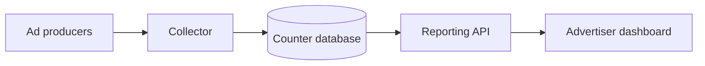
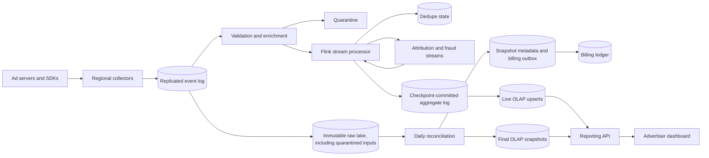
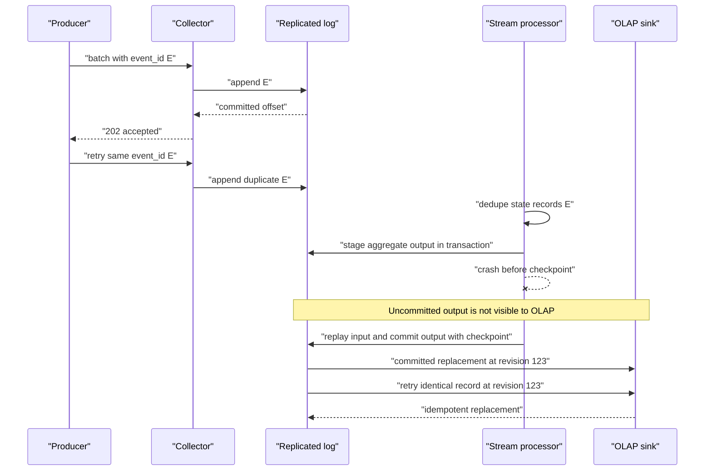
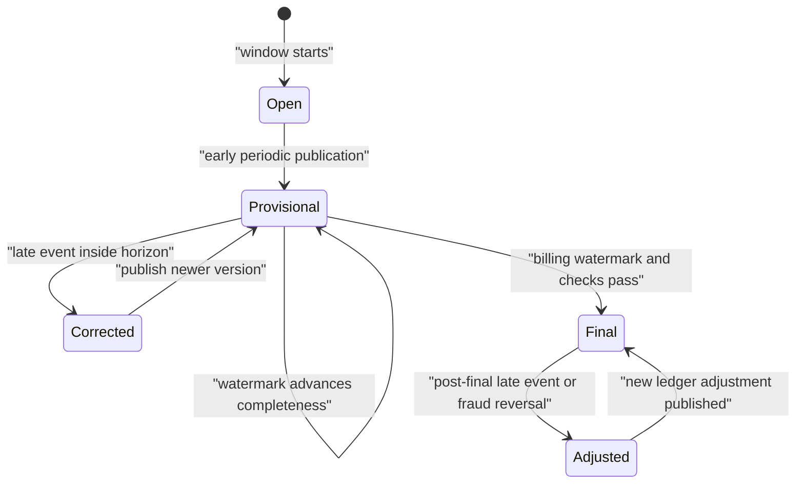
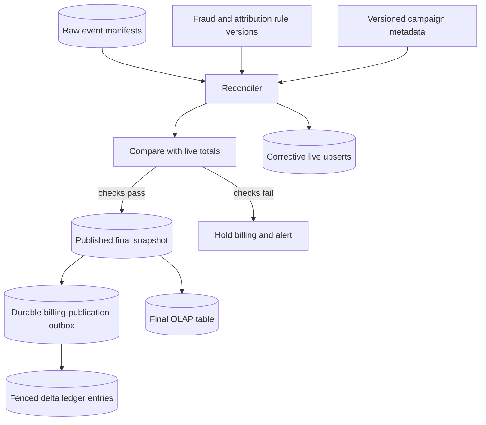

# Ad Click Aggregator System Design

This system ingests impressions, clicks, conversions, and adjustments from ad-serving systems, turns them into near-real-time advertiser dashboards, and later publishes billing-grade totals. Auction ranking, ad serving, budget enforcement, and identity graph construction are out of scope except where their events or constraints shape reporting correctness.

## 1. Requirements
### 1.1 Functional requirements
- Accept high-volume impression, click, conversion, invalid-traffic, and adjustment events from trusted producers.
- Deduplicate producer retries and downstream replays so billable clicks are counted exactly once in finalized reports.
- Serve live reports by advertiser, campaign, creative, publisher, geography, device, and time bucket with explicit freshness.
- Finalize daily aggregates and generate idempotent billing ledger entries with auditable corrections.
- Support conversion attribution under versioned attribution windows and models.
- Preserve raw evidence so fraud rules, attribution logic, and aggregation code can be replayed.

### 1.2 Non-functional requirements
- **Financial correctness.** A duplicate click is not a harmless analytics error; it can become an overcharge, so final totals must be reproducible from immutable inputs.
- **Freshness.** Advertisers need dashboards within roughly a minute to detect campaign issues, but live numbers may be provisional when late events or fraud review arrive.
- **Durability.** Once the collector acknowledges an event, the system must retain enough evidence to replay it through new code and recover from processor failure.
- **High write throughput.** The write path must handle million-event-per-second bursts without putting OLAP query latency or batch finalization on the critical ingest path.
- **Tenant isolation.** A hot advertiser or publisher should not starve other tenants, and reports must enforce authorization at every served aggregate.
- **Auditability.** Corrections need versions, reason codes, and immutable ledger entries rather than invisible overwrites.

### 1.3 The binding constraint

The hard part is not counting clicks quickly; it is counting billable clicks exactly once while the same event can be retried by a producer, replayed by a stream processor, arrive late, be joined to a delayed conversion, and later be reclassified as fraudulent. At the same time, advertisers will not wait three days for dashboards. This creates two products over the same evidence: a low-latency estimate and a finalized, money-moving answer.

That tension forces the architecture. We need a durable append-only event log before acknowledgement, stable event identifiers, deduplication state in both stream and batch paths, checkpoint-aligned transactional or idempotent sinks, event-time windows with watermarks, versioned aggregate upserts for corrections, and a reconciliation path that publishes immutable billing snapshots.

## 2. Back-of-the-envelope estimation

Assume illustratively that the platform receives 10 billion impressions, 500 million clicks, and 100 million conversions per day. That is `10.6B / 86,400 ≈ 122,685` events per second on average. Ad traffic is bursty around regional business hours and campaign launches; using an 8x peak factor gives about `981,480`, so the ingest design should be comfortable at roughly 1 million events per second.

If each canonical event is about 500 bytes after schema normalization, average raw ingress is `122,685 × 500 ≈ 61,342,500` bytes per second, about 61 MB/s before log replication. Peak ingress is about `1,000,000 × 500 = 500 MB/s`. With three log replicas, the broker fleet writes about 1.5 GB/s at peak. That number rules out doing synchronous OLAP writes, fraud scoring, or attribution joins before acknowledgement. The collector can validate and append, but everything else must be downstream replayable work.

Daily raw storage is `10.6B × 500 = 5.3 TB` before compression, indexes, and replication. A 13-month retention window is roughly `5.3 TB × 395 = 2,093.5 TB`, about 2.1 PB uncompressed. Compression may reduce this substantially, but the design consequence remains: raw events belong in cheap immutable object storage with manifests, not in the serving database.

For aggregation, suppose reports commonly group by advertiser, campaign, creative, country, device, publisher, and minute. Even if only 10 million campaigns and 100 million creatives are active over the retention horizon, the cross product with geography, device, and publisher is too large to precompute as a full cube. We pre-aggregate common rollups and store columnar base aggregates, then let OLAP combine dimensions at query time.

> **Key idea.** The event rate says acknowledgement must stop at durable log append; the storage and cardinality numbers say raw evidence and serving aggregates must be separate systems.

## 3. API design
**Question.** What makes a producer retry safe when a click can become a billable charge?
<details><summary>Answer</summary>

The producer allocates monotonically increasing `producer_sequence` values to new events and retries each event with the same sequence and stable `event_id`. The server acknowledges only durable log append, not downstream counting. Every later sink uses transactions or stable idempotency keys.

</details>

```http
POST /v1/events:batch
Idempotency-Key: producer_id:batch_uuid
Content-Encoding: gzip

{
  "producer_id": "adserver-us-7",
  "schema_version": 4,
  "events": [
    {"event_id":"01J...","producer_sequence":8127331,"type":"CLICK","event_time":"2026-10-13T19:15:22.123Z","click_id":"clk_...","campaign_id":"cmp_42","creative_id":"cr_7","cost_micros":25000,"currency":"USD"}
  ]
}

HTTP/1.1 202 Accepted
{"accepted":999,"rejected":1,"committed_sequence":8127331,"data_fresh_after":"2026-10-13T19:16:00Z"}

GET /v1/events/ingest-status?producer_id=adserver-us-7&after_sequence=8127000
GET /v1/reports?advertiser_id=42&from=2026-10-13T00:00:00Z&to=2026-10-14T00:00:00Z&group_by=campaign,country&mode=live
GET /v1/reports?advertiser_id=42&date=2026-10-12&mode=final&snapshot=latest
POST /v1/report-exports
GET /v1/report-exports/{export_id}
POST /v1/adjustments
```

The ingest endpoint returns `202` because it has accepted responsibility for the event, not because reports already include it. The response includes rejected records with reason codes for malformed payloads, while accepted records are only those durably appended to the replicated log. `committed_sequence` is the contiguous prefix with durable per-event outcomes, including explicit terminal rejections, not the highest sequence seen across a batch with holes. The status API returns those outcomes so recovery neither skips unaccepted events nor retries a rejected record forever. Reusing an event ID with a different payload is a conflict, not a second event.

Report APIs expose `mode=live` versus `mode=final` because a single unnamed number would be misleading. Live responses include observed `data_fresh_through`, `watermark`, `is_final=false`, timezone, currency, and metric definitions; `snapshot_version` appears only when a retained immutable report snapshot actually exists. The ingest response's `data_fresh_after` is an estimate, not a future visibility guarantee. Final responses bind to a published snapshot so pagination and exports do not mix reconciliation runs. Adjustments create new ledger and aggregate versions rather than patching old invoices.

## 4. Data model

Start with the obvious entity, a `Click` row keyed by `click_id`. That works until the producer times out and retries the same batch. If the database insert is not globally coordinated with aggregation, the same click can be counted twice. So the first-class entity is a canonical `AdEvent` with a stable `event_id`, producer identity, producer sequence, event time, receive time, and enough campaign metadata references to replay enrichment.

A raw event still cannot answer dashboards efficiently. We need `AggregateBucket` rows keyed by a reporting window and selected dimensions. But a mutable counter such as `clicks = clicks + 1` fails under replay: the same changelog record can be applied again after an OLAP timeout. The aggregate therefore has a deterministic primary key, a version, and either replacement semantics or idempotent delta identifiers.

Attribution adds another failure. A conversion may arrive before the click replica or after a late click, and fraud review may later invalidate the original touch. We represent `AttributionDecision` as an immutable decision with a model version and optional reversal link. Aggregates consume decision deltas, not hidden mutations.

Billing adds the final guardrail. The invoice cannot be whatever the live dashboard currently says. `BillingLedgerEntry` is append-only and idempotent by `(source_batch_id, ledger_line_id)`, where the source identifies the stable approved snapshot transition, not a job execution UUID. Charges, credits, and adjustments are separate entries.

```text
AdEvent
- event_id: globally stable UUID or ULID from producer
- producer_id, producer_sequence, batch_id
- type: IMPRESSION | CLICK | CONVERSION | INVALID_TRAFFIC | ADJUSTMENT
- event_time, received_time, collector_region
- advertiser_id, campaign_id, ad_group_id, creative_id, publisher_id, placement_id
- country, device_type, user_token, impression_id, click_id
- cost_micros, currency, consent_state, schema_version
- validation_status, quarantine_reason

DedupeRecord
- event_id, first_seen_time, first_log_partition, first_log_offset
- expiry_time, event_fingerprint

AggregateBucket
- aggregate_key: window_start, window_size, advertiser_id, currency, dimensions_hash, dimensions
- metrics: impressions, clicks, conversions, spend_micros, invalid_events
- watermark, version, finalization_state: LIVE | CORRECTED | FINAL
- source_manifest_id or changelog_id

AttributionDecision
- decision_id, conversion_event_id, touch_event_id
- advertiser_id, model_version, attribution_window
- value_micros, created_at, reversed_by_decision_id

PublishedSnapshot
- snapshot_id, service_date, created_at, input_manifest_id
- publication_revision, predecessor_snapshot_id
- aggregate_manifest_id, rule_versions, completeness_checks

BillingLedgerEntry
- ledger_entry_id, source_batch_id, ledger_line_id, from_snapshot_id, to_snapshot_id
- advertiser_id, service_date, amount_micros, currency
- entry_type: CHARGE | CREDIT | ADJUSTMENT, reason_code
```

The replicated event log stores the ingest stream, partitioned by a stable key such as advertiser or campaign when locality matters. Immutable raw events live in object storage partitioned by event date and receive date, with manifests and checksums. Dedupe state lives in the stream processor's keyed state store for fast retries and is rebuilt from raw events for finalization. Live and final aggregates live in a real-time OLAP store such as Pinot because high-cardinality slice-and-dice reports need columnar indexes, not a generic row store. The billing ledger lives in a transactional database or ledger service; raw events and OLAP rows deliberately do not become the source of financial truth.

> **Key idea.** The model separates evidence, provisional materializations, attribution decisions, published snapshots, and money-moving ledger entries so each can have the right consistency contract.

## 5. High-level design

The simplest design is tempting: collectors validate events, increment counters in a database, and dashboards query those counters.



It breaks in four concrete ways. If the collector increments the counter and the producer times out, a retry can increment the counter again. If the database write succeeds but the process crashes before recording which event was processed, replay double-counts. If a click arrives hours late, the already displayed day total changes without an audit trail. If fraud rules later invalidate a publisher's traffic, the system has no raw evidence or versioned correction path to explain the billing change.

### Fix 1: Durable log before acknowledgement

Collectors perform cheap authentication, schema validation, timestamp bounds, and quota checks, then append accepted events to a quorum-replicated Kafka-like log. They acknowledge only after the log commit. This turns downstream processors into replayable consumers instead of participants in the request's transaction. Google Ubiq's lesson for ad log processing is relevant here: infrastructure or datacenter degradation should not require manual babysitting before events are durably captured. Regional collectors can accept locally, replicate, and let home-region processors catch up.

### Fix 2: Stream processing with checkpoints and idempotent sinks

A Flink-like stream processor reads the log, keeps keyed dedupe state by `event_id`, aggregates by event-time window, and checkpoints source offsets and state together. Where the output is another log, checkpoint-aligned two-phase commit gives exactly-once log-to-log semantics. Where the output is Pinot, a key-value store, or a ledger staging table, the sink still needs idempotent upserts keyed by aggregate key and version. Uber's ads pipeline illustrates this boundary: Flink and Kafka transactions help, but record UUIDs, Hive dedupe, and Pinot upserts still matter for end-to-end correctness.

### Fix 3: Event-time windows with versioned corrections

Processing-time counters answer "when did we receive the event?" rather than "when did the click happen?" Reports need event time. The streaming path maintains watermarks and emits live windows, then emits correction upserts when late events arrive inside the correction horizon. Google's Mesa provides the serving pattern: publish versioned update batches and query stable snapshots rather than mutable partial tables whose answers differ across replicas.

### Fix 4: Batch reconciliation and billing snapshots

The daily batch path reads immutable raw events, exact-deduplicates event IDs, reapplies versioned enrichment, fraud rules, and attribution, compares the result with live aggregates, and publishes a snapshot manifest only after completeness checks pass. Billing entries are generated from that snapshot with idempotent ledger keys. X/Twitter's interaction aggregation experience is a useful warning: comparing raw, deduped, live, and batch-derived counts catches late-event and duplicate discrepancies that neither path should be trusted to detect alone.

### Fix 5: Specialized OLAP serving, not counters in the transactional store

Dashboards need low-latency grouping over high-cardinality dimensions. A transactional ledger or metadata database is the wrong serving tier. LinkedIn built Pinot for exactly this class of real-time analytics, including ads reporting, because columnar storage and indexes are what make high-scale slice-and-dice queries viable. The reporting API queries live Pinot tables for provisional data and finalized Pinot tables or snapshots for billing-period reports.

### Putting it together



A click travels from producer to regional collector and is appended to the replicated log. An independent archiver preserves the accepted input before downstream enrichment or quarantine can filter it; log segments cannot expire before their archive offsets and checksummed manifests are durable. The stream processor enriches with versioned metadata, deduplicates by `event_id`, updates event-time aggregate buckets, performs attribution joins when needed, and writes versioned upserts to the live OLAP table. Later, the daily batch reads the raw manifest, exact-deduplicates, applies fraud and attribution rules deterministically, publishes a final snapshot, and emits idempotent ledger entries. The same `AdEvent`, `AggregateBucket`, `PublishedSnapshot`, and `BillingLedgerEntry` entities appear at different points with different consistency guarantees.

> **Key idea.** Each component traces back to a specific failure of the naive design.

## 6. Deep dives
### 6.1 Exactly-once aggregation across retries, replay, and sinks
**Question.** The collector accepts a click, the producer times out, retries the same batch, and a stream worker later crashes after writing an aggregate update. Why is the click still billed once?
<details><summary>Answer</summary>

The producer retries with the same `event_id`; the stream processor deduplicates that ID in checkpointed keyed state; source offsets and dedupe state are restored together; and every emitted aggregate or ledger staging record uses a deterministic idempotency key or transactional commit tied to the checkpoint.

</details>

"Exactly once" is a dangerous phrase because it often hides the boundary. Kafka can deliver records at least once to a processor. Flink can checkpoint source offsets and state atomically. A transactional Kafka sink can commit output records only when a checkpoint completes. But an OLAP database, object store, or billing ledger does not automatically participate in that same transaction. Production-grade design names the boundary and closes the gaps with idempotency.

The producer is the first line of defense. It creates a stable `event_id` when the click happens, not when a network request is attempted. If a batch times out, the retry carries the same IDs and producer sequence numbers. The collector may also enforce an ingest-level idempotency key for the batch, but batch idempotency is not enough because a partially accepted batch may contain 999 good events and 1 rejected record. Event-level identity is the durable contract.

The stream processor partitions by a key that keeps duplicates together, usually a hash of `event_id` or an aggregation owner with deterministic routing for dedupe. It stores a `DedupeRecord` keyed by `event_id` with a TTL longer than the normal retry and replay horizon. On first observation, it records the ID and emits downstream changes. On duplicate observation, it suppresses metric changes but may update diagnostic counters. The dedupe store is part of checkpointed state, so a crash restores both "I have processed event X" and "I have consumed through offset N" to a consistent point.

A subtle failure occurs when a processor writes directly to OLAP and crashes before its checkpoint completes. A retry can double-apply an increment; even replacement upserts are unsafe if replay assigns the same version to a different partial bucket after a different input interleaving. This design therefore publishes aggregate updates to a checkpoint-transactional output log first, and OLAP consumes only committed records. One fenced owner serializes each full aggregate key, including currency, onto one output partition. Its committed offset supplies the monotonic revision within that partition; repartitioning requires an explicit new generation and handoff. Replaying a committed record preserves both revision and payload. A checkpoint number alone does not uniquely identify multiple outputs, and one input can produce several attribution or correction deltas.

For Pinot, partition the input by the full primary key and configure the revision comparison column explicitly; event time cannot order corrections to the same event-time bucket. Equal key/revision pairs must have identical payloads because equal-comparison conflicts are not deterministically resolved by upsert. Stream and batch writers must not race independent counters: a batch correction enters the same owner as a new base at a declared input cutoff. The owner pauses publication, rebuilds from that base, and replays all post-cutoff contributions, including those already processed, before publishing a newer revision. Merely overwriting the running total with the batch total would lose those contributions. Deleted dimension groups need zero replacements or tombstones. Final tables instead use immutable snapshot namespaces. These are proposed publication protocols, not guarantees supplied by Pinot or a claim that Uber implements this exact design.

Uber's real-time ads processing lesson fits exactly here. Flink plus Kafka transactions gave them a strong checkpoint-aligned pipeline, but they still used record UUIDs for downstream idempotency, deduplicated in Hive, and relied on Pinot upserts for analytical rows. That is the right claim for this design: exactly once within the stream framework where supported, effectively once for live serving through idempotent upserts, and billing-grade exactness after batch dedupe and reconciliation.



The main trade-off is state size. Keeping every event ID forever is impossible at 10.6 billion events per day. The stream dedupe TTL should cover producer retries, regional failover duplication, and common replay windows; the batch path performs exact dedupe for finalization from raw manifests. If an event resurfaces after the stream TTL, the live table may temporarily overcount, but the final snapshot corrects it. For money, the final path is authoritative.

Signals worth watching: duplicate rate by producer, dedupe-state eviction age, checkpoint duration, sink upsert conflicts, replay volume after failures, and live-versus-final variance by advertiser.

> **Strong-answer criteria.** A senior answer does not say "Kafka is exactly once" and stop. It identifies the producer ID contract, checkpoint boundary, sink idempotency key, dedupe TTL, and batch reconciliation path.

| Level | Approach | Why |
|---|---|---|
| Bad | Increment counters when events arrive. | Retries and replay create extra billable clicks. |
| Good | Use Kafka and Flink checkpoints with event ID dedupe. | Correct for processor replay, but external sinks can still double-apply writes. |
| Great | Combine stable event IDs, checkpointed dedupe, transactional log outputs, idempotent OLAP and ledger sinks, and batch exact dedupe. | Names every boundary where duplicates can enter and makes each boundary replay-safe. |

### 6.2 Event time, watermarks, late events, and versioned corrections
**Question.** A mobile SDK buffers clicks offline and sends them eight hours late, after the advertiser has already viewed hourly campaign performance. Should the system drop them, rewrite history, or bill them?
<details><summary>Answer</summary>

The live window should accept them if they fall within the correction horizon, emit a new aggregate version, and mark the report as corrected. Billing waits for a longer finalization watermark; arrivals after finalization become explicit adjustments rather than silent rewrites.

</details>

Processing time is easy to operate but wrong for advertising reports. If a click happened at 09:05 in New York and arrived at 17:05 because a device was offline, an advertiser expects it in the 09:00 hour, not as a mysterious evening spike. Event time is therefore the reporting time axis. The system tracks `event_time` from the producer, bounds it against trusted `received_time` to reject impossible values, and computes windows such as minute, hour, and day from event time.

Watermarks make this practical. A stream partition tracks the largest credible event time it has seen and subtracts an out-of-order allowance, for example `watermark = max_observed_event_time - 30 minutes`. A downstream operator takes the minimum across active input partitions, with explicit idle-partition handling. When the watermark passes 10:00, the 09:59 minute is mostly complete. To meet the roughly one-minute dashboard target, processing-time triggers publish provisional results before that watermark; waiting for it alone would delay dashboards by 30 minutes. Allowed lateness/state retention after window closure is a separate setting and must cover the eight-hour correction example, or late inputs must use a durable correction job. A watermark is not proof that no earlier event exists.

For dashboards, the right behavior is correction rather than mutation without explanation. Suppose the 09:00 hour originally showed 10,000 clicks with `version=41`. An eight-hour-late batch contributes 17 valid clicks. The stream writes a newer revision, illustratively `version=42`, for the same aggregate key with 10,017 clicks and updates `watermark` and `correction_reason=LATE_EVENT`. A live query gets the latest served version and can show a correction note. An export is stable only if it binds to a retained immutable report snapshot containing the old rows; a latest-value upsert table cannot reconstruct version 41 merely because an API names it. Live `snapshot_version` must identify such a materialization or be omitted in favor of freshness metadata.

For billing, finalization should use a longer watermark, often tied to business policy rather than stream mechanics. An illustrative rule might wait 72 hours after the advertiser's service day, then publish a final snapshot if raw manifests, dedupe counts, attribution state, fraud classifications, and checksum completeness all pass. A click arriving after that does not silently alter an issued invoice. It creates a later adjustment with a reason code and a reference to the final snapshot it amends.

Google Photon's lesson is especially important for attribution. Conversion joins are not simple cache lookups against perfectly ordered clicks. Clicks and conversions are unordered delayed streams, and the system needs persistent join state across the attribution window. Photon aimed for near-exact real-time joins with eventual exactly-once results. In this design, that means touch records remain durable for the full attribution window, decisions are versioned, and late clicks or conversions can create reversals and replacements until the relevant finalization boundary closes.

Google Mesa provides the serving discipline. If geo-replicated analytical tables are updated in place, two datacenters can answer the same report with different mixtures of old and new rows. Versioned update batches and manifests solve that. A query binds to a snapshot version; a publisher process atomically advances the manifest when all shards contain the correction. That is how live corrections and final snapshots stay repeatable.



The cost is operational complexity. Longer retained correction horizons improve completeness but increase state size; they need not delay early provisional dashboard updates. Use different publication/finalization policies for health dashboards, advertiser reporting, and billing. Store event instants in UTC, but derive advertiser service-day boundaries using the configured named timezone before aggregation; a local day can span 23 or 25 hours. Rendering a UTC daily total in another timezone does not make it the correct advertiser-day total. Preserve timezone and rule versions in the billing snapshot.

Signals worth watching: watermark lag by partition, late-event distribution by producer, correction volume by age, state size for attribution joins, and the percentage of billed days later adjusted.

> **Strong-answer criteria.** A strong answer separates event time from processing time, explains watermarks as a freshness/completeness trade-off, and uses versioned corrections rather than pretending late events do not exist.

| Level | Approach | Why |
|---|---|---|
| Bad | Count events in the hour they arrive. | Offline clients and delayed pipelines distort campaign performance. |
| Good | Use event-time windows with an allowed-lateness setting. | Produces better windows, but still needs correction and billing semantics. |
| Great | Use event-time windows, product-specific watermarks, versioned aggregate upserts, snapshot-bound reads, and explicit post-finalization adjustments. | Gives dashboards freshness without sacrificing auditability or repeatable billing. |

### 6.3 Real-time dashboards, fraud filtering, and batch reconciliation
**Question.** Fraud rules invalidate 2% of yesterday's clicks from a publisher after advertisers already watched live dashboards and one invoice batch is about to run. Where is truth computed?
<details><summary>Answer</summary>

Truth is computed from immutable raw events during reconciliation using versioned fraud and attribution rules. Live dashboards receive corrective upserts, and invoices are generated only from the published final snapshot; already issued invoices receive ledger credits or adjustments.

</details>

Fraud filtering is the place where an analytics system becomes a financial control system. A naive live-only design either bills suspicious clicks immediately or blocks every click on synchronous fraud scoring. Both are bad. Synchronous fraud checks add latency and create availability coupling between ingest and a complex model. Blindly billing live clicks creates financial risk and makes later invalid-traffic decisions look like arbitrary number changes.

The ingest path should classify only what is cheap and deterministic: malformed IDs, unauthorized producers, impossible timestamps, known revoked publishers, and consent violations. More expensive invalid-traffic detection runs downstream. Some rules are streaming-friendly, such as duplicate click bursts from the same user token or impossible click-through rates for a placement. Others require batch context, historical baselines, or model retraining. Therefore each event or aggregate can carry a fraud status such as `VALID`, `PENDING_REVIEW`, `INVALID`, or `REVERSED`, with a rule version and evidence pointer.

Live dashboards should be useful but honest. They can show estimated valid clicks and spend with `is_final=false`, a freshness timestamp, and sometimes a pending-invalid-traffic amount. When a rule invalidates yesterday's traffic, the stream or reconciliation publisher writes negative deltas or replacement aggregate versions to the live OLAP table. This is not a ledger correction yet; it is a reporting correction. The advertiser can see that yesterday changed because rule version 87 classified a publisher segment as invalid.

Batch reconciliation is where the platform decides what money moves. The reconciler reads raw event manifests for a service day, verifies completeness, exact-deduplicates event IDs, joins versioned campaign metadata, runs the selected fraud and attribution rule versions, and writes deterministic aggregate outputs under a `batch_id`. It compares those outputs with live aggregates by advertiser, campaign, day, and currency. Differences are expected for late events and fraud updates, but unexplained differences beyond tolerance block publication. After checks pass and final serving artifacts are ready, the metadata authority atomically advances the snapshot manifest and records a billing-publication outbox item; it does not pretend the OLAP store and ledger share a transaction.

Billing consumes that item in a ledger transaction. For each `(advertiser, service_day, currency)`, it conditionally advances an `applied_snapshot_id` and inserts only `new_total - previously_applied_total`, with a unique transition/line ID. Published snapshots have a monotonic revision; an incoming revision at or below the applied revision is a no-op, never a rollback. A competing newer revision recomputes against the actually applied predecessor. For example, revising a $100 total to $98 inserts a $2 credit, not a fresh $98 charge; replay inserts nothing. A new job UUID is not a new financial intent. The outbox closes the crash gap between publication and ledger application, and the applied-snapshot fence prevents two different correction jobs from issuing the same credit twice.

Pinterest's ads architecture reinforces a boundary that is easy to miss: reporting aggregates should not be the budget-enforcement mechanism. Pacing and bidding need their own hot path because dashboards lag, correct, and reconcile. This design uses reporting for advertiser visibility and billing evidence; ad serving uses separate strongly consistent or highly available counters to decide whether to spend the next impression.

The OLAP tier also deserves specificity. A row-store counter table looks simple until a user asks for campaign by creative by country by device over 90 days with filters and sorting. LinkedIn Pinot was built for low-latency, high-cardinality analytics with real-time ingestion; Uber and many ad systems use similar serving stores for live ads reporting. Pinot-style primary-key upserts make corrected aggregate versions queryable quickly. The raw lake and final snapshots remain the source of truth; OLAP is a serving materialization.



The lambda-versus-kappa choice is a trade-off. A pure kappa design reprocesses the same stream code from the log for both live and final outputs, reducing code divergence. A lambda design has a streaming path for freshness and a batch path for deterministic recomputation, increasing duplicated logic but making audits and backfills easier. For billed clicks, a pragmatic hybrid is best: share validation, enrichment, attribution, and fraud libraries across streaming and batch; accept that finalization runs as a batch job over immutable manifests because auditors and finance teams need repeatable inputs and outputs.

Signals worth watching: pending fraud volume, invalid-traffic reversal rate, live-versus-final deltas, reconciliation blocked days, ledger idempotency conflicts, OLAP upsert lag, and query latency for high-cardinality advertisers.

> **Strong-answer criteria.** The answer should separate live estimates from billing truth, keep fraud decisions versioned and auditable, and explain why OLAP serving is not the source of financial truth.

| Level | Approach | Why |
|---|---|---|
| Bad | Run fraud inline before accepting clicks. | Couples ingest availability to complex models and still cannot use future context. |
| Good | Mark suspicious traffic and reconcile daily. | Captures the main idea, but needs versioned rules, diffs, and ledger semantics. |
| Great | Use cheap ingest validation, streaming provisional fraud signals, deterministic batch reconciliation, versioned OLAP corrections, and append-only ledger adjustments. | Preserves freshness while making billing explainable and repeatable. |

## 7. Variants

**10x scale.** At roughly 10 million peak events per second, the basic shape remains: durable log, stream aggregation, raw lake, OLAP, reconciliation. The changes are mostly partitioning and isolation. Large advertisers get salted subpartitions and second-stage merges, brokers are split by tenant class or region, and aggregate keys are carefully chosen to avoid one campaign owning a single hot shard. The raw lake needs manifest compaction so batch jobs list thousands of files, not millions.

**Multi-region active-active ingestion.** Producers send to the nearest healthy collector, and event IDs remain globally stable across regions. Regional logs replicate to an advertiser home region for processing. If failover starts a second processor, it must acquire a fenced epoch so two owners cannot publish competing aggregate versions. Ubiq's operational lesson applies: failover should be automatic, but duplicate delivery across regions is assumed and suppressed by event ID and sink idempotency.

**Strict regulatory residency.** Some advertisers or users may require events to remain in a region. The raw lake, dedupe state, and OLAP shards then become region-scoped, while the reporting API federates authorized aggregates. Cross-region dashboards query aggregate snapshots, not raw user-level events. The billing ledger can still be global if it stores only advertiser-level charges and residency-compliant evidence references.

**A major fraud backfill.** If a new rule invalidates a month of traffic, do not issue ad hoc SQL updates against serving tables. Run a reprocessing job over immutable raw manifests with the new rule version, publish new final snapshots or adjustment snapshots, and create ledger credits linked to the affected invoice batches. Live OLAP can be patched quickly, but money moves only through ledger entries.

## 8. The transferable pattern

This is the common pattern for systems that must be fast now and exact later. The write path captures immutable evidence, the streaming path creates provisional materializations, and the reconciliation path publishes a versioned truth used for money, compliance, or user-visible history. Payment ledgers, ride billing, marketplace commissions, and usage-based SaaS metering all have the same shape: never let a low-latency counter be the only record of value transfer.

The sibling pattern is visible in systems such as [Ticketmaster](./ticketmaster-system-design.md), where a fast reservation experience must still prevent double-selling scarce seats. The mechanisms differ, but the reasoning is similar: name the invariant that matters, identify where retries and races break a naive design, then introduce idempotency keys, versioned state, leases or fences, and auditable finalization only where they protect that invariant.

## Review

The design starts from the binding constraint that clicks are both analytics events and billable money. A collector therefore acknowledges only durable log append, not aggregation. Stream processors use stable event IDs, checkpointed dedupe, event-time windows, watermarks, and idempotent OLAP upserts to provide near-real-time dashboards. Because live numbers can drift from late events, attribution joins, and fraud review, immutable raw manifests feed a deterministic reconciliation job that exact-deduplicates, applies versioned rules, publishes final snapshots, and creates append-only billing ledger entries. Pinot-like OLAP serves fast reports, but raw evidence and ledger snapshots remain the source of truth.

### Check your understanding
1. Why is a stable event ID stronger than a batch-level idempotency key?
   <details><summary>Answer</summary>

   A batch can partially succeed or be split during retry. Event-level identity lets every downstream processor and sink suppress duplicates for the individual click that may become billable.

   </details>
2. Why does the collector return success before fraud scoring and aggregation finish?
   <details><summary>Answer</summary>

   At peak ingest, coupling acknowledgement to slow downstream work would reduce availability and create ambiguous retries. Durable log append is the handoff point; later work is replayable.

   </details>
3. Why are watermarks not enough for billing correctness?
   <details><summary>Answer</summary>

   A watermark is a freshness policy, not proof that no older event exists. Billing also needs raw completeness checks, exact dedupe, versioned fraud and attribution rules, and immutable snapshot publication.

   </details>
4. Why should OLAP upserts use versions or deterministic changelog IDs?
   <details><summary>Answer</summary>

   A stream processor may replay after a crash or timeout. Replacement by version or idempotent changelog keys prevents the same aggregate update from being applied twice.

   </details>
5. Why not use the live reporting aggregate for budget enforcement?
   <details><summary>Answer</summary>

   Reporting aggregates lag, correct late events, and may wait for fraud decisions. Budget enforcement affects the next ad decision and needs a separate pacing path with its own consistency and availability contract.

   </details>

## Sources and further reading
| Source | Article | Why it matters |
|---|---|---|
| Uber | [Real-Time Exactly-Once Ad Event Processing with Apache Flink, Kafka, and Pinot](https://www.uber.com/us/en/blog/real-time-exactly-once-ad-event-processing/) | Shows Flink/Kafka transactions, record UUID idempotency, Hive dedupe, and Pinot upserts for ads events. |
| Google | [Ubiq: A Scalable and Fault-tolerant Log Processing Infrastructure](https://research.google/pubs/ubiq-a-scalable-and-fault-tolerant-log-processing-infrastructure/) | Describes geo-distributed exactly-once log processing used by Google advertising pipelines. |
| Google | [Photon: Fault-tolerant and Scalable Joining of Continuous Data Streams](https://research.google/pubs/photon-fault-tolerant-and-scalable-joining-of-continuous-data-streams/) | Explains low-latency, delayed-stream joins for ad clicks/search queries with eventual exactly-once output. |
| Google | [Mesa: Geo-Replicated, Near Real-Time, Scalable Data Warehousing](https://research.google/pubs/mesa-geo-replicated-near-real-time-scalable-data-warehousing/) | Covers versioned, geo-replicated ad measurement tables with consistent repeatable query answers. |
| Pinterest | [Ensuring High Availability of Ads Realtime Streaming Services](https://medium.com/pinterest-engineering/ensuring-high-availability-of-ads-realtime-streaming-services-ea3889420490) | Shows hot-hot budget/pacing/bidding streams, health metrics, and automatic switchover for ads spend control. |
| X/Twitter | [Processing billions of events in real time at Twitter](https://blog.x.com/engineering/en_us/topics/infrastructure/2021/processing-billions-of-events-in-real-time-at-twitter-) | Demonstrates UUID dedupe, late-event handling, Bigtable serving, and validation against batch counts at massive scale. |
| LinkedIn | [Real-time Analytics at Massive Scale with Pinot](https://engineering.linkedin.com/analytics/real-time-analytics-massive-scale-pinot) | Explains why ads reporting needs a dedicated real-time columnar OLAP system with specialized indexes. |
| Apache Pinot | [Stream Ingestion with Upsert](https://docs.pinot.apache.org/build-with-pinot/ingestion/upsert-dedup/upsert) | Specifies primary-key partitioning, comparison-value ordering, and equal-version conflict limitations. |
