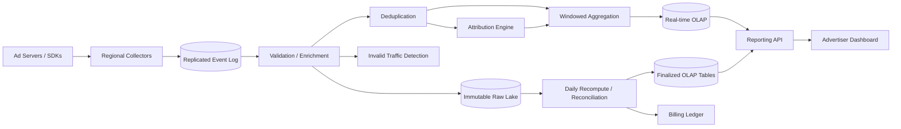

# Ad Click Aggregation and Reporting System

## 1. Requirements

### Functional requirements

1. Ingest ad impressions, clicks, conversions, and billing adjustments.
2. Produce near-real-time counters by advertiser, campaign, creative, geography, and device.
3. Provide finalized historical reports and downloadable exports.
4. Deduplicate retries and reject malformed or unauthorized events.
5. Attribute conversions to eligible clicks under configurable windows.
6. Detect invalid traffic and preserve raw evidence for reprocessing.
7. Separate estimated live metrics from billing-grade finalized totals.

### Non-functional requirements

- Very high write throughput and burst tolerance.
- Live dashboards within one minute.
- Financially correct, reproducible daily totals.
- No acknowledged event loss; bounded double counting.
- Multi-tenant isolation, privacy controls, and auditable adjustments.

Ad serving itself and auction ranking are out of scope.

## 2. Scale assumptions

- 10 billion impressions/day and 500 million clicks/day.
- 100 million conversions/day.
- Peak ingest: 1 million events/second.
- Average encoded event: 500 bytes; about 500 MB/second before replication.
- 10 million campaigns, 100 million creatives, 1 million advertisers.
- Interactive reports cover 90 days; raw events retained 13 months.
- Cardinality can exceed trillions of dimension combinations, so arbitrary pre-aggregation is impossible.

The hot path favors availability and durable capture. Billing correctness is achieved through deduplication, watermarks, reconciliation, and immutable recomputation rather than trusting one streaming counter.

## 3. High-level architecture



Raw immutable events are the source of truth. Live OLAP views are replaceable materializations; the billing ledger is append-only and finalized from reconciled data.

## 4. Event and data model

```text
AdEvent
- event_id, event_type: IMPRESSION | CLICK | CONVERSION
- event_time, received_time, producer_id, producer_sequence
- advertiser_id, campaign_id, ad_group_id, creative_id
- placement_id, publisher_id, country, device_type
- user_token, click_id, impression_id
- cost_micros, currency, consent_state, schema_version

AggregateKey
- window_start, window_size
- advertiser_id, campaign_id, selected_dimensions
- impressions, clicks, conversions, spend_micros
- invalid_events, unique_estimate, version, finalization_state

Attribution
- conversion_id, touch_event_id, model, attributed_value
- decision_version, created_at, reversed_at

BillingEntry
- ledger_entry_id, advertiser_id, service_date
- amount_micros, currency, source_batch_id
- entry_type: CHARGE | CREDIT | ADJUSTMENT
```

Money is integer micros, never floating point. Dimension IDs are immutable references; slowly changing names live in versioned metadata.

## 5. Ingestion APIs

```http
POST /v1/events:batch
Content-Encoding: gzip

{"producer_id":"adserver-us-7","events":[{"event_id":"...","type":"CLICK","event_time":"..."}]}
```

Response acknowledges the highest durably committed producer sequence, not downstream aggregation:

```json
{"accepted":999,"rejected":1,"committed_sequence":8127331}
```

Reporting:

```http
GET /v1/reports?advertiser_id=42&from=...&to=...&group_by=campaign,country
POST /v1/report-exports
GET /v1/report-exports/{export_id}
```

Report responses declare `data_fresh_through`, `is_final`, timezone, currency, and metric definitions.

## 6. Ingestion and validation flow

1. Authenticate producer and enforce tenant/schema quotas.
2. Validate required IDs, timestamps, enums, consent, and numeric bounds.
3. Add trusted receive time, region, and collector identity.
4. Append to a quorum-replicated log.
5. Return success only after durable append.
6. Enrichment joins campaign metadata using an event-time-valid version.
7. Persist canonical events to partitioned immutable storage.
8. Deduplicate and route to aggregation, attribution, and fraud streams.

Invalid records go to a reason-coded quarantine, not a silent drop. Backpressure returns explicit overload responses before collectors accept data they cannot durably retain.

## 7. Deduplication and delivery semantics

Producers generate stable, globally unique `event_id` values and retry with the same ID. Stream processors use:

- Log offsets/checkpoints for replay position.
- A partition-local dedupe store keyed by `event_id` with TTL longer than the retry horizon.
- Idempotent or transactional writes from checkpoint to aggregate changelog.
- Batch-wide exact dedupe from immutable raw events for finalization.

The live path is effectively once for normal retries, not mathematically exactly once across every external boundary. Final reports correct drift by recomputation.

## 8. Event-time windowing

Partition the stream by a stable aggregation owner such as `advertiser_id`. Compute minute and hour tumbling windows from `event_time`, while tracking a watermark:

```text
watermark = max_observed_event_time - allowed_lateness
```

Events before the watermark update a closed-but-correctable window and increment a late-event revision. Live dashboards may accept events up to 24 hours late; daily billing waits longer, for example 72 hours, then handles later arrivals as explicit adjustments.

Use local advertiser timezones only at report/finalization boundaries. Store windows in UTC to avoid daylight-saving ambiguity.

## 9. Aggregation strategy

Pre-aggregate common dimensions at minute/hour/day granularity. Avoid a full data cube: its dimensional explosion is untenable. Store base event-derived rollups in columnar OLAP and let vectorized queries combine them.

For unique users, HyperLogLog gives mergeable estimates with bounded error. Financial metrics, clicks, and conversions use exact integer counters. Stream processors emit changelog upserts with monotonically increasing aggregate versions, so retries cannot apply an older count over a newer one.

## 10. Conversion attribution

1. A click stores a privacy-safe touch record keyed by `click_id` and optionally user token.
2. A conversion names `click_id` when available; otherwise query eligible touches within the campaign window.
3. Apply the versioned attribution model: last-click, first-click, or fractional.
4. Write an immutable attribution decision and corresponding aggregate deltas.
5. Fraud reclassification or model correction writes reversals and replacements, never mutates history invisibly.

Cross-device attribution requires consent and an identity service; without it, report conversions as unattributed rather than guessing.

## 11. Consistency and concurrency

- Raw log order is guaranteed only within a partition.
- Aggregate state has one active owner per partition epoch.
- Checkpoint and state updates are atomic within the stream framework.
- OLAP reads may lag; response freshness makes that visible.
- Campaign budget enforcement cannot depend on delayed analytics; ad serving uses a separate strongly consistent pacing counter.
- Billing entries are append-only and idempotent by `(source_batch_id, advertiser_id, service_date, entry_type)`.

Corrections use compensating deltas. Concurrent report queries select a consistent snapshot/version rather than mixing partially published partitions.

## 12. Partitioning and storage

- Event log: hash by advertiser or campaign to preserve local aggregation.
- Raw lake: partition by event date/hour and region; cluster by advertiser.
- Hot OLAP: shard by advertiser hash and time, replicate across zones.
- Large advertisers receive salted subpartitions with a second-stage merge.
- Metadata: strongly consistent relational/KV store with versioned snapshots.

Time partitioning enables retention and pruning, but partitioning only by time creates hot writes. Combine time with hash buckets.

## 13. Batch reconciliation and finalization

For each service day:

1. Read all raw partitions plus late-event manifests.
2. Validate checksums and exact-deduplicate event IDs.
3. Reapply versioned enrichment, invalid-traffic rules, and attribution.
4. Produce deterministic aggregates under a `batch_id`.
5. Compare live and batch totals; alert beyond tolerance.
6. Atomically publish a manifest pointing reports to the new snapshot.
7. Create idempotent billing ledger entries.

Reprocessing creates a new version and audit diff. It never overwrites the evidence used by an issued invoice.

## 14. Reliability and failures

| Failure | Handling |
|---|---|
| Collector loses downstream connection | Buffer within limit, then explicit retryable failure |
| Producer retries a batch | Stable event IDs and sequences deduplicate it |
| Stream worker crashes | Restore checkpoint/state and replay log |
| Event is very late | Correct live revision or create post-finalization adjustment |
| OLAP write partially succeeds | Versioned idempotent upsert and replay |
| Fraud service unavailable | Mark pending; never silently classify as valid |
| Hot advertiser overloads shard | Salt partitions and merge in second stage |
| Batch output incomplete | Do not publish manifest or bill |
| Region outage | Producers fail over; event IDs suppress duplicates |
| Schema is incompatible | Reject/quarantine by version with visible errors |

## 15. Multi-region design

Collectors accept traffic near producers and append to regional replicated logs. Events asynchronously replicate to a home processing region determined by advertiser. During failover, a new processor acquires a fenced epoch; duplicate cross-region delivery is harmless.

Raw storage is copied cross-region with manifests and checksums. Interactive reads use nearby replicas, while finalized reports and billing use the authoritative published snapshot. Regional ingestion clocks are not trusted for event order; both event and receive times are retained.

## 16. Security and privacy

- mTLS or signed service credentials for producers; OAuth/RBAC for advertisers.
- Encrypt transit and storage; isolate tenant encryption keys where required.
- Tokenize user identifiers at collection and restrict raw-event access.
- Enforce consent, purpose limitation, deletion, and regional residency.
- Prevent report inference with minimum group thresholds and export controls.
- Sign event batches and audit schema/rule/model changes.
- Rate-limit ingestion and reporting; detect replayed credentials.
- Keep financial ledger permissions separate from analytics administration.

## 17. Observability

Monitor accepted/rejected events, log durability latency, consumer lag, watermark lag, duplicate rate, late-event distribution, state-store size, OLAP publication lag, query latency, live-versus-final variance, attribution rate, invalid-traffic rate, batch completeness, and billing reconciliation.

Key SLOs:

- 99.9% of accepted events visible in live reporting within 60 seconds.
- 100% of published billing batches pass completeness and balance checks.
- No acknowledged-event loss within the retention and recovery model.

## 18. Major trade-offs

- **Streaming versus batch:** streaming is fresh; batch is deterministic. Use both.
- **Exactly once versus idempotency:** end-to-end exactly once is brittle; stable IDs plus replay and reconciliation are auditable.
- **Pre-aggregation versus flexible queries:** common rollups lower latency; columnar base rollups preserve exploration.
- **Low watermark delay versus completeness:** dashboards favor freshness; billing waits and supports adjustments.
- **Advertiser partitioning versus hot keys:** locality simplifies aggregation but requires salting exceptional tenants.

## 19. Recommended interview presentation

1. Clarify live reporting versus billing correctness.
2. Estimate peak event and storage rates.
3. Draw durable ingestion, streaming, OLAP, raw lake, and batch paths.
4. Deep-dive into event IDs, watermarks, and late events.
5. Explain aggregation cardinality and attribution.
6. Cover deterministic reconciliation and append-only billing.
7. Discuss hot partitions, region failover, privacy, and SLOs.
8. Finish with the streaming/batch trade-off.

The central design insight is:

> Acknowledge only durable raw events, make live aggregates replayable and explicitly provisional, then derive billing-grade totals through deterministic deduplication, reconciliation, and versioned publication.
