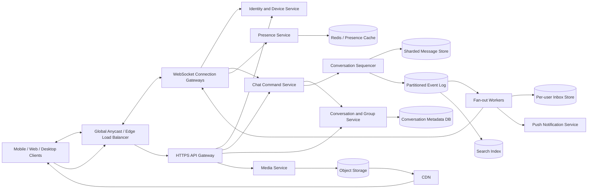

# Production-Scale Chat Application (WhatsApp / Messenger)

## 1. Requirements

### Functional requirements

1. Support one-to-one and group conversations.
2. Deliver text messages, reactions, replies, edits, deletes, and attachments.
3. Synchronize conversation history across a user's devices.
4. Show sent, delivered, and read receipts.
5. Expose online presence and typing indicators with privacy controls.
6. Support push notifications for offline users.
7. Preserve per-conversation message ordering.
8. Allow users to search conversations and messages.
9. Support group membership, roles, invitations, and removals.
10. Optionally support end-to-end encryption (E2EE), voice/video signaling, and disappearing messages.

### Non-functional requirements

- Low latency: target under 200 ms from send to delivery for online users in the same region.
- High availability: messaging should remain usable during a data-center failure.
- Durable accepted messages: once acknowledged, a message must not be silently lost.
- Massive persistent connections and bursty fan-out.
- Efficient mobile operation under intermittent connectivity and limited battery.
- At-least-once transport with exactly-once user-visible behavior through deduplication.
- Strong consistency for conversation membership and message acceptance; eventual consistency for presence, receipts, search, and unread counters.
- Abuse prevention, privacy, encryption in transit and at rest, and auditable administrative actions.

## 2. Scale assumptions and capacity

State assumptions explicitly and refine them with the interviewer:

- 2 billion registered users and 500 million daily active users.
- 100 million concurrent connections at peak.
- 50 messages sent per daily active user per day.
- 25 billion messages/day, approximately 290,000/second average and 1 million/second peak.
- Average text envelope: 1 KB after metadata and encryption; 25 TB/day before replication.
- 10% of messages include media, averaging 500 KB after client compression: roughly 1.25 PB/day of new media.
- Average one-to-one fan-out: 1 recipient with 2 active devices.
- Typical group: 10 members; maximum group: 10,000 members.
- Message history retention is product- and jurisdiction-dependent.

Persistent connection capacity is often the first bottleneck. At 100,000 sockets per tuned gateway, peak traffic needs roughly 1,000 gateway instances before headroom, maintenance capacity, and regional redundancy.

Media dominates storage and network cost. Text can live in replicated wide-column storage; encrypted attachments belong in object storage behind a CDN.

## 3. High-level architecture



The architecture separates:

- **Connection plane:** long-lived sockets, heartbeats, routing, and backpressure.
- **Conversation control plane:** membership, roles, permissions, and sequence allocation.
- **Message data plane:** durable message acceptance, event fan-out, inbox synchronization, and media transfer.

Gateways are stateful only for live connections. Durable routing and undelivered work must survive gateway replacement.

## 4. Data model

```text
User
- user_id
- status
- privacy_settings
- created_at

Device
- device_id
- user_id
- public_identity_key
- push_token
- last_seen_at
- revoked_at

Conversation
- conversation_id
- type: DIRECT | GROUP
- home_region
- next_sequence
- encryption_mode
- created_at

ConversationMember
- conversation_id
- user_id
- role: OWNER | ADMIN | MEMBER
- joined_sequence
- left_sequence
- notification_settings
- last_read_sequence

Message
- conversation_id
- sequence_number
- message_id
- client_message_id
- sender_user_id
- sender_device_id
- type
- encrypted_body_or_body
- media_id
- reply_to_message_id
- created_at
- edited_at
- deleted_at

InboxEntry
- user_id
- conversation_id
- latest_sequence
- last_activity_at
- unread_count_hint

DeliveryState
- message_id
- recipient_user_id
- delivered_at
- read_at

MediaObject
- media_id
- owner_id
- object_key
- size
- content_hash
- encryption_metadata
- scan_status

OutboxEvent
- event_id
- aggregate_id
- event_type
- payload
- published_at
```

Use a globally unique `message_id` for references and a monotonically increasing `sequence_number` for ordering within a conversation. A client-generated `client_message_id` makes retries idempotent.

For E2EE, servers store ciphertext and device key envelopes rather than plaintext. Group membership changes require key rotation; historical-key access is a deliberate product decision.

## 5. Core APIs and realtime protocol

### Send a message

```http
POST /v1/conversations/{conversation_id}/messages
Idempotency-Key: device-42:0194...

{
  "client_message_id": "0194...",
  "type": "TEXT",
  "ciphertext": "base64...",
  "reply_to_message_id": null
}
```

```json
{
  "message_id": "msg-781",
  "sequence_number": 88201,
  "accepted_at": "2026-10-13T07:22:18Z"
}
```

The acknowledgement means the message and its outbox record are durably committed, not that every recipient has received it.

### Synchronize a conversation

```http
GET /v1/conversations/{conversation_id}/messages?after_sequence=88150&limit=100
```

### Synchronize a user's inbox

```http
GET /v1/sync?cursor=user-cursor-912&limit=500
```

### Manage group membership

```http
POST   /v1/conversations/{id}/members
DELETE /v1/conversations/{id}/members/{user_id}
PATCH  /v1/conversations/{id}/members/{user_id}
```

### WebSocket frames

```json
{"type":"SEND_MESSAGE","request_id":"r1","conversation_id":"c1","client_message_id":"m1","ciphertext":"..."}
{"type":"MESSAGE_ACCEPTED","request_id":"r1","message_id":"s1","sequence_number":92}
{"type":"MESSAGE","conversation_id":"c1","sequence_number":92,"payload":{}}
{"type":"ACK_DELIVERED","conversation_id":"c1","through_sequence":92}
{"type":"ACK_READ","conversation_id":"c1","through_sequence":90}
```

Receipts acknowledge a contiguous high-water mark where possible; this compresses state compared with one row per message.

## 6. Message send and delivery flow

1. The client persists the outgoing message locally with `client_message_id`.
2. It sends over WebSocket, or HTTPS when socket connectivity is unavailable.
3. The gateway authenticates the device and forwards the command.
4. The chat service verifies current conversation membership and rate limits.
5. The conversation's logical leader assigns the next sequence number.
6. One transaction stores the message and transactional outbox event.
7. The sender receives `MESSAGE_ACCEPTED`.
8. Fan-out workers consume the event and update recipient inboxes.
9. A connection directory locates online recipient devices; gateways push the message.
10. Offline devices receive a privacy-safe push notification.
11. Clients acknowledge delivery and later advance their read high-water marks.

Delivery is at least once. Clients deduplicate by `message_id`, buffer short ordering gaps, and fetch missing sequences instead of displaying messages permanently out of order.

## 7. Offline synchronization and multi-device behavior

Push notifications and live socket frames are hints, not the source of truth. Each device stores a durable sync cursor and calls the sync API after reconnecting.

The server returns:

- Conversations whose latest sequence advanced.
- Membership or metadata changes.
- Message tombstones and edits.
- Device/key changes relevant to encryption.
- A new cursor committed only after the client applies the page.

If a cursor has expired, the client fetches an inbox snapshot and then message ranges for changed conversations. A new device may require explicit approval and key transfer before it can decrypt old history.

Sending from two devices is safe because message identity and sequencing are server-assigned. Read state normally converges by taking the maximum acknowledged sequence across a user's devices.

## 8. Group chat and fan-out

For ordinary groups, use **fan-out on write**:

- Resolve the membership snapshot valid at the message sequence.
- Append an inbox entry per recipient.
- Push to currently connected devices.

This makes inbox reads cheap and delivery fast. For a 10,000-member broadcast group, synchronous fan-out would amplify writes and delay sender acknowledgement. Instead:

- Accept the message once.
- Publish fan-out work in partitioned batches.
- Let clients read directly from the shared conversation log if their inbox pointer lags.

Membership semantics must be sequence-aware. A member who joins at sequence 500 should not automatically receive earlier messages unless history sharing is enabled. A removed member must not receive messages after `left_sequence`, even if a delayed worker processes an old membership cache.

## 9. Ordering, consistency, and concurrency

Guarantee ordering **within one conversation**, not globally.

- Route a conversation to one logical sequencer at a time.
- Persist an epoch with the leader lease and fence stale leaders.
- Allocate sequence ranges to reduce database contention, accepting gaps when a lease holder fails.
- Do not equate sequence order with client wall-clock timestamps.

Concurrent edits and deletes use compare-and-swap against the current message revision. A delete is a tombstone so all devices converge. Receipts, typing, presence, unread counts, and search indexes can be eventually consistent.

Exactly-once network delivery is unrealistic. Exactly-once user-visible insertion comes from:

```text
unique(sender_device_id, client_message_id)
unique(conversation_id, sequence_number)
unique(message_id)
```

For E2EE, the server still authorizes membership and sequences ciphertext, but cannot validate its semantic content.

## 10. Partitioning and storage

### Message storage

Use a wide-column or distributed SQL store keyed by:

```text
partition key: hash(conversation_id) or conversation_id bucket
sort key: sequence_number
```

Large conversations can be bucketed by sequence range or time while a directory maps ranges to partitions. Avoid time alone as the partition key because one viral group can create a hot shard.

### Inbox storage

Partition by `user_id`; sort by `last_activity_at`. Inbox entries are projections and can be rebuilt from durable conversation events.

### Media

Clients request signed upload URLs, upload encrypted bytes directly to object storage, then attach the committed `media_id` to a message. The media service verifies size and checksum. Non-E2EE media can be malware-scanned and transcoded; E2EE media scanning is limited to client-side controls and metadata abuse detection.

Retention jobs compact expired messages into tombstones, honor legal holds, and delete media only after reference and grace-period checks.

## 11. Reliable event publication

The message and outbox event must commit atomically:

```text
transaction:
- validate idempotency key
- allocate/record sequence
- insert message
- insert outbox event
- commit
```

An outbox relay publishes to a log partitioned by `conversation_id`. Consumers checkpoint offsets and are idempotent. This avoids the failure where a sender gets success but fan-out never learns about the message.

Critical consumers include inbox projection, live delivery, push notifications, search, safety systems, analytics, and retention scheduling. Consumer lag does not invalidate the accepted message; it degrades delivery latency and must trigger alarms.

## 12. Presence, typing, and receipts

Presence is ephemeral:

- Gateways refresh device leases in an in-memory regional store.
- User presence is derived from active device leases.
- Cross-region aggregation is eventually consistent.
- Privacy rules are applied before emitting status.

Typing events are lossy, rate-limited, expire within seconds, and never enter durable message storage. Delivery and read receipts are coalesced high-water marks and flushed asynchronously. For groups, exposing per-member read state is expensive; cap it to smaller groups or return aggregate counts.

## 13. Caching and search

Cache membership, conversation metadata, device routing, and recent messages, but treat authoritative membership as strongly consistent for sends and key changes. Version cache entries so revocation invalidates stale authorization.

For plaintext/server-encrypted chat, index asynchronously by `(user_id, conversation_id)` and enforce authorization at query time. With E2EE, server-side full-text search is unavailable; devices maintain local encrypted indexes. This is a fundamental product trade-off, not an implementation detail.

## 14. Availability and multi-region design

- Deploy gateways, fan-out, push, and read APIs active-active across regions.
- Give each conversation a home region for sequencing and writes.
- Replicate accepted messages synchronously across availability zones.
- Replicate asynchronously to a disaster-recovery region.
- Route connected users to a nearby edge; forward sends to the conversation home region.
- Cache recent encrypted messages near readers without creating new writers.

On home-region failure, promote a caught-up replica only after fencing the prior epoch. RPO should approach zero for acknowledged messages; achieving that across continents increases send latency. A practical design synchronously replicates within the home region and offers a small cross-region RPO, or synchronously replicates premium/high-risk workloads to a paired region.

Conversation migration uses a brief write fence, copies state, advances the epoch, updates routing, then resumes. Split-brain sequencing is worse than short write unavailability.

## 15. Security and abuse controls

- TLS everywhere; encrypt databases, logs, backups, and media at rest.
- Short-lived access tokens bound to devices; rotate and revoke compromised devices.
- Verify membership on every send, history fetch, and signed media URL issuance.
- Use signed prekeys, safety numbers, key transparency, and forward secrecy for E2EE.
- Rotate group sender keys when membership changes.
- Store push payloads without message plaintext by default.
- Rate limit account creation, messaging, invitations, and media by device, user, IP, and reputation.
- Detect spam graphs, automation, credential stuffing, and malicious files where encryption permits.
- Provide block/report workflows and preserve narrowly scoped evidence under clear policy.
- Protect contact discovery with privacy-preserving techniques rather than uploading raw address books.
- Maintain audited, dual-controlled administrative access and comply with deletion and retention rules.

Metadata remains sensitive even with E2EE. Minimize retention of social graphs, IP addresses, and delivery timing.

## 16. Important failure cases

| Failure | Handling |
|---|---|
| Client retries a send | Unique client message ID returns the original accepted message |
| Gateway dies after forwarding | Client retries; idempotency prevents duplication |
| Database commits but response is lost | Retry returns stored message and sequence |
| Outbox publication is delayed | Relay retries; lag alarm fires |
| Recipient receives duplicates | Client deduplicates by message ID |
| Sequence gap appears | Buffer briefly, then fetch missing range |
| Fan-out worker crashes mid-group | Resume batch from durable checkpoint |
| Push notification is lost | Reconnect sync discovers the message |
| Presence store fails | Presence becomes unknown; messaging still works |
| Stale group cache allows a send attempt | Authoritative membership check rejects it |
| Conversation leader splits | Epoch fencing rejects stale leader writes |
| Media upload succeeds but message does not | Lifecycle job removes orphan after grace period |
| Region fails | Fenced promotion and cursor-based resynchronization |
| E2EE key is unavailable | Surface undecryptable state; never fabricate plaintext or silently drop |

## 17. Observability

Track:

- Send acceptance latency and online delivery latency by region.
- Accepted, delivered, read, duplicate, and failed message rates.
- WebSocket connection count, churn, heartbeat misses, and gateway saturation.
- Event-log and consumer lag by partition.
- Sequence-gap frequency and sync recovery volume.
- Fan-out amplification and oversized-group backlog.
- Push provider success and latency.
- Database hot partitions, storage growth, and media CDN hit ratio.
- Presence freshness and false-online/false-offline sampling.
- Encryption key-distribution failures and undecryptable-message rates.
- Spam reports, blocks, rate-limit actions, and account-takeover indicators.

Use a trace ID from gateway through durable acceptance and fan-out, but never put plaintext or encryption keys in logs. Define SLOs separately for acceptance, online delivery, offline synchronization, and media availability.

## 18. Major trade-offs

### Fan-out on write versus fan-out on read

Write fan-out gives fast inbox reads for ordinary chats but amplifies writes. Read fan-out avoids huge broadcast writes but makes reads and unread computation more expensive. A size-based hybrid is appropriate.

### Per-conversation sequencer versus timestamp ordering

A sequencer provides deterministic order and gap detection. Client timestamps are cheaper but skewed and cannot resolve concurrent sends reliably.

### Single home region versus global active-active writes

A home region simplifies ordering and membership consistency. Multi-writer active-active reduces local send latency but requires conflict-free semantics that are difficult for membership changes, edits, and strict conversation order.

### E2EE versus server features

E2EE minimizes content exposure but limits server search, moderation, previews, and recovery. The encryption mode changes the architecture and must be selected explicitly.

### Durable receipts versus coalesced high-water marks

Per-message receipt rows are precise but costly. High-water marks dramatically reduce storage and traffic while fitting the common ordered-read UX.

### WebSockets versus polling

WebSockets provide low latency and efficient bidirectional delivery. Cursor-based polling remains necessary for recovery and environments that block persistent connections.

## 19. Recommended interview presentation

1. Clarify whether E2EE, group-size limits, multi-device history, and voice/video are in scope.
2. Estimate message rate, concurrent sockets, fan-out amplification, and media volume.
3. Draw the connection plane, durable message path, event log, fan-out, inboxes, and object storage.
4. Deep-dive the send path: idempotency, sequence assignment, transactional outbox, and acknowledgement semantics.
5. Explain that sockets and push are hints while cursor-based sync is authoritative.
6. Contrast ordinary-group fan-out with very large broadcast groups.
7. State consistency boundaries: strong membership and message acceptance, ordered per conversation, eventual presence and receipts.
8. Walk through gateway loss, duplicate delivery, event lag, and region failover.
9. Close with E2EE and multi-region trade-offs plus concrete SLOs.

A strong answer focuses first on durable, ordered, idempotent messaging. Presence, typing indicators, search, calls, and sophisticated moderation should be layered on only after the core delivery contract is precise.
