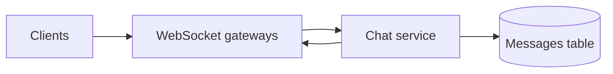
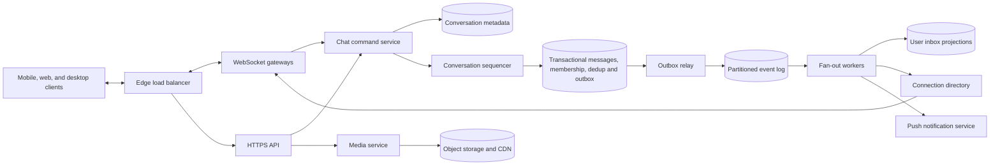
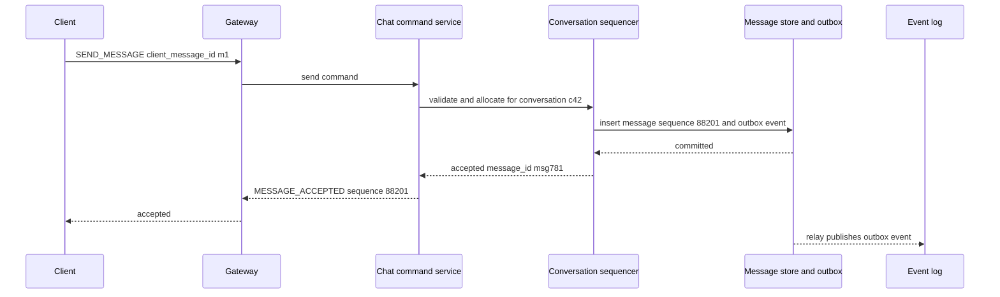
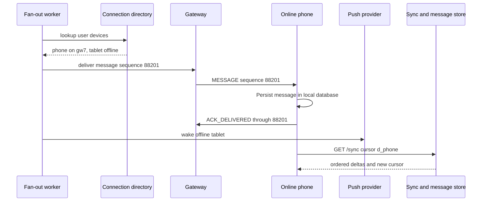
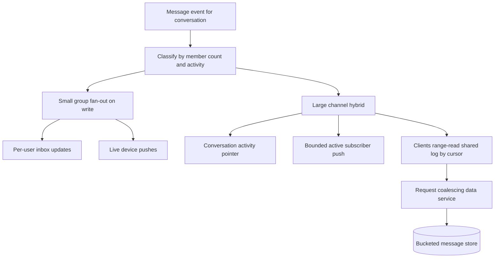

# Chat App System Design

A production chat system accepts messages from mobile, web, and desktop clients, assigns a durable order inside each conversation, and delivers those messages to many devices that may be online now, reconnecting later, or permanently gone. This design covers text messages, group chat, receipts, sync, attachments, and optional end-to-end encryption; it leaves voice/video media transport, advanced moderation, and enterprise compliance workflows out of the core path except where they change message delivery semantics.

## 1. Requirements

### 1.1 Functional requirements

- Users can send text messages, replies, edits, deletes, reactions, and attachment references in one-to-one and group conversations.
- Each conversation has a stable message order that every authorized device eventually converges on.
- A user's multiple devices can receive live messages when online and catch up after being offline using a durable cursor.
- The product exposes sent, delivered, and read states without requiring one receipt row per message per recipient.
- Group membership, roles, joins, leaves, removals, and notification settings affect who can send, read, and receive future messages.
- Offline recipients can be woken by push notifications, but push is a hint rather than the source of truth.

### 1.2 Non-functional requirements

- **Durability.** Once the service acknowledges a send, the message must survive process crashes, gateway loss, and fan-out worker restarts because users treat an accepted chat message as committed.
- **Per-conversation ordering.** Chat does not need a global order, but every participant in one conversation must see the same sequence or replies, deletes, and read cursors become ambiguous.
- **Low online delivery latency.** Online users expect messages to appear in hundreds of milliseconds, so the live path must avoid polling and avoid synchronous fan-out to all offline devices.
- **Offline efficiency.** Mobile devices are frequently suspended, roaming, or battery constrained, so reconnect must resume by cursor instead of replaying an entire mailbox.
- **At-least-once transport with idempotent effects.** WebSockets, push providers, clients, and gateways all retry; the user-visible history must still contain one copy of each logical send.
- **Hot-channel survivability.** Viral groups, reconnect storms, and large workspaces must not concentrate reads, writes, presence, or fan-out CPU on one unbounded storage partition or one actor.

### 1.3 The binding constraint

The binding constraint is durable, per-conversation ordered delivery to many devices that are often offline, over long-lived connections. A simple WebSocket broadcast system feels natural until the sender's gateway crashes after forwarding, a recipient has three devices of which two are asleep, and a 10,000-member group turns one accepted message into tens of thousands of delivery attempts. The hard part is not opening sockets; it is making the socket path a fast cache of a durable ordered log.

That constraint forces four mechanisms through the design: server-assigned per-conversation sequence numbers, idempotent client message IDs, acknowledgements that mean durable acceptance rather than recipient delivery, and cursor-based sync that repairs anything missed by online push. Storage and routing then have to be partitioned around conversation order without letting a single hot conversation or large group overload one shard.

## 2. Back-of-the-envelope estimation

Use these as illustrative assumptions, not claims about any real service. Suppose the product has 500 million daily active users, each sending 50 messages per day. That is `500M × 50 = 25B` messages per day, or `25B / 86,400 ≈ 289,352` sends per second on average. If peak traffic is 3.5 times average, the acceptance path must handle about `289K × 3.5 ≈ 1.0M` sends per second. This number shapes the write path: every send can afford a small number of strongly consistent operations, but it cannot synchronously update every recipient device before acknowledging.

Concurrent connections are a different bottleneck. If 20% of daily active users are connected at peak and each has 1.2 active devices on average, then `500M × 0.20 × 1.2 = 120M` live connections. At 100,000 tuned WebSocket connections per gateway instance, that is `120M / 100K = 1,200` gateways before headroom. With 40% capacity reserved for deploys, regional imbalance, and failure, plan for roughly `1,200 / 0.60 = 2,000` gateway slots. This implies gateways must be horizontally replaceable and must not own durable delivery state.

Fan-out multiplies accepted messages. If 85% of sends are one-to-one with one recipient averaging 1.5 online or recently active devices, 14% are small groups averaging 10 members, and 1% are large channels averaging 2,000 members, the naive delivery attempt rate per send is `(0.85 × 1.5) + (0.14 × 9 × 1.5) + (0.01 × 1,999 × 0.5) = 1.275 + 1.89 + 9.995 = 13.16` device pushes per accepted message, excluding sender-companion sync. At 1.0M peak sends per second, synchronous recipient fan-out would be about `13.16M` push attempts per second. The design therefore acknowledges after durable append and performs fan-out asynchronously, with special treatment for large groups.

Storage for text is large but tractable compared with media. If an encrypted message envelope averages 1 KB, accepted text-like messages add `25B × 1 KB = 25 TB` per day before replication and indexing. Three replicas make that about 75 TB per day. If 10% of messages reference media averaging 500 KB after client compression, media ingest is `25B × 0.10 × 500 KB = 1.25 PB` per day before replication. This separates message metadata storage from object storage: the ordered log keeps ciphertext and references, while media bytes go directly to object storage and CDN.

> **Key idea.** The acceptance path is write-heavy but compact; delivery and media are the amplification points. Acknowledging only durable acceptance, then repairing delivery by cursor, keeps the user contract strong without making every send wait for every device.

## 3. API design

**Question.** What does the send acknowledgement actually promise when the recipient may be offline and the sender may retry?
<details><summary>Answer</summary>

It promises that the server has authorized the sender, assigned or recovered a per-conversation sequence number, durably stored the message, and recorded fan-out work. It does not promise that any recipient device has displayed the message. Retries with the same client message ID return the same accepted message.

</details>

```http
POST /v1/conversations/{conversation_id}/messages
Idempotency-Key: {device_id}:{client_message_id}
{
  "client_message_id": "01J9M7...",
  "type": "TEXT",
  "ciphertext": "base64...",
  "reply_to_message_id": "msg_123_or_null",
  "media_id": null
}

202 Accepted
{
  "message_id": "msg_781",
  "conversation_id": "c_42",
  "sequence": 88201,
  "accepted_at": "2026-10-13T07:22:18Z"
}

GET /v1/conversations/{conversation_id}/messages?after_sequence=88150&limit=100
  -> ordered ConversationEvent deltas, next_sequence, covered_through

GET /v1/sync?cursor=opaque_user_device_cursor&limit=500

POST /v1/conversations/{conversation_id}/receipts
{
  "delivered_through": 88201,
  "read_through": 88190,
  "device_id": "dev_7"
}

POST /v1/media/uploads
{
  "size_bytes": 7340032,
  "sha256": "...",
  "encryption_metadata": {"mode":"client_encrypted"}
}

WS SEND_MESSAGE {"request_id":"r1","conversation_id":"c_42","client_message_id":"01J9M7...","ciphertext":"..."}
WS MESSAGE_ACCEPTED {"request_id":"r1","message_id":"msg_781","sequence":88201}
WS MESSAGE {"conversation_id":"c_42","sequence":88201,"message_id":"msg_781","payload":{}}
WS ACK_DELIVERED {"conversation_id":"c_42","through_sequence":88201}
```

The send endpoint uses `202 Accepted` for its asynchronous delivery operation, with the stronger application guarantee that the message is already durable. `201 Created` would also be valid for a durably created message resource; neither HTTP status implies recipient delivery. The `Idempotency-Key` and `client_message_id` make retries safe after a timeout, gateway disconnect, or client process restart. The effective key is `(conversation_id, sender_device_id, client_message_id)` so deduplication stays in the conversation's transaction boundary; it also stores a request hash and rejects conflicting reuse.

Sync uses opaque cursors rather than offsets. Offsets fail when the server changes storage layout, compacts old ranges, or merges mailbox and conversation events. A cursor can encode a per-device position in a durable user delta stream, plus fallback hints for conversations whose message ranges must be fetched directly. Devices advance the cursor only after applying the page to their local store. WebSocket frames are the low-latency path, but they are never the only correctness path; a reconnecting device always reconciles with `GET /v1/sync`.

Receipts are high-water marks because ordered conversations make that compact. A phone can acknowledge delivery through 88201 instead of one receipt per message. Clients advance only after applying all authorized events in the covered prefix; server coverage markers account for membership-filtered slots and non-message events without disclosing their bodies. Delivered/read receipts still refer to eligible message creation sequences, and server sync coverage is not evidence that the user read them.

## 4. Data model

Start with the obvious `Message`: one row per chat message with a body, sender, and timestamp. That cannot represent the user-visible order because two senders can submit at the same time, clocks skew, and a retry after timeout might create a second row. The first correction is to give each message a server `message_id`, a unique `(conversation_id, sender_device_id, client_message_id)` key, and a server-assigned creation sequence. Edits, deletes, reactions, and membership changes append new `ConversationEvent` sequences; they never rely solely on updating an old message row that an `after_sequence` reader would miss. Message display order uses creation sequence; catch-up uses event sequence and applies mutations to stable message IDs.

Now add `Conversation` and `ConversationMember`. Membership uses retained intervals keyed by `(conversation_id, user_id, joined_sequence)`, not a single overwritten join/leave row: leaving and rejoining must not grant access to the gap. Membership commands serialize with messages in the same conversation authority. This proposal permits reads of messages created during a user's membership intervals after leaving, but never of new messages outside those intervals; stricter removal policies add a current deny fence. Delayed edits and deletes are filtered using the target message's original eligibility, so former members can still receive authorized corrections to retained history.

A single message log still does not make mobile sync efficient. A user with hundreds of conversations needs to know which conversations changed without scanning all of them. Add `InboxEntry` as a projection keyed by user and sorted by last activity. It is rebuildable from message and membership events, so it need not be part of the same transaction as message acceptance. The sender acknowledgement waits for the message and outbox event, not for every inbox projection.

Multi-device delivery requires `Device` and `DeviceCursor`. A user-level read cursor is not enough because one phone can be offline for a week while a laptop remains current. Each device needs its own sync cursor and push token; user-visible read state can still be coalesced at the user level by taking the maximum read-through sequence when product semantics allow it.

Finally, reliable fan-out needs an `OutboxEvent`. If the service writes the message and then crashes before publishing to Kafka or another log, recipients will never learn about a valid message. The outbox event is committed with the message and relayed asynchronously until every consumer has a chance to catch up.

```text
Conversation
- conversation_id
- type: DIRECT | GROUP | CHANNEL
- home_region
- current_epoch
- next_sequence
- encryption_mode
- created_at

ConversationMember
- conversation_id
- user_id
- role
- joined_sequence
- left_sequence
- membership_version
- notification_settings

Message
- conversation_id
- sequence
- sequence_bucket
- message_id
- sender_user_id
- sender_device_id
- client_message_id
- message_revision
- type
- ciphertext_or_body
- media_id
- reply_to_message_id
- created_at
- edited_at
- deleted_at

ConversationEvent
- conversation_id, sequence, event_id, event_type
- target_message_id, message_revision, membership_version, payload

Device
- device_id
- user_id
- identity_public_key
- push_token_ref
- revoked_at
- last_seen_at

DeviceCursor
- user_id
- device_id
- sync_cursor
- applied_through_time
- updated_at

InboxEntry
- user_id
- conversation_id
- latest_sequence
- last_activity_at
- unread_count_hint
- projection_version

ReceiptState
- user_id
- conversation_id
- delivered_through_sequence
- read_through_sequence
- updated_at

MediaObject
- media_id
- owner_user_id
- object_key
- size_bytes
- content_hash
- encryption_metadata
- scan_state

OutboxEvent
- event_id
- aggregate_type
- aggregate_id
- event_type
- payload
- committed_at
- relay_state
```

The authoritative send transaction uses a transactional store that can atomically cover conversation metadata, membership, deduplication, messages/events, and outbox rows, including bucket rollover. Bucketed Cassandra or ScyllaDB history stores may be asynchronous read projections, not a second independent write in that transaction. Cassandra logged batches do not provide general cross-partition SQL isolation or transactions with an external metadata store. History is keyed by `(conversation_id, sequence_bucket)` and sorted by sequence, with an applied watermark; reads beyond it wait or use the authoritative tail. Discord's bucketed storage and Rust request-coalescing service are read/storage analogies, not evidence for this proposal's atomic send protocol. Inbox entries are projections partitioned by `user_id`; media belongs in object storage; presence, typing, and connection routes remain ephemeral.

> **Key idea.** The authoritative record is the ordered conversation log plus versioned membership. Inboxes, push notifications, search, unread counts, and live socket delivery are projections that can lag and repair from the log.

## 5. High-level design

The simplest design is one chat service connected to WebSocket servers and one messages table. A client sends a frame, the gateway calls the service, the service inserts a row, and the gateway broadcasts to recipients currently connected to it.



This breaks in five concrete ways. First, a retry after the client times out can create duplicate messages. Second, timestamps cannot define one conversation order under concurrent sends. Third, if the service commits to the database and crashes before broadcasting, the sender sees success while recipients never learn about the message. Fourth, recipients are often offline or connected through other gateways, so local broadcast is insufficient. Fifth, a large channel can make one database partition and one fan-out loop hot enough to delay everyone.

### Fix 1: Idempotent acceptance with server sequence numbers

The send path becomes a command, not just an insert. In one transaction the sequencer checks membership, advances the conversation sequence, and inserts a message/event under unique constraints on `(conversation_id, sender_device_id, client_message_id)` and `(conversation_id, sequence)`, with a globally unique `message_id`. If the same device retries, it returns the existing sequence. If two senders race, the sequencer serializes them inside the conversation without imposing a global order across unrelated conversations.

### Fix 2: Transactional outbox before delivery

Broadcast cannot be the durability boundary. The service commits the message and an outbox event atomically, then returns acceptance. A relay publishes committed outbox events to a partitioned event log. Fan-out, search, unread counters, push, and analytics consume from that log idempotently. If any consumer lags, the accepted message remains recoverable from storage.

### Fix 3: Gateways as connection holders, not message owners

WebSocket gateways maintain live sockets, heartbeats, and backpressure. A connection directory maps `(user_id, device_id)` to the current gateway and connection epoch. Fan-out workers push live messages through the directory when possible. If the mapping is stale, delivery fails harmlessly because the device will reconcile with sync. This matches the shape Slack has described: channel-oriented routing is separated from gateway servers that hold WebSocket subscriptions.

### Fix 4: Cursor sync as the source of truth

Online push is an optimization. Each device has a durable sync cursor and a local store. Reconnect starts with `GET /v1/sync`, then range fetches conversation events after its sequence for conversations that changed. Meta's Messenger Iris is evidence for snapshot-plus-delta sync and durable per-user queues, not for this exact transport: the published Iris design pushes deltas over MQTT rather than requiring an HTTPS pull after every notification.

### Fix 5: Hybrid fan-out and hot-channel controls

Small conversations use fan-out on write into per-user inbox projections because it makes reads and badge counts cheap. Large groups and channels switch to batched fan-out or fan-out on read: the accepted message is appended once, notification work is bounded, and clients read from the shared conversation log by cursor. Hot conversations get bucketed message partitions, request coalescing, and membership snapshots so reconnect storms do not pound one storage row.

### Putting it together



A send enters through WebSocket or HTTPS and reaches the chat command service. The service validates the sender against versioned membership in the metadata store, sends the command to the conversation sequencer, and the sequencer commits a message row plus an outbox event. The acknowledgement returns after that commit. The relay publishes the event to the log; fan-out workers update `InboxEntry`, attempt live delivery through the connection directory, and send privacy-safe push notifications to offline devices. If any of those steps fail, the recipient's next sync reads the same ordered message log by cursor.

> **Key idea.** Each component traces back to a specific failure of the naive design: idempotency fixes retries, sequencing fixes ordering, outbox fixes lost broadcasts, connection routing fixes multi-gateway delivery, and cursor sync fixes offline devices.

## 6. Deep dives

### 6.1 Durable send path and per-conversation sequencing

**Question.** A client sends a message, the server commits it, the response times out, and the client retries while another sender is also posting. How do we avoid both duplicates and inconsistent ordering?
<details><summary>Answer</summary>

Treat send as an idempotent command. The server uses `(conversation_id, sender_device_id, client_message_id)` to return the original result on retry, assigns one monotonically increasing event sequence per conversation, and commits the message/event and outbox together before acknowledging.

</details>

The tempting implementation is `INSERT message(sender, body, timestamp)` and then sort by timestamp. That fails as soon as two clients have skewed clocks or a retry lands after the original commit but before the client receives the acknowledgement. The user sees either two copies or a different order on different devices. Chat needs a narrow but strong ordering guarantee: within one conversation, all authorized readers eventually agree that sequence 88201 happened before 88202.

A conversation sequencer provides that guarantee. It can be a logical leader for the conversation, a transactional row containing `next_sequence`, or a small actor whose writes are fenced by an epoch. The transaction validates the sender's membership version against concurrent removals, checks the conversation-scoped idempotency key and request hash, allocates the next event sequence, inserts the message/event, and inserts outbox work. If the key already committed, it returns the existing `message_id` and `sequence` instead of allocating again. If two new sends race, only one gets sequence N and the other gets N+1.



The acknowledgement semantics are the most important sentence in the design: accepted means durable and enqueued for delivery, not delivered to every recipient. This lets the service keep the transaction small. A one-to-one send does not wait for the recipient's sleeping tablet; a 10,000-member channel does not wait for 10,000 inbox writes. Delivery state advances later through fan-out and receipts.

The sequencer must be fenced. If a conversation leader has a lease and the process pauses during a garbage collection event or network partition, a replacement may take over. The old leader cannot be allowed to wake up and write sequence 88202 after the new leader already wrote 88202. Store each write with `current_epoch`, and only accept `UPDATE ... WHERE conversation_id = ? AND epoch = ? AND next_sequence = ?` or the equivalent compare-and-swap. The replacement increments the epoch during failover; stale leaders then fail their conditional writes.

Sequence allocation also has a subtle gap problem. If a service reserves 1,000 numbers and crashes after using 10, clients may wait forever for the remaining 990. Allocate a sequence with each committed event, or durably fence and record unused reservations as no-op ranges before advancing coverage. Edits and membership events occupy real slots even when no new message bubble appears.

Storage partitioning is part of the send path because the sequencer writes the hot row. A bare `(conversation_id)` partition grows without bound and makes viral channels dangerous. Discord hit this class of issue in its message store evolution: bucketed channel partitions bounded partition size, and later ScyllaDB work put a Rust data service in front to coalesce identical hot reads. For this design, the write key is `(conversation_id, sequence_bucket)` with a directory that maps sequence ranges to buckets. The sequencer still owns order; the storage layer avoids unbounded partitions.

Alternatives exist. A Kafka partition per conversation gives ordered append but is impractical for millions or billions of mostly idle conversations. A global sequence is simple to reason about but creates unnecessary coordination and leaks cross-conversation timing. Client-generated sortable IDs are useful as provisional UI identifiers, but they cannot authorize membership or resolve concurrent sends. The production-grade answer is server order per conversation, idempotency per device, and a durable outbox.

Signals worth watching: idempotency hit rate, duplicate-message suppressions, conditional-write conflicts, sequencer failovers, sequence-gap fetches, outbox relay lag, and hot bucket read/write latency.

> **Strong-answer criteria.** A senior answer distinguishes durable acceptance from delivery, makes retries safe with a client message ID, and fences the sequencer so failover cannot create split-brain order.

| Level | Approach | Why |
|---|---|---|
| Bad | Insert messages with client timestamps and broadcast immediately. | Clock skew, retries, and crashes create duplicates, lost delivery, and inconsistent order. |
| Good | Use a server sequence and unique client message ID. | Correctly handles ordering and retries, but may still lose fan-out if publication is not atomic. |
| Great | Sequence with epoch fencing, commit message plus outbox atomically, bucket storage, and define ack semantics precisely. | This survives retries, leader failover, hot partitions, and asynchronous delivery. |

### 6.2 Delivery, offline sync, and multi-device convergence

**Question.** A user has a phone offline for three days, a laptop online now, and a newly linked tablet. What is the source of truth for what each device should display?
<details><summary>Answer</summary>

The ordered conversation log plus a per-device sync cursor are the source of truth. Live WebSocket frames and push notifications are hints. Each device applies ordered deltas to a local store and advances its own cursor only after durable local application.

</details>

A WebSocket-only design confuses reachability with delivery. It works in a demo where both users have one browser tab open. It fails for mobile because operating systems suspend apps, networks change, push providers drop or collapse notifications, and users own multiple devices. The server cannot assume that sending a frame means the message is now part of the recipient's history. It can only record that a specific connection accepted bytes, and even that may be lost if the gateway dies before the client applies the message.

The reliable model is push-then-sync. Fan-out workers attempt online delivery by consulting a connection directory: `(user_id, device_id) -> gateway_id, connection_epoch`. The gateway writes the frame to the socket and may receive an `ACK_DELIVERED` high-water mark. If the device is not connected, the push service sends a privacy-safe notification such as "new message" without plaintext by default. In both cases, the next client action is to reconcile using a durable cursor.



The sync cursor is per device, not merely per user. If the laptop reads through sequence 90000, that should not imply the phone has stored those messages locally. Device cursors protect local convergence. User-level `read_through_sequence` is a separate product signal that may take the maximum of reads across devices or follow a primary-device rule, depending on UX. Delivered receipts are usually device-derived and coalesced to a user high-water mark for display.

A reconnecting device asks for ordered deltas: conversation advances, membership changes, edits, deletes, tombstones, receipt updates, and key/device changes. It commits the applied page and cursor together in its local database. An expired cursor requires a complete authorized snapshot of current conversation state at a captured sync boundary, including reconciliation of removed conversations and old edited/deleted messages—not merely messages newer than the device's last sequence. Deltas after that boundary are retained during transfer. This is the snapshot-plus-delta shape illustrated by Iris, with this design's own HTTP repair path.

Multi-device end-to-end encryption changes the payload but not the delivery contract. WhatsApp's multi-device design gives each device its own identity key; senders encrypt to the recipient's device list and to the sender's companion devices. That means the send path may need a fresh device-list version and may store multiple encrypted envelopes for one logical message. A newly linked tablet may require encrypted history transfer or may start from a join point, depending on product policy. The server still sequences ciphertext and enforces membership, but it cannot derive missing plaintext or server-side search indexes.

Connection routing is intentionally soft state. Gateways refresh leases in a regional presence and connection store. If a lease says device D is on gateway G but G has restarted, the fan-out attempt fails and the event remains recoverable through sync. This lets gateways be replaced freely. Slack's public real-time architecture makes a similar separation: gateway servers hold connections close to users, while channel-oriented servers route events to the right gateways.

The hard edge cases are races between device state and message state. A device can be revoked just as fan-out reads the device list. The send path should bind encryption and delivery to a device-list version, and the fan-out path should check revocation before pushing. A member can be removed while an offline sync page is being built. The sync API must filter by `joined_sequence` and `left_sequence`, not by a cached present-tense membership boolean. A client can receive sequence 88203 before 88202 through parallel delivery. The local store should buffer a short gap, then fetch the missing range rather than permanently displaying out of order.

Signals worth watching: reconnect sync page size, expired-cursor rate, gap-repair fetches, stale connection-route failures, push wake success, undecryptable message rate, and per-device cursor lag.

> **Strong-answer criteria.** A senior answer says sockets and push are hints, makes the durable cursor the repair path, separates device sync state from user read state, and addresses encrypted multi-device fan-out.

| Level | Approach | Why |
|---|---|---|
| Bad | Mark messages delivered when the server writes to a WebSocket. | The client may never apply the frame, and offline devices are invisible. |
| Good | Store messages and let clients fetch missed ranges after reconnect. | Correct repair path, but incomplete without per-device cursors and push/live integration. |
| Great | Use live delivery plus push as hints, per-device ordered sync cursors, local application acks, membership filtering by sequence, and device-key-aware E2EE. | Devices converge despite offline periods, retries, revocation, and multiple transports. |

### 6.3 Large groups, hot channels, and fan-out economics

**Question.** A celebrity channel sends one message while 200,000 clients reconnect after a network event. What prevents one conversation from melting the message store and fan-out layer?
<details><summary>Answer</summary>

Do not synchronously fan out every event to every member. Append once to the ordered conversation log, batch or defer recipient projections, let large-channel clients read by cursor, bucket hot message storage, coalesce identical reads, and scope presence and receipts aggressively.

</details>

Small group chat rewards fan-out on write. If a message has nine recipients, writing nine inbox projections makes every recipient's home screen cheap: read the inbox partition by user, sort by last activity, show unread hints. The sender need not wait for those projections, but they usually complete quickly. The same algorithm becomes absurd for very large groups. A 10,000-member group with 1.2 devices per member turns one message into roughly 12,000 possible device deliveries, plus inbox writes, push decisions, unread updates, and receipt state. If the sender acknowledgement waits for that work, large groups ruin send latency. If workers do it naively afterward, a burst can bury the event log.

The design should classify conversations by fan-out cost. Direct chats and ordinary groups use fan-out on write into `InboxEntry`. Large groups and channels append once, update a shared activity pointer, and notify a bounded subset of active subscribers. Sync and periodic client polling batch-read activity pointers for the user's large-channel subscriptions, even if no inbox entry or push was created; otherwise omitted subscribers could remain stale forever. Clients then range-fetch conversation events. Push notifications are rate-limited and batched; a muted large channel may get no push at all.



Storage bucketing prevents the shared log from becoming one enormous partition. A bucket might cover a fixed sequence range such as 10,000 messages or a time range such as one day, with a directory for range lookup. The exact bucket size is operational: too small and range reads touch many partitions; too large and compaction, repair, and hot reads become painful. Discord's published Cassandra and ScyllaDB posts are directly relevant here. They found that channel-bucket keys bounded partitions, and that a data service with request coalescing protected ScyllaDB from many identical reads during hot events.

Fan-out CPU also needs distribution without reordering one conversation. Discord's Elixir scaling work described the cost of a single process sending events to many sessions, then distributing work while preserving event order. In this design, the conversation sequencer creates one ordered event stream, but fan-out workers can shard by recipient gateway or user range. Each shard preserves order for a given recipient and conversation. If a worker crashes midway through a large group batch, it resumes from a durable batch checkpoint and writes idempotent inbox updates.

Presence and read receipts are usually worse than messages in large groups because they are many-to-many and high frequency. Showing exact online status for every member of a 100,000-person channel is both expensive and not very useful. Scope presence to visible surfaces: friends, current small conversation, mentioned users, or a capped member list. Typing indicators should be lossy and disabled or aggregated for large channels. Read receipts should become counts, thresholds, or be disabled above a size limit. A contiguous high-water mark works for one user's state, but exposing every member's read position in a giant channel creates a write and privacy problem.

Membership scans must not block the hot sequencer. Discord's Maxjourney writeup is a useful warning: million-user server operations made membership scans and process handoff a runtime issue. Keep the sequencer focused on ordering and durable append. Use versioned membership snapshots for fan-out eligibility, store large member sets in data structures designed for scans, and move expensive notification eligibility checks to workers. If the snapshot is slightly stale, the worker must still enforce `joined_sequence` and `left_sequence` before delivery.

An alternative is pure fan-out on read for all conversations: never write inbox projections, always ask each conversation log what changed. That avoids write amplification but makes the common inbox view expensive for ordinary users with many small chats. Another alternative is precomputing everything, including per-message unread counts and per-recipient receipts. That gives rich UX at small scale and collapses under large channels. The hybrid is more complex, but it pays complexity only where fan-out cost demands it.

Signals worth watching: fan-out amplification per conversation class, event-log lag for large groups, hot bucket p99 latency, request coalescing hit rate, inbox projection backlog, presence subscription count, and push suppression rate.

> **Strong-answer criteria.** A senior answer quantifies fan-out, switches strategy by group size, protects hot storage with buckets and coalescing, and scopes presence and receipts instead of treating them like free metadata.

| Level | Approach | Why |
|---|---|---|
| Bad | Write one inbox row and one push task for every member before acknowledging. | Large groups make send latency and worker backlog unbounded. |
| Good | Acknowledge after append and fan out asynchronously. | Protects send latency, but hot channels can still overload storage and fan-out workers. |
| Great | Use hybrid fan-out, bucketed storage, coalesced reads, ordered sharded delivery, scoped presence, and size-based receipt semantics. | The system remains usable during viral channels and reconnect storms. |

## 7. Variants

**10x scale.** At 10 million peak sends per second and more than a billion live connections, the logical architecture stays the same but every partitioning assumption tightens. Conversation home regions need automated migration, gateways need more aggressive connection shedding and regional admission control, and hot conversations need dedicated routing lanes. The message store likely uses a specialized data service in front of ScyllaDB or an equivalent wide-column backend so application code never fans identical reads directly into storage.

**Strict end-to-end encryption.** The server still owns sequencing, membership authorization, storage of ciphertext, and delivery cursors, but many server features disappear or move client-side. Search becomes local encrypted indexing, media scanning is limited to client-side or metadata controls, and the send path must fetch a device-list version before encrypting. Group membership changes require sender-key rotation or another group-key protocol, so membership events become part of cryptographic state rather than simple metadata.

**Multi-region active-active writes.** If users demand local send latency everywhere, the hardest invariant is per-conversation order. The safer design keeps a single home region per conversation and forwards writes there. Active-active can work for independent conversations, but not for concurrent writes to the same conversation unless one region still wins sequencing or the product accepts conflict-free but weaker ordering semantics. Region failover must fence the old epoch before a new sequencer writes.

**Enterprise or regulated retention.** Retention, legal hold, and export do not change the hot send path, but they change storage lifecycle. Deletes become tombstones until retention policy permits compaction. Media deletion must check references and holds. Audit logs record administrative access and policy changes, but plaintext should not leak into traces or logs. For E2EE conversations, exports may be limited to ciphertext unless clients participate.

## 8. The transferable pattern

This is the ordered-log plus projection pattern. A small authoritative core accepts commands, assigns an order, and commits an event. Everything optimized for user experience—live delivery, inboxes, unread counters, search, push, presence, and analytics—is a projection that can lag and repair. The same shape appears in feeds, notifications, collaborative documents, and payment ledgers, though each chooses a different ordering scope and acknowledgement contract.

The reusable lesson is to define the durability boundary before drawing caches. In [Ticketmaster](./ticketmaster-system-design.md), the analogous boundary is the conditional reservation of scarce seats. In a chat app, it is the accepted sequence in a conversation. Once that line is precise, the rest of the design becomes easier to reason about: retries return the same committed fact, offline clients catch up by cursor, and hot read paths can be optimized without changing correctness.

## Review

The design starts from the fact that chat is not primarily a socket problem; it is a durable ordered-log problem with live delivery as a fast path. The send path uses idempotent client message IDs, server-assigned per-conversation sequences, epoch-fenced leaders, bucketed storage, and a transactional outbox so an accepted message cannot vanish. Delivery uses gateways and push for immediacy, but per-device cursor sync is the source of truth for offline and multi-device convergence. Large groups force a hybrid fan-out design, request coalescing, scoped presence, and receipt coalescing because naive per-recipient work makes a single hot channel dominate the system.

### Check your understanding

1. Why does the acknowledgement for a send mean durable acceptance rather than recipient delivery?
   <details><summary>Answer</summary>

   Recipient devices may be offline, suspended, connected through stale gateways, or too numerous for synchronous fan-out. If acknowledgement waited for delivery, offline devices and large groups would control send latency. Durable acceptance plus cursor repair gives a strong user contract without blocking on every recipient.

   </details>

2. Why are both `message_id` and `sequence` needed?
   <details><summary>Answer</summary>

   `message_id` is a stable identifier for replies, edits, deletes, and deduplication across systems. `sequence` is the per-conversation display and cursor order. A globally unique ID alone does not express the order all participants must converge on.

   </details>

3. What failure does the transactional outbox prevent?
   <details><summary>Answer</summary>

   It prevents the service from committing a message and then crashing before publishing the delivery event. Because the outbox event commits atomically with the message, a relay can later publish it and fan-out consumers can catch up.

   </details>

4. Why does a multi-device chat system need per-device sync cursors instead of only a user-level read cursor?
   <details><summary>Answer</summary>

   Each device has its own local store and offline periods. A laptop may be current while a phone is days behind. A user-level read cursor can represent UX state, but it cannot prove that every device has applied the same messages.

   </details>

5. When should the system switch from fan-out on write to a hybrid or fan-out-on-read model?
   <details><summary>Answer</summary>

   It should switch when member count, online subscriber count, or notification cost makes per-recipient writes dominate the send path or create sustained backlog. Large channels should append once, update bounded activity metadata, push only to active or eligible subsets, and let clients read the shared log by cursor.

   </details>

## Sources and further reading

| Source | Article | Why it matters |
|---|---|---|
| Discord | [How Discord Stores Billions of Messages](https://discord.com/blog/how-discord-stores-billions-of-messages) | Cassandra/Scylla-style message bucketing by channel and time to bound partitions and support range reads. |
| Discord | [How Discord Stores Trillions of Messages](https://discord.com/blog/how-discord-stores-trillions-of-messages) | Hot-partition mitigation with Rust data services, request coalescing, and consistent-hash routing. |
| Discord | [How Discord Scaled Elixir to 5,000,000 Concurrent Users](https://discord.com/blog/how-discord-scaled-elixir-to-5-000-000-concurrent-users) | Ordered, distributed real-time fan-out and the CPU/network cost of large pub/sub groups. |
| Discord | [Maxjourney: Pushing Discord's Limits with a Million+ Online Users in a Single Server](https://discord.com/blog/maxjourney-pushing-discords-limits-with-a-million-plus-online-users-in-a-single-server) | Large-group responsiveness, membership scans, process handoff, and runtime memory/GC lessons. |
| Slack | [Real-time Messaging](https://slack.engineering/real-time-messaging/) | Channel servers, gateway servers, consistent hashing, transient events, and global WebSocket fan-out. |
| Slack | [Flannel: An Application-Level Edge Cache to Make Slack Scale](https://slack.engineering/flannel-an-application-level-edge-cache-to-make-slack-scale-/) | Edge metadata caching, lazy loading, reconnect-storm protection, and client pub/sub reduction. |
| Meta Messenger | [Building Mobile-First Infrastructure for Messenger](https://engineering.fb.com/2014/10/09/production-engineering/building-mobile-first-infrastructure-for-messenger/) | Iris snapshot-plus-delta sync, per-user ordered queues, MQTT push, and mobile bandwidth reduction. |
| WhatsApp | [How WhatsApp Enables Multi-Device Capability](https://engineering.fb.com/2021/07/14/security/whatsapp-multi-device/) | Device identity keys, client fan-out encryption, encrypted history transfer, and secure app-state sync. |
| LinkedIn | [Designing Our New Messaging System](https://www.linkedin.com/blog/engineering/messaging-notifications/designing-our-new-messaging-system) | Centralized message copies, service ownership boundaries, and correctness-first migration principles. |
| LinkedIn | [Unifying Messaging Experiences Across LinkedIn](https://www.linkedin.com/blog/engineering/messaging-notifications/unifying-messaging-experiences-across-linkedin) | Reactive client data layer combining local store, realtime stream, and query APIs across platforms. |
| Apache Cassandra | [CQL data manipulation: BATCH](https://cassandra.apache.org/doc/latest/cassandra/developing/cql/dml.html#batch) | Documents batch atomicity and the single-partition isolation boundary; not a general cross-store transaction. |
| IETF | [RFC 9110: 201 Created and 202 Accepted](https://www.rfc-editor.org/rfc/rfc9110.html#section-15.3.2) | Separates resource creation and asynchronous processing semantics from application-level delivery receipts. |
