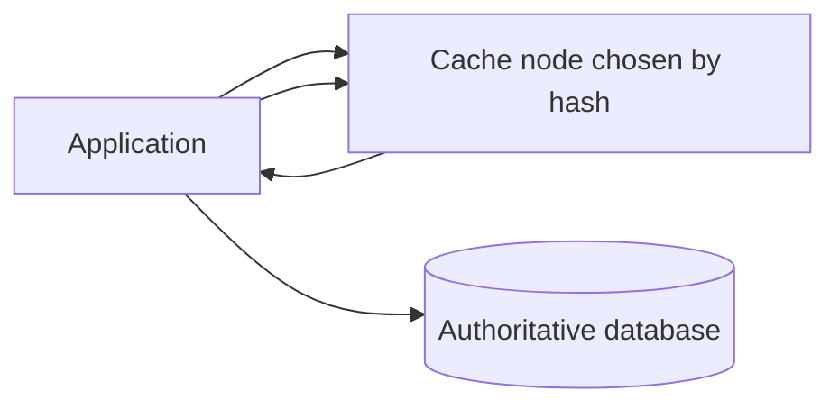
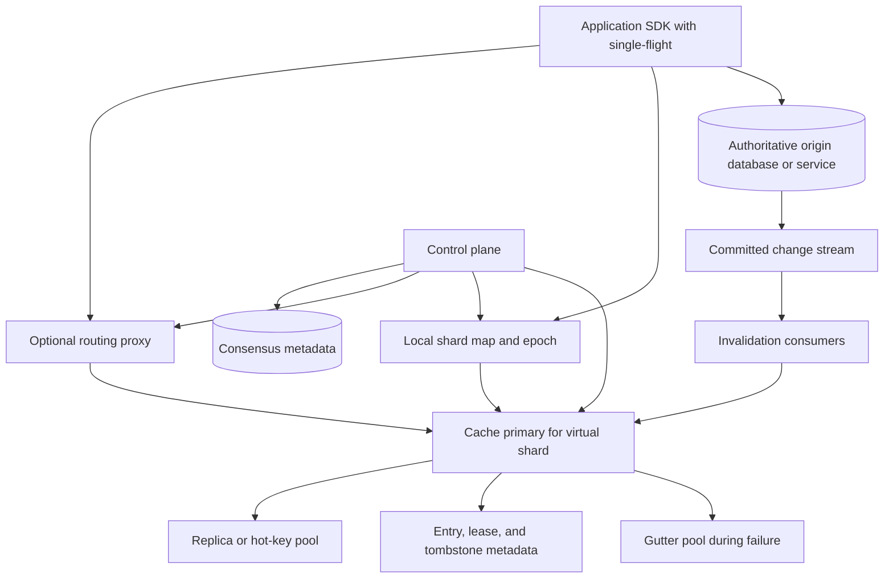
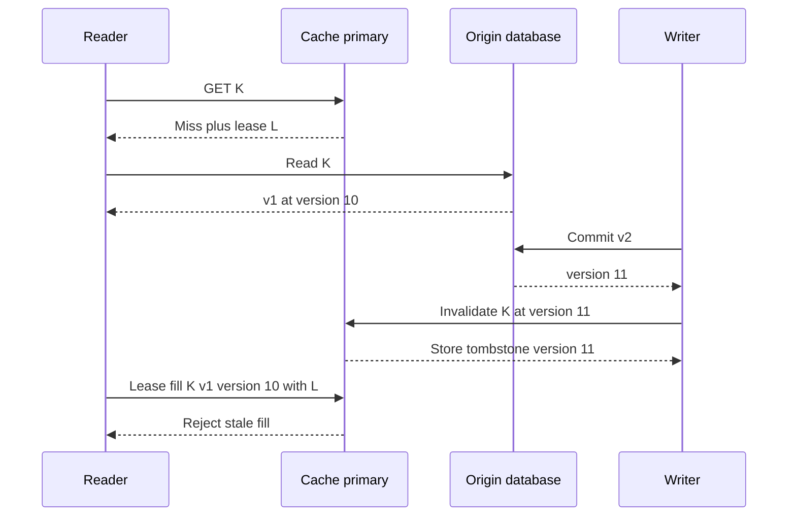
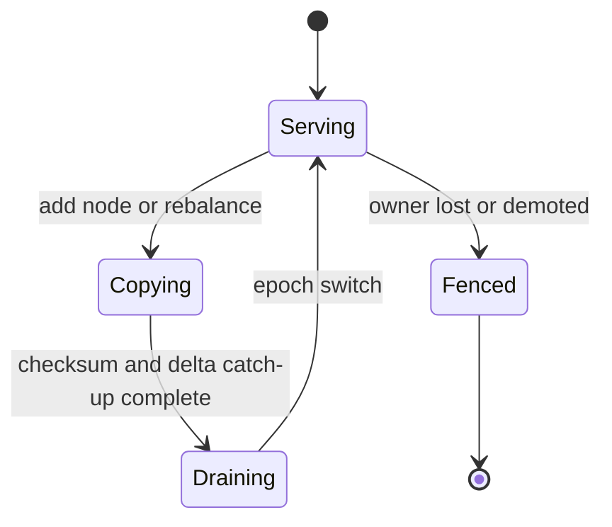

# Distributed Cache System Design

A distributed cache stores frequently read application objects close to compute so that the authoritative database or service is not asked the same question millions of times per second. This design covers a regional, general-purpose key-value cache with TTLs, invalidation, replication, hot-key handling, and origin protection; it is not a durable database, search index, queue, or cross-key transaction system.

## 1. Requirements
### 1.1 Functional requirements
- Support cache-aside reads and explicit `GET`, `SET`, `ADD`, `REPLACE`, `DELETE`, `MGET`, TTL, and atomic counter operations.
- Let callers express freshness needs with versions, compare-and-swap, `min_origin_version`, and per-namespace stale-serving policies.
- Partition data across many cache nodes, rebalance with bounded disruption, and route either through SDKs or a proxy tier.
- Protect the origin during misses, cold starts, node loss, and hot-key bursts using leases, coalescing, admission control, and throttled refill.
- Integrate with database writes or change-data-capture streams so committed origin changes invalidate or supersede cached values.
- Expose per-namespace hit rate, origin amplification, hot keys, evictions, refill latency, invalidation lag, and consistency probes.

### 1.2 Non-functional requirements
- **Low latency.** A cache hit must add only low-single-digit milliseconds regionally and sub-millisecond server processing, otherwise clients will bypass it for simple reads.
- **Origin safety.** Miss traffic must be shaped because the database is provisioned for the expected hit rate, not for the full read rate.
- **Bounded staleness.** The cache may be eventually consistent, but stale data must be limited by versions, tombstones, TTLs, or explicit bypass paths for sensitive reads.
- **Elastic partitioning.** Node additions, removals, and replacements must move only a small fraction of keys and must not cause a full-cluster cold miss storm.
- **Predictable memory.** Capacity planning must use resident bytes, including keys, metadata, fragmentation, replication, tombstones, and allocator slack, not just value payload bytes.
- **Operational isolation.** Namespaces need quotas and failure policies so one tenant's hot key, large values, or low hit rate does not evict or overload everyone else.

### 1.3 The binding constraint
The cache is deliberately not the source of truth, yet the database is provisioned assuming that the cache absorbs most reads. That tension dominates the design. If the cache returns stale values, the product can be wrong; if the cache loses too many values or allows many clients to refill the same value at once, the origin can collapse. “Just delete on write and refill on miss” works at small scale but fails when a read miss races a database write, when a popular key expires everywhere at once, or when a node loss turns millions of formerly cached reads into origin reads.

That constraint forces three families of mechanisms: version fencing and leases to stop stale fills from resurrecting old values, stampede and hot-key controls to keep miss traffic below origin capacity, and partition/failure machinery that treats node loss as a controlled degradation rather than a database denial-of-service event.

## 2. Back-of-the-envelope estimation
Use illustrative numbers so the consequences are visible. Suppose the product serves `50M` cache operations per second at peak, with `95%` reads. That is `50M × 0.95 = 47.5M` reads per second and `2.5M` writes, deletes, increments, or invalidations per second. At a `90%` read hit rate, the origin still receives `47.5M × 0.10 = 4.75M` read misses per second. If hit rate slips to `85%`, origin reads become `47.5M × 0.15 = 7.125M` per second. The five-point hit-rate drop adds `7.125M - 4.75M = 2.375M` origin reads per second. That is not a dashboard curiosity; it decides whether a database tier survives a cache incident.

For memory, use binary units: assume `20 TiB` of logical cached values and replication factor `2`, so raw replicated payload is `40 TiB`. Small-object caches pay heavily for keys, expiration metadata, hash tables, allocator size classes, connection buffers, and fragmentation. With a `30%` overhead factor, resident memory is `40 TiB × 1.30 = 52 TiB`. At `75%` occupancy, provisioned memory is `52 TiB / 0.75 = 69.33 TiB`. With `128 GiB` usable per node, the cluster needs `69.33 × 1024 / 128 = 554.7`, so about `560` nodes before spares. Rounding to `600` leaves room for failures and uneven shards; decimal TB/GB would instead use a factor of 1000.

Bandwidth matters for routing choices. With decimal `1 KB` average returned value size and the assumed `90%` hit rate, read-hit payload is `47.5M × 0.90 × 1 KB = 42.75 GB/s` before protocol and TCP overhead. If every write-like operation carried 1 KB, primary payload would be `2.5 GB/s`, or roughly `5 GB/s` with one replica; deletes and increments usually carry less. These numbers favor a binary protocol, persistent connections, pipelining, and avoiding a central data-path control plane. They also explain why full per-key metrics are impractical; hot-key detection needs sampling or sketches.

> **Key idea.** The cache can be disposable from a durability perspective but not from an operational perspective: a small hit-rate drop or a cold shard can add millions of reads per second to an origin that was never sized for them.

## 3. API design
**Question.** If a client times out after a miss fill, retries, and races an invalidation from a newer database write, what makes the retry safe?
<details><summary>Answer</summary>

The fill must carry a lease or version fence from the cache miss and an origin commit version from the database read. The cache accepts it only if the lease is still valid and the fill is not older than a tombstone or existing entry version. A retry without those conditions can overwrite a newer delete or value with stale data.

</details>

```http
GET /v1/cache/{namespace}/{key}?min_origin_version=123
PUT /v1/cache/{namespace}/{key}
If-Match: "cache-version-or-*"
Idempotency-Key: "request-id"

DELETE /v1/cache/{namespace}/{key}?origin_version=124
POST /v1/cache/{namespace}:mget
POST /v1/cache/{namespace}/{key}:increment
POST /v1/cache/{namespace}/{key}:lease-fill
GET /v1/namespaces/{namespace}/stats
GET /v1/namespaces/{namespace}/consistency-probes
```

The SDK should not collapse misses and transport failures into one result. A miss means the cache confidently does not have an acceptable value; an error means the caller must decide whether to bypass to origin, serve stale, retry another replica, or fail closed. Return types should look like `Hit(value, cache_version, origin_version, expires_at)`, `Miss(lease_token?)`, `Stale(value, origin_version)`, `Moved(config_epoch, target)`, `ConditionFailed`, `Throttled`, and `Error`.

Versions are part of the API because retries are otherwise unsafe. `min_origin_version` lets a read-after-write caller reject a cached value older than the write it just committed. `If-Match` and compare-and-swap protect per-key cache mutations, not the database; they are useful for counters, locks with fencing, and careful write-through flows. `lease-fill` is separate from `PUT` because a miss fill has different acceptance rules: it must present the lease token issued on miss, the origin version observed during the database read, and the TTL chosen by policy. The cache may reject a lease fill even if the key is absent, because an invalidation tombstone with a higher origin version is a real state.

In a versioned namespace, ordinary `PUT`, replica updates, and warm restores cannot bypass the origin-version floor; unversioned mutations are rejected or confined to best-effort namespaces. Applications must not evade a rejected lease fill by retrying it as a blind `SET`.

`MGET` is required because many application pages fetch dozens of independent keys. It should return partial results rather than failing the whole batch, and the SDK should coalesce misses by key before going to origin. Administrative APIs are intentionally narrow: namespace stats and consistency probes are allowed, but wildcard scans and global flushes are dangerous in multi-tenant caches.

## 4. Data model
Start with the obvious entity: a `CacheEntry` keyed by namespace and key bytes. A value, TTL, and expiration timestamp are enough for a toy cache. The first failure is stale resurrection. A reader can miss, read an old database snapshot, then a writer commits a newer value and deletes the cache key; when the slow reader finally fills, it recreates the old value. The entry therefore needs an `origin_version`, and the cache also needs a `Tombstone` that says “do not accept fills older than this version” even when no value is present.

The second failure is duplicate refill. If one thousand requests miss the same key, one thousand database reads may follow. A `Lease` records the short right to fill a key after a miss. The cache can hand one caller a lease token while telling the rest to wait, serve stale, or retry after a small delay. A lease is not a distributed lock for correctness of the database; it is an origin-protection and stale-fill-fencing mechanism inside the cache.

The third failure is uneven ownership. A flat hash directly onto node IDs makes node replacement move too many keys and gives the control plane no clean unit for migration. Introduce `VirtualShard` and `ShardAssignment`. Keys hash to many more virtual shards than physical nodes; the control plane maps those shards to primaries and replicas with a `config_epoch`. Data-plane requests include or learn the epoch, so an old owner can return `MOVED` instead of accepting writes after it has been fenced.

The fourth failure is tenant interference. A cache that stores entries only by key has no way to enforce quotas, stale policy, item size, or invalidation behavior. A `NamespacePolicy` owns the default TTL, maximum item size, compression threshold, memory quota, hot-key policy, stale-on-error policy, and consistency mode. Namespace is part of the key material so two tenants cannot collide and so per-tenant eviction can be fair.

```text
NamespacePolicy
- namespace_id
- quota_resident_bytes
- default_ttl_seconds
- max_item_bytes
- stale_on_error: disabled | bounded | always_for_immutable
- consistency_mode: best_effort | versioned | bypass_required
- compression_threshold_bytes
- hot_key_policy

CacheEntry
- namespace_id
- key_hash
- key_bytes
- value_bytes
- cache_version
- origin_version
- created_at_ms
- expires_at_ms
- flags: compressed, negative, stale_eligible
- lease_epoch_seen

Tombstone
- namespace_id
- key_hash
- origin_version: high-water floor from invalidations and accepted fills
- expires_at_ms
- reason: delete | invalidate | namespace_flush

Lease
- namespace_id
- key_hash
- lease_token
- issued_at_ms
- expires_at_ms
- holder_hint
- config_epoch

VirtualShard
- shard_id
- primary_node
- replica_nodes
- config_epoch
- state: serving | copying | draining | fenced

HotKeyRecord
- namespace_id
- key_hash
- observed_qps
- replica_pool
- near_cache_ttl_ms
- updated_at_ms
```

`CacheEntry`, `Tombstone`, and `Lease` live on the cache nodes that own the virtual shard. They are in memory by default; optional warm snapshots or flash tiers are accelerators, not sources of truth. `NamespacePolicy` and `VirtualShard` assignments live in a small strongly consistent metadata store because wrong routing can corrupt cache semantics even though values are disposable. Hot-key records can be approximate and eventually consistent because a missed hot-key optimization hurts latency, not correctness. The transactional database stores only authoritative business entities and their commit versions; it should not store cache leases or cache residency state.

> **Key idea.** The data model is mostly metadata for failure control: versions stop stale resurrection, leases stop duplicate refill, epochs stop split-brain ownership, and namespace policies stop one workload from consuming the cache's safety margin.

## 5. High-level design
The simplest design is an SDK that hashes each key to a cache node. On hit, it returns the value. On miss, the application reads the database and writes the value back with a TTL. Database writes delete the cache key.



This design looks fine until real load arrives. First, a read miss can race a database write and refill a stale value after the writer deletes the key. Second, popular keys expire or disappear in bursts, so many clients stampede the database. Third, one hot key can saturate one cache node even while the cluster is mostly idle. Fourth, node loss or rebalancing turns a slice of the keyspace cold and moves traffic to the origin. Fifth, clients need routing changes, quota enforcement, and failover behavior without every service reimplementing cache operations differently.

### Fix 1: Versioned invalidation and lease fills
On a miss, the cache may issue a short lease token. The application then starts a fresh origin read and returns value and commit version from the same snapshot. The cache atomically accepts the fill only if the lease is current and it meets the retained version floor. Invalidations revoke outstanding leases and raise, never lower, that floor. Facebook's memcache leases address stale fills and thundering herds; the additional origin-version protocol here is an illustrative design, not a claim that standard Memcached implements it.

### Fix 2: Request coalescing and origin budgets
Every SDK coalesces concurrent misses for the same key inside the process. Proxies or cache nodes coalesce across processes for keys known to be expensive. If no fresh value exists, the system can serve a bounded stale value for namespaces that allow it, probabilistically refresh before TTL, or throttle refills to an origin budget. Discord saw a related pattern with hot channels overloading single Cassandra partitions; the fix was not merely more database nodes, but a Rust data service in front that coalesced identical concurrent reads and controlled access to the backing store. A cache needs the same shape of protection.

### Fix 3: Virtual shards, epochs, and routing proxies
Keys map to virtual shards, and virtual shards map to primaries and replicas at a configuration epoch. Direct SDK routing is fastest, but a proxy tier like Meta's mcrouter becomes valuable at large scale because it centralizes connection pooling, prefix routing, replicated pools, warmup, shadow traffic, and cross-cluster failover while preserving a memcached-compatible client protocol. The control plane updates shard assignments; data nodes and proxies enforce epochs so an old owner cannot continue accepting mutations after migration.

### Fix 4: Hot-key replication and near caches
Adding ordinary shards does not split a single key. Once a key crosses a QPS threshold, the system can replicate it to a read pool, let proxies fan reads across replicas, and allow short-lived client near-cache entries with versioned invalidation. Counters need a different treatment: if exact immediate totals are not required, split them into partial counters and aggregate asynchronously. Hot-key records are detected with sampling or count-min sketches because full per-key metrics at tens of millions of QPS would themselves become a scalability problem.

### Fix 5: Gutter pools and controlled warmup
When a cache node fails, the tempting fallback is to treat its keys as misses. That is safe for durability but dangerous for the origin. A better path promotes a replica when configured, sends some traffic to a small gutter pool for temporary caching of missed keys, and rate-limits cold refill. Facebook's memcache paper uses gutter pools for this reason: failed cache servers should not translate directly into a thundering herd against MySQL. Warm snapshots, flash tiers, or recent WAL segments can reduce cold start, but the important rule is gradual admission back into the main cache.

### Putting it together


A normal read starts in the SDK. It checks a tiny near cache only if the namespace allows it, then routes by virtual shard and epoch to a proxy or directly to the primary. The primary returns a hit if the entry satisfies TTL and `min_origin_version`. On miss, it may issue a lease. The SDK coalesces local waiters, one caller reads the origin, and the lease fill is accepted only if no newer tombstone or entry exists. Database writes commit to the origin first, then a CDC consumer sends versioned invalidations to cache primaries. The control plane owns `NamespacePolicy` and `VirtualShard` metadata; cache nodes own entries, leases, and tombstones.

> **Key idea.** Each component traces back to a specific failure of the naive design: leases for stale fills, coalescing for stampedes, hot pools for single-key overload, epochs for ownership changes, and gutter/warmup paths for node loss.

## 6. Deep dives
### 6.1 The invalidation race and version fencing
**Question.** A reader misses key `K`, reads value `v1` from the database, then a writer commits `v2` and invalidates `K`; the reader's fill arrives last. What prevents the cache from serving `v1` again?
<details><summary>Answer</summary>

The invalidation carries the database commit version for `v2` and leaves a short tombstone. The stale fill carries the reader's lease token and the origin version for `v1`. The cache rejects the fill because `v1.origin_version < tombstone.origin_version`, even if the key currently has no value.

</details>

The common cache-aside recipe says “write the database, then delete the cache.” Deleting is safer than overwriting because a concurrent reader may have fetched an older database value. But deletion alone does not close the race. Imagine the cache misses at time `t1`, the reader starts a database read and sees version `10`, a writer commits version `11` at `t2`, the writer deletes the cache key at `t3`, and the slow reader fills version `10` at `t4`. The cache is now wrong until TTL. This is especially painful because it happens only under concurrency, so a system can pass ordinary tests and still fail during write bursts.

The fix is to make cache state monotonic with respect to origin versions. Use a commit-ordered per-key revision obtained atomically with the value; a wall-clock timestamp or unrelated CDC offset is not automatically such a revision. Under the same per-key serialization, an invalidation at `v` records `floor = max(floor, entry.version, v)`, revokes current fill leases, and removes only entries older than `v`. An older or duplicate CDC event cannot lower the floor or replace a newer value. A fill requires a valid, unconsumed lease and `fill.origin_version >= floor`; acceptance consumes the lease and raises the floor.

The floor belongs to protected metadata, not just the evictable value. Otherwise fill `v12`, evict it, receive delayed invalidation `v11`, and accept a stale `v11` fill would regress the cache. Retain floors from accepted fills as well as invalidations until all leases and reads that could precede them are fenced out. Lease duration and accepted read age must have enforced maxima, not a "maximum expected" delay. When retiring a floor, revoke its leases; future leases require a new authoritative read, never an old snapshot or a lagging replica with no minimum-version barrier. Restarts/promotions use non-reused shard/lease generations, discard unverifiable entries, and refill from a current origin read if metadata cannot be restored. Under metadata pressure, reject fills or bypass under origin budgets rather than silently evict correctness fences.



Leases and versions solve different halves of the problem. The lease suppresses duplicate fills and gives the cache a way to reject very late fills. The version fence decides which value is newer when events reorder. Facebook's memcache lease mechanism is the classic production example: a cache miss can return a lease token, and the cache accepts the subsequent set only if the token remains valid. Meta's later Polaris work shows why the story does not end with having a protocol. They measured consistency from the client's point of view by watching invalidations, querying cache replicas, and retrying across time windows so they could report external consistency SLOs rather than merely asserting that invalidation consumers were healthy.

There are edge cases. If the origin cannot provide comparable versions per key, delete hold-offs and short TTLs give only a weaker timing-dependent guarantee. TTL bounds residence after a fill, not age relative to an origin commit: delayed old snapshots can repeatedly renew stale data unless read age and origin replication lag are bounded too. Stale-on-error adds its own explicit maximum age. If a namespace serves permission or balance data, bypass to a strongly consistent authority unless the protocol fences every serving replica, hot pool, and near cache. `min_origin_version` gives a caller a specified lower bound, not knowledge of all later writes; synchronous invalidation of just the primary is not global strong freshness.

Uber's CacheFront illustrates a storage-integrated version of the same idea. By moving caching into Docstore's stateless query engine, Uber could centralize point-read caching, CDC invalidation, timestamp-based deduplication, invalidation markers, and per-request bypass for strong-consistency flows. The lesson is not that every application cache must live in the storage service, but that correctness improves when invalidation, bypass, and version comparison are first-class mechanisms rather than optional SDK folklore.

Signals worth watching: invalidation lag by namespace, rejected stale fills, tombstone evictions, cache-vs-origin sampled version mismatches, and the age distribution of values served under stale-on-error.

> **Strong-answer criteria.** A senior answer names the read-miss/write/stale-fill sequence, distinguishes lease fencing from origin-version fencing, and explains how tombstones survive deletion long enough to reject old fills.

| Level | Approach | Why |
|---|---|---|
| Bad | Delete the cache after every database write | It still allows a slow miss fill to recreate the pre-write value. |
| Good | Add TTLs and maybe double-delete after a delay | It reduces the window but depends on timing and does not prove the fill is newer. |
| Great | Use leases, origin versions, invalidation tombstones, and consistency probes | It makes fills conditional on monotonic versions and measures whether the guarantee holds in production. |

### 6.2 Stampedes, hot keys, and controlled refill
**Question.** A celebrity profile key expires while 200,000 requests per second are reading it, and the origin can safely handle only 5,000 reads per second for that object family. What should happen in the next second?
<details><summary>Answer</summary>

Most callers should not go to origin. The SDK and proxy coalesce identical misses, one or a small bounded number of lease holders refresh the value, eligible callers receive stale data or wait briefly, and the hot key may be served from replicated pools or near caches once refreshed.

</details>

A cache stampede is a capacity bug disguised as a correctness-neutral miss. If a key expires and every caller independently asks the database for the same replacement, the cache amplifies traffic exactly when it should be absorbing it. This can happen on natural TTL boundaries, deployments that flush a namespace, cold starts, failovers, or negative-cache entries expiring for a popular nonexistent object. The failure is nonlinear: a hot key that was one cache lookup per request becomes one database lookup per request.

The first line of defense is request coalescing. Inside each process, the SDK keeps a single-flight map from key to in-flight origin read. The first thread does the work; waiters attach to the same future. At the proxy or cache-node layer, leases provide cross-process coalescing: one caller receives a lease and others get a response that says “someone is filling this key; wait, use stale if allowed, or retry after this delay.” This is cheap, precise, and works even before the system has detected that the key is globally hot.

The second line is avoiding synchronized expiration. TTL jitter spreads expirations by adding random variation, for example storing a nominal `300s` value with an actual TTL selected from `270s` to `330s`. Probabilistic early refresh goes further: as a value approaches expiration, a small fraction of readers refresh it early while most readers still receive the current value. The refresh probability rises with age and observed QPS. This converts a cliff into a slope, which is exactly what an origin budget needs.

The third line is deciding what to serve while refreshing. For immutable or low-risk data, stale-while-revalidate gives the best user experience and the lowest origin load: serve the old value for a bounded grace period while one refresher updates it. For security-sensitive data, stale serving may be forbidden; those requests should wait within a short deadline or bypass to a strongly consistent path. Negative caching protects the origin from repeated reads of nonexistent objects, but its TTL must be short because creating the object should become visible quickly.

Hot keys need special machinery because partitioning alone cannot split one key. Detection should use sketches, sampling, or proxy counters rather than full-cardinality metrics. Once a key crosses a threshold, the primary can publish a `HotKeyRecord`, and routing proxies can read from a replicated hot-key pool. For very hot read-mostly keys, SDK near caches with tiny TTLs, such as `50ms` or `250ms`, can remove large amounts of network traffic while keeping staleness bounded. Netflix EVCache exposes a production version of this topology-aware thinking: clients know server groups and zones, use retries and fallbacks, support client-side caching, and accept that ordinary EVCache replication is best effort rather than a convergence guarantee.

Counters and mutable hot keys are harder. A global exact counter incremented on every request is a single-key write bottleneck. If exact instantaneous totals are not required, split the counter into shards such as `K:counter:0..N-1`, increment a shard chosen by client or hash, and aggregate asynchronously. If exactness is required, the cache is the wrong place to absorb arbitrary write load; it can cache reads of the authoritative counter but should not pretend to provide linearizable global increments across replicas.

Discord's Cassandra experience is a useful sibling lesson even though it is not a generic cache system. Hot channels overloaded single partitions, and Discord put a Rust data service in front that coalesced identical concurrent reads. The transferable point is that coalescing belongs near the access path, not as an afterthought in every caller. A distributed cache should make duplicate suppression a default client/proxy behavior because the origin capacity assumption depends on it.

Signals worth watching: lease waiters per key, stale-while-revalidate responses, early-refresh rate, hot-key top-N by sampled QPS, origin reads per cache miss, and retry-after responses emitted by the cache.

> **Strong-answer criteria.** A senior answer separates duplicate miss suppression, expiration smoothing, stale policy, and single-key scaling; it also states when exact mutable hot keys cannot be solved by ordinary caching.

| Level | Approach | Why |
|---|---|---|
| Bad | Let every miss read the database and rely on autoscaling | The origin may be stateful, shard-limited, or already provisioned for the expected hit rate. |
| Good | Add TTL jitter and process-local single-flight | It removes many accidental stampedes but misses cross-process bursts and hot-key read saturation. |
| Great | Combine leases, coalescing, probabilistic early refresh, stale-while-revalidate, hot-key pools, near caches, and per-namespace origin budgets | It controls both miss storms and single-key throughput while preserving explicit freshness choices. |

### 6.3 Partitioning, node loss, and warm recovery
**Question.** One cache node holding 1/600 of the cluster's primary keyspace dies during peak traffic. Why is treating all its keys as ordinary misses still dangerous?
<details><summary>Answer</summary>

Because 1/600 of `47.5M` read QPS is about `79,167` reads per second before considering hot shards, and those reads may hit the origin suddenly. The system should promote replicas or use gutter pools, throttle refill, and warm gradually rather than converting node loss into an origin spike.

</details>

Consistent hashing is often introduced as the solution to distributed caching: add or remove a node and only a fraction of keys move. That is necessary but incomplete. Moving “only” `1/600` of a `47.5M` read-per-second workload is still about `47,500,000 / 600 = 79,166.7` reads per second of potentially cold traffic. If the failed node had a few hot virtual shards, the spike can be much worse. The partitioning design must therefore be paired with failure-mode design.

Virtual shards give the control plane a manageable unit. Instead of hashing directly to physical nodes, the system hashes to thousands or tens of thousands of virtual shards and assigns each shard to a primary and one or more replicas across failure domains. A node failure marks its shards unavailable at a new `config_epoch`. If replicas are enabled, the control plane promotes a replica after fencing the old primary. If replicas are not enabled for a namespace, the routing layer may send misses to a gutter pool and apply origin budgets while entries refill.



Epochs identify ownership but do not by themselves inform a partitioned old owner that it has been replaced. Nodes need expiring serving leases with bounded clock uncertainty, or an authoritative gateway that fences all old-owner traffic; promotion waits until old service is fenced. Requests to a fenced owner receive `MOVED` or `STALE_EPOCH`, including reads in namespaces promising versioned consistency. During migration, copy entries and version floors, catch up ordered deltas, revoke old fill leases, then switch ownership. Asynchronous replicas may not be promoted with stale values or floors while claiming monotonicity: discard uncertain state and refill from the authority instead. Cold migration remains valid when explicit and rate-limited.

Routing proxies become more attractive as the fleet grows. Direct clients save a hop, but every client library must implement ring updates, connection pooling, retry policy, replicated reads, hot-key routing, and warmup rules. Meta's mcrouter shows the opposite trade-off: make routing an operable tier with route handles, online reconfiguration, shadow traffic, prefix routing, and replicated pools. The proxy tier costs latency and must scale horizontally, but it keeps failure policy consistent across services and can protect origins even when some clients are old.

Gutter pools are a practical admission that failover is not always clean. When a primary fails and its ordinary replacement is cold, routing a subset of misses to a small temporary cache prevents repeated origin reads for the same keys. Gutter entries have short TTLs and are discarded when the main shard recovers or warms. This does not preserve all hit rate, but it converts repeated misses into temporary hits and buys time for controlled refill. Warm snapshots or flash tiers can improve this further. Meta's McDipper demonstrated that flash-backed caches can dramatically reduce RAM needs for some pools, but flash is a different latency tier with checksums, compression, Bloom filters, and tombstone concerns; it should not be silently mixed into the hottest RAM path.

Rebalancing has a similar origin-risk shape. Adding nodes should not cause clients to immediately treat all moved keys as absent. A careful migration marks shards `COPYING`, streams entries to the new owner, records deltas or dual-writes mutations, samples counts or checksums, then switches the epoch. The old owner forwards briefly before discarding. For TTL-heavy small-object workloads, storage layout matters during this process. Twitter's Pelikan and Segcache work emphasizes that metadata, fragmentation, delayed expiration, and maintenance work on latency-sensitive threads can dominate cache behavior. A rebalance plan that copies only value bytes in an estimate will understate memory and CPU pressure.

Signals worth watching: cold-miss QPS after node loss, gutter hit rate, refill throttling, shard movement bytes, stale-epoch errors, replica promotion time, and origin read amplification during rebalances.

> **Strong-answer criteria.** A senior answer quantifies the miss spike from node loss, uses epochs or fencing for ownership changes, and includes a warmup path that protects the origin rather than merely restoring cache capacity.

| Level | Approach | Why |
|---|---|---|
| Bad | Hash keys across nodes and let failed-node keys miss | It ignores the absolute origin QPS created by even a small percentage of a large cluster. |
| Good | Use consistent hashing and replicas | It limits movement and improves availability but still needs fencing, warmup, and overload controls. |
| Great | Use virtual shards, epochs, proxy-aware routing, promoted replicas, gutter pools, throttled refill, and warm migration | It treats partitioning as an origin-protection problem, not just a load-balancing problem. |

## 7. Variants
**10x scale.** At `500M` operations per second, the architecture remains the same shape but the routing and measurement choices become stricter. Full per-key anything is impossible; sketches and sampled tracing are mandatory. A proxy tier may be deployed hierarchically by region or service group to avoid connection explosion. Hot-key pools and near caches become default for high-QPS namespaces. The origin budget must be enforced automatically because a five-point hit-rate drop would add `23.75M` origin reads per second under the earlier read mix.

**Strong freshness namespace.** Permissions, entitlement, and money-adjacent reads should bypass to a strongly consistent authority unless all serving paths participate in a proven freshness protocol. Short TTLs and `min_origin_version` alone are bounded-staleness and minimum-version tools, not linearizability. Stale-on-error is disabled, and inaccessible freshness authority means failure rather than a stale allow decision.

**Integrated storage-service cache.** If many microservices repeatedly cache the same database entities, move cache-aside logic into the storage or query service, like Uber's CacheFront. Applications call the storage API, and the storage tier owns CDC invalidation, lease fills, bypass flags, and origin budgets. The cache nodes may still be Redis, Memcached, or a custom store, but the correctness protocol becomes centralized rather than copied across services.

**Tag or prefix invalidation.** Content and configuration systems often need to purge by tag, tenant, hostname, or prefix. A single global purge index becomes a bottleneck and a blast-radius risk. Cloudflare's Instant Purge points toward local indexes near the cached data: each cache machine maintains enough metadata to remove its own matching entries quickly. For this application cache, tag indexes should be scoped by namespace and shard, with quotas because indexes consume resident memory just like values.

## 8. The transferable pattern
This is the reusable pattern of a non-authoritative accelerator in front of an authoritative but capacity-limited system. The accelerator is allowed to forget, but forgetting is not free because the backing system cannot absorb all demand. The design therefore revolves around conditional refill, duplicate suppression, failure warmup, and explicit staleness policy. The same pattern appears in CDN purge systems, storage-service read caches, search result caches, and rate-limited external API memoization.

The closest sibling problems are systems where a fast path and a correctness path have different guarantees. In [Ticketmaster](./ticketmaster-system-design.md), the reservation layer must protect scarce inventory from oversell while absorbing bursts. In [News Feed](./news-feed-system-design.md), fanout and cache materialization accelerate reads but must tolerate stale or missing derived data. In all of them, the senior move is to stop saying “cache it” as a feature and instead define the invalidation, refill, and failure contracts.

## Review
The design starts from the uncomfortable fact that a cache is not authoritative but the origin depends on it for survival. Capacity math shows that a small hit-rate loss produces millions of extra origin reads, so the architecture cannot be only a hash ring and TTLs. The final system uses namespace policies, virtual shards, epochs, cache entries with origin versions, tombstones, leases, SDK/proxy coalescing, hot-key replication, near caches, versioned invalidation, gutter pools, and controlled warmup. The deepest correctness issue is the read-miss/write/stale-fill race; the deepest scalability issue is that misses and hot keys concentrate load instead of distributing it; the deepest reliability issue is that node loss must be handled as an origin-protection event.

### Check your understanding
1. Why is “write database, then delete cache” not sufficient by itself?
   <details><summary>Answer</summary>

   A reader can miss before the write, read the old database value, then fill after the writer deletes the cache. Without an origin-version tombstone or equivalent fence, the stale fill resurrects the old value until TTL.

   </details>
2. Why does a cache node loss threaten the origin if the cache is not durable anyway?
   <details><summary>Answer</summary>

   The lost entries are safe to forget, but their traffic does not disappear. It becomes miss traffic against the origin, which was sized assuming a high hit rate. Replicas, gutter pools, and throttled refill reduce that sudden amplification.

   </details>
3. What is the difference between a lease token and an origin version?
   <details><summary>Answer</summary>

   A lease token limits who may fill after a miss and suppresses duplicate refill. An origin version proves freshness relative to database commits and invalidation tombstones. Production-grade fills usually need both.

   </details>
4. Why does adding more shards not fix a single hot key?
   <details><summary>Answer</summary>

   A single key hashes to one shard, so ordinary partitioning cannot split its read load. The system needs hot-key replication, proxy fanout, near caches, stale serving, or a different data model such as sharded counters.

   </details>
5. When should a namespace bypass the cache rather than serve stale data?
   <details><summary>Answer</summary>

   Bypass is appropriate when stale reads are unsafe, such as permission revocation, balances, or a read-after-write flow requiring a specific minimum version. The namespace policy should make this explicit instead of relying on callers to remember.

   </details>

## Sources and further reading
| Source | Article | Why it matters |
|---|---|---|
| Meta / USENIX | [Scaling Memcache at Facebook](https://www.usenix.org/conference/nsdi13/technical-sessions/presentation/nishtala) | Canonical design for leases, regional pools, gutter fallback, and origin protection at billion-QPS cache scale. |
| Meta | [Introducing mcrouter: A memcached protocol router for scaling memcached deployments](https://engineering.fb.com/2014/09/15/web/introducing-mcrouter-a-memcached-protocol-router-for-scaling-memcached-deployments/) | Shows how proxy routing, replicated pools, shadowing, warmup, and online reconfiguration become core cache infrastructure. |
| Meta | [Cache made consistent](https://engineering.fb.com/2022/06/08/core-infra/cache-made-consistent/) | Explains Polaris, client-observable consistency SLOs, and tracing the fill/invalidation race window. |
| Meta | [McDipper: A key-value cache for Flash storage](https://engineering.fb.com/2013/03/05/web/mcdipper-a-key-value-cache-for-flash-storage/) | Demonstrates when flash/NVMe cache tiers work and why tombstones/delete hold-offs prevent stale resurrection. |
| Netflix | [EVCache features](https://netflix.github.io/EVCache/features/) | Documents zone-aware discovery, mirroring, retries, client caches, maintenance modes, and explicit best-effort consistency. |
| Uber | [How Uber Serves Over 40 Million Reads Per Second from Online Storage Using an Integrated Cache](https://www.uber.com/us/en/blog/how-uber-serves-over-40-million-reads-per-second-using-an-integrated-cache/) | Shows why caching belongs in the storage/query layer for transparent adoption, independent scale-out, and centralized invalidation. |
| Uber | [How Uber Serves over 150 Million Reads per Second from Integrated Cache with Stronger Consistency Guarantees](https://www.uber.com/us/en/blog/how-uber-serves-over-150-million-reads/) | Covers CDC invalidation, invalidation markers, timestamp dedupe, bypass policies, and TTL-bound staleness at larger scale. |
| Cloudflare | [Instant Purge: invalidating cached content in under 150ms](https://blog.cloudflare.com/instant-purge/) | Details local per-machine purge indexes with RocksDB sidecars, active purge, and global invalidation latency targets. |
| Twitter / Pelikan | [Why Pelikan](https://pelikan.io/blog/why-pelikan/) | Explains operational cache-server requirements: predictable memory, tail latency isolation, protocol extensibility, and safer admin commands. |
| Twitter / Pelikan | [Segcache: a memory-efficient, scalable cache for small objects with TTL](https://pelikan.io/blog/segcache/) | Shows how TTL-heavy small-object workloads are dominated by metadata, fragmentation, and expiration efficiency. |
