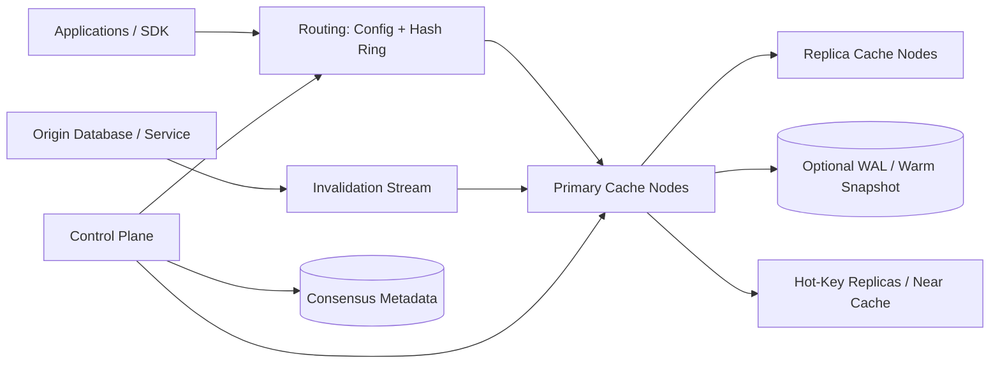

# Production Distributed Cache

## 1. Requirements

### Functional requirements

1. Support `GET`, `SET`, `ADD`, `REPLACE`, `DELETE`, multi-get, TTL, and atomic counters.
2. Provide optional compare-and-swap and small per-key atomic operations.
3. Distribute data across nodes and rebalance with limited disruption.
4. Replicate hot data for availability.
5. Enforce namespaces, quotas, and item-size limits.
6. Offer cache-aside clients and optional write-through/invalidation integration.
7. Expose hit rate, evictions, hot keys, and per-tenant usage.

### Non-functional requirements

- Sub-millisecond server processing and low-single-digit millisecond regional latency.
- Millions of operations per second per cluster.
- Graceful degradation during node loss and traffic spikes.
- No requirement for durable storage by default; origin remains authoritative.
- Predictable memory use and tenant isolation.
- Avoid stale or resurrected values beyond documented consistency bounds.

This is a general application cache, not a durable database. Range queries, arbitrary scans, and multi-key ACID transactions are out of scope.

## 2. Scale assumptions and capacity

Assume:

- 50 million requests/second peak, 95% reads.
- 20 TB logical cached values.
- 1 KB average and 1 MB maximum item.
- Replication factor two: 40 TB raw value memory.
- 75% target memory occupancy to leave room for metadata and fragmentation.
- 600 cache nodes with roughly 128 GB usable memory each.
- 90% target hit rate; a 5-point drop on the 47.5 million reads/second adds roughly 2.4 million origin reads/second.
- Payload bandwidth is about 47.5 GB/s for 1 KB read hits, plus about 5 GB/s of replicated write payload before protocol overhead.

Memory overhead can exceed 30% for keys, expiration, allocator classes, and hash tables: 40 TB replicated payload becomes about 52 TB resident, and at 75% occupancy needs about 70 TB provisioned. Capacity planning must use resident bytes, not payload bytes.

## 3. High-level architecture



Clients can route directly for the lowest latency, while a proxy mode simplifies operations and security. The control plane never sits on the normal data path.

## 4. Data model and protocol

```text
Namespace
- namespace_id
- quota_bytes
- default_ttl
- max_item_size
- eviction_policy
- consistency_mode

CacheEntry
- namespace_id
- key_bytes
- value_bytes
- version
- created_at
- expires_at
- flags
- origin_version

ShardAssignment
- virtual_shard
- primary_node
- replica_nodes
- config_epoch
```

Use a compact binary protocol with request IDs and pipelining:

```text
Get(namespace, key, min_version?)
Set(namespace, key, value, ttl, condition?, request_id)
Delete(namespace, key, expected_version?)
Increment(namespace, key, delta, initial, ttl)
MultiGet(namespace, keys)
```

Responses distinguish miss, expired, condition failure, moved shard, throttling, and server failure. A miss is normal; a transport failure must not be disguised as a miss.

## 5. Core APIs

```http
GET /v1/cache/{namespace}/{key}
PUT /v1/cache/{namespace}/{key}
If-Match: "version"

{
  "value": "base64...",
  "ttl_seconds": 300
}
```

```http
DELETE /v1/cache/{namespace}/{key}
POST   /v1/cache/{namespace}:mget
POST   /v1/cache/{namespace}/{key}:increment
GET    /v1/namespaces/{namespace}/stats
```

SDKs should expose explicit result types: `Hit(value, version)`, `Miss`, and `Error`. They implement deadlines, bounded retries, circuit breakers, and request coalescing.

## 6. Cache-aside read flow

1. The application asks the cache for a key.
2. The SDK hashes namespace/key to a virtual shard and sends `GET` to its primary or an allowed replica.
3. On a hit, the node verifies expiration and returns the value/version.
4. On a miss, one caller acquires a short single-flight lease or local coalescing slot.
5. That caller reads the authoritative origin and populates the cache with bounded TTL and jitter.
6. Waiters reuse the result rather than stampeding the origin.

At Facebook scale this is often implemented as a lease: a miss returns a short token, and the cache accepts the fill only with that token, so a slow reader cannot overwrite a newer value after an invalidation.

Negative caching can protect the origin for nonexistent values but needs a short TTL. Serve-stale-on-error is useful only for data explicitly marked safe to be stale.

## 7. Write and invalidation strategies

### Cache-aside

Write the database, then delete the cache key. Deletion is safer than overwriting because a concurrent reader may have fetched an older database value. The remaining race is handled with origin versions or delayed second invalidation.

### Write-through

The cache synchronously invokes or participates with the origin, improving read freshness but coupling availability and requiring clear commit ordering.

### Change-data-capture invalidation

The origin emits committed changes to an ordered stream. Consumers delete or update keys carrying `origin_version`. Nodes reject invalidations older than the entry's version, preventing reordered events from deleting newer data.

The double-delete pattern can reduce a specific read/write race but is timing-dependent; versioned invalidation is more rigorous. If the cache cannot retain full versions for deleted entries, use short delete hold-offs/tombstones so a tardy stale fill is rejected instead of resurrecting old data.

## 8. Expiration, eviction, and stampede control

Expiration combines:

- Lazy removal on access.
- Periodic sampling of expiration buckets.
- A timing wheel for near-term TTLs.

Add TTL jitter so popular entries do not expire together. Eviction runs before memory is exhausted and may use sampled LRU, LFU with aging, or segmented policies. Protect tiny hot items from one-time scans using an admission policy such as TinyLFU.

Stampede controls include per-process single flight, distributed leases for extremely expensive values, probabilistic early refresh, and stale-while-revalidate. Lease holders have short timeouts; a failed refresher must not block all readers.

## 9. Consistency and concurrency

Within one primary, operations on a key are serialized. `ADD`, counters, and compare-and-swap are atomic per key. There is no cross-key atomicity.

Replication may be:

- Asynchronous: lowest write latency, possible loss/staleness on failover.
- Quorum/synchronous: better failover consistency, higher latency.

Use monotonically increasing versions or origin commit versions. A promoted replica increments the shard epoch; old primaries are fenced before accepting writes. Clients include `config_epoch` and retry explicit `MOVED` responses.

For security-sensitive revocation, bypass an eventually consistent cache or use synchronous invalidation and short TTLs. The cache's consistency mode must match the data.

## 10. Partitioning and routing

Map keys to thousands of virtual shards using a stable hash:

```text
virtual_shard = hash(namespace_id || key) mod V
```

The control plane assigns virtual shards to physical nodes based on memory and failure domain. This is easier to rebalance than moving arbitrary consistent-hash ranges.

During migration:

1. Mark the shard `COPYING` at a new config epoch.
2. Stream existing entries while dual-writing new mutations or logging deltas.
3. Compare checksums/sample counts.
4. Switch ownership atomically in metadata.
5. Keep the old owner forwarding briefly, then discard its shard.

Because data is a cache, cold migration can also accept misses and refill, but rate-limit this choice to protect the origin.

## 11. Storage and memory management

Use an in-memory hash table plus slab/arena allocation to reduce fragmentation. Store small metadata inline and large values in size-class arenas. Enforce maximum key/value sizes before allocation.

Optional local NVMe extends capacity for colder objects, but it changes tail latency and complicates eviction. It is best treated as a separate tier for large or cooler objects, with checksums, admission control, and Bloom filters to avoid unnecessary device reads. Optional warm snapshots or a short WAL reduce cold-start origin load; they do not turn the cache into the source of truth.

Compression saves memory and network for large values but costs CPU. Apply it above a threshold and store the codec flag per entry.

## 12. Hot keys and hot shards

A single celebrity key can saturate one primary even with ample cluster capacity. Mitigations:

- Replicate read-only hot keys to more nodes or replicated pools with per-client replica selection.
- Use short-lived SDK near caches with versioned invalidation.
- Request coalescing and response caching in proxies.
- Detect hot keys with sampling/sketches rather than full per-key metrics.
- Split hot counters into sharded partial counters when exact immediate totals are unnecessary.

Adding ordinary shards does not solve a single-key bottleneck. Hot-key replication must preserve invalidation and bounded staleness.

## 13. Reliability and failure handling

| Failure | Handling |
|---|---|
| Cache node fails | Promote fenced replica or treat entries as misses |
| Retry reaches old owner | Epoch check returns `MOVED` |
| Replica is stale at promotion | Document possible lost writes; use quorum mode where unacceptable |
| Entire cache restarts | Admission limits, jittered refill, origin protection |
| Invalidation consumer lags | Alert; versions and TTL bound staleness |
| Large tenant fills memory | Namespace quota and fair eviction |
| Hot key overloads node | Extra read replicas, near cache, coalescing |
| Cache timeout | Circuit breaker; explicit fallback policy |
| Corrupt snapshot | Ignore and warm from origin |
| Control plane outage | Nodes continue with last assignment; reconfiguration pauses |

Origin capacity is part of cache reliability. Shed optional traffic, serve approved stale values, and recover gradually after widespread misses.

## 14. Multi-region design

Run independent regional cache clusters near applications. The authoritative database or change stream distributes versioned invalidations. Do not synchronously replicate ordinary cache writes across continents; the latency cost defeats caching.

Region-local keys include tenant and schema/version prefixes. A regional outage shifts traffic to another region whose cache may be cold, so prewarm critical keys and rate-limit failover. For globally immutable data, CDN or cross-region cache fill is safe. For mutable data, use origin versions and accept a stated staleness window.

## 15. Security and tenant isolation

- Mutual TLS and workload identities; no unauthenticated public cache.
- Namespace-scoped authorization and unguessable tenant separation.
- Encrypt network traffic, snapshots, and spill disks.
- Quotas for memory, QPS, bandwidth, item size, and connections.
- Never put credentials or highly sensitive plaintext in shared caches without application encryption.
- Scrub values from logs and sampled diagnostics.
- Audit namespace configuration and bulk flush operations.
- Disable dangerous wildcard scans and global flush for normal tenants.

Cache poisoning is prevented by authenticating writers and including schema/version and tenant in keys.

## 16. Observability

Track:

- Hit, miss, stale, and error rates by namespace and operation.
- Latency percentiles split by server, network, and origin fallback.
- Resident bytes, logical bytes, allocator fragmentation, and eviction rate.
- Expiration rate, TTL distribution, and rejected allocations.
- Hot keys/shards, replication lag, and failover count.
- Rebalance bytes and duration.
- Invalidation lag and version regressions.
- Consistency SLOs such as `N nines of writes consistent within M minutes`, verified by sampled cache-vs-origin probes.
- Origin request amplification during incidents.

A high hit rate can hide poor value: measure saved origin latency/cost and ensure errors are not counted as misses.

## 17. Operational safeguards

Roll out client hashing and protocol changes compatibly. Configuration changes carry epochs and staged activation times. Provide per-namespace flush, but require confirmation and rate-limit refill afterward. Capacity automation adds nodes before eviction pressure becomes severe.

Chaos tests should remove primaries, delay invalidations, restart a cluster cold, and overload one key while verifying the origin remains protected.

## 18. Major trade-offs

### Direct clients versus proxies

Direct routing minimizes hops but distributes topology logic. Proxies centralize policy and connection pooling but add latency and a scaling tier.

### TTL versus explicit invalidation

TTL is simple and bounds staleness. Invalidation improves freshness but can lag or be reordered. Production systems usually combine versioned invalidation with TTL as a safety net.

### Replication versus origin fallback

Replicas improve hit availability but double memory. Cheap, resilient origins may prefer misses; expensive origins justify replicas.

### LRU versus LFU/admission

LRU adapts quickly but scan pollution evicts hot data. LFU/admission preserves frequently reused entries but needs aging and more metadata.

### Availability versus freshness

Serving stale data maintains availability but is unsafe for permissions or balances. Make stale fallback a per-namespace policy.

## 19. Lessons from production systems

### Facebook Memcache: leases, pools, and gutter fallback

Facebook's NSDI memcache work shows that at billions of requests per second, stampedes and failover behavior dominate the design. Cache misses should return a short lease token so only one reader fills the value, stale fills are fenced, and overloaded or failed nodes can spill misses to a small gutter pool instead of stampeding MySQL. This maps directly to the single-flight lease in the read path and the origin-protection controls in cold-start and failure handling.

### Meta mcrouter: make routing an operable tier

Meta's mcrouter treats the memcached protocol router as a programmable production tier: connection pooling, prefix routing, replicated pools, shadow traffic, online reconfiguration, and route-handle composition. For this design, proxy mode should not be described as merely simpler security; it is where large deployments centralize routing policy, hot-key replication, warmup/shadow testing, and cross-cluster failover while preserving client protocol compatibility.

### Meta Polaris: consistency needs an external SLO

Meta's Polaris work is a reminder that versioned invalidation is not enough unless the system can prove it is working. Polaris watches invalidation events, queries cache replicas as a client, retries at multiple timescales to avoid false positives, and reports metrics like `99.99999999% consistent within five minutes`. This design should expose a similar sampled consistency probe, plus tracing around the race window between fills, invalidations, evictions, and failover.

### Meta McDipper: flash caches are a different tier

McDipper replaced some RAM-heavy memcache pools with flash and reportedly cut servers in some pools by up to 90% while keeping more than 90% of gets sub-millisecond. The mechanism matters: checksums, optional Bloom filters, compression, encryption, and arenas, plus delete hold-offs to stop stale fills after invalidations. In this design, NVMe should be reserved for colder or larger objects and isolated from the low-latency RAM tier.

### Netflix EVCache: topology-aware clients and best-effort replication

EVCache wraps memcached with discovery, client-managed server groups, zone-aware reads, cross-zone mirroring, retries, fallbacks, compression, client-side caching, and write-only mode during maintenance. It also explicitly makes no convergence or consistency guarantee. For this design, multi-AZ replication can improve availability, but freshness-sensitive namespaces still need origin versions, bypass options, and documented staleness windows.

### Uber CacheFront: integrate caching with the storage service

Uber's Docstore CacheFront moved caching into the stateless query engine rather than every microservice owning Redis and invalidation code. It started with point reads, served more than 40 million reads/second, and later scaled past 150 million reads/second by combining Redis, CDC via Flux, timestamp-based deduplication, invalidation markers, and per-request bypass for strong-consistency flows. This supports offering write-through/invalidation integration as a first-class storage-service feature, not only SDK boilerplate.

### Cloudflare Instant Purge: index invalidation near the data

Cloudflare moved from lazy purge records to active purge backed by CacheDB, a Rust/RocksDB sidecar on each cache machine, with local indexes for tags, hostnames, and prefixes. Purges can take effect in under 150 ms P50 globally while saving about 10x storage versus retaining lazy purge history. For application caches with tag or namespace invalidation, keep indexes scoped near the cached data rather than building one global purge index.

### Twitter Pelikan and Segcache: metadata dominates small-object caches

Twitter's Pelikan work calls out production issues that generic Redis/Memcached deployments can hide: unbounded fragmentation, maintenance work on latency-sensitive threads, dangerous flush commands, weak observability, and poor protocol extensibility. Segcache further shows that for TTL-heavy small objects, metadata and delayed expiration can waste a large fraction of memory; segment-structured storage reduced footprint by up to 60% for representative workloads. This design's quotas and capacity math should therefore budget resident bytes and choose storage engines by workload shape, not just API compatibility.

## 20. Recommended interview presentation

1. Clarify that the origin remains authoritative and define allowed staleness.
2. Estimate QPS, memory including overhead, hit rate, and origin amplification.
3. Draw SDK routing, virtual shards, replicas, control plane, and invalidations.
4. Walk through cache-aside reads and database-write invalidation races.
5. Deep-dive into TTL, eviction, stampede prevention, and hot keys.
6. Explain epochs, failover, and shard migration.
7. Cover cold-start protection and regional independence.
8. Finish with freshness/availability and memory/replication trade-offs.

The central design insight is:

> Treat the cache as disposable but operationally dangerous: partition by stable virtual shards, serialize per-key mutations at a fenced primary, combine TTL with versioned invalidation, and protect the origin from stampedes, hot keys, and cold restarts.


## Further reading: curated engineering blogs

| Source | Article | Why it matters |
|---|---|---|
| Meta / USENIX | [Scaling Memcache at Facebook](https://www.usenix.org/conference/nsdi13/technical-sessions/presentation/nishtala) | Canonical design for leases, regional pools, gutter fallback, and origin protection at billion-QPS cache scale. |
| Meta | [Introducing mcrouter: A memcached protocol router for scaling memcached deployments](https://engineering.fb.com/2014/09/15/web/introducing-mcrouter-a-memcached-protocol-router-for-scaling-memcached-deployments/) | Shows how proxy routing, replicated pools, shadowing, warmup, and online reconfiguration become core cache infrastructure. |
| Meta | [Cache made consistent](https://engineering.fb.com/2022/06/08/core-infra/cache-made-consistent/) | Explains Polaris, client-observable consistency SLOs, and tracing the fill/invalidation race window. |
| Meta | [McDipper: A key-value cache for Flash storage](https://engineering.fb.com/2013/03/05/web/mcdipper-a-key-value-cache-for-flash-storage/) | Demonstrates when flash/NVMe cache tiers work and why tombstones/delete hold-offs prevent stale resurrection. |
| Netflix | [EVCache features](https://netflix.github.io/EVCache/features/) | Documents zone-aware discovery, mirroring, retries, client caches, maintenance modes, and explicit best-effort consistency. |
| Uber | [How Uber Serves Over 40 Million Reads Per Second from Online Storage Using an Integrated Cache](https://www.uber.com/us/en/blog/how-uber-serves-over-40-million-reads-per-second-using-an-integrated-cache/) | Shows why caching belongs in the storage/query layer for transparent adoption, independent scale-out, and centralized invalidation. |
| Uber | [How Uber Serves over 150 Million Reads per Second from Integrated Cache with Stronger Consistency Guarantees](https://www.uber.com/us/en/blog/how-uber-serves-over-150-million-reads/) | Covers CDC invalidation, invalidation markers, timestamp dedupe, bypass policies, and TTL-bound staleness at larger scale. |
| Cloudflare | [Instant Purge: invalidating cached content in under 150ms](https://blog.cloudflare.com/instant-purge/) | Details local per-machine purge indexes with RocksDB sidecars, active purge, and global invalidation latency targets. |
| Twitter / Pelikan | [Why Pelikan](https://pelikan.io/blog/why-pelikan/) | Explains operational cache-server requirements: predictable memory, tail latency isolation, protocol extensibility, and safer admin commands. |
| Twitter / Pelikan | [Segcache: a memory-efficient, scalable cache for small objects with TTL](https://pelikan.io/blog/segcache/) | Shows how TTL-heavy small-object workloads are dominated by metadata, fragmentation, and expiration efficiency. |
