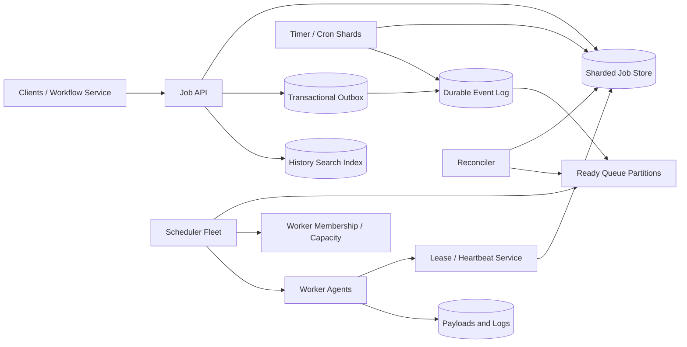

# Production Distributed Job Scheduler

## 1. Requirements

### Functional requirements

1. Submit immediate, delayed, recurring, and dependency-based jobs.
2. Dispatch work to heterogeneous worker pools using resource and placement constraints.
3. Support retries, timeouts, cancellation, priorities, rate limits, and deadlines.
4. Prevent two healthy workers from concurrently owning the same attempt.
5. Expose status, progress, logs, history, and searchable metadata.
6. Support cron schedules with explicit time zones and daylight-saving behavior.
7. Handle workflows/DAGs and fan-out/fan-in dependencies.
8. Provide dead-lettering and manual replay.

### Non-functional requirements

- Schedule tens of millions of jobs per day with second-level dispatch latency.
- Remain available across machine and availability-zone failures.
- Never lose an accepted job within the home-region quorum; cross-region disaster recovery has an explicit RPO unless writes are synchronously replicated across regions.
- Provide at-least-once execution; clearly define idempotency expectations.
- Isolate tenants and prevent starvation.
- Scale the control plane independently from worker execution.

Exactly-once side effects are out of scope because the scheduler cannot atomically commit arbitrary external work. It provides fencing and idempotency tools instead.

## 2. Scale assumptions and capacity

Assume:

- 100 million job runs/day: about 1,160/second average and 20,000/second peak.
- 10 million recurring definitions.
- 5 million simultaneously running attempts.
- 200,000 worker nodes across many pools.
- 1 KB average job metadata and 20 state transitions per run.
- 30 days of searchable hot history and one year archived.

```text
100M runs/day x 20 transitions x 300 bytes
= about 600 GB/day of unreplicated event history
```

Payloads and logs belong in object storage; queue rows contain references. Large scheduled bursts, such as midnight cron jobs, matter more than average throughput.

## 3. High-level architecture



The durable job store is authoritative. Ready queues accelerate dispatch but are reconstructable hints; if a queue/log is chosen as the initial write buffer, the client acknowledgment must match its replication durability. Schedulers decide placement; workers execute untrusted or isolated workloads.

## 4. Data model and state machine

```text
JobDefinition
- job_id
- tenant_id
- command_or_handler
- payload_uri
- schedule
- timezone
- retry_policy
- timeout
- priority
- constraints
- revision

JobRun
- run_id
- job_id
- scheduled_for
- state
- remaining_dependencies
- attempt_count
- deadline
- idempotency_key
- version

Attempt
- attempt_id
- run_id
- number
- worker_id
- lease_epoch
- lease_expires_at
- started_at / finished_at
- result_uri
- failure_class

Dependency
- parent_run_id
- child_run_id
- condition: SUCCESS | COMPLETION

StateEvent
- run_id
- sequence
- from_state / to_state
- actor
- timestamp
```

Core run transitions:

```text
SCHEDULED -> READY -> DISPATCHED -> RUNNING -> SUCCEEDED
                     |             |-> RETRY_WAIT -> READY
                     |             |-> FAILED
                     |             |-> TIMED_OUT
                     |             |-> CANCELED
                     |-> READY (lease expires before start)
```

Every transition uses compare-and-swap on `version` and appends a state event in the same transaction.

## 5. Core APIs and worker protocol

```http
POST /v1/jobs
Idempotency-Key: client-uuid

{
  "handler": "generate-invoice:v3",
  "payload_uri": "obj://payloads/...",
  "run_at": "2026-10-13T09:00:00Z",
  "timeout_seconds": 900,
  "retry": {"max_attempts": 5, "backoff": "exponential"},
  "constraints": {"pool": "finance", "cpu": 2, "memory_mb": 4096}
}
```

```http
POST   /v1/jobs/{job_id}:pause
POST   /v1/jobs/{job_id}:resume
POST   /v1/runs/{run_id}:cancel
POST   /v1/runs/{run_id}:retry
GET    /v1/runs/{run_id}
GET    /v1/runs?tenant_id=...&state=FAILED
GET    /v1/runs/{run_id}/events
```

Workers use a bidirectional gRPC stream:

```text
Register(capabilities, pool, resources)
Offer(attempt_id, lease_epoch, payload_ref, deadline)
Accept(attempt_id, lease_epoch)
Heartbeat(attempt_id, lease_epoch, progress)
Complete(attempt_id, lease_epoch, result_ref)
```

Every worker mutation includes the lease epoch. A stale worker receives an explicit fenced error.

## 6. Job submission flow

1. The API authenticates the tenant, validates limits and schedule syntax, and stores large payloads separately.
2. In one transaction it inserts the definition/run, idempotency record, audit event, and outbox record.
3. Immediate jobs enter `READY`; future jobs enter `SCHEDULED`.
4. An outbox publisher emits ready events to the appropriate queue partition.
5. The client receives the stable job/run ID. A retry with the same key and equivalent request returns it; a different request is rejected.

The outbox closes the gap between committing a job and publishing it. A reconciler periodically scans authoritative `READY` rows without active dispatch records and republishes them.

## 7. Timers, cron, and delayed jobs

Partition timers by a hash of `job_id` and time bucket. Each timer shard owns a renewable, fenced lease and scans an indexed window such as:

```text
WHERE shard = ? AND next_fire_time <= now + lookahead
```

Near-term timers enter a hierarchical timing wheel or priority heap; far-future timers remain in the database. On firing, a conditional transaction creates a uniquely keyed run `(job_id, scheduled_for)` and computes the next occurrence.

Cron definitions store the original expression, IANA time zone, and explicit daylight-saving policy:

- Missing local time: skip or run at the next valid instant.
- Repeated local time: run once or twice.
- Misfire: catch up, coalesce to one run, or skip.

For non-idempotent cron jobs, prefer fail-closed behavior: skipping or operator-controlled catch-up is usually safer than accidentally double-launching. Clock skew is bounded with synchronized clocks, but database compare-and-swap—not local time alone—prevents double creation.

## 8. Dispatch and placement

Ready queues are partitioned by pool and priority band. Scheduler instances consume partitions under leases and maintain a soft cache of worker capacity. For workflow-heavy workloads, sticky ownership of a workflow shard can keep related state transitions local, but ownership must be rebuildable from the database after failure.

Placement filters by:

- Required runtime, labels, region, and compliance zone.
- CPU, memory, GPU, and ephemeral disk.
- Tenant concurrency and rate limits.
- Affinity/anti-affinity and data locality.
- Deadline and priority.

Then it scores eligible workers by remaining capacity, locality, fragmentation, and recent failure rate. The scheduler creates an `Attempt` and transitions `READY -> DISPATCHED` before offering it. If the worker does not accept promptly, the offer expires and the run is requeued.

Use deficit round robin or weighted fair queuing across tenants, with reserved capacity for critical classes and per-namespace quotas so one tenant or job type cannot monopolize shared queues. Aging prevents low-priority starvation.

## 9. Execution, leases, retries, and cancellation

After accepting, the worker starts an isolated process/container and transitions the attempt to `RUNNING`. It renews a short lease and reports progress. Missing heartbeats cause the attempt to become lost; after a grace period the reconciler increments the lease epoch and retries.

Retries distinguish:

- Transient infrastructure or retryable application errors.
- Permanent validation/application failures.
- Scheduler cancellation and deadline expiration.

Backoff uses exponential delay plus jitter and respects a maximum attempts/elapsed-time budget. Cancellation is cooperative first: mark `CANCEL_REQUESTED`, notify the worker, then terminate after a grace period. A completion racing with cancellation wins only through a documented conditional transition.

Worker code receives `run_id`, `attempt_id`, and a stable business idempotency key. For side effects, it should use an idempotency table or transactional inbox in the destination system.

## 10. Workflow and dependency handling

A DAG submission validates acyclicity and creates dependency edges. Each child stores `remaining_dependencies`. When a parent reaches a terminal state, an idempotent dependency consumer records that edge as processed and atomically decrements the counter if the edge condition is satisfied. If a required `SUCCESS` edge cannot be satisfied because the parent failed or was canceled, the child is marked `SKIPPED`/`BLOCKED` (or failed according to workflow policy) rather than waiting forever. The child becomes `READY` exactly when all required edges are processed and their conditions hold.

For massive fan-out, do not transact across all children. Emit partitioned parent-completion events and use batched conditional updates. A workflow aggregator computes summary state from durable child transitions. Compensation is application-defined; the scheduler must not pretend arbitrary steps can be rolled back.

## 11. Consistency and concurrency

Strong consistency is required for:

- Run state transitions.
- Attempt ownership and lease epochs.
- Uniqueness of scheduled occurrences and idempotency keys.
- Dependency counters.

Queue delivery, search indexing, logs, and progress are eventually consistent. Queue messages are hints containing IDs; consumers re-read authoritative state and ignore obsolete messages.

Fencing is essential. A lease timestamp alone fails if a paused scheduler resumes. Monotonically increasing `lease_epoch` values let the database, worker, and downstream resource reject stale owners.

## 12. Partitioning and storage

Shard job/run rows by `tenant_id` plus hashed `job_id` to distribute large tenants. Keep a run and its attempts/events together. Separate indexes serve `(state, next_action_time, shard)` scans without globally querying all jobs.

Ready queues partition by execution pool and priority, with virtual partitions for rebalancing. Timer buckets partition by fire time and hash. Very large tenants get namespace-level capacity reservations and many virtual shards; small tenants can share shards without losing quota isolation. Payloads, results, and logs use immutable object keys and checksums.

Move terminal event histories to columnar object-storage files after the hot period. Keep compact status rows online and index selected fields in a search engine. Search is never authoritative for scheduling.

## 13. Reliability and failure handling

| Failure | Handling |
|---|---|
| API response lost after commit | Idempotency key returns original job |
| Outbox publish fails | Publisher retries; reconciler republishes |
| Ready message duplicated | Conditional state transition ignores obsolete message |
| Scheduler crashes after dispatch | Attempt lease expires; fenced retry |
| Worker completes after lease loss | Stale epoch rejects completion |
| Worker dies after external side effect | Retry may repeat; handler idempotency is required |
| Timer owner fails | New fenced owner scans overlap window |
| Queue unavailable | Accepted jobs remain in authoritative store |
| Search index lags | Status lookup reads job store |
| Poison job repeatedly crashes workers | Retry budget, quarantine, and dead-letter queue |
| Zone fails | Replicated metadata elects owners in another zone |

Run continuous invariants: no `RUNNING` attempt with an expired unhandled lease, no `READY` job absent from reconciliation, and no child with a negative dependency count.

## 14. Multi-region design

Assign each tenant or job to a home region for state transitions and timer ownership. Stateless APIs route writes home; workers may run elsewhere if latency and data policy permit. Metadata replicates synchronously across availability zones and asynchronously to a disaster-recovery region by default; choose synchronous cross-region writes only for tenants that require zero regional data loss and can accept the added latency/availability trade-off.

During regional failure:

1. Stop or fence old-region lease issuance.
2. Verify replication position against the accepted recovery-point objective and disclose/reconcile any acknowledged home-region writes beyond that point.
3. Promote the secondary and increment regional epochs.
4. Reconstruct ready queues and timer windows from authoritative rows.
5. Treat old workers as stale until they re-register.

Active-active ownership of one run is avoided. Globally submitted jobs can be routed by tenant home while read APIs use replicas.

## 15. Security and isolation

- Authenticate users and workers with short-lived identities and mutual TLS.
- Authorize job types, worker pools, payloads, cancellations, and replay separately.
- Encrypt metadata, payloads, results, and logs with KMS-managed keys.
- Run workloads in sandboxed containers or microVMs with least-privilege service accounts.
- Keep secrets out of job payloads; inject scoped secret references at execution.
- Enforce tenant quotas for submissions, concurrency, CPU time, storage, and retries.
- Validate handler allowlists and prevent arbitrary control-plane command injection.
- Audit definition changes, dispatch, cancellation, secret access, and manual retries.

## 16. Observability

Track:

- Submission rate, validation failures, and idempotent replays.
- Schedule-to-ready, ready-to-dispatch, and dispatch-to-start latency.
- Queue depth and oldest age by pool, priority, and tenant.
- Running attempts, lease renewals, lost workers, and fenced stale writes.
- Success, retry, timeout, cancellation, and dead-letter rates by job type.
- Timer lag, cron misfires, and reconciler repairs.
- Worker resource utilization and placement failures.
- Regional replication lag and failover readiness.

The primary SLI is deadline attainment or schedule-to-start latency, not merely API uptime. Synthetic jobs should verify submission through execution and result retrieval.

## 17. Capacity protection and operations

Admission control rejects or delays workloads beyond tenant quotas. Per-handler circuit breakers can pause jobs when a dependency is failing, avoiding a retry storm. Backpressure should be visible as queue age and admission delay, not hidden as unbounded database/Redis memory growth. Operators need safe controls to pause a definition, drain a pool, reduce concurrency, quarantine a version, replay dead letters, and inspect every state transition.

Deploy scheduler changes gradually because placement bugs have fleet-wide blast radius. Version worker protocols and allow mixed-version operation during rollout.

## 18. Major trade-offs

### At-least-once versus exactly-once execution

At-least-once survives worker ambiguity. Exactly-once external effects require cooperation from the destination, so expose stable idempotency keys and fencing instead of making an impossible promise.

### Push versus worker polling

Push gives low latency and informed placement. Polling is simpler through firewalls and naturally applies backpressure. A long-lived worker stream with server offers combines both.

### Database timers versus timing wheels

Database indexes are durable but expensive at high frequency. Timing wheels are efficient but volatile. Keep future truth in the database and cache only the near horizon.

### Central versus decentralized scheduling

Central schedulers optimize placement but can bottleneck. Partitioned schedulers by pool retain global policy within a manageable domain.

### Strict priority versus fairness

Strict priority can starve tenants. Weighted fair queues with reserved emergency capacity provide predictable isolation.

## 19. Lessons from production systems

### Dropbox ATF: callback contracts and no-concurrent-task ownership

Dropbox's Async Task Framework was built for 10,000 tasks/second from the start, was serving about 9,000 scheduled tasks/second, and targeted 95% of tasks beginning within five seconds of their scheduled time. Its most transferable idea is the explicit user contract: at-least-once execution, idempotent callbacks, terminal-state signaling by user code, and no concurrent execution of the same task. This design should expose the same contract in the API and worker SDK instead of burying retries and fencing as implementation details.

### Slack: durable buffers prevent queue-memory deadlock

Slack's older Redis-backed queue failed badly when Redis filled: enqueue stopped, and even dequeue required enough memory to move jobs into an in-flight list. Slack inserted Kafka ahead of Redis through a stateless Kafkagate service, preserving application interfaces while adding a durable write buffer for bursts. This scheduler should treat bounded in-memory queues as dispatch accelerators only; accepted jobs need durable storage/logging before client acknowledgment, and queue age should trigger backpressure before memory exhaustion.

### Meta FOQS: persistent priority queues with leases and active-topic discovery

FOQS is a sharded-MySQL, multitenant priority queue with namespace/topic isolation, `deliver_after`, lease duration, ack/nack, delayed redelivery, and active-topic discovery. Meta also uses prefetch buffers and in-memory ready indexes to avoid scanning every shard on dequeue. This maps directly to ready-queue partitions: keep priority/delay metadata durable, let consumers lease work, and use active partition/topic discovery so workers do not poll every possible queue.

### Meta Async: delay tolerance, time shifting, and batching

Meta's Async platform moved beyond simple FIFO priority because large use cases and peak-hour load could starve smaller or more urgent work. It classifies work by delay tolerance and uses queues, time shifting, and batching to move tolerant work away from peaks while preserving urgent workloads. The scheduler should therefore make deadline/delay tolerance a first-class placement signal and expose coalescing/batching policies for tenants that can trade latency for efficiency.

### Airbnb Dynein: separate immediate queues from durable delayed scheduling

Airbnb's Dynein wraps SQS for immediate jobs and uses a separate delayed scheduler for jobs that may be months or years in the future, with an inbound SQS queue buffering scheduler ingestion spikes. This supports the database-plus-near-horizon timing-wheel split: durable future triggers remain in a scheduler store, immediate execution uses queue semantics, and an inbound buffer smooths write spikes without losing jobs.

### Google distributed cron: prefer fail-closed for non-idempotent schedules

Google SRE's distributed cron chapter emphasizes that some cron jobs tolerate skipped runs but not double launches, such as payroll or newsletters. Their lesson is to track launch state consistently and often prefer skipping over duplicate launch when ambiguity remains. This design should require explicit misfire and idempotency policy per cron definition, with operator-visible skipped launches rather than automatic duplicate catch-up for unsafe jobs.

### Netflix Maestro: keep authoritative state single and rebuild fast caches

Netflix redesigned Maestro's engine after dual state in Conductor tables plus Maestro tables and external queues created race conditions, stuck jobs, and lost executions. The new engine keeps the database as source of truth, rebuilds in-memory flow state after failure, partitions flow groups, and uses generation IDs for ownership. This reinforces the design choice that queues, heaps, and actor state are caches; the database must be sufficient to rebuild ownership and continue workflows safely.

### Uber Cadence: code-driven durable workflows need versioning and operations

Uber Cadence treats workflows as code in native languages, adding schedules, signals, cancellation, retries, searchable attributes, UI inspection, rate limits, hot-shard detection, failover, resets, versioning, and replay/shadow testing. For this scheduler, DAG support should not stop at dependency counters: long-lived workflows need version-safe replay, operator reset from a safe point, searchable checkpoints, and compatibility rules for in-flight runs during deployments.

### Temporal: durable execution is an application model, not exactly-once side effects

Temporal frames durable execution as crash-proof progress by virtualizing execution across process failures. That is useful for workflow code, but it does not eliminate the need for idempotent activities and external side-effect coordination. This scheduler should distinguish durable orchestration state from side-effect correctness: it can reliably resume a workflow decision, but handlers still need idempotency keys, transactional inbox/outbox patterns, or fenced downstream writes.

### Google Borg: placement is an optimization and isolation problem

Borg runs hundreds of thousands of jobs across clusters up to tens of thousands of machines, combining admission control, task packing, overcommitment, machine sharing, and process-level isolation. A job scheduler at this scale should not only dequeue work; it must model resource requests, pack tasks to reduce fragmentation, spread correlated failures, and expose simulation/analysis tools before changing fleet-wide placement policy.

## 20. Recommended interview presentation

A clear 45-minute sequence is:

1. Clarify job types, latency, retry semantics, and side-effect guarantees.
2. Estimate run/transition rates, concurrent attempts, and burst patterns.
3. Draw the authoritative store, outbox, ready queues, schedulers, and workers.
4. Walk through submission, dispatch, heartbeat, completion, and retry.
5. Deep-dive into cron timers and fencing tokens.
6. Explain idempotency and why execution is at least once.
7. Cover fair scheduling, dependency counters, and reconciliation.
8. Finish with regional failover, sandboxing, and trade-offs.

The central design insight is:

> Keep job state authoritative in a strongly consistent store, use queues as rebuildable dispatch accelerators, and combine renewable leases with monotonically increasing fencing epochs so failures can cause retries without allowing stale owners to mutate state.

## Further reading: curated engineering blogs

| Source | Article | Why it matters |
|---|---|---|
| Dropbox | [How we designed Dropbox ATF: an async task framework](https://dropbox.tech/infrastructure/asynchronous-task-scheduling-at-dropbox) | Defines at-least-once async task contracts, no-concurrent execution, isolation, and latency targets at 9k tasks/sec. |
| Slack | [Scaling Slack’s Job Queue](https://slack.engineering/scaling-slacks-job-queue/) | Shows how durable Kafka buffering avoided Redis memory deadlock while preserving existing job queue interfaces. |
| Meta | [FOQS: Scaling a distributed priority queue](https://engineering.fb.com/2021/02/22/production-engineering/foqs-scaling-a-distributed-priority-queue/) | Details sharded persistent priority queues with delay, leases, ack/nack, active-topic discovery, and trillion-item/day scale. |
| Meta | [Async: Driving efficiency and developer productivity at Facebook scale](https://engineering.fb.com/2020/08/17/production-engineering/async/) | Explains delay tolerance, time shifting, batching, and fairness for billions of asynchronous requests. |
| Airbnb | [Dynein: Building an Open-source Distributed Delayed Job Queueing System](https://medium.com/airbnb-engineering/dynein-building-a-distributed-delayed-job-queueing-system-93ab10f05f99) | Separates immediate SQS-backed queues from durable delayed scheduling with buffering, rate limits, and backpressure. |
| Google SRE | [Distributed Periodic Scheduling with Cron](https://sre.google/sre-book/distributed-periodic-scheduling/) | Covers distributed cron state, idempotency, skipped-vs-duplicate launch trade-offs, and consensus-backed scheduler replicas. |
| Netflix | [100X Faster: How We Supercharged Netflix Maestro’s Workflow Engine](https://netflixtechblog.com/100x-faster-how-we-supercharged-netflix-maestros-workflow-engine-028e9637f041) | Shows how single-source-of-truth state, rebuildable in-memory actors, partitioned ownership, and generation IDs remove workflow races. |
| Uber | [Announcing Cadence 1.0: The Powerful Workflow Platform Built for Scale and Reliability](https://www.uber.com/us/en/blog/announcing-cadence/) | Highlights code-driven workflows, signals, schedules, resets, versioning, failover, search, and operational tooling. |
| Temporal | [The definitive guide to Durable Execution](https://temporal.io/blog/what-is-durable-execution) | Clarifies durable execution as crash-proof workflow progress while leaving external side effects to idempotency/fencing. |
| Google Research | [Large-scale cluster management at Google with Borg](https://research.google/pubs/large-scale-cluster-management-at-google-with-borg/) | Adds placement lessons: admission control, task packing, overcommitment, isolation, correlated-failure avoidance, and simulation. |
