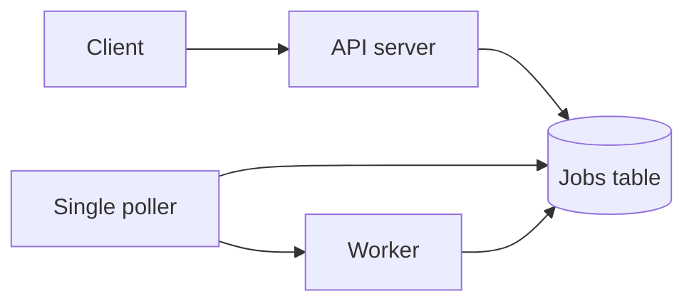
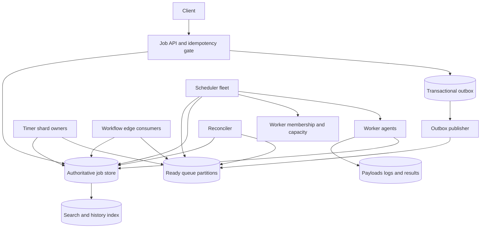
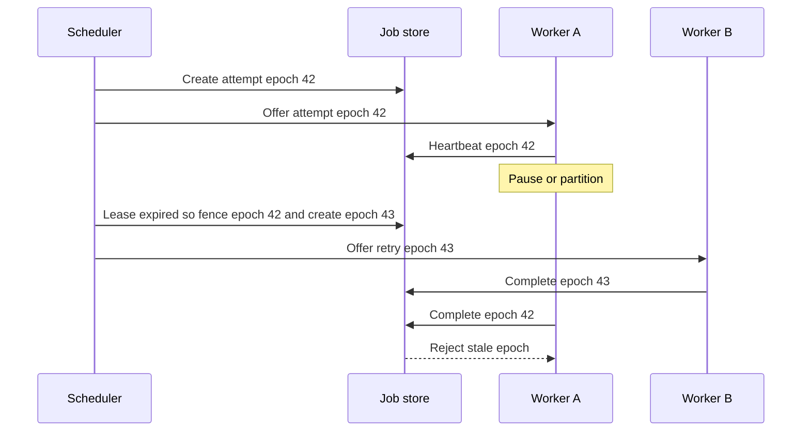
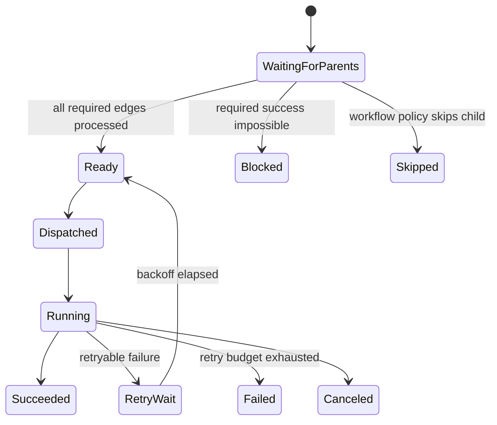

# Distributed Job Scheduler System Design

A distributed job scheduler accepts work that should run now, later, on a recurring calendar, or after other work completes, and it dispatches that work to worker pools. This design focuses on the control plane: durable scheduling, dispatch, retries, leases, cron, and workflow state. It does not try to make arbitrary external side effects exactly once, and it treats payload execution, sandbox internals, and business logic as worker concerns.

## 1. Requirements

### 1.1 Functional requirements

- Let clients create immediate, delayed, recurring, and DAG-based jobs with retries, deadlines, timeouts, priorities, and placement constraints.
- Dispatch ready jobs to heterogeneous workers while respecting tenant quotas, worker capacity, pool labels, and rate limits.
- Provide run status, attempt history, progress, cancellation, manual retry, dead-lettering, and searchable metadata.
- Guarantee that an accepted job is durably recorded and will be attempted at least once unless explicitly canceled or blocked by policy.
- Ensure a single logical job run is not intentionally executed by two active workers at the same time, even when schedulers or workers crash.
- Define cron behavior precisely for time zones, daylight-saving transitions, misfires, catch-up, and skipped occurrences.

### 1.2 Non-functional requirements

- **Schedule fidelity.** The system should start most jobs close to their scheduled time because users experience scheduler delay as missed invoices, stale exports, or late workflows.
- **Durability.** Once the API acknowledges a job, the authoritative metadata must survive machine and availability-zone failure inside the home region.
- **At-least-once execution.** The scheduler must prefer retrying ambiguous work over silently losing it, while exposing idempotency and fencing so applications can make retries safe.
- **No concurrent ownership.** A run should have at most one valid owner epoch at a time, because overlapping attempts can corrupt downstream systems even if every individual worker is healthy.
- **Tenant isolation.** One tenant's midnight cron burst or retry storm must not starve other tenants or exhaust shared queue memory.
- **Rebuildability.** Ready queues, in-memory timer heaps, and workflow actors are accelerators; the durable store must be sufficient to reconstruct them after failure.

### 1.3 The binding constraint

The binding constraint is that a job must run at its intended time, at least once, and never concurrently with itself, across worker crashes and network partitions, while exactly-once external side effects are impossible for the scheduler to guarantee. If a worker charges a credit card and dies before reporting success, the scheduler cannot know whether retrying repeats the charge. If it does not retry, it can lose the job. That ambiguity shapes the design more than raw throughput does.

The consequence is a control plane built around durable intent, reconstructable dispatch hints, renewable leases, monotonically increasing fencing tokens, and explicit idempotency contracts. Timing data must be indexed well enough to find due work without melting a hot `now` partition. Ownership must survive pauses and partitions without letting zombie workers complete stale attempts. Cron and DAG semantics must be written down rather than implied by whatever retry happened first.

## 2. Back-of-the-envelope estimation

Use illustrative numbers to size the shape of the system, not to claim a universal workload. Suppose the service handles `100M` job runs per day. The average arrival rate is `100,000,000 / 86,400 = 1,157.4` runs per second. A 20x daily burst gives about `23,148` runs per second, which we can round to `25k` peak run creations per second for headroom. This means a single database partition or a single ready queue cannot be the path to readiness; the system needs sharded writes and many dispatch partitions.

Each run might produce state events for creation, ready, dispatch, start, heartbeats or progress snapshots, retry, and terminal state. If the durable event stream stores `20` events per run at about `300` bytes each, hot event history is `100M × 20 × 300 = 600,000,000,000` bytes, about `600 GB` per day before replication and indexes. Thirty days of hot searchable event metadata would be about `18 TB` unreplicated. That pushes large payloads, logs, and result blobs out of the transactional store and into object storage, leaving compact state rows and event records in the scheduler store.

Now assume `10M` recurring definitions. If just `10%` fire at the top of the hour, that is `1M` due occurrences in a narrow window. Spread over one minute, the creation pressure is `1,000,000 / 60 = 16,667` runs per second before retries and DAG expansion. If all hourly schedules are indexed only by `next_fire_time`, every timer owner hammers the same key range around the current time. The scheduler needs time buckets plus hash shards, and it should smear eligible work across virtual partitions instead of making the current minute a global hot partition.

Worker scale has a different implication. With `5M` simultaneously running attempts and a `30` second heartbeat interval, the heartbeat write rate is `5,000,000 / 30 = 166,667` heartbeats per second if every heartbeat is durably written. That is too much for the same transaction path that owns state transitions. Heartbeats should update a compact lease record, be coalesced, or be written only when progress changes, while terminal transitions remain strongly consistent.

> **Key idea.** The numbers say the hard part is not accepting an API call; it is indexing due work, smoothing calendar bursts, and keeping ownership state small and strongly consistent while execution progress is noisy and huge.

## 3. API design

**Question.** What makes a client retry safe when the API response is lost after the job was committed?
<details><summary>Answer</summary>

The client supplies an idempotency key scoped to the tenant and operation. The scheduler stores the normalized request hash and the created identifiers in the same transaction as the job. A retry with the same key and equivalent request returns the original `job_id` and `run_id`; a retry with a different request is rejected as a conflict.

</details>

```http
POST /v1/jobs
Idempotency-Key: client-generated-uuid
{
  "handler": "generate-invoice:v3",
  "payload_uri": "obj://payloads/tenant-a/abc",
  "run_at": "2026-10-13T09:00:00Z",
  "timeout_seconds": 900,
  "retry_policy": {"max_attempts": 5, "backoff": "exponential_jitter"},
  "constraints": {"pool": "finance", "cpu": 2, "memory_mb": 4096}
}

POST /v1/schedules
{
  "cron": "0 9 * * MON-FRI",
  "timezone": "America/Los_Angeles",
  "dst_policy": "skip_missing_run_once_on_repeated",
  "misfire_policy": "coalesce",
  "handler": "send-digest:v2"
}

POST /v1/workflows
{
  "nodes": [{"name": "extract", "handler": "etl-extract:v4"}],
  "edges": [{"from": "extract", "to": "load", "condition": "SUCCESS"}],
  "failure_policy": "block_dependents"
}

POST /v1/runs/{run_id}:cancel
POST /v1/runs/{run_id}:retry
GET  /v1/runs/{run_id}
GET  /v1/runs?tenant_id=...&state=FAILED&cursor=...
GET  /v1/runs/{run_id}/events?after_sequence=...
```

The API returns `202 Accepted` for work that has been durably recorded but not completed. Status is a resource, not a synchronous response, because the scheduler cannot know when a worker will start or whether a retry will be needed. List APIs use cursors over a stable sort key instead of offsets; offset pagination over a changing run table skips or duplicates rows during heavy state churn.

Cancellation is deliberately a request, not an immediate fact. If a worker completes at the same time a client cancels, only one conditional state transition wins. The API can report `CANCEL_REQUESTED`, then `CANCELED` if the worker cooperates or the lease is revoked, or `SUCCEEDED` if the completion committed first. That is less pretty than pretending cancellation is instant, but it matches the real race.

Worker protocol calls also carry ownership data:

```http
POST /internal/attempts/{attempt_id}:heartbeat
{
  "run_id": "run_123",
  "worker_id": "worker_9",
  "lease_epoch": 42,
  "progress": {"percent": 63}
}

POST /internal/attempts/{attempt_id}:complete
{
  "run_id": "run_123",
  "lease_epoch": 42,
  "result_uri": "obj://results/run_123/attempt_3"
}
```

The non-obvious field is `lease_epoch`. A timestamp says when a lease seems expired; an epoch says which owner is still authorized. Every mutation from a worker includes it, and stale epochs are rejected even if an old worker resumes after a long pause.

## 4. Data model

Start with the obvious entity: a `JobDefinition` says what to run. That is enough for an immediate one-shot job, but it cannot represent a specific occurrence of a recurring job or a retry with its own deadline. So we add `JobRun`, one row per logical scheduled occurrence. A daily report has one definition and many runs, each with a distinct `scheduled_for` and terminal outcome.

A run still is not enough once workers crash. If run state just says `RUNNING worker_7`, then a second scheduler cannot tell whether `worker_7` is slow, partitioned, dead, or done but unable to report. We add `Attempt`, a numbered execution try with `lease_epoch`, `lease_expires_at`, and `worker_id`. Retries create new attempts or new epochs, and terminal transitions validate the current epoch.

Recurring jobs need a way to prevent duplicate occurrence creation. That requires a uniqueness constraint on `(job_id, scheduled_for)` for logical cron runs. The timer can scan overlapping windows and safely race with another timer owner because only one insert wins. The scheduler may publish duplicate ready messages, but the run row remains unique.

DAGs introduce a different failure. A child cannot just wait for a parent status in memory, because the dependency event may be consumed twice or the workflow engine may restart. We add `DependencyEdge` plus a durable processed marker keyed by `(parent_run_id, child_run_id, condition)`. The child stores `remaining_dependencies`; an idempotent transition decrements it exactly once per satisfied edge.

Finally, debugging and reconciliation need history. A mutable status row tells us where a run is now, but not why it got there. `StateEvent` is appended in the same transaction as important state transitions. Search indexes are derived from these events; they are not authoritative for scheduling.

```text
JobDefinition
- job_id, tenant_id, handler, payload_uri, schedule_spec, timezone
- retry_policy, timeout_seconds, priority, constraints
- misfire_policy, dst_policy, revision, paused

JobRun
- run_id, job_id, tenant_id, scheduled_for, state
- remaining_dependencies, attempt_count, deadline_at
- business_idempotency_key, version, next_action_at

Attempt
- attempt_id, run_id, attempt_number, worker_id
- lease_epoch, lease_expires_at, started_at, finished_at
- result_uri, failure_class, last_progress_digest

DependencyEdge
- parent_run_id, child_run_id, condition
- processed, processed_at

TimerShard
- shard_id, owner_id, owner_epoch, lease_expires_at
- bucket_start, bucket_width_seconds

OutboxEvent
- event_id, aggregate_type, aggregate_id, event_type
- partition_key, payload, created_at, published_at

StateEvent
- run_id, sequence, from_state, to_state
- actor_type, actor_id, timestamp, reason
```

The authoritative rows live in a strongly consistent, sharded transactional store, partitioned by tenant plus hashed job or workflow identifiers so large tenants can spread across virtual shards. The ready queue lives in a durable log or persistent queue partitioned by pool, priority band, and virtual shard. Payloads, logs, and large results live in object storage behind immutable references and checksums. Search attributes and event text go to a search index after commit, but search lag never affects scheduling decisions.

> **Key idea.** The data model separates intent, logical occurrence, physical attempt, and derived dispatch hints; that separation is what lets the system retry ambiguous work without inventing exactly-once execution.

## 5. High-level design

The simplest design is one database table and a poller. The API inserts jobs with `run_at`. A scheduler process repeatedly runs `SELECT * FROM jobs WHERE run_at <= now AND state = 'SCHEDULED' LIMIT 100`, marks rows running, sends them to workers, and updates status when workers finish.



That design breaks in predictable ways. The due-time query becomes a hot range around `now`. A crash after committing the job but before enqueueing it can strand work. A paused worker can resume after its lease expired and overwrite a newer attempt. Queue memory can fill during a burst, causing both enqueue and dequeue to fail. Cron and DAG state held in process memory disappears during failover and creates duplicates or stuck children.

### Fix 1: Make the store authoritative and queues reconstructable

Accepted jobs are committed to the job store before acknowledgment. Ready queues are dispatch accelerators, not the source of truth. The API writes an outbox record in the same transaction as the job, and an outbox publisher emits ready events to queue partitions. If publishing fails, the row remains visible to a reconciler that scans for `READY` work without a live dispatch record and republishes it. Slack hit the danger of relying on bounded queue memory when Redis filled and even dequeue needed memory to move jobs into an in-flight list; the transferable lesson is that a durable buffer and reconstructable queues keep admission and recovery from depending on volatile queue state.

### Fix 2: Index due work by bucket and shard, not by a global clock edge

Delayed and recurring work is stored with `next_action_at`, `time_bucket`, and `timer_shard`. Timer owners lease shards and scan bounded windows such as `bucket = 2026-10-13T09:00Z AND shard = 17`. Near-horizon work can be cached in a timing wheel or heap, but future truth remains in the store. Airbnb Dynein makes the same split between immediate queue semantics and durable delayed scheduling, while Meta FOQS shows why durable delay metadata and active partition discovery matter when consumers cannot poll every possible queue.

### Fix 3: Use attempts, leases, and fencing tokens for ownership

A scheduler does not merely set `state = RUNNING`; it creates an attempt with a renewable lease and a monotonically increasing epoch. Workers heartbeat and complete using that epoch. If the lease expires, a reconciler can create a new epoch and retry. If the old worker later wakes up, its completion is rejected because the epoch is stale. This protects against zombie workers, not just dead ones.

### Fix 4: Treat workflows and cron as durable state machines

Cron creates uniquely keyed logical occurrences, and each definition declares what to do with missed, repeated, and nonexistent local times. DAGs use dependency counters and idempotent edge processing rather than in-memory callbacks. Netflix Maestro's redesign is relevant here: dual state across workflow tables, engine tables, and external queues produced races and stuck executions, so the engine moved toward a single source of truth plus rebuildable in-memory actors.

### Putting it together



A one-shot delayed request enters through the API idempotency gate. The payload is stored by reference, the run is inserted as `SCHEDULED`, and an outbox event records that a timer shard should notice it. When the bucket becomes due, the timer owner conditionally transitions the run to `READY` and publishes a queue hint. A scheduler consumes the hint, re-reads the run, creates an attempt with epoch `1`, and offers it to a worker. The worker heartbeats with epoch `1` and either completes, fails, or times out. If any hint is lost, the reconciler can reconstruct it from the authoritative rows.

> **Key idea.** Each component traces back to a specific failure of the naive design.

## 6. Deep dives

### 6.1 Finding due work without a hot `now` partition

**Question.** Ten million cron definitions exist, and one million of them are due at 09:00. How do we find them on time without every scheduler scanning the same database range?
<details><summary>Answer</summary>

Store future work in indexed time buckets with hash shards and lease ownership. Timer owners scan only their shard windows, create unique occurrences with conditional writes, and publish ready hints. Ready queues use active partition discovery and virtual shards so consumers do not poll empty partitions or overload the current minute.

</details>

The naive query is attractive because it is readable: `WHERE next_fire_time <= now ORDER BY next_fire_time LIMIT 100`. It works in a prototype and fails exactly when users need the scheduler most. Midnight, top-of-hour, and business-day starts concentrate millions of rows around the same key range. Adding more pollers makes the hot range hotter; every poller competes for the same index pages and returns overlapping candidates unless the database supports expensive skip-locked semantics at scale.

The fix is to make due work partitionable before it is due. Each scheduled item stores a bucket such as minute or five-second bucket, plus a hash shard derived from `job_id` or `tenant_id/job_id`. A timer owner leases `(bucket, shard)` ranges for the near horizon. Its scan is bounded: one shard, one bucket range, one owner epoch. If the owner crashes, another owner takes over after the shard lease expires and scans the same window with overlap. Duplicate detection comes from the uniqueness key on `(job_id, scheduled_for)` and conditional state transitions, not from trusting that scans never overlap.

Bucket width is a trade-off. A one-minute bucket reduces index cardinality but creates larger bursts inside the owner. A one-second bucket gives precise scans but more buckets to manage and more shard metadata. A practical design uses coarse durable buckets and a near-horizon timing wheel inside each timer owner. The database answers, "which items may fire soon for this shard?" The in-memory wheel answers, "which of these should fire in the next few milliseconds?" If the timer process dies, it loses only the cache; the next owner reloads from the durable bucket.

The ready queue needs the same anti-hotspot thinking. Partitioning only by priority sends the 09:00 burst to a small number of partitions. Partition by execution pool, priority band, and virtual shard. Consumers discover active partitions rather than polling every possible one. Meta FOQS is a useful production reference: it combines persistent priority and delay metadata with leases, ack/nack, active-topic discovery, and in-memory ready indexes so consumers find active work without scanning every shard. That maps directly to a job scheduler where many partitions are empty most of the day and a few become hot during cron bursts.

Airbnb Dynein reinforces the separation of concerns. Immediate jobs can use queue semantics, while jobs scheduled months out belong in a delayed scheduler store until they approach execution. If all future work is inserted directly into an immediate queue, the queue becomes both a timer database and a dispatch buffer, which makes long delay, rebalancing, and recovery harder. The scheduler should keep the durable future in a store optimized for indexed time scans and publish to immediate queue partitions only when work is near ready.

A subtle failure appears during catch-up after an outage. Suppose a timer shard was down for ten minutes. If it blindly publishes all missed jobs at once, it can produce a retry storm worse than the outage. The timer should respect tenant concurrency, deadline, and misfire policy while catching up. Some jobs need every missed occurrence; some should coalesce to one run; some should skip because duplicate external effects are more dangerous than lateness. That policy belongs on the schedule definition, not in the timer owner's accident of implementation.

Signals worth watching: timer lag by shard, oldest due item age, due-scan rows examined per run emitted, active partition count, ready queue age by tenant and pool, and the fraction of occurrences created by reconciler rather than the normal timer path.

> **Strong-answer criteria.** A senior answer must avoid a global `now` scan, explain why duplicate scans are safe, and separate durable future scheduling from immediate dispatch queues.

| Level | Approach | Why |
|---|---|---|
| Bad | Every scheduler polls `next_fire_time <= now` from one index. | More schedulers amplify the hot range and duplicate work. |
| Good | Partition timers by time bucket and hash shard. | It spreads scans, but still needs lease ownership and duplicate-safe occurrence creation. |
| Great | Use bucketed durable scans, near-horizon timing wheels, active ready partitions, unique occurrence keys, and catch-up policy. | It handles bursts, crashes, and outage recovery without losing the due-time contract. |

### 6.2 Leases, heartbeats, and fencing against zombie workers

**Question.** A worker pauses for two minutes during a garbage-collection stop, its lease expires, and the job is retried elsewhere. The old worker then resumes and reports success. What prevents two completions or two external writes?
<details><summary>Answer</summary>

The scheduler can prevent stale control-plane mutations with monotonically increasing fencing tokens. The resumed worker's completion includes the old `lease_epoch` and is rejected. External side effects require the destination to check the same fencing token or an idempotency key; otherwise the scheduler can only provide at-least-once execution, not exactly-once side effects.

</details>

A lease timeout alone is not enough. It tells the scheduler when it may give up on an owner, but it does not stop the old owner from acting later. Network partitions, process pauses, overloaded hosts, and asymmetric packet loss all create zombies: workers that are no longer authorized but still running. If the only rule is "complete before `lease_expires_at`," a worker with a skewed clock or delayed packets can overwrite a newer attempt.

The core protocol is compare-and-swap around an epoch. When a scheduler dispatches an attempt, it writes `lease_epoch = 42`, `worker_id = worker_a`, and `lease_expires_at = now + duration` under the run's current version. The worker receives epoch `42`. Every heartbeat, progress update, cancellation acknowledgement, and completion includes epoch `42`. The store accepts the mutation only if the run is still in a compatible state and the attempt still has epoch `42`. If the lease expires and a reconciler retries the run, it moves ownership to epoch `43`. From that moment, epoch `42` is fenced.



The lease duration should be short enough to meet recovery objectives but long enough to avoid false loss under ordinary pauses. Heartbeats can be frequent, but the authoritative lease record should stay compact. For millions of running attempts, writing every progress tick as a full event is wasteful. Coalesce heartbeat writes, store a last-seen timestamp and progress digest, and append durable events only for meaningful state transitions or sampled progress.

Fencing must propagate to resources that can be corrupted by stale workers. The job store can reject a stale `Complete`, but it cannot undo a stale worker's direct call to a payment API, data warehouse, or email service. The worker SDK should pass a stable `business_idempotency_key`, `run_id`, `attempt_id`, and `lease_epoch` to handler code. Downstream systems that support conditional writes can store the highest accepted epoch and reject lower epochs. Systems that support idempotency keys can deduplicate repeated calls. Systems that support neither must be treated as at-least-once side-effect targets, and job owners must choose retry policies accordingly.

This is where the design has to be honest. "Exactly once" is sometimes achievable inside one database transaction, but a generic scheduler cannot atomically commit its attempt state with arbitrary external effects. Temporal's durable execution model and Cadence-style workflow histories help code resume after process failure, but activities still need idempotency or compensation. Dropbox ATF states the same contract directly: at-least-once callbacks, idempotent user code, and no concurrent task execution. That is a stronger product contract than vague exactly-once language because it tells users where the boundary is.

Cancellation uses the same protocol. Marking a run `CANCEL_REQUESTED` notifies the current owner. If the worker completes with the current epoch before the cancellation transition fences it, success may win. If cancellation increments the epoch first, later completion is stale. The API should expose this race rather than hiding it: cancellation is best effort until a terminal state is committed.

Signals worth watching: expired leases per pool, stale epoch rejections, completion-after-cancel races, heartbeat write latency, retry-after-side-effect incidents, and workers whose local execution time continues long after their lease is fenced.

> **Strong-answer criteria.** A senior answer must distinguish lease expiry from fencing, include a stale-worker sequence, and state clearly that downstream side effects need idempotency or their own fencing.

| Level | Approach | Why |
|---|---|---|
| Bad | Use a lease expiration timestamp and trust workers to stop. | Paused or partitioned workers can resume and mutate state. |
| Good | Require heartbeats and retry after missed heartbeats. | It detects likely failure but does not fence stale completions. |
| Great | Use CAS state transitions, monotonically increasing epochs, stale mutation rejection, and downstream idempotency or fencing. | It preserves control-plane ownership and makes side-effect ambiguity explicit. |

### 6.3 Cron semantics and DAG workflows

**Question.** A workflow has an hourly cron trigger, a daylight-saving transition, and a child task that depends on a parent succeeding. The scheduler was down for three hours. Which runs exist, and which children become ready?
<details><summary>Answer</summary>

The answer must come from explicit schedule and workflow policy. Cron definitions declare time zone, daylight-saving behavior, and misfire policy such as skip, catch up, or coalesce. DAG children become ready only through durable, idempotent dependency-edge processing; if a required parent success can no longer happen, the child is blocked, skipped, or failed according to workflow policy.

</details>

Cron looks simple until local time becomes part of the contract. A schedule such as `0 2 * * *` in `America/Los_Angeles` has days where 02:00 does not exist and days where an hour repeats. If the scheduler stores only the next UTC instant, users cannot tell whether the system skipped intentionally, fired twice intentionally, or did whatever the library happened to do. The definition should store the original expression, IANA time zone, daylight-saving policy, and a revision. The occurrence row should store the resolved `scheduled_for` instant and the local-time label that produced it.

Misfire policy matters even more during outages. Google SRE's distributed cron chapter highlights that some jobs tolerate skipped launches better than duplicate launches. Payroll, billing, newsletters, and destructive maintenance are examples where fail-closed behavior may be safer than automatic catch-up. Other jobs, such as hourly metrics rollups, may need every missed occurrence. A third class can coalesce: if three hourly refreshes were missed, run once for the latest state. The scheduler should not make this a hidden global setting. It belongs on the schedule, and unsafe catch-up should require explicit opt-in.

The occurrence creation protocol is conditional. For each due local occurrence, the timer tries to insert `(job_id, scheduled_for)` with the schedule revision and policy result. If two timer owners race, one insert wins. If the policy says coalesce, the scheduler creates or updates a single catch-up run keyed by the coalescing window. If the policy says skip, it appends a state event explaining the skipped occurrence so users see an intentional decision rather than a missing row.

Workflows add a separate state machine. A naive DAG engine keeps an in-memory count of unfinished parents and enqueues children when callbacks arrive. That fails when callbacks are duplicated, the engine restarts, or a parent reaches a terminal state that can never satisfy the edge condition. The durable model stores dependency edges and a child `remaining_dependencies` count. When a parent reaches `SUCCEEDED`, an edge consumer records that this parent-child edge was processed and conditionally decrements the child. When the counter reaches zero, the child transitions to `READY`. Duplicate parent completion events are harmless because the processed marker already exists.

Failure edges need equal care. If a child requires `SUCCESS` and the parent becomes `FAILED` after exhausting retries, the child should not sit forever with `remaining_dependencies = 1`. The workflow policy decides whether to mark it `BLOCKED`, `SKIPPED`, or `FAILED`, or whether to run a compensation path. A completion condition can also be `COMPLETION` rather than `SUCCESS` for cleanup tasks. This distinction is what turns a job scheduler into a workflow engine rather than a pile of callbacks.



Long-lived workflows also need versioning. If handler `load:v2` is replaced by `load:v3` while a month-long workflow is in progress, replaying decisions against new code can change behavior. Cadence and Temporal popularized code-driven durable workflows with histories, signals, resets, and versioning APIs; the scheduler does not have to become a full durable execution runtime, but it should at least pin handler revisions for submitted runs and define how in-flight workflows migrate.

Netflix Maestro's experience is the cautionary tale for workflow state split across too many places. When authoritative state, engine-local state, and queues can disagree, the system produces stuck workflows and lost executions. This design keeps workflow truth in the job store and treats actors, caches, and queues as rebuildable. On restart, a workflow shard reloads active runs and dependency state from durable rows, not from whatever messages happened to remain in a queue.

Signals worth watching: cron misfires by policy, skipped occurrence counts, duplicate occurrence insert conflicts, children blocked by failed dependencies, negative or inconsistent dependency counters, workflow shard reload time, and in-flight workflow revisions during deployments.

> **Strong-answer criteria.** A senior answer must define cron local-time and misfire semantics, make occurrence creation idempotent, and model DAG dependencies as durable state transitions rather than callbacks.

| Level | Approach | Why |
|---|---|---|
| Bad | Store only the next UTC fire time and enqueue children from memory. | DST, outages, and restarts create invisible skips, duplicates, and stuck children. |
| Good | Store cron time zones and dependency counters. | It improves correctness but still needs explicit misfire policy and idempotent edge processing. |
| Great | Persist local-time policy, unique occurrences, skipped-run events, edge processed markers, failure propagation, and workflow versioning. | It makes calendar and DAG behavior explainable after failures. |

## 7. Variants

**10x scale.** At `1B` runs per day, the average creation rate is `1,000,000,000 / 86,400 = 11,574` runs per second and a 20x burst is about `231k` runs per second. The architecture stays the same, but every logical partition becomes many virtual partitions, ready queues move toward log-structured storage with aggressive batching, heartbeat writes must be coalesced, and tenant-level admission control becomes mandatory rather than protective. Search and history pipelines need asynchronous compaction because raw event volume would be about `1B × 20 × 300 = 6 TB` per day before replication.

**Multi-region active-passive.** Keep each tenant's scheduling state in a home region replicated across zones, with asynchronous disaster recovery to another region unless the tenant pays the latency and availability cost of synchronous cross-region quorum writes. During failover, increment a regional epoch, stop accepting stale worker completions from the old region, rebuild ready queues from the job store, and disclose any acknowledged writes beyond the replication point. Active-active ownership of the same run is avoided because it turns lease fencing into a global consensus problem.

**Tenant with strict no-duplicate side effects.** For payroll-like jobs, configure cron misfires as skip or operator-reviewed catch-up, require downstream idempotency keys, and make retry budgets conservative. The scheduler can still be at least once internally, but product defaults should fail closed when duplicate external effects are worse than late execution. Google distributed cron's skipped-versus-duplicate framing belongs directly in this variant.

**Workflow platform instead of job scheduler.** If users want Cadence or Temporal-style durable code execution, the job scheduler becomes the activity execution substrate, not the whole product. Add workflow histories, deterministic replay rules, signals, queries, reset points, and versioning APIs. The attempt, lease, queue, and worker placement machinery stays useful, but orchestration decisions move into a durable workflow engine.

## 8. The transferable pattern

This system has the same reusable shape as many reliable asynchronous systems: commit intent first, publish reconstructable hints second, let workers lease work, and make every externally visible mutation conditional on a version or fencing token. The queue is not the truth; it is a fast way to discover work whose truth lives somewhere more durable. That pattern also appears in ticket inventory reservations, payment outboxes, webhook delivery, and notification fan-out; see [Ticketmaster](./ticketmaster-system-design.md) for another design where leases and expiration protect scarce resources.

The second transferable lesson is honesty about boundaries. A scheduler can provide durable orchestration and no-concurrent ownership in its own state machine, but external side effects require cooperation from the external system. When that cooperation is unavailable, the product should expose policy choices: skip, retry, coalesce, compensate, or ask an operator. Pretending every failure can be hidden behind exactly-once language is how systems create duplicate charges, duplicate emails, and mysterious stuck workflows.

## Review

The design starts from the binding constraint: jobs must be durably attempted at their intended time without concurrent ownership, while arbitrary side effects remain at least once. That forces an authoritative job store, transactional outbox, reconstructable ready queues, bucketed timer shards, conditional occurrence creation, attempt leases, fencing epochs, and explicit idempotency keys. Scale estimates point to the real pressure points: calendar bursts, hot due-time ranges, large event history, and heartbeat volume. Cron and DAG support are treated as durable state machines with declared policies for DST, misfires, dependency failure, and workflow versioning. The resulting architecture is less about a clever queue and more about making every ambiguous failure recoverable, explainable, and fenced.

### Check your understanding

1. Why are ready queues treated as reconstructable hints rather than the source of truth?
   <details><summary>Answer</summary>

   A queue can drop, duplicate, reorder, or become unavailable during bursts. If accepted jobs live only in the queue, a queue failure can lose work or block recovery. Keeping the job store authoritative lets a reconciler rebuild ready messages and lets consumers ignore obsolete duplicates by re-reading current state.

   </details>

2. Why does a lease expiration timestamp not by itself prevent concurrent execution?
   <details><summary>Answer</summary>

   Expiration lets the scheduler decide when to retry, but it does not stop the old worker from resuming after a pause or partition. A monotonically increasing fencing epoch is needed so stale heartbeats and completions are rejected, and downstream systems need idempotency or their own fencing for side effects.

   </details>

3. What design consequence follows from `10M` cron definitions with `1M` due at 09:00?
   <details><summary>Answer</summary>

   A global `next_fire_time <= now` scan would create a hot range. The scheduler needs time buckets plus hash shards, leased timer ownership, near-horizon caches, and partitioned ready queues so due work is spread before the burst arrives.

   </details>

4. When should a missed cron occurrence be skipped instead of caught up?
   <details><summary>Answer</summary>

   It should be skipped when a duplicate or late external effect is worse than a missing run, such as payroll, billing, or one-time newsletters. The schedule definition should declare this misfire policy, and skipped occurrences should be recorded as visible events.

   </details>

5. Why does a DAG child need durable dependency-edge processing instead of an in-memory callback from its parent?
   <details><summary>Answer</summary>

   Parent completion messages can be duplicated, lost, or replayed after a workflow engine restart. A processed marker per edge and a conditional decrement of `remaining_dependencies` make readiness idempotent and allow failure policies to mark children blocked or skipped when required success becomes impossible.

   </details>

## Sources and further reading

| Source | Article | Why it matters |
|---|---|---|
| Dropbox | [How we designed Dropbox ATF: an async task framework](https://dropbox.tech/infrastructure/asynchronous-task-scheduling-at-dropbox) | Defines at-least-once async task contracts, no-concurrent execution, isolation, and latency targets at 9k tasks/sec. |
| Slack | [Scaling Slack’s Job Queue](https://slack.engineering/scaling-slacks-job-queue/) | Shows how durable Kafka buffering avoided Redis memory deadlock while preserving existing job queue interfaces. |
| Meta | [FOQS: Scaling a distributed priority queue](https://engineering.fb.com/2021/02/22/production-engineering/foqs-scaling-a-distributed-priority-queue/) | Details sharded persistent priority queues with delay, leases, ack/nack, active-topic discovery, and trillion-item/day scale. |
| Meta | [Async: Driving efficiency and developer productivity at Facebook scale](https://engineering.fb.com/2020/08/17/production-engineering/async/) | Explains delay tolerance, time shifting, batching, and fairness for billions of asynchronous requests. |
| Airbnb | [Dynein: Building an Open-source Distributed Delayed Job Queueing System](https://medium.com/airbnb-engineering/dynein-building-a-distributed-delayed-job-queueing-system-93ab10f05f99) | Separates immediate SQS-backed queues from durable delayed scheduling with buffering, rate limits, and backpressure. |
| Google SRE | [Distributed Periodic Scheduling with Cron](https://sre.google/sre-book/distributed-periodic-scheduling/) | Covers distributed cron state, idempotency, skipped-vs-duplicate launch trade-offs, and consensus-backed scheduler replicas. |
| Netflix | [100X Faster: How We Supercharged Netflix Maestro’s Workflow Engine](https://netflixtechblog.com/100x-faster-how-we-supercharged-netflix-maestros-workflow-engine-028e9637f041) | Shows how single-source-of-truth state, rebuildable in-memory actors, partitioned ownership, and generation IDs remove workflow races. |
| Uber | [Announcing Cadence 1.0: The Powerful Workflow Platform Built for Scale and Reliability](https://www.uber.com/us/en/blog/announcing-cadence/) | Highlights code-driven workflows, signals, schedules, resets, versioning, failover, search, and operational tooling. |
| Temporal | [The definitive guide to Durable Execution](https://temporal.io/blog/what-is-durable-execution) | Clarifies durable execution as crash-proof workflow progress while leaving external side effects to idempotency/fencing. |
| Google Research | [Large-scale cluster management at Google with Borg](https://research.google/pubs/large-scale-cluster-management-at-google-with-borg/) | Adds placement lessons: admission control, task packing, overcommitment, isolation, correlated-failure avoidance, and simulation. |
