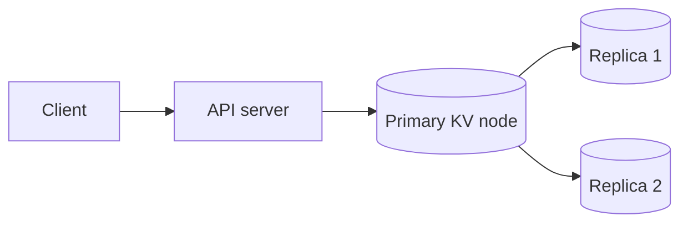
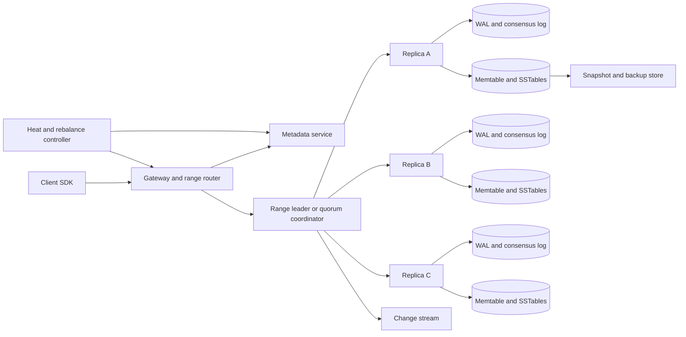
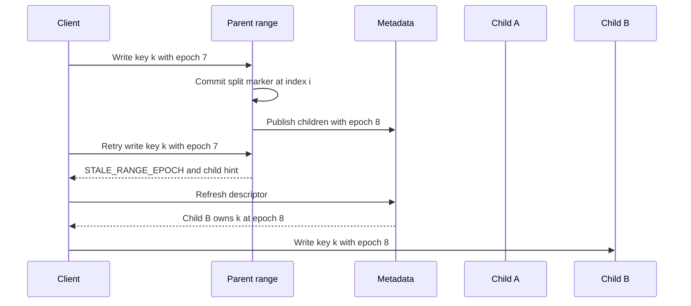
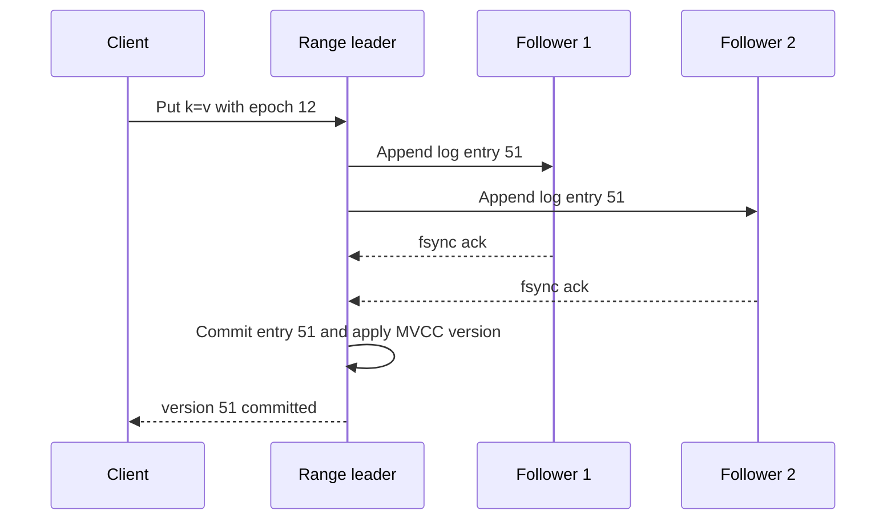
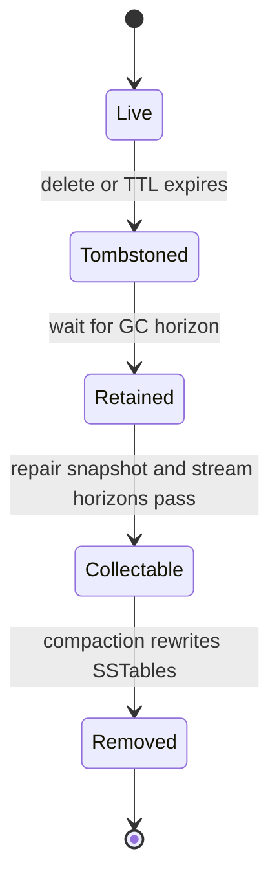

# Distributed Key-Value Store System Design

A distributed key-value store keeps opaque values addressable by ordered byte-string keys while hiding node failures, data movement, and storage-engine details from applications. This design is for a regional, multi-tenant production service that supports point reads/writes, conditional mutation, bounded scans, TTL, snapshots, and change streams; rich query, joins, unbounded cross-key transactions, and object-sized values are deliberately outside the core.

## 1. Requirements

### 1.1 Functional requirements

- Store, retrieve, delete, and conditionally update values by key within a named table.
- Support bounded ordered scans over key ranges, with continuation tokens that survive range splits.
- Let each table or key range choose a consistency mode: linearizable operations when quorum is available, or highly available eventual operations when the product accepts conflicts.
- Replicate data across failure domains, repair corrupt or stale replicas, and recover from node or zone loss without acknowledged data loss in the configured mode.
- Repartition online as data volume and request heat change, including split, merge, and replica movement without stopping clients.
- Provide TTL, snapshots, backup/restore, and at-least-once change streams for derived indexes, caches, and analytics.

### 1.2 Non-functional requirements

- **Scalability.** The keyspace is far too large for one machine, so the design must shard data and metadata without a global write bottleneck.
- **Tail-latency control.** A few hot keys or hot prefixes can dominate p99 latency, so routing, admission control, and split decisions must use heat rather than only bytes.
- **Explicit consistency.** Applications must know whether a successful read/write is linearizable, read-your-writes, bounded-stale, or eventual, because hiding that choice produces data-loss and conflict bugs.
- **Reconfiguration safety.** Clients and servers will hold stale range maps during split, merge, and failover, so ownership must be fenced by epochs rather than by best-effort cache invalidation.
- **Storage correctness over time.** Deletes, TTL, snapshots, repair, and change consumers interact through old versions and tombstones, so garbage collection needs a safe horizon.
- **Operational isolation.** One tenant's scan, hot partition, compaction debt, or change-stream lag must not starve unrelated tenants sharing the same storage fleet.

### 1.3 The binding constraint

The binding constraint is not simply petabytes of storage. It is the choice between availability during a partition and linearizable reads/writes, made independently per range, while the keyspace is too large for one machine and traffic is highly skewed. A single global consensus group gives clean semantics but fails capacity and availability. Pure hash sharding spreads random load but makes ordered scans and range movement awkward. A leaderless, always-writable design remains available through partitions but gives the application conflict resolution and stale-read semantics.

The architecture therefore partitions the ordered keyspace into many ranges, lets each range choose either a consensus-backed mode or a leaderless quorum mode, and makes reconfiguration explicit through epochs. That choice forces three mechanisms to be first-class: heat-aware partitioning and safe routing changes, replication protocols with honest guarantees, and an LSM/MVCC storage engine whose tombstones are retained until repair, snapshots, and streams can no longer need them.

## 2. Back-of-the-envelope estimation

Use illustrative numbers to size the shape of the system, not to predict one company's workload. Suppose the service stores 10 PB of logical user data with an average 1 KB value. That is `10 PB / 1 KB = 10^13` keys, roughly ten trillion distinct records before metadata and old versions. No single catalog entry, server cache, or scan plan can enumerate keys directly; the unit of routing must be a range descriptor that covers many keys.

Assume peak regional traffic is 5 million reads/s and 1 million writes/s. The logical write ingress is `1,000,000 × 1 KB = 1 GB/s`. With three replicas, synchronous replication alone sends about `3 GB/s` of storage traffic before indexes, checksums, compression, change streams, and compaction. If LSM write amplification is 8x after replication, the storage fleet may perform about `1 GB/s × 3 × 8 = 24 GB/s` of sustained disk write work. That number implies compaction cannot be an afterthought; it needs admission control and per-tenant budgets just like foreground writes.

For capacity, three replicas turn 10 PB logical into `10 PB × 3 = 30 PB` replicated data. If each node contributes 12 TB of safe usable space after filesystem reserve, repair headroom, snapshots, compaction slack, and operational margin, raw capacity alone needs `30 PB / 12 TB = 2,500` storage nodes. A real deployment would provision more because metadata, MVCC history, tombstones, backups in flight, and uneven range placement all consume headroom. The design consequence is that the metadata plane manages thousands of nodes and millions of ranges, but no client request should depend on a strongly consistent lookup for every operation.

Heat is the number that changes the design most. With one million ranges, average load is only `6,000,000 ops/s / 1,000,000 = 6 ops/s` per range, which looks trivial. The average is misleading: a celebrity account, a popular Discord channel, or one tenant's daily batch can concentrate tens of thousands of requests on one key or narrow prefix. Range splitting helps when heat covers many adjacent keys; it does not split a single hot key. That is why the gateway must track per-key heat, coalesce duplicate reads, throttle tenants, and sometimes force application-level sharding.

> **Key idea.** The store scales by making the range, not the node or table, the unit of routing, replication, heat management, and storage ownership. The arithmetic says capacity is a solved horizontal problem, while skew and reconfiguration safety are the hard parts.

## 3. API design

**Question.** If a client sends a write, the leader commits it, and the response is lost, what makes a retry safe?
<details><summary>Answer</summary>

Every mutation carries a stable idempotency identity, such as `(client_id, request_sequence)`, and the serving range persists the final result for a bounded window. A retry with the same identity returns the original committed version or original conditional failure instead of applying the mutation again.

</details>

```http
PUT /v1/tables/{table}/keys/{key}
If-Match: "version-or-*"
Idempotency-Key: "client-id:sequence"
Consistency: linearizable

GET /v1/tables/{table}/keys/{key}?consistency=linearizable|bounded_stale|eventual

DELETE /v1/tables/{table}/keys/{key}
If-Match: "version-or-*"
Idempotency-Key: "client-id:sequence"

POST /v1/tables/{table}:batchGet
{ "keys": ["..."], "consistency": "bounded_stale", "maxFanout": 64 }

POST /v1/tables/{table}:batchWrite
{ "mutations": [...], "atomicity": "single_range" }

GET /v1/tables/{table}:scan?start=a&end=z&limit=500&snapshot=...

GET /v1/tables/{table}:changes?from=range_id:log_index
```

The API exposes consistency rather than making the SDK guess. A `GET` in `linearizable` mode must route to the current range leader or perform a quorum/read-index protocol. A bounded-stale read can use a follower only if that replica proves its applied index or timestamp is within the requested bound. An eventual read can trade freshness for availability and locality, but the response includes the serving replica, version, and staleness watermark so the application can make that choice visible.

Conditional headers make lost-update prevention explicit. `If-Match: "version"` is a compare-and-swap on the current visible version; `If-Match: "*"` means blind overwrite. This is more precise than a generic `PUT` because an opaque value store cannot inspect application invariants. Batch writes are atomic only when all keys map to one range unless the caller opts into a slower transaction API; otherwise a partial failure is possible and must be surfaced as per-key results.

Scans use continuation tokens rather than offsets. An offset like "start at row 10,000" is unstable when keys are inserted or a range splits during the scan. The token contains the last returned key, snapshot timestamp, original table epoch, and a signature. If the next request reaches a child range after a split, the gateway can continue from the last key at the same snapshot instead of duplicating or skipping keys.

Change streams are at least once. The stable event identity is `(range_id, log_index, mutation_sequence)` for consensus ranges or a comparable version vector for leaderless ranges. Consumers checkpoint positions and deduplicate. If the checkpoint is older than retention, the API returns `CHECKPOINT_EXPIRED`; the correct recovery is a snapshot plus tail, not silently starting at the oldest retained event.

## 4. Data model

Start with the obvious entity: a table contains keys and opaque values. That is enough for a toy store, but it cannot route a request because a ten-trillion-key table spans thousands of machines. Add a `RangeDescriptor` with `[start_key, end_key)`, replica set, leader, and epoch. Now clients can route a key to the right servers, but a split creates a race: a stale client may send a write to the parent after children already own the interval. The epoch becomes a fencing token; every request includes the descriptor epoch it used, and the server rejects stale epochs with the newer descriptor or a pointer to metadata.

The value itself cannot be a single mutable cell because reads need snapshots, retries need stable outcomes, and deletes must survive repair. Represent each key as MVCC versions ordered by commit timestamp or committed log index. A delete is a tombstone version, not physical removal. TTL is not a background delete that happens at exactly the expiration time; it is a read-time visibility rule plus an asynchronous tombstone or compaction decision. That distinction prevents an expired value from reappearing when a slow replica repairs from an old copy.

A conditional write needs more than the value. It needs the expected version, the idempotency identity, and the committed result. Without a request result table, a timeout after commit is indistinguishable from a timeout before commit. Retrying a blind increment or append would double-apply it. Persisting `(client_id, request_sequence) -> outcome` in the same range log as the mutation ties deduplication to the data it protects.

Change streams introduce another record: a committed mutation event. It should be derived from the authoritative range log, not from compaction output, because compaction can reorder files and drop shadowed versions. The event carries enough identity for deduplication and enough split metadata for consumers to move from a parent range to child ranges.

```text
Table
- table_id, tenant_id
- key_encoding: bytes_lexicographic | typed_prefix
- default_consistency: linearizable | quorum_eventual
- ttl_policy, snapshot_retention, change_stream_retention
- quotas: storage_bytes, read_qps, write_qps, scan_bytes, batch_fanout

RangeDescriptor
- range_id
- table_id
- start_key_inclusive, end_key_exclusive
- mode: consensus | leaderless_quorum
- replicas: [{node_id, zone, role}]
- leader_id nullable
- epoch
- parent_range_id nullable
- split_children nullable
- heat_counters: range_qps, top_key_estimates

MVCCRecord
- table_id, user_key
- version: commit_timestamp_or_log_index
- value_or_tombstone
- expires_at nullable
- checksum

RequestResult
- range_id
- client_id, request_sequence
- status: committed | condition_failed | rejected
- committed_version nullable
- response_hash
- expires_after

ChangeEvent
- range_id
- log_index_or_version
- event_id
- user_key
- operation: put | delete | ttl_delete | split_marker
- commit_timestamp
```

Descriptors live in a small replicated metadata service because they are control-plane state, not user data. MVCC records, request results, and change events live inside the range's replicated storage so the mutation, dedupe result, and stream position commit together. Large blobs do not live in the key-value store; the value holds an object-store reference and checksum, otherwise compaction and repair would be dominated by multi-megabyte cells rather than key-value access.

> **Key idea.** Each field exists because mutable cells and cache-only routing fail under retries, splits, snapshots, or repair. The final model treats ownership, versions, and idempotency as durable data.

## 5. High-level design

The simplest design is a stateless API tier in front of one primary database node with replicas for failover. The API hashes or compares the key, sends writes to the primary, and reads from the primary or a replica.



That design breaks in four concrete ways. First, ten petabytes and millions of operations per second cannot fit behind one primary. Second, a network partition forces an implicit choice: reject writes without the primary or accept divergent writes on both sides. Third, range scans require ordered placement, while uniform hashing hides locality. Fourth, a single hot key or prefix can overload its owner even when average cluster load is low.

### Fix 1: Partition the ordered keyspace into ranges

Make `[start_key, end_key)` ranges the unit of ownership. Ordered ranges preserve scans and prefix locality, while the metadata service maps each range to a replica group. Hash partitioning is still useful inside the key design: a table can add a hashed tenant prefix when it does not need global order. The store should not force one answer; it should make the key encoding explicit at table creation.

Ranges split when bytes, QPS, write bandwidth, or compaction debt cross thresholds. They merge when adjacent cold ranges waste metadata and file handles. This turns capacity into an online control loop instead of a one-time sharding plan.

### Fix 2: Replicate each range independently

Each range has its own replication group. In linearizable mode, the group uses Raft or Multi-Paxos: one leader orders writes, a majority persists each log entry, and reads either go through the leader or use a safe read-index/lease protocol. Losing quorum means rejecting linearizable writes rather than accepting split brain.

In eventual mode, the same range abstraction can use leaderless quorums with version vectors or dotted versions. Writes may be accepted by any reachable replica and repaired later through hinted handoff, read repair, and anti-entropy. That mode is more available during partitions but pushes conflict semantics to the table policy.

### Fix 3: Fence routing changes with epochs

A range descriptor has an epoch. Split, merge, replica move, and leadership transfer all create a new epoch or a new descriptor lineage. A server only accepts a request if the request's epoch matches its current ownership. Stale clients receive `STALE_RANGE_EPOCH` with enough information to refresh. This prevents the dangerous case where a parent and child both accept writes for the same key interval.

### Fix 4: Put heat controls before the storage engine

Storage engines do not magically fix a single hot key. The gateway tracks top keys and prefixes, coalesces identical concurrent reads, applies per-tenant admission control, and can route hot read-only keys through caches with version validation. If a hot prefix contains many keys, split-for-heat can isolate it. If one key is hot, the application may need sharded counters, cached materialization, or a data-service layer that combines concurrent requests.

### Fix 5: Use an LSM/MVCC engine per replica

A replica appends mutations to a log, applies them to a memtable, flushes immutable SSTables, and compacts old files. MVCC versions allow snapshot reads and change-stream replay without blocking writers. Tombstones stay until the GC horizon says repair, snapshots, and stream consumers cannot need the deleted version.

### Putting it together



A write starts in the SDK with a cached descriptor. The gateway verifies tenant budgets and forwards to the current range owner. In consensus mode, the leader checks the epoch, conditional version, and idempotency key, proposes the mutation, waits for a majority, applies the committed entry to MVCC state, records the request result, and emits a change event. In leaderless mode, the coordinator writes to a configured quorum and returns a version that may later need reconciliation. The metadata service is not on the steady-state data path except on cache miss or reconfiguration.

> **Key idea.** Each component traces back to a specific failure of the naive design: ranges solve capacity and scans, replication makes failure semantics explicit, epochs make movement safe, heat controls handle skew, and LSM/MVCC makes durable history manageable.

## 6. Deep dives

### 6.1 Partitioning, rebalancing, and hot-key mitigation

**Question.** A range owns keys `tenant42#2026-10-13#...`; one product launch sends 80,000 reads/s to one item and 20,000 writes/s across the surrounding prefix. Should the system hash, split, move, cache, or throttle?
<details><summary>Answer</summary>

Use different tools for different heat shapes. Split the range if heat spans many adjacent keys, move or add replicas if the group is underprovisioned, coalesce/cache identical reads for the one hot item, and throttle or require application sharding if one key receives sustained writes that cannot be merged safely.

</details>

Hash partitioning looks attractive because it spreads keys uniformly. For point lookups with no ordering requirement, it is often the simplest answer. The problem is that this store promises ordered scans, prefix reads, snapshots, and continuation across adjacent keys. A pure hash of the full key destroys locality: scanning `tenant42#orders#2026-10-13` becomes a fanout to every partition. A pure range scheme preserves locality but creates the classic hot-last-range problem for timestamps and monotonically increasing IDs. The production design needs both: ordered ranges in the storage layer and explicit key encodings, such as hashed tenant buckets or reversed timestamps, when the application does not need strict global order.

A split is a protocol, not a file operation. The parent range chooses a split key, usually near a boundary that reduces both bytes and heat. It commits a split marker at log index `i`, flushes or identifies a consistent state through `i`, creates child descriptors with epoch `parent_epoch + 1`, and publishes them atomically in metadata. The parent then rejects new requests for child-owned intervals with `STALE_RANGE_EPOCH`. For a while, stale clients still send to the parent. That is safe because the parent has a durable tombstone/forwarding descriptor saying, in effect, "I no longer own this interval after index `i`." Without that fence, the parent and child can both accept writes and no later repair can know which order was intended.



Moving a range is similar but uses joint consensus or an equivalent membership-change protocol. Add a new replica as a learner, stream it the snapshot and subsequent log entries, promote it only after it catches up, then remove the old replica. Leadership transfer is a separate step; moving bytes and moving the write leader at the same time creates avoidable unavailability. Merge is the inverse of split and should be conservative because it reduces parallelism. Many systems split automatically but avoid automatic merges because merging can reintroduce heat and complicate old descriptors.

DynamoDB's public material on split-for-heat is a useful production lesson: partition splitting can raise throughput for a hot partition, but it cannot make one partition key infinitely writable, and split decisions are constrained by local secondary indexes and access patterns. This maps directly to range heat. If heat covers a range of sort keys, split it. If all heat is one key, splitting creates two ranges where one remains hot.

Discord hit the latter pattern with hot channels in its message store. The fix was not only moving from Cassandra to ScyllaDB; Discord also put Rust data services in front of storage to consistently route channel traffic and coalesce identical concurrent reads. That is the right mental model for this design's gateway. If 10,000 clients ask for the same key at once, the gateway should send one in-flight read to storage and fan out the response. If a hot counter receives 10,000 increments/s, coalescing is not enough unless the operation is semantically mergeable; the product may need sharded counters or an append log.

Signals worth watching: per-range QPS, top-key estimates, stale-epoch rejection rate, split backlog, move duration, coalescing hit rate, and how often throttling protects one tenant from another.

> **Strong-answer criteria.** A senior answer separates byte imbalance from heat imbalance and explains why stale routing needs epoch fencing. It also admits that single-key heat is an application/API problem, not just a database partitioning problem.

| Level | Approach | Why |
|---|---|---|
| Bad | Hash every key and rely on random distribution. | Point reads balance, but scans, locality, and continuation semantics become expensive fanout. |
| Good | Use ordered ranges with split and merge. | Preserves scans and supports online growth, but misses stale-route races and single-key heat. |
| Great | Use range epochs, joint reconfiguration, heat-aware splits, request coalescing, tenant throttles, and application sharding for unsplittable keys. | Makes routing changes safe and picks the mitigation that matches the heat shape. |

### 6.2 Replication choices: consensus ranges versus leaderless quorums

**Question.** During a zone-isolating network partition, two clients write the same key on opposite sides. Should both writes succeed?
<details><summary>Answer</summary>

Only if the range is configured for leaderless eventual semantics and the table has a conflict policy. In linearizable mode, the side without quorum must reject writes; otherwise the system has silently traded correctness for availability.

</details>

A distributed key-value store is often described as if replication is one module. In reality, replication is the product contract. A consensus-backed range and a leaderless Dynamo-style range can share the same range descriptor and storage engine, but they promise different things.

In consensus mode, a range has a leader and a replicated log. A write is acknowledged after a majority persists the log entry. Majority intersection means any later leader must contain that committed entry or learn it before serving. A linearizable read cannot simply ask the nearest follower, because that follower may be behind or may not know a newer leader exists. The common solutions are leader reads with a lease that is valid under bounded clock assumptions, or a read-index protocol where the leader confirms it is still current with a quorum and waits until its state machine has applied through that index. The cost is clear: if the group has three replicas and only one is reachable, it cannot accept linearizable writes.



Leaderless quorum mode starts from a different priority: remain writable when some replicas or paths fail. A coordinator writes to `W` replicas and reads from `R` replicas. If `R + W > N`, a read is likely to overlap a write in a healthy system, but that arithmetic alone does not provide linearizability under sloppy quorums, clock skew, concurrent writes, or partitions. The system needs version vectors or dotted versions to identify siblings, hinted handoff to remember writes intended for unavailable replicas, read repair to fix stale copies encountered during reads, and anti-entropy, often Merkle-tree based, to find divergence in the background. Deletes still require tombstones, because a replica that missed the delete might otherwise reintroduce the old value during repair.

Amazon's original Dynamo popularized this leaderless style for highly available shopping-cart-like workloads where conflict resolution was acceptable. DynamoDB, despite the name, is different for many core paths: public papers describe partitioned replication groups with Multi-Paxos and a managed service around admission control, auto scaling, backups, and global tables. The lesson is not that one protocol is universally better; it is that the guarantee must match the product. A bank balance and a cache of recommended videos do not need the same partition behavior.

Mixing the modes invisibly is the trap. If a table normally gives linearizable reads and writes, it cannot quietly fall back to accepting local writes during a partition. That creates histories no linearizable client can reason about. Instead, the table or range declares its mode. In consensus mode, errors say `QUORUM_UNAVAILABLE` or `NOT_LEADER`, and retries with the same idempotency key are safe. In leaderless mode, writes may return success with a version context, reads may return siblings, and the application or merge policy resolves them.

Multi-range transactions add another layer. DynamoDB's transactions paper is a reminder that distributed transactions are a feature, not a flag: transaction records, participant intents, timestamp ordering or locking, coordinator recovery, idempotency, and strict timeouts are part of correctness. This design keeps single-range atomicity in the baseline. If a batch spans ranges and asks for atomicity, it goes through a transaction coordinator and pays the latency and contention cost explicitly.

Signals worth watching: leader changes, quorum write latency, read-index latency, rejected writes due to no quorum, hinted-handoff backlog, sibling/conflict rate, anti-entropy bytes, and repair age.

> **Strong-answer criteria.** A senior answer names the guarantee each replication family provides and refuses to blur availability fallback with linearizability. It also explains the repair machinery leaderless replication needs to avoid permanent divergence.

| Level | Approach | Why |
|---|---|---|
| Bad | Replicate to three nodes and read from any node. | Fast, but reads can be stale and failover can lose acknowledged writes if commit rules are vague. |
| Good | Use Raft or Paxos per shard. | Gives clean linearizable semantics, but sacrifices writes without quorum and may over-serve workloads that can tolerate conflicts. |
| Great | Offer consensus and leaderless modes per range/table, expose the guarantee in the API, and implement idempotency, repair, conflict metadata, and tombstone retention accordingly. | Aligns partition behavior with product needs instead of hiding CAP choices. |

### 6.3 LSM storage, MVCC, compaction, and tombstone GC

**Question.** A key is deleted, one replica is offline for a day, and compaction drops the tombstone on healthy replicas. What happens when the old replica returns?
<details><summary>Answer</summary>

The old value can be resurrected during repair. Tombstones must not be garbage-collected until the repair horizon, snapshot horizon, and change-stream horizon have all advanced beyond the delete.

</details>

The storage engine has to absorb high write throughput while supporting point reads, scans, snapshots, TTL, and repair. A B-tree gives in-place updates and stable read paths, but random writes across a petabyte-scale fleet create many small disk updates. An LSM tree fits this workload better: append to a WAL, insert into a sorted memtable, flush immutable SSTables, and compact them later. Sequential writes are efficient, and immutable files are convenient for snapshots and repair.

The cost is read and write amplification. A point read may check the memtable and several SSTable levels, using Bloom filters and sparse indexes to avoid unnecessary disk reads. A scan merges sorted runs and filters MVCC versions. Compaction rewrites data repeatedly to reduce overlap, reclaim shadowed values, and keep read latency under control. With `1 GB/s` logical writes and three replicas, even moderate write amplification becomes fleet-scale disk work. That is why compaction has to be scheduled with foreground latency in mind and why tenants need quotas for write rate, scan bytes, and retained history.

MVCC turns every update into a new version rather than an in-place overwrite. A linearizable read asks for the newest version at or below the committed read index. A snapshot scan asks for the newest version at or below its snapshot timestamp. Change streams read committed log entries and do not depend on whether old SSTables have been compacted. This separation is powerful: writers do not block readers, and backup can copy immutable SSTables plus a manifest. It also means old versions are intentionally retained, so garbage collection must be conservative.

Tombstones are the sharp edge. A delete writes a versioned marker saying "from this version onward, the key is absent." TTL is similar: the value is invisible after `expires_at`, but physical removal is a later compaction decision. Dropping the tombstone too early is worse than wasting space because it can resurrect data. A replica that missed the delete, a backup restore from before the delete, or a lagging change-stream consumer may still hold or need the old value. Repair must see the tombstone and prefer it over the older value.



The GC horizon is the minimum of several watermarks: the oldest active snapshot timestamp, the oldest required change-stream checkpoint, the anti-entropy/repair horizon for replicas that may still return, and any legal or backup retention policy. In a consensus range, the log and snapshots give a precise committed order, but a slow follower can still pin history. In a leaderless range, the horizon must also consider hinted handoff and anti-entropy progress. If any watermark stalls, tombstones accumulate and compaction debt grows; that is an operational signal, not merely a storage nuisance.

Production systems reinforce this. Uber Schemaless used immutable versioned cells and asynchronous indexes, showing how version history and derived data decouple write paths from query features. FoundationDB keeps an ordered transactional KV core and builds layers above it; the transferable lesson is to keep the storage semantics tight and test failure histories aggressively. A system that cannot simulate compaction crashes, lost responses, split races, and repair from stale replicas will eventually discover those histories in production.

Signals worth watching: L0 file count, read amplification, write amplification, compaction debt, oldest snapshot age, oldest stream checkpoint, tombstone ratio, repair lag, and disk free-space headroom.

> **Strong-answer criteria.** A senior answer connects LSM mechanics to user-visible guarantees: snapshots require MVCC, deletes require tombstones, and tombstone GC is bounded by repair and consumers, not by a fixed timer alone.

| Level | Approach | Why |
|---|---|---|
| Bad | Delete the key from disk when the user calls delete. | Breaks snapshots and can resurrect data from stale replicas. |
| Good | Use WAL, memtables, SSTables, and tombstones. | Handles write throughput and deletes, but may leak space or drop history without a GC horizon. |
| Great | Tie compaction and tombstone GC to MVCC, repair, snapshots, backup, and change-stream watermarks with admission control for compaction debt. | Preserves correctness while keeping the storage engine operable under sustained load. |

## 7. Variants

**10x scale.** At 100 PB logical data and 60 million ops/s, the architecture stays range-based but the control plane must become more hierarchical. Metadata is cached aggressively, range controllers are partitioned by table or keyspace, and placement decisions are batched to avoid thrashing. The storage path still uses per-range replication and LSM files, but compaction, repair, and heat analytics need fleet-level scheduling so background work does not consume the same resources everywhere at once.

**Global active-active product.** If users must write locally in multiple regions during WAN partitions, consensus per regional range is not enough. Either assign each key a home region and accept remote-write latency for that key, or use leaderless/multi-leader semantics with conflict-free data types, version vectors, or application merges. What stays the same is epoch-fenced range ownership inside each region and MVCC/tombstone storage; what changes is the conflict contract exposed to callers.

**Strict financial ledger.** For account balances, choose consensus mode, single-range account placement where possible, conditional updates, and bounded transactions for cross-account movement. Reject writes without quorum. Do not offer eventual reads on ledger keys unless clearly marked as non-authoritative. The same storage engine works, but API defaults, audit retention, and transaction recovery become stricter.

**Read-heavy derived feature store.** A Venice-like derived store for recommendations may accept eventual consistency and optimize BatchGet. The gateway enforces fanout budgets, partial-result policies, and per-tenant quotas. Change-stream bootstrap and bulk ingestion matter more than per-key linearizability. Hot-key coalescing, cache validation, and invisible dataset migration become central features.

## 8. The transferable pattern

This problem has the same reusable shape as many large stateful systems: split an enormous namespace into ownership units, replicate each unit with an explicit consistency contract, fence ownership changes, and push expensive background maintenance behind watermarks. The hardest part is not drawing replicas; it is preserving the ordering and ownership facts that make retries, repair, and reconfiguration safe.

The pattern appears in ordered storage systems like [FoundationDB](./distributed-key-value-store-system-design.md), reservation systems such as [Ticketmaster](./ticketmaster-system-design.md), and any design where a hot logical entity can overload one shard even when average load is low. The names change: range epoch becomes fencing token, MVCC version becomes ledger sequence, tombstone horizon becomes retention watermark. The design instinct is the same: identify the smallest unit that can own correctness, then make movement of that unit explicit.

## Review

The design starts from the CAP and skew constraint: each range must choose linearizable quorum behavior or higher-availability eventual behavior, and no single machine can own the keyspace. The answer is an ordered range abstraction with epoch-fenced routing, per-range replication, heat-aware split/move/coalescing, and an LSM/MVCC engine. Consensus ranges reject writes without quorum and give simple semantics; leaderless ranges remain available but require conflict metadata, hinted handoff, read repair, and anti-entropy. Storage correctness depends on retaining versions and tombstones until snapshots, repair, backups, and change streams have advanced. The production lesson from DynamoDB, Discord, ZippyDB, Schemaless, Venice, FoundationDB, and Netflix is that the protocol is only half the system; admission control, safe APIs, and operational guardrails make the guarantee usable.

### Check your understanding

1. Why is range partitioning chosen even though hashing balances load better?
   <details><summary>Answer</summary>

   Ordered ranges preserve scans, prefix locality, and snapshot continuation. Hashing is still useful in key design when global order is unnecessary, but a pure full-key hash would turn range scans into broad fanout.

   </details>

2. What prevents a stale client from writing to a parent range after a split?
   <details><summary>Answer</summary>

   Every descriptor has an epoch, and every request carries the epoch used for routing. After the split marker commits and child descriptors are published, the parent rejects requests for child-owned keys with `STALE_RANGE_EPOCH` and a refresh hint.

   </details>

3. Why does `R + W > N` not automatically mean a leaderless system is linearizable?
   <details><summary>Answer</summary>

   Quorum overlap helps, but sloppy quorums, concurrent writes, partitions, clock assumptions, and stale replicas can still produce multiple versions. Linearizability requires a single real-time order; leaderless systems need version metadata and reconciliation, and they usually provide eventual consistency rather than linearizability.

   </details>

4. Why can a single hot key survive range splitting?
   <details><summary>Answer</summary>

   A split divides key intervals. If all traffic targets one key, that key remains entirely in one child range. The fix is request coalescing, caching, throttling, mergeable/sharded data structures, or an application-level redesign.

   </details>

5. Why is tombstone garbage collection tied to multiple horizons?
   <details><summary>Answer</summary>

   A tombstone must remain until no stale replica, repair process, snapshot, backup restore, or change-stream consumer can need it to suppress an older value. The safe GC point is the minimum of those watermarks, not merely the delete time plus a fixed delay.

   </details>

## Sources and further reading

| Source | Article | Why it matters |
|---|---|---|
| AWS | [Scaling DynamoDB: How partitions, hot keys, and split for heat impact performance](https://aws.amazon.com/blogs/database/part-3-scaling-dynamodb-how-partitions-hot-keys-and-split-for-heat-impact-performance/) | Shows partition splitting, adaptive capacity, burst behavior, and why hot keys still need design work. |
| Amazon / USENIX | [Amazon DynamoDB: A Scalable, Predictably Performant, and Fully Managed NoSQL Database Service](https://www.usenix.org/conference/atc22/presentation/elhemali) | Explains partitioned Multi-Paxos replication, autoscaling, backups, global tables, and operating at tens of millions of requests per second. |
| Amazon / USENIX | [Distributed Transactions at Scale in Amazon DynamoDB](https://www.usenix.org/system/files/atc23-idziorek.pdf) | Details how DynamoDB adds bounded distributed transactions without making normal key-value operations slow. |
| Discord | [How Discord Stores Trillions of Messages](https://discord.com/blog/how-discord-stores-trillions-of-messages) | Demonstrates hot-partition mitigation with data services, request coalescing, consistent routing, and Cassandra-to-ScyllaDB migration results. |
| Meta | [How we built a general purpose key value store for Facebook with ZippyDB](https://engineering.fb.com/2021/08/06/core-infra/zippydb/) | Shows a multi-tenant strongly consistent KV service with tiers, shards, RocksDB, Paxos/async replication, and flexible durability choices. |
| Uber | [The Architecture of Schemaless, Uber Engineering’s Trip Datastore Using MySQL](https://www.uber.com/us/en/blog/schemaless-part-two-architecture/) | Covers immutable cells, sharding, versioned updates, and eventually consistent indexes in a production datastore. |
| LinkedIn | [Open Sourcing Venice: LinkedIn’s Derived Data Platform](https://www.linkedin.com/blog/engineering/open-source/open-sourcing-venice-linkedin-s-derived-data-platform) | Provides production numbers and patterns for read-heavy derived KV data, BatchGet fanout, multi-tenancy, quotas, and multi-region operation. |
| Apple / FoundationDB | [Technical Overview](https://apple.github.io/foundationdb/technical-overview.html) | Shows why a minimal ordered transactional KV core, layers, optimistic concurrency, and simulation-driven testing matter. |
| Netflix | [Introducing Netflix’s Key-Value Data Abstraction Layer](https://netflixtechblog.com/introducing-netflixs-key-value-data-abstraction-layer-1ea8a0a11b30) | Explains how a KV DAL standardizes consistency, idempotency, pagination, and data modeling across multiple backing stores. |
