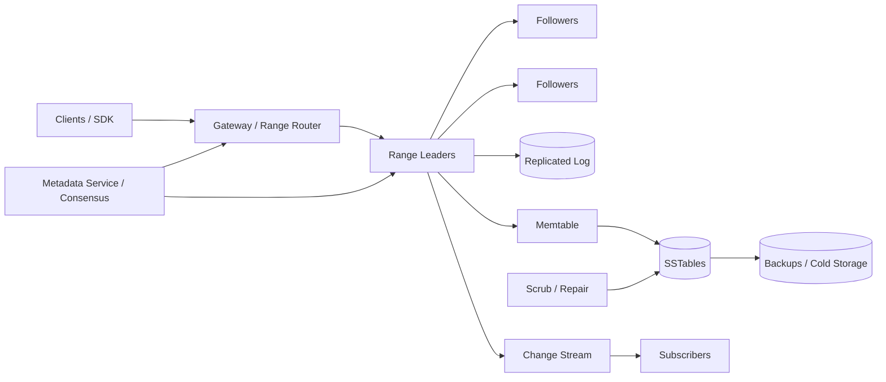

# Production Distributed Key-Value Store

## 1. Requirements

### Functional requirements

1. Store and retrieve opaque values by key.
2. Support `Put`, `Get`, `Delete`, conditional writes, and batched operations.
3. Offer range scans over ordered keys within a table/partition.
4. Provide tunable or clearly defined consistency.
5. Replicate data across failure domains and recover automatically.
6. Support TTL, snapshots, backup/restore, and change streams.
7. Repartition online as data and traffic grow.
8. Enforce tenant/table quotas and access controls.

### Non-functional requirements

- Petabytes of data and millions of operations per second.
- Single-digit millisecond regional point reads/writes at the median.
- No acknowledged data loss under the configured failure model.
- Predictable consistency during leader changes and network partitions.
- Horizontal scale without global stop-the-world rebalancing.
- Verifiable repair, backup, and disaster recovery.

The baseline design is a strongly consistent, range-partitioned store. Multi-key transactions are limited to one range initially; distributed transactions are an explicit extension.

## 2. Scale assumptions and capacity

Assume:

- 10 PB logical data, 1 KB average value, roughly 10 trillion keys.
- 5 million reads/second and 1 million writes/second peak.
- Replication factor three: 30 PB before compression.
- 100,000 storage nodes with 10-20 TB usable capacity.
- 30-day point-in-time recovery through snapshots and logs.
- 70/30 read/write ratio, but individual ranges can be highly skewed.

```text
1M writes/s x 1 KB = 1 GB/s logical ingress
3 replicas + compaction amplification => several GB/s disk/network traffic
```

Plan for write and compaction amplification, indexes, tombstones, checksums, and 30% free-space headroom.

## 3. High-level architecture



The metadata plane maps key ranges to replica groups. Each range is an independent consensus group, avoiding one global write bottleneck.

## 4. Data model and internal records

```text
Table
- tenant_id
- table_id
- key_encoding
- consistency_policy
- ttl_policy
- encryption_key

RangeDescriptor
- range_id
- start_key
- end_key
- replicas
- leader
- epoch
- split_parent

MVCCRecord
- user_key
- commit_timestamp
- value_or_tombstone
- expires_at
- checksum

Mutation
- client_id
- request_sequence
- operation
- key
- value
- expected_version

ChangeEvent
- range_id
- log_index
- key
- operation
- commit_timestamp
```

Keys are byte strings compared lexicographically. Values have size limits; large blobs belong in object storage with a reference in the store.

## 5. Core APIs

```http
PUT /v1/tables/{table}/keys/{key}
If-Match: "version"
Idempotency-Key: client-sequence

GET /v1/tables/{table}/keys/{key}?consistency=linearizable
DELETE /v1/tables/{table}/keys/{key}
```

```text
BatchGet(keys, consistency)
BatchWrite(mutations)              // atomic only when one range unless requested otherwise
Scan(start_key, end_key, limit, continuation, snapshot_timestamp)
CompareAndSwap(key, expected, value)
Watch(start_position, key_prefix)
```

Responses include value version, serving range epoch, and continuation tokens. Errors explicitly identify stale routing, retryable leader loss, condition failure, throttling, and indeterminate outcomes.

## 6. Write flow

1. The SDK caches the range descriptor for the key and sends the mutation to its leader.
2. The leader checks table authorization, item limits, range epoch, idempotency sequence, and compare condition.
3. It proposes the mutation to the range's consensus log.
4. A quorum persists the entry; the entry becomes committed.
5. Each replica applies it in log order to a memtable/MVCC state and emits a change record.
6. The leader acknowledges with the committed version/log index.
7. Memtables later flush as immutable SSTables.

If the client loses the response, it retries using `(client_id, request_sequence)`. Replicas retain a bounded session result table so a duplicate returns the original outcome.

## 7. Read and scan flow

A linearizable read goes to the leader. The leader confirms its lease/read index is current with the consensus group, waits until state is applied through that index, and returns the newest visible version.

Follower reads are optional:

- Stale reads return the replica's applied timestamp/index.
- Bounded-staleness reads require lag below the requested bound.
- Snapshot reads use an MVCC timestamp and ignore newer versions.

A range scan reads sorted SSTables plus the memtable, merges versions, and returns a signed continuation token containing last key, snapshot timestamp, and descriptor epoch. Crossing a split consults metadata and continues without duplicating keys.

## 8. Consensus, consistency, and concurrency

Each range uses Raft/Paxos-style consensus with one leader and replicas across zones. Majority quorum intersection ensures committed log entries survive leader replacement.

Linearizability applies per key and per range operation. Compare-and-swap prevents lost updates. MVCC permits snapshot reads without blocking writers.

For multi-range transactions, add:

1. A transaction record with timestamp and status.
2. Per-range provisional intents.
3. Two-phase commit after conflict checking.
4. A recovery protocol where participants resolve abandoned coordinators.

This provides atomicity but increases latency, write amplification, and contention. Keep the initial interview design single-range unless cross-range transactions are required.

## 9. Partitioning, splitting, and routing

Ordered range partitioning supports scans and locality. Start with coarse ranges and split when size, QPS, or write bandwidth exceeds thresholds. A split:

1. Chooses a split key avoiding a single hot prefix.
2. Creates two child descriptors with a higher epoch.
3. Establishes consistent child replica state at a committed log index.
4. Atomically publishes routing metadata.
5. Leaves forwarding/tombstone metadata so stale clients refresh.

Ranges can move replica-by-replica using joint consensus, then transfer leadership. Merge adjacent cold ranges to control metadata overhead.

Sequential keys create a hot last range. Recommend hashed key prefixes, reversed timestamps, or application sharding when ordered global insertion is not required.

## 10. LSM storage engine

Writes append to a WAL and update a sorted memtable. Full memtables flush to level-0 SSTables containing data blocks, sparse indexes, Bloom filters, and checksums. Reads consult Bloom filters and block indexes before fetching data.

Compaction merges SSTables, discards shadowed versions older than the safe MVCC horizon, and reclaims tombstones only after all replicas, snapshots, and change consumers no longer need them.

Leveled compaction offers good read and space amplification at higher write cost. Size-tiered compaction improves write throughput but increases read and space amplification. Configure by workload class rather than claiming one universal choice.

## 11. Deletes, TTL, and garbage collection

Delete writes a versioned tombstone. TTL expiration behaves like a logical tombstone at read time; physical removal is asynchronous.

Never drop a tombstone before:

- Older values cannot arrive through repair or replication.
- No retained snapshot can see the deleted version.
- Change-stream retention has advanced.
- Backup/legal-retention policy permits it.

Track a global or per-range garbage-collection safe point derived from active snapshots, replication progress, and subscriber checkpoints. Long-running snapshots can pin large histories and must be bounded.

## 12. Change streams and secondary consumers

Committed range-log entries feed an ordered per-range change stream. Subscribers checkpoint `(range_id, log_index)` and receive split events that map a parent position to child positions.

Delivery is at least once. Consumers deduplicate by stable event identity. If retention expires, return `CHECKPOINT_EXPIRED` and require a snapshot-plus-tail bootstrap. Change streams enable indexes, search, analytics, and cache invalidation, but those derived systems are not authoritative.

## 13. Reliability, repair, and failure handling

| Failure | Handling |
|---|---|
| Leader fails before commit | New leader may reject/retry; client uses request sequence |
| Leader fails after commit before response | Retry returns recorded result |
| Follower disk corrupts block | Checksum detects; copy from healthy replica |
| Zone fails | Majority in other zones elects leader |
| No quorum | Reject linearizable writes rather than split brain |
| Client has stale range map | Epoch error includes/refers to new descriptors |
| Compaction crashes | Input SSTables remain; unreferenced output is discarded |
| Tombstone removed too early | Prevent through GC safe point and repair horizon |
| Hot range overloads | Split, relocate, isolate tenant, or redesign key |
| Metadata service unavailable | Cached routes and range consensus continue; reconfiguration pauses |

Periodic Merkle-tree or block-checksum comparisons detect silent divergence. Repair transfers only differing blocks and never overwrites newer committed state.

## 14. Backup and disaster recovery

Create incremental, content-addressed SSTable snapshots plus a manifest at a consistent timestamp. Retain consensus/change logs after the snapshot for point-in-time recovery. Encrypt, checksum, and replicate backup objects independently of serving storage.

Restore into a separate cluster, verify row counts/checksums and application invariants, then cut over. Regular restore drills are mandatory; successful uploads alone do not prove recoverability.

## 15. Multi-region design

Three options should be explicit:

1. **Regional quorum:** replicas across zones in one region; async disaster-recovery copy. Lowest latency, nonzero regional RPO.
2. **Cross-region quorum:** replicas span regions. Strong consistency and near-zero RPO, but every write pays WAN latency.
3. **Home-region per key/range:** each range has one writable region, async read replicas elsewhere. Scales globally with clear per-key order.

The practical default is regional consensus plus asynchronous DR, or home-region ranges for global products. Promotion fences the former region through epochs and waits for an accepted recovery point. Multi-leader last-write-wins may be offered as a separate eventual-consistency mode, not mixed invisibly with linearizable tables.

## 16. Security and tenant isolation

- Mutual TLS for node and client traffic with short-lived identities.
- Table/key-prefix permissions for read, write, scan, watch, and administer.
- Envelope encryption at rest with per-tenant/table data keys.
- Quotas for storage, QPS, bandwidth, scans, snapshots, and change retention.
- Validate key/value sizes before memory allocation.
- Audit schema, ACL, backup, restore, and bulk-delete operations.
- Prevent timing and metrics leakage across tenants; isolate very large tenants.
- Secure decommissioning through cryptographic erasure and disk sanitization.

## 17. Observability

Track:

- Read/write latency by consistency mode and range.
- Request rate, throttling, conditional failures, and indeterminate outcomes.
- Consensus proposal latency, leader changes, quorum health, and apply lag.
- Range size/QPS skew, split/move backlog, and hot-key estimates.
- WAL fsync, memtable stalls, Bloom effectiveness, and cache hit rate.
- Compaction debt, read/write/space amplification, and free disk.
- Checksum failures, repair bytes, backup age, and restore test results.
- Change-stream lag and GC safe-point age.

Trace a request using range ID, epoch, leader, and log index without logging sensitive keys or values.

## 18. Major trade-offs

### Hash versus range partitioning

Hashing balances random traffic naturally but makes scans expensive. Ranges support ordered scans and locality but can hotspot. This design chooses ranges and addresses skew explicitly.

### Strong versus eventual consistency

Consensus simplifies application reasoning but sacrifices writes without quorum and adds latency. Eventual multi-leader designs favor availability but need conflict resolution. Expose the choice at table creation.

### LSM tree versus B-tree

LSMs optimize sustained writes and sequential storage with compaction cost. B-trees offer steadier reads and in-place updates. At this scale and write rate, an LSM is a strong default.

### Synchronous versus asynchronous geo-replication

Synchronous replication minimizes RPO but adds WAN latency and can reduce availability. Asynchronous replication gives regional speed with explicit lag and failover loss risk.

### Large versus small ranges

Large ranges reduce metadata and consensus groups but move slowly and hotspot. Small ranges rebalance well but add control-plane and file overhead.

## 19. Recommended interview presentation

1. Clarify consistency, scan, transaction, durability, and regional requirements.
2. Estimate operations, bytes, replicas, and write amplification.
3. Draw metadata routing and independent consensus groups per range.
4. Walk through quorum write and linearizable/follower reads.
5. Deep-dive into range split/move and stale-route epochs.
6. Explain WAL, memtables, SSTables, compaction, and tombstone safety.
7. Cover request deduplication, repair, backup restore, and change streams.
8. Finish with multi-region consistency/latency trade-offs.

The central design insight is:

> Partition the ordered keyspace into independently replicated consensus ranges, use epochs to make routing and ownership changes safe, and combine a replicated log with an LSM engine and MVCC so durable writes, scalable scans, repair, and snapshots have explicit correctness boundaries.
