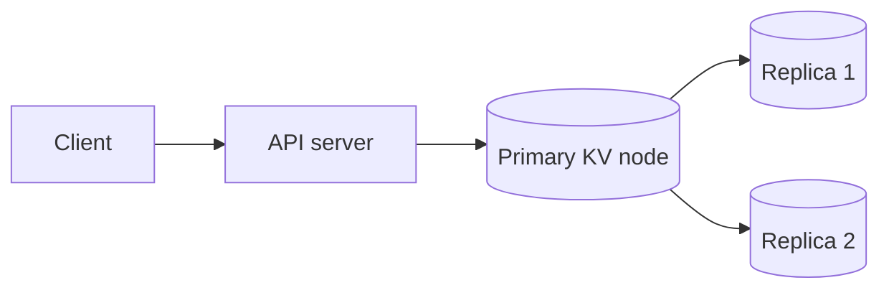
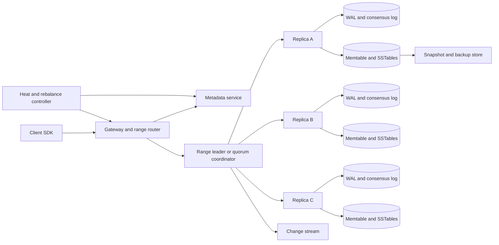
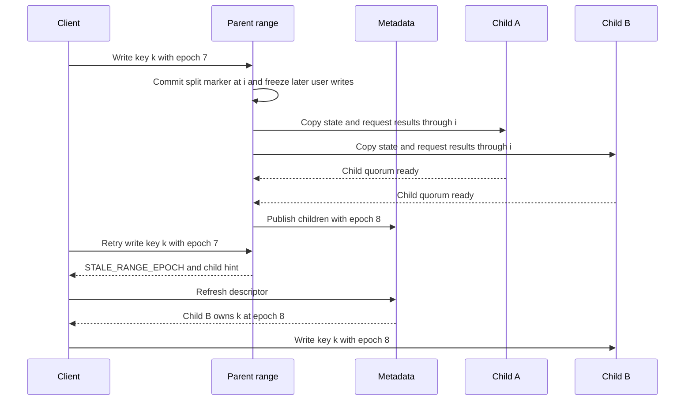
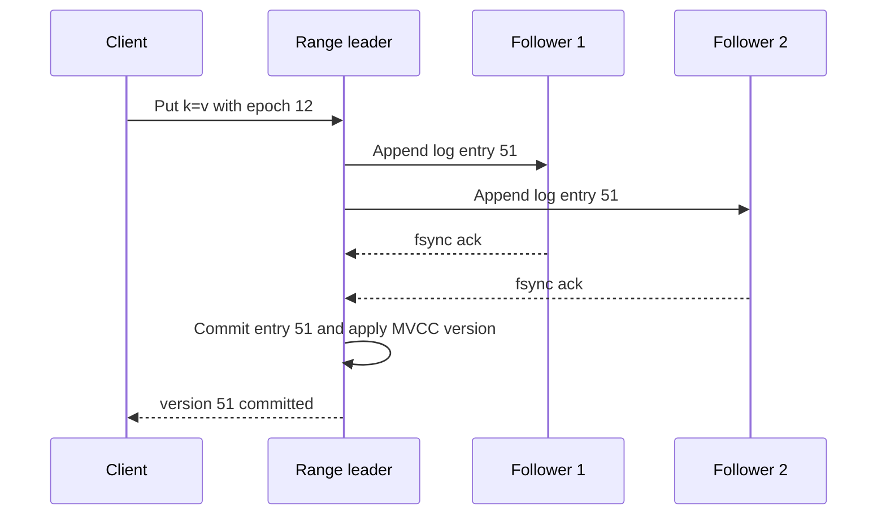
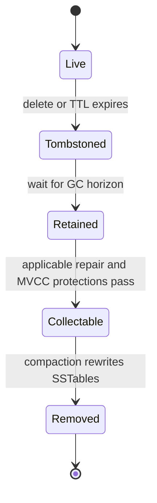

# Distributed Key-Value Store System Design

A distributed key-value store keeps opaque values addressable by ordered byte-string keys while hiding node failures, data movement, and storage-engine details from applications. This design is for a regional, multi-tenant production service that supports point reads/writes, conditional mutation, bounded scans, TTL, snapshots, and change streams; rich query, joins, unbounded cross-key transactions, and object-sized values are deliberately outside the core.

## 1. Requirements

### 1.1 Functional requirements

- Store, retrieve, delete, and conditionally update values by key within a named table.
- Support bounded ordered scans over key ranges, with continuation tokens that survive range splits.
- Provision consensus tables for strong operations, or explicitly weaker leaderless tables for products that accept conflicts; do not silently switch modes on a request.
- Replicate across failure domains and state the tolerated fault set. Consensus acknowledgements survive configured quorum-safe failures; a leaderless `W=1` acknowledgement cannot promise survival of the only accepting replica's permanent loss.
- Repartition online as data volume and request heat change, including split, merge, and replica movement without stopping clients.
- Provide TTL, snapshots, backup/restore, and at-least-once change streams for derived indexes, caches, and analytics.

### 1.2 Non-functional requirements

- **Scalability.** The keyspace is far too large for one machine, so the design must shard data and metadata without a global write bottleneck.
- **Tail-latency control.** A few hot keys or hot prefixes can dominate p99 latency, so routing, admission control, and split decisions must use heat rather than only bytes.
- **Explicit consistency.** Applications must know whether a successful read/write is linearizable, read-your-writes, bounded-stale, or eventual, because hiding that choice produces data-loss and conflict bugs.
- **Reconfiguration safety.** Clients and servers will hold stale range maps during split, merge, and failover, so ownership must be fenced by epochs rather than by best-effort cache invalidation.
- **Storage correctness over time.** Deletes, TTL, snapshots, repair, and change consumers interact through old versions and tombstones, so garbage collection needs a safe horizon.
- **Operational isolation.** One tenant's scan, hot partition, compaction debt, or change-stream lag must not starve unrelated tenants sharing the same storage fleet.

### 1.3 The binding constraint

The binding constraint is not simply petabytes of storage. It is the choice between availability during a partition and linearizable reads/writes, made independently per range, while the keyspace is too large for one machine and traffic is highly skewed. A single global consensus group gives clean semantics but fails capacity and availability. Pure hash sharding spreads random load but makes ordered scans and range movement awkward. A leaderless, always-writable design remains available through partitions but gives the application conflict resolution and stale-read semantics.

The baseline partitions the ordered keyspace into consensus-backed ranges. A separately provisioned leaderless table is an alternative for conflict-tolerant workloads, not a per-request fallback. Strong conditional updates, atomic batches, and consistent snapshot scans belong to the consensus contract; the leaderless variant cannot inherit them merely by changing a quorum setting. Both need heat-aware partitioning, safe ownership changes, and explicit storage-retention rules.

## 2. Back-of-the-envelope estimation

Use illustrative numbers to size the shape of the system, not to predict one company's workload. Suppose the service stores 10 PB of logical user data with an average 1 KB value. That is `10 PB / 1 KB = 10^13` keys, roughly ten trillion distinct records before metadata and old versions. No single catalog entry, server cache, or scan plan can enumerate keys directly; the unit of routing must be a range descriptor that covers many keys.

Assume peak regional traffic is 5 million reads/s and 1 million writes/s. The logical write ingress is `1,000,000 × 1 KB = 1 GB/s`. Three copies produce `3 GB/s` of aggregate logical storage writes, while copying from the leader to two followers adds `2 GB/s` of inter-replica network traffic. If LSM write amplification is 8x per copy, peak fleet disk work is about `1 GB/s × 3 × 8 = 24 GB/s`, excluding any separately budgeted WAL or other overhead. Sustained work depends on the actual average traffic. Compaction therefore needs admission control and per-tenant budgets.

For capacity, three replicas turn 10 PB logical into `10 PB × 3 = 30 PB` replicated data. If each node contributes 12 TB of safe usable space after filesystem reserve, repair headroom, snapshots, compaction slack, and operational margin, raw capacity alone needs `30 PB / 12 TB = 2,500` storage nodes. A real deployment would provision more because metadata, MVCC history, tombstones, backups in flight, and uneven range placement all consume headroom. The design consequence is that the metadata plane manages thousands of nodes and millions of ranges, but no client request should depend on a strongly consistent lookup for every operation.

Heat is the number that changes the design most. With one million ranges, average load is only `6,000,000 ops/s / 1,000,000 = 6 ops/s` per range, which looks trivial. The average is misleading: a celebrity account, a popular Discord channel, or one tenant's daily batch can concentrate tens of thousands of requests on one key or narrow prefix. Range splitting helps when heat covers many adjacent keys; it does not split a single hot key. That is why the gateway must track per-key heat, coalesce duplicate reads, throttle tenants, and sometimes force application-level sharding.

> **Key idea.** The store scales by making the range, not the node or table, the unit of routing, replication, heat management, and storage ownership. The arithmetic says capacity is a solved horizontal problem, while skew and reconfiguration safety are the hard parts.

## 3. API design

**Question.** If a client sends a write, the leader commits it, and the response is lost, what makes a retry safe?
<details><summary>Answer</summary>

In consensus mode, every mutation carries a tenant/table-scoped stable request identity and the range persists its result and request hash for a documented retry window. A matching retry returns the original outcome; changed parameters are rejected. Deduplication state must move with the data on split or relocation. Beyond retention, return an expired/unknown-outcome error rather than promise indefinite replay safety for non-idempotent operations.

</details>

```http
PUT /v1/tables/{table}/keys/{key}
If-Match: "version"
Idempotency-Key: "client-id:sequence"
Consistency: linearizable

GET /v1/tables/{table}/keys/{key}?consistency=linearizable|bounded_stale|eventual

DELETE /v1/tables/{table}/keys/{key}
If-Match: "version"
Idempotency-Key: "client-id:sequence"

POST /v1/tables/{table}:batchGet
{ "keys": ["..."], "consistency": "bounded_stale", "maxFanout": 64 }

POST /v1/tables/{table}:batchWrite
{ "mutations": [...], "atomicity": "single_range" }

GET /v1/tables/{table}:scan?start=a&end=z&limit=500&snapshot=...

GET /v1/tables/{table}:changes?from=range_id:log_index
```

The API exposes consistency rather than making the SDK guess. A linearizable read needs current authority confirmation and an applied read index, or a valid read lease; routing to a node that believes it is leader is insufficient. Bounded-stale reads require an explicit age bound and a safe closed/resolved timestamp applied by the replica. A recently written value or local index alone does not prove that no newer writes were missed. If the proof is unavailable, wait, route to a safe replica, or fail rather than silently exceed the bound. Eventual reads expose version context and known replication progress, without inventing a staleness bound during a partition.

Conditional headers follow HTTP semantics: `If-Match: "version"` requires that exact strong ETag, `If-Match: *` requires an existing representation, and `If-None-Match: *` permits create-only writes. An unconditional PUT omits those preconditions. Failed preconditions return `412`. Atomic single-range batches either commit completely or reject if their keys now span ranges; they must not silently degrade to partial success after a split. Explicit non-atomic batches may return per-key results. Strong CAS and atomic batches are unsupported on the baseline leaderless variant unless an additional coordination protocol is supplied.

Scans use signed continuation tokens containing the last returned key, table incarnation, query bounds, and snapshot identity. A cross-range snapshot requires a common read timestamp `T` plus a barrier on every participating range ensuring all writes at or below `T` have resolved and been applied; unrelated per-range log indices are not a global snapshot. Retain those MVCC versions for the snapshot lease, and transfer the protected timestamp across splits. Resume strictly after the last key using current routing. Return `SNAPSHOT_EXPIRED` if protection expires instead of silently mixing historical and current data.

Change streams are at least once. Consensus events use `(range_id, log_index, mutation_sequence)` and split markers that identify child resume positions. Leaderless events need a stable mutation ID plus version context; a vector clock describes causality, not a total-order cursor. Consumers checkpoint all relevant partitions. An expired checkpoint returns `CHECKPOINT_EXPIRED`; recovery takes a snapshot with matching stream positions and retains the tail while copying, not an unrelated snapshot followed by whichever events happen to remain.

## 4. Data model

Start with the obvious entity: a table contains keys and opaque values. That is enough for a toy store, but it cannot route a request because a ten-trillion-key table spans thousands of machines. Add a `RangeDescriptor` with `[start_key, end_key)`, replica set, leader, and epoch. Now clients can route a key to the right servers, but a split creates a race: a stale client may send a write to the parent after children already own the interval. The epoch becomes a fencing token; every request includes the descriptor epoch it used, and the server rejects stale epochs with the newer descriptor or a pointer to metadata.

The value itself cannot be a single mutable cell because reads need snapshots, retries need stable outcomes, and deletes must survive repair. Consensus MVCC versions have commit timestamps and durable range/log identities; version tokens remain unique across split and leadership changes. A delete is a tombstone version. TTL checks the expiration of the newest version visible at the read's timestamp; if expired, return absence, never fall back to an older unexpired value. Any later physical expiry operation must be conditional on that version so it cannot delete a newer replacement. Leaderless values instead carry causally ordered versions or explicit siblings.

A conditional write needs more than the value. It needs the expected version, the idempotency identity, and the committed result. Without a request result table, a timeout after commit is indistinguishable from a timeout before commit. Retrying a blind increment or append would double-apply it. Persisting `(client_id, request_sequence) -> outcome` in the same range log as the mutation ties deduplication to the data it protects.

Change streams introduce another record: a committed mutation event. It should be derived from the authoritative range log, not from compaction output, because compaction can reorder files and drop shadowed versions. The event carries enough identity for deduplication and enough split metadata for consumers to move from a parent range to child ranges.

```text
Table
- table_id, tenant_id
- key_encoding: bytes_lexicographic | typed_prefix
- default_consistency: linearizable | quorum_eventual
- ttl_policy, snapshot_retention, change_stream_retention
- quotas: storage_bytes, read_qps, write_qps, scan_bytes, batch_fanout

RangeDescriptor
- range_id
- table_id
- start_key_inclusive, end_key_exclusive
- mode: consensus | leaderless_quorum
- replicas: [{node_id, zone, role}]
- leader_id nullable
- epoch
- parent_range_id nullable
- split_children nullable
- heat_counters: range_qps, top_key_estimates

MVCCRecord
- table_id, user_key
- version: commit_timestamp_and_range_log_identity | causal_version
- value_or_tombstone
- expires_at nullable
- checksum

RequestResult
- range_id
- tenant_id, table_id, client_id, request_sequence, request_hash
- affected_key_or_batch, origin_range_id
- status: committed | condition_failed | rejected
- committed_version nullable
- response_hash
- expires_after

ChangeEvent
- range_id
- log_index_or_version
- event_id
- user_key
- operation: put | delete | ttl_delete | split_marker
- commit_timestamp
```

Descriptors live in a small replicated metadata service because they are control-plane state, not user data. MVCC records, request results, and change events live inside the range's replicated storage so the mutation, dedupe result, and stream position commit together. Large blobs do not live in the key-value store; the value holds an object-store reference and checksum, otherwise compaction and repair would be dominated by multi-megabyte cells rather than key-value access.

> **Key idea.** Each field exists because mutable cells and cache-only routing fail under retries, splits, snapshots, or repair. The final model treats ownership, versions, and idempotency as durable data.

## 5. High-level design

The simplest design is a stateless API tier in front of one primary database node with replicas for failover. The API hashes or compares the key, sends writes to the primary, and reads from the primary or a replica.



That design breaks in four concrete ways. First, ten petabytes and millions of operations per second cannot fit behind one primary. Second, a network partition forces an implicit choice: reject writes without the primary or accept divergent writes on both sides. Third, range scans require ordered placement, while uniform hashing hides locality. Fourth, a single hot key or prefix can overload its owner even when average cluster load is low.

### Fix 1: Partition the ordered keyspace into ranges

Make `[start_key, end_key)` ranges the unit of ownership. Ordered ranges preserve scans and prefix locality, while the metadata service maps each range to a replica group. Hash partitioning is still useful inside the key design: a table can add a hashed tenant prefix when it does not need global order. The store should not force one answer; it should make the key encoding explicit at table creation.

Ranges split when bytes, QPS, write bandwidth, or compaction debt cross thresholds. They merge when adjacent cold ranges waste metadata and file handles. This turns capacity into an online control loop instead of a one-time sharding plan.

### Fix 2: Replicate each range independently

Each consensus range uses Raft or Multi-Paxos: one leader orders writes, the protocol commits through a durable quorum, and reads confirm authority through a read-index or safe lease protocol before reading applied state. Losing quorum means rejecting linearizable writes rather than accepting split brain.

In eventual mode, a coordinator may contact any replicas, but success still requires the configured `W` acknowledgements. Permitting success from either side of a partition requires a compatible low-quorum or explicitly sloppy-quorum policy; not every leaderless configuration is always writable. Version vectors, hints, read repair, and anti-entropy expose and reconcile conflicts under the table's policy.

### Fix 3: Fence routing changes with epochs

A descriptor epoch detects stale routing, but comparing two cached epochs is not itself a fence. The current replication protocol must retire the parent's write authority before children become writable, and obsolete leaders must be unable to commit. Descriptor lineage tracks splits and moves; consensus terms track leadership. A stale client receives `STALE_RANGE_EPOCH` or `NOT_LEADER` rather than writing through an owner that has lost authority.

### Fix 4: Put heat controls before the storage engine

Storage engines do not magically fix a single hot key. The gateway tracks top keys and prefixes, coalesces identical concurrent reads, applies per-tenant admission control, and can route hot read-only keys through caches with version validation. If a hot prefix contains many keys, split-for-heat can isolate it. If one key is hot, the application may need sharded counters, cached materialization, or a data-service layer that combines concurrent requests.

### Fix 5: Use an LSM/MVCC engine per replica

A replica appends mutations to a log, applies them to a memtable, flushes immutable SSTables, and compacts old files. MVCC supports retained snapshots; the committed event log supports change-stream replay independently. Compaction preserves protected versions and deletion markers required by the applicable repair protocol.

### Putting it together



A write starts with a cached descriptor and tenant admission check. In consensus mode, propose the command and evaluate its expected version and request identity against the state produced by preceding committed commands. A preliminary leader-side check alone would let two queued CAS commands both pass against the same old version. Apply the mutation or conditional failure, request result, and event atomically in state-machine order before responding. A leaderless write instead returns causal version context after its configured acknowledgements, without claiming that same atomic CAS contract.

> **Key idea.** Each component traces back to a specific failure of the naive design: ranges solve capacity and scans, replication makes failure semantics explicit, epochs make movement safe, heat controls handle skew, and LSM/MVCC makes durable history manageable.

## 6. Deep dives

### 6.1 Partitioning, rebalancing, and hot-key mitigation

**Question.** A range owns keys `tenant42#2026-10-13#...`; one product launch sends 80,000 reads/s to one item and 20,000 writes/s across the surrounding prefix. Should the system hash, split, move, cache, or throttle?
<details><summary>Answer</summary>

Use different tools for different heat shapes. Split the range if heat spans many adjacent keys, move or add replicas if the group is underprovisioned, coalesce/cache identical reads for the one hot item, and throttle or require application sharding if one key receives sustained writes that cannot be merged safely.

</details>

Hash partitioning spreads point lookups but destroys full-key scan locality. Ordered ranges preserve locality but monotonic timestamps concentrate writes at one edge. Reversing timestamps changes the hot edge from last to first; it does not distribute writes. Salt a hot tenant's keys across explicit buckets when throughput requires it, accepting fan-out and merge work for ordered scans. Hashing only the tenant ID spreads tenants but cannot split one hot tenant.

A split is a protocol, not a file operation. Commit a split/freeze marker at parent log index `i`; the parent state machine rejects later user mutations even before metadata publication. Initialize child quorums from state through `i`, including retained versions, snapshot protections, and unexpired request results. Preserve original mutation/version identities so a lost-response retry against a child is not applied again. Only after durable child readiness does the metadata authority atomically publish the non-overlapping child descriptors and activate them. A durable split intent lets recovery finish a crash between these phases. The retired parent redirects but never resumes independent writes.



Moving a range is similar but uses joint consensus or an equivalent membership-change protocol. Add a new replica as a learner, stream it the snapshot and subsequent log entries, promote it only after it catches up, then remove the old replica. Leadership transfer is a separate step; moving bytes and moving the write leader at the same time creates avoidable unavailability. Merge is the inverse of split and should be conservative because it reduces parallelism. Many systems split automatically but avoid automatic merges because merging can reintroduce heat and complicate old descriptors.

DynamoDB's public material on split-for-heat is a useful production lesson: partition splitting can raise throughput for a hot partition, but it cannot make one partition key infinitely writable, and split decisions are constrained by local secondary indexes and access patterns. This maps directly to range heat. If heat covers a range of sort keys, split it. If all heat is one key, splitting creates two ranges where one remains hot.

Discord's data services show the value of consistent routing and coalescing concurrent reads. Apply that optimization only when key, authorization, consistency mode, and snapshot requirements match. A linearizable coalesced read must have a shared read point after every joined request began; late arrivals cannot reuse an already-evaluated result merely because its response is still in flight. A hot counter's writes cannot be collapsed unless the operation is semantically mergeable; it may need explicit sharding instead.

Signals worth watching: per-range QPS, top-key estimates, stale-epoch rejection rate, split backlog, move duration, coalescing hit rate, and how often throttling protects one tenant from another.

> **Strong-answer criteria.** A senior answer separates byte imbalance from heat imbalance and explains why stale routing needs epoch fencing. It also admits that single-key heat is an application/API problem, not just a database partitioning problem.

| Level | Approach | Why |
|---|---|---|
| Bad | Hash every key and rely on random distribution. | Point reads balance, but scans, locality, and continuation semantics become expensive fanout. |
| Good | Use ordered ranges with split and merge. | Preserves scans and supports online growth, but misses stale-route races and single-key heat. |
| Great | Use range epochs, joint reconfiguration, heat-aware splits, request coalescing, tenant throttles, and application sharding for unsplittable keys. | Makes routing changes safe and picks the mitigation that matches the heat shape. |

### 6.2 Replication choices: consensus ranges versus leaderless quorums

**Question.** During a zone-isolating network partition, two clients write the same key on opposite sides. Should both writes succeed?
<details><summary>Answer</summary>

Only if an explicitly eventual policy allows each side to meet its write-acknowledgement requirement and defines conflict resolution. A fixed `N=3, W=2` configuration cannot acknowledge both disjoint sides. In consensus mode, the side without quorum cannot commit writes.

</details>

A distributed key-value store is often described as if replication is one module. In reality, replication is the product contract. A consensus-backed range and a leaderless Dynamo-style range can share the same range descriptor and storage engine, but they promise different things.

In consensus mode, a range has a leader and a replicated log. A write is acknowledged after a majority persists the log entry. Majority intersection means any later leader must contain that committed entry or learn it before serving. A linearizable read cannot simply ask the nearest follower, because that follower may be behind or may not know a newer leader exists. The common solutions are leader reads with a lease that is valid under bounded clock assumptions, or a read-index protocol where the leader confirms it is still current with a quorum and waits until its state machine has applied through that index. The cost is clear: if the group has three replicas and only one is reachable, it cannot accept linearizable writes.



Leaderless quorum mode writes to `W` replicas and reads from `R`. For fixed membership in the same `N` replicas, `R + W > N` guarantees set intersection, not just probable overlap. It still does not by itself define an atomic register: concurrent writes, partial failed writes, version selection, and repair need a protocol. Sloppy quorums using substitute replicas can lose even that fixed-set intersection. Version vectors identify concurrent siblings, hinted handoff delivers missed writes, and read repair and anti-entropy reconcile replicas. None of these mechanisms grants a global compare-and-swap without coordination.

Amazon's original Dynamo popularized this leaderless style for highly available shopping-cart-like workloads where conflict resolution was acceptable. DynamoDB, despite the name, is different for many core paths: public papers describe partitioned replication groups with Multi-Paxos and a managed service around admission control, auto scaling, backups, and global tables. The lesson is not that one protocol is universally better; it is that the guarantee must match the product. A bank balance and a cache of recommended videos do not need the same partition behavior.

Mixing the modes invisibly is the trap. If a table normally gives linearizable reads and writes, it cannot quietly fall back to accepting local writes during a partition. That creates histories no linearizable client can reason about. Instead, the table or range declares its mode. In consensus mode, errors say `QUORUM_UNAVAILABLE` or `NOT_LEADER`, and retries with the same idempotency key are safe. In leaderless mode, writes may return success with a version context, reads may return siblings, and the application or merge policy resolves them.

Multi-range transactions add another layer. DynamoDB's transactions paper is a reminder that distributed transactions are a feature, not a flag: transaction records, participant intents, timestamp ordering or locking, coordinator recovery, idempotency, and strict timeouts are part of correctness. This design keeps single-range atomicity in the baseline. If a batch spans ranges and asks for atomicity, it goes through a transaction coordinator and pays the latency and contention cost explicitly.

Signals worth watching: leader changes, quorum write latency, read-index latency, rejected writes due to no quorum, hinted-handoff backlog, sibling/conflict rate, anti-entropy bytes, and repair age.

> **Strong-answer criteria.** A senior answer names the guarantee each replication family provides and refuses to blur availability fallback with linearizability. It also explains the repair machinery leaderless replication needs to avoid permanent divergence.

| Level | Approach | Why |
|---|---|---|
| Bad | Replicate to three nodes and read from any node. | Fast, but reads can be stale and failover can lose acknowledged writes if commit rules are vague. |
| Good | Use Raft or Paxos per shard. | Gives clean linearizable semantics, but sacrifices writes without quorum and may over-serve workloads that can tolerate conflicts. |
| Great | Offer consensus and leaderless modes per range/table, expose the guarantee in the API, and implement idempotency, repair, conflict metadata, and tombstone retention accordingly. | Aligns partition behavior with product needs instead of hiding CAP choices. |

### 6.3 LSM storage, MVCC, compaction, and tombstone GC

**Question.** A key is deleted, one replica is offline for a day, and compaction drops the tombstone on healthy replicas. What happens when the old replica returns?
<details><summary>Answer</summary>

In a leaderless repair scheme, an old value can be resurrected if a returning replica still contributes it after the delete marker was discarded. Retain the marker through the repair safety horizon or rebuild excluded stale replicas. Consensus followers instead recover the committed prefix or install a current snapshot; they do not merge arbitrary old values back into the leader.

</details>

The storage engine has to absorb high write throughput while supporting point reads, scans, snapshots, TTL, and repair. A B-tree gives in-place updates and stable read paths, but random writes across a petabyte-scale fleet create many small disk updates. An LSM tree fits this workload better: append to a WAL, insert into a sorted memtable, flush immutable SSTables, and compact them later. Sequential writes are efficient, and immutable files are convenient for snapshots and repair.

The cost is read and write amplification. A point read may check the memtable and several SSTable levels, using Bloom filters and sparse indexes to avoid unnecessary disk reads. A scan merges sorted runs and filters MVCC versions. Compaction rewrites data repeatedly to reduce overlap, reclaim shadowed values, and keep read latency under control. With `1 GB/s` logical writes and three replicas, even moderate write amplification becomes fleet-scale disk work. That is why compaction has to be scheduled with foreground latency in mind and why tenants need quotas for write rate, scan bytes, and retained history.

MVCC turns every update into a new version rather than an in-place overwrite. A linearizable read asks for the newest version at or below the committed read index. A snapshot scan asks for the newest version at or below its snapshot timestamp. Change streams read committed log entries and do not depend on whether old SSTables have been compacted. This separation is powerful: writers do not block readers, and backup can copy immutable SSTables plus a manifest. It also means old versions are intentionally retained, so garbage collection must be conservative.

Tombstones are the sharp edge. A delete marks absence until a later write; physical removal happens separately. Dropping its marker while shadowed values still exist in older SSTables can expose them locally. In a leaderless store, a replica that missed the delete can also reintroduce old data through anti-entropy. This is distinct from a consensus follower installing current state or an isolated backup restore.



Retention has distinct boundaries. MVCC compaction preserves versions needed by active protected snapshots and unfinished backups, and drops a tombstone only when covered older values cannot survive in other SSTables. Leaderless deletion additionally requires repair/hint safety; replicas absent beyond that horizon must rebuild rather than contribute stale data. Consensus log truncation requires a usable snapshot for lagging followers, not permanent retention of every deleted key. This design's change stream retains complete committed events independently, so an old stream checkpoint pins that log, not automatically the LSM tombstone. Expire unsupported checkpoints explicitly. Completed backups retain their own bytes; restoring an old backup is an isolated recovery operation followed by required log replay, never a merge of old values into a live range.

Production systems reinforce this. Uber Schemaless used immutable versioned cells and asynchronous indexes, showing how version history and derived data decouple write paths from query features. FoundationDB keeps an ordered transactional KV core and builds layers above it; the transferable lesson is to keep the storage semantics tight and test failure histories aggressively. A system that cannot simulate compaction crashes, lost responses, split races, and repair from stale replicas will eventually discover those histories in production.

Signals worth watching: L0 file count, read amplification, write amplification, compaction debt, oldest snapshot age, oldest stream checkpoint, tombstone ratio, repair lag, and disk free-space headroom.

> **Strong-answer criteria.** A senior answer distinguishes MVCC protection, leaderless repair safety, consensus snapshot recovery, and independently retained change logs rather than treating every consumer as a permanent tombstone pin.

| Level | Approach | Why |
|---|---|---|
| Bad | Delete the key from disk when the user calls delete. | Breaks snapshots and can resurrect data from stale replicas. |
| Good | Use WAL, memtables, SSTables, and tombstones. | Handles write throughput and deletes, but may leak space or drop history without a GC horizon. |
| Great | Preserve required MVCC versions and repair-safe deletions, rebuild obsolete replicas, and enforce separate snapshot and stream retention contracts. | Prevents resurrection without requiring indefinite retention of every version. |

## 7. Variants

**10x scale.** At 100 PB logical data and 60 million ops/s, the architecture stays range-based but the control plane must become more hierarchical. Metadata is cached aggressively, range controllers are partitioned by table or keyspace, and placement decisions are batched to avoid thrashing. The storage path still uses per-range replication and LSM files, but compaction, repair, and heat analytics need fleet-level scheduling so background work does not consume the same resources everywhere at once.

**Global active-active product.** If users must write locally in multiple regions during WAN partitions, consensus per regional range is not enough. Either assign each key a home region and accept remote-write latency for that key, or use leaderless/multi-leader semantics with conflict-free data types, version vectors, or application merges. What stays the same is epoch-fenced range ownership inside each region and MVCC/tombstone storage; what changes is the conflict contract exposed to callers.

**Strict financial ledger.** For account balances, choose consensus mode, single-range account placement where possible, conditional updates, and bounded transactions for cross-account movement. Reject writes without quorum. Do not offer eventual reads on ledger keys unless clearly marked as non-authoritative. The same storage engine works, but API defaults, audit retention, and transaction recovery become stricter.

**Read-heavy derived feature store.** A Venice-like derived store for recommendations may accept eventual consistency and optimize BatchGet. The gateway enforces fanout budgets, partial-result policies, and per-tenant quotas. Change-stream bootstrap and bulk ingestion matter more than per-key linearizability. Hot-key coalescing, cache validation, and invisible dataset migration become central features.

## 8. The transferable pattern

This problem has the same reusable shape as many large stateful systems: split an enormous namespace into ownership units, replicate each unit with an explicit consistency contract, fence ownership changes, and push expensive background maintenance behind watermarks. The hardest part is not drawing replicas; it is preserving the ordering and ownership facts that make retries, repair, and reconfiguration safe.

The pattern appears in ordered storage systems like FoundationDB, reservation systems such as [Ticketmaster](./ticketmaster-system-design.md), and any design where a hot logical entity can overload one shard even when average load is low. The names change: range epoch becomes fencing token, MVCC version becomes ledger sequence, tombstone horizon becomes retention watermark. The design instinct is the same: identify the smallest unit that can own correctness, then make movement of that unit explicit.

## Review

The baseline uses consensus-backed ordered ranges with safe reads, serialized conditional mutations, and fenced ownership changes. Leaderless tables are a weaker alternative whose write availability depends on their acknowledgement policy; they require explicit conflict and repair semantics. Safe splits transfer deduplication and protected history before activating children. Storage correctness separates MVCC retention, repair-safe tombstones, snapshot recovery, and event-log retention. The production lesson is that replication alone is insufficient: safe APIs, admission control, and operational guardrails make the guarantee usable.

### Check your understanding

1. Why is range partitioning chosen even though hashing balances load better?
   <details><summary>Answer</summary>

   Ordered ranges preserve scans, prefix locality, and snapshot continuation. Hashing is still useful in key design when global order is unnecessary, but a pure full-key hash would turn range scans into broad fanout.

   </details>

2. What prevents a stale client from writing to a parent range after a split?
   <details><summary>Answer</summary>

   The committed split marker stops later parent mutations before writable child descriptors are published. Child initialization includes dedupe and snapshot state. Epoch checks then detect stale clients; a cached descriptor comparison alone cannot retire an old writer.

   </details>

3. Why does `R + W > N` not automatically mean a leaderless system is linearizable?
   <details><summary>Answer</summary>

   Quorum overlap helps, but sloppy quorums, concurrent writes, partitions, clock assumptions, and stale replicas can still produce multiple versions. Linearizability requires a single real-time order; leaderless systems need version metadata and reconciliation, and they usually provide eventual consistency rather than linearizability.

   </details>

4. Why can a single hot key survive range splitting?
   <details><summary>Answer</summary>

   A split divides key intervals. If all traffic targets one key, that key remains entirely in one child range. The fix is request coalescing, caching, throttling, mergeable/sharded data structures, or an application-level redesign.

   </details>

5. Why is tombstone garbage collection tied to multiple horizons?
   <details><summary>Answer</summary>

   Compaction must preserve protected MVCC history and suppress older on-disk values. Leaderless repair also requires deletion knowledge to reach replicas or stale replicas to rebuild. Independent event-log retention and completed backups have their own horizons; they do not necessarily pin LSM tombstones forever.

   </details>

## Sources and further reading

| Source | Article | Why it matters |
|---|---|---|
| AWS | [Scaling DynamoDB: How partitions, hot keys, and split for heat impact performance](https://aws.amazon.com/blogs/database/part-3-scaling-dynamodb-how-partitions-hot-keys-and-split-for-heat-impact-performance/) | Shows partition splitting, adaptive capacity, burst behavior, and why hot keys still need design work. |
| Amazon / USENIX | [Amazon DynamoDB: A Scalable, Predictably Performant, and Fully Managed NoSQL Database Service](https://www.usenix.org/conference/atc22/presentation/elhemali) | Explains partitioned Multi-Paxos replication, autoscaling, backups, global tables, and operating at tens of millions of requests per second. |
| Amazon / USENIX | [Distributed Transactions at Scale in Amazon DynamoDB](https://www.usenix.org/system/files/atc23-idziorek.pdf) | Details how DynamoDB adds bounded distributed transactions without making normal key-value operations slow. |
| Discord | [How Discord Stores Trillions of Messages](https://discord.com/blog/how-discord-stores-trillions-of-messages) | Demonstrates hot-partition mitigation with data services, request coalescing, consistent routing, and Cassandra-to-ScyllaDB migration results. |
| Meta | [How we built a general purpose key value store for Facebook with ZippyDB](https://engineering.fb.com/2021/08/06/core-infra/zippydb/) | Shows a multi-tenant strongly consistent KV service with tiers, shards, RocksDB, Paxos/async replication, and flexible durability choices. |
| Uber | [The Architecture of Schemaless, Uber Engineering’s Trip Datastore Using MySQL](https://www.uber.com/us/en/blog/schemaless-part-two-architecture/) | Covers immutable cells, sharding, versioned updates, and eventually consistent indexes in a production datastore. |
| LinkedIn | [Open Sourcing Venice: LinkedIn’s Derived Data Platform](https://www.linkedin.com/blog/engineering/open-source/open-sourcing-venice-linkedin-s-derived-data-platform) | Provides production numbers and patterns for read-heavy derived KV data, BatchGet fanout, multi-tenancy, quotas, and multi-region operation. |
| Apple / FoundationDB | [Technical Overview](https://apple.github.io/foundationdb/technical-overview.html) | Shows why a minimal ordered transactional KV core, layers, optimistic concurrency, and simulation-driven testing matter. |
| Netflix | [Introducing Netflix’s Key-Value Data Abstraction Layer](https://netflixtechblog.com/introducing-netflixs-key-value-data-abstraction-layer-1ea8a0a11b30) | Explains how a KV DAL standardizes consistency, idempotency, pagination, and data modeling across multiple backing stores. |
| IETF | [RFC 9110: HTTP Semantics](https://www.rfc-editor.org/rfc/rfc9110.html#name-if-match) | Defines If-Match and If-None-Match preconditions without overloading wildcard semantics. |
| Raft authors | [In Search of an Understandable Consensus Algorithm](https://raft.github.io/raft.pdf) | Explains state-machine deduplication, safe reads, and membership changes. |
| Cockroach Labs | [An epic read on follower reads](https://www.cockroachlabs.com/blog/follower-reads-stale-data/) | Explains closed and resolved timestamps needed for safe historical follower reads. |
| Apache Cassandra | [Tombstones](https://cassandra.apache.org/doc/latest/cassandra/managing/operating/compaction/tombstones.html) | Explains why replica repair and delete-marker retention must prevent resurrection. |
