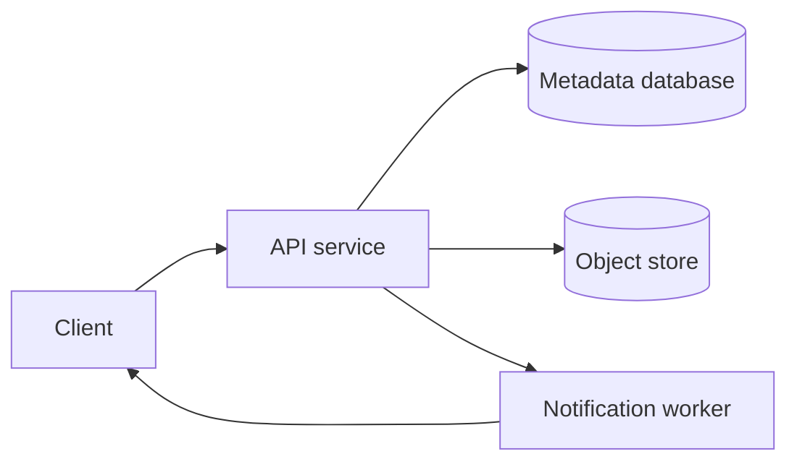
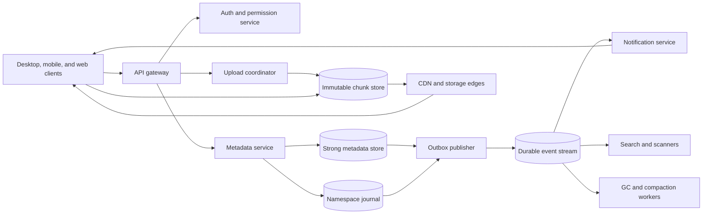
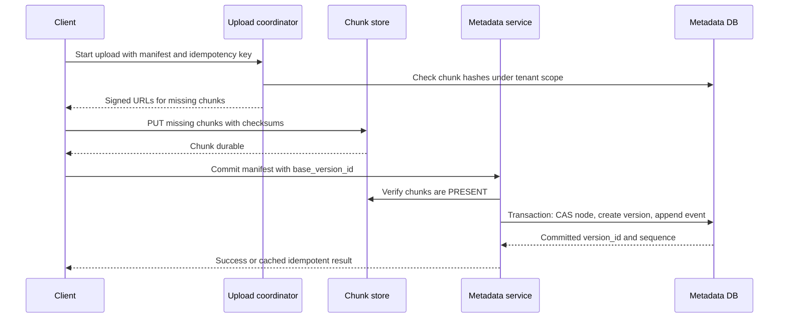
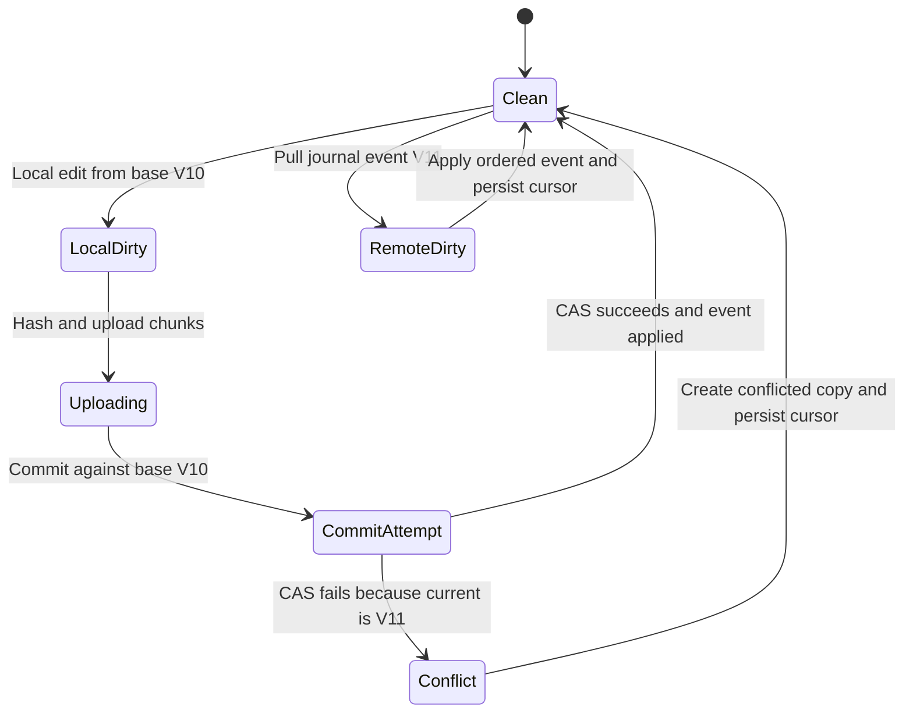
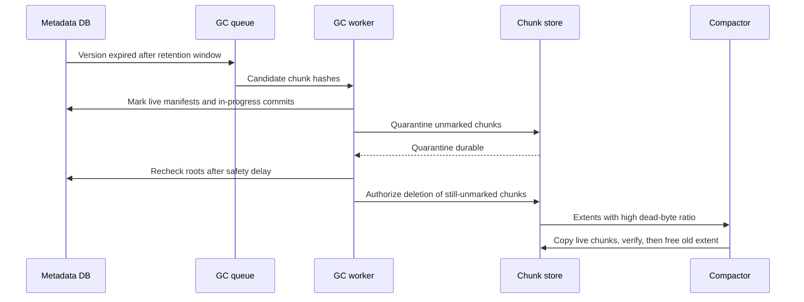

# Dropbox File Storage and Sync System Design

A Dropbox-like service stores files, folders, versions, shares, and device synchronization state for users who may edit the same namespace from many online and offline clients. This design focuses on storage, metadata commits, sync reconciliation, conflict handling, and safe reclamation of space; it does not deeply cover document co-editing, full-text search ranking, billing, or enterprise administration.

## 1. Requirements

### 1.1 Functional requirements

- Upload, download, move, rename, delete, restore, and version files and folders.
- Resume interrupted uploads and downloads without retransferring bytes that already arrived.
- Synchronize changes across desktop, mobile, and web clients with a durable catch-up path after disconnection.
- Preserve user data when concurrent offline edits race, including conflicted copies instead of silent overwrites.
- Share files or folders with named users and short-lived public links.
- Support large files efficiently through chunking, parallel transfer, and deduplication.

### 1.2 Non-functional requirements

- **Durability.** File bytes must survive disk, host, rack, and regional failures because users treat the service as the canonical copy of irreplaceable data.
- **Strong metadata consistency.** Folder uniqueness, current file version, permissions, quotas, and sync sequence numbers must be linearizable within a namespace, or clients will lose updates and disagree about the tree.
- **Eventual byte availability.** Immutable chunks can be replicated and cached asynchronously, but a metadata commit must not expose a version until every referenced chunk is durable enough to read.
- **Low sync latency.** A user expects an edit on one device to appear on another in seconds, so push notifications should reduce waiting while cursor-based polling remains authoritative.
- **Scalable storage economics.** Logical storage reaches exabytes, so the design must deduplicate, erasure-code, compress where safe, and reclaim dead chunks without risking live data.
- **Offline tolerance.** Clients can spend hours disconnected, so every mutation protocol must tolerate retries, stale base versions, and reconciliation against a later server history.

### 1.3 The binding constraint

The binding constraint is the split personality of the system. File bytes are huge, immutable after upload, naturally content-addressed, and worth treating as a storage problem. Metadata is small, mutable, user-visible, and must be strongly consistent because one wrong race can overwrite a file or create two active children with the same name. A good design keeps these worlds separate: the byte store optimizes for bandwidth, durability, deduplication, and compaction, while the metadata store optimizes for transactions, ordering, permissions, and sync cursors.

Offline clients make the split harder. A client can upload chunks for an edit based on version `V10` while another client has already committed `V11`. The bytes for the stale edit may be perfectly valid, but the metadata commit must fail or turn into a conflicted copy. That forces three mechanisms throughout the design: chunked content-addressed upload followed by an atomic metadata commit, a per-namespace journal with durable cursors, and conservative garbage collection that never deletes a block merely because one reference counter says it is unused.

## 2. Back-of-the-envelope estimation

Use these as illustrative assumptions, not claims about Dropbox. Suppose the service has `100M` registered users, `20M` daily active users, and `5M` connected devices during a busy window. If each active user uploads `20` files per day, average upload-file rate is `20M × 20 / 86,400 = 4,630` file commits per second. Peak traffic is usually several times higher, so a busy service should be comfortable around `25K` to `50K` file commits per second. The metadata write path therefore needs sharding by namespace, idempotency, and short transactions; it cannot put all commits behind one global sequencer.

Assume an average file is `5 MB`. Upload ingress is `20M × 20 × 5 MB = 2,000,000,000 MB/day`, which is `2 PB/day` or about `23 GB/s` average. At a `5×` peak multiplier, ingress reaches about `115 GB/s`; if peak commits reach `50K/s`, byte ingress at `5 MB` each is `250 GB/s`. Application servers must not proxy these bodies. They should issue signed URLs and let clients stream chunks directly to a storage edge.

Downloads are larger. If each daily active user downloads or syncs `100` files, that is `20M × 100 × 5 MB = 10 PB/day`, about `116 GB/s` average before CDN and local-cache hits. Immutable content-addressed chunks make CDN caching simple because a new version has new chunk hashes rather than invalidating an old key.

Storage dominates everything. If `100M` users each store `10 GB`, logical storage is `1 EB`. With fixed `4 MB` chunks, `1 EB / 4 MB = 268,435,456,000` logical chunks, about `268B` chunk references before versions and deduplication. A transactional metadata database cannot store hot per-chunk placement details for every read path in one row per request; it needs compact manifests, cold manifest storage, batching, and a storage layer that groups chunks into larger extents for erasure coding and compaction.

> **Key idea.** The numbers say the architecture is not a generic CRUD app with file blobs attached. File bytes need a direct, content-addressed data plane, while metadata commits and sync ordering need a strongly consistent control plane sharded by namespace.

## 3. API design

**Question.** What makes a retry safe when the client uploaded bytes successfully but lost the commit response?
<details><summary>Answer</summary>

Every mutating request carries a client-generated idempotency key and a base metadata version. The server records the result of the first successful commit under that key, so a retry returns the same committed version instead of creating a duplicate file or appending another change event.

</details>

```http
POST   /v1/uploads
       body: {parent_node_id, name, size, base_version_id, idempotency_key, chunk_hashes[]}

POST   /v1/uploads/{upload_id}/chunks
       body: {chunks: [{index, hash, size}]}
       returns: {missing_chunks: [{index, upload_url, expires_at}]}

POST   /v1/uploads/{upload_id}/commit
       body: {node_id?, parent_node_id?, name, base_version_id?, chunks: [{index, hash}], idempotency_key}

GET    /v1/nodes/{node_id}/download?version_id={version_id}
       returns: {manifest_id, chunks: [{index, hash, download_url, expires_at}], file_hash}

PATCH  /v1/nodes/{node_id}
       body: {base_revision, parent_node_id?, name?, deleted?}

GET    /v1/namespaces/{namespace_id}/changes?cursor={cursor}&limit={limit}
       returns: {changes[], next_cursor, has_more}

POST   /v1/shares
       body: {resource_id, principal_id?, role?, public_link_options?}

POST   /v1/nodes/{node_id}/restore
       body: {version_id, idempotency_key}
```

The upload API deliberately has two phases. Registering chunks is not a file-system mutation; it only arranges for missing immutable bytes to reach storage. The commit endpoint is the only step that changes the namespace. That keeps a half-finished `100 GB` upload from creating a visible file and lets the garbage collector quarantine abandoned chunks later.

Downloads return manifests rather than forcing the metadata service to stream bytes. The service checks current permissions, chooses storage replicas or CDN URLs, and issues short-lived signed URLs scoped to specific chunk keys and HTTP methods. For highly sensitive folders, the service can proxy through an authorization gateway, but the default path should keep large bodies away from application servers.

The changes API uses cursors, not offsets. An offset assumes a stable list, but a sync journal is compacted and partitioned. A cursor represents the last durable namespace sequence applied by that client. Push notifications are only hints: a device receiving `namespace X changed` still calls `/changes` and advances its cursor only after applying changes locally. If the cursor is too old, the server returns `CURSOR_EXPIRED`, and the client performs a snapshot reconciliation.

Mutation APIs include both idempotency keys and base versions. Idempotency handles transport uncertainty; base versions handle semantic uncertainty. If a client edited `V10` and the server current version is `V11`, replaying the request safely is not enough. The server must either reject the commit with a conflict response or commit it as a separate conflicted file.

## 4. Data model

Start with the obvious entity: a file path such as `/team/plan.pdf` with a blob pointer. That fails as soon as a user renames a parent folder while another device edits a child file offline. The path changed, but the identity of the file did not. The model therefore needs a stable `node_id` for each file and folder, with parent and name as mutable attributes.

A stable node still is not enough because file content changes over time. If `node_id = N7` points directly at a blob, an overwrite destroys the previous version and makes restore, conflict handling, and retry reasoning difficult. The node should instead point at a current immutable `version_id`, while historical `FileVersion` rows remain recoverable until retention expires.

A version cannot contain one giant object key because uploads are resumable, files are large, and identical ranges should deduplicate. Each version points to an ordered manifest of chunks. Chunks are content-addressed by a cryptographic hash and stored independently from the metadata transaction. The metadata commit records the manifest only after storage confirms the referenced chunks exist and pass checksum verification.

Finally, sync requires a history that clients can replay. A table of nodes tells the current state, but it cannot tell a reconnecting laptop what happened since cursor `98127`, nor can it preserve ordering between rename, edit, and delete. Each namespace therefore has a monotonic `ChangeEvent` journal. The same transaction that updates nodes and versions appends the next event, so the cursor is not an eventually published side effect.

```text
User
- user_id, account_status, storage_quota_bytes, storage_used_bytes

Namespace
- namespace_id, owner_id, home_region, current_sequence, retention_policy

Node
- node_id, namespace_id, parent_node_id, normalized_name, display_name
- type: FILE | FOLDER
- current_version_id, revision, deleted_at, created_at, updated_at

FileVersion
- version_id, node_id, namespace_id, size_bytes, file_hash
- manifest_id, base_version_id, created_by, created_at
- status: PENDING | COMMITTED | TOMBSTONED | EXPIRED

Manifest
- manifest_id, chunk_count, total_size_bytes, encoding, created_at

ManifestChunk
- manifest_id, sequence_number, chunk_hash, byte_offset, length, compressed_length

ChunkIndex
- chunk_hash, tenant_id, physical_extent_id, size_bytes, checksum, encryption_metadata
- refcount_estimate, quarantine_until, state: PRESENT | QUARANTINED | DELETING

Permission
- resource_id, principal_id, role: OWNER | EDITOR | VIEWER, inherited_from

ShareLink
- share_id, resource_id, token_hash, expires_at, password_hash, revoked_at

ChangeEvent
- namespace_id, sequence_number, operation, node_id, version_id, actor_id, payload, created_at

IdempotencyRecord
- scope, idempotency_key, request_hash, result_type, result_id, expires_at
```

`Namespace`, `Node`, `FileVersion`, permissions, idempotency records, and the sync journal live in a strongly consistent metadata layer partitioned primarily by `namespace_id`. Dropbox's Edgestore is a useful production analogue: it exposes a strongly consistent metadata abstraction over sharded MySQL with caching and geo-replication, so product logic does not hand-code shard details. Very large tenants eventually need movable key ranges and transactional support similar to Dropbox's Panda work; manual shard splitting is not a durable scaling strategy for petabyte-scale metadata.

Chunk bytes live in the storage system, not the transactional database. `Manifest` records can begin in metadata for small files but should spill to a manifest store as they grow. The metadata database stores the manifest identity and enough checksums to validate commits. Physical placement, erasure coding stripes, disk repair state, and compaction bookkeeping belong to the storage tier.

> **Key idea.** Stable node identity, immutable versions, ordered manifests, and a per-namespace journal are all responses to path-based sync failures and offline races.

## 5. High-level design

The simplest design puts metadata rows and file blobs behind one API service. The client uploads a whole file, the service writes a blob, updates a path row, and sends notifications.



This works for a prototype and fails in several concrete ways. A `100 GB` upload ties up application servers and restarts from zero after a laptop sleeps. Two offline clients editing the same path can overwrite each other because the API updates the current blob without a base-version compare-and-swap. Lost notifications leave devices permanently stale if there is no durable journal. A delete can race a delayed commit and garbage collection can remove a chunk that a version is about to reference. A single metadata database partition becomes hot for large shared folders.

### Fix 1: Split the data plane from the control plane

Clients split files into chunks, hash them, and ask an upload coordinator which chunks are missing. Missing chunks are uploaded directly to storage with short-lived signed URLs; chunks already present under the tenant dedup scope are skipped. This removes large bodies from application servers and enables resumability. Dropbox's Magic Pocket made the same separation at production scale: immutable encrypted blocks up to `4 MB` live in the storage system, while mutable file history is handled by a higher-level FileJournal-style metadata layer.

### Fix 2: Make metadata commits transactional and versioned

The metadata commit validates that every chunk in the manifest is durable, creates a `FileVersion`, updates `Node.current_version_id` with a compare-and-swap against `base_version_id`, appends a `ChangeEvent`, updates quota accounting, and records the idempotency result in one transaction. If the compare-and-swap fails, the server does not overwrite. It returns a conflict or creates a conflicted copy according to client policy.

### Fix 3: Use a per-namespace journal and cursor reconciliation

Push notifications are unreliable by design. They can be delayed, duplicated, dropped by mobile operating systems, or delivered before a client has network to fetch data. The durable source of truth is a per-namespace journal with monotonically increasing sequence numbers. Devices persist the last applied cursor after applying changes to their local index. When they reconnect, they ask for changes after that cursor; if the journal has compacted past it, they rebuild from a snapshot.

### Fix 4: Treat storage reclamation as asynchronous safety-critical work

A metadata delete tombstones a version; it does not delete chunks synchronously. Chunks referenced by expired versions enter a quarantine window, then mark-and-sweep verifies liveness before physical deletion or extent compaction. Dropbox's Magic Pocket compaction work shows why this distinction matters: immutable blobs inside closed volumes do not release capacity merely because metadata forgot them. Live blobs must be copied out before old volumes can be reclaimed.

### Fix 5: Partition metadata by namespace, then split hot ranges deliberately

Most user operations are local to one root or shared folder. Partitioning by `namespace_id` keeps directory uniqueness, version commits, and journal ordering single-shard for ordinary cases. Huge enterprise namespaces can outgrow one shard, so the metadata layer needs movable subranges and, for cross-subtree operations, small distributed transactions or a namespace-level sequencer. The design should evolve toward rebalancing and transactional key ranges rather than relying only on static shard counts.

### Putting it together



A typical upload starts with the client hashing chunks and calling the upload coordinator. The coordinator returns signed URLs only for missing chunks, and the client uploads those chunks directly to the chunk store. The client then calls metadata commit with the ordered manifest and base version. The metadata service performs authorization, verifies chunk presence, updates `Node` and `FileVersion`, appends `ChangeEvent`, and inserts an outbox row atomically. Notification workers publish a lightweight hint; other clients fetch authoritative changes by cursor and then download manifests from storage edges or CDN.

> **Key idea.** Each component traces back to a specific failure of the naive design.

## 6. Deep dives

### 6.1 Chunked upload, deduplication, and the metadata commit

**Question.** A client uploads all chunks for `report.pdf`, the commit response times out, and the user retries from a different network. How do we avoid duplicate versions, lost uploads, and references to missing chunks?
<details><summary>Answer</summary>

Separate chunk upload from namespace commit. Chunks are content-addressed and idempotent. The commit endpoint uses an idempotency key, verifies chunk durability, and performs a compare-and-swap on the file's base version in the same transaction that creates the file version and journal event.

</details>

The tempting upload design is `PUT /files/path` with the whole body. It is simple until the file is `100 GB`, the laptop sleeps at `99 GB`, and the API server has to decide whether a partially received body is a file. It also prevents useful deduplication: if a user edits one slide in a large presentation, the service receives almost the entire file again. Chunking fixes transfer economics, but only if the metadata protocol is precise about when bytes become a visible version.

The client first chooses chunks, commonly fixed-size `4 MB` chunks because they are predictable, easy to parallelize, and align with Dropbox's published block design. Content-defined chunking can save bandwidth after an insertion near the beginning of a file because boundaries resynchronize, but it costs CPU and more complex client libraries. A practical service can start fixed-size, then introduce content-defined chunking for very large files or file types where bandwidth dominates CPU.

Each chunk is named by a hash such as `sha256(bytes)`. The client sends the manifest to the upload coordinator, which checks `ChunkIndex` under the tenant's deduplication scope. Global dedup saves more storage, but it can leak whether some other user possesses known content. Tenant-scoped dedup is a safer default: it still avoids retransmitting chunks across a user's devices and shared folders without turning the storage system into an oracle for arbitrary files.

The coordinator returns signed URLs for missing chunks. The storage layer verifies checksums while accepting bytes; a client-provided hash is only a claim. The chunk becomes `PRESENT` only after the storage system has enough durable replicas or erasure-coded fragments for the service's write policy. At exabyte scale, chunks should not each be an independent placement unit forever. The storage layer groups immutable chunks into larger extents or volumes for repair, erasure coding, and compaction.

The commit is the semantic boundary. It runs as a metadata transaction: load the idempotency record, validate the request hash if the key was seen before, verify all chunk hashes are `PRESENT`, create a manifest and `FileVersion`, update the node with `WHERE current_version_id = :base_version_id`, append the next namespace `ChangeEvent`, update quota, and store the idempotency result. If the response is lost, the retry finds the same idempotency record and returns the same `version_id`. If another client already committed a newer current version, the compare-and-swap updates zero rows. The service can return `409 CONFLICT` with both versions or create `report (Alice's conflicted copy).pdf` as a new node, but it must not silently advance the original node over someone else's edit.



Compression fits between chunking and storage, but only with strict safety rules. Dropbox's Broccoli work showed that compressing in the block sync path can reduce median latency and wire bytes by more than `30%`, while Lepton showed specialized lossless JPEG recompression saving `22%` on existing images and multiple petabytes. The lesson is not to compress everything blindly. The client or edge should bypass already-compressed or encrypted data quickly, bound CPU and memory, use deterministic reversible transforms, and verify decompressed bytes against the original file hash before commit.

Signals worth watching: upload abandonment rate, chunk checksum failures, dedup hit ratio by tenant, idempotent commit replay rate, commit conflict rate, and bytes proxied through application servers.

> **Strong-answer criteria.** A senior answer separates byte durability from namespace visibility, uses content hashes for idempotent chunks, and makes the metadata commit the only user-visible mutation.

| Level | Approach | Why |
|---|---|---|
| Bad | Upload whole files through the API and overwrite the path | Restarts are expensive, API servers carry huge bodies, and concurrent edits lose data |
| Good | Chunk uploads directly to object storage, then update metadata | Resumability and scale improve, but retries and conflict races may still duplicate versions |
| Great | Content-addressed chunks plus idempotent transactional commit with CAS and journal append | Retries, deduplication, conflict detection, and sync ordering are handled together |

### 6.2 Sync journal, offline reconciliation, and conflicted copies

**Question.** A laptop edits `budget.xlsx` on an airplane while a desktop renames the containing folder and edits the same file. What should happen when the laptop reconnects?
<details><summary>Answer</summary>

The laptop replays from its last namespace cursor to learn the authoritative rename and newer file version, uploads its chunks if needed, and attempts a commit against its original base version. The base-version CAS fails, so the server preserves the desktop version and stores the laptop edit as a conflicted copy or returns a conflict for the client to materialize.

</details>

Sync breaks when the server and client use paths as identity. A rename of `/Finance` to `/Planning` can look like a delete plus an add, while an offline edit to `/Finance/budget.xlsx` appears to target a path that no longer exists. Dropbox's Nucleus rewrite is strong production evidence for stable data models: the old sync engine's representation made moves, sharing, and correctness hard, so the rewrite centered on a stricter model with stable identifiers and better invariants. In this design, the client local index stores `node_id`, parent `node_id`, display name, current version, and last applied cursor. A move changes parent/name fields; it does not erase identity.

The journal is per namespace because ordering matters within a folder tree but global ordering is unnecessary and expensive. Every mutation gets sequence `current_sequence + 1` in the same transaction that applies the mutation. A client that has cursor `100` asks for changes after `100`, applies events `101..N` in order, writes its local index, and only then persists cursor `N`. If the process crashes midway, it repeats from the last durable cursor. Event handlers are idempotent: applying `set node N7 current_version V12` twice yields the same index.

Notifications are hints. Mobile push systems drop messages, desktops sleep, and notification workers can publish duplicates after retrying the outbox. The notification payload should be small: namespace id and maybe latest known sequence. The client still calls `/changes`. This design also fixes the classic outbox failure: if the database commit succeeds but publishing to Kafka fails, clients are not permanently stale because the journal row exists. A transactional outbox worker can publish later, and periodic polling covers the remaining gap.

Conflicts are not exceptional; they are expected in an offline-first file system. Each edit carries `base_version_id`. If current equals base, the edit advances the original file. If current differs, the service preserves both. For ordinary binary files, the safest behavior is a conflicted copy named with actor and timestamp. For text or application-specific document formats, the client may offer a merge, but that should be an explicit higher-level feature. Silent last-writer-wins is unacceptable because it destroys user data while pretending sync succeeded.

Folder conflicts need the same discipline. The metadata transaction enforces one active child per `(parent_node_id, normalized_name)`. If two offline devices create `notes.txt` under the same parent, one gets the intended name and the other becomes `notes (Bob's conflicted copy).txt`. If a delete races an edit, the edit should remain recoverable, often as a restored conflicted file under the nearest live parent or a recovery area. The exact UX can vary, but the invariant is stable: no committed user bytes disappear solely because a different client deleted a name.



Testing this protocol is as important as designing it. Dropbox's sync testing work argues for designing away invalid states, not merely detecting them after the fact. Randomized tests should generate offline edits, moves, deletes, duplicate names, case-only renames, permission revocations, crashes between upload and commit, and cursor expirations. The server should reject impossible states: missing parent, duplicate active names, folder cycles, cursor gaps, and a file version that references absent chunks.

Signals worth watching: end-to-end commit-to-visibility latency, cursor expiration frequency, conflict-copy creation rate, duplicate notification rate, local-index repair rate, and invariant violations found by model tests.

> **Strong-answer criteria.** A senior answer treats push as a latency optimization, not correctness; uses stable node ids and cursors; and explains why conflicted copies are a data-preservation feature, not a bug.

| Level | Approach | Why |
|---|---|---|
| Bad | Last writer wins by path | Renames look like deletes, offline edits overwrite each other, and users lose data |
| Good | Poll for changes and compare timestamps | Reconnection works sometimes, but clocks and path identity still create ambiguous histories |
| Great | Per-namespace journal, stable node ids, base-version CAS, and conflicted copies | Clients can reconcile ordered history after disconnection while preserving every committed edit |

### 6.3 Storage tier, erasure coding, garbage collection, and compaction

**Question.** A user deletes a folder, the recovery window expires, and a GC worker sees chunk `H` with refcount zero. Is it safe to delete `H` immediately?
<details><summary>Answer</summary>

No. Reference counts are hints that can drift. The worker should quarantine the chunk, run mark-and-sweep from authoritative live versions and manifests, account for in-progress commits and replication lag, and only then let the storage tier delete or compact physical extents.

</details>

The naive storage lifecycle is seductive: increment a chunk refcount on commit, decrement it on delete, and delete when the count hits zero. That fails because the metadata and storage systems do not fail atomically together. A commit can upload chunks, crash before metadata commit, retry later, and still need those chunks. A metadata transaction can commit a manifest while a refcount update is delayed. A restore can race expiration. Replication and erasure-coding repair can lag behind metadata state. In a system holding an exabyte of user data, a false deletion is worse than a leak; leaked bytes cost money, deleted live bytes destroy trust.

The storage tier should treat chunks as immutable content-addressed blobs grouped into larger physical extents. Replication is simple conceptually but expensive at this scale. Erasure coding reduces overhead by storing data and parity fragments across failure domains. For example, a `10+4` code stores `10` data fragments and `4` parity fragments, so storage overhead is `14 / 10 = 1.4×` before metadata, repair slack, and multi-region copies. That is far cheaper than `3×` replication for cold data, but reads and repairs are more complex. Hot chunks may still use replication or cache copies at edges for latency, then migrate to erasure-coded extents when cold.

Garbage collection should follow the metadata lifecycle. A delete first tombstones nodes and versions so users can restore within the retention window. When a version expires, the system marks its manifest references as candidates for dereference. Candidate chunks enter `QUARANTINED` with a future timestamp rather than immediate deletion. During quarantine, any new commit can still reference the chunk by hash and move it back to `PRESENT` if policy permits.

The authoritative safety pass is mark-and-sweep. Mark starts from live namespaces, non-expired versions, restore windows, legal holds, and in-progress upload sessions that have reached commit eligibility. It marks all manifests and chunks reachable from those roots. Sweep can delete only chunks that are unmarked, past quarantine, and not required by storage repair or region replication. Refcount estimates remain useful for prioritization, but they are not proof.

Compaction is separate from logical liveness. Dropbox's Magic Pocket compaction write-up makes this concrete: immutable blobs remain inside closed volumes after delete. If an extent contains `70%` dead chunks and `30%` live chunks, deleting dead entries may not release a disk allocation. Compaction copies live chunks into new extents, verifies checksums, atomically updates physical placement indexes, waits through a safety window, and then frees the old extent. This creates write amplification, so the system should compact only when reclaimed space justifies the extra IO and repair risk.



Safety also includes hash and encryption choices. A cryptographic hash collision is extremely unlikely with SHA-256, but a malicious client can lie about a hash by uploading different bytes to a signed URL. Storage must verify the actual bytes. Encryption metadata belongs with chunk placement because the same logical hash may need tenant-specific encryption domains; dedup scope and key scope must be designed together.

Signals worth watching: dead-byte ratio by extent, quarantine backlog, mark-and-sweep duration, compaction write amplification, repair backlog, refcount drift discovered by reconciliation, and any attempted read of a chunk in `DELETING` state.

> **Strong-answer criteria.** A senior answer distinguishes logical deletion from physical reclamation, treats refcounts as advisory, and explains how erasure coding and compaction change the deletion path.

| Level | Approach | Why |
|---|---|---|
| Bad | Delete a chunk immediately when a file is deleted | Restore, retries, and shared references break; live data can disappear |
| Good | Keep refcounts and delete at zero after retention | Better, but crashes and delayed events can make counts wrong |
| Great | Quarantine, mark-and-sweep from authoritative roots, then compact immutable extents | Safety is prioritized while still reclaiming physical space economically |

## 7. Variants

**10x scale.** At `10 EB` logical storage and hundreds of thousands of commits per second, the same split remains but every interface becomes more explicitly batched. Manifests move out of the metadata hot path, namespace partitions need automatic range movement, GC runs as a distributed dataflow job, and storage repair capacity becomes a first-class quota. The core invariants do not change: chunks are immutable, metadata commits are transactional, and cursors are per namespace.

**Multi-region active-active.** Immutable chunk storage can become active-active earlier than metadata because content hashes remove most write conflicts. Metadata writes are harder: two regions cannot both assign the next sequence for the same namespace without coordination. A practical design gives each namespace a home region, serves reads and downloads globally, and promotes a secondary only after fencing the old primary. Dropbox's disaster-readiness writing makes the same separation: block storage can be multi-homed sooner, while metadata failover requires phased active-passive discipline before active-active ambitions.

**Enterprise shared workspace.** A single company folder with millions of nodes can make `namespace_id` a hot partition. The design adds subtree partitioning, movable key ranges, and a logical namespace sequencer. Cross-subtree moves become small transactions that reserve the destination name, update parent links, and append one ordered journal event. Permissions also need careful caching because a top-level revocation invalidates many descendants.

**End-to-end encrypted product mode.** If clients encrypt before upload with keys the server never sees, deduplication, malware scanning, previews, search, and server-side compression are reduced or lost. The byte plane still stores immutable chunks, and the metadata plane still commits versions and cursors, but chunk hashes may need to be over ciphertext, sharing requires key wrapping between users, and recovery workflows become user-key workflows rather than account workflows.

## 8. The transferable pattern

This is the pattern of separating a large immutable data plane from a small strongly consistent control plane. The data plane is optimized for content addressing, direct transfer, caching, erasure coding, and asynchronous repair. The control plane is optimized for conditional updates, sequencing, idempotency, and user-visible invariants. Similar splits appear in video upload systems, backup systems, package registries, and photo storage services. The details differ, but the argument is the same: do not put giant immutable bytes inside the transaction path, and do not let eventually consistent blob state decide mutable user semantics.

The sync side shares a pattern with any offline-first replicated application: stable identities, an ordered change log, base-version checks, and explicit conflict materialization. A Ticketmaster-like inventory system has a different data plane, but the control-plane lesson is related: when users race for scarce mutable state, correctness comes from conditional commits and fencing rather than from retrying blind writes. See [Ticketmaster](./ticketmaster-system-design.md) for a contrasting system where the scarce object is inventory rather than user file history.

## Review

The design follows from one constraint: huge immutable bytes and small mutable metadata need different systems. Clients upload content-addressed chunks directly to storage, but no chunk becomes a user-visible file until a metadata transaction verifies durability, performs a base-version compare-and-swap, appends a namespace journal event, updates quota, and records idempotency. Devices synchronize by replaying per-namespace cursors because notifications are only hints. Offline conflicts preserve both versions through conflicted copies. The storage tier reclaims space only through retention, quarantine, mark-and-sweep, and compaction, because deleting a live chunk is far worse than temporarily leaking dead bytes.

### Check your understanding

1. Why should application servers not proxy normal file upload and download bodies?
   <details><summary>Answer</summary>

   At the estimated scale, upload ingress can reach hundreds of GB/s at peak. Proxying those bytes through application servers wastes CPU, memory, network capacity, and failure budget. Signed URLs let clients stream immutable chunks directly to storage while the application tier handles only authorization and metadata commits.

   </details>

2. Why is an idempotency key not enough to prevent sync conflicts?
   <details><summary>Answer</summary>

   Idempotency makes transport retries safe by returning the same result for the same request. It does not prove the edit is still based on the current file version. The commit also needs a base-version compare-and-swap so stale offline edits become conflicts instead of overwrites.

   </details>

3. Why are push notifications insufficient as the source of truth for sync?
   <details><summary>Answer</summary>

   Notifications can be lost, duplicated, delayed, or delivered while a client is offline. The per-namespace journal is durable and ordered, so clients use notifications only as hints and always reconcile by fetching changes after their last persisted cursor.

   </details>

4. Why is path-based identity dangerous for an offline file sync system?
   <details><summary>Answer</summary>

   Paths change when folders are renamed or moved. An offline edit to an old path can be misread as an edit to a deleted file or a new file. Stable `node_id` values preserve identity across moves and make reconciliation unambiguous.

   </details>

5. Why not delete chunks immediately when reference counts reach zero?
   <details><summary>Answer</summary>

   Reference counts can drift after crashes, delayed commits, restore races, and replication lag. Safe reclamation quarantines candidates, marks live data from authoritative metadata roots, rechecks after a safety delay, and then compacts physical extents if needed.

   </details>

## Sources and further reading

| Source | Article | Why it matters |
|---|---|---|
| Dropbox | [Inside the Magic Pocket](https://dropbox.tech/infrastructure/inside-the-magic-pocket) | Explains Dropbox's immutable 4 MB block storage, FileJournal separation, replication, and erasure coding. |
| Dropbox | [Improving storage efficiency in Magic Pocket, our immutable blob store](https://dropbox.tech/infrastructure/improving-storage-efficiency-in-magic-pocket-our-immutable-blob-store) | Shows why immutable stores need GC plus compaction to reclaim deleted blob space at exabyte scale. |
| Dropbox | [Rewriting the heart of our sync engine](https://dropbox.tech/infrastructure/rewriting-the-heart-of-our-sync-engine) | Describes Nucleus and why stable data models are essential for large-scale file sync correctness. |
| Dropbox | [Testing sync at Dropbox](https://dropbox.tech/infrastructure/-testing-our-new-sync-engine) | Details model/randomized testing and protocol invariants for a sync engine with offline clients. |
| Dropbox | [Streaming File Synchronization](https://dropbox.tech/infrastructure/streaming-file-synchronization) | Demonstrates prefetching uncommitted blocklists to pipeline large-file sync and cut latency. |
| Dropbox | [Broccoli: Syncing faster by syncing less](https://dropbox.tech/infrastructure/-broccoli--syncing-faster-by-syncing-less) | Shows block-sync compression reducing median latency and network bytes by more than 30%. |
| Dropbox | [Lepton image compression: saving 22% losslessly from images at 15MB/s](https://dropbox.tech/infrastructure/lepton-image-compression-saving-22-losslessly-from-images-at-15mbs) | Shows specialized deterministic JPEG recompression saving multiple petabytes without changing file bytes. |
| Dropbox | [(Re)Introducing Edgestore](https://dropbox.tech/infrastructure/reintroducing-edgestore) | Presents Dropbox's strongly consistent metadata abstraction over sharded MySQL with caching and geo-replication. |
| Dropbox | [Future-proofing our metadata stack with Panda, a scalable key-value store](https://dropbox.tech/infrastructure/panda-metadata-stack-petabyte-scale-transactional-key-value-store) | Explains rebalancing, ACID transactions, and incremental capacity expansion for petabyte-scale metadata. |
| Dropbox | [That time we unplugged a data center to test our disaster readiness](https://dropbox.tech/infrastructure/disaster-readiness-test-failover-blackhole-sjc) | Separates active-active content storage from harder metadata failover and grounds RTO/RPO planning. |
