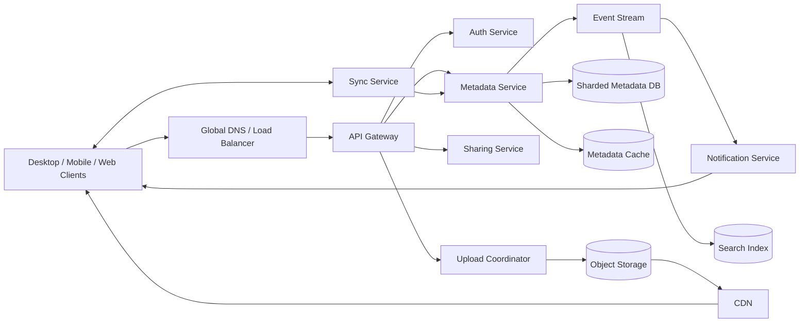

# Dropbox-like File Storage and Sync Service

## 1. Requirements

### Functional requirements

1. Upload and download files.
2. Organize files into folders.
3. Synchronize changes across devices.
4. Support resumable uploads.
5. Maintain file versions and restore deleted files.
6. Share files or folders with users or public links.
7. Detect simultaneous edits and preserve both versions.
8. Notify clients quickly when files change.
9. Handle large files efficiently.

### Non-functional requirements

- High durability: target `99.999999999%` for stored file data.
- High availability for downloads and synchronization.
- Low synchronization latency, ideally a few seconds.
- Support billions of files and millions of concurrent clients.
- Encrypt data in transit and at rest.
- Keep metadata operations strongly consistent.
- Allow eventual consistency for immutable file content.

## 2. Scale assumptions

State these assumptions explicitly during an interview and adjust them when challenged:

- 100 million registered users.
- 20 million daily active users.
- 5 million concurrently connected devices.
- Average user stores 10 GB.
- Approximately 1 EB of logical storage.
- 20 uploads and 100 downloads per active user per day.
- Average file size: 5 MB.
- Maximum file size: 100 GB.
- Read-to-write ratio: approximately 5:1.

Approximate upload request rate:

```text
20M users x 20 uploads / 86,400 seconds
= approximately 4,600 uploads/second average
= approximately 20,000-50,000 uploads/second at peak
```

Approximate byte volume with 5 MB average files:

```text
Uploads:   20M x 20 x 5 MB = 2 PB/day = ~23 GB/s average
Downloads: 20M x 100 x 5 MB = 10 PB/day = ~116 GB/s average
Peak upload ingress: 20K-50K uploads/s x 5 MB = ~100-250 GB/s
```

Storing every version indefinitely would be prohibitively expensive. The system therefore needs retention policies, deduplication, compression where useful, and lifecycle-based movement to colder storage.

## 3. High-level architecture



The key separation is:

- **Control plane:** authentication, namespace, permissions, versions, and synchronization state.
- **Data plane:** transfer and storage of file bytes.

Application servers should not proxy large file bodies. Clients should transfer chunks directly to object storage using short-lived signed URLs.

## 4. Data model

### File namespace

```text
User
- user_id
- account_status
- storage_quota
- storage_used

Node
- node_id
- namespace_id
- parent_node_id
- name
- type: FILE | FOLDER
- current_version_id
- owner_id
- deleted_at
- created_at
- updated_at
- revision

FileVersion
- version_id
- node_id
- size
- content_hash
- created_by
- created_at
- status: PENDING | COMMITTED | DELETED

Chunk
- chunk_hash
- object_key
- size
- encryption_metadata
- reference_count

VersionChunk
- version_id
- chunk_hash
- sequence_number
- byte_offset
- length

Permission
- resource_id
- principal_id
- role: OWNER | EDITOR | VIEWER

ShareLink
- share_id
- resource_id
- token_hash
- expires_at
- password_hash
- revoked_at

ChangeEvent
- namespace_id
- sequence_number
- node_id
- operation
- version_id
- actor_id
- timestamp
```

### Important decisions

- Assign every file and folder a stable `node_id`; names and paths can change.
- Store parent-child relationships rather than using the full path as identity.
- Treat file content as immutable. Editing creates a new `FileVersion`.
- Have each version reference an ordered manifest of immutable chunks.
- Use a monotonically increasing sequence number within each synchronization namespace.

A namespace might represent one user's root directory or a shared team folder.

## 5. Core APIs

### Start an upload

```http
POST /v1/uploads

{
  "parent_node_id": "folder-123",
  "file_name": "report.pdf",
  "size": 7340032,
  "base_version_id": "version-41",
  "idempotency_key": "client-generated-uuid"
}
```

Response:

```json
{
  "upload_id": "upload-789",
  "chunk_size": 4194304,
  "missing_chunks": [],
  "expires_at": "2026-10-13T08:00:00Z"
}
```

### Register chunks

```http
POST /v1/uploads/{upload_id}/chunks

{
  "chunks": [
    {
      "index": 0,
      "hash": "sha256:...",
      "size": 4194304
    }
  ]
}
```

The service returns signed upload URLs only for chunks that are not already present.

### Commit an upload

```http
POST /v1/uploads/{upload_id}/commit

{
  "base_version_id": "version-41",
  "chunks": [
    {"index": 0, "hash": "sha256:..."},
    {"index": 1, "hash": "sha256:..."}
  ]
}
```

The commit atomically:

1. Validates all chunks.
2. Creates the immutable version manifest.
3. Updates the file's current version using compare-and-swap.
4. Appends a change event.
5. Updates quota accounting.

### Retrieve changes

```http
GET /v1/namespaces/{namespace_id}/changes?cursor=98127&limit=1000
```

Response:

```json
{
  "changes": [],
  "next_cursor": 99127,
  "has_more": false
}
```

Other important endpoints:

```http
GET    /v1/nodes/{node_id}
GET    /v1/nodes/{node_id}/download
PATCH  /v1/nodes/{node_id}
DELETE /v1/nodes/{node_id}
GET    /v1/nodes/{node_id}/versions
POST   /v1/nodes/{node_id}/restore
POST   /v1/shares
DELETE /v1/shares/{share_id}
```

Mutation APIs should accept idempotency keys because clients will retry after network failures.

## 6. Upload flow

1. The client splits the file into chunks.
2. It calculates a cryptographic hash for each chunk.
3. It sends the chunk manifest to the upload coordinator.
4. The coordinator checks which chunks already exist.
5. The client uploads missing chunks directly to object storage using signed URLs.
6. Object storage verifies checksums.
7. The client asks the metadata service to commit the upload.
8. The metadata service atomically creates a version and updates the namespace.
9. A change event is written to the event stream.
10. Other devices receive a notification and fetch the authoritative changes.

### Why chunks?

- Interrupted uploads can resume.
- Editing part of a large file may upload only changed chunks.
- Identical content can be deduplicated.
- Chunks can be downloaded in parallel.
- Large files do not need to pass through application servers.

A fixed 4 MB chunk size is straightforward and aligns with Dropbox's published block design; 4-8 MB is still a reasonable interview range. Content-defined chunking provides better delta detection when bytes are inserted near the beginning of a file, but costs more CPU and implementation complexity.

A strong interview answer can begin with fixed-size chunks, then introduce content-defined chunking if bandwidth optimization becomes a priority.

## 7. Download flow

1. The client requests the current version or a specific historical version.
2. The metadata service authenticates the user and checks permissions.
3. It returns a short-lived signed URL or a manifest containing signed chunk URLs.
4. The client downloads through the CDN.
5. The client verifies chunk and full-file hashes.
6. Popular encrypted chunks are cached at CDN edge locations.

Authorization must happen before signed URLs are issued. URLs should expire quickly and should be scoped to specific objects and methods.

## 8. Synchronization protocol

Reliable synchronization is the hardest part of this design.

### Client state

Each client maintains:

- A local index of file IDs, paths, versions, and hashes.
- The last applied namespace cursor.
- A durable queue of local changes.
- Temporary state for partially completed transfers.
- A local file watcher.

### Sync process

1. The file watcher detects a local change.
2. The client waits briefly to coalesce repeated writes.
3. The client calculates hashes and uploads changed chunks.
4. The client commits against its known `base_version_id`.
5. The server assigns the change a namespace sequence number.
6. The notification service sends a lightweight "namespace changed" message.
7. Devices call the changes API with their last cursor.
8. Devices apply changes in sequence order and persist the new cursor.

Notifications are only hints. They can be duplicated, delayed, or lost. The cursor-based change log is the source of truth.

For very large newly-created files, the system can reduce device-to-device latency by advertising a pre-commit, prefetchable block manifest to other authorized devices. The downloader fetches blocks while the uploader is still sending later chunks, then falls back to the committed change log if the speculative state expires.

### Reconnection

When a client reconnects:

```text
GET /changes?cursor=<last-durable-cursor>
```

If the cursor has expired because change logs were compacted, the server returns a specific `CURSOR_EXPIRED` error and the client performs a full metadata snapshot reconciliation.

## 9. Conflict handling

Use optimistic concurrency control.

Every upload identifies the version from which it was edited:

```text
base_version_id = V10
```

The metadata service commits with logic equivalent to:

```sql
UPDATE nodes
SET current_version_id = :new_version
WHERE node_id = :node_id
  AND current_version_id = :base_version;
```

If no row is updated, another client committed first.

Possible policies:

- Preserve the remote version as canonical.
- Store the local edit as `report (Alice's conflicted copy).pdf`.
- Notify the user.
- Optionally attempt an application-specific merge for collaborative document formats.

Never silently overwrite one user's data with another's. Both versions should remain recoverable.

Folder operations have related conflicts:

- Concurrent rename: accept one and expose the other as a conflict.
- Delete versus edit: retain the edited version, potentially as a restored or conflicted file.
- Duplicate names: enforce uniqueness transactionally within each parent folder.

## 10. Metadata consistency and partitioning

File bytes are immutable, so object storage can be eventually consistent as long as a metadata version is not exposed before all referenced chunks are durable.

Metadata requires stronger guarantees:

- Creating or renaming a file must be atomic.
- A folder must not expose two active children with the same normalized name.
- Version commits must use compare-and-swap.
- Permissions must be checked against current authoritative state.
- Every committed mutation must appear in the change log exactly once logically.

Partition metadata by `namespace_id`. This keeps operations within a user's root or shared folder on the same shard.

Benefits:

- Ordered changes within a namespace.
- Efficient directory listings.
- Most mutations are single-shard transactions.
- Straightforward cursor generation.

A very large enterprise namespace can become a hot partition. Mitigations include partitioning by subtree while maintaining a logical namespace-level event sequencer, or limiting shared-root size and encouraging multiple team spaces.

## 11. Reliable event publication

A dangerous failure mode is:

1. The database commit succeeds.
2. Publishing the sync event fails.
3. Other clients never hear about the change.

Use the transactional outbox pattern:

```text
Database transaction:
- update node
- create file version
- append namespace change
- insert outbox event
- commit
```

An outbox worker publishes events to Kafka or another durable stream and marks them delivered. Consumers must be idempotent because publication can happen more than once.

Consumers include:

- Notification delivery.
- Search indexing.
- Audit logging.
- Malware scanning.
- Usage analytics.
- Garbage collection.

## 12. Storage and deduplication

### Physical storage

Store chunks in replicated object storage. The object key can derive from the content hash:

```text
chunks/{hash-prefix}/{sha256}
```

At exabyte scale, avoid treating every 4 MB chunk as an independent physical placement unit. Group immutable chunks into larger extents or buckets for replication, erasure coding, compaction, and disk-rebuild workflows.

### Deduplication

Two possible scopes:

- **Per-user or per-tenant:** better privacy isolation, lower savings.
- **Global:** maximum savings, but risks leaking whether another user possesses a known file.

For a production design, tenant-scoped deduplication is often the safer default.

Never trust a client-provided hash alone. The server or object-storage layer must verify the bytes against the declared hash.

### Compression

Lossless compression can reduce both storage cost and sync bandwidth, but it must be deterministic and verified. Compress only formats and sizes where CPU cost, latency, and memory bounds are acceptable; after compression, decode and compare bytes before committing the compressed representation. For already-compressed or encrypted data, skip compression quickly.

### Garbage collection

Deleting a version should not synchronously delete its chunks.

1. Mark the version deleted.
2. Retain it for the recovery window.
3. Decrement chunk references when the version expires.
4. Place unreferenced chunks into a quarantine state.
5. Delete them after a safety delay.

This prevents races with in-progress commits, restores, replication, and delayed events.

Reference counts alone can drift after failures. Periodic mark-and-sweep reconciliation should verify them. In immutable extent-based stores, garbage collection only identifies dead chunks; a separate compaction process must copy live chunks into new extents before old extents release physical space.

## 13. Caching and CDN

### CDN

Use the CDN for:

- Public or authorized downloads.
- Frequently accessed immutable chunks.
- Range requests.
- Geographic latency reduction.

Immutable content hashes make cache invalidation simple: new content gets a new key.

### Metadata cache

Cache:

- Node metadata.
- Directory listings.
- User quota information.
- Permission summaries.

Do not rely exclusively on cached authorization data for sensitive operations. Use short TTLs or explicit invalidation events, especially after access revocation.

## 14. Availability and multi-region design

A practical design:

- Deploy stateless API, sync, and notification services in multiple regions.
- Route uploads and metadata writes to a namespace's home region.
- Replicate metadata synchronously across availability zones.
- Replicate metadata asynchronously to disaster-recovery regions.
- Replicate file chunks across regions according to durability and residency policies.
- Serve downloads from nearby replicas and CDN edges.

Active-active metadata writes across distant regions introduce difficult ordering and conflict problems. A per-namespace home region provides a simpler consistency model while still allowing globally distributed reads. File-content storage can be active-active sooner than metadata because immutable chunk reads and asynchronous replication have fewer ordering constraints than namespace mutations.

During home-region failure:

- Initially serve safe reads from replicas.
- Promote a sufficiently caught-up secondary.
- Fence the old primary before accepting writes.
- Use recovery-point and recovery-time objectives to decide whether temporary write unavailability is preferable to possible conflicting writes.

## 15. Security

- Use TLS for all communication.
- Encrypt data at rest using managed KMS keys.
- Use per-tenant keys for enterprise isolation where required.
- Issue short-lived, narrowly scoped signed URLs.
- Store passwords with Argon2id or another approved password hash.
- Use OAuth or session tokens with rotation and revocation.
- Apply rate limits by account, IP, device, and endpoint.
- Perform malware scanning and content policy enforcement.
- Keep audit logs for sharing, permission changes, and downloads.
- Support share-link expiration, revocation, and optional passwords.
- Validate metadata to prevent path traversal and unsafe filenames.
- Enforce quotas on storage, versions, requests, and shared-link traffic.
- Implement data-residency and deletion workflows for compliance.

End-to-end encryption is possible, but it weakens server-side search, deduplication, malware scanning, previews, and account recovery. Treat it as a deliberate product mode rather than adding it implicitly.

## 16. Important failure cases

| Failure | Handling |
|---|---|
| Client retries upload creation | The idempotency key returns the existing upload |
| Chunk upload is interrupted | Resume only missing chunks |
| Chunk is stored but commit fails | Garbage collector removes it after quarantine |
| Commit succeeds but response is lost | Idempotent commit returns the committed version |
| Event publishing fails | Transactional outbox retries |
| Notification is lost | Client polls using its durable cursor |
| Events arrive twice | Idempotent consumers and version checks |
| Two clients edit simultaneously | Optimistic concurrency and conflicted copy |
| Client cursor is too old | Full metadata snapshot reconciliation |
| Permission is revoked after URL issuance | Very short URL TTL; proxy highly sensitive downloads |
| Metadata region fails | Fenced failover to a replicated region |
| Hash collision or dishonest client | Verify hashes server-side and use SHA-256 or stronger |

## 17. Observability

Track:

- Upload and download throughput.
- Chunk deduplication ratio.
- Sync notification latency.
- End-to-end change propagation latency.
- Change-log consumer lag.
- Metadata transaction latency and conflicts.
- Upload abandonment rate.
- Object replication backlog.
- Cursor expiration and full-resync frequency.
- Quota accounting drift.
- Garbage-collection backlog.
- Authorization failures and anomalous share-link traffic.

A valuable service-level indicator is:

```text
Time from successful commit on device A
to visible metadata on device B
```

Sync correctness also needs randomized and model-based tests that explore offline edits, concurrent moves, deletes, partial transfers, retry races, and platform-specific filesystem behavior. Track invariant violations such as orphaned nodes, duplicate active child names, and cursor gaps.

## 18. Major trade-offs

### Whole-file storage versus chunking

- Whole files are simpler.
- Chunking enables resumability, deduplication, and delta transfer.
- Chunking adds manifests, reference tracking, and garbage-collection complexity.

### Fixed-size versus content-defined chunks

- Fixed-size chunks are fast and predictable.
- Content-defined chunks produce better deltas after insertions.
- A hybrid design can use fixed chunks initially and content-defined chunking for larger files.

### Strong versus eventual metadata consistency

- Strong consistency prevents lost updates and namespace anomalies.
- Eventual consistency provides higher cross-region write availability.
- Per-namespace strongly consistent writes are a good compromise.

### Global versus tenant-scoped deduplication

- Global deduplication saves more storage.
- Tenant-scoped deduplication provides better isolation and fewer information leaks.

### Push versus polling

- Push minimizes latency.
- Polling provides reliability.
- Use push as a hint and cursor-based polling as the authoritative mechanism.


## 19. Lessons from production systems

### Magic Pocket: immutable blocks plus higher-level metadata

Dropbox's Magic Pocket stores file content as immutable encrypted blocks up to 4 MB, while mutable file history lives in a separate FileJournal-style metadata layer. This directly supports the design here: keep object storage simple and immutable, and put versioning, conflict detection, sharing, and cursor ordering in strongly consistent metadata.

### Magic Pocket compaction: deletes are not physical reclamation

Dropbox's 2026 Magic Pocket write-up emphasizes that immutable blobs remain inside closed volumes after delete; garbage collection marks dead blobs, but compaction must rewrite live blobs into new volumes before old capacity is reusable. This changes the storage design from "decrement refcount and delete" to an asynchronous GC plus compaction pipeline with safeguards against write amplification.

### Nucleus: stable data models matter more than clever sync logic

Dropbox rewrote its desktop sync engine as Nucleus because the classic engine's data model made scale, sharing, and correctness hard; one cited issue was representing moves as delete/add pairs and lacking stable identifiers preserved across moves. The `node_id` and version-based design here is therefore not just convenience: it prevents path-based ambiguity and makes offline reconciliation testable.

### Testing sync: design away invalid states

Dropbox's Nucleus testing strategy made the protocol stricter so clients could not even transiently accept impossible states such as a file without its parent directory. This maps to concrete invariants in this design: commits must preserve parent existence, unique names, acyclic folder graphs, monotonic cursors, and recoverable conflict copies, then randomized tests should generate offline/concurrent edit sequences to break those invariants.

### Streaming Sync: pipeline large-file propagation

Dropbox's Streaming Sync reduced multi-client sync latency by letting authorized downloaders prefetch blocks from not-yet-committed uploads, approaching a 2x best-case improvement and showing about 25% improvement in one published two-machine test. For this design, expose speculative blocklists only as hints with expiration and fallback to the durable committed change log.

### Broccoli: compress before syncing when it pays

Dropbox's Broccoli work used a modified Brotli encoder in the block sync path and reported more than 30% reductions in median latency and data on the wire. Add compression as a negotiated client/server capability with quick bypass for incompressible data, strict CPU/memory limits, and byte-for-byte verification before storing compressed chunks.

### Lepton: specialized lossless compression can save petabytes

Dropbox's Lepton recompressed JPEGs losslessly, reporting 22% savings on existing JPEG images, 16 billion images encoded, and multiple petabytes saved. The lesson is to apply format-specific, reversible transformations only where determinism and safety are proven; generic compression alone leaves large savings untapped at exabyte scale.

### Edgestore: metadata wants a strongly consistent abstraction

Dropbox built Edgestore as a strongly consistent, read-optimized, horizontally scalable metadata store over MySQL, serving millions of queries per second with five-nines availability. This supports the document's separation between content blobs and metadata, and argues for a metadata API that hides sharding, caching, and replication details from feature teams.

### Panda: shard splitting is not a long-term scaling plan

Dropbox introduced Panda, a petabyte-scale transactional key-value layer between Edgestore/filesystem systems and sharded MySQL, to support ACID transactions, rebalancing, incremental capacity expansion, and distributed transactions. In this design, very large namespaces and metadata hot spots should be handled by movable key ranges and transaction support, not only by doubling shards or manually splitting databases.

### Disaster readiness: content and metadata fail over differently

Dropbox's disaster-readiness work notes that Magic Pocket block storage was active-active/multi-homed earlier, while metadata required a phased active-passive path toward active-active because ordering and state transitions are harder. The design should set separate RTO/RPO targets for chunks and metadata, drill failover regularly, and fence old primaries before accepting metadata writes in a promoted region.

## 20. Recommended interview presentation

A clear 45-minute sequence is:

1. Clarify requirements and scale.
2. Separate metadata from file content.
3. Draw the high-level architecture.
4. Explain chunked, resumable uploads.
5. Deep-dive into cursor-based synchronization.
6. Explain optimistic conflict detection.
7. Cover metadata partitioning and consistency.
8. Discuss durability, multi-region failover, and security.
9. Finish with bottlenecks and trade-offs.

The central design insight is:

> Store file bytes as immutable chunks, keep namespace and version metadata strongly consistent, and synchronize devices through an ordered, cursor-based change log. Push notifications improve latency, but clients always reconcile against the durable log.

## Further reading: curated engineering blogs

| Source | Article | Why it matters |
|---|---|---|
| Dropbox | [Inside the Magic Pocket](https://dropbox.tech/infrastructure/inside-the-magic-pocket) | Explains Dropbox's immutable 4 MB block storage, FileJournal separation, replication, and erasure coding. |
| Dropbox | [Improving storage efficiency in Magic Pocket, our immutable blob store](https://dropbox.tech/infrastructure/improving-storage-efficiency-in-magic-pocket-our-immutable-blob-store) | Shows why immutable stores need GC plus compaction to reclaim deleted blob space at exabyte scale. |
| Dropbox | [Rewriting the heart of our sync engine](https://dropbox.tech/infrastructure/rewriting-the-heart-of-our-sync-engine) | Describes Nucleus and why stable data models are essential for large-scale file sync correctness. |
| Dropbox | [Testing sync at Dropbox](https://dropbox.tech/infrastructure/-testing-our-new-sync-engine) | Details model/randomized testing and protocol invariants for a sync engine with offline clients. |
| Dropbox | [Streaming File Synchronization](https://dropbox.tech/infrastructure/streaming-file-synchronization) | Demonstrates prefetching uncommitted blocklists to pipeline large-file sync and cut latency. |
| Dropbox | [Broccoli: Syncing faster by syncing less](https://dropbox.tech/infrastructure/-broccoli--syncing-faster-by-syncing-less) | Shows block-sync compression reducing median latency and network bytes by more than 30%. |
| Dropbox | [Lepton image compression: saving 22% losslessly from images at 15MB/s](https://dropbox.tech/infrastructure/lepton-image-compression-saving-22-losslessly-from-images-at-15mbs) | Shows specialized deterministic JPEG recompression saving multiple petabytes without changing file bytes. |
| Dropbox | [(Re)Introducing Edgestore](https://dropbox.tech/infrastructure/reintroducing-edgestore) | Presents Dropbox's strongly consistent metadata abstraction over sharded MySQL with caching and geo-replication. |
| Dropbox | [Future-proofing our metadata stack with Panda, a scalable key-value store](https://dropbox.tech/infrastructure/panda-metadata-stack-petabyte-scale-transactional-key-value-store) | Explains rebalancing, ACID transactions, and incremental capacity expansion for petabyte-scale metadata. |
| Dropbox | [That time we unplugged a data center to test our disaster readiness](https://dropbox.tech/infrastructure/disaster-readiness-test-failover-blackhole-sjc) | Separates active-active content storage from harder metadata failover and grounds RTO/RPO planning. |
