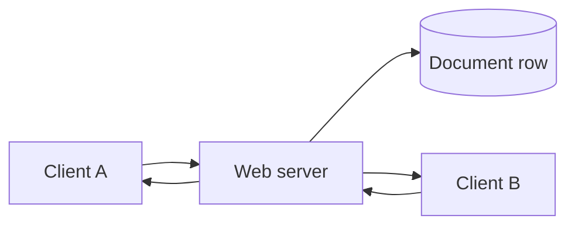
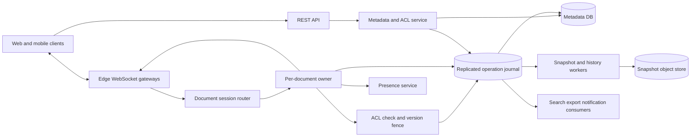
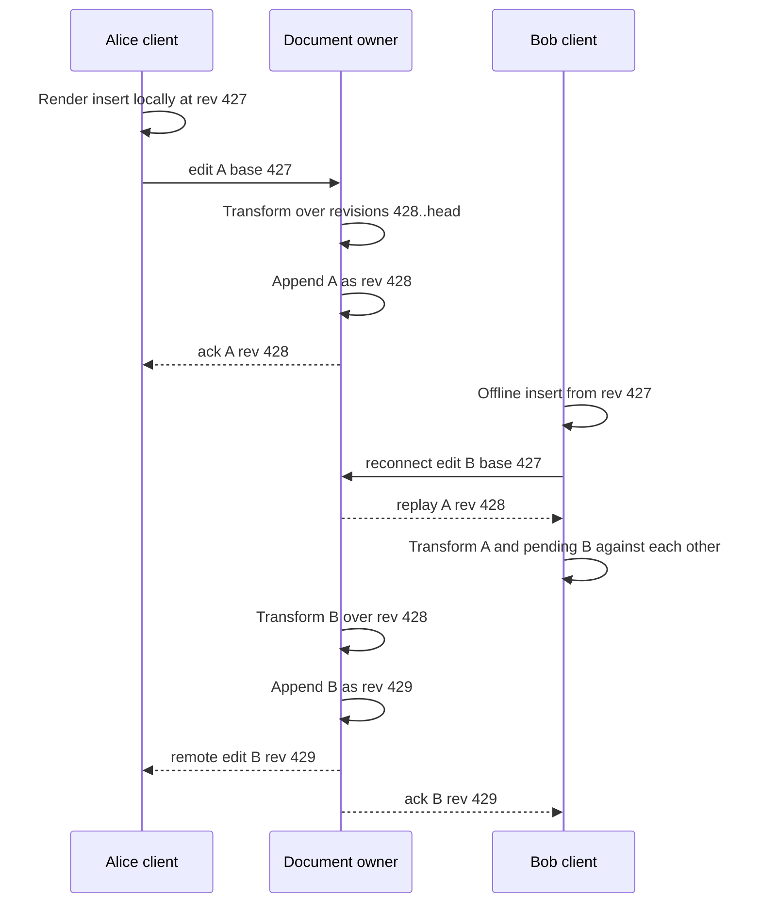
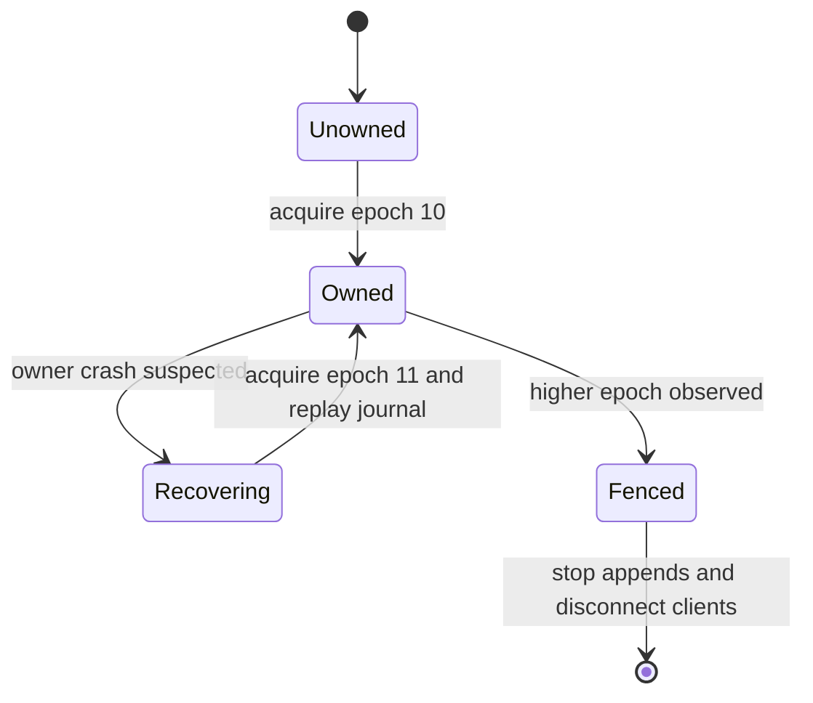
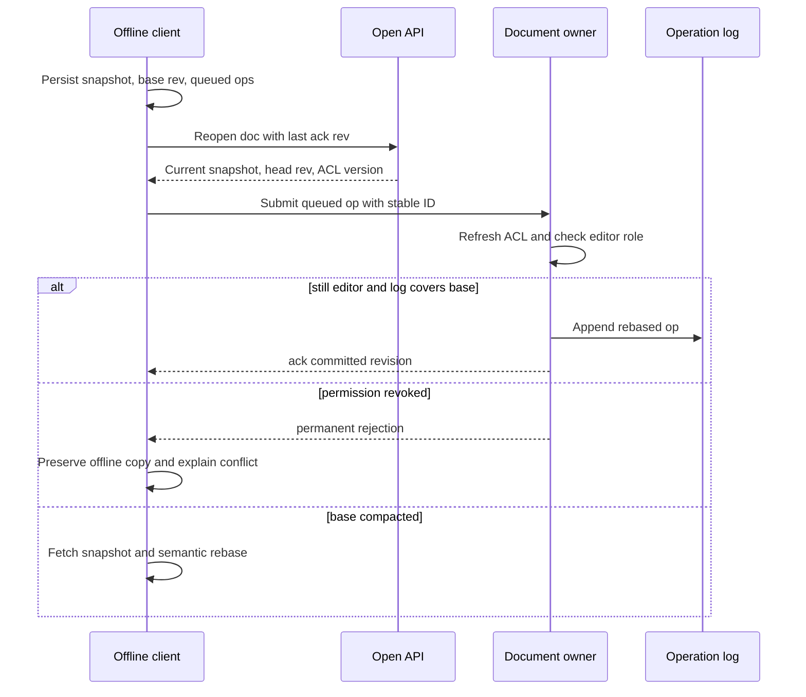

# Google Docs Collaborative Editor System Design

A Google Docs-like editor lets many people edit the same rich document, see one another's changes quickly, work through brief disconnections, and recover a complete attributed history. This design focuses on text and structured document collaboration: rich text, lists, comments, suggestions, sharing, autosave, offline edits, and revision history are in scope; spreadsheets, video calls, and desktop-publishing layout are not.

## 1. Requirements
### 1.1 Functional requirements
- Create, open, rename, move, copy, trash, restore, and delete documents.
- Edit rich text concurrently from web and mobile clients with immediate local echo.
- Show collaborator presence, cursors, selections, and names in near real time.
- Preserve attributed revision history and support named versions and restore.
- Support comments, replies, suggestions, mentions, and resolved threads anchored to document content.
- Share documents with users, groups, domains, and links using viewer, commenter, and editor roles, including offline edit replay after reconnect.

### 1.2 Non-functional requirements
- **Convergence.** Every authorized collaborator must eventually see the same document state, even when edits arrive in different orders at different clients.
- **Low edit latency.** A keystroke must render locally immediately and should become visible to healthy in-region collaborators within about 200 ms; otherwise the editor feels broken.
- **Durability.** Once an edit is acknowledged, it must survive process crashes, leader failover, and retries.
- **Bounded failover.** Editing may briefly pause during failover, but the system must not fork one document into two accepted histories.
- **Permission safety.** ACL revocation must quickly stop new edits and exports from revoked users, while preserving already committed history.
- **Replayable history.** The system must reconstruct a document, anchors, suggestions, and audit trail from snapshots plus operations without trusting volatile memory.

### 1.3 The binding constraint
The binding constraint is not storing documents; it is accepting concurrent edits to the same document while every collaborator converges, sees local echo, and can come back from offline work. A naive database row update cannot express two users typing at the same position from different base revisions. If the server accepts both without a canonical order, clients can render different documents. If the server waits for each keystroke before rendering, the editor feels unusable.

The architecture is therefore shaped by one idea: each document needs one authoritative, durable operation sequence, while clients are allowed to speculate locally. That forces operational transformation or CRDT-style merge rules, per-document routing to a live session owner, a write-ahead journal with fencing for failover, and a reconnect protocol that rebases offline edits against the canonical log while rechecking permissions.

## 2. Back-of-the-envelope estimation
Assume these numbers are illustrative, not claims about a particular company. Suppose there are 100 million daily active users, and 10% have an editor tab or mobile session connected during peak. That gives `100M × 0.10 = 10M` concurrent collaboration sessions. If those sessions are spread over 2 million active documents, the mean is `10M / 2M = 5` connected sessions per active document, but the mean hides the real problem: a company all-hands doc or classroom worksheet can have hundreds of viewers and editors on one document.

Typing traffic is modest per person and enormous in aggregate. If an active editor emits 2 logical operations per second after client-side keystroke coalescing, peak write ingress is `10M × 2 = 20M` edit operations per second. With five collaborators per document, the sender already has the edit locally, so each operation fans out to roughly `5 - 1 = 4` peers on average, or `20M × 4 = 80M` remote edit frames per second before presence. Presence and cursor events can exceed edit events, but they are lossy and should not share the durable edit path.

Storage is driven by the operation log more than the latest document body. If the average persisted operation, including actor, revision, IDs, and payload, is 300 bytes, sustaining the assumed peak all day would produce `20M × 300 × 86,400 = 518,400,000,000,000` bytes, about 518 TB/day. This is a peak-sustained sizing bound, not an average-day forecast. Triple replication requires about `20M × 300 × 3 = 18 GB/s` at that peak. This number implies append-only partitioned logs, snapshots, and compaction; it rules out treating every keystroke as a heavyweight relational transaction with secondary indexes updated synchronously.

Open latency is driven by replay length. If a document snapshot is 50 KB and the retained tail since the snapshot is 2,000 operations at 300 bytes each, open must fetch about `50 KB + 600 KB = 650 KB` before compression. That is fine for normal documents, but a hot document at 500 editors and 2 ops/sec can produce `500 × 2 = 1,000` ops/sec; a 2,000-operation replay window is only two seconds. Hot documents therefore need more frequent incremental snapshots or catch-up from an in-memory session owner.

> **Key idea.** The math says the hard path is a tiny but strictly ordered per-document write stream with large fan-out. Durable edits, lossy presence, search indexing, and export generation must be separated so cursor storms and slow consumers cannot delay acknowledged edits.

## 3. API design
**Question.** What makes a retry safe when the client showed the keystroke locally but lost the acknowledgement?
<details><summary>Answer</summary>

The client gives every edit a stable `operation_id` and monotonically increasing `client_sequence`. The document owner deduplicates by `(document_id, client_id, client_sequence)` and returns the original committed revision if the retry already succeeded. The client can retry until it receives either a committed revision or a permanent rejection such as lost permission.

</details>

```http
POST /v1/documents
  Idempotency-Key: <uuid>
  body: {"title":"Design notes", "parent_id":"folder-7"}

GET /v1/documents/{document_id}?known_revision=418
  -> {"snapshot_revision":400, "snapshot_url":"...", "operations_after_snapshot":[...], "current_revision":427, "acl_version":12, "collaboration_endpoint":"wss://..."}

WS join
  {"type":"join", "document_id":"doc-123", "known_revision":427, "client_id":"tab-9", "acl_version":12}

WS edit
  {"type":"edit", "operation_id":"op-uuid", "client_sequence":81, "base_revision":427, "ops":[{"kind":"insert_text", "node_id":"p-19", "offset":12, "text":"hello"}]}

WS ack
  {"type":"ack", "operation_id":"op-uuid", "committed_revision":428, "canonical_ops":[...]}

WS remote_edit
  {"type":"remote_edit", "committed_revision":428, "actor_id":"u-7", "canonical_ops":[...]}

PUT /v1/documents/{document_id}/acl/{principal_id}
  If-Match: acl_version=12
  body: {"role":"VIEWER"}

POST /v1/documents/{document_id}/restore
  Idempotency-Key: <uuid>
  body: {"target_revision":390}
```

The API is split because opening a document is not the same as joining the live edit stream. The initial `GET` is a permission-checked bootstrap that returns a snapshot, the operation tail, and the collaboration endpoint. Edits then move over WebSocket because polling for every keystroke adds avoidable latency and load. Each WebSocket frame carries a short-lived session token scoped to one document, so stealing one token does not grant broad account access.

Versions are explicit. `known_revision` lets the server avoid resending work the client already has. `base_revision` tells the sequencer what state the user edited against. `acl_version` prevents a collaboration server from appending under a stale permission decision after revocation. ACL writes use conditional updates because two admins may race; an `If-Match` failure makes the loser refetch current permissions rather than overwrite silently. Restore is modeled as a new operation range that transforms the document toward an older version, not as mutation of history.

## 4. Data model
Start with the obvious entity: `Document(document_id, title, owner_id, current_revision)`. That is enough to list files and open the latest version, but it cannot explain how Alice's insert at revision 427 and Bob's delete at revision 427 both become revision 428 and 429 without losing one edit. We need immutable `EditOperation` rows with a base revision, canonical committed revision, actor, client sequence, and operation payload.

An operation log alone still makes opening expensive, because a long-lived document may have millions of operations. Add `Snapshot(document_id, revision, object_key, content_hash)` so open can load a normalized tree and replay only the tail. The snapshot pointer is metadata; the snapshot object is immutable. A failed snapshot build must never corrupt the document, so the system writes the object first and advances `latest_snapshot_revision` with a conditional metadata update after validation.

A rich document is not an HTML blob. Comments, suggestions, lists, tables, and formatting need stable targets. The content model is an ordered tree of nodes with stable IDs, text leaves, marks, and structural operations such as `move_node`, `split_paragraph`, and `apply_style`. Stable node IDs let comment anchors survive nearby insertions. For ordered non-text collections such as block children, fractional positions can reduce write size; Figma uses fractional indexing for ordered sequences, but prose still needs text-specific OT or a sequence CRDT because arbitrary character interleavings are user-visible.

Permissions look like they could live on the document row until inheritance, folders, groups, domains, and link sharing enter. Add `DocumentACL` with `acl_version`. Notion's public writeups are a useful warning here: render-order content arrays and parent pointers serve different purposes. The editable tree can move blocks around, but permission ancestry should follow a separate authoritative parent pointer so a transient collaborative move cannot create ambiguous access.

Comments and suggestions are separate from body text. A comment has an anchor in terms of stable node IDs plus the revision where it was created; as edits commit, the anchor is transformed. A suggestion stores proposed operations and a terminal state. Accepting a suggestion is one conditional journal command that checks `PENDING` and commits both the `ACCEPTED` decision and rebased body operations; two independently committed writes could lose or double-apply the suggestion. Rejecting changes only suggestion state, through the same command authority.

```text
Document
- document_id, owner_id, title, parent_id, home_region
- current_revision, latest_snapshot_revision, acl_version
- state: ACTIVE | TRASHED | PURGED
- created_at, updated_at

DocumentACL
- document_id, principal_id, role: OWNER | EDITOR | COMMENTER | VIEWER
- inherited_from, granted_by, version, updated_at

EditOperation
- document_id, committed_revision, operation_id
- client_id, client_sequence, base_revision
- canonical_payload, actor_id, acl_version_checked
- owner_epoch, committed_at

Snapshot
- document_id, revision, object_key, content_hash, schema_version, created_at

CommentThread
- thread_id, document_id, anchor, anchor_revision
- state: OPEN | RESOLVED | DETACHED, created_by, created_at

Suggestion
- suggestion_id, document_id, proposed_ops, base_revision
- state: PENDING | ACCEPTED | REJECTED, author_id, decided_by, decided_at

ClientSession
- session_id, document_id, user_id, client_id
- last_acknowledged_revision, connected_region, acl_version, connected_at

DocumentOwnerLease
- document_id, owner_worker_id, owner_epoch, lease_until, journal_position
```

Metadata belongs in a strongly consistent sharded store partitioned by a workspace or document container. For collaboration state, the per-document command journal is authoritative for edits, effective ACL versions, comments, and suggestion decisions; their metadata rows are revision-tagged materializations, not independent commit authorities. Conditional command append checks the expected head, owner epoch, and effective ACL version atomically. Snapshots include this replay state as well as the document tree. Snapshots and attachments live in object storage behind authorized access. Presence belongs in ephemeral memory with short TTLs because losing a cursor position is acceptable and blocking edits behind presence writes is not.

> **Key idea.** The data model separates the mutable pointer to the latest state from immutable evidence: operations, snapshots, comments, ACL versions, and owner epochs. That separation is what makes retries, replay, restore, and failover safe.

## 5. High-level design
The simplest design is one web server per WebSocket connection and one database row per document. The server receives a keystroke, updates the document body, writes the row, and broadcasts the new body to connected clients.



This works for a toy editor and fails in predictable ways. Two web servers can update the same document row from different base versions and overwrite each other. Broadcasting full bodies turns a one-character edit in a 10 MB document into a bandwidth spike. A server crash between memory broadcast and database write creates clients that saw edits the log cannot replay. A database failover can let an old server continue accepting edits unless writes are fenced. Offline clients return with edits based on old revisions, not patches against the current body. ACL revocation races with in-flight edits unless the edit path checks a current permission fence.

### Fix 1: Canonical per-document operation order
Give every active document one logical session owner. All edit operations for that document go through that owner, which validates the operation, transforms it against committed operations since the client's base revision, assigns the next revision, appends the canonical operation to the durable log, and only then acknowledges and broadcasts. This mirrors the core idea described in Google Docs material: collaborative editing is a revision log of typed operations, not direct mutation of a character buffer.

The owner is not chosen because one machine can handle every document. It is chosen because one document needs one serialization point. Millions of documents distribute across many owners; one hot document remains ordered. That trade-off is acceptable because for a single prose document, convergence is more important than squeezing out a few milliseconds by accepting independent regional histories.

### Fix 2: Optimistic clients with bounded in-flight state
The client renders local edits immediately and keeps an unacknowledged queue. Apache Wave's OT design made this distinction explicit: local optimism keeps typing responsive, while server acknowledgement bounds shared state. In this design, a client can batch keystrokes while one operation is in flight, but it does not create an unbounded stream of speculative server work. When an acknowledgement returns, the client drops the acknowledged operation and sends the next batch rebased on the new revision.

Remote operations and the local pending queue are transformed against each other before rendering. If the client cannot transform safely, it preserves the old base and offline state, fetches a fresh snapshot, and attempts a semantic rebase rather than replaying stale offsets blindly. Unrepresentable changes remain in a recoverable local copy. The important product rule is that offline or speculative text is never silently discarded.

### Fix 3: Write-ahead journal and fenced ownership
An in-memory session owner gives low latency but cannot be the source of truth. Each accepted operation is appended to a replicated per-document journal or log before acknowledgement. The log write includes an owner epoch, and the log service rejects writes from stale epochs. Figma hit this exact reliability boundary: checkpoint-only multiplayer state was not enough, so they added a write-ahead journal, ownership locks, and replay validation. The same lesson applies here: memory makes collaboration fast; a fenced journal makes it recoverable.

On failover, a router assigns a higher epoch to a new owner only after the old lease expires or is fenced. The new owner loads the latest snapshot, replays journal entries after it, resumes at the next revision, and deduplicates client retries by operation ID and client sequence.

### Fix 4: Split durable edits from ephemeral presence and derived consumers
Presence, cursor positions, search, notifications, exports, and analytics should not sit in the edit acknowledgement path. The edit log is the source of truth. Consumers read it asynchronously and are idempotent by `(document_id, revision)`. Presence is stored in memory with TTL and coalescing; a missed cursor update is harmless. Search indexes snapshots or grouped revisions and checks current ACLs at query time instead of trusting stale permissions embedded in an index.

Linear's delta-sync work demonstrates the cost of permission-aware replay at scale. Historical catch-up can become a large set-intersection problem, so serving old ranges may require secondary inverted indexes plus an authoritative recent slice from the primary log. That is a read-path optimization; it must not change the commit protocol.

### Fix 5: Permission fences on the write path
Sharing is part of collaboration, not a side feature. ACL mutations are commands in the same per-document journal as edits and increment the effective `acl_version`. Append atomically checks that version against the journal's authorization state, not an owner's cached belief; an edit racing a revocation is ordered before it or rejected after it. Revocation succeeds only when that fence is installed, not merely published to a queue. Inherited folder/group revocation must install fences on affected documents (or durably deny access while this completes) before reporting enforcement. Read, export, snapshot, and live-delivery paths must also check current authorization, including on existing sessions; already delivered plaintext cannot be recalled. Short-lived bearer URLs alone imply a residual access window, so strict revocation uses an authorization gateway for those downloads.

### Putting it together


A client opens `doc-123` through the REST API, receives snapshot revision 400 and tail operations through revision 427, then joins the WebSocket endpoint returned by the router. Join catches up from 427 and registers live delivery at a common revision boundary so edits between GET and join are not lost. When the user types, the client applies the edit locally, sends an operation with `base_revision=427`, and keeps it in the pending queue. The document owner transforms it over newer revisions and conditionally appends revision 428 with the current owner epoch and effective ACL version, then acknowledges and broadcasts to authorized peers. Snapshot workers later compact revisions into object storage, while metadata materializes the latest pointers and ACLs.

> **Key idea.** Each component traces back to a specific failure of the naive design: the owner gives order, the journal gives durability, fencing prevents split brain, snapshots bound replay, and ACL versions close revocation races.

## 6. Deep dives
### 6.1 OT with a central sequencer versus CRDTs
**Question.** Alice and Bob both insert text at offset 10 from revision 427 while Alice is online and Bob is offline. How do we guarantee that every collaborator ends at the same text?
<details><summary>Answer</summary>

Pick one canonical order per document. With OT, the owner transforms Bob's operation over Alice's committed operation before assigning Bob's revision; clients apply the same transform rules against their local pending queues. A CRDT can make the operations commute by giving inserted characters stable identifiers, but still needs deterministic ordering, tombstone or garbage-collection rules, and permission checks on reconnect.

</details>

Operational transformation fits the design when there is a central sequencer. Each edit names the revision it was authored against. If Alice's insert becomes revision 428 and Bob's edit arrives later with `base_revision=427`, the owner transforms Bob's position through revision 428 before committing it as 429. Concurrent inserts at the same logical position get a deterministic tie-breaker, such as canonical revision order plus operation ID. Deletes carry enough context to transform later operations that targeted deleted ranges. Styling operations target stable ranges and can be split when text is inserted or removed inside them.

The hard part is not the sentence-level example; it is the transform library. Rich documents have nested lists, tables, suggestions, comments, and formatting ranges. A generic JSON patch is too weak because it says what changed in one representation, not what the user intended. Microsoft Fluid SharedTree's merge model is useful evidence here: it sequences tree edits as intentions, treats moves as moves, and uses last-writer-wins only for incompatible intentions. A Docs-style system should encode operations such as `move_node`, `split_paragraph`, and `apply_style`, not arbitrary DOM mutations.

Clients also run transforms, but the server is authoritative. Keep a confirmed server state, one outstanding batch, and a buffered local batch. For each remote operation in revision order, a pairwise transform produces both the remote operation for the optimistic view and updated outstanding/buffered operations for the new server state. Acknowledgement advances the confirmed state and removes the matching outstanding batch; it must not apply an already echoed insert a second time. The visible state is the confirmed state plus the remaining transformed queue. Tie-breaking must agree with server precedence on both sides. If a transform cannot be performed safely because the schema changed or the base is too old, preserve local work and resync rather than guess.

A CRDT changes the failure mode. Instead of transforming positions through a sequenced log, each insert creates an identifier that orders it relative to neighboring identifiers; deletes mark identifiers as removed. This is attractive for peer-to-peer or very long offline editing because operations can commute without a live central server. It is not free. Character identifiers, tombstones, vector clocks or Lamport timestamps, garbage collection, and permission-aware compaction all add state. Server-side search, export, and abuse scanning still require a canonical materialized document. ACL revocation is also awkward: a user may generate valid-looking offline CRDT operations after losing permission, so reconnect must still reject operations whose authorization window has closed.

Figma chose a centralized, CRDT-inspired approach for design objects instead of general OT. That is the useful lesson, not that one algorithm wins everywhere. Object properties can often merge with last-writer-wins registers, stable object IDs, and server authority. Ordered non-text lists can use fractional indexing. Prose needs tighter semantics because interleaved words are visible and often wrong. A practical Docs design can use OT for text sequences, CRDT-like object IDs for structural nodes, fractional indexes for non-text child order, and conditional state machines for comments and suggestions.

The central sequencer is the simplifier. It means the server can publish one revision history, group revisions into human-readable named versions, and use the operation log for audit. It also means a single hot document cannot be written concurrently by many leaders. The design accepts that limit because the binding constraint is convergence for one document. To scale globally, we distribute documents, not the history of one document.



Signals worth watching: transform failures, revision gap at submit, property-test coverage by operation type, client resync rate, and divergence detected by synthetic multi-client documents.

> **Strong-answer criteria.** A senior answer must explain both local optimism and canonical ordering, and must choose merge semantics per data type rather than saying only "use OT" or only "use CRDT."

| Level | Approach | Why |
|---|---|---|
| Bad | Store the latest HTML and let last write win | Concurrent edits overwrite each other and clients diverge. |
| Good | Use OT through a central server | Establishes a canonical order, but is incomplete without deterministic transforms, retry IDs, and reconnect handling. |
| Great | Use a per-document sequencer with OT for text, CRDT-like stable IDs for objects, fractional indexing where appropriate, exhaustive transform tests, and server-authoritative replay | Matches merge semantics to data types while preserving one auditable history. |

### 6.2 Document ownership, routing, journaling, and failover
**Question.** The owner for a hot document pauses during a network partition, the router elects a new owner, and the old owner later resumes. How do we avoid two accepted histories?
<details><summary>Answer</summary>

Every owner write carries a fencing epoch obtained from the ownership service. The journal accepts appends only from the current epoch. A new owner must obtain a higher epoch, load the latest snapshot, replay the journal, and resume from the last committed revision. The old owner may still broadcast stale frames, but its journal writes fail and clients resync to the canonical log.

</details>

A live collaboration session keeps hot document state in memory: the current revision, recent operations, transformed cursor positions, connected sessions, and small fan-out buffers. That memory is a performance cache, not the authority. Without a durable journal, a crash after acknowledgement loses edits. Without fencing, a slow or partitioned owner can accept edits after a replacement starts, creating a fork that cannot be repaired without asking humans which text to keep.

Routing starts with `document_id -> owner_worker`. Edge gateways do not choose arbitrary workers; they ask the session router. The router either returns the current owner or initiates placement. Placement writes `DocumentOwnerLease(document_id, worker_id, owner_epoch, lease_until)` using a compare-and-swap. The epoch monotonically increases. The owner renews its lease while healthy, but the lease alone is not enough. Every journal append includes `owner_epoch`, and the journal service checks it against the current fenced epoch. This protects against delayed packets and stop-the-world pauses.

The commit path is intentionally ordered: validate operation, check ACL version, transform against in-memory head, append to the replicated journal with epoch and expected previous revision, then acknowledge and broadcast. The expected previous revision is another guardrail. If the owner believes head is 428 but the journal already has 429, append fails and the owner must recover. The log is the serialization proof.

Figma's reliability work is a production analogy for journaling and ownership fencing. They described checkpointing every 30-60 seconds, conditional journal writes tied to ownership, and replay validation. Their post also describes batched persistence and checkpoint-based cross-region recovery; it is not evidence that Figma provides this proposal's durable-before-ack or zero-RPO contract. A per-document owner is recoverable only if its memory can be replayed and stale owners cannot write.

Failover is a short pause, not active-active editing. When an owner is suspected dead, the router stops assigning new joins to it and attempts to acquire a higher epoch. Existing clients may still be connected to the old owner. Once a new owner is established, clients reconnect through edge gateways with `last_acknowledged_revision` and their unacknowledged operations. If a client sent an operation that committed but lost the acknowledgement, deduplication returns the committed revision. If the old owner acknowledged an operation before durable append, that is a protocol bug; acknowledgement must happen only after the journal quorum accepts the write.

The broadcast rule must remain strict during failover: an owner never sends a committed `remote_edit` before append succeeds. A delayed frame from the old owner can therefore describe only an already committed revision, which clients deduplicate or gap-fill against the log. An epoch alone is not evidence of commit. Only local unacknowledged work is speculative; broadcasting an append that later fails would violate the protocol.

Hot documents need careful placement. The average document has five collaborators, but a 500-editor document creates `500 × 2 = 1,000` ops/sec and roughly `1,000 × 499 = 499,000` recipient deliveries per second if every editor receives every edit. A single owner may still serialize operations, but fan-out encoding can be offloaded to regional relays. The owner builds one canonical frame per revision, relays replicate it near clients, and slow clients are disconnected and resynchronized rather than accumulating unbounded buffers.



Signals worth watching: owner election rate, append failures by stale epoch, journal append latency, replay time, duplicate operation rate after reconnect, and slow-client disconnects on hot documents.

> **Strong-answer criteria.** A strong answer distinguishes session ownership from durability and includes both fencing tokens and expected revision checks. It also states that failover pauses editing rather than allowing split-brain histories.

| Level | Approach | Why |
|---|---|---|
| Bad | Keep active document state only in the collaboration server's memory | A crash loses acknowledged edits and failover can fork history. |
| Good | Write every edit to a replicated log | Preserves durability, but stale owners can still write without fencing. |
| Great | Route each document to one owner, append with owner epoch and expected revision, recover from snapshots plus journal, and make clients reconnect with deduplicated pending edits | Prevents split brain and gives a deterministic recovery story. |

### 6.3 Persistence, snapshots, revision history, and offline reconnect
**Question.** A user edits offline for two hours, reconnects after compaction removed their base log range, and their editor permission was revoked five minutes ago. What happens?
<details><summary>Answer</summary>

The server first rechecks current permission; if the user is no longer an editor, queued edits cannot be appended. The client must preserve the offline changes in a recoverable local copy and explain that permission changed. If permission still exists but the base log is gone, the client fetches a current snapshot and performs a semantic three-way rebase of queued operations, escalating unrepresentable conflicts to the user.

</details>

The persistence model has three jobs that often get conflated. First, it must make acknowledged edits durable. Second, it must make opening and reconnect fast enough. Third, it must preserve human-meaningful revision history. The operation journal solves the first job. Snapshots solve the second. Revision grouping and attribution solve the third.

Snapshotting is a compaction protocol, not a replacement for the log. A worker reads snapshot revision `R`, replays operations through revision `N`, serializes the normalized document tree, writes it to object storage with a content hash, validates it, and conditionally advances `latest_snapshot_revision` to `N`. If the worker crashes after writing the object but before advancing the pointer, the orphan object can be garbage-collected later. If it advances the pointer without validation, every future open may start from corrupt state, so the pointer update is the dangerous step.

Retention policy is a product and cost decision. To preserve the promised complete attributed history, compaction removes operations from the hot tail only after a validated snapshot and durable raw-history archive cover them; grouped human revisions are a presentation index, not a replacement for the audit log. Snapshots also retain per-client deduplication checkpoints. Before rebasing after a lost acknowledgement, reconnect resolves which stable operation IDs already committed, so a snapshot containing the edit is not combined with the same queued edit again. If a retry is older than retained deduplication evidence, reject automatic replay and preserve a local copy rather than treating it as a new operation. Human-facing revision groups follow idle windows, actor changes, paste/import boundaries, and named versions.

Offline reconnect is a permission-aware rebase. The client persists a cached snapshot, `last_acknowledged_revision`, unacknowledged operations in client-sequence order, and attachment blobs waiting for upload. On reconnect, it opens the document, receives the current ACL version and revision, and asks for operations after its checkpoint. If the log still covers that range, the client applies remote operations, rebases local queued operations, and resubmits them with stable IDs. If the log was compacted past the checkpoint, the client downloads a current snapshot and runs a semantic three-way rebase: old local base, current server state, and local offline state.

Notion's offline work is instructive because it treats offline availability as a complete subtree with reasons, not a best-effort cache accident. A Docs client should similarly mark a document available offline only after all needed records are durable locally: snapshot, relevant operation tail, comments required for rendering, and pending attachments. It should track why the document is offline, such as explicit pinning or recent access, so one cleanup path does not evict data another feature promised.

ACL revocation is the hardest reconnect race. Suppose the user had editor access at 10:00, went offline, was revoked at 11:55, and reconnects at 12:00 with two hours of edits. The server cannot append those operations merely because they were authored earlier; it cannot reliably prove when the user typed them, and accepting them violates revocation expectations. The operation owner checks current ACL version before append. If the user is not an editor, it rejects with a permanent permission error. The client keeps the local changes as an offline copy, perhaps allowing export or owner-mediated recovery depending on product policy, but it must not silently merge them.

Attachments add another edge case. Offline edits may reference images that have not uploaded. The client should upload immutable attachments first, receive content-addressed IDs, then submit document operations referencing those IDs. If an attachment upload is denied because permission was revoked, the document operation must also be denied or rewritten into a recoverable local copy.



Signals worth watching: snapshot age, replay bytes per open, compaction lag, offline rebase failure rate, rejected offline edits after ACL changes, and orphaned attachment cleanup.

> **Strong-answer criteria.** A strong answer separates durable commit, compaction, and user-facing revision history, and treats offline replay as a permission-checked rebase rather than blind queue drain.

| Level | Approach | Why |
|---|---|---|
| Bad | Store only latest document state and overwrite it on reconnect | Loses history, cannot rebase, and accepts stale permissions. |
| Good | Keep an operation log and snapshots | Enables replay and compaction, but misses ACL revocation and base-compaction conflicts. |
| Great | Use immutable ops, validated snapshots, grouped revision history, permission-aware reconnect, semantic rebase, and recoverable offline copies | Preserves durability and user trust under long disconnects and permission changes. |

## 7. Variants
**10x scale.** At 100 million concurrent sessions and `100M × 2 = 200M` ops/sec, the design still distributes by document, but every supporting path must become more hierarchical. Edge gateways use regional relays for fan-out, owners are placed with hot-document isolation, snapshots become incremental, and catch-up reads use indexed historical ranges plus authoritative head slices. The per-document single owner remains because splitting one document into multiple writers would attack the convergence guarantee.

**Multi-region active-active editing.** If the product demands low-latency writes from multiple continents to the same document, the design must choose between coordination latency and CRDT-first semantics with more complex conflict and permission handling. Home-region ownership is the default here. Zero RPO applies only to failures covered by the synchronous journal quorum; surviving loss of the home region with zero RPO requires cross-region durability before acknowledgement. A secondary takes over only after fencing the old owner and recovering the committed log, not merely by acquiring a higher epoch over an asynchronously lagging copy.

**Enterprise residency and legal hold.** Residency mostly changes placement and retention, not the collaboration algorithm. The document's home region, snapshots, journal replicas, and search indexes must stay inside allowed regions. Legal hold prevents deletion of retained history; normal documents still retain raw attributed history in the archive to meet this design's requirement. Keeping only grouped state snapshots would be a weaker product contract.

**End-to-end encryption.** True end-to-end encryption conflicts with server-side OT, search, export, abuse scanning, and semantic rebase. A variant could move transformation and conflict resolution to clients and store opaque CRDT operations on the server, but then permission revocation, web search, import/export, and recovery all become weaker or more expensive. That is a different product, not a small flag.

## 8. The transferable pattern
This is the pattern of optimistic local work plus canonical serialized commit. It appears whenever the user needs immediate feedback but the system needs one durable truth: collaborative documents, multiplayer design tools, code editors, inventory reservations, and financial ledgers all split speculative client state from committed state. The reusable move is to make the commit log the source of truth, make retries idempotent, and make recovery replay the same evidence rather than reconstructing from caches.

The closest siblings are systems with hot-key serialization and fan-out. A Ticketmaster-like system has a similar binding constraint around racing for scarce seats, though its merge rule is rejection rather than transformation; see [Ticketmaster](./ticketmaster-system-design.md). A chat system shares fan-out and reconnect mechanics, but messages append without rewriting prior positions, so it avoids the hardest OT/CRDT problem. Google Docs is harder because the same logical position can be changed by multiple people and all clients must converge without making typing feel remote.

## Review
The design is built around one document having one canonical operation history. Clients render optimistically, but every edit is validated, transformed, fenced, appended to a replicated journal, assigned a revision, and then broadcast. Snapshots and grouped revision history keep open and restore practical without replacing the operation log. A per-document owner simplifies OT and fan-out, while owner epochs and expected revision checks prevent split brain during failover. Offline reconnect is not a blind upload; it is a permission-checked rebase that preserves local work when ACLs or compaction make automatic merge unsafe.

### Check your understanding
1. Why not store each document as one HTML blob and use last-write-wins?
   <details><summary>Answer</summary>

   Last-write-wins loses concurrent edits and gives different clients no principled way to converge after local echo or offline work. A collaborative editor needs intent-preserving operations, base revisions, transformation or CRDT merge rules, and a canonical committed order.

   </details>
2. Why does a per-document owner not mean one server handles all documents?
   <details><summary>Answer</summary>

   Ownership is per document. Millions of documents are spread across many workers, but all edits for one active document route through one logical owner so that document has one revision order. The scalability unit is documents, while the correctness unit is a single document history.

   </details>
3. What must happen before an edit acknowledgement is sent?
   <details><summary>Answer</summary>

   The owner must validate the operation and permission, transform it against committed operations since its base revision, append it durably to the replicated journal with the current fencing epoch and expected previous revision, and assign a committed revision. Broadcasting or acknowledging before durable append risks losing edits clients believe were saved.

   </details>
4. How does ACL revocation interact with offline edits?
   <details><summary>Answer</summary>

   Reconnect checks current permission before appending queued operations. If the user was revoked while offline, the server rejects the edits even if they were authored from an older revision. The client should preserve them in a recoverable local copy rather than silently discarding or merging them.

   </details>
5. Why keep presence separate from the operation log?
   <details><summary>Answer</summary>

   Presence is high-volume and lossy. Cursor positions can be stale or dropped without corrupting the document, while edit operations require durable ordering and replay. Mixing them would let cursor storms and slow presence consumers delay acknowledged edits.

   </details>

## Sources and further reading
| Source | Article | Why it matters |
|---|---|---|
| Google Drive Blog | [What’s different about the new Google Docs: Conflict resolution](https://drive.googleblog.com/2010/09/whats-different-about-new-google-docs_22.html) | Explains Google Docs' revision log and OT transform model for insert, delete, and style changes. |
| Apache Wave | [Google Wave Operational Transformation](https://svn.apache.org/repos/asf/incubator/wave/whitepapers/operational-transform/operational-transform.html) | Details optimistic UI, server acknowledgement, batching, and structured-document OT. |
| Figma | [How Figma’s multiplayer technology works](https://www.figma.com/blog/how-figmas-multiplayer-technology-works/) | Shows when a centralized CRDT-inspired model is simpler than OT for object trees. |
| Figma | [Making multiplayer more reliable](https://www.figma.com/blog/making-multiplayer-more-reliable/) | Describes the write-ahead journal, ownership lock, checkpoints, and replay validation behind reliable multiplayer. |
| Figma | [Realtime editing of ordered sequences](https://www.figma.com/blog/realtime-editing-of-ordered-sequences/) | Introduces fractional indexing for collaborative ordered lists where text-style OT is unnecessary. |
| Notion | [The data model behind Notion’s flexibility](https://www.notion.com/blog/data-model-behind-notion) | Explains block IDs, content arrays, parent pointers, and transactional operations for flexible documents. |
| Notion | [Herding elephants: Lessons learned from sharding Postgres at Notion](https://www.notion.com/blog/sharding-postgres-at-notion) | Covers workspace-local sharding, transitive sharding of related rows, and 480 logical shards over 32 databases. |
| Notion | [How we made Notion available offline](https://www.notion.com/en-gb/blog/how-we-made-notion-available-offline) | Shows complete offline subtrees, reason tracking, push refresh, and conflict-resolution migration. |
| Microsoft | [Fluid Framework: How SharedTree merges changes](https://devblogs.microsoft.com/microsoft365dev/fluid-framework-how-sharedtree-merges-changes/) | Defines sequenced merge semantics for collaborative trees, true moves, removals, and last-writer-wins conflicts. |
| Linear | [Rebuilding Linear’s delta sync read path](https://linear.app/now/rebuilding-delta-sync-read-path) | Demonstrates scalable permission-aware delta sync using immutable actions, inverted indexes, authoritative overlap, and late enrichment. |
