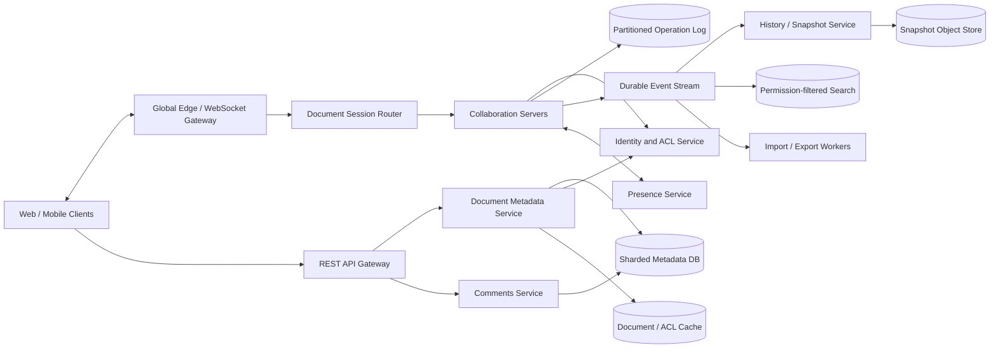

# Google Docs-like Collaborative Editor

## 1. Requirements

### Functional requirements

1. Create, rename, move, copy, and delete documents.
2. Edit a document concurrently from web and mobile clients.
3. Show collaborator presence, cursors, selections, and names in near real time.
4. Preserve a complete, attributable revision history and support restore.
5. Support comments, replies, suggestions, mentions, and resolved threads.
6. Share with users, groups, domains, or links using viewer, commenter, and editor roles.
7. Work offline and merge queued edits after reconnection.
8. Autosave without an explicit save action.
9. Export and import common formats.
10. Search document titles and permitted content.

### Non-functional requirements

- Local keystrokes should render immediately.
- Remote edits should normally appear within 200 ms in-region and 500 ms globally.
- No acknowledged edit may be lost.
- All replicas must converge to the same document.
- Document reads should be highly available; editing may briefly pause rather than fork during failover.
- Permission changes, especially revocation, require strong consistency.
- Support millions of simultaneously open documents and hundreds of active editors on a hot document.
- Encrypt traffic and stored content, and retain auditable edit attribution.

Rich text, tables, lists, images, comments, and suggestions are in scope. General-purpose spreadsheets, video calls, and full desktop publishing are not.

## 2. Scale assumptions

State assumptions explicitly:

- 500 million registered users and 100 million daily active users.
- 10 million concurrently connected editing sessions at peak.
- 2 million documents actively edited at peak.
- Average document: 50 KB structured content; p99: 10 MB.
- Average active editor: 2 operations/second while typing.
- Average 5 active editors per open document; hot documents may have 500.
- 10 billion stored documents and 500 TB/day of new operation-log data before compaction.
- Read-to-write ratio for document metadata: about 5:1.

Peak collaboration traffic:

```text
10M active editing sessions x 2 operations/second
= 20M edit operations/second
```

At 500 TB/day and 20M operations/second, the average persisted operation budget is about 290 bytes before replication:

```text
500 TB/day / (20M ops/sec x 86,400 sec/day) ~= 290 bytes/op
```

With 3x log replication this is about 1.5 PB/day, or 17 GB/sec of sustained replicated write bandwidth. Average fan-out is roughly four remote recipients per operation, so peer delivery is about 80M frames/second before presence. Most operations are tiny, but connection fan-out and per-document ordering dominate. Presence events are more frequent and less durable than edits, so they need a separate path.

## 3. High-level architecture



Separate:

- **Durable collaboration plane:** ordered edits, acknowledgements, snapshots, and recovery.
- **Ephemeral collaboration plane:** presence, cursors, and typing indicators.
- **Control plane:** metadata, permissions, comments, sharing, and document lifecycle.

Each active document has one logical leader at a time. The session router maps `document_id` to that leader and moves clients together during rebalancing.

## 4. Data model

```text
Document
- document_id
- owner_id
- title
- home_region
- current_revision
- latest_snapshot_revision
- state: ACTIVE | TRASHED | PURGED
- created_at
- updated_at

DocumentACL
- document_id
- principal_id
- role: OWNER | EDITOR | COMMENTER | VIEWER
- inherited_from
- granted_by
- version

EditOperation
- document_id
- revision
- operation_id
- client_id
- client_sequence
- base_revision
- operation_payload
- actor_id
- committed_at

Snapshot
- document_id
- revision
- object_key
- content_hash
- schema_version
- created_at

CommentThread
- thread_id
- document_id
- anchor_start
- anchor_end
- anchor_revision
- state: OPEN | RESOLVED
- created_by

Comment
- comment_id
- thread_id
- body
- mentions
- created_by
- created_at
- edited_at

Suggestion
- suggestion_id
- document_id
- operation_range
- author_id
- state: PENDING | ACCEPTED | REJECTED

ClientSession
- session_id
- document_id
- user_id
- client_id
- last_acknowledged_revision
- connected_at
```

Document content is an ordered tree, not an HTML blob. Stable node and character identifiers make structural operations and comment anchors resilient to nearby edits.

Operations and snapshots are immutable. Metadata points to the latest committed revision. An `operation_id` plus `(client_id, client_sequence)` provides retry deduplication.

For rich documents, keep structural parent pointers separate from render-order child arrays. The parent pointer is the authority for permissions and ancestry checks; ordered child arrays are the editable render tree. This avoids ambiguous ACL inheritance when content is moved, linked, or temporarily referenced from multiple places.

## 5. Core APIs and protocols

### Open a document

```http
GET /v1/documents/{document_id}?known_revision=418
```

```json
{
  "document_id": "doc-123",
  "snapshot_revision": 400,
  "snapshot_url": "https://signed.example/...",
  "operations_after_snapshot": [],
  "current_revision": 427,
  "permission": "EDITOR",
  "collaboration_endpoint": "wss://collab.example/session"
}
```

### Join the collaboration session

```json
{
  "type": "join",
  "document_id": "doc-123",
  "known_revision": 427,
  "client_id": "device-tab-9"
}
```

### Submit an edit

```json
{
  "type": "edit",
  "operation_id": "uuid",
  "client_sequence": 81,
  "base_revision": 427,
  "operations": [
    {"kind": "insert_text", "node_id": "p-19", "offset": 12, "text": "hello"}
  ]
}
```

The server responds with the committed revision and transformed operation. Other clients receive the same canonical operation.

Other endpoints:

```http
POST   /v1/documents
PATCH  /v1/documents/{document_id}
DELETE /v1/documents/{document_id}
GET    /v1/documents/{document_id}/revisions
POST   /v1/documents/{document_id}/restore
GET    /v1/documents/{document_id}/acl
PUT    /v1/documents/{document_id}/acl/{principal_id}
POST   /v1/documents/{document_id}/comments
POST   /v1/comments/{thread_id}/replies
POST   /v1/comments/{thread_id}/resolve
POST   /v1/documents/{document_id}/exports
```

All mutations use idempotency keys. WebSocket frames carry session tokens scoped to one document and expire quickly.

## 6. Real-time editing flow

1. The client downloads a recent snapshot plus subsequent operations.
2. It opens a WebSocket and is routed to the document leader.
3. A keystroke is applied locally immediately and queued as an unacknowledged operation.
4. The client sends the operation with its base revision.
5. The leader validates the editor permission and deduplicates the operation.
6. It transforms the operation against operations committed since the base revision.
7. The leader appends the canonical operation to a quorum-replicated log.
8. After durable commit, it assigns a revision, acknowledges the sender, and broadcasts to peers.
9. Clients transform incoming operations against their unacknowledged local queue and converge.
10. Snapshot workers periodically compact the log.

Acknowledgement happens only after durable replication. Rendering does not wait for acknowledgement, which preserves typing responsiveness.

To keep server state bounded, clients should coalesce local keystrokes and maintain a small in-flight window, often one outstanding batch per document session. While waiting for acknowledgement, new local edits stay optimistic in the client queue and are sent as the next batch.

## 7. Operational transformation and alternatives

For a centralized service, operational transformation (OT) is a practical choice:

- Each operation states its base revision.
- The leader transforms it over later canonical operations.
- Concurrent inserts receive deterministic ordering.
- Deletes retain enough context to transform later positions.
- Clients apply the same transform rules against pending local edits.

Example:

```text
Base text: "cat"
Alice inserts "s" at position 3.
Bob inserts "big " at position 0 from the same base.
Canonical result after transformation: "big cats"
```

The transform library must be deterministic, versioned, and exhaustively property-tested for convergence.

A CRDT simplifies peer-to-peer and offline merging because operations commute, but per-character identifiers, tombstones, version vectors, Lamport timestamps, and garbage collection can increase document size and implementation cost. A server-authoritative OT design fits centralized Docs; a sequence CRDT is attractive if long offline editing or decentralized replicas dominate. For non-text ordered lists such as layers or block children, fractional indexing can be simpler than OT because moving an item updates one ordering value, but it can interleave concurrent inserts and is a poor fit for prose.

## 8. Offline editing and reconnection

The client persists:

- Last durable server revision.
- A cached snapshot.
- Unacknowledged operations in client-sequence order.
- Imported images or attachments awaiting upload.

On reconnection:

1. Fetch operations after the last acknowledged revision.
2. Apply remote operations and rebase queued local operations.
3. Resubmit local operations with their stable IDs.
4. If the retained log no longer covers the base revision, fetch a current snapshot and run a three-way semantic rebase.
5. If an operation cannot be represented safely, preserve it in a recoverable offline copy and tell the user.

Never discard offline edits silently. Only advertise a document or subtree as available offline after all records required to render and edit it are durably cached. Track why each item is offline, such as explicit pinning, recent access, or inheritance from an offline parent, so removing one reason does not accidentally evict needed data. Long offline intervals may produce visible formatting conflicts even when text converges.

## 9. Comments, suggestions, and anchors

Comments are durable entities, not document text. An anchor references stable content identifiers plus the revision where it was created. As edits commit, anchor positions are transformed. If all anchored content is deleted, keep the thread with surrounding quoted context and mark the anchor detached.

Suggestion mode records proposed operations separately:

- Readers render the base content plus pending suggestion overlays.
- Accept applies the operations against the current revision after transformation.
- Reject changes only suggestion state.
- Accept/reject is conditional and idempotent so two reviewers cannot decide twice.

Mentions create notification outbox records in the same transaction as the comment. Notification delivery is at-least-once and deduplicated by event ID.

## 10. Consistency and concurrency

Guarantees:

- Strict revision order within one document.
- Read-your-writes for an editing session.
- Eventual convergence for connected clients.
- Strongly consistent permission and ownership mutations.
- No global ordering across documents.
- Presence is best effort and may be stale.

The collaboration leader is a per-document serialization point. It is not a durability boundary: the replicated operation log is. A fencing epoch prevents an old leader from committing after a new leader is elected.

ACL changes increment an ACL version and publish a revocation fence before returning success. Collaboration servers subscribe to invalidations, include the ACL version in session state, and must refresh a stale version before appending any new edit. Revoked editors are disconnected promptly; already committed edits remain in history.

## 11. Partitioning, snapshots, and storage

Partition operation logs by hash of `document_id`; all operations for a document remain ordered in one partition. Metadata is sharded by `document_id` or by a workspace/domain container when many documents share permissions and navigation state. Keep the document, ACL rows, comments, and other transactionally related records co-located where possible; cross-shard writes require an outbox or saga and must not be needed for the edit acknowledgement path.

Snapshots:

1. Read a committed snapshot at revision `R`.
2. Replay operations through revision `N`.
3. Serialize the normalized document tree.
4. Write it to object storage with a hash.
5. Atomically advance `latest_snapshot_revision` to `N`.
6. Retain older operations according to history policy.

Snapshot every few thousand operations or when replay time exceeds a target. Hot documents need more frequent incremental snapshots. Images live in object storage behind signed URLs; document nodes reference immutable attachment IDs.

Hot partitions are mitigated by isolating extremely active documents onto dedicated collaboration workers. A single document remains sequential, but transformation, fan-out encoding, and snapshotting can use parallel supporting workers.

## 12. Reliable event publication

Committing an edit and emitting downstream events must not diverge. The operation log itself can be the source for history, search, notifications, analytics, and audit consumers. Metadata mutations use a transactional outbox.

Consumers track `(document_id, revision)` and are idempotent. Search indexes snapshots asynchronously rather than every keystroke, and query-time filtering checks current ACL state rather than trusting a stale indexed permission copy. Revision history groups operations into human-sized versions based on idle windows, actor changes, and explicit named versions.

Delta sync for reconnecting clients is a permission-aware log query: fetch revisions after the client's checkpoint, filter by current access and subscriptions, and stream in order. For very large tenants, serve most of the historical range from a secondary metadata index, overlap with an authoritative head slice from the primary log, and deduplicate by revision so index lag cannot hide committed edits.

Slow consumers do not block editing. Lag alarms and replayable retention allow recovery.

## 13. Caching and fan-out

Cache document metadata, recent snapshots, and short-lived ACL decisions. Do not cache authorization beyond revocation objectives.

The collaboration server broadcasts once per committed operation to all sessions on the document. For very hot documents:

- Build one encoded frame and reuse it.
- Use regional fan-out relays rather than cross-region connections to the leader.
- Coalesce presence updates.
- Apply per-session backpressure.
- Disconnect and resynchronize clients that cannot keep up instead of retaining unbounded buffers.

CDNs serve immutable snapshots, images, and export artifacts. They do not cache mutable edit streams.

If collaboration workers keep active document state in memory, pair checkpoints with a durable journal. Each journal entry has a per-document sequence range, and each worker write is conditional on the current document ownership epoch. Recovery loads the latest checkpoint, replays newer journal entries, and rejects split-brain writers whose epoch is stale.

## 14. Multi-region design

Assign each document a home region:

- The home region owns the collaboration leader and synchronous multi-AZ log replicas.
- Remote users connect to nearby edge gateways, which relay edits to the home region.
- Snapshots replicate asynchronously and immutable attachments use multi-region object storage.
- Read-only opening can use a nearby sufficiently fresh replica.

Active-active editing of the same document across regions adds ordering latency or forks. A home-region leader keeps one history. Enterprise residency policies determine placement.

On region failure, promote a caught-up secondary only after obtaining a higher fencing epoch. Clients reconnect, send their last acknowledged revision and unacknowledged operations, and deduplicate safely. The RPO target is zero for acknowledged edits; RTO might be under five minutes.

## 15. Security and privacy

- TLS for all traffic and KMS-backed encryption at rest.
- Short-lived session and signed attachment tokens.
- Authorize every document open, edit, export, comment, and share mutation.
- Domain policies can prohibit public links or external sharing.
- Audit ACL changes, exports, ownership transfer, and administrative access.
- Scan imported files and rendered exports.
- Sanitize pasted HTML and prevent script execution in documents.
- Rate-limit creation, edits, comments, exports, and invitation fan-out.
- Detect credential abuse and anomalous bulk downloads.
- Enforce retention, legal hold, regional residency, and verified purge workflows.
- Redact sensitive document content from logs, metrics, and traces.

End-to-end encryption conflicts with server-side OT, search, export, and abuse scanning. It would require a materially different client-controlled collaboration design.

## 16. Reliability and important failure cases

| Failure | Handling |
|---|---|
| Client retries an edit | Deduplicate by operation ID and client sequence |
| Sender loses acknowledgement | Return the already committed revision |
| WebSocket drops | Rejoin from last acknowledged revision |
| Client is far behind | Load a fresh snapshot and rebase pending edits |
| Collaboration leader crashes | Elect a replica with a higher fencing epoch |
| Old leader returns | Log rejects writes from its stale epoch |
| Slow client accumulates backlog | Bound buffers, disconnect, then snapshot-resync |
| Snapshot worker fails midway | Immutable partial output is ignored; pointer is unchanged |
| Search consumer lags | Editing continues; alert on indexing freshness SLO |
| Permission is revoked mid-session | Invalidate ACL cache and disconnect the session |
| Two reviewers accept a suggestion | Conditional state update permits one terminal decision |
| Malformed operation reaches server | Reject before append; never broadcast unvalidated state |

## 17. Observability

Track:

- Local-to-acknowledged edit latency and remote visibility latency.
- WebSocket connection count, reconnect rate, and regional relay latency.
- Operation transformation time by revision gap.
- Log append latency, replication health, and leader elections.
- Snapshot age, replay length, and compaction backlog.
- Duplicate operation rate and offline-rebase failures.
- Active editors and operations/second per hot document.
- Fan-out queue depth and slow-client disconnects.
- ACL invalidation latency.
- Comment mention and export delivery failures.
- Search freshness and permission-filter errors.

An end-to-end SLI is:

```text
Time from durable acknowledgement of edit E
to E being rendered by every healthy connected collaborator
```

Use synthetic multi-client documents to continuously verify convergence, reconnect, and permission revocation.

## 18. Major trade-offs

### OT versus CRDT

- OT has compact state and fits a central sequencer.
- CRDT operations commute and support longer offline work.
- CRDT metadata and garbage collection can be expensive.

### Per-document leader versus multi-leader

- One leader gives a clear order and simple history.
- Multi-leader reduces cross-region latency but needs complex conflict resolution.

### Operation retention versus aggressive compaction

- Longer retention simplifies incremental reconnect and detailed history.
- Aggressive compaction reduces cost but forces more snapshot downloads.

### Durable edits versus ephemeral presence

- Combining them seems simpler.
- Separating them prevents cursor storms from affecting edit durability.

### Immediate search indexing versus snapshots

- Per-operation indexing is fresher.
- Snapshot-based indexing is cheaper and avoids indexing transient intermediate states.

## 19. Lessons from production systems

### Google Docs: revision logs and OT

Google described Docs as a revision log of changes, not direct mutation of a character buffer. Edits such as `InsertText`, `DeleteText`, and `ApplyStyle` are appended, and each editor transforms incoming changes relative to its local state. This supports the design's immutable operation log and reinforces that style ranges, deletes, and structural edits need explicit transform rules, not generic JSON patches.

### Apache Wave: optimistic UI with bounded server state

The Wave OT whitepaper used local optimistic execution so typing never waits for the network, but required a client to wait for server acknowledgement before sending more operations. While waiting, the client batches local operations. That maps directly to this design's optimistic client queue and explains why limiting in-flight batches reduces per-client server state without sacrificing local responsiveness.

### Figma: centralized, CRDT-inspired documents

Figma rejected general OT for its design-document tree and used a centralized, CRDT-inspired model with object IDs, properties, last-writer-wins registers, and server authority. The lesson is to choose conflict semantics per data type: rich text may need OT or a sequence CRDT, while object properties, comments, and layout attributes can often use deterministic last-writer-wins or intent-preserving merges.

### Figma: journals, ownership locks, and validation

Figma moved from checkpoint-only persistence every 30-60 seconds to a write-ahead journal, reporting that 95% of edits were saved within 600 ms. It also made journal writes conditional on a document lock UUID and validated journal replay against checkpoints on about 400K consecutive cases before rollout. This strengthens the design's durable acknowledgement path: active in-memory leaders need fencing, journal replay, and dark validation.

### Figma: fractional indexing for ordered non-text sequences

For layer ordering, Figma stores arbitrary-precision fractional positions between 0 and 1, so insert or move usually changes one value. This is useful for block children, outline nodes, or comment ordering, but not for prose because concurrent inserts may interleave. The editor should therefore use text OT or CRDTs for character sequences and reserve fractional indexing for non-text ordered collections.

### Notion: blocks, parent pointers, and transaction boundaries

Notion models text, images, pages, database rows, and lists as blocks with UUIDs, properties, type, ordered content pointers, and a separate parent pointer used for permissions. That maps to the document tree here: use stable node IDs for anchors and moves, but keep ACL ancestry independent from render ordering so permissions stay unambiguous during collaboration.

### Notion: shard by locality, not just row count

Notion sharded Postgres by workspace ID because related blocks, comments, collections, and spaces are normally queried and updated together. It created 480 logical shards over 32 physical databases to preserve future rebalancing options. For Docs, hash by document for the operation log, but shard metadata by workspace or document container when that is the transactional and permission locality boundary.

### Notion: complete offline subtrees

Notion's offline mode evolved a SQLite cache into a persistent store that tracks which pages are fully available offline and why. It keeps a forest of offline page trees, so a page is removed only when its last offline reason disappears, and reconnect fetches only pages whose server timestamp changed. This design should similarly avoid partial offline documents and track offline coverage explicitly.

### Microsoft Fluid SharedTree: sequenced tree intents

Fluid SharedTree sequences edits through a relay, then merges by applying valid intentions in sequence order. It treats moves as true moves rather than copy-plus-delete, treats removal as movement to a detached state, and uses last-writer-wins only for incompatible intentions. The implication is that structured document operations should encode intent, such as move node X, not low-level diffs.

### Linear: permission-aware delta sync

Linear's local-first sync uses ordered immutable sync actions that clients replay after a checkpoint. At large scale, reconnect became a permission-aware set intersection over more than 20 TB of sync actions, so Linear moved historical filtering to inverted indexes, kept payloads in Postgres, overlapped with an authoritative recent Postgres slice, and deduplicated. Docs needs the same separation between committing the log and serving catch-up queries.

## 20. Recommended interview presentation

A clear 45-minute sequence is:

1. Clarify editing, offline, comments, sharing, and scale.
2. Draw the split between durable edits, ephemeral presence, and metadata.
3. Explain the document leader and ordered operation log.
4. Walk through optimistic local rendering and durable acknowledgement.
5. Deep-dive into OT, convergence, and reconnect rebasing.
6. Cover snapshots, history, comments, and suggestion anchors.
7. Discuss hot documents, fan-out, and partitioning.
8. Explain home-region failover, fencing, permissions, and security.
9. Tie the design to production lessons: OT revision logs, durable journals, offline coverage, sharding locality, and permission-aware delta sync.
10. Finish with OT-versus-CRDT and latency-versus-consistency trade-offs.

The central design insight is:

> Render edits optimistically at the client, but establish one durable canonical operation order per document. Transform concurrent operations against that order, separate ephemeral presence from durable content, and recover every session from snapshots plus an idempotent operation log.

## Further reading: curated engineering blogs

| Source | Article | Why it matters |
|---|---|---|
| Google Drive Blog | [What’s different about the new Google Docs: Conflict resolution](https://drive.googleblog.com/2010/09/whats-different-about-new-google-docs_22.html) | Explains Google Docs' revision log and OT transform model for insert, delete, and style changes. |
| Apache Wave | [Google Wave Operational Transformation](https://svn.apache.org/repos/asf/incubator/wave/whitepapers/operational-transform/operational-transform.html) | Details optimistic UI, server acknowledgement, batching, and structured-document OT. |
| Figma | [How Figma’s multiplayer technology works](https://www.figma.com/blog/how-figmas-multiplayer-technology-works/) | Shows when a centralized CRDT-inspired model is simpler than OT for object trees. |
| Figma | [Making multiplayer more reliable](https://www.figma.com/blog/making-multiplayer-more-reliable/) | Describes the write-ahead journal, ownership lock, checkpoints, and replay validation behind reliable multiplayer. |
| Figma | [Realtime editing of ordered sequences](https://www.figma.com/blog/realtime-editing-of-ordered-sequences/) | Introduces fractional indexing for collaborative ordered lists where text-style OT is unnecessary. |
| Notion | [The data model behind Notion’s flexibility](https://www.notion.com/blog/data-model-behind-notion) | Explains block IDs, content arrays, parent pointers, and transactional operations for flexible documents. |
| Notion | [Herding elephants: Lessons learned from sharding Postgres at Notion](https://www.notion.com/blog/sharding-postgres-at-notion) | Covers workspace-local sharding, transitive sharding of related rows, and 480 logical shards over 32 databases. |
| Notion | [How we made Notion available offline](https://www.notion.com/en-gb/blog/how-we-made-notion-available-offline) | Shows complete offline subtrees, reason tracking, push refresh, and conflict-resolution migration. |
| Microsoft | [Fluid Framework: How SharedTree merges changes](https://devblogs.microsoft.com/microsoft365dev/fluid-framework-how-sharedtree-merges-changes/) | Defines sequenced merge semantics for collaborative trees, true moves, removals, and last-writer-wins conflicts. |
| Linear | [Rebuilding Linear’s delta sync read path](https://linear.app/now/rebuilding-delta-sync-read-path) | Demonstrates scalable permission-aware delta sync using immutable actions, inverted indexes, authoritative overlap, and late enrichment. |
