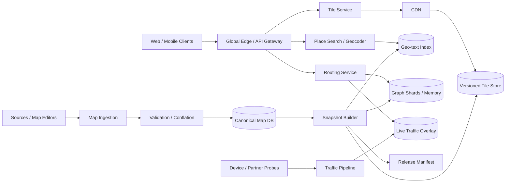

# Google Maps-like Mapping, Search, Tiles, and Routing System

## 1. Requirements

### Functional requirements

1. Render interactive vector maps at global zoom levels.
2. Search and autocomplete addresses, places, and points of interest.
3. Geocode text to coordinates and reverse-geocode coordinates.
4. Compute driving, walking, cycling, and transit routes.
5. Incorporate live traffic, closures, turn restrictions, and vehicle constraints.
6. Provide route alternatives, ETA, step instructions, and rerouting.
7. Ingest map edits and publish validated map versions.
8. Support offline map regions and cached navigation.

### Non-functional requirements

- Global low-latency reads with very high availability.
- Correct, explainable routes over a planet-scale graph.
- Fresh traffic within minutes and map edits within policy-dependent SLAs.
- Version consistency across tiles, search, geocoding, and routing.
- Safe operation under bad edits, traffic spikes, and regional failures.

Street imagery capture and social reviews are out of scope.

## 2. Scale assumptions

- 1 billion monthly users; 100 million daily active.
- 10 million map viewport sessions concurrently at peak.
- 5 billion tile requests/day, heavily CDN-cacheable.
- 500 million search/geocode queries/day.
- 200 million route computations/day; peak 20,000 route requests/second.
- Road graph: roughly 1 billion nodes/edges including detailed restrictions.
- Billions of places and address records across language variants.
- Tens of millions of traffic probes/second from opted-in devices and partners.

Static read traffic dwarfs edit traffic. Tiles and graph snapshots should be immutable and aggressively cacheable.

## 3. High-level architecture



The serving plane consumes immutable map releases plus small live overlays. The ingestion plane performs slower validation, conflation, and reproducible builds.

## 4. Core data model

```text
MapFeature
- feature_id, feature_type, geometry
- attributes, source_ids, confidence
- valid_from, valid_to, version

RoadNode
- node_id, lat, lng, elevation, region_id

RoadEdge
- edge_id, from_node, to_node, geometry
- length_m, road_class, speed_limit
- access_modes, one_way, toll, surface
- base_travel_time, restriction_ids

TurnRestriction
- from_edge, via_node_or_path, to_edge
- prohibited_or_penalty, vehicle_filter, schedule

Place
- place_id, point_or_polygon, category
- localized_names, address_components, popularity, status

TrafficObservation
- segment_id, observed_at, speed, confidence, source_class

MapRelease
- release_id, source_cutoff, graph_version, tile_version, search_version
- region, state, checksum_manifest
```

Stable feature/place IDs survive name and geometry changes. Geometry is stored at high precision; serving artifacts use zoom-specific simplification.

## 5. Core APIs

```http
GET /v1/tiles/{z}/{x}/{y}.mvt?style=default&release=current
GET /v1/places:autocomplete?q=1600+Amphi&lat=...&lng=...
GET /v1/geocode?address=...
GET /v1/reverse-geocode?lat=...&lng=...

POST /v1/routes
{
  "origin":{"lat":...,"lng":...},
  "destination":{"lat":...,"lng":...},
  "mode":"DRIVE",
  "departure_time":"...",
  "alternatives":2,
  "avoid":["TOLLS"]
}
```

Responses include `map_release_id`, traffic freshness, confidence, route polyline, legs, maneuvers, ETA, and warnings. Request IDs and idempotency matter for metering even though route reads are logically safe.

## 6. Map ingestion and conflation

Inputs include government road data, commercial feeds, imagery-derived changes, business owners, trusted editors, and user reports.

1. Normalize coordinate systems, schemas, and licenses.
2. Match incoming features to stable canonical IDs.
3. Conflate conflicting geometry/attributes using source authority, recency, and confidence.
4. Validate topology: connected intersections, legal direction, turn restrictions, address ranges, and geometry sanity.
5. Run automated regressions and targeted human review for risky changes.
6. Write a new canonical version without mutating published snapshots.
7. Build and canary serving artifacts before manifest promotion.

Emergency closures bypass full base-map publication as signed, expiring overlays.

## 7. Vector tile generation and serving

Partition the world using Web Mercator `(z, x, y)` tiles. Build vector tiles containing clipped and simplified roads, boundaries, labels, land, and POIs. Clients style vectors locally, reducing the number of server-rendered variants.

Tiles are immutable by release and content hash:

```text
/tiles/{release}/{style_schema}/{z}/{x}/{y}.mvt
```

The CDN caches popular tiles; clients cache by ETag. A small manifest maps `current` to an immutable release. Release changes avoid purging billions of objects. Low zooms are precomputed; unpopular high zooms may be generated on demand and cached.

## 8. Search, autocomplete, and geocoding

Index normalized names, language variants, transliterations, categories, address tokens, administrative hierarchy, geometry, popularity, and opening/status signals.

Candidate generation combines:

- Prefix/fuzzy text index.
- Address parser and country-specific formatting rules.
- Geo cells near user bias or viewport.
- Category and administrative filters.

Ranking combines textual match, distance, prominence, language/locale, query intent, and freshness. Autocomplete must meet tight latency, so use precomputed popular prefixes and terminate early. Geocoding returns confidence and structured components; ambiguous queries return multiple candidates rather than false precision.

## 9. Road graph construction

Convert roads into a directed graph. Intersections and decision points become nodes; traversable sections become edges. Edge weights include expected travel time and penalties. Encode:

- One-way roads and turn restrictions.
- Time-dependent access and closures.
- Vehicle height/weight, toll, ferry, and road class constraints.
- Walking/cycling connectivity and elevation.

Partition graph artifacts by geographic cells with boundary nodes. Maintain a coarse overlay graph for long-distance search and detailed local shards near origin/destination.

## 10. Routing algorithms

Baseline Dijkstra is correct but too slow at planetary scale. Use A* with a geographic lower-bound heuristic for local routes and preprocessing such as contraction hierarchies, customizable route planning, or multi-level Dijkstra for long routes.

Request flow:

1. Snap origin/destination to plausible accessible edges, considering heading.
2. Select graph release and traffic snapshot.
3. Search local graph to overlay entry points.
4. Traverse the high-level graph.
5. Unpack shortcuts into detailed edges.
6. Validate dynamic restrictions and compute instructions.
7. Generate sufficiently distinct alternatives with bounded extra cost.

The heuristic must never overestimate if optimality is required. Time-dependent routing preserves FIFO assumptions or uses an algorithm designed for non-FIFO schedules.

## 11. Traffic and ETA

Map-match noisy probe points to likely road segments using position, heading, speed, and path continuity. Aggregate enough probes to protect privacy, reject outliers, and estimate segment speed/confidence by time bucket.

Live edge cost:

```text
cost(edge, t) = length / blended_speed(historical, live, confidence)
              + turn_penalty + restriction_penalty
```

Sparse segments rely more on historical profiles. Incident feeds create high-confidence closures or penalties. Routing reads a versioned traffic snapshot so one computation does not mix arbitrarily changing costs. Active navigation reroutes only when improvement exceeds a threshold, avoiding oscillation.

## 12. Consistency and versioning

- Canonical map edits use optimistic concurrency and review workflows.
- Published artifacts are immutable.
- A release manifest atomically names compatible tile, graph, and search versions.
- Services pin a release for each request/session.
- Live traffic and closure overlays declare their base graph version.
- If an overlay references unknown edges, ignore it visibly and alert rather than corrupt routing.

Not every region needs one global release. Regional manifests can advance independently, but boundary compatibility is tested and explicitly versioned.

## 13. Partitioning, storage, and caching

- Canonical features: partition by stable ID with spatial secondary indexes.
- Tiles: object storage by release and tile key; CDN at global edges.
- Search: shard by geographic region and language, with global fallback for famous places.
- Routing graph: region/cell shards memory-mapped into RAM; overlay graph replicated widely.
- Traffic: partition by segment/cell and time; recent overlay in memory, history in columnar storage.

Viewport clients request only visible tiles and prefetch along motion direction. Route responses and geocodes can be cached using snapped endpoints, mode, departure bucket, options, and release, but personalized or live-traffic TTLs remain short.

## 14. Reliability and failure handling

| Failure | Handling |
|---|---|
| CDN miss or region loss | Fetch immutable tile from another replica/origin |
| Bad map edit | Canary metrics, rollback manifest, preserve prior release |
| Partial artifact build | Checksum gate prevents manifest publication |
| Routing shard unavailable | Replica serves; bounded fallback to older compatible release |
| Traffic pipeline delayed | Blend toward historical speeds and expose freshness |
| Search shard times out | Return partial regional/global candidates with explicit degradation |
| Probe spike | Durable stream buffers; sampling/backpressure preserves recent coverage |
| Closure overlay expires | Remove automatically unless renewed |
| Client goes offline | Use downloaded signed region bundle and embedded graph |
| Cross-shard route boundary fails | Retry replica or use coarser overlay detour |

## 15. Multi-region and release strategy

Stateless APIs and edge caches run globally. Tiles, search shards, and graph releases replicate before a region advertises readiness. Traffic is processed near ingestion, then merged into regional authoritative overlays.

Release process:

1. Build deterministic artifacts and checksum manifests.
2. Run topology, route-quality, search, and visual regressions.
3. Replicate artifacts globally.
4. Canary by employee/region/traffic percentage.
5. Atomically promote regional manifests.
6. Retain multiple releases for quick rollback and long client sessions.

Data-plane regions can continue serving pinned immutable releases if the control plane is unavailable.

## 16. Security, privacy, and abuse

- Authenticate metered APIs with scoped keys/OAuth; apply per-project quotas.
- Restrict keys by app signature, origin, IP, and endpoint.
- Encrypt data and sign offline bundles/manifests.
- Aggregate and threshold traffic probes; strip direct identifiers and limit retention.
- Protect sensitive places and vulnerable-user locations according to policy.
- Validate map edits, maintain provenance, and detect coordinated vandalism.
- Prevent search scraping and route-amplification abuse with quotas and cost limits.
- Audit privileged edits and emergency closure publication.

## 17. Observability

Track tile CDN hit ratio and byte latency, blank/corrupt tiles, search success and reformulation, geocode confidence, route p50/p99, graph shard loads, routes-not-found, ETA absolute percentage error, reroute rate, traffic freshness/coverage, map-match confidence, build duration, validation failures, canary regressions, release adoption, and rollback frequency.

Route quality needs offline golden queries plus online signals such as unexpected U-turns, immediate reroutes, and arrival error. Never optimize only server latency.

## 18. Major trade-offs

- **Raster versus vector tiles:** raster is simple; vector reduces variants and enables client styling/offline interaction.
- **Fresh edits versus release safety:** overlays handle urgent changes; validated snapshots protect global consistency.
- **Preprocessing versus dynamic weights:** contraction speeds routes but traffic changes weights; customizable/multi-level techniques balance both.
- **Optimal routes versus latency:** bounded approximations and hierarchical search meet interactive deadlines.
- **Global versus regional indexes:** regional locality scales, while global fallbacks handle cross-region and famous-place queries.
- **Traffic utility versus privacy:** aggregation thresholds and retention reduce precision in sparse areas but protect users.

## 19. Recommended interview presentation

1. Clarify tiles, search, routing, traffic, and update freshness.
2. Estimate tile/search/route load and emphasize cacheability.
3. Draw separate ingestion/build and immutable serving planes.
4. Explain vector tiles and atomic release manifests.
5. Deep-dive into graph modeling and hierarchical routing.
6. Add map matching, live traffic, and ETA confidence.
7. Cover search/geocoding, partition boundaries, rollback, and offline mode.
8. Finish with privacy, route-quality metrics, and core trade-offs.

The central design insight is:

> Build validated, immutable, mutually compatible map artifacts and serve them globally through caches; layer fast, versioned traffic and closure overlays on a hierarchical road graph so freshness never sacrifices reproducibility or safe rollback.
