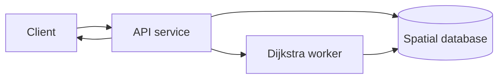
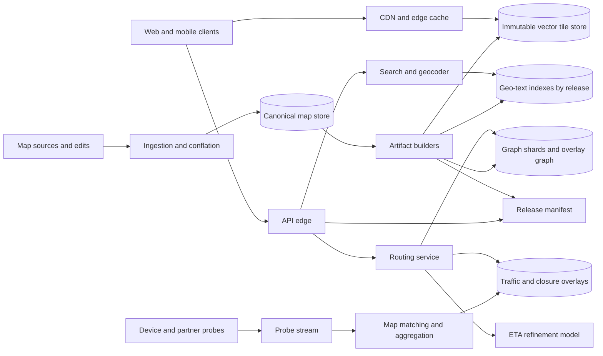
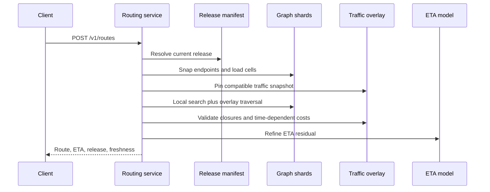
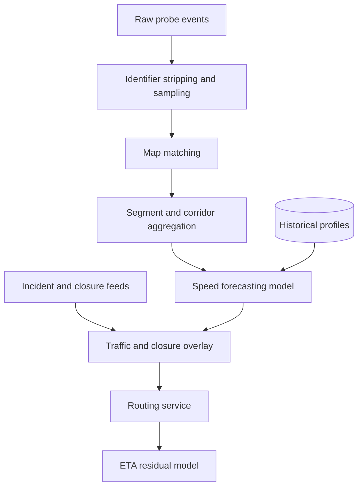
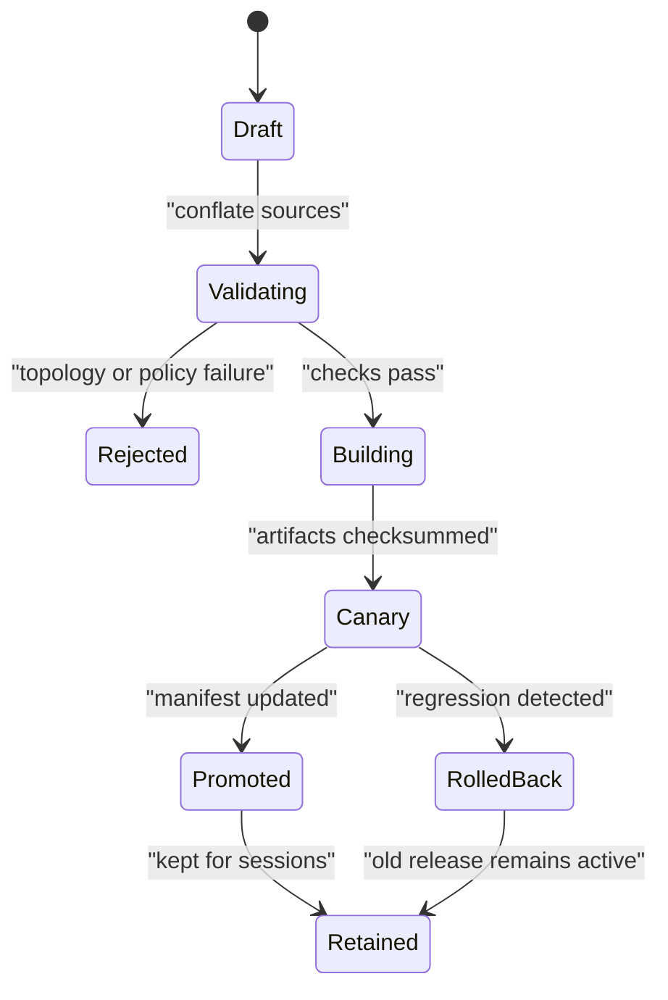

# Google Maps System Design

A Google Maps-like system renders interactive maps, finds places and addresses, and computes routes with live traffic over a continuously changing world. This design focuses on the serving and update architecture for tiles, search/geocoding, road routing, traffic, ETA, and map releases; street imagery capture, social reviews, ads, and business-owner workflows are out of scope except where they affect map correctness.

## 1. Requirements
### 1.1 Functional requirements
- Render global, zoomable maps on web and mobile clients using cacheable vector tiles.
- Search and autocomplete places, addresses, categories, and digital addresses, with geocoding and reverse geocoding.
- Compute driving, walking, cycling, and transit routes with alternatives, maneuvers, restrictions, and rerouting.
- Incorporate live traffic, incidents, closures, turn restrictions, and vehicle constraints into route choice and ETA.
- Ingest map edits from authoritative feeds, imagery-derived extraction, partners, trusted editors, and user reports, then publish safe map releases.
- Support offline regions where clients can render maps and navigate with a signed, bounded local bundle.

### 1.2 Non-functional requirements
- **Low latency.** Viewport panning needs tiles in tens of milliseconds from edge caches, autocomplete must feel instant, and route computation must usually finish within a few hundred milliseconds.
- **Fresh dynamic weights.** Traffic, incidents, and closures can change minute by minute, so the routing layer must accept new costs without rebuilding the continental road graph.
- **Route correctness.** A fast route is unacceptable if it violates one-way streets, turn bans, vehicle restrictions, closures, or time-dependent access rules.
- **Release consistency.** Tiles, search, geocoding, and routing must agree on the same base map often enough that a searched place can be rendered and routed to.
- **Rollback safety.** Bad map edits and bad traffic models happen, so serving artifacts must be immutable, versioned, canaried, and quickly reversible.
- **Privacy-preserving traffic.** Probe data is useful only if it is aggregated, thresholded, stripped of direct identifiers, and retained with strict limits.

### 1.3 The binding constraint

The binding constraint is that the road graph is much too large for plain Dijkstra at request time, while the important edge weights are not static. A continental graph has hundreds of millions of directed edges once turn restrictions, ramps, ferry links, service roads, and access modes are represented. Dijkstra over that graph for every route would burn CPU and memory bandwidth, but the weights that matter most to drivers -- live speeds, closures, incidents, and time-of-day predictions -- can change every minute.

That tension rules out a single static shortest-path index and also rules out a naive live graph scan. The architecture has to separate stable topology from frequently changing metrics, pin every route to a compatible map release and traffic snapshot, use hierarchical routing such as customizable route planning for fast metric customization, and keep traffic/ETA as overlays rather than as mutations of the canonical map.

## 2. Back-of-the-envelope estimation

The following numbers are illustrative, not claims about any one company. Suppose the system has `100M` daily active users. If each user opens maps `10` times per day and each session requests `40` vector tiles while panning and zooming, tile demand is `100M × 10 × 40 = 40B` tile requests per day. Dividing by `86,400` gives about `463k` average tile requests per second. With a `5×` diurnal and event peak, the edge must absorb about `2.3M` tile requests per second. That makes tile serving a CDN/object-storage problem first and an application-server problem second; origin code cannot sit on the hot path for popular tiles.

Search and routing are smaller but more CPU-bound. If `100M` users issue `5` search or autocomplete requests per day, that is `500M/day`, or `5.8k/s` average and perhaps `60k/s` peak because autocomplete fans out as users type. If `20M` users request `10` routes or reroutes per day, that is `200M/day`, or `2.3k/s` average and `20k-30k/s` peak. A route request that touches only a few megabytes of memory is manageable; one that scans gigabytes of graph state is not.

The road graph size also shapes the algorithm. Assume `1B` directed edges globally after splitting roads at intersections and restrictions. Even a compact edge record of `64` bytes is `64GB` before geometry, turn tables, indexes, live speed arrays, and multiple modes. Replicating the full hot graph in every routing worker is wasteful, but routing workers still need memory-local shards and high-level overlay data. If live traffic updates touch `10M` segments per minute, recomputing all shortcuts globally every minute is impossible; updating affected cells or metric overlays is the only plausible path.

Traffic probes have a different shape. If `10M` opted-in moving devices send a location update every `5` seconds during a global peak, ingestion sees `10M / 5 = 2M` probe events per second before sampling and partner feeds. The design must map-match, aggregate, threshold, and downsample before writing serving state; it cannot let raw probes become random writes into the routing graph.

> **Key idea.** The numbers split the system into three planes: immutable tiles and map artifacts served mostly from caches, CPU-heavy route/search requests served from memory-local indexes, and high-volume probe ingestion reduced into compact traffic overlays.

## 3. API design

**Question.** How does the API keep a route, its tiles, and its traffic explanation from silently mixing incompatible versions?
<details><summary>Answer</summary>

Every serving response carries a `map_release_id`; route responses also carry a `traffic_snapshot_id` and freshness metadata. Clients may request `release=current`, but services resolve `current` to an immutable release at the start of a request or navigation session. If a live overlay references an edge absent from that base release, the overlay is ignored and surfaced as a data-quality signal rather than being applied to the wrong road.

</details>

```http
GET /v1/tiles/{z}/{x}/{y}.mvt?style=default&release=current
If-None-Match: "tile-etag"

GET /v1/places:autocomplete?q=coffee&lat=37.42&lng=-122.08&session_id=s123&release=current

GET /v1/geocode?address=1600+Amphitheatre+Parkway&region=US&release=current

GET /v1/reverse-geocode?lat=37.4219999&lng=-122.0840575&release=current

POST /v1/routes
Idempotency-Key: route-metering-uuid
{
  "origin": {"lat": 37.7749, "lng": -122.4194, "heading": 120},
  "destination": {"place_id": "p_abc"},
  "mode": "DRIVE",
  "departure_time": "2026-10-13T19:30:00-07:00",
  "alternatives": 2,
  "avoid": ["TOLLS"],
  "release": "current"
}

POST /v1/navigation/{session_id}:reroute
{
  "current_position": {"lat": 37.78, "lng": -122.41, "heading": 180},
  "last_route_id": "r789",
  "traffic_snapshot_id": "ts456"
}

GET /v1/map-releases/{release_id}/manifest
```

Tile APIs are ordinary safe `GET`s because their payloads are immutable by release and cacheable by `ETag`. Search APIs include a `session_id` so autocomplete and final selection can share ranking context and billing without making keystroke retries create duplicate sessions. Route requests are logically reads, but the `Idempotency-Key` still matters for quota, billing, and client retries after timeouts. A timed-out route computation may finish server-side; retrying with the same key should either return the same completed route or attach to the same in-flight work.

The route response includes `route_id`, `map_release_id`, `traffic_snapshot_id`, `traffic_freshness_seconds`, `confidence`, a polyline, maneuvers, warnings, and alternative explanations. Reroute is modeled as a session operation rather than a blind new route because it must avoid oscillating between nearly equal paths and must understand what the driver is already following. Cancellation is best-effort: if a mobile client abandons a route request, the server can stop work only until the computation has already been committed to a shared in-flight cache.

## 4. Data model

Start with the obvious entity: a map feature with geometry and tags. That is enough to render a park polygon or a road line, but it is not enough for routing because a painted line is not a traversable graph. A single road geometry may be one-way in one direction, have a bus-only lane, disallow left turns during rush hour, or split into several decision points. So the routing model must derive directed `RoadEdge`s and `RoadNode`s from canonical features.

A directed graph still fails without explicit restrictions. If the model stores only edge speed and length, it may route a truck under a low bridge or turn left where a turn ban applies. That introduces `TurnRestriction`, `AccessRule`, and time windows. These rules cannot be folded permanently into one scalar weight because the answer depends on mode, vehicle, local time, schedule, and incident overlays.

Search introduces a different failure. A `Place` with one name and one point cannot represent multilingual aliases, entrances, campus polygons, address ranges, or countries where conventional street addresses are incomplete. Places therefore carry localized names, address components, category, popularity, geometry, entrances, status, and links to digital address systems such as Plus Codes. Google Plus Codes are useful here because they represent locations as a hierarchical grid and can be used where street addresses are weak or absent.

Finally, serving must survive bad edits. If published tiles and graph shards are overwritten in place, rollback becomes a race against cache state and long-running navigation sessions. That adds `MapRelease` as a first-class entity and forces serving artifacts to be immutable. Live traffic and closures become versioned overlays that declare which base graph they apply to.

```text
CanonicalFeature
- feature_id, feature_type, source_ids, license_class
- geometry, attributes, confidence, valid_from, valid_to
- version, review_state

RoadNode
- node_id, lat, lng, elevation_m, cell_id, release_id

RoadEdge
- edge_id, from_node, to_node, shape_ref, length_m
- road_class, speed_limit_kph, base_travel_time_s
- access_modes, toll_class, surface, bridge_tunnel_flags
- restriction_refs, release_id

TurnRestriction
- restriction_id, from_edge, via_node_or_path, to_edge
- rule_type, penalty_s, prohibited, vehicle_filter, time_window

Place
- place_id, geometry, entrances, category, status
- localized_names, address_components, plus_code
- popularity_score, source_ids, release_id

TrafficOverlay
- traffic_snapshot_id, base_graph_release_id, segment_id
- observed_speed_kph, predicted_speed_by_horizon, confidence
- updated_at, expires_at, source_mix

ClosureOverlay
- closure_id, base_graph_release_id, affected_edges
- reason, severity, starts_at, expires_at, signature

MapRelease
- release_id, region, source_cutoff
- tile_version, graph_version, search_version
- checksum_manifest, state, promoted_at
```

Canonical features live in a versioned spatial store with provenance and review metadata because ingestion needs history, source comparison, and auditability. Tiles live in object storage keyed by immutable release, style schema, zoom, x, and y, with a CDN in front. Search shards live in geo-text indexes partitioned by region and language with a global fallback for famous places. Routing graph shards are memory-mapped or loaded into RAM by cell, plus a replicated high-level overlay graph. Traffic overlays live in low-latency key-value or in-memory stores partitioned by segment/cell and time bucket; raw probe history belongs in streaming logs and columnar storage, not in the transactional map database.

> **Key idea.** The canonical map is a slow, reviewable source of truth; serving uses immutable derived artifacts plus small, expiring dynamic overlays.

## 5. High-level design

The simplest design is tempting: store roads and places in one spatial database, render tiles from it, search it with a text index, and run Dijkstra over road rows whenever a user asks for directions.



That design breaks in several concrete ways. Popular tile traffic would hammer the database even though most map views are identical for many users. Dijkstra would scan too much graph state for long routes. Minute-by-minute traffic would require mutating the same rows used by map releases, making reproducibility and rollback hard. Search, tiles, and routing could observe different versions of the map. Bad edits or ML regressions would be published directly into the hot path.

### Fix 1: Immutable map releases and manifests

Instead of serving from mutable canonical tables, build deterministic artifacts: vector tiles, search indexes, road graph shards, and release manifests. A manifest atomically says which tile, search, and graph versions are compatible for a region. A client may say `release=current`, but the edge resolves that to `release_2026_10_13_us_west_17` and services pin it for the request or navigation session. Rollback becomes a manifest pointer change, not a destructive rewrite.

This mirrors the production lesson from Google Maps' mapping pipeline: real maps are assembled from imagery, authoritative data, ML extraction, human operators, and user feedback. That mixture needs provenance, confidence, validation, and canaries before publication. Emergency closures are the exception: they are signed, expiring overlays because waiting for a full base-map release would make navigation unsafe.

### Fix 2: CDN-backed vector tile serving

Tiles are precomputed for low and medium zooms and generated on demand only for cold high-zoom areas. Mapbox Vector Tiles package clipped geometries and metadata in compact PBF payloads, letting clients style roads, labels, and land locally. That decouples data delivery from cartographic styling, but it also creates a compatibility contract: old clients and styles may still expect layer names and attributes. The tile key therefore includes both release and style schema, and the release manifest declares schema compatibility.

With immutable tile URLs, the CDN can cache aggressively. The system avoids purging billions of objects by changing the small `current` manifest and allowing old tiles to age out. Mobile clients use `ETag`s and cache visible tiles plus likely motion direction.

### Fix 3: Specialized search and geocoding indexes

Search is not a database `LIKE` query. Autocomplete needs prefix, fuzzy matching, language variants, transliteration, viewport bias, popularity, categories, and administrative hierarchy. The search builder consumes the same release as tiles and the graph, producing region/language shards plus global famous-place shards. Ambiguous geocodes return ranked candidates with confidence instead of false precision. Plus Codes and other grid-based digital addresses are first-class candidates for regions with incomplete street-address systems.

### Fix 4: Hierarchical routing with customizable metrics

The router consumes graph shards and a high-level overlay rather than scanning the full graph. Stable topology is preprocessed by region/cell; frequently changing weights are customized from base profiles plus live traffic overlays. Contraction hierarchies are extremely fast when weights are static, but live traffic makes full shortcut rebuilds too slow. Customizable Route Planning-style separation is a better fit: expensive topology preprocessing is mostly metric independent, and metric customization can refresh affected cells much more often.

### Fix 5: Probe-to-traffic pipeline and ML ETA layer

Raw device and partner probes are not edge weights. They are noisy, biased, privacy-sensitive observations. A traffic pipeline map-matches them to likely segments, aggregates above privacy thresholds, rejects outliers, and publishes versioned segment/corridor speed predictions. The route engine remains responsible for legal, explainable path choice; an ETA model can then predict residual error from live conditions, history, city, time, weather, pickup/dropoff behavior, and route shape.

### Putting it together



A route request enters the API edge, resolves `current` to a release manifest, snaps origin and destination to edges in that graph release, reads a traffic snapshot compatible with that release, runs hierarchical search, refines ETA, and returns route geometry plus version/freshness metadata. A tile request usually never reaches application code; it is served from CDN or immutable object storage. A map edit enters ingestion, is conflated into canonical features, validated, built into artifacts, canaried, and promoted by manifest only after checks pass.

> **Key idea.** Each component traces back to a specific failure of the naive design: caches protect tiles, release manifests protect consistency, specialized indexes protect search latency, hierarchical routing protects CPU, and overlays protect freshness without corrupting the base map.

## 6. Deep dives
### 6.1 Routing when the graph is huge and weights change every minute

**Question.** Why not precompute the fastest paths with contraction hierarchies and update edge weights when traffic changes?
<details><summary>Answer</summary>

Static contraction hierarchies are excellent when weights rarely change, but shortcuts depend on the metric used during preprocessing. If live traffic changes many edge weights every minute, rebuilding or repairing enough shortcuts for a continent becomes too slow. A production navigation system needs metric-independent topology preprocessing, fast metric customization, and time-dependent edge evaluation pinned to a traffic snapshot.

</details>

Plain Dijkstra is the correct starting point because it exposes the model: nodes, directed edges, nonnegative weights, and a priority queue. It fails at scale because the search frontier grows across the map. A* improves local routes by using a lower-bound heuristic such as straight-line distance divided by maximum possible speed, but long-distance driving still touches too much graph state, especially around dense metro areas and highway interchanges.

Contraction hierarchies solve the static case by ordering nodes by importance and adding shortcuts so queries climb quickly from local roads to important roads and back down. For a stable road network, this is hard to beat. The problem is that a shortcut's weight is a promise about the best path through contracted nodes under a particular metric. If a crash makes a freeway segment slow, or rain changes citywide speeds, many shortcut weights are no longer valid. Uber's routing-engine writeup describes this pressure directly: static preprocessing was too slow for live traffic, and even dynamic updates around minutes could be stale for a ride-hailing system.

Customizable Route Planning changes the split. The expensive preprocessing partitions the graph and computes topology structures that do not depend heavily on the exact travel-time metric. A customization phase then computes boundary-to-boundary costs for cells using the current metric. Microsoft Research's CRP work is relevant because it treats new cost functions as a first-class operation rather than as a full rebuild. In this design, the base graph release is stable, while traffic customization refreshes affected cells and overlay arcs. A downtown cell with changing speeds can be recustomized frequently without touching rural cells three states away.

Time dependence adds another trap. The cost of an edge is not just `length / speed_now`. If the driver will reach that edge in `35` minutes, the router should evaluate the predicted speed for that future arrival time. For road traffic, the algorithm depends on the FIFO property: leaving later should not let you arrive earlier on the same edge in a way that violates causality. With FIFO piecewise-linear travel-time functions, time-dependent Dijkstra-like algorithms remain valid. If the system mixes in transit schedules, waiting, or non-FIFO behavior, it must model waiting explicitly rather than pretending every edge has a simple scalar weight.

A practical route query has phases. First, snap origin and destination to plausible directed edges using location, heading, mode, access rules, and confidence. Second, search detailed local cells near each endpoint. Third, traverse the overlay graph across larger regions. Fourth, unpack shortcuts into detailed edges. Fifth, validate dynamic restrictions and closures, because an overlay may close a ramp that the preprocessed graph considers legal. Sixth, generate alternatives that are meaningfully distinct rather than trivial variants.



The router must be explicit about what it guarantees. It can guarantee legality against the pinned base graph and accepted overlays. It may not guarantee global optimality if it uses bounded approximations or alternative pruning. That is acceptable if the service exposes confidence, keeps error budgets for route quality, and uses offline golden routes plus online signals such as immediate reroutes, illegal maneuvers, route abandonment, and arrival error.

Signals worth watching: route p50/p99 latency, cells touched per query, traffic snapshot age, closure validation failures, routes-not-found, immediate reroute rate, and gap between graph ETA and actual arrival.

> **Strong-answer criteria.** A senior answer distinguishes topology preprocessing from metric customization, handles time-dependent costs with FIFO assumptions, and explains how live overlays are pinned and validated instead of mutating the graph mid-query.

| Level | Approach | Why |
|---|---|---|
| Bad | Run Dijkstra over the road table for every request. | Correct in principle but too slow and too memory-heavy for continental routes. |
| Good | Use A* and contraction hierarchies. | Much faster, but static shortcuts become stale when live traffic changes frequently. |
| Great | Use release-pinned graph shards, CRP-style metric customization, time-dependent edge functions, and overlay validation. | Separates stable topology from changing weights while preserving legal route constraints and rollback. |

### 6.2 Live traffic and ETA from noisy probes

**Question.** A phone reports slow movement on a road. When should that change the ETA for thousands of drivers?
<details><summary>Answer</summary>

Not immediately by itself. A single probe is noisy and privacy-sensitive. The system should map-match probes to candidate segments, aggregate enough observations to satisfy privacy thresholds, blend live speeds with historical and predicted profiles using confidence, publish a versioned traffic snapshot, and let routing read that snapshot consistently.

</details>

Raw location events are not traffic. GPS drifts into frontage roads, urban canyons create jumps, parking lots look like congestion, and phones stop reporting when batteries die. A probe also describes a person, so the serving path should never expose individual traces. The ingestion pipeline first normalizes events, strips direct identifiers, rate-limits abusive sources, and groups observations into short-lived anonymous streams only long enough to map-match.

Map matching is a probabilistic inference problem. Given latitude, longitude, accuracy radius, heading, speed, recent path, and road topology, the matcher selects likely directed edges. A hidden Markov model or similar path-continuity method avoids snapping every point independently. Independent snapping causes impossible jumps between parallel roads and overreacts to noisy points near interchanges. Uber has described driver GPS pings on the order of seconds being map-matched to a global road graph; at that scale, map matching is a hot production service, not offline cleanup.

After map matching, aggregation estimates speed for segments or corridors by time bucket. Sparse roads rely more on historical profiles. Dense roads can use live observations with higher confidence. Incidents and closures are different from ordinary speed estimates: a verified closure should set a hard prohibition or large penalty with an expiry, while ordinary congestion is a soft cost. Every output includes confidence, source mix, and expiry. If a traffic overlay expires, routing should decay toward historical speeds rather than keep stale congestion forever.

Historical data must adapt to regime changes. Google has written about combining live traffic with historical patterns and emphasizing more recent weeks when COVID-era traffic changed normal behavior. The general design lesson is to keep history time-decayed and regime-aware. A holiday, storm, roadwork season, or pandemic can make a five-year average actively misleading.

ETA then becomes two layers. The graph layer computes a physically explainable route and a baseline travel time using time-dependent edge costs. The ML layer predicts residual error: pickup friction, downtown turn delays, weather, event spillover, local driving behavior, and modelable bias in the graph estimate. Google and DeepMind's traffic work uses graph neural networks over road-network supersegments so adjacent roads and intersections can influence each other; Uber's DeepETA similarly treats routing output and real-time traffic as inputs to low-latency prediction. The important architectural split is that ML should refine ETA, not make illegal routes legal or hide graph regressions.



There are hard edge cases. A tunnel may have no live probes, so the system needs last-known profiles and partner feeds. A bridge closure may be reported before enough probes prove it, so trusted incident feeds bypass statistical thresholds but require signatures and expiry. A stadium event can make side streets slow before the freeway slows, so corridor-level features matter. A rural road may never meet the threshold for live traffic, so the response should expose lower confidence rather than invent precision.

The pipeline also needs backpressure. During a probe spike, preserving recent representative coverage is better than faithfully processing every stale event. Stream processors should drop or sample old low-value probes before they delay fresh observations. Serving state should be compact: latest speed buckets and forecasts by segment/corridor, not raw traces.

Signals worth watching: probe ingest lag, map-match confidence, coverage by road class, percentage of routes using stale traffic, ETA mean absolute percentage error, model residual drift, and privacy-threshold suppression rate.

> **Strong-answer criteria.** A senior answer treats traffic as an inference and serving problem, not a direct write to edge weights, and separates legal route computation from ML ETA correction.

| Level | Approach | Why |
|---|---|---|
| Bad | Average every phone speed directly into the road edge. | Noisy, privacy-risky, biased, and inconsistent during route computation. |
| Good | Map-match and aggregate live segment speeds. | Handles noise but can still miss corridors, sparse coverage, and ETA residual bias. |
| Great | Aggregate with privacy thresholds, blend live/history/forecast confidence, publish versioned overlays, and apply ML residual ETA separately. | Fresh, privacy-aware, explainable, and debuggable under regime changes. |

### 6.3 Vector tiles, pyramid levels, and incremental map updates

**Question.** A city changes a major road name and closes one bridge. How do clients see the update without purging the world's tiles or breaking routes in progress?
<details><summary>Answer</summary>

The road-name change goes through canonical ingestion, validation, artifact build, canary, and release-manifest promotion for the affected region. The bridge closure is a signed, expiring closure overlay applied to compatible graph releases immediately. Tiles are immutable by release, so clients move to the new release through a small manifest rather than through global cache purges.

</details>

A raster map server can render exactly what the user sees, but every style, language, pixel density, and theme multiplies server work. Vector tiles push geometry and attributes to the client so the same tile can support day mode, night mode, local language, selection highlighting, and offline rendering. The pyramid is the organizing principle: at low zoom, one tile covers a large area and contains simplified highways, boundaries, water, and major labels; at high zoom, tiles contain local roads, building footprints, entrances, and dense POIs.

The naive vector-tile mistake is to treat tiles as independent cache entries that can be overwritten. If tile `z/x/y` is replaced in place, clients, CDNs, search, and routing can observe a mixed world. A user might search for a renamed road in the new index while their map still renders old labels and their route uses an old edge ID. The fix is immutable tile paths such as `/tiles/{release}/{style_schema}/{z}/{x}/{y}.mvt` and a manifest that maps `current` to a compatible tile/search/graph set.

Incremental updates still matter because the world changes constantly. The canonical map builder should not rebuild the entire planet for a local road-name edit. It can compute affected tiles by geometry coverage and zoom, rebuild those tiles for a regional release, and reuse unchanged tile objects by content hash. Search and graph artifacts follow their own affected-region rebuilds. Promotion is atomic at the manifest level: either the region points to the old compatible set or the new compatible set.

Mapbox's vector tile guidance highlights the data/styling split, and that split becomes an API contract. If a client style expects a `road_class` attribute and a release removes it, old clients may render roads incorrectly even though the tile is valid PBF. The design needs style-schema versions, backward-compatible layer evolution, and canaries that render visual diffs for important locations. Layer removal is a client migration, not a casual tile optimization.



Offline regions complicate this but do not change the principle. A downloaded bundle includes a tile subset, a compact local graph, search data, style schemas, signatures, and expiry metadata. The client can route offline using historical speeds and known closures at download time, but it must label traffic freshness honestly. When online again, it can fetch small manifests and deltas, but deltas should be applied only if their base release matches the bundle.

The bridge closure in the question is different from the road-name change. Waiting for a full release could route drivers onto a closed bridge. A trusted closure feed can publish a signed overlay with affected edge IDs, start time, expiry, and reason. Routers apply it only to compatible base graph releases. Tiles may optionally render a closure line from the overlay, but the canonical road name changes only after normal validation.

Signals worth watching: CDN hit ratio, origin tile QPS, manifest promotion failures, visual diff regressions, tile schema compatibility errors, client release skew, and percentage of requests pinned to retained old releases.

> **Strong-answer criteria.** A senior answer uses immutable release-addressed tiles, manifests instead of purges, schema compatibility for vector layers, and overlays for urgent closures.

| Level | Approach | Why |
|---|---|---|
| Bad | Render or overwrite tiles directly from the live database. | Expensive, inconsistent, and hard to roll back. |
| Good | Precompute vector tiles and cache them in a CDN. | Fast, but still risky if updates overwrite cache keys or break old styles. |
| Great | Use immutable release keys, content-hash reuse, regional manifests, style-schema compatibility, and signed urgent overlays. | Delivers fresh maps without mixed-version clients or global cache purges. |

## 7. Variants

**10x scale.** At `10×` usage, the tile plane remains viable only if CDN hit ratio stays extremely high and origin generation is protected by request coalescing. Search needs more aggressive prefix caches and per-region capacity isolation. Routing needs tighter cell locality, hot-corridor precomputation, and admission control for expensive alternatives. The architecture stays the same, but every mutable overlay and manifest operation needs stronger blast-radius limits.

**Fleet and truck routing.** Truck routing adds height, weight, hazmat, delivery-window, and curb-access constraints. The base graph can stay shared, but access rules become more important and route requests need vehicle profiles. Some shortcuts may be valid for passenger cars but invalid for trucks, so metric customization and validation must include vehicle class.

**Disaster response.** During wildfires, floods, or earthquakes, closures and demand spikes arrive faster than normal map releases. The system should prioritize trusted emergency overlays, lower TTLs, regional canaries, and clear confidence labels. Offline bundles become more important, but stale traffic must be called out because connectivity gaps can make probes disappear exactly where conditions are worst.

**Strict regional data residency.** Some regions may require raw probes or detailed map edits to stay in-country. The ingestion and traffic pipelines become regional, and global serving consumes only approved aggregate overlays or artifacts. Immutable releases, manifests, and graph customization still apply; raw-data movement changes, not the core routing architecture.

## 8. The transferable pattern

This is the pattern of a large mostly static corpus with a small but crucial dynamic overlay. The base map must be reviewed, versioned, replicated, and cached like a release artifact. Traffic and closures must be fresh, expiring, and compatible with that base, but they should not mutate it in place. Systems with this shape usually need immutable snapshots, manifests, derived indexes, and explicit overlay semantics.

The same pattern appears in other design problems where request-time work is too expensive without preprocessing but the last-mile state changes quickly. A ticketing system such as [Ticketmaster](./ticketmaster-system-design.md) precomputes seating and availability views but must apply live reservations safely. A ride-hailing system has stable geographic supply/demand regions but dynamic driver positions and ETAs. The reusable lesson is to split stable topology from dynamic metrics, then make the compatibility boundary visible in APIs and data models.

## Review

The design is shaped by one constraint: a planet-scale road graph cannot be searched naively, yet traffic changes too quickly for a purely static shortest-path index. The solution is to build immutable, compatible map artifacts from a reviewed canonical map; serve vector tiles through CDN-friendly release keys; use specialized search indexes; route over graph shards and high-level overlays with CRP-style metric customization; publish traffic and closures as versioned overlays; and refine ETA with ML without letting ML hide illegal routes or stale graph data. Manifests, pinned releases, freshness metadata, canaries, and rollback make the system safe under bad edits, stale traffic, and mixed client versions.

### Check your understanding
1. Why is plain Dijkstra not enough for driving directions at this scale?
   <details><summary>Answer</summary>

   It may be correct on a small graph, but a continental road graph has too many directed edges, restrictions, and turn states to scan per request. The router needs A*, hierarchy, partitioning, and preprocessed overlays so each request touches a bounded amount of memory.

   </details>
2. Why are static contraction hierarchies not a complete answer for live navigation?
   <details><summary>Answer</summary>

   Their shortcuts are tied to the metric used during preprocessing. Minute-by-minute traffic changes can invalidate many shortcut weights, so the design needs metric customization or overlay repair rather than full graph rebuilds.

   </details>
3. Why should traffic be published as a snapshot instead of read as continuously changing edge rows?
   <details><summary>Answer</summary>

   A route computation must be internally consistent and reproducible. Pinning a traffic snapshot avoids mixing speeds from different moments halfway through the search and lets the response report freshness and confidence.

   </details>
4. Why are map tiles addressed by immutable release keys?
   <details><summary>Answer</summary>

   Immutable keys let CDNs cache aggressively, prevent mixed old/new tiles under the same URL, and make rollback a manifest change instead of a global purge or overwrite race.

   </details>
5. What belongs in the ML ETA layer, and what should stay in graph routing?
   <details><summary>Answer</summary>

   Graph routing should enforce legal paths, restrictions, closures, and explainable baseline travel time. ML should correct residual ETA error from traffic patterns, weather, local behavior, and route context, while being monitored separately so it does not mask graph or map regressions.

   </details>

## Sources and further reading
| Source | Article | Why it matters |
|---|---|---|
| Google Maps | [Google Maps 101: how we map the world](https://blog.google/products-and-platforms/products/maps/google-maps-101-how-we-map-world/) | Shows why production maps require imagery, authoritative sources, ML, human review, and user feedback with provenance. |
| Google Maps | [Google Maps 101: How AI helps predict traffic and determine routes](https://blog.google/products-and-platforms/products/maps/google-maps-101-how-ai-helps-predict-traffic-and-determine-routes/) | Explains blending aggregate live traffic, historical patterns, route selection, incidents, and freshness under changing traffic regimes. |
| Google DeepMind | [Traffic prediction with advanced Graph Neural Networks](https://deepmind.google/blog/traffic-prediction-with-advanced-graph-neural-networks/) | Details GNN supersegments, adjacent-road message passing, and production stability concerns for ETA prediction. |
| Uber | [ETA Phone Home: How Uber Engineers an Efficient Route](https://www.uber.com/us/en/blog/engineering-routing-engine/) | Shows routing-engine evolution, contraction-hierarchy rebuild limits, dynamic traffic trade-offs, and cell-based preprocessing. |
| Microsoft Research | [Faster Customization of Road Networks](https://www.microsoft.com/en-us/research/publication/faster-customization-of-road-networks/) | Provides the CRP rationale for fast metric customization over a mostly stable road topology. |
| Uber | [DeepETA: How Uber Predicts Arrival Times Using Deep Learning](https://www.uber.com/ch/en/blog/deepeta-how-uber-predicts-arrival-times/) | Demonstrates low-latency ML residual correction on top of graph routing and real-time traffic. |
| Uber | [Scaling Real-Time Traffic Forecasting with a Graph-Aware Transformer](https://www.uber.com/us/en/blog/scaling-real-time-traffic/) | Gives concrete scale for map-matched GPS pings, segment traversal forecasts, future horizons, and high-QPS traffic ML serving. |
| Mapbox | [Vector tiles introduction](https://docs.mapbox.com/data/tilesets/guides/vector-tiles-introduction/) | Explains MVT/PBF vector tile data, client styling, caching, interactivity, and raster trade-offs. |
| Google Maps | [How we’re giving everyone, everywhere an address](https://blog.google/products-and-platforms/products/maps/google-maps-101-giving-everyone-everywhere-an-address/) | Introduces Plus Codes for geocoding and navigation where conventional street addresses are incomplete or absent. |
