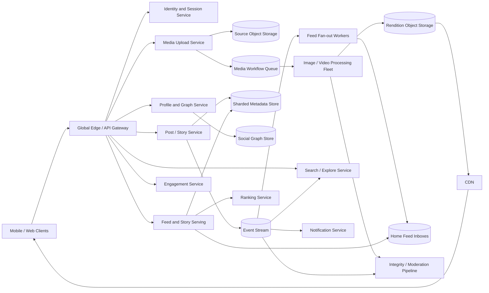

# Production-Scale Instagram-like Photo and Video Platform

## 1. Requirements

### Functional requirements

1. Create photo, carousel, and short-video posts with captions, tags, and locations.
2. Follow public accounts and request access to private accounts.
3. View a ranked home feed and a user's profile grid.
4. Publish and view ephemeral stories that expire after 24 hours.
5. Discover content through Explore, search, hashtags, and recommendations.
6. Like, comment, save, share, mention, and report content.
7. Deliver notifications for follows, requests, mentions, comments, and selected engagement.
8. Process images and videos into device-appropriate renditions.
9. Enforce blocks, private-account rules, content policy, age, and regional restrictions.
10. Provide creator publishing status, drafts, archives, and basic insights.

### Non-functional requirements

- Fast media loading worldwide, with low feed and profile latency.
- Very high durability for original uploads and published metadata.
- High availability for reads and graceful degradation of ranking or counters.
- Strong authorization for private accounts, blocks, close-friends stories, and deletion.
- Eventual consistency for feed fan-out, engagement counts, search, Explore, and analytics.
- Resumable uploads and asynchronous, idempotent media processing.
- Protection against abuse, scraping, account takeover, and unsafe content.
- Cost-efficient media storage and CDN delivery at multi-petabyte daily scale.

Direct messaging is a separate chat subsystem and is out of scope except for sharing a post by reference.

## 2. Scale assumptions and capacity

- 2 billion monthly active users and 500 million daily active users.
- 100 million new feed posts/day.
- 500 million stories/day.
- 20 billion media views/day across feed, profiles, stories, and Explore.
- Peak feed/API read traffic: approximately 1 million requests/second.
- Average photo source: 3 MB; average short-video source: 20 MB.
- Daily source ingest: roughly 1-3 PB before replicas and derived renditions.
- Derived images average 3-6 sizes/formats; videos use an adaptive bitrate ladder.
- Average user follows 300 accounts; celebrity accounts exceed 100 million followers.
- Most bytes are served by CDN, while metadata and authorization remain application concerns.

Photos, videos, feed ranking, and stories have different access and retention patterns. The design shares ingestion and media storage but uses separate indexes and serving policies.

## 3. High-level architecture



Media bytes flow directly between clients, object storage, processors, and CDN. API services coordinate uploads and authorize access without proxying large bodies.

## 4. Data model

```text
User
- user_id
- username
- account_type: PUBLIC | PRIVATE
- status
- profile_media_id
- follower_count_hint
- following_count_hint
- version

FollowEdge
- follower_id
- followee_id
- state: REQUESTED | ACTIVE | MUTED
- created_at
- version

BlockEdge
- blocker_id
- blocked_id
- created_at

Post
- post_id
- author_id
- type: PHOTO | CAROUSEL | VIDEO
- caption
- audience
- location_id
- moderation_state
- created_at
- edited_at
- deleted_at
- version

PostMedia
- post_id
- media_id
- position

Story
- story_id
- author_id
- media_id
- audience: FOLLOWERS | CLOSE_FRIENDS
- created_at
- expires_at
- deleted_at

MediaAsset
- media_id
- owner_id
- source_object_key
- processing_state
- width
- height
- duration_ms
- content_hash

MediaRendition
- rendition_id
- media_id
- format
- width
- height
- bitrate
- object_key
- checksum

FeedInboxEntry
- viewer_id
- time_bucket
- post_id
- author_id
- published_at

Engagement
- user_id
- target_id
- type: LIKE | SAVE
- created_at

Comment
- comment_id
- post_id
- parent_comment_id
- author_id
- body
- moderation_state
- created_at

StoryView
- story_id
- viewer_id
- viewed_at
```

Counters are cached projections, not the canonical engagement state. Media is immutable; edits change post metadata or create a replacement media asset rather than mutating CDN objects.

## 5. Core APIs

### Start media upload

```http
POST /v1/media/uploads
Idempotency-Key: client-generated-uuid

{
  "content_type": "video/mp4",
  "size": 25165824,
  "checksum": "sha256:..."
}
```

```json
{
  "media_id": "media-501",
  "upload_id": "upload-81",
  "part_size": 8388608,
  "signed_part_urls": ["https://object-store/..."],
  "expires_at": "2026-10-14T00:00:00Z"
}
```

### Publish a post

```http
POST /v1/posts
Idempotency-Key: client-generated-uuid

{
  "media_ids": ["media-501"],
  "caption": "Sunset",
  "audience": "FOLLOWERS"
}
```

### Read feeds and stories

```http
GET /v1/feed/home?cursor=opaque-token&limit=20
GET /v1/stories/tray?cursor=opaque-token
GET /v1/users/{user_id}/posts?cursor=opaque-token
```

Other endpoints:

```http
POST   /v1/stories
DELETE /v1/stories/{story_id}
PUT    /v1/users/{user_id}/follow
POST   /v1/users/{user_id}/follow-requests/{request_id}/accept
DELETE /v1/users/{user_id}/follow
PUT    /v1/users/{user_id}/block
PUT    /v1/posts/{post_id}/likes/me
DELETE /v1/posts/{post_id}/likes/me
POST   /v1/posts/{post_id}/comments
GET    /v1/explore?cursor=...
GET    /v1/search?q=...
```

Mutations use idempotency keys and/or entity versions. Feed cursors are signed, opaque, and short-lived.

## 6. Media upload and processing flow

1. The client obtains a resumable upload session.
2. It uploads parts directly to a nearby object store endpoint.
3. The media service validates part checksums and atomically completes the source object.
4. An outbox event starts a durable processing workflow.
5. Image jobs correct orientation, strip unsafe metadata, crop previews, and generate AVIF/WebP/JPEG renditions.
6. Video jobs probe the file, transcode an HLS/DASH ladder, create posters, and validate output.
7. Safety classifiers inspect permitted content and attach policy decisions.
8. The media record becomes `READY`; the client may publish it.

Processing jobs are idempotent and write versioned deterministic output keys. A minimum image rendition or low video ladder can make publishing available while premium variants finish, but the post must never reference an unvalidated source.

Unattached uploads expire after a grace period. Published originals move to durable replicated storage; derived renditions can be regenerated and may use cheaper durability.

## 7. Post publication and feed fan-out

1. Verify that every media asset is owned by the author, ready, and policy-eligible.
2. Commit the post, media ordering, idempotency record, and outbox event in one transaction.
3. Return the canonical post immediately.
4. Inject it into the author's own feed/profile for read-your-writes.
5. Fan-out workers append references to ordinary followers' feed inboxes.
6. Celebrity posts remain on the author's timeline and are pulled during feed reads.
7. Ranking features, search indexes, notification candidates, and counters update asynchronously.

Private-account posts can be materialized only to active followers, but final serving must still recheck the relationship. Presence in an inbox never grants access.

## 8. Home feed generation

Candidate sources include:

- Materialized inbox entries from ordinary followed accounts.
- Recent posts pulled from high-fan-out accounts.
- Suggested posts from embedding/topic retrieval.
- Reshares or collaborative posts.
- Sponsored content from a separate ads system.

The serving path deduplicates, filters private/blocked/deleted/ineligible posts, hydrates media and features, pre-ranks, applies the main ranker, then re-ranks for diversity and frequency caps. It performs a final authorization check before issuing media URLs.

If recommendation systems fail, serve recent followed posts. If the online feature store is slow, use bounded stale features or a lightweight model. Core feed utility must not depend on every ML service.

## 9. Stories design

Stories differ from permanent posts:

- They have an explicit `expires_at`, usually 24 hours.
- The story tray ranks authors before individual stories.
- Within an author's story set, ordering is normally chronological.
- Read receipts may be visible to the author.
- Audience can be followers or a close-friends list.

Store active story IDs in time-bucketed per-author indexes and maintain a per-viewer tray projection containing candidate authors, not copies of every story. At read time, fetch non-expired stories and recheck current authorization.

Expiration is enforced logically by `expires_at`; a delayed cleanup job must not make an expired story visible. Physical deletion and CDN eviction happen asynchronously. Authors may archive stories privately, which creates a separate durable record and access policy.

For celebrity story view counts, append view events to a stream and aggregate. If the product exposes a viewer list, store exact viewer IDs only within a bounded window and paginate them; do not update one hot row.

## 10. Profiles, Explore, and search

### Profile grid

Maintain an author timeline index ordered by publication time. Profile reads fetch IDs, batch-hydrate posts, and filter current state. Cache public first pages briefly; private profile content requires viewer-scoped authorization.

### Explore

Explore uses:

1. Candidate retrieval from content/user embeddings, topics, trends, and graph neighborhoods.
2. Policy and eligibility filtering.
3. Ranking for predicted interest and quality.
4. Diversity across creators, media types, and topics.
5. Exploration slots for new content.

### Search

Index usernames, names, hashtags, places, captions where policy permits, and public content metadata. Exact username lookup uses a strongly consistent normalized-username index. General search is eventual and must recheck account/post visibility before returning or opening a result.

## 11. Feed pagination and consistency

Use a short-lived feed session containing:

```text
session_id
candidate watermark
model version
last score and post ID
served-ID set reference
expiry and signature
```

This gives stable-enough pagination while allowing controlled insertion of fresh posts. Offset pagination would duplicate or skip items as the feed changes.

Strongly consistent state:

- Post ownership, deletion, and audience.
- Private follow requests and acceptance.
- Blocks and account disablement.
- Media readiness and active policy state.
- Username uniqueness.

Eventually consistent state:

- Feed inboxes and story trays.
- Like/comment/view counters.
- Search and Explore indexes.
- Notifications, analytics, and ranking features.

Edits use optimistic concurrency against `version`. Deletes create tombstones and high-priority invalidation events. Stale references are harmless only because serving rechecks the canonical object.

## 12. Social graph and celebrity handling

Store forward and reverse adjacency:

```text
(follower_id, followee_id) -> follow state
(followee_id, follower_id) -> follower state
```

Private follow transitions are state-machine operations:

```text
NONE -> REQUESTED -> ACTIVE
  ^         |          |
  +---------+----------+
```

Acceptance must be idempotent and authorize only the intended requester. Blocks override follows and should synchronously update a deny path while asynchronous workers clean projections.

Shard celebrity follower lists into stable buckets for fan-out of notifications or graph maintenance. Do not fan out every celebrity post. Hybrid push/pull mode is chosen by follower count, active audience, and post rate, with overlap deduplicated by `post_id`.

## 13. Engagement, comments, and notifications

Likes and saves use a canonical uniqueness constraint on `(user_id, target_id, type)`. Events update approximate counters asynchronously. The UI may optimistically show the local user's action while reconciling with server state.

Partition comments by `post_id` and bucket exceptionally popular posts. Rank top comments separately from chronological pagination. Moderation state is checked on every read.

Notifications are derived, coalesced, and rate-limited:

- Aggregate “A and 20 others liked your post.”
- Prioritize follow requests, mentions, and replies over bulk likes.
- Store a durable notification inbox before sending optional mobile push.
- Suppress notifications based on blocks, mutes, preferences, and later content removal.

## 14. Partitioning, caching, and media delivery

- Partition users and posts by stable IDs; index timelines by `(author_id, created_at)`.
- Partition feed inboxes by viewer and time bucket.
- Partition stories by author and expiration bucket.
- Partition graph lists by user; shard extreme reverse lists.
- Partition engagement streams by target with salting for viral posts.
- Store source and derived media in object storage; serve immutable renditions through CDN.

Media URLs should reference versioned assets so TTLs can be long. For public content, CDN caches maximize sharing. For private content, use short-lived signed URLs/cookies and edge authorization while preserving cacheability of encrypted bytes. A leaked URL should expire quickly and be scoped to an object class.

Cache profile metadata, public profile grids, feed candidate IDs, graph summaries, and popular public post metadata. Never use a stale cache entry as sole proof of private-content authorization.

## 15. Reliable events and lifecycle management

Commit canonical mutations with an outbox row. Relays publish immutable, versioned events to the stream. Consumers include:

- Feed fan-out.
- Search and Explore indexing.
- Notifications.
- Counter aggregation.
- Moderation and integrity.
- Analytics and creator insights.
- Deletion and retention workflows.

Consumers are idempotent and compare aggregate versions so a delayed update cannot resurrect a deleted post. Dead-letter queues retain poison events with alerting and replay tooling.

Media garbage collection is conservative:

1. Tombstone the post or story.
2. Remove it logically from all serving paths.
3. Retain under recovery/legal policy.
4. Check references from posts, stories, drafts, messages, and archives.
5. Quarantine unreferenced assets.
6. Delete after a safety delay.

## 16. Availability and multi-region design

- Run read APIs, ranking, search frontends, and upload coordinators active-active.
- Route user/post mutations to a home region or globally consistent store.
- Replicate metadata synchronously across availability zones and asynchronously across regions.
- Upload media to the nearest compliant region, then replicate originals.
- Use multi-region rendition origins and CDN failover.
- Keep regional feed projections rebuildable from canonical timelines and event logs.

On ranking failure, return a followed-content fallback. On local inbox loss, pull recent posts from followed timelines while rebuilding. On privacy-store uncertainty, fail closed for private content. Public cached media can continue during a metadata incident only when its authorization and policy lease is still valid.

Region failover fences the previous writer before promotion. A small period of stale counters or Explore results is acceptable; accepting conflicting follow approvals or leaking a private story is not.

## 17. Security, privacy, and abuse controls

- TLS, encryption at rest, least-privilege service credentials, and managed key rotation.
- Device-bound sessions, risk-based login challenges, and rapid session revocation.
- Authorize every private post, story, rendition URL, comment thread, and notification.
- Apply blocks bidirectionally across profiles, search, feeds, stories, mentions, and sharing.
- Rate limit login, follows, requests, likes, comments, uploads, and scraping.
- Detect fake engagement, spam networks, impersonation, grooming, and account takeover.
- Sandbox media decoders and link-preview fetchers; strip dangerous EXIF metadata.
- Scan and classify content with human escalation and appeal workflows.
- Protect minors and sensitive location data; avoid exposing precise upload metadata.
- Audit employee tools and restrict access to private media.
- Support export, deletion, retention, copyright, legal hold, and regional residency requirements.

Image perceptual hashes help find known harmful or duplicate content but require strict access controls and false-positive review. Face recognition or location inference introduces additional legal and ethical constraints and should not be assumed.

## 18. Important failure cases

| Failure | Handling |
|---|---|
| Upload pauses on mobile network | Resume missing parts with durable session |
| Complete upload is retried | Idempotent completion returns existing media |
| Processor crashes | Workflow retries deterministic job; poison input is isolated |
| Post commit succeeds but fan-out does not | Transactional outbox republishes |
| User sees own post before fan-out | Read-your-writes injection intentionally supplies it |
| Celebrity post overloads fan-out | Pull during feed reads |
| Private follower is removed | Final graph check suppresses stale inbox item |
| Story cleanup is delayed | `expires_at` prevents serving |
| Deleted media remains at CDN | Metadata blocks URL renewal; emergency purge and short auth TTL |
| Counter events duplicate | Event-ID deduplication and idempotent aggregates |
| Main ranker fails | Recent followed-content fallback |
| Search index is stale | Canonical authorization and policy check |
| Regional feed store is lost | Rebuild from events and author timelines |
| Block propagation lags | Synchronous deny cache/path overrides projections |

## 19. Observability

Track:

- Upload throughput, resume rate, checksum failures, and abandoned sessions.
- Media queue age, processing time, rendition failures, and time to publish-ready.
- Feed/profile/story p50/p95/p99 latency and dependency breakdown.
- Image load time, video startup time, rebuffering, and CDN hit ratio.
- Fan-out lag, amplification, hybrid-mode rate, and inbox rebuild progress.
- Candidate counts, ranking fallback rate, duplicate rate, and empty feeds.
- Story expiration correctness and unauthorized-access denials.
- Follow-request and block propagation latency.
- Counter/search/Explore freshness and notification delivery lag.
- Safety classifier backlog, report rate, takedown propagation, and appeal outcomes.
- Account-takeover signals, scraping volume, and rate-limit activity.

Use trace IDs through publication and fan-out, but do not log private captions, tokens, or signed URLs. Synthetic accounts continuously verify public/private follow, block, story expiry, media delivery, and deletion flows from multiple regions.

## 20. Major trade-offs

### Unified post model versus separate media products

A shared base model simplifies engagement and permissions, while photos, videos, carousels, and stories need different processing and retention. Share identity and policy primitives, but keep product-specific indexes and workflows.

### Fan-out on write versus fan-out on read

Write fan-out accelerates ordinary feed reads. Celebrity fan-out is prohibitively expensive. Hybrid delivery is required, with read-time deduplication during mode changes.

### Public CDN caching versus private authorization

Public immutable media can use long shared TTLs. Private media needs short-lived authorization without forcing every byte through application servers. Edge token validation balances security and cache efficiency.

### Exact story viewers versus aggregate counts

Exact viewer lists are a valued feature but expensive and privacy sensitive. Bound retention and use append/compact storage; use aggregate streaming counters for large audiences.

### Precompute every video rendition versus demand-aware ladders

Full ladders improve device coverage and playback immediately but cost compute and storage. Generate a standard ladder first and add premium codecs/resolutions based on source and demand.

### Ranked feed versus chronological fallback

Ranking improves relevance but introduces feature and model dependencies. A following-only chronological fallback preserves availability, predictability, and user control.

## 21. Recommended interview presentation

1. Clarify whether Stories, Reels/short video, Explore, private accounts, and messaging are in scope.
2. Estimate media ingest, rendition amplification, views, feed requests, and social-graph skew.
3. Draw direct upload, asynchronous processing, object storage/CDN, metadata, graph, hybrid feed, and story paths.
4. Deep-dive media processing and the atomic transition from ready asset to published post.
5. Explain hybrid fan-out and why private-account authorization is rechecked at serve time.
6. Contrast permanent posts, profile grids, Explore, and expiring stories.
7. State consistency boundaries for blocks/private follows/deletion versus feeds/counters/search.
8. Walk through failed processing, stale inbox entries, story expiry, CDN revocation, and region loss.
9. Close with graceful ranking fallback, abuse controls, observability, and cost.

A strong answer does not describe Instagram as only a news feed. It explicitly designs the media lifecycle, private graph, profile and discovery surfaces, ephemeral stories, CDN authorization, and integrity controls that define the product.
