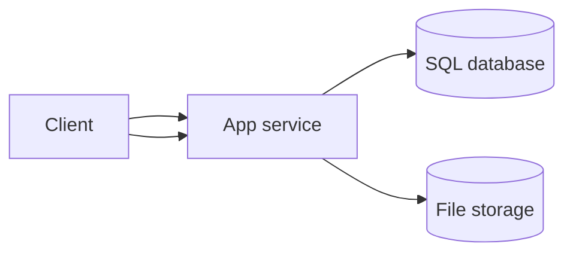
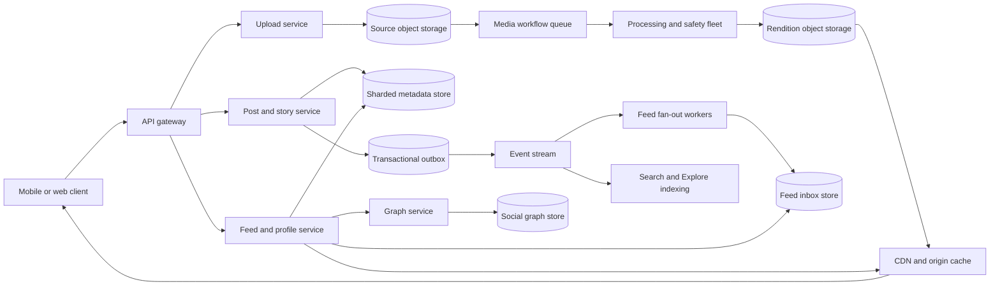
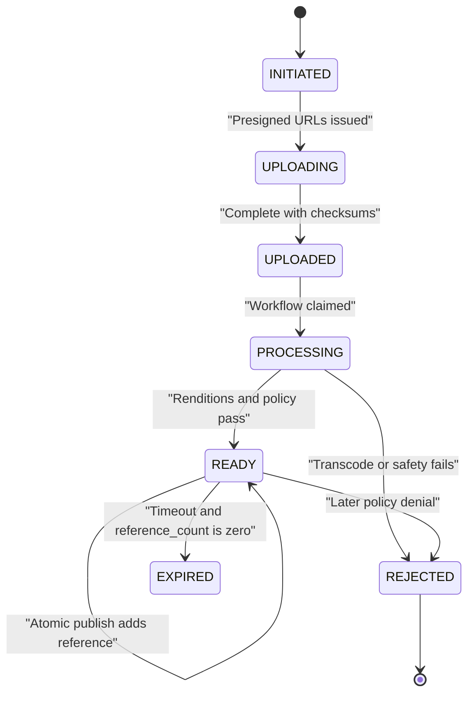
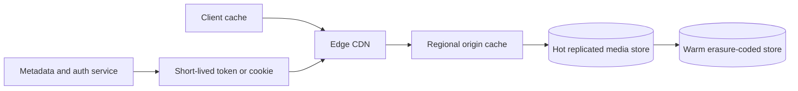
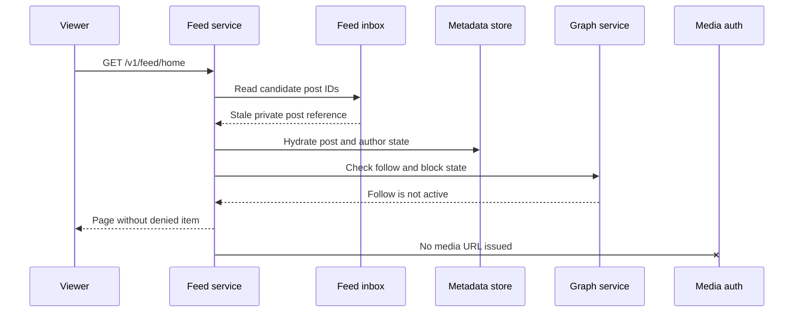

# Instagram System Design

Instagram is a media-first social platform where people upload photos, carousels, short videos, and stories, then consume them through profiles, home feed, stories, search, and Explore. This design focuses on posts, stories, media processing, media delivery, metadata, privacy, and high-level feed integration; direct messaging and the full ranking science of a news feed are out of scope and are referenced through the sibling [News Feed](./news-feed-system-design.md) design.

## 1. Requirements

### 1.1 Functional requirements

- Users can upload photos, carousels, and short videos, see processing status, and publish only media that is ready and policy-eligible.
- Users can follow public accounts, request private accounts, block accounts, and have those relationships enforced on profiles, feeds, stories, search, and media URL issuance.
- Users can view profile grids, home feed items, stories, Explore, hashtags, and search results with cursor-based pagination.
- Users can like, save, comment, mention, report, delete, and edit metadata such as captions without mutating immutable media bytes.
- Creators can publish ephemeral stories that expire after 24 hours and can inspect bounded story view information.
- The system emits events for feed fan-out, Explore/search indexing, notifications, counters, moderation, deletion, and analytics.

### 1.2 Non-functional requirements

- **Low media latency.** The product feels broken if thumbnails or videos start slowly, so media bytes must be served from layered caches and CDNs rather than application servers.
- **Durable originals.** A successfully uploaded original is user-created content; losing it is worse than losing a derived thumbnail, so originals need stronger durability than regenerable renditions.
- **Correct privacy.** Private accounts, blocks, deletion, story expiration, and policy takedowns must be enforced by canonical metadata checks even when feed inboxes, search indexes, or CDNs are stale.
- **Read-heavy availability.** Viewing dominates posting, so profile, feed, story, and media reads should degrade to safe fallbacks when ranking, counters, or recommendation systems fail.
- **Asynchronous completion.** Uploading bytes, transcoding video, safety checks, and fan-out cannot fit inside one synchronous request, so clients need idempotent mutation APIs and status resources.
- **Cost-aware storage and bandwidth.** Media bytes dominate cost; the architecture must separate hot replicated media from cooled erasure-coded media and maximize cache hits before scaling origin storage.

### 1.3 The binding constraint

The binding constraint is that media bytes dominate cost and bandwidth while metadata and the social graph dominate correctness. A photo or video view mostly consumes CDN and storage resources, but whether that view is allowed depends on small, fast-changing records: follow state, blocks, deletion, policy, expiration, and account status. Treating media and metadata as one transactional object would make every byte path slow and expensive. Treating them as fully independent would leak private or deleted content.

That tension forces three mechanisms. First, uploads go directly to object storage through presigned sessions, then an asynchronous workflow publishes immutable renditions only after processing and safety checks. Second, media storage uses cache hierarchy and hot-to-warm tiering because most user-visible cost is repeated byte delivery. Third, metadata IDs and indexes are shard-aware, while feed and Explore receive references through events and always recheck canonical authorization before issuing media URLs.

## 2. Back-of-the-envelope estimation

Assumptions here are illustrative, not claims about the real Instagram. Suppose the service has 500 million daily active users and 100 million permanent posts per day. The average write rate is `100M / 86,400 = 1,157` posts/s. If daily activity peaks at 5x, publication sees about `1,157 × 5 = 5,785` posts/s before stories and engagement. That is large but not the hardest number; it is tractable with sharded metadata and append-only event logs.

Stories add a different write shape. If users publish 500 million stories per day, the average is `500M / 86,400 = 5,787` stories/s and a 5x peak is about `28,935` stories/s. Stories are short-lived, so the design should avoid copying each story to every follower inbox. Per-author story indexes plus per-viewer tray projections are cheaper than materializing every story item to every follower.

Media views dominate serving. With 20 billion media views per day, average view traffic is `20B / 86,400 = 231,481` views/s. At 5x peak that is roughly `1.16M` media views/s. If an average rendered view transfers only 500 KB after adaptation, CDN egress at peak is `1.16M × 500KB = 580GB/s`, far beyond what the app tier should ever proxy. The API should return metadata and short-lived media authorization; clients fetch bytes from CDN and origin caches.

Storage is also byte-led. If permanent posts are 70% photos at 3 MB and 30% videos at 20 MB, daily source ingest is `70M × 3MB + 30M × 20MB = 810TB` before replicas. If derived renditions average 2x the source size across thumbnails, WebP/AVIF variants, posters, and video ladders, the system writes another `1.62PB` per day. This pushes originals and fresh renditions into hot replicated storage, then moves cooled immutable objects to erasure-coded warm storage.

Fan-out is the hidden multiplier. If an ordinary author has 300 followers, naive push fan-out for 100 million posts creates `100M × 300 = 30B` feed inbox inserts per day, or `347,222` inserts/s on average. That is plausible with batching and sharded inboxes, but a single account with 100 million followers would create 100 million inserts for one post. Celebrity posts must use pull-on-read or a hybrid strategy, not pure push.

> **Key idea.** The architecture is not primarily CPU-bound by post creation. It is byte-bound on media delivery, write-amplified by fan-out, and correctness-bound by small metadata decisions that must be rechecked after every stale projection.

## 3. API design

**Question.** What makes upload and publish retries safe when the client is on an unreliable mobile network?
<details><summary>Answer</summary>

The client gets an idempotent upload session, uploads parts directly to object storage, and publishes through a separate idempotent request that only accepts media in a ready, policy-eligible state. Retrying upload completion returns the same `media_id`; retrying publish with the same idempotency key returns the same `post_id` instead of creating duplicates.

</details>

```http
POST /v1/media/uploads
Idempotency-Key: <client-uuid>
Body: {"content_type":"video/mp4","size_bytes":25165824,"checksum":"sha256:..."}

PUT <signed_part_url>
Headers: Content-Range: bytes 0-8388607/25165824

POST /v1/media/uploads/{upload_id}/complete
Body: {"parts":[{"part":1,"checksum":"sha256:..."}]}

GET /v1/media/{media_id}/status
Response: {"state":"PROCESSING|READY|REJECTED","renditions":[...],"reason_code":"..."}

POST /v1/posts
Idempotency-Key: <client-uuid>
Body: {"media_ids":["m..."],"caption":"...","audience":"FOLLOWERS"}

GET /v1/feed/home?cursor=<opaque>&limit=20
GET /v1/users/{user_id}/posts?cursor=<opaque>&limit=30
POST /v1/stories
DELETE /v1/posts/{post_id}
PUT /v1/users/{user_id}/follow
PUT /v1/users/{user_id}/block
```

The upload API deliberately separates bytes from metadata. The media service returns presigned part URLs and records the expected size, content type, owner, checksum, and expiration. The object store receives the body; the app service receives completion metadata and verifies checksums before moving the asset to `PROCESSING`. A synchronous `POST /posts` that accepted a multipart video would tie mobile retries, video transcode time, and app worker memory together. Returning `202 Accepted`-style processing status keeps the app tier small and lets users leave and resume.

Publish is a second transaction because a post is a social object, not just a file. It checks that every `media_id` is owned by the author, has not expired as an unattached draft, is `READY`, and has an active policy decision. The idempotency key is scoped to `(user_id, operation, client_key)`, stores the request hash, and returns the original response for exact retries. If the same key is reused with different media IDs, the server rejects it rather than guessing client intent.

Read APIs use cursors instead of offsets. A feed can change between page one and page two because new posts arrive, ranking features update, and deletions happen. The cursor encodes a signed feed session, candidate watermark, last score and ID, model version, served-ID-set reference, and expiration. It does not grant access; each page still filters blocks, deletion, private-account state, age/regional policy, and story expiration before issuing media URLs.

Delete APIs create tombstones and invalidation events. They need not synchronously purge every byte cache or feed inbox, but access revocation must fence the serving authorization path before success is reported. Canonical metadata denies hydration and token renewal, and the edge rejects new byte requests under revoked grants as described below. Purging cached objects is asynchronous cleanup, not the authorization mechanism. Content already downloaded, and requests authorized before the fence, cannot be recalled.

## 4. Data model

Start with the obvious entity, `Post`, containing an author, caption, and media URL. That fails as soon as video processing is asynchronous. A URL might point to an untranscoded, unsafe, or not-yet-replicated object. The fix is to split `MediaAsset` from `Post`: media has an upload and processing lifecycle; post has a publication and social lifecycle.

A single `MediaAsset` is still not enough because one source file produces many immutable variants. Mobile feed thumbnails, profile-grid squares, high-resolution photos, video posters, and adaptive video segments have different formats and cache behavior. That introduces `MediaRendition`, keyed by deterministic object keys and checksums. The post points to media IDs and ordering, while the serving layer chooses renditions based on device, network, and policy.

A post with an `audience` field also cannot by itself enforce privacy. Private-account access depends on a relationship that changes after the post enters feed inboxes or search indexes. The graph therefore needs canonical `FollowEdge` and `BlockEdge` records. Feed, story, search, notification, and Explore projections may contain stale references, but serving treats those references as candidates and rechecks graph state.

Stories look like posts with expiration until viewer behavior is added. A story tray ranks authors, a story expires logically at `expires_at`, and read receipts may be visible to the author for a bounded period. Stories therefore share media assets but use separate `Story`, `StoryViewEvent`, and active-story indexes. Expiration is a read-time predicate, not just a cleanup job.

Engagement should not be stored as counters on `Post`. A viral post would make one counter row hot, duplicate like events would inflate counts, and deletes would race with delayed updates. The canonical action is an `Engagement` uniqueness record such as `(user_id, target_id, type)`. Counts are projections built from idempotent events and can be approximate or slightly stale.

Instagram's production ID design is directly relevant. Their shard-aware IDs used time, logical shard, and per-shard sequence bits so IDs were roughly sortable without a central sequence. This design uses the same principle: post, story, media, and comment IDs should include or cheaply map to a shard and creation time. Profile grids, backfills, and hot-path hydration then route to the right shard without an extra lookup service.

```text
User(user_id, username, account_type, status, profile_media_id, version)
FollowEdge(follower_id, followee_id, state, created_at, version)
BlockEdge(blocker_id, blocked_id, created_at)

MediaAsset(media_id, owner_id, upload_id, source_object_key, state,
           width, height, duration_ms, content_hash, policy_state, version, reference_count)
MediaRendition(rendition_id, media_id, format, width, height, bitrate,
               object_key, checksum, storage_tier, created_at)

Post(post_id, author_id, type, caption, audience, location_id,
     moderation_state, created_at, edited_at, deleted_at, version)
PostMedia(post_id, media_id, position)

Story(story_id, author_id, media_id, audience, created_at, expires_at, deleted_at)
StoryViewEvent(story_id, viewer_id, viewed_at)

FeedInboxEntry(viewer_id, time_bucket, post_id, author_id, published_at, fanout_version)
Engagement(user_id, target_id, type, created_at)
Comment(comment_id, post_id, parent_comment_id, author_id, body, moderation_state, created_at)
OutboxEvent(event_id, aggregate_type, aggregate_id, version, payload, created_at)
```

Canonical users, posts, media lifecycle, follows, blocks, and idempotency records live in sharded transactional stores because ownership, deletion, privacy, and readiness need conditional updates and read-your-writes behavior. Feed inboxes, story trays, notifications, counters, search indexes, and Explore candidates live in rebuildable key-value or search stores because they are projections. Media bytes live in object/blob storage and CDN; large bodies deliberately do not go in the transactional store. Feed inboxes and graph projections need p99 and p999 objectives, not only average latency: Instagram's Rocksandra work showed how JVM garbage collection and compaction can dominate tail latency in online key-value paths.

> **Key idea.** Store the small facts that grant authority in canonical shards; store copied references and counters as disposable projections; store immutable media bytes in systems optimized for bandwidth and cache locality.

## 5. High-level design

The simplest design is a web service that accepts media upload, writes a post row with a media path, and lets followers query recent posts from followed authors.



That design breaks in five concrete ways. App workers become byte proxies and collapse under video upload and download bandwidth. Posts can reference files that are not transcoded, replicated, or safety-checked. Feed reads become graph joins over hundreds of authors for every request. One celebrity post can overload a single fan-out partition. Finally, stale indexes or CDN URLs can expose private, blocked, deleted, or expired media unless metadata remains authoritative.

### Fix 1: Direct upload plus asynchronous media workflow

The client uploads bytes directly to object storage through presigned, resumable part URLs. The media service owns only upload sessions, checksums, state transitions, and workflow events. Processors create image variants, video ladders, posters, thumbnails, perceptual hashes, and safety decisions. A post can reference the media only after a conditional state transition marks the asset `READY`. This removes app servers from the byte path and gives the system a place to retry expensive work.

### Fix 2: Immutable media delivery through cache hierarchy

Derived media objects are immutable and versioned, so CDN object caches can use long shared TTLs independently of access grants. Even currently public media needs an edge policy gate if it can later become private or be taken down. Private media additionally requires a viewer-scoped grant. Short-lived signatures limit exposure but do not alone revoke existing URLs. Facebook's photo caching work motivates cache hierarchy and origin shielding; the authorization protocol here is this design's proposal, not an attribution to that stack.

### Fix 3: Sharded metadata with an outbox

Post creation commits the post, media ordering, idempotency record, and outbox event together. The event log then drives feed fan-out, search, Explore, notifications, counters, and deletion workflows. If a relay crashes after the commit, the outbox row remains and is republished. If a consumer sees the event twice, it uses event IDs and aggregate versions to make the update idempotent. This is the boundary between strongly consistent canonical state and eventually consistent projections.

### Fix 4: Hybrid feed fan-out

Ordinary authors are pushed into follower inboxes because it makes read latency predictable. High-fan-out authors are pulled at read time from their author timelines because pushing to tens of millions of inboxes per post is wasteful and bursty. The feed service merges materialized inbox entries, pulled celebrity timelines, and recommendation candidates, then delegates full ranking mechanics to the [News Feed](./news-feed-system-design.md) architecture. The important Instagram-specific rule is that candidates are references, not access grants.

### Fix 5: Final authorization before media URL issuance

Every read path hydrates canonical metadata before returning a playable media URL. The checks include post deletion, moderation state, account status, follow state, block state, story expiration, close-friends membership, and regional policy. The CDN repeats grant/policy validation before serving bytes, including cache hits; direct origin access is denied. A stale inbox reference or copied URL is not proof of current access. On uncertain authorization, serving fails closed.

### Putting it together



A publish begins with an upload session and direct object-store writes. Completion emits a media workflow job. The processing fleet writes immutable renditions and updates `MediaAsset` state with a compare-and-set on version. `POST /posts` then validates ownership and readiness, commits `Post` and `PostMedia`, and records an outbox event. Fan-out workers update ordinary follower inboxes; search and Explore update their indexes; notifications and counters update asynchronously. On read, the feed/profile/story service fetches candidate IDs, hydrates canonical metadata, asks the graph service for current authorization, and only then returns rendition descriptors and signed media access.

> **Key idea.** Each component traces back to a specific failure of the naive design: byte overload, unsafe publication, projection loss, celebrity skew, or stale authorization.

## 6. Deep dives

### 6.1 Media upload, processing, and safe publication

**Question.** The client completes a video upload, immediately retries publish twice, and the transcoder later rejects the source. What state is the post in?
<details><summary>Answer</summary>

There is no published post. Upload completion creates a `MediaAsset` in `PROCESSING`; publish returns a retryable “media not ready” status until processing reaches `READY`. If safety or transcode rejects the source, the asset becomes `REJECTED`, future publish attempts fail deterministically, and idempotency prevents duplicate posts from repeated client requests.

</details>

The tempting design is to let `POST /posts` accept a file and publish as soon as the upload finishes. That works for small photos in a toy system, but video breaks it. A 25 MB mobile upload can pause for minutes, transcode can take longer than the request timeout, decoders can crash on malformed files, and safety classifiers can reach a different decision than the MIME type suggests. If the post becomes visible before this work completes, followers can request media that does not exist, see unmoderated content, or cache a rendition that later should never have been served.

The production mechanism is a small state machine around `MediaAsset`: `INITIATED -> UPLOADING -> UPLOADED -> PROCESSING -> READY` or `REJECTED`. Upload URLs are scoped to one user, session, part, size, and expiration. Completion verifies parts and total checksum, pins an immutable source object version, and commits `UPLOADED` with its workflow outbox event. A still-valid upload URL must not overwrite the source that was scanned. The workflow probes, normalizes, creates renditions, and runs safety classifiers. Outputs use write-once versioned or content-addressed keys, so a stale worker cannot overwrite published bytes; metadata CAS on the attempt/version rejects stale success reports. Deterministic naming alone does not make nondeterministic encoders safe to retry.



Publication is then a conditional metadata transaction, not a media operation. It locks or conditionally updates every referenced media row, checks ownership, `READY`, `ALLOW`, and draft expiry, adds durable references, and commits `Post`, `PostMedia`, idempotency, and outbox together. Expiration and policy updates serialize on those same rows; a strong read followed by a separate post insert would still race draft GC. Keep these rows in the author's transactional shard or use a real distributed transaction. Story publication follows the same protocol. Readiness and attachment are separate: an asset can remain `READY` while referenced by both a post and a story, and expiration requires zero references. A validated minimal rendition may permit publication before premium variants finish; the unvalidated source is never a serving fallback.

Failure modes are mostly about races. The user may delete a draft while processing is running; processors should still finish or stop safely, but a final compare-and-set should not resurrect an expired asset. The workflow may publish output and crash before updating state; a retry sees deterministic output keys and continues. A moderation model may later reclassify the media; that creates a policy update event and invalidates serving, but it does not mutate cached bytes. A client may reuse an idempotency key with different media IDs; the idempotency table must reject the mismatch.

The alternative is synchronous processing for photos and asynchronous only for videos. That can reduce perceived latency for small images, but it complicates the API and still needs the same state machine for retries, safety, and downstream fan-out. A cleaner design lets all media use the same lifecycle while optimizing fast paths inside the workflow.

Signals worth watching: upload abandonment, checksum failures, workflow queue age, time to `READY`, rejection rate by reason, retry counts, processor crash loops, and attempts to publish non-ready media.

> **Strong-answer criteria.** A senior answer separates source upload from publication, names the media state machine, makes processing idempotent, and explains why policy eligibility is checked before post commit.

| Level | Approach | Why |
|---|---|---|
| Bad | Publish as soon as the file upload finishes. | It exposes unprocessed, unsafe, or missing renditions and makes retries duplicate social objects. |
| Good | Use async processing and let clients poll media status. | It handles latency but may still miss idempotency, ownership checks, and publish-time CAS. |
| Great | Direct resumable upload, deterministic processing, policy-gated `READY`, idempotent publish, and conditional transitions. | It survives mobile retries, worker crashes, unsafe inputs, and races between expiration, delete, and publish. |

### 6.2 Media storage and delivery: hot bytes, warm bytes, and cache hierarchy

**Question.** Why not store every rendition as a normal object and scale origin storage whenever CDN misses rise?
<details><summary>Answer</summary>

Because media cost is dominated by repeated reads of immutable bytes, not by metadata rows. The system should first maximize browser, edge, and regional-origin cache hits, then store hot media in replicated low-latency storage and migrate cooled immutable blobs to erasure-coded warm storage behind stable media handles.

</details>

The naive storage design treats each thumbnail, photo, poster, and video segment as an independent object in one flat bucket. It is simple, but it ignores two facts. First, a feed page may request dozens of small thumbnails where filesystem or object metadata I/O can dominate. Second, popularity is extremely skewed: fresh posts, celebrity posts, and viral videos are read heavily for a short time, while old media must remain durable but is rarely fetched. Scaling one storage tier for both patterns wastes money.

Facebook's Haystack lesson is that photo-serving systems can drown in metadata operations. Haystack packed many photos into large append-only files and kept tiny offset metadata in memory, avoiding repeated filesystem metadata lookups. An Instagram-like system does not need to literally copy that implementation if it uses modern object storage, but it should preserve the shape: immutable blobs, compact indexes, checksums, tombstones, and compaction. Small renditions should not require expensive per-file metadata work on every miss.

The serving path is a hierarchy. The app returns a rendition manifest and grant; the client asks its local cache, edge CDN, regional origin cache, hot storage, then warm storage. Facebook's photo caching work motivates absorbing most requests before backend storage. Long CDN object TTLs are separate from grant validity: the edge checks access before using a shared immutable-object cache key. Bytes already in a viewer's local cache are outside server revocation control.



Hot-to-warm tiering follows media lifecycle. New uploads, recent posts, and viral media stay in hot replicated storage because they need high read throughput and low tail latency. Cooled originals and old renditions move to erasure-coded warm storage. Facebook's f4 warm BLOB system showed that immutable blobs can be stored more cheaply with erasure coding while preserving user-visible reads. The handle seen by metadata does not change; only the storage tier behind it changes. A cache miss for warm media may be slower, but the CDN can refill and shield repeated reads.

Private media creates the hardest trade-off. Issuance-time authorization and short-lived signed URLs alone leave a replay window after removal; CloudFront's documented signature expiry, for example, is not a check of this application's follow graph. To meet this design's stronger promise, bind grants to viewer, resource, and authorization versions, cap story grants at `expires_at`, and validate them on every byte request at the edge. The edge uses the current authorization authority or a registered revocable lease; a revocation fences lease holders or waits for their leases to expire before reporting enforcement, and disconnected holders stop serving at lease expiry. Origins accept requests only from this protected path. Purges reclaim caches but cannot substitute for access checks, because an old URL could refill a purged object. This is a proposed protocol, not a claim that ordinary CDN signatures implement it.

Deletion is also a metadata-first operation. The post is tombstoned, URL renewal stops, search/feed projections are invalidated, and media enters a conservative garbage-collection workflow. Physical bytes are deleted only after checking references from posts, stories, drafts, archives, messages, legal holds, and safety retention. Derived renditions are regenerable; originals may have stricter retention or export requirements.

Signals worth watching: CDN hit ratio by surface, origin cache hit ratio, warm-store recall latency, hot-tier bytes by age, video startup time, rebuffering, signed URL denial rates, purge lag, and backend requests per media view.

> **Strong-answer criteria.** A senior answer treats CDN and tiering as core architecture, distinguishes original durability from derived rendition regeneration, and explains how private authorization avoids proxying bytes through app servers.

| Level | Approach | Why |
|---|---|---|
| Bad | Store files on app servers or proxy all media through the API. | App workers become the bottleneck and media bandwidth dominates cost. |
| Good | Put immutable renditions in object storage behind a CDN. | It handles most public reads but may ignore hot/cold skew and private authorization. |
| Great | Layer client/edge/origin caches, use Haystack-like compact blob storage, tier hot to f4-like warm storage, and issue short-lived authorized access. | It optimizes the actual cost driver while preserving deletion and privacy semantics. |

### 6.3 Shard-aware metadata IDs and correctness under stale projections

**Question.** A private account removes a follower after a post was already copied into that follower's feed inbox. Can the follower still open the media?
<details><summary>Answer</summary>

Newly authorized reads are denied after the removal fence. The feed suppresses the stale reference, and the edge rejects reuse of an older grant under the revoked relationship version. Issuance-time checks alone would not stop replay of a previously issued URL. Already downloaded bytes cannot be recalled.

</details>

Metadata is small compared with media, but it is where correctness lives. The naive approach is to partition posts by author, feed inbox by viewer, and rely on projections being updated quickly. That fails whenever projections lag. A private follower can be removed, an account can block another, a story can expire, a post can be deleted, or a safety system can takedown media while stale references remain in inboxes, search indexes, caches, notifications, or Explore candidate stores.

The first requirement is routable identity. Instagram's shard-aware ID scheme avoided a central ID generator by combining time, shard ID, and sequence bits inside PostgreSQL shards. This design uses the same idea so `post_id`, `media_id`, `story_id`, and `comment_id` tell services where to route or can be mapped with a cheap directory. Time order also makes profile grids and backfills efficient. The exact bit split is an implementation detail; the property matters more than the constants: no global sequence bottleneck, rough chronological sort, and shard locality.

The second requirement is a canonical authority for relationships and object state. `FollowEdge(follower_id, followee_id)` and `BlockEdge(blocker_id, blocked_id)` are not optional caches. Private follow acceptance is a state-machine transition from `REQUESTED` to `ACTIVE`, authorized by the private account owner and protected with version checks. Blocks synchronously update the deny path because block correctness is more important than asynchronous cleanup speed. Deletions create tombstones with monotonically increasing versions so delayed events cannot resurrect a post in a projection.



The third requirement is projection discipline. Feed inboxes, story trays, search indexes, notification inboxes, and Explore candidates are rebuildable. They store enough data to serve fast candidates, but they do not make final decisions. Consumers process outbox events with event IDs and aggregate versions. If `PostDeleted(v7)` arrives before a delayed `PostUpdated(v6)`, the consumer keeps the tombstone. If fan-out misses an event, replay from the log or backfill from author timelines can repair the inbox. If an index is stale, the read path filters it.

This is also where tail latency matters. Metadata reads are on the critical path for media URL issuance. Instagram's Rocksandra work is a warning that a key-value store can meet average latency goals while p99 reads spike due to garbage collection or compaction. Feed inboxes, graph projections, and notification stores should use bounded partitions, request hedging or coalescing around hot keys, compaction-aware storage engines, and p99/p999 alerts. For a celebrity profile or viral post, avoid making one partition serve every read; shard reverse follower lists and engagement streams into stable buckets.

There are trade-offs. Rechecking authorization on every item costs CPU and storage reads, so the system should batch graph checks, cache negative and public-account results briefly, and precompute viewer-scoped summaries. But stale cache entries cannot be the sole proof for private content. When the graph store is uncertain, public content may degrade to cached metadata, but private content fails closed.

Signals worth watching: stale-reference suppression rate, unauthorized media URL attempts, graph check latency, block propagation latency, follow state-machine conflicts, projection lag, tombstone replay counts, and p99/p999 metadata tail latency.

> **Strong-answer criteria.** A senior answer distinguishes candidate projections from canonical authorization, uses shard-aware IDs to avoid routing bottlenecks, and explicitly fails closed for private content.

| Level | Approach | Why |
|---|---|---|
| Bad | Trust feed/search indexes because they are usually fresh. | Projection lag leaks private, blocked, deleted, or expired content. |
| Good | Recheck post deletion and private account state on feed reads. | It improves privacy but may miss ID routing, event versions, blocks, and tail-latency pressure. |
| Great | Use shard-aware IDs, canonical graph/object state, versioned outbox events, stale-reference filtering, and deny-by-default private authorization. | It keeps fast projections safe without making them the source of truth. |

### 6.4 Home feed and Explore integration without repeating the feed system

**Question.** Where should Instagram-specific design stop and the generic news-feed design begin?
<details><summary>Answer</summary>

Instagram should define candidate sources, media hydration, privacy checks, and media-specific ranking constraints, then delegate generic fan-out, ranking sessions, deduplication, and pagination mechanics to the news-feed architecture. The integration point is a candidate reference plus metadata and media features, not raw bytes.

</details>

A photo platform is not only a news feed, but the home feed is still a major read path. The mistake is to spend the whole Instagram design rebuilding a feed-ranking system and ignore media lifecycle. The right boundary is that Instagram produces safe, hydrated candidates with media descriptors, and the [News Feed](./news-feed-system-design.md) design handles fan-out strategy, ranking sessions, cursor semantics, and pagination stability.

Home feed candidates come from four sources. First, materialized inbox entries from ordinary followed accounts provide low-latency baseline content. Second, pull-on-read author timelines cover celebrities and accounts whose fan-out cost is too high. Third, Explore-style recommendation sources provide unconnected or suggested posts. Fourth, ads or commerce modules may insert separately governed inventory. The feed service deduplicates by `post_id`, filters canonical eligibility, fetches media and author features, applies ranking, then returns rendition manifests.

Explore has a different contract. It searches a much larger inventory, so it needs staged retrieval and ranking. Instagram's Explore engineering has described mechanisms such as account and media embeddings, nearest-neighbor retrieval, model distillation, and multi-stage funnels. Meta's newer Explore descriptions add Two Tower retrieval, cached item embeddings, online user embeddings, ANN lookup, off-peak precomputation, multi-task scoring, and final integrity/diversity reranking. The architectural lesson is not a specific model; it is that retrieval must be bounded before online ranking, and policy filtering must happen early and again before serving.

Suggested posts inside home feed need a product constraint: they should feel adjacent to what the user follows. Instagram's Suggested Posts work distinguished connected and unconnected recommendations, using seeds from user activity, account/media KNN, co-occurrence, graph exploration, popular-media fallbacks, and negative feedback. In this design, recommendation candidates carry provenance and reason codes so ranking can blend them conservatively with followed content and suppress them when the user asks for less.

The media platform adds constraints that a text-oriented feed may not. Ranking should know whether a candidate has a playable rendition for the device and network. It should avoid returning ten heavy videos to a user on constrained bandwidth if lightweight alternatives exist. It should include integrity state, creator diversity, media-type diversity, freshness, and viewer feedback. If the online feature store or heavy model fails, the system returns recent followed posts with ready media; it does not block the core feed on every ML dependency. Instagram's reported model-operations work around model registries, launch automation, criticality tiers, and stability SLOs reinforces this: ranking models are production dependencies that need rollback and health policy.

Signals worth watching: candidate counts by source, empty-feed rate, recommendation fallback rate, duplicate suppression, media-not-ready candidates, model criticality violations, Explore policy-filter rate, and user negative-feedback rate.

> **Strong-answer criteria.** A senior answer avoids duplicating the full feed design, but still names candidate contracts, hybrid push/pull boundaries, media hydration, early policy filtering, and graceful ranking fallback.

| Level | Approach | Why |
|---|---|---|
| Bad | Say “use ML ranking” after fan-out. | It misses candidate generation, media readiness, policy, and fallback behavior. |
| Good | Merge followed posts, celebrity pulls, and recommendations. | It covers sources but may not define the contract with media and authorization. |
| Great | Integrate with the news-feed design through safe candidate references, staged retrieval, media-aware hydration, final auth checks, and model fallback tiers. | It keeps Instagram-specific complexity clear without repeating a separate system. |

## 7. Variants

**10x scale.** At 10x, media views reach about `200B/day`, or `2.31M` average views/s and `11.57M` views/s at a 5x peak. The metadata design stays similar, but CDN contracts, regional origin shielding, tiering automation, and cache-aware encoding become existential. Feed fan-out thresholds move downward because write amplification becomes more expensive. More recommendation and Explore work shifts to offline precomputation, but final authorization remains online.

**Multi-region active-active.** Reads, uploads, and CDN delivery can be active-active, but canonical mutations need clear ownership. Route user/profile/post mutations to a home region or a globally consistent shard; replicate originals asynchronously after durable local write; fence the old writer during failover. Counters, Explore, and search may be stale across regions. Follow approval, block, deletion, and private media authorization must not accept conflicting writes.

**A Reels-heavy product shift.** If short video dominates, source ingest and derived ladders grow faster than post QPS. The upload workflow adds more compute scheduling, hardware transcode pools, codec negotiation, and demand-aware ladder generation. Feed ranking also becomes more sensitive to video startup time and rebuffering. The metadata model still works because posts reference media assets and renditions rather than embedding byte details.

**Strict regional residency.** If certain users' media and metadata must remain in-region, upload sessions choose compliant origins, source replication excludes disallowed regions, and feed/search projections carry residency labels. Global Explore can rank metadata references only when policy permits, and media URL issuance must choose an allowed CDN/origin path. The same final authorization mechanism becomes the enforcement point for geography.

## 8. The transferable pattern

This is the pattern of a byte-heavy social system with correctness-heavy metadata. The large objects are immutable, cached, and tiered; the small records are versioned, sharded, and authoritative; derived indexes are fast but disposable. Similar shapes appear in YouTube-like video systems, TikTok-like short-video feeds, Pinterest-like media boards, and file-sharing products where a link or preview is cheap but authorization to fetch bytes is not.

The feed side is a sibling pattern rather than the whole system. Use [News Feed](./news-feed-system-design.md) for fan-out, ranking-session cursors, deduplication, and pagination mechanics; use this Instagram design for upload lifecycle, rendition storage, CDN authorization, and media-aware candidate hydration. The transferable rule is to ask what must be true before issuing a byte URL, then make every cache and projection subordinate to that truth.

## Review

The design starts from the constraint that media bytes dominate cost while metadata and graph state dominate correctness. That leads to direct resumable upload, asynchronous processing, immutable renditions, and publish only after readiness and safety checks. It separates authoritative metadata from rebuildable projections, uses shard-aware IDs to avoid global routing bottlenecks, and relies on outbox events for fan-out, search, Explore, notifications, counters, and deletion. Media delivery is a cache hierarchy with hot replicated storage and f4-like warm tiering, inspired by Haystack and Facebook photo caching lessons. Feed and Explore receive safe candidate references and recheck authorization before media URL issuance, so stale projections degrade relevance rather than privacy.

### Check your understanding

1. Why is `MediaAsset` separate from `Post`?
   <details><summary>Answer</summary>

   Because upload, transcode, rendition generation, and safety checks complete asynchronously and can fail. A post is a social object that should only reference media after the asset is ready and policy-eligible.

   </details>

2. Why are feed inbox entries not treated as proof of access?
   <details><summary>Answer</summary>

   They are staleable projections. A private follow, block, deletion, story expiration, or policy decision can change after fan-out, so serving must recheck canonical metadata and graph state before issuing media URLs.

   </details>

3. What does shard-aware ID generation buy beyond uniqueness?
   <details><summary>Answer</summary>

   It avoids a central sequence service, preserves rough time order, and lets services route post/media/story/comment operations to the owning shard without an expensive lookup on hot paths.

   </details>

4. Why does media storage need hot-to-warm tiering?
   <details><summary>Answer</summary>

   Fresh and viral media need replicated low-latency throughput, while old immutable blobs need durable cheap storage. Erasure-coded warm tiers reduce cost without changing the media handles used by metadata and caches.

   </details>

5. How should Explore integrate with the rest of the design?
   <details><summary>Answer</summary>

   Explore should provide bounded, policy-filtered candidate references using embeddings, ANN retrieval, and staged ranking. The serving path still hydrates canonical metadata, checks authorization, and returns media renditions only for eligible items.

   </details>

## Sources and further reading

| Source | Article | Why it matters |
|---|---|---|
| Instagram Engineering | [Sharding & IDs at Instagram](https://medium.com/instagram-engineering/sharding-ids-at-instagram-1cf5a71e5a5c) | Shows time-sortable shard-aware IDs without a central ID service. |
| Instagram Engineering | [Open-sourcing a 10x reduction in Apache Cassandra tail latency](https://medium.com/instagram-engineering/open-sourcing-a-10x-reduction-in-apache-cassandra-tail-latency-d64f86b43589) | Explains Rocksandra and why p99/GC behavior matters for online key-value stores. |
| Meta Engineering | [Needle in a haystack: efficient storage of billions of photos](https://engineering.fb.com/2009/04/30/core-infra/needle-in-a-haystack-efficient-storage-of-billions-of-photos/) | Details append-only photo storage with compact in-memory indexes to avoid metadata I/O. |
| Meta Engineering | [An analysis of Facebook photo caching](https://engineering.fb.com/2014/02/27/web/an-analysis-of-facebook-photo-caching-2/) | Quantifies browser, edge, origin, and backend cache effects for photo serving. |
| Facebook / USENIX | [f4: Facebook's Warm BLOB Storage System](https://www.usenix.org/system/files/conference/osdi14/osdi14-paper-muralidhar.pdf) | Shows how to tier cooled immutable media into erasure-coded warm storage. |
| Meta AI | [Powered by AI: Instagram’s Explore recommender system](https://ai.meta.com/blog/powered-by-ai-instagrams-explore-recommender-system/) | Gives concrete Explore mechanisms: IGQL, embeddings, distillation, and staged ranking. |
| Meta Engineering | [Scaling the Instagram Explore recommendations system](https://engineering.fb.com/2023/08/09/ml-applications/scaling-instagram-explore-recommendations-system/) | Updates Explore with Two Tower retrieval, ANN, precomputation, MTML ranking, and reranking. |
| Meta Engineering | [How Instagram suggests new content](https://engineering.fb.com/2020/12/10/web/how-instagram-suggests-new-content/) | Covers suggested-post seed selection, cold start, value models, and “Feels Like Home” constraints. |
| Meta Engineering | [Journey to 1000 models: Scaling Instagram’s recommendation system](https://engineering.fb.com/2025/05/21/production-engineering/journey-to-1000-models-scaling-instagrams-recommendation-system/) | Shows model registry, launch automation, criticality, and stability SLOs for large ML fleets. |
| Meta Engineering | [Introducing Immortal Objects for Python](https://engineering.fb.com/2023/08/15/developer-tools/immortal-objects-for-python-instagram-meta/) | Explains Instagram's Python/Django serving model and memory-efficiency work at scale. |
| AWS | [CloudFront signed URLs](https://docs.aws.amazon.com/AmazonCloudFront/latest/DeveloperGuide/private-content-signed-urls.html) | Defines signature validity and request-time expiry; does not provide application relationship revocation. |
| AWS | [Restrict access to an S3 origin](https://docs.aws.amazon.com/AmazonCloudFront/latest/DeveloperGuide/private-content-restricting-access-to-s3.html) | Prevents direct origin requests from bypassing the CDN access path. |
| AWS | [Uploading objects with presigned URLs](https://docs.aws.amazon.com/AmazonS3/latest/userguide/PresignedUrlUploadObject.html) | Warns that a PUT can replace an existing key, motivating immutable source versions and write-once published outputs. |
