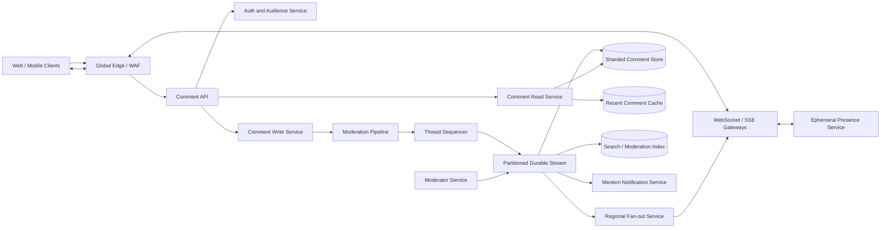

# Live Comments Real-Time System

## 1. Requirements

### Functional requirements

1. Post, edit, and delete comments on a live stream, article, sports event, or shared object.
2. Deliver new comments to connected viewers in near real time.
3. Support threaded replies, reactions, mentions, and pinned comments.
4. Provide stable pagination for recent and historical comments.
5. Show a consistent ordering appropriate to the product.
6. Enforce rate limits, blocked-user lists, and audience permissions.
7. Detect spam, abuse, and unsafe content before or shortly after publication.
8. Allow moderators to hide, restore, pin, slow, or lock discussion.
9. Let disconnected clients resume without missing durable comments.
10. Show aggregate counts and optional presence/typing indicators.

### Non-functional requirements

- In-region p95 post-to-visible latency under 300 ms.
- No acknowledged durable comment may be lost.
- Per-thread ordering must be deterministic, though global ordering is unnecessary.
- Handle millions of concurrent WebSocket or SSE connections.
- Absorb event-driven bursts and celebrity-stream hot keys.
- Remain readable if real-time delivery is impaired.
- Prevent one slow viewer or hot thread from exhausting shared resources.
- Make moderation actions and evidence auditable.

Video transport, recommendation feeds, and full user identity are external systems. Comments may attach to them by `resource_id`.

## 2. Scale assumptions

- 100 million daily active viewers.
- 10 million concurrent connections at ordinary peak; 30 million during major events.
- 500,000 active comment threads.
- Average 100,000 comments/second; peak 1 million/second.
- Read fan-out can exceed 20 million delivered messages/second.
- Average durable comment payload: 500 bytes before indexing and replicas.
- Typical thread: 10 comments/second and 100 viewers.
- Hot live event: 100,000 comments/second and 5 million viewers.
- Retain comments for one year; retain moderation evidence per policy.

Peak daily raw payload:

```text
1M comments/second x 500 bytes
= 500 MB/second before replication and indexes
```

Connection count and fan-out bandwidth exceed write-storage cost. The design must degrade hot threads deliberately rather than attempt to show every message to every viewer.

## 3. High-level architecture



Separate:

- **Write path:** validation, synchronous moderation, per-thread sequencing, durable append.
- **Read path:** cached recent windows plus stable historical pagination.
- **Delivery path:** at-least-once stream consumption and regional connection fan-out.
- **Ephemeral path:** presence and typing indicators, which need no durable log.

## 4. Data model

```text
Thread
- thread_id
- resource_id
- owner_id
- mode: OPEN | FOLLOWERS_ONLY | SLOW | LOCKED
- home_region
- next_sequence
- retention_policy
- created_at

Comment
- thread_id
- sequence
- comment_id
- parent_comment_id
- author_id
- body
- status: PENDING | VISIBLE | HELD | HIDDEN | DELETED
- moderation_labels
- created_at
- edited_at
- version

CommentMutation
- mutation_id
- thread_id
- comment_id
- type: CREATE | EDIT | DELETE | HIDE | RESTORE | PIN
- actor_id
- reason_code
- sequence
- created_at

ReactionAggregate
- thread_id
- comment_id
- reaction_type
- count
- version

UserReaction
- user_id
- comment_id
- reaction_type
- created_at

Subscription
- connection_id
- thread_id
- last_delivered_sequence
- delivery_mode: ALL | SAMPLED | RANKED

ModerationCase
- case_id
- comment_id
- policy_version
- model_scores
- reviewer_id
- decision
- evidence_pointer
```

The durable cursor is `(thread_id, sequence)`. `comment_id` is globally unique for deduplication and direct lookup. Edits create mutations and increment a version rather than rewriting audit history.

## 5. Core APIs and real-time protocol

### Fetch comments

```http
GET /v1/threads/{thread_id}/comments?after_sequence=98120&limit=100
```

```json
{
  "comments": [],
  "next_sequence": 98220,
  "has_more": true,
  "thread_mode": "OPEN"
}
```

### Post a comment

```http
POST /v1/threads/{thread_id}/comments
Idempotency-Key: 4c9...

{
  "client_comment_id": "uuid",
  "parent_comment_id": null,
  "body": "What a finish!"
}
```

```json
{
  "comment_id": "c-882",
  "sequence": 98221,
  "status": "VISIBLE",
  "created_at": "2026-10-13T07:30:00Z"
}
```

### Subscribe

```json
{
  "type": "subscribe",
  "thread_id": "thread-7",
  "after_sequence": 98200,
  "capabilities": ["edits", "reactions"]
}
```

Other endpoints:

```http
PATCH  /v1/comments/{comment_id}
DELETE /v1/comments/{comment_id}
PUT    /v1/comments/{comment_id}/reactions/{type}
DELETE /v1/comments/{comment_id}/reactions/{type}
POST   /v1/comments/{comment_id}/reports
POST   /v1/threads/{thread_id}/moderation-actions
GET    /v1/threads/{thread_id}/snapshot
```

Mutations require idempotency keys and an expected comment version where races matter.

## 6. Comment write flow

1. Authenticate the author and load thread audience rules.
2. Enforce account, IP, device, and thread rate limits.
3. Validate size, encoding, links, mentions, and parent relationship.
4. Run synchronous rules and low-latency abuse models.
5. Reject prohibited content, hold uncertain content, or permit publication.
6. The thread sequencer assigns the next sequence.
7. Append the comment to a quorum-replicated stream.
8. Return success after durable append.
9. Consumers persist the record, populate recent caches, fan out it to viewers, index it, and trigger mentions.
10. Asynchronous moderation may later append a hide mutation.

The API may show the sender an optimistic local bubble, but it must reconcile to the server status. A held comment can be visible only to the author until approved.

## 7. Ordering, delivery, and recovery

Each thread has one logical sequence. This gives:

- Stable display order.
- A resume cursor.
- Deterministic moderation placement.
- Idempotent consumer checkpoints.

Wall-clock timestamps alone are insufficient because clocks skew and concurrent writes tie.

Delivery is at-least-once. Gateways discard events whose sequence is already applied. If a sequence gap appears, a client or gateway calls the read API for the missing range. Push is a latency optimization; the durable comment store and sequence cursor are authoritative.

On reconnect:

```text
subscribe(thread_id, after_sequence=last_durable_sequence)
```

If the gap exceeds stream retention, return a recent snapshot plus a cursor. Historical comments remain accessible by pagination.

## 8. Hot-thread fan-out

Sending every comment from a 100,000-comments/second stream to 5 million viewers is neither useful nor affordable.

Use modes based on thread heat and client preference:

- **ALL:** all visible comments for normal threads.
- **SAMPLED:** deterministic subset, preserving moderator and followed-user comments.
- **RANKED:** a bounded stream selected by quality, diversity, recency, and social relevance.
- **AGGREGATED:** counts and highlighted comments only under extreme load.

The durable log still records accepted comments. Regional fan-out relays consume once and publish to local gateways. Gateways maintain compact thread-to-connection indexes.

Backpressure rules:

- Bound every connection queue.
- Coalesce reaction and count updates.
- Drop ephemeral presence first.
- Switch lagging viewers to sampled or snapshot mode.
- Never block the thread's durable write path on a viewer.

Communicate degraded delivery mode in protocol metadata so clients do not imply they are displaying every comment.

## 9. Moderation and abuse control

Moderation has three stages:

1. **Pre-accept rules:** blocked terms, account sanctions, flood detection, malicious URLs.
2. **Synchronous models:** spam, toxicity, sexual content, threats, and language-specific classifiers within a strict latency budget.
3. **Asynchronous review:** deeper models, user reports, coordinated-abuse detection, and human queues.

Decisions:

- `VISIBLE`: publish normally.
- `HELD`: visible to author and moderators only.
- `HIDDEN`: retain for evidence but remove from public reads and push a hide mutation.
- `DELETED`: user deletion with product-specific tombstone behavior.

Policy and model versions are stored with decisions. Moderator actions require reason codes and are audited. Appeals operate on the retained evidence without restoring harmful content automatically.

User block lists are applied both on server-side personalized reads and at clients for defense in depth.

## 10. Reactions and threaded replies

Threaded replies reference a stable parent ID. Limit nesting depth or flatten deeply nested replies for usability and query cost. Parent deletion leaves a tombstone if replies remain.

Reaction writes are idempotent per `(user_id, comment_id, reaction_type)`. The user-reaction row is authoritative; aggregate counters update transactionally when practical or through idempotent deltas. Periodic recomputation repairs drift.

Do not fan out every reaction for viral comments. Coalesce changes into snapshots such as:

```json
{"comment_id":"c-882","counts":{"like":12491,"laugh":822},"as_of_version":91}
```

Mentions are parsed server-side after validating that the author may mention the target. An outbox prevents a committed mention from losing its notification.

## 11. Consistency and concurrency

Strong or serialized guarantees:

- Sequence allocation within a thread.
- Comment version updates.
- Thread lock/slow-mode changes.
- User's reaction uniqueness.
- Moderator state transitions.

Eventual guarantees:

- Fan-out delivery.
- Reaction totals.
- Search and moderation indexes.
- Viewer counts and presence.

Edit uses optimistic concurrency:

```http
PATCH /v1/comments/c-882
If-Match: "version-3"
```

Only the author or an authorized moderator may mutate the comment, and edit windows are policy-driven. An edit is re-moderated before its mutation becomes visible.

Thread mode carries a version. Gateways may cache it briefly, but the write service validates the authoritative mode before append.

## 12. Partitioning and storage

Partition the durable stream and primary comment store by `thread_id` to preserve order and efficient range scans. Store rows sorted by sequence.

Hot threads create partition skew. Mitigations:

- Assign the thread a dedicated stream partition and workers.
- Batch log appends while retaining sequence order.
- Separate durable storage from fan-out processing.
- If one sequencer becomes limiting, allocate sequence ranges to write workers and merge by assigned order, accepting small gaps when leases expire.

Gaps are valid; duplicate or reordered sequences are not.

Use:

- Wide-column or log-structured storage for comments by thread/sequence.
- Key-value lookup by `comment_id`.
- Search index for moderation investigations, not authoritative pagination.
- Object storage for evidence attachments and exports.
- TTLs and tiered storage based on retention.

## 13. Caching and pagination

Cache the newest few hundred visible comments per active thread. Cache keys include audience or moderation dimensions where necessary; never serve a privileged moderator view to ordinary users.

Use cursor pagination:

```text
before_sequence=98221&limit=100
```

Offset pagination shifts under concurrent inserts and is unsuitable. A historical page is stable because sequences do not change. Hide mutations filter results; the API may return fewer than the requested limit while scanning forward to fill the page.

Pinned comments and thread configuration use separate small keys so updating them does not invalidate the full recent-comment window.

## 14. Multi-region design

Assign each thread a home region for sequencing and durable writes:

- Clients connect to nearby gateways.
- Writes relay to the home region.
- The stream replicates synchronously across availability zones.
- Regional consumers receive events for local fan-out.
- Comment storage and recent caches replicate to read regions.

For global live events, cross-region write latency is traded for one deterministic order. If lower latency matters more, partition into regional substreams and display a deterministic merge, but users may observe slightly different interleavings. State that product choice explicitly.

On home-region failure, elect a caught-up replica with a higher fencing epoch. Gateways buffer only a small bounded number of submissions; clients retry using idempotency keys. Read and already-replicated fan-out continue.

## 15. Reliability and failure handling

| Failure | Handling |
|---|---|
| Client retries a post | Return the existing comment via idempotency key |
| API acknowledges but fan-out fails | Consumers replay from durable stream |
| Viewer misses sequence numbers | Fetch the missing range from read API |
| WebSocket gateway fails | Reconnect to another gateway with cursor |
| Slow viewer cannot keep up | Switch to sampled/snapshot mode |
| Persistence consumer lags | Retain stream, alert, and scale consumers |
| Moderation service times out | Fail closed, hold, or degrade by thread risk policy |
| Async model hides a comment | Append hide mutation and remove from caches |
| Reaction event is duplicated | User-reaction uniqueness and idempotent aggregate delta |
| Thread leader splits | Fencing epoch rejects stale sequencer writes |
| Cache contains hidden content | Moderation invalidation plus short TTL; authoritative reads filter |
| Notification provider fails | Outbox retries without affecting comment visibility |

Periodic jobs reconcile stream offsets with stored comment ranges, reaction aggregates with user reactions, and moderation index state with authoritative status.

## 16. Security and privacy

- TLS and encryption at rest.
- Audience authorization on subscribe, read, post, and every reconnect.
- Short-lived WebSocket credentials scoped to allowed threads.
- Sanitize rendered markup; store structured text rather than executable HTML.
- Detect malicious links, Unicode confusables, and mention abuse.
- Rate-limit by user, device, IP, thread, and trust tier.
- Protect moderator endpoints with MFA, least privilege, and immutable audit logs.
- Keep hidden content out of application logs and ordinary analytics.
- Support user deletion, retention, legal hold, and regional residency.
- Prevent enumeration through opaque IDs and uniform authorization errors.
- Sign internal moderation decisions and verify service identity.

Privacy-sensitive presence should use approximate counts unless users explicitly opt into named presence.

## 17. Observability

Track:

- Post acceptance and rejection rates by reason.
- API-to-durable-append and append-to-visible latency.
- Sequence gaps, duplicate deliveries, and reconnect recovery volume.
- Stream consumer lag by thread and region.
- Active connections, fan-out rate, and per-gateway queue depth.
- Hot-thread delivery mode changes and sampling ratios.
- Recent-cache hit ratio and stale moderation incidents.
- Moderation model latency, hold rate, overturn rate, and queue age.
- Report volume and moderator action latency.
- Reaction aggregation drift.
- Region failovers and stale fencing attempts.

An important SLI is:

```text
Time from durable comment acknowledgement
to visibility for 99% of healthy subscribed viewers in the selected delivery mode
```

Synthetic clients should post, reconnect across a forced gateway failure, detect gaps, and verify hidden comments disappear.

## 18. Major trade-offs

### WebSockets versus SSE versus polling

- WebSockets support bidirectional presence and efficient multiplexing.
- SSE is simpler for server-to-client comment streams.
- Polling is a reliable fallback and recovery mechanism.

### Strict order versus regional latency

- A home sequencer provides one thread order.
- Regional substreams reduce latency but produce merged interleavings.

### Pre-moderation versus post-moderation

- Pre-moderation prevents exposure but adds latency and false-positive friction.
- Post-moderation is fast but harmful content may briefly appear.
- Risk-tiered hold policies combine both.

### Full versus sampled fan-out

- Full fan-out is intuitive for normal discussions.
- Sampling is essential for extreme streams and must be transparent.

### Durable reactions versus approximate counters

- Durable user reactions enforce uniqueness.
- Approximate or asynchronous totals scale viral reads.

## 19. Recommended interview presentation

A clear 45-minute sequence is:

1. Clarify thread types, ordering, moderation, and scale.
2. Quantify writes, connections, and fan-out separately.
3. Draw durable write, read, fan-out, and ephemeral planes.
4. Walk through post validation, sequencing, append, and delivery.
5. Explain cursor recovery and at-least-once deduplication.
6. Deep-dive into hot-thread sampling and backpressure.
7. Cover moderation stages, edits, reactions, and pagination.
8. Discuss partitioning, home-region failover, and security.
9. Finish with ordering, moderation-latency, and delivery-mode trade-offs.

The central design insight is:

> Persist each accepted comment once in a per-thread ordered log, then treat real-time push as recoverable at-least-once fan-out. Under extreme heat, preserve durable history and moderation correctness while deliberately degrading each viewer to a bounded, transparent subset.
