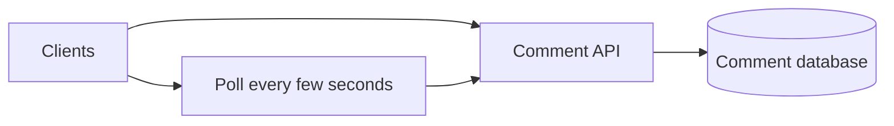
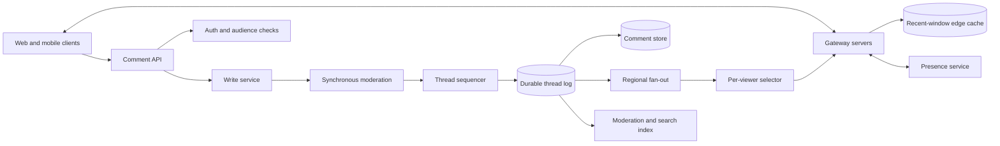
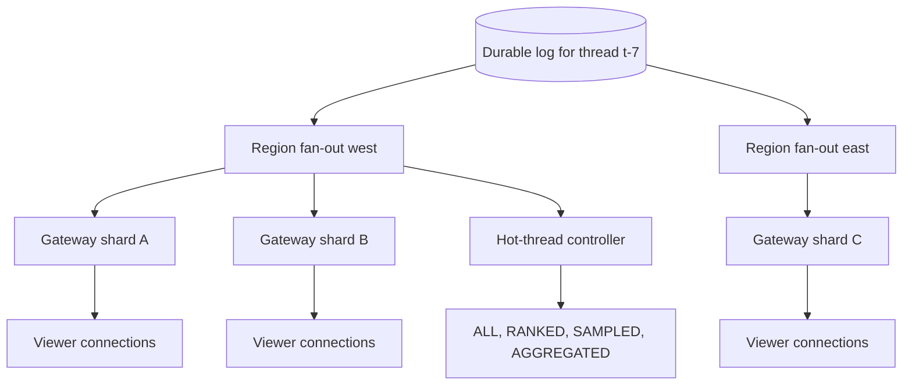
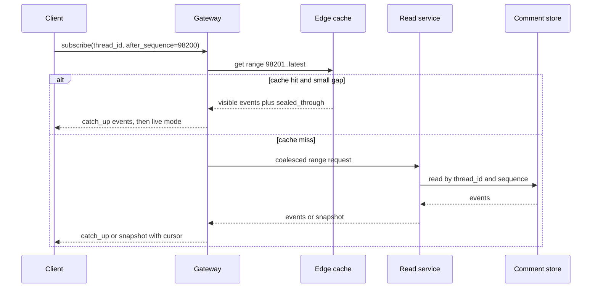
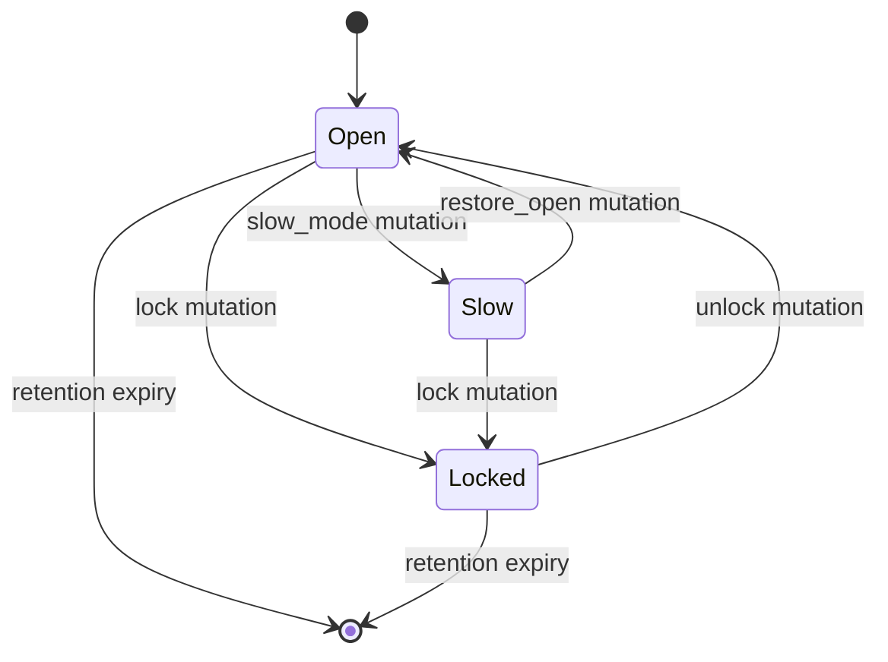

# Live Comments System Design

Live comments are the real-time discussion layer attached to a live video, sports event, article, or shared object. This design covers comment creation, moderation, fan-out to connected viewers, reconnect recovery, and viewer-count style presence; it does not design the video transport, recommendation feed, full identity system, or long-form search product.

## 1. Requirements

### 1.1 Functional requirements

- Viewers can post comments, replies, reactions, reports, and moderator actions on a live thread.
- Connected viewers receive a bounded real-time stream of comments, edits, hides, pins, and count updates.
- A disconnected viewer can reconnect with a cursor and recover durable comments or receive a recent snapshot when the gap is too large.
- Moderators can hold, hide, restore, pin, slow, lock, and audit comments without relying on best-effort push.
- Clients can page recent and historical comments in deterministic order.
- The product can show approximate viewer counts and optional named presence without mixing that ephemeral state into durable comments.

### 1.2 Non-functional requirements

- **Bounded per-viewer delivery.** A hot event may receive far more comments than a person can read, so the system must cap each viewer's stream instead of pushing the full firehose.
- **Durable write correctness.** Once the API acknowledges a comment as accepted, the comment and its moderation state must survive process crashes, consumer lag, and gateway failure.
- **Per-thread ordering.** Viewers need a stable cursor and deterministic moderation placement for a thread, even though a single global order across all threads is unnecessary.
- **Connection scalability.** The system must hold millions of WebSocket or SSE connections without letting reconnect storms stampede the primary comment store.
- **Moderation precedence.** Removal, lock, and policy mutations must overtake ordinary best-effort display choices; a hidden comment cannot remain visible because a viewer is in a sampled mode.
- **Graceful degradation.** Under heat, preserve posting, recovery, and moderation while degrading full delivery to ranked, sampled, aggregated, or snapshot modes.

### 1.3 The binding constraint

The binding constraint is fan-out asymmetry. Writes are large but still tractable: even an illustrative fleet peak of one million comments per second can be appended to partitioned logs and stored with careful sharding. The impossible part is the product intuition that every connected viewer should see every comment. If one live event has 5 million viewers and 100,000 comments per second, full delivery would mean `5,000,000 × 100,000 = 500,000,000,000` message deliveries per second for that one event. No network, phone battery, or human attention span benefits from that.

That asymmetry forces the architecture to separate durable acceptance from display delivery. The write path records every accepted comment once, the fan-out path subscribes gateway fleets per video, and a per-viewer selector decides what subset each viewer sees. Some events are never droppable: the author's own comment acknowledgement, moderation removals, lock/slow-mode changes, and cursor repair must be delivered or recoverable. Ordinary comments on a hot stream are candidates for sampling, ranking, and rate-capping.

## 2. Back-of-the-envelope estimation

Assumptions here are illustrative, not facts about any one company. Suppose the service has 100 million daily viewers and an ordinary peak of 10 million concurrent connections. A championship or celebrity event can push that to 30 million. If an average connected viewer keeps one active comment subscription, the gateway layer must maintain `10M` to `30M` live subscriptions plus heartbeat state. This makes connection management a first-class subsystem, not a side effect of the read API.

For writes, assume an ordinary peak of 100,000 comments per second across the fleet and an extreme peak of 1,000,000 comments per second. With a compact 500-byte durable comment payload before indexes and replicas, average raw ingest at 100,000 comments per second is `100,000 × 500 = 50,000,000` bytes per second, about 50 MB/s. Per day that is `50 MB/s × 86,400 = 4,320,000 MB`, about 4.32 TB/day raw, or `4.32 × 365 = 1,576.8` TB/year before replication, indexes, moderation evidence, and tiering. That is serious storage, but it is not the shape that breaks the design.

The fan-out multiplier is the design-shaping number. A normal active discussion with 100 viewers and 10 comments per second costs `100 × 10 = 1,000` deliveries per second and can run in full mode. A hot live event with 5 million viewers and 100,000 comments per second costs `5,000,000 × 100,000 = 500,000,000,000` deliveries per second if delivered in full. If each pushed envelope were only 200 bytes after compression and framing, that would be `500,000,000,000 × 200 = 100,000,000,000,000` bytes per second, or 100 TB/s, before TLS, retries, and mobile radio overhead. The correct response is not a bigger WebSocket cluster; it is a product and protocol rule that no viewer receives that firehose.

Reconnects are the second multiplier. If a regional gateway fleet serving 2 million viewers restarts and every client immediately fetches the last 100 comments, the read store sees `2,000,000 × 100 = 200,000,000` comment rows requested in a burst. Slack's Flannel work is relevant because it treats edge startup and reconnect payloads as cacheable application state. Live comments need the same shape: gateways and edge caches serve recent windows and metadata, while primary stores handle misses and gap fills.

> **Key idea.** Storage grows with accepted comments, but delivery grows with accepted comments multiplied by viewers. Therefore the durable log must be complete, while each viewer stream must be intentionally incomplete under heat.

## 3. API design

**Question.** How can a client safely retry a post, reconnect to a different gateway, and still know whether it is seeing the complete stream?
<details><summary>Answer</summary>

A post uses an idempotency key and returns the server-assigned sequence after durable append. A subscription includes the last durable sequence the client has applied. The server replies with a delivery mode, so the client can distinguish a complete stream from a ranked or sampled view.

</details>

```http
POST /v1/threads/{thread_id}/comments
Idempotency-Key: 7b7f8c4e
Content-Type: application/json

{"client_comment_id":"c-local-41","parent_comment_id":null,"body":"What a finish!"}

HTTP/1.1 201 Created
{"comment_id":"c-882","thread_id":"t-7","sequence":98221,"status":"VISIBLE","version":1}

GET /v1/threads/{thread_id}/comments?after_sequence=98200&limit=100
HTTP/1.1 200 OK
{"comments":[],"next_sequence":98220,"sealed_through":98220,"delivery_mode":"HISTORICAL"}

PATCH /v1/comments/{comment_id}
If-Match: "version-3"
Idempotency-Key: 91a1b6

{"body":"edited text"}

DELETE /v1/comments/{comment_id}
Idempotency-Key: b42d

WS -> {"type":"subscribe","thread_id":"t-7","after_sequence":98220,"max_events_per_second":8}
WS <- {"type":"subscribed","thread_id":"t-7","from_sequence":98221,"delivery_mode":"RANKED","sealed_through":98220}
WS <- {"type":"comment","thread_id":"t-7","sequence":98221,"comment_id":"c-882","rank_reason":"followed_author"}
WS <- {"type":"hide","thread_id":"t-7","sequence":98244,"comment_id":"c-810","policy_version":"p19"}
```

Push is the normal read path for live viewing, but it is not the source of truth. Every pushed event carries `(thread_id, sequence, event_type)` so the gateway and client can deduplicate after at-least-once delivery. The subscription request says `after_sequence`, not `offset`, because offsets shift under concurrent writes while a per-thread sequence is stable. The response includes `delivery_mode`: `ALL` means the viewer should receive every visible event after the cursor; `RANKED`, `SAMPLED`, and `AGGREGATED` mean the stream is intentionally incomplete and must not be used as an archival view.

Posting returns only after the write path has appended to a quorum-replicated durable stream. If moderation holds the comment, the response still has a sequence and status, but public fan-out excludes it until a later restore or visible mutation. Retries with the same idempotency key return the original result. Edits and deletes use expected versions because a user edit racing a moderator hide should not silently overwrite the moderation state.

Cancellation is deliberately narrow. A client can cancel a local optimistic bubble before the server accepts it, but once the API returns a sequence, undo is represented as a delete mutation. This avoids the race where a gateway has already delivered a comment while a late HTTP cancel tries to pretend it never existed.

## 4. Data model

Start with the obvious entity, `Comment(thread_id, body, author_id, created_at)`. It lets us store text, but it cannot represent deterministic recovery. A reconnecting client needs to say "send everything after what I last applied," and clock time is not precise enough because client clocks skew and concurrent writes tie. The model therefore needs a per-thread `sequence`, assigned by a sequencer that is authoritative for that thread.

Now add `status` to the comment. That is enough for reads, but it loses the audit trail. A moderator hide, an author edit, an async abuse model hold, and a restore are not just new values; they are decisions with actors, reasons, policy versions, and ordering. We therefore append `CommentMutation` records into the same ordered stream. The materialized `Comment` row is the current projection; the mutation log is the evidence and replay source.

Thread configuration looks small, but it is on the write path. Slow mode, lock mode, audience policy, and home region determine whether a comment can be accepted. If gateways cache it indefinitely, a locked thread keeps accepting comments. If every post reads a distant database row, hot events overload that row. The model stores `ThreadConfig` with a version and short-lived gateway cache. The write service validates the authoritative version before append; gateways use cached config only for early rejection.

Subscription state is tempting to put in the primary database because it is important. That is the wrong durability boundary. A viewer's connection, last pushed sequence, presence heartbeat, and delivery mode are gateway/fan-out state. They must be recoverable from the client's cursor and recent caches, not transactional with comment creation. LinkedIn's presence platform is the useful analogy: heartbeats, expiry, delayed triggers, and sticky routing are best-effort state with grace periods, separate from durable product records.

```text
ThreadConfig
- thread_id
- resource_id
- home_region
- mode: OPEN | SLOW | LOCKED | FOLLOWERS_ONLY
- mode_version
- slow_mode_seconds
- retention_policy
- created_at

Comment
- thread_id
- sequence
- comment_id
- parent_comment_id
- author_id
- body_pointer
- status: VISIBLE | HELD | HIDDEN | DELETED
- current_version
- created_at
- edited_at

CommentMutation
- mutation_id
- idempotency_key
- thread_id
- sequence
- comment_id
- type: CREATE | EDIT | DELETE | HIDE | RESTORE | PIN | LOCK | SLOW_MODE
- actor_id
- actor_type: USER | MODERATOR | MODEL | SYSTEM
- reason_code
- policy_version
- created_at

IdempotencyRecord
- actor_id
- idempotency_key
- request_hash
- result_comment_id
- result_sequence
- expires_at

ReactionState
- user_id
- comment_id
- reaction_type
- version
- created_at

ReactionAggregate
- comment_id
- reaction_type
- count
- aggregate_version

GatewaySubscription
- connection_id
- thread_id
- last_sent_sequence
- delivery_mode
- max_events_per_second
- heartbeat_deadline
```

The ordered stream is partitioned primarily by `thread_id`, with hot threads isolated onto dedicated partitions or shards. The primary comment store is a wide-column or log-structured store keyed by `(thread_id, sequence)` for range scans, plus a key-value index by `comment_id` for direct edits and moderation. `IdempotencyRecord` must be stored with the same failure domain as the write log or replicated atomically enough that a retry after failover cannot create a duplicate. `GatewaySubscription` and presence live in memory and short-TTL key-value stores near the gateways; they deliberately do not go in the transactional comment store.

> **Key idea.** The durable model is an ordered mutation log per thread plus projections for reads; gateway subscriptions are rebuildable delivery state, not comment truth.

## 5. High-level design

The simplest design is an API server that writes comments to a database and every client polls `GET /comments?after=...` every few seconds. It is attractive because it has one store, no persistent connections, and easy debugging.



It breaks in four concrete ways. First, polling load scales with viewers even when no one is posting; Meta's live commenting work found that frequent polling at social scale overloads backend systems, which is why subscriptions must be explicit state. Second, a hot event turns each accepted comment into millions of reads or pushes unless delivery is capped. Third, a gateway or mobile-network failure causes synchronized reconnects that hammer recent-comment reads. Fourth, moderation removal becomes just another best-effort update and can be delayed behind ordinary comments.

### Fix 1: Durable per-thread log before fan-out

Put a sequenced log between acceptance and delivery. The write service authenticates, rate-limits, runs synchronous moderation, assigns a per-thread sequence, and appends a mutation. The API acknowledges only after the append is durable. Fan-out, indexing, notification, cache fill, and search are consumers. If a consumer crashes, it replays from its checkpoint; if a gateway dies, clients reconnect with `after_sequence`.

Discord's message-storage lesson fits here even though the product is different. Hot channels can overload a single storage partition, so Discord put data services in front of Cassandra and ScyllaDB to coalesce identical reads and route by channel. For live comments, the same service boundary protects `(thread_id, sequence)` ranges and recent windows from stampedes.

### Fix 2: Pub/sub fan-out to regional gateway fleets

Do not have every gateway independently poll the durable log for every hot thread. Regional fan-out consumers subscribe once per hot thread, then publish to gateway servers that have local viewers. Gateways maintain a compact `thread_id -> connections` index. This is the pattern described by Twitch's split between chat edge, policy evaluation, and Pubsub brokers, and by Disney+ Hotstar's broadcast clusters for tens of millions of sockets: the cluster optimized for socket broadcast is not the same service that decides whether a comment is valid.

The fan-out service also controls delivery mode. Normal threads use `ALL`. Hot streams switch viewers to `RANKED`, `SAMPLED`, or `AGGREGATED` according to per-viewer caps and product rules. The durable log remains complete, so historical pagination and moderation evidence are not sacrificed.

### Fix 3: Server-side selection before mobile delivery

A phone should not receive 10,000 comments per second so it can discard 9,992 of them. Ranking and rate-capping belong at the fan-out layer, near the gateway, with enough user context to preserve important comments: the viewer's own comment, followed authors, replies to the viewer, moderator pins, and removal events. Meta's Bladerunner paper is relevant because it describes stream processors that apply filtering, aggregation, and application-specific logic before pushing updates to devices; LiveVideoComments is exactly this family of problem.

### Fix 4: Edge caches and cursor repair for reconnect storms

Gateways cache thread metadata, pinned comments, and recent visible windows. If many clients reconnect, they resume from their last sequence and most receive a small cached gap fill or a snapshot. Only large gaps or cold ranges reach the primary read service. Slack's Flannel shows why this matters: application-level edge caches reduce startup payloads and reconnect storms for millions of simultaneous real-time clients.

### Fix 5: Separate ephemeral presence from durable comments

Viewer counts and typing indicators are heartbeat-derived estimates. They need grace windows, jitter tolerance, and delayed offline publication, not ordered durable sequences. LinkedIn's presence architecture uses heartbeats, key expiry, delayed triggers, and sticky routing to avoid online/offline flapping. Live comments should apply that pattern to approximate counts while keeping moderation and comments in the durable log.

### Putting it together



A post enters through the API, passes audience and rate checks, is held or accepted by synchronous moderation, receives the next thread sequence, and is appended to the durable log. Store consumers materialize `Comment` rows by `(thread_id, sequence)`. Fan-out consumers read the same log, publish to regional gateways, and invoke the selector to decide which connected viewers receive the event. A reconnecting client presents its last applied sequence to a gateway; the gateway fills small gaps from the edge cache and larger gaps through the read service. Presence heartbeats never enter the comment log.

> **Key idea.** Each component traces back to a specific failure of the naive design.

## 6. Deep dives

### 6.1 Fan-out architecture for hot streams

**Question.** A stream has 5 million viewers and receives 100,000 comments per second. Why not shard viewers across more WebSocket servers and broadcast every comment?
<details><summary>Answer</summary>

Because the cost is multiplicative: `5M × 100K = 500B` deliveries per second. More gateways postpone saturation but do not change the impossible product requirement. The architecture must consume each hot thread once per region and intentionally reduce per-viewer output.

</details>

The naive broadcast design treats fan-out as a transport problem. Add WebSocket servers, put a load balancer in front, and have each server subscribe to comment events. This works for small rooms, but it fails when every server independently consumes the same hot topic and pushes the same overwhelming stream to its local clients. The first failure is backend duplication: if 2,000 gateways each poll or subscribe to the durable log for the same thread, the log and broker see 2,000 consumers doing identical work. The second failure is downstream uselessness: even if the brokers survive, viewers cannot read 100,000 comments per second.

The production shape is a fan-out tree. The durable log has one ordered topic or partition group for the thread. A regional fan-out service consumes that topic once per region. It then publishes to gateway servers that currently host viewers for the thread. Each gateway maintains an in-memory index from `thread_id` to connection IDs, and the fan-out layer tracks which gateways have at least one subscriber. A cold thread might be delivered directly by a shared fan-out worker; a hot thread earns dedicated workers, a larger memory budget, and possibly a broadcast-optimized cluster.



LinkedIn, Hotstar, and Twitch illustrate different parts of this architecture. LinkedIn's presence work shows that subscription-adjacent state needs local routing and expiry because mobile clients churn. Hotstar's 50-million-connection PubSub experience shows that broadcast clusters hit practical limits around cluster size, load balancers, and subscriber nodes, so publisher/subscriber separation and many subscriber nodes matter. Twitch's engineering description separates ingress, policy evaluation, and Pubsub fan-out, which is exactly the isolation needed here: a moderation slowdown should not take down socket delivery, and a socket storm should not accept invalid comments.

The tree still has hard edge cases. If a hot thread moves from `ALL` to `RANKED`, every gateway must learn that mode quickly, but clients must also be told so the UI does not imply completeness. If a regional fan-out worker is slow, it should skip ordinary ranked candidates rather than delay mandatory mutations. If a gateway's per-connection queue grows, the gateway downgrades that connection to snapshot mode and sends a control message with the latest sealed sequence.

A tempting alternative is to partition the comment stream itself into many independent shards and let clients merge. That improves write throughput, but it complicates ordering and recovery. For live comments, a single logical per-thread sequence is valuable. We can still scale hot ingestion by leasing sequence ranges to workers with fencing epochs, but the externally visible cursor remains one sequence space. Gaps from expired leases are sealed explicitly so clients do not wait forever.

Signals worth watching: fan-out deliveries per accepted comment, per-gateway queue depth, hot-thread mode transitions, broker consumer lag by region, and the percentage of viewers in each delivery mode.

> **Strong-answer criteria.** A senior answer must separate durable append from regional fan-out, quantify the fan-out multiplier, and state that hot streams require intentional per-viewer reduction rather than only more sockets.

| Level | Approach | Why |
|---|---|---|
| Bad | Every gateway subscribes to every hot thread and pushes all comments. | It duplicates broker work and creates impossible per-viewer delivery. |
| Good | Consume once per region and publish to gateways with local subscribers. | It removes duplicate backend reads but still needs hot-mode control. |
| Great | Use a regional fan-out tree with per-thread heat detection, gateway subscription indexes, mandatory-event lanes, and transparent delivery modes. | It scales transport while preserving correctness and product honesty. |

### 6.2 Sampling, ranking, and what must never be dropped

**Question.** If the system samples comments for a hot stream, how do we avoid dropping the one comment or moderation event that a viewer must see?
<details><summary>Answer</summary>

Classify events before selection. Ordinary comments can be sampled or ranked; mandatory events such as the viewer's own comment result, replies to the viewer, moderator hides, lock changes, and pins bypass sampling or remain recoverable through cursor repair.

</details>

Sampling is often described as if it were random loss. That is dangerous. The product can drop many ordinary comments because no viewer can read them all, but it cannot drop semantic events that change state. A hide mutation must remove a previously displayed comment. A lock mutation must stop the composer. A user's own accepted comment must reconcile the optimistic bubble. A reply or mention may be a notification-level event. The selector therefore starts with event classes, not algorithms.

The durable log contains complete ordered mutations. The fan-out selector reads events and builds per-viewer output under a token bucket, for example eight comment-like events per second plus a separate control lane. The first lane is mandatory: hides, restores, locks, slow-mode changes, pins, and acknowledgements for comments authored by this connection's user. The second lane is personalized priority: followed authors, direct replies, mentions, local-language matches, and comments that are early in a thread before heat rises. The third lane is ranked public sampling: quality scores, diversity constraints, recency, and randomization so the stream does not become only celebrity accounts or only the loudest cohort. The fourth lane is aggregate updates: counts, top reactions, and periodic highlights.

The selector must also reason about history. Suppose a viewer saw comment sequence 500, and an async model hides it at sequence 900. The viewer may now be receiving only one ranked comment per second. The hide cannot wait behind the ranked lane; it must be sent promptly or applied during the next snapshot. Similarly, if a viewer never saw sequence 500 because sampling skipped it, sending a hide for it is harmless but wasteful; gateways can keep a small displayed-comment bloom filter or LRU set per connection to target removals when possible. Correctness still comes from authoritative reads filtering hidden content.

Meta's Bladerunner work is the right mental model: stream processors apply application-specific filtering and aggregation before device delivery. The key addition for comments is explicit non-droppable semantics. A ranking model may decide which public comments are interesting, but policy events are not candidates for ranking. Moderation and user-owned reconciliation are control-plane facts.

Rate capping needs transparency. The client receives `delivery_mode="RANKED"` and perhaps `max_events_per_second=8`. UI copy can say "Top comments" or simply avoid implying completeness. Historical views use the read API, not the sampled live stream. This prevents the common bug where product analytics or moderation tooling accidentally treats a viewer's sampled stream as the record of what happened.

There are trade-offs. Deterministic sampling by hash `(thread_id, sequence, viewer_bucket)` gives stable diversity and avoids every viewer seeing the same ten comments, but it may miss socially relevant comments. Full personalization improves relevance but is expensive and can leak signals if not carefully authorized. A practical design uses tiers: cheap deterministic sampling for anonymous viewers, richer ranking for signed-in viewers with local profile features, and strict mandatory lanes for everyone.

Signals worth watching: mandatory-event latency, own-comment reconciliation latency, hide-after-display latency, sampled-stream complaint rate, per-viewer dropped ordinary comments, and model/ranker CPU per delivered event.

> **Strong-answer criteria.** A senior answer must say that sampling applies to ordinary display candidates, not to state-changing control events, and must preserve a complete durable log for audit and recovery.

| Level | Approach | Why |
|---|---|---|
| Bad | Randomly drop comments when queues are full. | It can drop hides, own comments, and lock changes, creating incorrect UI state. |
| Good | Rank comments and cap each viewer's stream. | It protects clients but is incomplete unless event classes are explicit. |
| Great | Maintain mandatory, personalized, ranked, and aggregate lanes with transparent delivery modes and authoritative recovery. | It preserves correctness while admitting that hot live display is selective. |

### 6.3 Reconnect storms, catch-up, and sequence gaps

**Question.** A gateway fleet restarts during a live event. Two million clients reconnect within a minute. How does the system avoid losing comments or melting the database?
<details><summary>Answer</summary>

Clients reconnect with their last applied sequence. Gateways first fill from local recent-window caches, then coalesced range reads, and finally snapshots if the gap is too large. The durable log and read store are authoritative; gateway queues are disposable.

</details>

A real-time system fails if it treats a WebSocket as durable state. Mobile networks suspend apps, load balancers rebalance, deployments restart gateways, and regional incidents produce synchronized reconnects. If the only copy of "what this viewer should see next" is a gateway queue, the system either loses events or keeps unbounded queues. The better contract is that every client owns a cursor: the highest durable sequence it has applied for each thread. Reconnect is `subscribe(thread_id, after_sequence=n)`.

The catch-up path is tiered. First, the gateway checks an in-memory or edge-cache recent window keyed by `(thread_id, sequence range, audience class)`. Hot threads almost always need the newest few hundred events, so this cache absorbs the common case. Second, the gateway or read service coalesces identical misses. If 50,000 viewers ask for `t-7:98200..98280`, only one backend range read should hit the comment store. Discord's data-service pattern is useful here: put a service in front of the storage engine that uses consistent-hash routing and request coalescing for hot channel ranges. Third, if the client is too far behind or the stream retention window has expired, return a snapshot: recent visible comments, pinned comments, current mode, and `sealed_through` cursor.



Sequence gaps deserve explicit handling. A hot sequencer may lease ranges to workers. If a worker dies after reserving 100 sequence numbers, clients might observe sequence 1000 and then 1101. Without metadata, they will wait forever for 1001..1100. The log therefore needs sealed gaps or a `sealed_through` watermark. A read response can say "there are no visible events through 1100" or "events through 1100 are not yet sealed; retry." This distinction prevents both false loss and endless spinners.

Reconnect storms also interact with presence. If every disconnect immediately decrements viewer count and every reconnect increments it, counts flap wildly. LinkedIn's presence lesson applies directly: use heartbeat expiry with grace windows and delayed offline triggers. A gateway restart should mark connections uncertain, not instantly offline. Counts are approximate and can be recomputed from heartbeat leases; comments cannot.

Slack's Flannel work adds another important point: bootstrap payloads should be slim and edge-served. A reconnecting live-comments client does not need the entire user profile graph, all historical comments, and every reaction. It needs thread config, pinned comments, recent visible window, delivery mode, and a cursor. Everything else can lazy-load.

The failure modes are mostly around cache correctness. A recent-window cache must not serve hidden comments to ordinary viewers after a moderation mutation. There are two safeguards: hide mutations invalidate or patch cache entries, and the authoritative read service filters by current status. For very hot threads, it is often cheaper to include tombstone/control events in the cache than to rewrite large cached windows.

Signals worth watching: reconnects per minute, cache catch-up hit ratio, coalescing factor, backend range-read QPS per hot thread, snapshot fallback rate, and clients reporting sequence gaps beyond a retry budget.

> **Strong-answer criteria.** A senior answer must make gateway state disposable, use client cursors, coalesce hot range reads, and distinguish unsealed gaps from sealed empty ranges.

| Level | Approach | Why |
|---|---|---|
| Bad | Keep all missed events in each gateway connection queue. | Queues are lost on restart and become unbounded for slow clients. |
| Good | Reconnect with `after_sequence` and read missing events from storage. | Correct, but can stampede the store during mass reconnects. |
| Great | Use recent edge caches, coalesced range reads, snapshots, sealed watermarks, and heartbeat grace. | It recovers correctly without turning failure into a database incident. |

### 6.4 Sequencing, moderation, and hot-partition correctness

**Question.** Two write workers accept comments while a moderator locks the thread. What prevents comments from being appended after the lock or appearing in different orders for different viewers?
<details><summary>Answer</summary>

Thread mutations pass through a sequenced, fenced authority. Workers validate the current thread mode before append, attach an epoch and sequence, and stale workers are rejected. A lock is a sequenced mutation; after it is sealed, later creates fail unless policy allows moderator exceptions.

</details>

Per-thread order is the backbone of recovery, but it creates a hot-key risk. One sequencer per active thread is easy to reason about: it increments `next_sequence` and appends. Under normal load, that is ideal. Under a celebrity event, one process or one database partition may be too small. The mistake is to remove ordering entirely. The better design scales the sequencer while preserving one external sequence space.

A common mechanism is a fenced leader with range leases. The thread has a `sequencer_epoch`. A leader obtains epoch 42 and leases ranges such as 10,000..10,999 to write workers. Each append includes epoch and sequence. The log accepts only the current epoch and each sequence at most once. If the leader stalls and a new leader obtains epoch 43, late writes from epoch 42 are rejected. If a worker dies with unused sequence numbers, the new leader writes a sealed-gap marker for that range or advances `sealed_through` with proof that no events will appear there.

Moderation and thread mode changes use the same ordered path. A lock at sequence 20,000 means normal create mutations after 20,000 should fail. There is still a race before the lock is sequenced: comments accepted at 19,998 and 19,999 are valid because they happened before the lock in thread order. This is better than pretending a wall-clock timestamp can decide. Gateways may optimistically gray out the composer when they hear about a pending lock, but the write service is authoritative.



Moderation removal also benefits from sequencing. If an async model hides comment 100 at sequence 150, every projection can apply: comment 100 remains in audit storage, public reads filter it after sequence 150, and gateways that displayed it receive a hide control event. If an author edit races that hide, expected versions prevent the edit from turning a hidden comment visible by accident. The projection code applies mutations with compare-and-set on `current_version` and status transition rules.

Hot partitions remain real. Partitioning by `thread_id` preserves range scans but creates skew. The mitigations are layered: isolate hot threads onto dedicated stream partitions, batch appends, coalesce reads, keep recent windows in memory, and move fan-out work away from the storage partition. If a single logical thread exceeds what one ordered log can accept, the product can choose regional substreams, but that changes semantics: viewers in different regions may see different interleavings until merged. That is a product trade-off, not an invisible optimization.

Signals worth watching: sequencer lease expirations, rejected stale epochs, sealed-gap count, append latency by hot thread, lock-to-enforcement latency, and projection compare-and-set failures.

> **Strong-answer criteria.** A senior answer must use fencing or another explicit stale-writer defense, treat moderation and lock operations as ordered mutations, and name the cost of preserving a single thread order.

| Level | Approach | Why |
|---|---|---|
| Bad | Let any write worker increment a counter and trust timestamps for conflicts. | It creates duplicates, reordering, and ambiguous lock races. |
| Good | Use one sequencer per thread. | Correct for normal threads, but hot threads and failover need a plan. |
| Great | Use fenced epochs, range leases, sealed gaps, versioned projections, and explicit regional-order trade-offs. | It preserves recovery semantics while scaling the hot path. |

## 7. Variants

**10x scale.** At 10 million comments per second and hundreds of millions of connections, the same separation remains: complete durable log, regional fan-out, selective viewer streams. What changes is isolation. Hot events get dedicated log clusters, dedicated fan-out trees, pre-warmed gateway capacity, and stricter aggregate modes. Ranking features must be cheaper, often precomputed or bucketed, because per-viewer expensive ranking at the edge becomes the bottleneck.

**Multi-region active-active.** If the product requires low-latency posting from every continent, one home sequencer per thread may be too slow. The alternative is regional substreams with deterministic merge keys. It improves local write latency but weakens the guarantee that all viewers see the same order at the same time. Moderation removals still need global propagation and should remain mandatory control events.

**Strict regulatory retention.** Some products must retain hidden content for evidence while honoring user deletion requests or regional residency. The mutation log can store bodies in region-scoped object storage with policy-controlled tombstones and legal holds. Fan-out and caches must carry only pointers or redacted bodies after deletion; audit access becomes a separate authorized workflow.

**Interactive broadcast features.** Polls, emoji bursts, and creator prompts should not be modeled as ordinary comments. They use the same gateway and fan-out infrastructure, but their state is aggregate-first. Disney+ Hotstar's PubSub lesson applies: broadcast clusters are excellent for counts and highlights, while durable comment creation stays on the sequenced write path.

## 8. The transferable pattern

This problem is an instance of complete-write, selective-read architecture. The system records every accepted mutation exactly once in an ordered, replayable substrate, then admits that real-time delivery is a projection constrained by bandwidth, client capacity, and human attention. The same pattern appears in [chat](./chat-app-system-design.md), [news feeds](./news-feed-system-design.md), [YouTube](./youtube-system-design.md), and [pub/sub](./pub-sub-message-queue-system-design.md), but live comments emphasize the gap between durable truth and what any one viewer can consume.

The reusable move is to name which events are correctness events and which are display candidates. Correctness events need idempotency, ordering, recovery, and often fencing. Display candidates can be ranked, sampled, coalesced, or dropped with transparent metadata. Systems that fail to make that distinction either overload themselves trying to deliver everything or corrupt user-visible state by dropping the wrong thing.

## Review

Live comments are shaped by fan-out asymmetry: appending accepted comments is expensive but tractable, while pushing every hot-stream comment to every viewer is impossible and useless. The design therefore accepts comments through a moderated, idempotent, per-thread sequenced log; materializes authoritative reads by `(thread_id, sequence)`; consumes the log once per region into gateway fan-out; and applies per-viewer selection with mandatory lanes for own comments, moderation, pins, locks, and cursor repair. Reconnects use client cursors, edge recent-window caches, coalesced range reads, snapshots, and sealed watermarks. Presence and viewer counts use heartbeat leases with grace, not the durable log. The production-grade answer is not "more WebSockets"; it is a clear boundary between complete durable history and bounded honest live display.

### Check your understanding

1. Why is full fan-out the binding constraint rather than comment storage?
   <details><summary>Answer</summary>

   Storage grows with accepted comments. Full fan-out grows with accepted comments multiplied by connected viewers. A hot stream with 100,000 comments per second and 5 million viewers implies 500 billion deliveries per second, so the architecture must cap per-viewer output.

   </details>

2. What events should bypass sampling or remain recoverable even in ranked mode?
   <details><summary>Answer</summary>

   The viewer's own comment reconciliation, moderation hides/restores, lock and slow-mode changes, pins, direct replies or mentions depending on product policy, and cursor repair metadata. Ordinary public comments are display candidates; state-changing control events are not.

   </details>

3. Why does reconnect use `after_sequence` instead of a timestamp or offset?
   <details><summary>Answer</summary>

   A per-thread sequence is stable under concurrent writes and gives an exact cursor. Timestamps can skew or tie, and offsets shift as inserts and hides occur. `after_sequence` lets gateways and read services deduplicate and fill gaps deterministically.

   </details>

4. What is a sealed gap and why does it matter?
   <details><summary>Answer</summary>

   A sealed gap is a range of sequence numbers that will never contain visible events, often because a leased range expired. It tells clients and projections not to wait forever for missing numbers while still distinguishing true gaps from events that are merely delayed.

   </details>

5. Why keep presence outside the durable comment log?
   <details><summary>Answer</summary>

   Presence is heartbeat-derived, approximate, and sensitive to mobile jitter. It needs TTLs, grace windows, and delayed offline triggers. Comments and moderation are durable ordered facts. Mixing the two would either over-durabilize ephemeral state or weaken comment correctness.

   </details>

## Sources and further reading

| Source | Article | Why it matters |
|---|---|---|
| Meta | [Live Commenting: Behind the Scenes](https://engineering.fb.com/2011/02/07/core-infra/live-commenting-behind-the-scenes/) | Shows why low-latency comments need push and subscription state rather than frequent polling. |
| Meta / SOSP | [Bladerunner: Stream processing at scale for a live view of backend data mutations at the edge](https://doi.org/10.1145/3477132.3483572) | Describes per-application stream processors that filter, aggregate, and rank live updates before device delivery. |
| Meta | [How we scale Live streaming for millions of viewers simultaneously](https://engineering.fb.com/2020/10/22/video-engineering/live-streaming/) | Details redundancy and failover expectations for high-stakes live events with millions of concurrent viewers. |
| LinkedIn | [Now You See Me, Now You Don’t: LinkedIn’s Real-Time Presence Platform](https://www.linkedin.com/blog/engineering/product-design/now-you-see-me-now-you-dont-linkedins-real-time-presence-platf) | Provides the heartbeat, expiry, delayed-trigger, and sticky-routing pattern for presence and viewer counts. |
| Slack | [Flannel: An Application-Level Edge Cache to Make Slack Scale](https://slack.engineering/flannel-an-application-level-edge-cache-to-make-slack-scale-/) | Demonstrates edge caching, slim bootstraps, team affinity, and reconnect-storm reduction for real-time clients. |
| Twitch | [Twitch State of Engineering 2023](https://blog.twitch.tv/en/2023/09/28/twitch-state-of-engineering-2023/) | Explains chat edge, policy evaluation, and Pubsub fan-out separation for hundreds of billions of chat messages/day. |
| Disney+ Hotstar | [Building PubSub for 50M concurrent socket connections](https://blog.hotstar.com/building-pubsub-for-50m-concurrent-socket-connections-5506e3c3dabf) | Shows practical broadcast fan-out lessons: publisher/subscriber split, cluster-size limits, load balancers, and reverse bridges. |
| Discord | [How Discord Stores Trillions of Messages](https://discord.com/blog/how-discord-stores-trillions-of-messages) | Shows request coalescing and consistent-hash routing to protect hot message partitions. |
