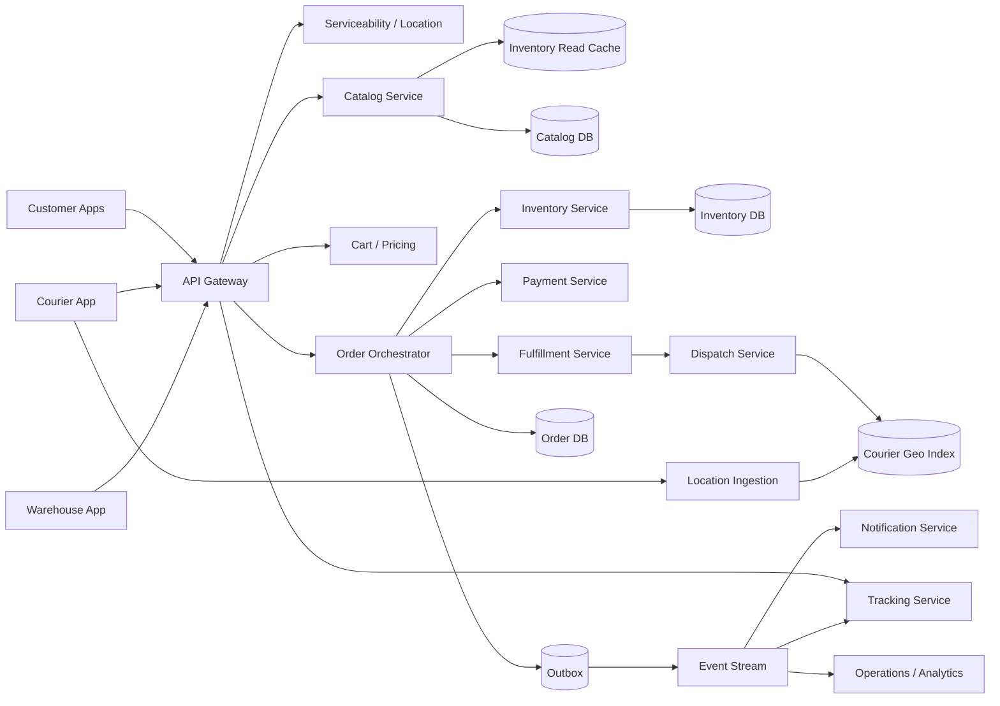

# Local Delivery System: Gopuff-like Instant Commerce

## 1. Requirements

### Functional requirements

1. Show a serviceable catalog and accurate price/availability for a delivery address.
2. Support cart, promotions, checkout, payment, substitution preferences, and cancellation.
3. Reserve inventory from a specific micro-fulfillment center (MFC).
4. Route orders to picking and packing workflows.
5. Assign a courier and provide live ETA and tracking.
6. Handle out-of-stock items, substitutions, refunds, tips, and age-restricted goods.
7. Let operators manage inventory, batches, hours, delivery zones, and courier capacity.
8. Notify customers throughout the order lifecycle.

Out of scope: marketplace restaurants, scheduled parcel shipping, and warehouse procurement optimization.

### Non-functional requirements

- Checkout availability of `99.99%`.
- Catalog reads below 200 ms at `p95`; order creation below 1 second excluding payment challenge.
- Prevent overselling while keeping browse availability responsive.
- Typical order delivered in 15-30 minutes.
- Durable financial and order state with complete audit history.
- Live tracking updates every few seconds without overloading transactional storage.

## 2. Scale assumptions and capacity

- 20 million registered users; 3 million daily active users.
- 1,000 MFCs across several countries.
- 2 million orders/day, averaging about 23 orders/second.
- 100,000 orders in the peak hour, or about 28 orders/second globally; use 30-50 orders/second for headroom, with strong local spikes.
- 25 items/order; 50 million order lines/day, averaging about 579 lines/second and about 694 lines/second in the 100,000-order peak hour.
- 50,000 active couriers at peak, emitting location every 5 seconds: 10,000 updates/second.
- 5,000 SKUs per MFC; about 5 million MFC-SKU inventory rows.
- Browse traffic is roughly 100 times order-write traffic, or about 3,000-5,000 reads/second at peak before CDN and app cache hits.

The global throughput is manageable, but locality creates hot partitions: a single MFC can receive hundreds of simultaneous checkouts during a promotion or weather event.

## 3. High-level architecture



The ordering path is an orchestrated saga across inventory, payment, fulfillment, and dispatch. Each domain owns its database; changes propagate through durable events rather than distributed transactions.

## 4. Data model

```text
FulfillmentCenter
- mfc_id
- region_id
- location
- service_polygon
- operating_hours
- status

SKU
- sku_id
- product_id
- title
- unit_size
- age_restriction
- substitution_group_id

Inventory
- mfc_id
- sku_id
- on_hand
- reserved
- damaged
- safety_stock
- version
- updated_at

InventoryReservation
- reservation_id
- order_id
- mfc_id
- sku_id
- quantity
- expires_at
- state: HELD | CONSUMED | RELEASED | EXPIRED

Order
- order_id
- customer_id
- mfc_id
- delivery_address_snapshot
- status
- pricing_snapshot
- payment_intent_id
- idempotency_key
- version
- created_at

OrderItem
- order_id
- line_id
- requested_sku_id
- fulfilled_sku_id
- requested_quantity
- fulfilled_quantity
- unit_price_snapshot
- substitution_policy

FulfillmentTask
- task_id
- order_id
- state: QUEUED | PICKING | PACKED | HANDED_OFF
- picker_id
- promised_ready_at

Delivery
- delivery_id
- order_id
- courier_id
- state
- pickup_at
- delivered_at
- proof_of_delivery
```

Maintain an append-only `OrderEvent` timeline for support and audit. Prices, taxes, address, and item descriptions are snapshots so historical orders do not change when catalog data changes.

The inventory invariant is:

```text
sellable = on_hand - reserved - damaged - safety_stock
sellable >= 0
```

## 5. Core APIs

### Browse a serviceable catalog

```http
GET /v1/catalog?latitude=37.78&longitude=-122.41
```

The response includes an `mfc_id`, catalog version, estimated availability, prices, and delivery estimate. Browse availability is advisory; checkout performs authoritative reservation. For grocery and quick commerce, search and browse should resolve against the customer's candidate MFCs, then revalidate authoritative price and stock before checkout because hub inventory can change between keystrokes and payment.

### Create an order

```http
POST /v1/orders
Idempotency-Key: 6d944...

{
  "mfc_id": "mfc-17",
  "cart_version": 12,
  "address_id": "addr-3",
  "payment_method_id": "pm-8",
  "items": [
    {"sku_id": "sku-42", "quantity": 2, "substitution": "BEST_MATCH"}
  ],
  "tip": 5.00
}
```

```json
{
  "order_id": "ord-91",
  "status": "CONFIRMED",
  "amount_authorized": 34.18,
  "promised_delivery_at": "2026-10-13T08:05:00Z"
}
```

### Tracking and courier APIs

```http
GET  /v1/orders/{order_id}
GET  /v1/orders/{order_id}/tracking
POST /v1/orders/{order_id}/cancel
POST /v1/couriers/{courier_id}/locations
POST /v1/deliveries/{delivery_id}/accept
POST /v1/deliveries/{delivery_id}/complete
```

All mutation APIs require an idempotency key or a version precondition. Mobile clients retry frequently across poor networks.

## 6. Serviceability, catalog, and ETA

1. Geocode the address and validate deliverability.
2. Query a spatial index for MFC service polygons containing the point.
3. Exclude closed, unhealthy, overloaded, or capacity-constrained centers.
4. Select an MFC using distance, inventory coverage, queue depth, courier supply, and promised SLA.
5. Return that MFC's assortment and prices.

ETA combines:

```text
ETA = order_queue_delay
    + pick_and_pack_time
    + courier_assignment_delay
    + pickup_wait
    + route_travel_time
```

Use percentile or probabilistic estimates rather than averages and recalibrate continuously. The displayed ETA should include capacity and uncertainty; optimistic straight-line distance alone causes missed promises. Keep an ML fallback path with clipped inputs/outputs or conservative heuristics so upstream feature-unit bugs do not produce unsafe promises.

## 7. Checkout and order saga

One practical ordering sequence is:

1. Validate cart, MFC, address, age restrictions, price version, and limits.
2. Create `PENDING` order idempotently.
3. Atomically reserve all inventory lines at the selected MFC.
4. Authorize the estimated payment amount.
5. Commit the order as `CONFIRMED` and create the fulfillment task.
6. Publish the order event through a transactional outbox.
7. Begin picking; later capture the final amount after substitutions and weighed items.

Compensations:

- Inventory reservation fails: reject with unavailable items; no payment authorization.
- Payment authorization fails: release reservations.
- Fulfillment creation fails after confirmation: retry from outbox; operator queue if prolonged.
- Order is cancelled before picking: release inventory and void authorization.
- Partial fulfillment: adjust inventory, total, tax, and captured amount.

There is no cross-service exactly-once transaction. The goal is exactly-once business effect through stable operation IDs, idempotent handlers, state-machine guards, and reconciliation.

## 8. Inventory consistency and concurrency

Inventory reservation is the central correctness problem. Execute all lines for one MFC in a database transaction:

```sql
UPDATE inventory
SET reserved = reserved + :quantity,
    version = version + 1
WHERE mfc_id = :mfc_id
  AND sku_id = :sku_id
  AND on_hand - reserved - damaged - safety_stock >= :quantity;
```

Lock rows in sorted `sku_id` order to reduce deadlocks. If any line fails, roll back the entire reservation unless the product explicitly supports partial checkout.

Browse reads use an eventually consistent cache. Checkout uses the primary inventory store. Reservation records have expirations; a sweeper releases abandoned holds, but it must transition reservation state conditionally so it cannot release a consumed hold.

Physical stock can still differ because of shrinkage, damage, or mis-picks. Cycle counts and picker reports produce adjustments. Safety stock and conservative low-stock thresholds trade sales for fewer substitutions. For browse/search ranking, feed inventory confidence into retrieval or ranking, but keep a final real-time inventory check in the order path; stale projections should hide or down-rank risky items, not become the source of truth.

## 9. Picking, substitution, and handoff

Fulfillment queues are partitioned by MFC. Within a center, prioritize by promised time, temperature requirements, and route batching.

1. A picker claims a task with a lease.
2. The app gives a route optimized for aisle/bin locations.
3. Each scan validates barcode and quantity.
4. Missing items trigger the customer's substitution policy and a ranked replacement list based on historical substitutions, product attributes, and current MFC availability.
5. Material price changes may request customer approval with a deadline.
6. Packing records bags, temperature zones, restricted items, and final total.
7. A handoff scan transfers custody to the assigned courier.

Picker leases expire and can be reclaimed. Every scan uses a unique event ID; retries must not decrement inventory twice.

## 10. Dispatch and live tracking

Dispatch continuously matches ready-soon orders to couriers using:

- Predicted pick completion.
- Courier position and vehicle type.
- Delivery route and promised SLA.
- Batch compatibility and detour cost.
- Courier capacity, breaks, and fairness.

Start with greedy constrained matching every few seconds; introduce optimization windows, MIP/min-cost matching, or vehicle-routing heuristics when batching value justifies complexity. Keep the optimization window bounded by the promise and use a greedy fallback if the solver times out.

Courier locations enter a high-write, TTL-based geo store, not the order database. Keep the latest point for dispatch and a sampled, retention-limited trail for support. Customers receive throttled updates over WebSocket/SSE; raw courier coordinates should stop after delivery.

Delivery state changes use compare-and-swap:

```text
ASSIGNED -> ACCEPTED -> AT_PICKUP -> PICKED_UP -> AT_CUSTOMER -> DELIVERED
```

Proof can include a photo, PIN, signature, or age verification depending on order policy.

## 11. Payments, refunds, and tips

- Authorize estimated total at checkout, including a bounded substitution buffer where lawful.
- Capture the final fulfilled total after packing or delivery.
- Void unused authorization and issue line-level refunds when needed.
- Keep tips separately adjustable within a policy window.
- Store provider tokens, never raw card data.
- Use an internal payment ledger so provider webhooks and order state can be reconciled.

Payment provider timeouts are ambiguous. Query by the stable payment operation ID before retrying; never create a new charge merely because the response was lost.

## 12. Partitioning and storage

- Partition inventory and fulfillment by `mfc_id`; this preserves local transactions and isolates hot centers.
- Partition orders primarily by `order_id`, with secondary customer and MFC indexes.
- Partition the event stream by `order_id` for ordered lifecycle events; use separate MFC topics for warehouse scheduling.
- Store catalog product data centrally but materialize MFC-specific assortment, price, and availability views. Split ingestion, publishing, and search indexing so sparse retailer or MFC feeds can be enriched, validated, versioned, and rolled back before customer exposure.
- Store location points in a geospatial/time-series system with TTL.
- Store receipts and proof images in object storage with signed access.

For a hot MFC, scale reads through caches and replicas, but keep each SKU's reservation authority single-writer. Splitting by `sku_id` increases write capacity but makes multi-line atomic reservation harder; only do so after measuring contention.

## 13. Reliability and important failures

| Failure | Handling |
|---|---|
| Client retries checkout | Return original order by idempotency key and customer |
| Reservation succeeds, payment fails | Saga releases reservation |
| Payment times out | Query provider by operation ID before retry |
| Reservation expires during commit | State transition and transaction prevent release of consumed hold |
| Picker app disconnects | Durable task state and expiring claim lease |
| Item physically missing | Substitute/refund and inventory adjustment |
| Courier rejects or disappears | Lease timeout and redispatch |
| Location updates stop | Show stale indicator and use last ETA |
| Event delivered twice | Idempotent consumer inbox/state guard |
| MFC loses connectivity | Stop new promises; local operational fallback and later reconciliation |
| Region fails | Route unaffected MFCs normally; fenced failover for impacted partitions |

Run reconcilers for inventory reservations versus order state, payment ledger versus provider settlement, packed items versus captured amount, and delivered orders versus courier payout.

## 14. Multi-region design

MFCs are naturally regional:

- Assign each MFC a home region for inventory, order orchestration, and fulfillment writes.
- Replicate within three availability zones synchronously.
- Route catalog and tracking reads to nearby replicas.
- Replicate order history asynchronously to a disaster-recovery region.
- Keep courier and customer traffic pinned to the active region for the delivery.

During regional failure, do not accept inventory writes in two regions. Fence the former primary, promote a sufficiently current replica, and temporarily mark uncertain centers unavailable. A few minutes of order unavailability is preferable to overselling and duplicate dispatch.

## 15. Security, safety, and compliance

- TLS, encryption at rest, managed secrets, and least-privilege service identities.
- Tokenize payment instruments and minimize PCI scope.
- Encrypt precise addresses and courier locations; use strict retention and access auditing.
- Require step-up checks for account changes, refunds, and high-risk orders.
- Detect promotion abuse, account takeover, chargeback patterns, and courier GPS spoofing.
- Verify age and identity for alcohol or regulated products; record required evidence.
- Separate customer and courier contact details using masked communication.
- Restrict warehouse devices by role and MFC.
- Apply rate limits and signed requests to courier location ingestion.
- Support deletion, residency, tax, receipt, and labor-policy obligations by market.

## 16. Observability and SLOs

Track:

- Catalog latency, error rate, and stale-availability rate.
- Checkout conversion and failure by inventory, payment, or validation reason.
- Reservation conflicts, expirations, and inventory adjustment rate.
- Order acceptance-to-pick, pick duration, pack duration, and handoff wait.
- Courier assignment time, rejection rate, location freshness, and batch utilization.
- Promised versus actual delivery time by MFC and time of day.
- Substitution, cancellation, refund, chargeback, and support-contact rates.
- Saga age, outbox lag, dead-letter events, and reconciliation discrepancies.
- MFC queue depth, picker capacity, courier supply, and system health.

The customer-facing north-star SLI is:

```text
percentage of confirmed orders delivered complete and within promised window
```

Operational dashboards must be scoped per MFC; global averages hide local failures.

## 17. Major trade-offs

### Strong inventory versus available browsing

- Strong checkout reservation prevents overselling.
- Eventually consistent browse availability is faster and cheaper.
- Clearly treat the cart as advisory until checkout.

### Reserve before or after payment

- Reserving first prevents charging for unavailable items but briefly holds stock for failed payments.
- Authorizing first increases charge reversals and can charge when stock disappears.
- Use short inventory holds, then authorize.

### Central versus MFC-local authority

- Central systems simplify operations and analytics.
- MFC-local writes reduce latency and isolate failures.
- Use regional authority per MFC with centralized aggregated views.

### Immediate versus batched dispatch

- Immediate dispatch minimizes assignment delay.
- Short batching windows improve courier utilization and route economics.
- Bound optimization by the delivery promise.

### Accuracy versus sales

- Safety stock reduces substitutions and overselling.
- Aggressive sellable counts improve conversion but worsen customer experience.

## 18. Lessons from production systems

### DoorDash: dispatch is ML plus optimization, not nearest courier

DoorDash's dispatch writing frames matching as a real-time optimization problem over predicted ready times, travel times, Dasher states, quality, and efficiency. Their move from bipartite matching/Hungarian-style assignment to MIP-style formulations unlocked multi-delivery routes and larger regional solve windows. In this design, Dispatch should treat greedy nearest-courier matching as a fallback, not the target architecture, and should log solver alternatives for safe rollout.

### DoorDash: route optimization needs bounded heuristics and fallbacks

DoorDash's routing post describes last-mile routing as NP-hard and uses ruin-and-recreate with termination criteria such as time limits or iteration caps; it also keeps a trivial greedy route as a fallback and benchmark. For instant commerce, batching/pickup routing must run inside seconds, so every optimizer needs a latency budget, a partial-solution strategy, and an operational fallback that preserves delivery correctness even if economics degrade.

### DoorDash: ETA should be probabilistic and multi-stage

DoorDash's NextGen ETA system separates an accuracy-first probabilistic base layer from a decision layer and uses multi-task modeling across homepage, store, checkout, food, grocery, pickup, and delivery ETA use cases. This maps directly to the ETA formula here: queue delay, pick time, assignment delay, pickup wait, and travel time should be modeled as distributions and then transformed into customer promises by a business decision layer.

### DoorDash: inventory availability is a confidence problem

DoorDash's grocery inventory work combines merchant feeds, operator updates, Dasher reports, photos, historical order data, and source-confidence ranking, then precomputes projections that feed search ranking. It reports nearly 90% exact-item fulfillment after cleaning and prediction, but still relies on substitutions for the rest. This design should therefore expose availability confidence in browse/search while preserving authoritative reservation at checkout.

### Instacart: availability and substitutions belong in the shopping flow

Instacart predicts over 500 million listings every 60 minutes across nearly 25,000 stores using retailer data, store location, purchase history, shopper input, and time-of-day/day-of-week features. It pairs that item availability model with replacement recommendations because customers shopping for themselves commonly replace items and many customers leave replacement choice to the shopper. For MFC commerce, this means the app should request substitution preferences before checkout, not after a picker reports an outage.

### Instacart: cart pricing is contextual and must be confirmed at order creation

Instacart describes search over 500 million item listings across 20,000 locations and basket pricing with more than 10 million active deals or discounts. It confirms totals and creates payment authorization at order creation after applying customer, retailer, CPG, loyalty, bundle, delivery, and credit rules. This supports the design's pricing snapshots and price-version validation: browse totals are provisional; checkout must persist the exact pricing inputs used for authorization and later reconciliation.

### Uber Eats: retail catalog needs enrichment, versioning, and rollback

Uber's INCA system was built when Uber Eats expanded from restaurant menus to grocery, pharmacy, and retail catalogs with hundreds of thousands of SKUs per retailer. It splits ingestion, storage, publishing, and indexing; processes billions of changes daily; targets under-one-minute critical price/availability updates; merges/enriches sparse feeds; and snapshots published catalogs for instant rollback. The catalog service here should similarly version published MFC assortments and keep bad feed rollbacks separate from inventory reservation correctness.

### Zepto: hyperlocal search must revalidate inventory downstream

Zepto's search architecture resolves query understanding, fulfillment zone, retrieval, live ranking, ads, and filters within tight latency budgets while serving over a million search-platform requests per minute. Because inventory, personalization, session state, experiments, and store configuration make full page caching invalid, Zepto keeps retrieval/ranking live and uses Product Assortment/Product Service for authoritative inventory and price resolution. This maps to using cached candidate lists only as hints and doing final stock/price validation before cart and checkout.

### Zepto: prioritize freshness signals to avoid indexing backpressure

The AWS/Zepto OpenSearch write-up separates high-priority inventory/catalog/pricing updates from lower-priority enrichment updates with Kafka/MSK topics and Flink indexing jobs. It also shows a practical trade-off: a 10-second search-index refresh was acceptable because real-time inventory service validation happened after retrieval, enabling 2x indexing throughput and 30% cost savings. For this design, search-index freshness can lag slightly if checkout and product-enrichment reads hit the real-time inventory authority.

### Swiggy: ML reliability is part of the product SLA

Swiggy's ML reliability post calls out ETA and Instamart recommendations as business-critical and gives a concrete failure mode: an upstream service changing time units from microseconds to milliseconds could corrupt ETA predictions without clipping and observability. For local delivery, ML serving should expose error codes, shadow-mode validation, input/output clipping, fallback heuristics, and data-drift monitoring as first-class reliability features.

## 19. Recommended interview presentation

A clear 45-minute sequence is:

1. Clarify delivery promise, MFC model, substitutions, and regulated goods.
2. Estimate orders, browse QPS, inventory rows, and courier updates.
3. Draw catalog, order saga, inventory, fulfillment, dispatch, and tracking.
4. Deep-dive into atomic inventory reservation and idempotent checkout.
5. Walk through picking, substitution, payment capture, and courier handoff.
6. Explain dispatch/ETA and high-volume location ingestion.
7. Cover MFC partitioning, failure reconciliation, and regional failover.
8. Finish with overselling, batching, and availability trade-offs.

The central design insight is:

> Keep inventory authority and fulfillment local to a specific MFC, coordinate checkout as an idempotent saga, and make every physical or financial transition auditable because real-world stock, payments, and courier state will inevitably diverge and require reconciliation.

## Further reading: curated engineering blogs

| Source | Article | Why it matters |
|---|---|---|
| DoorDash | [Next-Generation Optimization for Dasher Dispatch at DoorDash](https://careersatdoordash.com/blog/next-generation-optimization-for-dasher-dispatch-at-doordash/) | Shows why dispatch evolves from simple matching to MIP-style optimization with predictions, constraints, rollout safety, and multi-delivery routes. |
| DoorDash | [Scaling a routing algorithm using multithreading and ruin-and-recreate](https://careersatdoordash.com/blog/scaling-a-routing-algorithm-using-multithreading-and-ruin-and-recreate/) | Explains bounded route optimization, same-day constraints, concurrency, and greedy fallbacks for last-mile routing. |
| DoorDash | [Improving ETAs with multi-task models, deep learning, and probabilistic forecasts](https://careersatdoordash.com/blog/improving-etas-with-multi-task-models-deep-learning-and-probabilistic-forecasts/) | Details probabilistic, multi-stage ETA modeling and why uncertainty must feed the customer promise. |
| DoorDash | [Building a Source of Truth for an Inventory with Disparate Data Sources](https://careersatdoordash.com/blog/building-a-source-of-truth-for-a-digital-inventory-with-disparate-data-sources/) | Covers inventory-confidence signals, precomputed availability projections, search down-ranking, and substitutions. |
| Instacart | [The story behind an Instacart order, part 3: predicting the shop](https://tech.instacart.com/the-story-behind-an-instacart-order-part-3-predicting-the-shop-d1a3bb9f5d98) | Shows item availability and replacement models for grocery fulfillment with stale partner inventory. |
| Instacart | [The story behind an Instacart order, part 2: browsing and buying](https://tech.instacart.com/the-story-behind-an-instacart-order-part-2-browsing-and-ordering-6b6a6066a706) | Explains searchable grocery catalog scale, contextual pricing, deal application, checkout persistence, and authorization. |
| Uber Eats | [From Restaurants to Retail: Scaling Uber Eats for Everything](https://www.uber.com/us/en/blog/scaling-uber-eats-for-everything/) | Describes INCA catalog/inventory ingestion, enrichment, publishing, indexing, versioning, and rollback at retail scale. |
| Zepto | [Building Search for a 10-Minute World](https://blog.zepto.com/building-search-for-a-10-minute-world-43b1992f5dca) | Explains hyperlocal quick-commerce search where query intent, fulfillment zone, inventory, price, and ranking are resolved live. |
| Zepto / AWS | [How Zepto powers sub-second search using OpenSearch Service OR2 instances](https://aws.amazon.com/blogs/big-data/how-zepto-powers-sub-second-search-using-opensearch-service-or2-instances/) | Shows event-driven hub-level indexing, P0/P1 freshness pipelines, and the trade-off between search refresh latency and real-time inventory validation. |
| Swiggy | [Building Rock-Solid ML Systems](https://medium.com/swiggy-bytes/building-rock-solid-ml-systems-d1d5ab544f0e) | Covers ML operational excellence for ETA and quick-delivery systems, including clipping, shadow mode, error codes, and fallbacks. |

