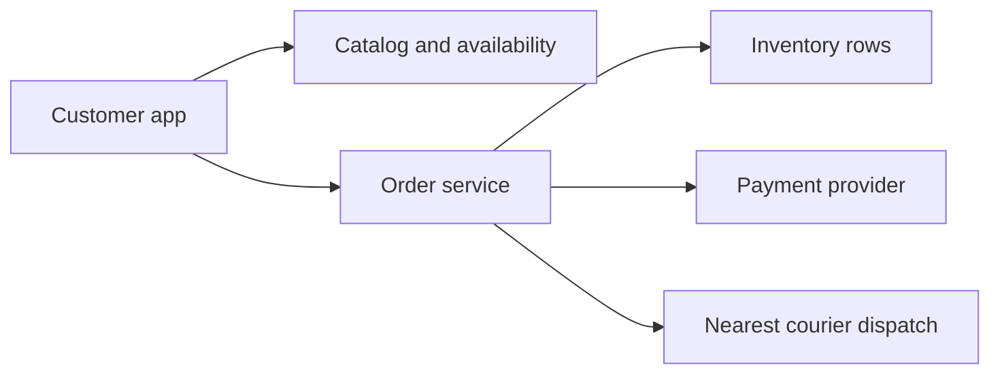
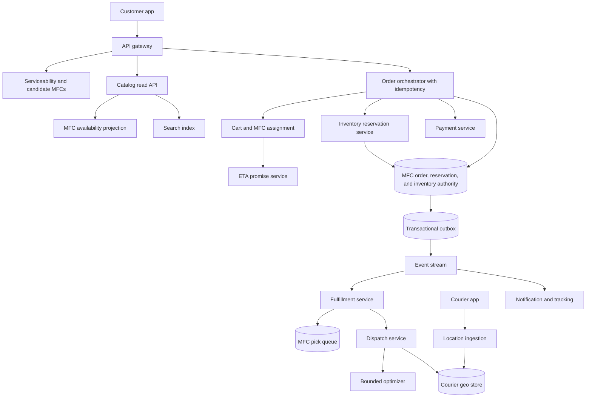
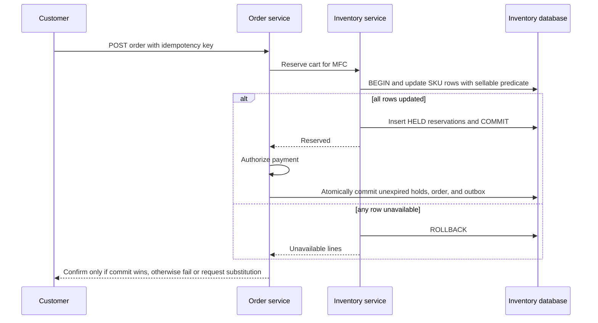
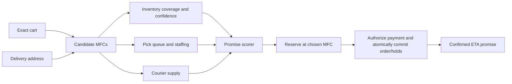
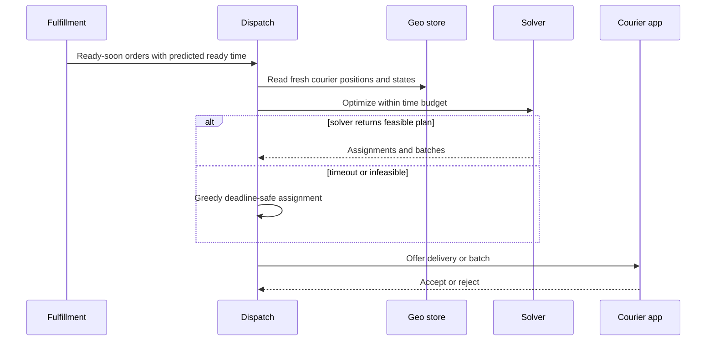

# Local Delivery System Design

This design covers a Gopuff-like quick-commerce service that sells a curated catalog from owned micro-fulfillment centers and delivers in minutes. It includes browse availability, checkout reservation, MFC assignment, picking, dispatch, ETA, tracking, substitutions, and payment state; it excludes procurement planning, marketplace restaurants, and long-haul parcel logistics.

## 1. Requirements
### 1.1 Functional requirements
- Show a serviceable catalog for a delivery address, with prices, delivery estimate, and advisory item availability.
- Let a customer build a cart, choose substitution preferences, apply eligible promotions, and check out safely on retry.
- Reserve every requested item from one authoritative micro-fulfillment center before confirming the order.
- Route confirmed orders through picking, packing, substitutions, handoff, courier dispatch, tracking, cancellation, and refund flows.
- Let operators manage MFC hours, capacity, zones, stock adjustments, pick queues, and courier supply.
- Notify customers and support agents from an auditable order timeline rather than from transient worker state.

### 1.2 Non-functional requirements
- **No logical oversell at checkout.** Browse can be stale, but confirmation must commit units from authoritative recorded stock at one MFC. Physical shrinkage can still cause a shortage and needs an explicit substitution/refund path.
- **Low-latency browsing.** Catalog and search should usually render under 200 ms at `p95`, because users abandon if every scroll requires an inventory transaction.
- **Fast but honest promises.** A 15-30 minute promise only helps if it accounts for pick queue, courier supply, batching delay, and uncertainty, not just map distance.
- **Retry-safe money and orders.** Mobile clients, payment providers, and warehouse devices all retry across timeouts, so mutations need idempotency keys, version guards, and reconciliation.
- **Local failure isolation.** A hot, closed, or disconnected MFC should degrade its own zone without taking down browse, checkout, or dispatch elsewhere.
- **Fresh tracking without hot order writes.** Courier locations update every few seconds and must not turn the order database into a time-series store.

### 1.3 The binding constraint
The system looks like a normal ecommerce site until checkout. During browsing, availability is an estimate derived from cached MFC projections, search indexes, partner feeds, picker reports, and recent sales. That estimate must be cheap, local, and fast enough to power search and ranking. At checkout, however, the customer is asking for a promise: this exact cart can be picked from one MFC and delivered by a deadline. That promise cannot be made from the browse cache because two customers can race for the last unit, a picker can mark an item damaged, or the nearest MFC can become overloaded between add-to-cart and payment.

The design is therefore shaped by a deliberate split. Browse returns advisory availability and candidate MFCs; checkout performs an authoritative all-or-nothing reservation against the selected MFC; ETA is computed from a feasible full-cart MFC with operational capacity; dispatch optimizes within a bounded window with a constraint-preserving greedy fallback that may leave work unassigned. The main mechanisms forced by this constraint are conditional inventory updates, expiring checkout holds and non-expiring committed allocations, idempotent order creation, MFC-scoped authority, probabilistic ETA promises, and bounded dispatch optimization.

## 2. Back-of-the-envelope estimation
Assume, illustratively, `20M` registered users, `3M` daily active users, `1,000` MFCs, and `2M` orders per day. The average order rate is `2,000,000 / 86,400 = 23.1` orders per second. A busy hour with `100,000` orders is `100,000 / 3,600 = 27.8` orders per second globally, so the global write rate is not frightening. The consequence is easy to miss: the hard part is not aggregate throughput, it is locality. A rainstorm, sporting event, or promotion can push hundreds of concurrent checkouts into a single MFC, and those checkouts contend for the same few low-stock SKUs.

If each order has `25` lines, the system processes `2,000,000 × 25 = 50,000,000` order lines per day. The peak-hour line rate is `100,000 × 25 / 3,600 = 694.4` attempted reserved lines per second globally. This is small enough for transactional storage if partitioned by MFC and SKU, but a single hot SKU cannot be protected by cache invalidation. It needs an atomic predicate such as `available >= requested` at the write authority.

Inventory cardinality is also moderate. With `5,000` active SKUs per MFC and `1,000` MFCs, the authoritative inventory table has `5,000 × 1,000 = 5,000,000` MFC-SKU rows. That is not a big-data problem. It is a correctness problem around concurrent decrements, safety stock, adjustments, and expiring holds. At `100×` the stated peak-hour order rate, browse is about `2,778` requests per second before caching; provisioning `5,000/s` adds headroom rather than following from that multiplier. The assumed 100,000-order hour is only `1.2×` the daily-average hour, so it is not a substitute for separately load-testing local bursts. Projections help browsing but cannot confirm stock.

Courier telemetry is a different shape. If `50,000` active couriers send a location every `5` seconds, ingestion is `50,000 / 5 = 10,000` updates per second. Those writes are append-heavy, lossy within limits, and TTL-bound. They belong in a geospatial/time-series path, while order state receives only coarse delivery transitions such as `PICKED_UP` and `DELIVERED`.

> **Key idea.** The numbers say to spend complexity on local correctness, not global throughput. Cache and precompute the browse side, but keep checkout reservation single-authoritative per MFC-SKU and keep high-frequency location updates out of transactional order storage.

## 3. API design
**Question.** If mobile clients retry checkout after a timeout, how do we avoid creating two orders, two payment authorizations, or two inventory holds?
<details><summary>Answer</summary>

The checkout API uses an idempotency key scoped to the customer and cart intent. The order service first records or finds the operation, then drives a state machine with stable downstream operation IDs for inventory and payment. A retry returns the existing order or pending status instead of repeating business effects.

</details>

```http
GET /v1/serviceability?lat=37.78&lng=-122.41
  -> 200 {"candidate_mfcs":[{"mfc_id":"mfc-17","eta_minutes":{"p50":18,"p90":29}}]}

GET /v1/catalog?mfc_id=mfc-17&catalog_version=2026-10-13T18:30Z
  -> 200 {"items":[{"sku_id":"sku-42","price":"4.99","availability":"LOW","availability_version":8123}]}

POST /v1/carts/{cart_id}/validate
  {"address_id":"addr-3","items":[{"sku_id":"sku-42","quantity":2}],"substitution_policy":"BEST_MATCH"}
  -> 200 {"candidate_mfc_id":"mfc-17","price_version":556,"advisory_unavailable":[]}

POST /v1/orders
Idempotency-Key: 6d944b4c
  {"cart_id":"cart-9","candidate_mfc_id":"mfc-17","price_version":556,"payment_method_id":"pm-8"}
  -> 202 {"order_id":"ord-91","status_url":"/v1/orders/ord-91"}

GET /v1/orders/{order_id}
  -> 200 {"state":"CONFIRMED","promised_delivery_at":"2026-10-14T03:05:00Z"}

POST /v1/orders/{order_id}/cancel
If-Match: order-version-7
  -> 202 {"state":"CANCEL_REQUESTED"}

POST /v1/couriers/{courier_id}/locations
  {"lat":37.78,"lng":-122.41,"observed_at":"2026-10-14T02:49:02Z","accuracy_meters":8}

POST /v1/deliveries/{delivery_id}/accept
Idempotency-Key: courier-accept-123
  -> 200 {"state":"ACCEPTED"}
```

The catalog endpoint deliberately says `availability` rather than `available_quantity`. Exposing precise counts from a stale projection invites customers and clients to treat advisory data as a contract. `LOW`, `IN_STOCK`, `LIKELY_OUT`, and an `availability_version` communicate enough for ranking and UI warnings while preserving the invariant that checkout must revalidate. Cart validation is still not a reservation; it gives the user an early warning and helps choose the best candidate MFC before payment.

`POST /v1/orders` returns `202` when the orchestration may still be settling inventory, payment, fraud checks, or a 3DS challenge. The status resource lets clients poll safely, and push notifications or SSE can reduce polling later. Every mutation has either an idempotency key or an `If-Match` version precondition. Cancellation is asynchronous because it races with picking and handoff: a cancel request can release inventory before picking, refund after packing, or be rejected after delivery.

Money uses decimal strings in API payloads and persisted snapshots. Floating point is not acceptable for authorizations, tax, tips, or refunds. The external payment provider sees stable operation IDs derived from the order state machine, so a timeout is resolved by querying the provider before retrying rather than by creating a second authorization.

## 4. Data model
Start with the obvious entity: an `Order` has customer, address, items, total, and status. That works for digital goods, but it cannot answer the quick-commerce question: which MFC owns the promise? The same SKU can be abundant in one MFC and unavailable in another a mile away. Therefore the order stores an `mfc_id`, address snapshot, price snapshot, and promised delivery time. Historical orders must not change when catalog titles, prices, zones, or taxes are updated.

Next, add `Inventory(mfc_id, sku_id, on_hand)`. That is still insufficient because physical stock and sellable stock are not the same. Define `on_hand` as recorded units not yet consumed from inventory, including damaged units still recorded on site, and `reserved` as both temporary holds and committed unpicked allocations. `on_hand - reserved - damaged - safety_stock` must cover each new reservation. A stock-loss correction can reveal a negative balance; do not reject reality or silently reduce reservations to preserve an equation. Block new sales, record the shortage, and reconcile affected orders through substitution or refund. Versioning lets read projections track changes.

A bare decrement also fails on abandoned checkouts. If checkout reserves stock and the payment challenge is never completed, those units cannot be stuck forever. If a sweeper blindly subtracts from `reserved`, it can release stock already promised to a confirmed order or consumed by picking. The fix is an `InventoryReservation` per order line with `HELD`, `COMMITTED`, `CONSUMED`, `RELEASED`, and `EXPIRED` states. Only temporary `HELD` rows expire; confirmation changes every line to `COMMITTED` under the same transaction as the order transition. The inventory row is the aggregate counter; the reservation row is the audit trail and compensation handle.

Fulfillment introduces another failure. An order can be confirmed while the warehouse device is offline, a picker can claim then disappear, or scans can retry. A `FulfillmentTask` with a claim lease and scan event IDs separates order truth from warehouse execution. Similarly, a `Delivery` entity separates courier assignment from the order because dispatch may reassign several times without rewriting the whole order.

```text
FulfillmentCenter
- mfc_id, region_id, location, service_polygon, operating_hours, status
- capacity_state: OPEN | DEGRADED | CLOSED

MfcSkuInventory
- mfc_id, sku_id
- on_hand, reserved, damaged, safety_stock
- version, updated_at

InventoryReservation
- reservation_id, order_id, mfc_id, sku_id, quantity
- state: HELD | COMMITTED | CONSUMED | RELEASED | EXPIRED
- expires_at, operation_id, created_at

Order
- order_id, customer_id, mfc_id, idempotency_key
- delivery_address_snapshot, pricing_snapshot, payment_intent_id
- state: PENDING | RESERVING | PAYMENT_AUTHORIZING | CONFIRMED | PICKING | PACKED | OUT_FOR_DELIVERY | DELIVERED | CANCELLED | FAILED
- promised_delivery_at, version, created_at

OrderItem
- order_id, line_id, requested_sku_id, fulfilled_sku_id
- requested_quantity, fulfilled_quantity, unit_price_snapshot
- substitution_policy, reservation_id

FulfillmentTask
- task_id, order_id, mfc_id
- state: QUEUED | CLAIMED | PICKING | PACKED | HANDED_OFF
- picker_id, claim_lease_until, promised_ready_at

Delivery
- delivery_id, order_id, mfc_id, courier_id
- state: OFFERED | ACCEPTED | AT_PICKUP | PICKED_UP | AT_CUSTOMER | DELIVERED | CANCELLED
- assignment_version, pickup_at, delivered_at

OrderEvent
- order_id, sequence, event_type, payload, created_at, producer_operation_id
```

Order commit state, reservations, and inventory are colocated within one MFC transaction boundary, with SKU rows as keys inside that boundary; independently sharding SKU rows does not make a multi-line transaction local. Customer/order-ID indexes route to that authority. A durable checkout operation fixes the selected MFC and cart fingerprint before reservation so retries cannot create separate orders at two centers; switching centers requires releasing the prior attempt first. Fulfillment tasks may live separately and are created idempotently from the order outbox. Courier locations live in a TTL geospatial store keyed by courier and region. Catalog data is centrally managed, but published MFC assortments and availability projections are materialized into read stores and search indexes. Raw location trails, catalog search documents, and analytics aggregates deliberately do not go in the transactional inventory store.

> **Key idea.** The data model separates promises from hints. Advisory projections can be rebuilt, but order, reservation, payment, fulfillment, and delivery transitions need durable state machines with operation IDs.

## 5. High-level design
The simplest design has the app call a catalog service, pick the nearest MFC, create an order, decrement inventory, charge the card, and ask dispatch for the nearest courier.



This design breaks in five concrete ways. First, browse availability is stale, so two checkouts can sell the last unit if inventory is decremented outside an atomic predicate. Second, nearest-MFC selection can be wrong when the nearest MFC is missing one item or has a long pick queue. Third, charging before a durable reservation creates refunds for unavailable carts, while reserving without expiration leaks stock. Fourth, nearest-courier dispatch misses batching, predicted ready time, courier acceptance, and bounded optimization. Fifth, frequent courier locations and warehouse scans can overload the order database if treated as ordinary order updates.

### Fix 1: Split advisory availability from authoritative reservation
Browse uses a materialized availability projection per MFC-SKU, fed by inventory versions, catalog publishing, picker reports, cycle counts, and sales events. It can be stale by seconds and still be useful for ranking, hiding risky low-stock items, and warning customers. Checkout does not trust it. The inventory service runs a transaction over sorted SKU rows and applies `reserved = reserved + quantity` only when `on_hand - reserved - damaged - safety_stock >= quantity`. If any line fails, the reservation transaction rolls back and checkout returns the unavailable lines.

DoorDash and Instacart evidence points in the same direction. Their grocery availability systems combine retailer feeds, shopper or Dasher reports, photos, purchase history, and confidence ranking, yet still rely on substitutions and final validation. That is exactly the role of this projection: improve browse quality without becoming the source of truth for order confirmation.

### Fix 2: Make MFC assignment cart-aware and capacity-aware
The app can start with the closest serviceable MFC, but order creation must choose the nearest MFC that can satisfy the whole cart and the delivery promise. The assignment service scores candidate MFCs by service polygon, travel time, item coverage, inventory confidence, pick queue, courier supply, hours, age-restricted handling, and capacity health. If the nearest MFC lacks one item, the system can either choose a slightly farther MFC with the full cart, ask the customer to accept a substitution, or split only if the product explicitly supports multiple deliveries. For instant commerce, the default should be one MFC, because split deliveries double dispatch complexity and confuse the promise.

### Fix 3: Orchestrate checkout as an idempotent saga
There is no shared transaction with the payment provider or fulfillment queues. The order service records a `PENDING` order under the idempotency key, reserves inventory, and authorizes payment with stable operation IDs. After authorization, a local MFC transaction checks that the order is still confirmable and every hold is `HELD` and unexpired at the serialized decision, then changes all holds to `COMMITTED`, marks the order `CONFIRMED`, and inserts an outbox event. Fulfillment consumes that event idempotently. If expiry or cancellation won, a late authorization is voided instead of confirming an unreserved order; ambiguous provider responses remain pending and are reconciled. Payment failure releases temporary holds, and cancellation of committed unpicked stock uses an explicit guarded release rather than a TTL.

### Fix 4: Dispatch with a bounded optimizer and a greedy fallback
Nearest available courier is a baseline, not a design. Dispatch should consider predicted pick completion, courier location, acceptance probability, vehicle type, batch compatibility, promised deadline, pickup wait, and route detour cost. DoorDash describes dispatch evolving from simpler matching to MIP-style optimization for multi-delivery routes, while its routing work uses bounded heuristics and greedy fallbacks because last-mile routing is NP-hard. This system should solve in short windows, keep the best feasible solution found so far, and fall back to greedy assignment when the optimizer times out.

### Fix 5: Separate high-rate signals from order truth
Courier locations go to a TTL geo store and event stream. Warehouse scans go to fulfillment task state and append-only scan events. The order timeline receives durable milestones, not every GPS point or aisle scan. Tracking reads combine order state, delivery state, latest courier point, and ETA projection. This keeps the order database small, auditable, and strongly guarded while still giving customers live updates.

### Putting it together


A typical request starts with serviceability finding candidate MFCs for the address. Catalog reads materialized assortment and advisory availability. Checkout creates or resumes the idempotent operation, fixes the MFC for the accepted cart, obtains an ETA, holds inventory, and authorizes payment. Confirmation atomically commits still-unexpired holds, order state, and an outbox event in the MFC authority. Fulfillment consumes that event into its pick queue; dispatch observes ready time and courier supply. Order and inventory remain separate logical models within that commit boundary, while current courier position and rebuildable projections stay outside it.

> **Key idea.** Each component traces back to a specific failure of the naive design.

## 6. Deep dives
### 6.1 Advisory availability versus authoritative reservation
**Question.** Two customers see one low-stock item as available, add it to cart, and check out at the same time. Which one gets the unit, and what exactly prevents both from being confirmed?
<details><summary>Answer</summary>

Browse availability is only a hint. Checkout runs a single MFC-scoped transaction that conditionally increments `reserved` for each SKU only when sellable stock is sufficient. One transaction commits first; the other observes insufficient sellable stock and fails or requests substitution.

</details>

A tempting answer is to make the browse cache fresher. That helps conversion, but it does not solve the race. Even if the cache updates every second, two checkouts can arrive within the same second. Even if it updates every 100 ms, a picker can mark a unit damaged after the customer opens the cart. The invariant belongs at the write authority: confirmation commits all reservations and ordinary reservation writes cannot allocate beyond recorded sellable stock. Physical loss is an explicit shortage, not something this transaction can prevent.

The reservation transaction validates positive quantities, combines duplicate SKU lines, and locks/updates SKU rows in a consistent order to reduce deadlocks. A unique stable reservation operation ID and its recorded result are committed with the increments, so retrying cannot increment twice. Each row uses this predicate:

```sql
UPDATE mfc_sku_inventory
SET reserved = reserved + :quantity,
    version = version + 1
WHERE mfc_id = :mfc_id
  AND sku_id = :sku_id
  AND on_hand - reserved - damaged - safety_stock >= :quantity;
```

If any update affects zero rows, the transaction rolls back all earlier lines. This is important for quick commerce because the delivery promise depends on one MFC having every item. Partial reservation would create a stranded order unless the customer already opted into substitutions or partial fulfillment. The reservation service also writes `InventoryReservation` records in the same transaction. Those records are not a substitute for the counter predicate; they are the audit trail, expiration handle, and reconciliation source.



Reservation expiration is a subtle source of bugs. A sweeper transitions only due `HELD -> EXPIRED` and decrements `reserved` in the same transaction, using the same locking order as confirmation. An expired-but-not-yet-swept hold cannot be committed merely because its state still says `HELD`. If confirmation wins, `COMMITTED` is not TTL-released while the picker works. At the chosen physical consumption milestone, `COMMITTED -> CONSUMED` atomically subtracts quantity from both `reserved` and `on_hand`; releasing unconsumed stock subtracts only from `reserved`. Retried scans use stable operation IDs. Cancellation races against consumption in that authority; consumed stock requires a separate physical-return disposition, not a blind stock increment.

Substitution reserves the replacement SKU and releases/adjusts the original allocation transactionally, with customer consent and a recalculated price/payment authorization when needed. A committed-order failure must explicitly compensate committed reservations; a generic expired-hold sweeper is not allowed to do so. Reconciliation compares order state, reservation quantities, scans, and payment status, surfacing a confirmed order without a committed/consumed allocation as a defect rather than repairing it with an unfenced decrement.

Precomputed projections still matter. DoorDash's grocery inventory work describes combining disparate sources and confidence ranking for digital inventory, and Instacart's availability systems predict hundreds of millions of listings on a schedule while still supporting replacements. For an owned MFC, the projection can be stronger than a marketplace feed because the operator controls receipts, scans, and cycle counts, but it is still not linearizable. Its job is to reduce bad carts before checkout: hide items below a low-stock threshold, down-rank low-confidence SKUs, refresh popular SKU projections more often, and display substitution prompts early.

The trade-off is sales versus disappointment. Higher safety stock and conservative projections reduce substitutions and support contacts but hide sellable units. Aggressive projections increase conversion but push failures into checkout or picking. The right setting is per SKU and MFC: a high-value item with frequent shrinkage deserves a larger buffer than canned seltzer with stable replenishment. Signals worth watching: checkout stock-failure rate by MFC-SKU, browse-to-checkout stale availability, reservation deadlocks, expired holds, adjustment rate, and substitution rate.

> **Strong-answer criteria.** A senior answer distinguishes advisory reads from authoritative writes and names the actual concurrency control. It also covers expiration, compensation, and physical-stock drift rather than pretending the database row always matches the shelf.

| Level | Approach | Why |
|---|---|---|
| Bad | Trust the catalog cache and decrement asynchronously after payment | Two checkouts can confirm the last unit, and refunds become the normal path. |
| Good | Use a transactional inventory update at checkout | Prevents oversell but may still leak stock without reservation state and expiration guards. |
| Great | Use MFC-scoped conditional reservation, reservation state transitions, safety stock, projections, and reconciliation | Preserves correctness while keeping browse fast and giving operations levers for shrinkage and stale signals. |

### 6.2 MFC assignment and the ETA promise
**Question.** The closest MFC can deliver in 14 minutes but lacks one cart item; a farther MFC has every item but likely delivers in 28 minutes. What does checkout promise?
<details><summary>Answer</summary>

Checkout should promise from the best MFC that can satisfy the complete accepted cart and capacity constraints. If the closest MFC cannot reserve every item, the system either asks for a substitution, uses the farther MFC with an honest ETA, or rejects the cart; it should not promise from the closest MFC and hope picking fixes it.

</details>

The naive serviceability algorithm draws a radius around the address and chooses the nearest open MFC. That is enough to show a landing page, but it is not enough to confirm an order. Quick commerce sells a bundle of items plus a time promise. The bundle is feasible only if one MFC can reserve all accepted items. The time promise is feasible only if that MFC's pick queue, staffing, courier supply, travel time, and uncertainty fit the service level.

The assignment service therefore works in two stages. During browse, it finds a small set of candidate MFCs whose polygons contain the address or whose drive time is below a threshold. It annotates each with advisory catalog coverage and an ETA distribution. During checkout, it re-scores candidates for the exact cart and asks inventory to reserve at the selected MFC. If reservation fails because the projection was stale, assignment can try the next candidate only if the user experience allows it and payment has not been committed. Usually the cleaner path is to return unavailable lines and substitutions, because silent MFC switching can change price, fees, taxes, delivery time, alcohol eligibility, or item assortment.

ETA should be a distribution, not a single average. Picking and courier approach often run in parallel: a useful decomposition from confirmation is `max(queue_delay + pick_pack_time, assignment_delay + courier_to_MFC_time) + handoff_time + delivery_travel_time`. Any sequential component definition must avoid counting the same wait twice. Features include MFC queue depth, staffing, item count, temperature zones, courier density, weather, traffic, batching, and acceptance rates. Predict the joint completion-time distribution: summing component p90 values is not the p90 of the total. DoorDash's probabilistic ETA work motivates separating prediction from the promise decision; here the product can show a range or choose a calibrated percentile such as p80.



This is where ML reliability becomes product reliability. Swiggy's ML reliability discussion gives a concrete class of failure: a feature unit changes upstream and corrupts ETA predictions unless the serving layer clips inputs and outputs, exposes error codes, and has fallback heuristics. A quick-commerce ETA service should reject impossible predictions such as negative pick time, cap travel speed, monitor feature drift, shadow new models, and fall back to conservative rules when features are missing. A bad ETA is not just a ranking bug; it can cause late orders, refunds, and overloaded MFCs.

There is also a fairness and stability problem. If the assignment service always picks the MFC with the shortest current ETA, traffic can oscillate between neighboring centers as queues fluctuate. Use hysteresis and capacity buckets: prefer the user's default MFC unless another candidate is materially better, and stop promising a center before it is fully saturated. Operators need a manual drain mode for freezer failures, staffing shortages, or local events. In drain mode, browse projections can still show items, but checkout assignment treats the MFC as unavailable or capacity constrained.

The key trade-off is whether to split an order across MFCs. Splitting can recover revenue when no single MFC has all items, but it creates two picks, two courier routes, two handoffs, two tracking experiences, and ambiguous substitutions. For a 15-30 minute owned-inventory service, the default should be no split. Consider splitting only for high-value baskets, scheduled deliveries, or enterprise customers, and present it explicitly as two deliveries. Signals worth watching: promised-versus-actual delivery by MFC and percentile, assignment retry rate, MFC switching at checkout, ETA model fallback rate, late orders caused by pick queue versus courier delay, and manual drain duration.

> **Strong-answer criteria.** A strong design treats MFC choice as a feasibility and promise problem, not just geospatial lookup. It includes probabilistic ETA, capacity health, model fallbacks, and user-visible handling when no single MFC can satisfy the cart.

| Level | Approach | Why |
|---|---|---|
| Bad | Always choose the nearest MFC and show a fixed 20-minute ETA | It ignores cart completeness, queue depth, courier supply, and uncertainty. |
| Good | Score MFCs by inventory coverage and distance | Better feasibility, but still misses operational capacity and promise calibration. |
| Great | Choose the best full-cart MFC using reservation, probabilistic multi-stage ETA, capacity controls, fallbacks, and explicit substitution or rejection flows | Aligns the customer promise with physical stock and local delivery reality. |

### 6.3 Dispatch, batching, and bounded optimization
**Question.** Five orders will be packed within six minutes and eight couriers are nearby. Do we assign each order immediately to the nearest courier or wait to batch?
<details><summary>Answer</summary>

Use a bounded dispatch window. Optimize assignments and compatible batches against promised deadlines, predicted ready times, detour cost, and courier state, but keep a greedy feasible assignment as fallback if the optimizer times out or the batching window would risk a promise.

</details>

Instant commerce dispatch is hard because the system controls both the warehouse queue and the courier handoff. If dispatch assigns too early, couriers wait at the MFC while items are still being picked. If it assigns too late, packed orders sit on a shelf and miss the promise. If it greedily picks the nearest courier for each order, it misses two-order routes that reduce cost with a tiny detour. If it waits too long for the perfect batch, it sacrifices the very speed customers bought.

The dispatch service should maintain a rolling view of ready-now and ready-soon orders. Fulfillment publishes predicted ready time as the picker claims and scans items; ETA publishes the latest customer deadline; location ingestion maintains each courier's latest position and freshness; courier service provides capacity, vehicle type, break state, and acceptance history. Every few seconds, dispatch builds a bounded optimization problem for one region or MFC cluster. The objective can minimize weighted lateness, pickup wait, travel time, detour, and unfairness while respecting hard constraints such as age-restricted eligibility, vehicle capacity, temperature handling, and maximum batch size.

DoorDash's dispatch and routing posts are directly relevant. They describe moving beyond simple bipartite matching toward MIP-style formulations for multi-delivery routes, and using ruin-and-recreate heuristics with time limits and greedy benchmarks because routing is NP-hard. The lesson is not to copy a specific algorithm; it is to put a latency budget around the optimizer. A solver that returns an ideal plan after 45 seconds is useless for a 20-minute promise. A solver that returns the best current feasible plan after 300 ms, plus a greedy fallback, is production-shaped.



An offer is temporary; acceptance creates durable route ownership, not an assignment that disappears when telemetry expires. Acceptance verifies the authenticated courier, pending offer, server expiry, and assignment version, then atomically claims delivery/order membership and the courier's compatible route/capacity with an outbox event. Per-delivery CAS alone cannot stop two optimizers from assigning incompatible routes to the same courier. A retry returns the recorded acceptance. Rejection/expiry releases only the matching pending offer; redispatch after acceptance requires an explicit fenced transfer. For batches, each stop has its own deadline and proof requirements; cancellation can remove an unpicked stop through a guarded route update, while picked-up goods require a physical disposition.

A greedy fallback must still satisfy all hard constraints and can leave orders unassigned. If no feasible route exists, keep the order visibly pending, revise the promise or cancel under policy; neither a solver nor a fallback can guarantee a deadline when no courier capacity exists.

Batching must be conservative near deadlines. A simple policy is to allow batching only if the predicted `p90` delivery time for every order remains before its promise plus a small grace threshold, and to cap detour per order. The optimization can be more aggressive when demand is high and courier supply is low, but the customer-facing promise should already account for that. If the ETA service knows dispatch is using a 90-second batching window, the original promise must include that potential wait; otherwise dispatch invisibly steals slack.

Tracking should not expose every internal assignment churn. Customers care that the order is being prepared, picked up, nearby, or delivered. Courier location should be throttled and blurred according to policy, then stopped after delivery. The order database stores `ASSIGNED`, `PICKED_UP`, and `DELIVERED`; the geo store stores fresh points with TTL. Signals worth watching: solver latency, fallback rate, batch utilization, courier wait at MFC, packed-to-pickup time, rejection rate, stale location rate, lateness by dispatch cause, and customer contacts about confusing tracking.

> **Strong-answer criteria.** A senior answer does not stop at nearest courier. It describes the bounded optimization problem, deadline-safe fallback, assignment leases, and how dispatch slack is included in the ETA promise.

| Level | Approach | Why |
|---|---|---|
| Bad | Assign every order to the nearest courier immediately | Causes courier wait, poor batching, and missed deadlines when ready times differ. |
| Good | Run periodic matching using courier distance and order deadlines | Handles some contention but may fail under solver timeout, rejection, and batching constraints. |
| Great | Maintain ready-soon state, solve bounded batch assignments, use greedy fallback, lease offers, CAS delivery transitions, and feed batching delay into ETA | Improves economics without making the delivery promise depend on an unbounded optimizer. |

## 7. Variants
**10x scale.** At `20M` orders per day, the global average becomes `20,000,000 / 86,400 = 231.5` orders per second and peak-hour traffic might exceed `278` orders per second before local bursts. The architecture remains MFC-scoped, but hot MFCs need stricter admission control, per-SKU contention monitoring, read projection fanout, and possibly SKU-bucketed inventory writers. Do not split a single hot SKU across active writers unless the product accepts weaker multi-line atomicity or introduces a reservation coordinator.

**Active-active regions.** MFCs are naturally regional, so each MFC should have one write home for inventory, fulfillment, and order orchestration. Catalog and order history can replicate broadly, but inventory writes should not be accepted in two regions at once. During failover, fence the old primary, promote a sufficiently current replica, and mark uncertain MFCs unavailable until reservation state is reconciled. A few minutes of checkout unavailability is better than duplicate dispatch or oversell.

**Regulated items.** Alcohol, tobacco, pharmacy, or age-restricted goods add constraints to assignment and dispatch. The chosen MFC must be licensed for the address, the courier must be eligible, the customer may need identity verification, and proof must be retained according to market rules. The inventory reservation mechanism stays the same, but ETA and dispatch must include compliance checks as hard constraints, not post-processing.

**Marketplace or partner inventory.** If the service stops owning all MFC stock and adds partner stores, availability becomes less trustworthy. Browse projections need source-confidence scoring, checkout may need partner-side reservation APIs, and substitution flows become more prominent. The transferable invariant still holds: do not confirm a promise until one fulfillment node has reserved or contractually accepted every item.

## 8. The transferable pattern
The reusable pattern is a fast advisory read path paired with a slower authoritative commit path. Search, browsing, recommendations, and ETA previews use projections because they must be low-latency and high-fanout. The moment the user asks for a scarce resource, the system switches to a write authority that uses conditional updates, leases, fencing, or state-machine guards. Ticket sales, hotel booking, restaurant reservations, and flash-sale ecommerce all share this shape; see [Ticketmaster](./ticketmaster-system-design.md) for another version where stale discovery gives way to authoritative seat holds.

The second pattern is promise composition across physical and external systems. The customer sees one order, but the promise depends on inventory, payment, picking, courier acceptance, routing, and sometimes regulation. There is no global exactly-once transaction across those systems. Production-grade designs make each local transition idempotent, record an audit event, publish through an outbox, and run reconcilers for the gaps between physical reality and software state.

## Review
The design starts from the binding constraint that browse availability is advisory while checkout must reserve real inventory at one MFC. That forces an MFC-scoped inventory authority with conditional updates, reservation records, expiration guards, and reconciliation. It also forces cart-aware MFC assignment because the delivery promise depends on the nearest center that can satisfy the whole cart and has enough operational capacity. ETA is treated as a probabilistic, multi-stage promise rather than a distance calculation. Dispatch uses bounded optimization for batching and route economics, but preserves correctness with greedy fallback, assignment leases, and compare-and-swap delivery transitions. High-rate signals such as courier location and search projections stay outside transactional order storage, while the order timeline, reservation state, payment operations, fulfillment tasks, and delivery milestones remain durable and auditable.

### Check your understanding
1. Why is it acceptable for browse availability to be stale but not checkout availability?
   <details><summary>Answer</summary>

   Browse is a hint used for ranking and user guidance; it can be corrected before the customer is charged or promised delivery. Checkout creates a business commitment, so it must use the authoritative inventory predicate and reserve real units before confirmation.

   </details>
2. Why does the design prefer one MFC per order?
   <details><summary>Answer</summary>

   One MFC keeps reservation, picking, dispatch, tracking, pricing, and customer expectations coherent. Splitting can recover revenue but doubles fulfillment and delivery complexity, so it should be explicit and limited to variants that justify it.

   </details>
3. What bug can an inventory expiration sweeper introduce?
   <details><summary>Answer</summary>

   It can release units already promised to a confirmed order, consumed by picking, or released by cancellation. Expiry must compete atomically with confirmation, transition only due `HELD` rows, and update inventory in the same transaction. Confirmed `COMMITTED` allocations do not expire automatically.

   </details>
4. Why is ETA modeled as a distribution?
   <details><summary>Answer</summary>

   Pick time, courier assignment, pickup wait, and travel time vary by local conditions. A distribution lets the business choose an honest promise percentile and manage uncertainty, while averages create systematically late orders during volatile periods.

   </details>
5. Why does dispatch need a greedy fallback if it has an optimizer?
   <details><summary>Answer</summary>

   Routing and batching are time-constrained optimization problems. A greedy fallback provides a bounded best effort under the same hard constraints. If it cannot find a feasible assignment, it must leave work unassigned and trigger promise/operational handling, not invent capacity or silently violate constraints.

   </details>

## Sources and further reading
| Source | Article | Why it matters |
|---|---|---|
| DoorDash | [Next-Generation Optimization for Dasher Dispatch at DoorDash](https://careersatdoordash.com/blog/next-generation-optimization-for-dasher-dispatch-at-doordash/) | Shows why dispatch evolves from simple matching to MIP-style optimization with predictions, constraints, rollout safety, and multi-delivery routes. |
| DoorDash | [Scaling a routing algorithm using multithreading and ruin-and-recreate](https://careersatdoordash.com/blog/scaling-a-routing-algorithm-using-multithreading-and-ruin-and-recreate/) | Explains bounded route optimization, same-day constraints, concurrency, and greedy fallbacks for last-mile routing. |
| DoorDash | [Improving ETAs with multi-task models, deep learning, and probabilistic forecasts](https://careersatdoordash.com/blog/improving-etas-with-multi-task-models-deep-learning-and-probabilistic-forecasts/) | Details probabilistic, multi-stage ETA modeling and why uncertainty must feed the customer promise. |
| DoorDash | [Building a Source of Truth for an Inventory with Disparate Data Sources](https://careersatdoordash.com/blog/building-a-source-of-truth-for-a-digital-inventory-with-disparate-data-sources/) | Covers inventory-confidence signals, precomputed availability projections, search down-ranking, and substitutions. |
| Instacart | [The story behind an Instacart order, part 3: predicting the shop](https://tech.instacart.com/the-story-behind-an-instacart-order-part-3-predicting-the-shop-d1a3bb9f5d98) | Shows item availability and replacement models for grocery fulfillment with stale partner inventory. |
| Instacart | [The story behind an Instacart order, part 2: browsing and buying](https://tech.instacart.com/the-story-behind-an-instacart-order-part-2-browsing-and-ordering-6b6a6066a706) | Explains searchable grocery catalog scale, contextual pricing, deal application, checkout persistence, and authorization. |
| Uber Eats | [From Restaurants to Retail: Scaling Uber Eats for Everything](https://www.uber.com/us/en/blog/scaling-uber-eats-for-everything/) | Describes INCA catalog/inventory ingestion, enrichment, publishing, indexing, versioning, and rollback at retail scale. |
| Zepto | [Building Search for a 10-Minute World](https://blog.zepto.com/building-search-for-a-10-minute-world-43b1992f5dca) | Explains hyperlocal quick-commerce search where query intent, fulfillment zone, inventory, price, and ranking are resolved live. |
| Zepto / AWS | [How Zepto powers sub-second search using OpenSearch Service OR2 instances](https://aws.amazon.com/blogs/big-data/how-zepto-powers-sub-second-search-using-opensearch-service-or2-instances/) | Shows event-driven hub-level indexing, P0/P1 freshness pipelines, and the trade-off between search refresh latency and real-time inventory validation. |
| Swiggy | [Building Rock-Solid ML Systems](https://medium.com/swiggy-bytes/building-rock-solid-ml-systems-d1d5ab544f0e) | Covers ML operational excellence for ETA and quick-delivery systems, including clipping, shadow mode, error codes, and fallbacks. |
| PostgreSQL | [Transaction Isolation](https://www.postgresql.org/docs/current/transaction-iso.html) | Explains concurrent conditional updates and predicate rechecks; multi-row reservation and confirmation still require one transaction. |
