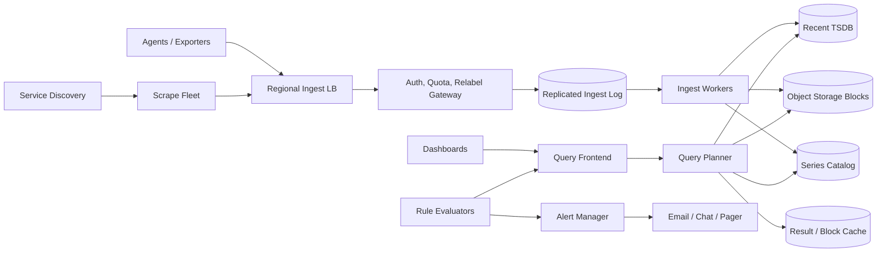

# Production Metrics Monitoring System

## 1. Requirements

### Functional requirements

1. Ingest counters, gauges, and histogram/distribution samples from hosts and services.
2. Support tagged time series such as `http_requests_total{service,region,status}`.
3. Query recent and historical data with filters, grouping, aggregation, and rates.
4. Render dashboards with near-real-time refresh.
5. Evaluate threshold, absence, and derived-expression alerts.
6. Route notifications through on-call integrations while deduplicating and inhibiting noise.
7. Apply retention, downsampling, quotas, and tenant isolation.
8. Discover and scrape targets as well as accept pushed metrics.

### Non-functional requirements

- Sustain millions of samples per second with predictable backpressure.
- Make fresh data queryable within 10-30 seconds.
- Target 99.9% ingestion availability and 99.99% alert-evaluation availability.
- Preserve acknowledged samples durably; tolerate duplicate delivery.
- Keep dashboard queries below one second for common recent windows.
- Prevent unbounded tag cardinality from destabilizing the service.

Logs and traces are adjacent products but are out of scope. Exemplars may link a metric point to a trace ID.

## 2. Scale assumptions and capacity

Assume:

- 2 million monitored hosts and containers.
- 500 active series per target on average: 1 billion active series.
- One sample every 15 seconds: about 67 million samples/second at peak.
- 16 bytes for timestamp/value plus roughly 2 bytes/sample after delta and XOR compression.
- Seven days of raw data, 13 months of 5-minute aggregates.
- 100,000 dashboard queries/second and 10 million alert rules evaluated each minute.

```text
67M samples/s x 86,400 x 2 compressed bytes
= about 11.6 TB/day for sample payloads
```

Indexes, replication, write-ahead logs, and object metadata add several times that amount. Cardinality, not only bytes, drives memory: an in-memory 200-byte head per active series would require roughly 200 GB before replicas and caches.

## 3. High-level architecture



The write path is append-heavy and optimized for compression; the read path fans out over time and series shards. The durable ingest log decouples acceptance from storage and lets consumers replay after failure.

## 4. Data model and wire protocol

```text
Tenant
- tenant_id
- ingest_limit
- active_series_limit
- retention_policy

Series
- tenant_id
- metric_name
- canonical_labels
- series_fingerprint
- first_seen
- last_seen

Sample
- series_fingerprint
- timestamp_ms
- float64_value

HistogramSample
- series_fingerprint
- timestamp_ms
- count
- sum
- sparse_buckets

Block
- tenant_id
- min_time / max_time
- shard
- resolution
- object_keys
- checksum

AlertRule
- rule_id
- expression
- interval
- for_duration
- labels
- destinations
```

Labels are sorted and normalized before hashing. The fingerprint is an index key, not proof of identity; collisions compare canonical labels. Agents send compressed batches over remote-write HTTP or streaming gRPC:

```protobuf
WriteRequest {
  repeated TimeSeries series;
  string request_id;
}
```

Reject samples too far in the future, and route moderately late samples to a bounded out-of-order buffer. Return explicit per-batch throttling and validation errors.

## 5. Core APIs

```http
POST /v1/metrics:write
Authorization: Bearer <tenant-token>
Content-Encoding: snappy
Idempotency-Key: agent-batch-uuid
```

```http
GET /v1/query?expr=sum(rate(http_requests_total{service="checkout"}[5m]))
GET /v1/query_range?expr=...&start=...&end=...&step=60s
GET /v1/labels/service/values?match[]=http_requests_total
POST /v1/rules
GET /v1/alerts
POST /v1/silences
```

Range queries return a matrix of timestamp/value pairs plus warnings for partial results. Query limits include maximum series scanned, points returned, time range, and execution duration.

## 6. Ingestion flow

1. An agent batches samples by tenant and compresses them.
2. The gateway authenticates, validates timestamps and labels, applies relabeling, and enforces rate and cardinality quotas.
3. A consistent hash routes each series to an ingest partition.
4. The gateway appends the batch to a quorum-replicated log before acknowledging it.
5. An ingest worker deduplicates request IDs within a bounded window and appends samples to its write-ahead log and in-memory head.
6. Periodically, the worker compacts immutable two-hour blocks, uploads them to object storage, and publishes block metadata.
7. Catalog updates make newly observed series discoverable.

At-least-once agents are preferable to losing metrics. Identical timestamp/value pairs are collapsed; conflicting values at one timestamp use a documented winner, normally the latest accepted sample, and increment a conflict metric.

## 7. Scraping and backpressure

Service discovery assigns targets to scrape workers with consistent hashing. Leases prevent two workers intentionally scraping the same target, although brief duplication during rebalance is harmless.

Each worker adds target health metrics, applies timeouts, and uses jitter so all jobs do not fire simultaneously. When ingestion is constrained:

- Gateways return `429` with retry guidance.
- Agents use exponential backoff, jitter, a bounded disk spool, and oldest-first replay.
- Per-tenant fair queues prevent one customer from consuming all capacity.
- Low-priority recording rules may be delayed before ingestion is dropped.

Never silently report success for discarded samples. Surface dropped-series and spool-age telemetry locally and centrally.

## 8. Query execution

The frontend parses and normalizes the expression, selects matching series from the catalog, and splits work by time and shard. Leaf workers read recent chunks from the head and historical blocks from object storage, then perform local filtering and partial aggregation. A reducer merges partials.

Optimizations:

- Cache immutable block indexes and normalized query results.
- Push label filters and partial `sum`, `min`, and `max` to leaves.
- Align dashboard time ranges and steps to improve cache reuse.
- Use recording rules for expensive, recurring expressions.
- Select a coarser downsampled resolution when the requested pixel density permits it.

A query scheduler uses tenant-weighted fairness so a month-long wildcard query cannot starve alert evaluation.

## 9. Alert evaluation and notification

Rule groups are assigned by tenant and group ID to evaluators. One owner evaluates a group at a time under a renewable lease. The evaluator stores the last successful evaluation and pending `for` state durably.

An alert transitions:

```text
INACTIVE -> PENDING -> FIRING -> RESOLVED
```

Alert Manager clusters replicas, deduplicates by alert fingerprint, groups related alerts, applies silences and inhibition, and routes notifications. Notification attempts carry stable IDs, use exponential retries, and enter a dead-letter queue after policy exhaustion. Receivers must tolerate duplicates because exactly-once external paging is not realistic.

Alert queries receive reserved capacity and may choose fail-closed semantics: missing evaluation data is reported as an evaluation error, not interpreted as healthy.

## 10. Consistency, ordering, and concurrency

- Samples are ordered per series within a worker, not globally.
- Acknowledged writes are durable in the replicated log but may not yet be query-visible.
- Read-after-write is eventual, bounded by log lag and head publication.
- Rule definitions and dashboard metadata use strongly consistent conditional updates.
- Block manifests are published only after all objects and checksums are durable.
- Compaction is idempotent; output block IDs derive from input IDs and compaction level.

Concurrent rule edits use an `etag` or revision. Alert leases require fencing tokens so a paused former owner cannot publish after reassignment.

## 11. Partitioning, indexing, and storage

Partition first by tenant, then hash by series fingerprint. Large tenants receive dedicated virtual shards; small tenants share shards. Time partitioning creates immutable blocks, enabling cheap object storage and parallel range scans.

The inverted catalog maps `(tenant, label_name, label_value)` to compressed postings of series IDs. High-cardinality values make this index expensive, so enforce per-metric series limits and expose cardinality reports.

Within a block, group samples by series and encode:

- Timestamp deltas with delta-of-delta compression.
- Floating-point values with XOR compression.
- Sparse histogram buckets with delta encoding.

Background compaction merges small blocks, removes superseded samples, creates downsampled aggregates, and atomically swaps manifests. Lifecycle rules delete expired blocks only after replicas and readers no longer reference them.

## 12. Reliability and failure handling

| Failure | Handling |
|---|---|
| Agent loses connectivity | Bounded local disk spool and replay |
| Gateway fails after log append | Retry with request ID; deduplicate |
| Ingest worker crashes | New worker replays partition from durable log |
| Object upload partially succeeds | Manifest remains unpublished; orphan sweeper removes objects |
| Catalog lags | Known-series queries work; discovery may be temporarily incomplete |
| Query shard times out | Return explicit partial-result warning or fail strict alert queries |
| Evaluator pauses past lease | Fencing token rejects stale output |
| Notification endpoint fails | Stable notification ID, retry, then dead-letter |
| Cardinality explosion | Reject new series for offending tenant/metric, preserve existing series |
| Bad compaction | Checksums and source retention permit rollback/rebuild |

Maintain head replicas in separate failure domains. Regularly restore blocks and replay logs in disaster-recovery exercises.

## 13. Retention and lifecycle

Keep raw samples for short diagnostic windows, then compact to 1-minute and 5-minute rollups containing count, sum, min, max, and histogram sketches. Averages alone are insufficient because they cannot be safely re-aggregated.

Deletion records tenant/time predicates as tombstones. Queries honor tombstones immediately; asynchronous rewrite removes bytes. Legal deletion needs completion tracking across raw blocks, rollups, caches, and backups.

## 14. Multi-region design

Agents write to the nearest healthy region and, for critical tenants, can dual-write with identical request IDs. Each region stores a full recent copy for its assigned tenants; asynchronous block replication provides disaster recovery.

A tenant has a preferred alerting region. A consensus-backed lease permits only that region to send notifications, avoiding duplicate pages during network partitions. Query frontends read locally when possible and federate only for missing shards.

If regulation requires regional residency, route and encrypt those tenants separately. Cross-region failover favors continued ingestion, while alert ownership favors single-writer consistency.

## 15. Security and tenant isolation

- Mutual TLS for agents; short-lived scoped tokens for remote write and query.
- Encrypt logs, WALs, blocks, and backups with tenant-aware KMS policies.
- Authorize every series, rule, dashboard, and silence by tenant and role.
- Redact secrets from labels and reject prohibited label names.
- Apply network, query-cost, ingestion, and active-series quotas.
- Audit rule edits, silence changes, token use, exports, and retention changes.
- Isolate large or regulated tenants on dedicated shards when required.

Labels can contain sensitive infrastructure metadata, so observability data needs the same access discipline as application data.

## 16. Observability of the monitoring system

Use an independent minimal monitoring path to avoid total self-observation failure. Track:

- Accepted, rejected, duplicated, and late samples.
- End-to-end freshness and durable-log lag.
- Active series and cardinality growth by tenant/metric.
- WAL size, block creation, compaction backlog, and object errors.
- Query latency by expression cost, bytes scanned, and cache hit ratio.
- Rule evaluation delay, error rate, and missed intervals.
- Notification latency, retries, and deduplication.
- Replica divergence and disaster-recovery replication lag.

Synthetic canary series should continuously test write, query, rule evaluation, and notification end to end.

## 17. Bottlenecks and evolution

The first bottleneck is usually label cardinality, followed by catalog memory and fan-out queries. Add admission control before merely adding storage. Dedicated heavy-tenant shards, query scheduling, recording rules, and downsampling are safer scaling steps.

Do not promise arbitrary SQL over all samples. Keep the query language optimized for time-series selection and vector aggregation, and export bounded data for offline analytics.

## 18. Major trade-offs

### Push versus pull

Pull centralizes discovery and health checking; push works for short-lived and firewalled workloads. Support both through one normalized ingestion path.

### At-least-once versus exactly-once

At-least-once plus bounded deduplication preserves availability. Global exactly-once ingestion would add coordination cost disproportionate to duplicate metric points.

### Local disks versus object storage

Local TSDBs make recent writes and queries fast. Object storage makes long retention economical. A hybrid head-plus-immutable-block architecture gets both.

### Availability versus complete query results

Dashboards may accept marked partial results. Alerts should reserve capacity and fail explicitly rather than quietly evaluate incomplete data.

### Raw retention versus rollups

Raw data supports arbitrary debugging but is expensive. Rollups reduce cost but permanently limit resolution and available functions.

## 19. Recommended interview presentation

A clear 45-minute sequence is:

1. Clarify metric types, query freshness, alert guarantees, and cardinality limits.
2. Estimate samples per second, active series, and retention bytes.
3. Draw the durable log, ingest workers, head storage, blocks, query tier, and alert manager.
4. Deep-dive on series partitioning and compressed time blocks.
5. Walk through query fan-out and alert-state ownership.
6. Explain backpressure, late data, deduplication, and cardinality protection.
7. Cover multi-region alert fencing and disaster recovery.
8. Finish with cost/accuracy and availability/completeness trade-offs.

The central design insight is:

> Treat each labeled series as an ordered append stream, acknowledge through a durable log, store recent data in a fast mutable head and history in immutable compressed blocks, and protect alert evaluation from noisy ingestion and queries.
