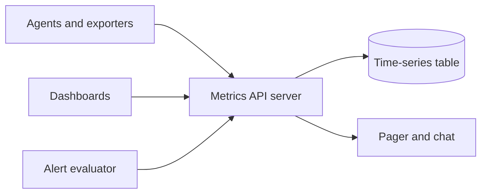
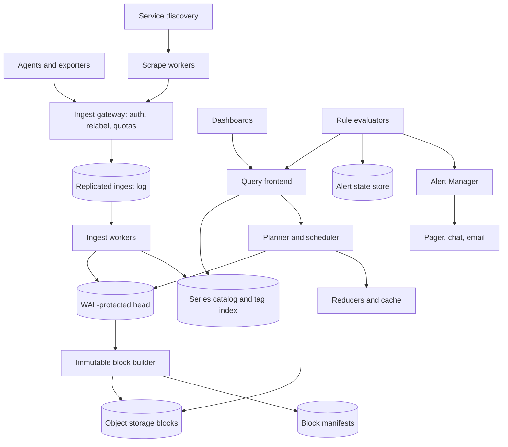
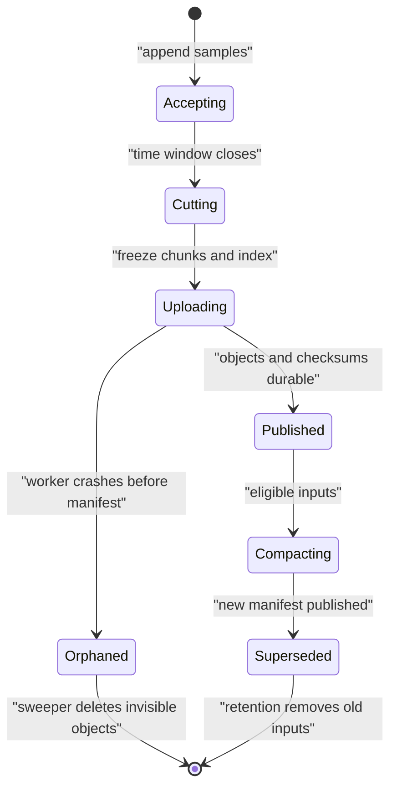
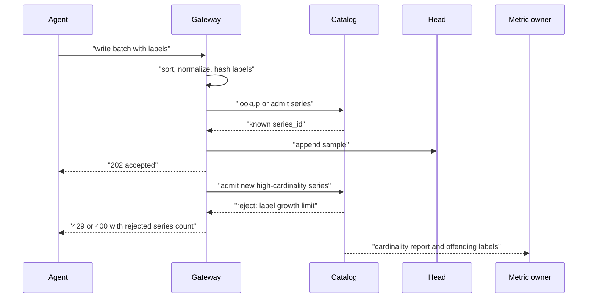
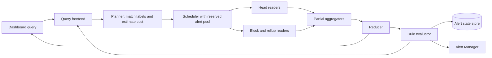

# Metrics Monitoring System Design

A production metrics monitoring system ingests numeric measurements from services, stores them as labeled time series, answers dashboard and ad hoc queries, and evaluates alerts. This design covers metrics ingestion, storage, querying, downsampling, and alert delivery; it excludes logs, traces, profiling, and incident-management workflows except where alerts hand off to those systems.

## 1. Requirements

### 1.1 Functional requirements

- Accept counters, gauges, histograms, and distribution samples from agents, exporters, and scrape workers.
- Store tagged time series such as `http_requests_total{service="checkout", region="us-east", status="500"}` and support filtering, grouping, rates, and aggregations over those tags.
- Serve near-real-time dashboards for recent windows and historical queries over retained raw and downsampled data.
- Evaluate threshold, absence, burn-rate, and expression-based alerts with `for` durations and route deduplicated notifications.
- Enforce tenant, metric, and label governance: quotas, retention policies, cardinality reports, and rejection of dangerous label sets.
- Support both pull-based scraping and push-style remote write through one normalized ingestion path.

### 1.2 Non-functional requirements

- **Write throughput.** The system must absorb tens of millions of samples per second because every host and service emits continuously even when no one is looking at a dashboard.
- **Cardinality control.** The number of active series must be bounded because each distinct label set consumes head memory, index entries, scheduler state, and recovery work before the first byte of long-term storage matters.
- **Freshness.** Newly accepted samples should become queryable within roughly 10-30 seconds so dashboards and alerts describe the current system, not yesterday's outage.
- **Durability with duplicates.** Acknowledged samples should survive process and machine failures, while agents may retry and produce duplicates because exactly-once delivery across a fleet is not worth the coordination cost.
- **Alert isolation.** Alert evaluation must continue when dashboards are slow, object storage is impaired, or expensive tenant queries are being throttled; a monitoring system that fails silently during degradation is worse than no monitoring.
- **Predictable degradation.** Overload should reject new series, delay low-priority work, or return marked partial query results rather than corrupting data or pretending discarded samples were accepted.

### 1.3 The binding constraint

The binding constraint is not just write volume. A metrics backend can append tens of millions of compressed samples per second if the series set is stable, but it falls over when label cardinality explodes. One accidental label such as `user_id`, full URL path, container restart ID, or request UUID turns a manageable metric into millions of new series. Each new series creates postings-list entries in the inverted tag index, a mutable head object, a WAL stream position, compaction metadata, query planning work, and alert fan-out. Sample count is a bandwidth problem; active series count is a memory, index, and recovery problem.

That constraint forces the architecture: a WAL-protected in-memory head for fresh writes, immutable compressed blocks for history, a separately scalable inverted label index with admission control, rollups that understand counter resets, and an alerting path with reserved capacity and its own state store. The design is built around rejecting or shaping cardinality before it reaches storage and around keeping alerts alive when the query/dashboard path is degraded.

## 2. Back-of-the-envelope estimation

Use illustrative assumptions to size the mechanisms, not to claim a universal production number. Suppose the platform monitors 2 million active targets across hosts, containers, and managed services. If each target has 500 active series, the system has `2,000,000 × 500 = 1,000,000,000` active series. At a 15-second scrape or push interval, the steady write rate is `1,000,000,000 ÷ 15 = 66,666,667` samples per second. Replicating the hot path three ways turns that into about `66.7M × 3 = 200M` replica sample writes per second before compaction removes redundancy in long-term storage.

Raw sample bytes look deceptively small. With Gorilla-style timestamp delta-of-delta and float XOR compression, a stable series may average about 1-2 bytes per sample in a block. At 2 bytes, one day of logical sample payload is `66.7M × 86,400 × 2 = 11,525,760,000,000` bytes, about 11.5 TB or 10.5 TiB. With three hot replicas, WAL overhead, object metadata, block indexes, and compression variance, the provisioned write and storage budget is several times higher. This number says object storage and compaction are mandatory, but it is not what usually breaks first.

The head and index numbers are harsher. If a series costs only 200 bytes in the mutable head, 1 billion active series need `1,000,000,000 × 200 = 200 GB` of RAM before postings lists, label strings, hash tables, query caches, allocator overhead, and replication. If the true per-series hot footprint is closer to 1 KB once index and runtime overhead are included, the same active set needs about 1 TB per logical copy. A single high-cardinality label can add millions of series and gigabytes of always-hot memory without changing the sample interval.

Query and alert numbers drive isolation. If 10 million alert rules are evaluated once per minute, the average rule-evaluation rate is `10,000,000 ÷ 60 = 166,667` evaluations per second, and bursty aligned schedules can be much higher. If a dashboard query matches 100,000 series over a 1-hour window at 15-second resolution, it touches `100,000 × 240 = 24,000,000` points before aggregation. The query path must push partial aggregation down to shards, cache immutable results, and reserve capacity for rule evaluation instead of letting dashboard fan-out starve alerts.

> **Key idea.** The sample stream demands an append-optimized storage engine, but active series cardinality demands admission control and index governance. The architecture should spend its strongest consistency and isolation budget on series creation and alert evaluation, not on every individual point.

## 3. API design

**Question.** What makes a metrics write retry safe when the agent times out after the server may already have accepted the batch?
<details><summary>Answer</summary>

The server acknowledges only after the batch is durably appended to the ingest log, and the client retries with a stable idempotency key or batch sequence. Storage workers deduplicate identical batches within a bounded window and collapse duplicate samples at the same series and timestamp, while still treating conflicting values as a visible data-quality error.

</details>

```http
POST /v1/metrics:write
Authorization: Bearer <token>
Content-Encoding: snappy
Idempotency-Key: <agent-id>/<sequence>

{ "tenant_id": "t1", "timeseries": [{ "metric": "http_requests_total", "labels": {"service":"checkout"}, "samples": [[1791944160000, 42.0]] }] }

POST /v1/scrape-targets:lease
{ "worker_id": "scraper-17", "capacity": 5000, "ttl_seconds": 30 }

GET /v1/query?expr=sum(rate(http_requests_total{service="checkout"}[5m]))

GET /v1/query_range?expr=...&start=1791940000&end=1791943600&step=60s&partial_response=false

GET /v1/labels/service/values?match[]=http_requests_total&limit=1000&cursor=<opaque>

POST /v1/rules
If-Match: <ruleset-etag>
{ "group": "checkout-slo", "interval_seconds": 30, "rules": [...] }

GET /v1/alerts?state=firing&tenant_id=t1

POST /v1/silences
{ "matchers": [{"name":"service", "value":"checkout"}], "starts_at": "...", "ends_at": "...", "comment": "deploy" }
```

The write API is batch-oriented because the protocol overhead would dominate individual samples. It returns per-series validation failures, a throttle hint for retryable overload, and a clear distinction between accepted samples and rejected new series. The gateway must never respond with success for discarded data; otherwise the monitoring system creates false confidence exactly when it is overloaded.

Scraping and pushing meet at the same normalized remote-write boundary. Pull is useful for service discovery and target-health metrics, while push is necessary for short-lived jobs, edge environments, and workloads behind firewalls. Both paths sort labels, normalize names, attach tenant identity, enforce limits, and then append to the same durable log.

Queries expose an explicit `partial_response` choice. Dashboards often prefer a marked partial result over a blank page, but alert evaluation should use strict queries that fail when shards time out or data is too stale. Label-value APIs are cursor-based because offsets become expensive against an inverted index and are unstable while series churn. Rule edits use `If-Match` with an ETag because concurrent UI and automation edits otherwise overwrite each other; alert state changes are produced by evaluators, not by callers directly.

## 4. Data model

Start with the obvious entity: a sample is a timestamp and a numeric value. That is not enough because the same metric name has many dimensions; `http_requests_total` for `checkout` in `us-east` with status `500` is not the same stream as status `200`. So the first durable identity is a canonical series: tenant, metric name, sorted labels, and a fingerprint. The fingerprint makes routing and lookup fast, but it is not proof of identity; collision handling compares the canonical label set.

The next failure is ungoverned series creation. If storage workers create series implicitly for every sample, a bad deploy can generate millions of unique paths before any central limit notices. That adds a series catalog record with owner, creation time, last-seen time, status, and quota accounting. New series creation goes through admission control; samples for existing series can continue even when the tenant is over its new-series budget, which preserves current visibility during an incident while stopping the cardinality leak from getting worse.

A block is needed because storing every sample as an independent row destroys compression and makes historical scans expensive. The mutable head accepts recent samples and WAL records; periodically it cuts immutable time blocks containing chunks, a local index, tombstones, and metadata. Immutable block manifests make compaction, caching, object storage, and recovery tractable because readers can address complete blocks by tenant, shard, time range, resolution, and checksum.

Alerts need their own model because alert correctness depends on time, not just the current query result. A threshold with `for: 10m` must remember when it first became true and whether evaluation gaps occurred. Alert state therefore records the rule revision, evaluator fencing token, pending-since timestamp, last successful evaluation, last error, and notification fingerprint. Without that state, a restarted evaluator would either forget pending alerts or page repeatedly.

```text
Tenant
- tenant_id, plan, ingest_sample_limit, new_series_limit, active_series_limit
- retention_policy, rollup_policy, alert_reserved_capacity

MetricDescriptor
- tenant_id, metric_name, type, unit, owner, allowed_labels, denied_labels
- max_series, max_label_values_per_hour, drop_rules

Series
- tenant_id, metric_name, canonical_labels, series_fingerprint
- series_id, created_at, last_seen_at, status, owning_metric_descriptor

Sample
- series_id, timestamp_ms, value, source_id, batch_id

HistogramSample
- series_id, timestamp_ms, count, sum, sparse_buckets

HeadPartition
- tenant_id, shard_id, wal_segment, min_time, max_time, owner_epoch

Block
- tenant_id, shard_id, resolution, min_time, max_time
- object_keys, index_key, source_blocks, checksum, compaction_level

Rollup
- series_id, resolution, window_start, count, sum, min, max
- first_value, last_value, counter_increase, reset_count, histogram_sketch

AlertRule
- tenant_id, rule_group_id, rule_id, revision, expression, interval, for_duration
- labels, annotations, destinations, strict_query

AlertState
- alert_fingerprint, rule_id, rule_revision, state, pending_since
- last_evaluated_at, last_success_at, last_error, evaluator_token
```

The series catalog and inverted label index live in a partitioned, strongly governed metadata store because they decide whether new active memory is admitted. The sample stream lives in a quorum-replicated append log and then in shard-owned TSDB heads, because individual samples need ordered append and replay more than row-level transactions. Blocks live in object storage behind manifests because historical data is large, immutable, and cacheable. Alert rules and alert state live in a strongly consistent store with conditional updates and fencing tokens. The transactional metadata store deliberately does not contain raw samples; putting 66 million writes per second through a row database would spend consistency where the system only needs per-series append order.

> **Key idea.** The data model separates series identity, sample bytes, block manifests, and alert state because each has different consistency and scaling needs. Cardinality governance belongs on series creation, not after samples have already entered the head.

## 5. High-level design

The simplest design is one metrics API server writing samples into a database table and reading them back for dashboards and alerts. It feels attractive because every component is familiar: agents call the API, the database stores rows, and queries run SQL-like aggregations.



This design breaks in four concrete ways. First, every sample becomes a random database write or a wide-row hotspot instead of an append to a series-local stream. Second, high-cardinality labels create unbounded indexes and memory pressure before storage bytes look large. Third, historical queries and dashboards compete with alert evaluation on the same query workers. Fourth, a crash between accepting a batch and storing it either loses acknowledged data or forces clients into ambiguous retries without deduplication.

### Fix 1: Durable ingest log before the storage engine

The gateway validates, normalizes, and quota-checks a batch, then appends it to a replicated log partitioned by tenant and series fingerprint before acknowledging the client. Ingest workers consume the log and append to local WAL-protected heads. If a worker crashes, another worker replays from the log. If the gateway crashes after append but before response, the agent retries with the same idempotency key and the worker deduplicates the batch.

The log also gives the system a pressure boundary. When storage falls behind, lag grows and gateways can throttle by tenant before heads run out of memory. Acknowledgement means durable acceptance, not query visibility; fresh queries are eventually consistent within the log-consumption and head-publication lag.

### Fix 2: Mutable head plus immutable compressed blocks

Recent samples go to a shard-owned in-memory head protected by a WAL. The head keeps active chunks, recent postings, and enough metadata to answer fresh queries without object-store round trips. Periodically, usually around a small fixed time window such as two hours, the head cuts immutable blocks: chunks, block index, metadata, and tombstones. Prometheus popularized this WAL-plus-head-plus-two-hour-block shape for a single node, and the distributed design keeps the same storage lifecycle while adding sharding, replication, and remote block storage.

Immutable blocks make historical data cheap to cache and compact. Compaction merges small blocks, removes tombstoned data, repairs overlaps, and creates downsampled resolutions. Because block IDs derive from input blocks, time range, shard, and compaction level, compaction can be retried idempotently and published with an atomic manifest swap.

### Fix 3: Cardinality gate and separately scalable tag index

Before a new series is admitted, the gateway consults the metric descriptor and series catalog. It checks tenant active-series limits, per-metric limits, label allow/deny rules, and per-label-value growth rates. Existing series should continue to ingest during an overload, but new series for the offending metric can be rejected with a specific error. This is the difference between losing visibility into the current incident and stopping a bad label from taking down the platform.

The inverted index maps `(tenant, label_name, label_value)` to compressed postings lists of series IDs. It scales separately from point storage because its resource curve is different. Datadog describes a similar separation between real-time point storage and tag indexing; Cloudflare's Prometheus experience also shows that lifecycle ownership and cardinality governance are operational requirements, not nice-to-have cleanup tasks.

### Fix 4: Query planner with fan-out, rollups, and fairness

A query frontend parses expressions, asks the catalog for matching series IDs, chooses raw or downsampled blocks, and fans out work by shard and time range. Leaf workers push down filtering and partial aggregation so a root reducer does not pull every point across the network. Dashboard queries use aligned steps and cached immutable block results; expensive recurring expressions become recording rules.

Fan-out must be scheduled. A tenant's month-long wildcard query cannot consume the same workers that evaluate pages. Query admission therefore estimates series scanned, blocks touched, samples decoded, and output points. It applies tenant fairness and uses a separate reserved pool for alert evaluation.

### Fix 5: Alerting path independent of dashboard health

Rule evaluators own rule groups under renewable leases with fencing tokens. They run strict queries against reserved capacity, store pending and firing state durably, and send state changes to an Alert Manager that deduplicates, groups, silences, inhibits, and retries notifications. If the dashboard path is slow, alerts still evaluate. If query data is incomplete, alert evaluation records an error or pages on monitoring-system health according to policy; it does not quietly treat missing data as healthy.

This split echoes a hard lesson from production systems: the monitoring system's user interface and its paging engine have different failure budgets. A degraded dashboard is annoying; a degraded alert pipeline during an outage is a second outage.

### Putting it together



A pushed batch enters the gateway, where tenant identity, label normalization, metric ownership, and cardinality quotas are enforced. After the replicated log acknowledges the append, the client receives success. Ingest workers replay the log into WAL-protected heads and update the series catalog for newly admitted series. Block builders periodically freeze head chunks into immutable blocks, upload them to object storage, and publish manifests. Dashboards and alert evaluators both query through the planner, but alert queries use strict semantics and reserved scheduling capacity. Alert evaluators persist state separately and hand notification events to Alert Manager, which handles deduplication and receiver retries.

> **Key idea.** Each component traces back to a specific failure of the naive design: the ingest log fixes ambiguous acceptance, the head and blocks fix write/read shape, the catalog fixes cardinality, the planner fixes fan-out, and the alert path fixes degraded dashboards hiding real incidents.

## 6. Deep dives

### 6.1 TSDB storage: head, WAL, Gorilla compression, blocks, and compaction

**Question.** An ingest worker acknowledges a batch, crashes, restarts on another node, and then a dashboard asks for the last five minutes. Which data is durable, which data is query-visible, and how does recovery avoid corrupting blocks?
<details><summary>Answer</summary>

Acknowledged means the batch is in the replicated ingest log, and usually also in a local WAL once consumed. Query visibility waits for replay into the new head and publication of that head's shard ownership. Immutable blocks are published only after all chunk and index objects are written and checksummed, so a partial upload is invisible and can be swept later.

</details>

A general database row model is the wrong storage shape for metrics. A series is an ordered append stream: one value every few seconds, usually with slowly changing timestamps and values. The storage engine should exploit that shape. The hot path keeps an in-memory head for recent chunks so writes are cheap and recent queries do not fetch object storage. Every head append is protected by a local WAL and by the upstream replicated ingest log. The log gives cross-node durability and replay; the WAL gives fast local restart without replaying a large shared log segment from the beginning.

Compression is not an afterthought. Gorilla and Beringei showed that monitoring data compresses well when encoded as a stream: timestamps use delta-of-delta because scrape intervals are stable, and floating-point values use XOR against the previous value because many gauges and counters change predictably. A raw timestamp plus float is 16 bytes; compressed blocks often reach around 1-2 bytes per sample for regular streams. That saving is the reason the earlier estimate's 11.5 TB/day of logical compressed payload is plausible, but it only holds when samples are grouped by series and time. If the system interleaves unrelated series or writes row fragments into a generic index, it destroys the locality that makes compression work.

The mutable head cannot grow forever. It is optimized for appends, recent reads, and fast label lookups over active chunks, not for cheap long-term retention. The worker periodically cuts a block for a bounded time range. A block contains series chunks, a block-local index, metadata, and tombstones. It is immutable after publication. Prometheus uses this pattern on a single node with a WAL-protected head and two-hour blocks; the distributed design keeps the same lifecycle but shards tenants across many workers and writes blocks to object storage.



The publication protocol matters more than the object format. A worker writes all chunk and index objects under content-addressed or unique temporary object keys, verifies checksums, and only then publishes a manifest record. Readers discover blocks through manifests, never by listing objects. If the worker crashes halfway through upload, no manifest points at the partial block. If compaction creates a bad output, the input blocks remain referenced until the manifest swap succeeds and a retention window passes, so rollback is possible.

Compaction has two jobs that fight each other. It improves query performance by reducing the number of blocks touched for a time range, and it reduces cost by creating downsampled data for older windows. But compaction can also create write amplification and recovery delays. Pinterest's Goku experience is a useful warning: bootstrap and recovery bandwidth can dominate availability when many hosts try to reload large in-memory datasets from shared storage. This design therefore treats WAL replay length, block-download concurrency, and head warm-up time as capacity metrics. A node should be able to rebuild a shard from recent blocks plus bounded log replay within the freshness SLO, or the shard is too large.

Late and out-of-order data complicate the clean block story. A small out-of-order window can be buffered in the head and merged before block cut. Data that arrives after a block is published should go to a small correction block or be rejected according to policy; rewriting old blocks on every late sample would make object storage behave like a database. For counters, corrections are especially sensitive because a reset-aware rate over a window depends on first and last values and reset boundaries.

Signals worth watching: ingest-log lag, WAL replay duration, head memory by tenant and shard, block cut latency, compaction backlog, object upload failures, compression ratio, and the age of the oldest unpublished block.

> **Strong-answer criteria.** A strong answer distinguishes durable acceptance from query visibility, explains why series-local compression requires a head-and-block layout, and describes atomic manifest publication for block correctness.

| Level | Approach | Why |
|---|---|---|
| Bad | Write each sample as a row in a general database | It loses series locality, creates expensive indexes, and makes compression weak. |
| Good | Use a TSDB head, WAL, and immutable blocks | It matches append-heavy writes and cheap historical scans, but may ignore distributed replay and publication races. |
| Great | Add a replicated ingest log, bounded replay, atomic manifests, idempotent compaction, and recovery SLOs | These mechanisms make the storage engine survive crashes, partial uploads, and shard movement at fleet scale. |

### 6.2 Cardinality and the inverted tag index

**Question.** A deploy adds `path="/users/123456/orders/987"` to `http_request_duration_seconds`, creating millions of label values in minutes. How does the system protect itself without blinding operators to existing metrics during the incident?
<details><summary>Answer</summary>

The gateway admits samples for already-known series but rejects or rewrites new series that violate metric label policy or growth budgets. It updates cardinality counters before head allocation, returns explicit errors for dropped new series, and surfaces owner-level reports so the team can remove or normalize the bad label.

</details>

The inverted index is what makes dimensional metrics useful. A query such as `sum by (service) (rate(http_requests_total{region="us-east", status=~"5.."}[5m]))` cannot scan every series. The planner needs postings lists for label matchers: all series with `region=us-east`, all series with status values matching `5..`, all series for metric `http_requests_total`, then intersections and grouping. This index is also what cardinality attacks first. Each new label value adds postings entries, label strings, cache entries, and planner work.

The naive fix is to scale storage. That misses the failure. A cardinality explosion is not just more bytes; it is more active objects. A billion stable series sampled every 15 seconds can be sharded and compressed. A metric that creates a new series per request makes the active set churn so fast that the head cannot compact efficiently, the catalog cannot keep up, and query planning becomes a metadata scan. Grafana Mimir's billion-active-series testing is instructive because it showed how much CPU and memory are needed even for controlled high cardinality; default redundancy can turn 1 billion logical active series into 3 billion ingested series before long-term deduplication. Accidental cardinality deserves admission control, not heroic storage scaling.

The system treats series creation as a governed operation. Metric descriptors can define allowed labels, denied labels, owner, expected type, max series, and max new label values per hour. The gateway computes the canonical label set, looks up or creates the series through a catalog admission path, and allocates head memory only after the catalog approves. If the series exists, ingestion can continue even when the tenant is temporarily over a new-series budget. If it is new and violates policy, the gateway rejects it or applies a predeclared relabel rule such as dropping `pod_uid` or normalizing a path template.



The response code depends on policy. A syntactically invalid label or denied label can be a `400` because retrying will not help. A tenant-level new-series budget exhaustion can be a `429` with retry guidance. The important point is explicitness: clients and owners must see accepted samples, rejected samples, and rejected new series separately. Silent dropping trains teams to distrust metrics.

The index itself should be partitioned by tenant and label space, with compressed postings lists and caches for hot matchers. High-cardinality labels are not always wrong. A Kubernetes `pod` label or customer shard label may be necessary for debugging. The governance question is whether the label has bounded lifecycle ownership and whether queries need it. Cloudflare's Prometheus operations emphasize metric ownership and lifecycle control for exactly this reason. Datadog's architecture separates point storage from tag indexing because tag lookup has different scaling behavior than appending samples. Uber's M3 makes retention and rollup policies first-class so expensive dimensionality can be managed by policy rather than one global knob.

There is a trade-off between rejecting, rewriting, and aggregating. Rejecting preserves backend health but loses some data. Rewriting labels, such as templating `/users/123` to `/users/:id`, preserves aggregate signal but can hide a debugging dimension. Pre-aggregation at the agent or gateway can keep totals while refusing per-user series, but it changes query semantics. The safest design makes these choices explicit per metric descriptor and owner, with defaults that reject unbounded dimensions.

Signals worth watching: active series by tenant and metric, new series per minute, top labels by value count, postings-list memory, catalog admission latency, rejected new series, series churn, and queries that match unusually many postings.

> **Strong-answer criteria.** A strong answer says that cardinality is admitted before head allocation, distinguishes existing-series ingestion from new-series creation, and treats the tag index as a separately scalable product surface.

| Level | Approach | Why |
|---|---|---|
| Bad | Store any label users send and add machines when memory rises | It lets one bad deploy create unbounded head and index state. |
| Good | Add tenant quotas and reject writes over limit | It protects the backend but may drop existing critical metrics and gives little guidance. |
| Great | Govern series creation with metric descriptors, label policies, growth budgets, explicit errors, and owner reports | It stops new cardinality explosions while preserving existing visibility and making cleanup actionable. |

### 6.3 Query, rollup, and alert evaluation under degradation

**Question.** Object storage is slow, a tenant starts a wildcard dashboard query, and at the same time a checkout burn-rate alert must evaluate. What keeps the alert reliable, and how do rollups avoid lying about counters?
<details><summary>Answer</summary>

The query scheduler reserves capacity for alert evaluation, alert queries use strict partial-result semantics, and rule state is stored outside the dashboard path. Rollups store reset-aware counter increase, first and last samples, counts, sums, min, max, and sketches rather than only averages, so rates and aggregations remain meaningful at coarser resolutions.

</details>

Query execution starts with label selection. The planner turns matchers into series IDs using the catalog, splits the time range across head and blocks, chooses a resolution, sends shard-local work to leaves, and merges partial results. That fan-out is unavoidable: a global dashboard may touch many tenants, regions, shards, and blocks. Netflix Atlas's regional isolation and global query composition show why tree-shaped query aggregation becomes a product requirement once dimensional metrics are used across a large fleet.

The naive query path lets every request use the same pool. It works until a user opens a dashboard with a wildcard label over a month, or an expensive ad hoc expression decodes billions of points. If alert evaluation shares that pool, the system can miss pages because someone explored historical data. The fix is admission control and scheduling by purpose. Dashboard queries receive tenant-weighted fairness, point and series limits, cache-friendly step alignment, and optional partial responses. Alert queries use a reserved pool, stricter deadlines, and strict partial-response semantics. If the data is incomplete, the evaluator records an error and follows alert policy; it does not convert unknown into OK.

Rollups are where many metrics systems lie accidentally. A gauge can often be downsampled with count, sum, min, and max. A counter cannot be downsampled safely by averaging raw values because counters reset, wrap, and jump. A correct rollup for counters stores reset-aware increase over the window, first value, last value, reset count, and enough boundary information to combine adjacent windows. Histograms need bucket or sketch data that can be merged; storing only p95 for each minute cannot produce a correct p95 for an hour because percentiles are not generally composable.

For example, a 5-minute rollup for `requests_total` should not store only the last counter value. If a process restarts halfway through the window, the rate over that window is the sum of positive deltas before and after the reset, not `last - first`. When combining twelve 5-minute windows into an hour, the query engine can sum `counter_increase` values and divide by elapsed time, while checking boundary gaps and reset metadata. That is why retention policy is part of the data model, not a background compression trick.



Alert evaluation has a lifecycle independent of query serving. Rule groups are assigned to evaluators by tenant and group ID. An evaluator holds a renewable lease with a fencing token; if it pauses past the lease and another evaluator takes over, stale writes from the old evaluator are rejected. The evaluator stores `pending_since`, `last_success_at`, and the rule revision durably. That protects `for` semantics across restarts. Without durable pending state, a 10-minute alert might never fire if the evaluator restarts every nine minutes.

Notification delivery is at-least-once. Alert Manager deduplicates by alert fingerprint, groups related alerts, applies silences and inhibition, and retries receiver calls with stable notification IDs. Exactly-once paging through external chat and pager APIs is not realistic, so receivers must tolerate duplicates. The stronger guarantee is that the monitoring system will not intentionally send notifications from two alert owners at once; fencing and single-owner leases provide that.

Degradation policy should be explicit. Dashboards may show partial data with warnings when one historical shard is slow. Alerts should usually fail closed for monitoring-system errors: an evaluation error increments an alerting-health metric and can page the platform team if it persists. Absence alerts need special care because missing samples can mean the service is down, the agent is disconnected, the ingest path is delayed, or the query path is broken. Good absence alerts include freshness checks from the ingest log and head, not only a query that returns an empty vector.

Signals worth watching: query fan-out width, samples decoded per query, alert evaluation duration and missed intervals, strict-query failures, stale data age, rollup lag, counter reset anomalies, and notification retry backlog.

> **Strong-answer criteria.** A strong answer separates dashboard and alert budgets, explains strict versus partial query semantics, and knows that downsampling counters and histograms requires mergeable state rather than averages.

| Level | Approach | Why |
|---|---|---|
| Bad | Let alerts call the same dashboard query API with best-effort partial results | Expensive dashboards or slow shards can hide incidents. |
| Good | Add query limits, caching, and recording rules | This improves latency but still may not protect alert correctness under degradation. |
| Great | Use reserved alert capacity, durable rule state with fencing, strict query semantics, and reset-aware rollups | Alerts continue operating during query stress and historical compaction does not corrupt rates. |

## 7. Variants

**10x scale.** At 10 billion active series and roughly `10B ÷ 15 = 666.7M` samples per second, the architecture stays recognizable but the isolation becomes stricter. Large tenants get dedicated ingest cells, catalog partitions, and query schedulers. Shuffle sharding limits blast radius. Agents perform more pre-aggregation, metric descriptors are required before new high-volume metrics launch, and global dashboards rely heavily on recording rules and rollups rather than raw fan-out.

**Multi-region active-active.** Agents write to the nearest healthy region, and critical tenants may dual-write with the same batch IDs. Query frontends prefer local data and federate missing regions through a tree. Alert notifications still need single-owner semantics: a consensus-backed lease chooses one alerting region per tenant or rule group, with fencing tokens preventing duplicate pages during partitions. Ingestion favors availability; paging favors a single writer.

**Regulated regional residency.** Some tenants cannot move raw labels or samples across regions. The same head, block, and catalog design is deployed per region, but global queries can only use approved aggregates or anonymized rollups. Alert rules that include regulated labels run inside the region, and notification payloads are filtered so labels do not leak into external systems.

**Burst event or bad deploy.** A traffic spike increases sample values but not necessarily series count; the write path can handle it if agents batch and gateways throttle fairly. A bad deploy adding an unbounded label is more dangerous. The response is to freeze new series for the offending metric, preserve existing series, page the metric owner with cardinality reports, and optionally apply a preapproved relabel rule. This is a control-plane incident as much as a storage incident.

## 8. The transferable pattern

The reusable pattern is a high-volume append stream with a small hot mutable layer, a large immutable historical layer, and a metadata index whose cardinality dominates system health. Similar shapes appear in [Ad Click Aggregator](./ad-click-aggregator-system-design.md), [Pub-Sub / Message Queue](./pub-sub-message-queue-system-design.md), and [Distributed Key-Value Store](./distributed-key-value-store-system-design.md): accept writes durably, partition by an identity that preserves locality, compact immutable history, and keep fan-out reads from starving critical background work.

The second transferable lesson is that correctness lives at the boundary where the system degrades. Metrics are allowed to be eventually visible and occasionally duplicated, but they are not allowed to silently disappear after acknowledgement or to make alerts report healthy because a query timed out. For systems with external side effects, such as [Payment System](./payment-system-design.md) or [Ticketmaster](./ticketmaster-system-design.md), the same principle becomes idempotency keys, fencing tokens, leases, and explicit failure states. The mechanisms differ, but the design habit is the same: name the failure mode, then add the smallest protocol that makes it observable and bounded.

## Review

The design starts from the fact that metrics ingestion is write-heavy but cardinality-bound: tens of millions of samples per second are manageable only if active series creation is governed. The resulting architecture accepts batches through a quota-enforcing gateway, durably appends them to a replicated log, writes them into WAL-protected in-memory heads, freezes immutable compressed blocks, and scales a separate inverted tag index. Queries fan out through a planner that chooses raw or rollup data, pushes aggregation down, and schedules by tenant and purpose. Alerts are not just dashboard queries on a timer; they have reserved capacity, strict partial-result semantics, durable pending state, fencing, and at-least-once notification delivery. The system degrades by rejecting new cardinality, throttling expensive queries, and surfacing explicit errors rather than pretending missing data is healthy.

### Check your understanding

1. Why is active series count often more dangerous than raw sample count?
   <details><summary>Answer</summary>

   Raw samples can be appended, compressed, and moved to object storage. Each active series consumes always-hot head memory, tag-index postings, catalog state, scheduling overhead, and recovery work. A high-cardinality label can multiply those costs without increasing scrape frequency.

   </details>

2. Why does the gateway acknowledge only after appending to a replicated ingest log?
   <details><summary>Answer</summary>

   It makes acceptance durable even if the gateway or ingest worker crashes. If the client times out and retries, stable batch IDs and sample deduplication handle duplicates, while replay from the log rebuilds the head.

   </details>

3. Why are immutable block manifests safer than readers listing object-store prefixes?
   <details><summary>Answer</summary>

   A manifest is published only after all block objects and checksums are durable. Partial uploads remain invisible and can be swept, while compaction can atomically swap from old input blocks to new output blocks.

   </details>

4. Why can't long-term rollups store only averages or p95 values?
   <details><summary>Answer</summary>

   Averages alone lose min, max, count, and boundary data, counters need reset-aware increases, and percentiles are not generally composable. Rollups must store mergeable state such as count, sum, min, max, first, last, counter increase, reset count, and histogram sketches or buckets.

   </details>

5. What should happen when an alert query receives partial data during a storage outage?
   <details><summary>Answer</summary>

   It should not silently evaluate as healthy. Alert queries should use strict semantics, record evaluation errors, preserve previous state according to policy, and page on monitoring-system degradation if the error persists.

   </details>

## Sources and further reading

| Source | Article | Why it matters |
|---|---|---|
| Meta | [Beringei: A high-performance time series storage engine](https://engineering.fb.com/2017/02/03/core-infra/beringei-a-high-performance-time-series-storage-engine/) | Explains the Gorilla-style in-memory hot store, delta-of-delta timestamps, XOR float compression, and why recent metrics need millisecond reads. |
| Prometheus | [Storage](https://prometheus.io/docs/prometheus/latest/storage/) | Canonical reference for WAL-protected head chunks, two-hour immutable blocks, tombstones, compaction, and the 1-2 bytes/sample rule of thumb. |
| Uber | [M3: Uber’s Open Source, Large-scale Metrics Platform for Prometheus](https://www.uber.com/gb/en/blog/m3/) | Shows multi-tenant Prometheus-compatible metrics at billions of series, quorum writes, global queries, and policy-driven rollups/retention. |
| Netflix | [Atlas Overview](https://netflix.github.io/atlas-docs/overview/) | Covers dimensional metrics, regional isolation, global query composition, and why metric-name encoding does not scale. |
| Grafana Labs | [How we scaled our new Prometheus TSDB Grafana Mimir to 1 billion active series](https://grafana.com/blog/how-we-scaled-our-new-prometheus-tsdb-grafana-mimir-to-1-billion-active-series/) | Quantifies active-series scaling, redundancy overhead, load testing, and resource needs for billion-series clusters. |
| Datadog | [Evolving our real-time timeseries storage again: Built in Rust for performance at scale](https://www.datadoghq.com/blog/engineering/rust-timeseries-engine/) | Describes separating real-time point storage from tag indexing and redesigning the hot engine for high-cardinality, bursty workloads. |
| Pinterest | [Improving Efficiency Of Goku Time Series Database at Pinterest (Part — 1)](https://medium.com/pinterest-engineering/improving-efficiency-of-goku-time-series-database-at-pinterest-part-1-7659b94796f4) | Highlights short-term/long-term storage separation, compaction, smart routing, and recovery-time bottlenecks. |
| Cloudflare | [How Cloudflare runs Prometheus at scale](https://blog.cloudflare.com/how-cloudflare-runs-prometheus-at-scale/) | Gives operational lessons from hundreds of Prometheus instances, billions of series, and practical cardinality governance. |
