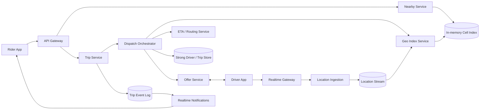

# Uber-like Nearby Drivers and Dispatch System

## 1. Requirements

### Functional requirements

1. Ingest frequent driver locations and availability changes.
2. Show riders a low-latency, privacy-safe view of nearby available drivers.
3. Estimate pickup times.
4. Match a ride request to one suitable driver without double assignment.
5. Handle offers, acceptance, timeout, cancellation, and reassignment.
6. Track an active trip and publish location updates to rider and driver.

### Non-functional requirements

- Nearby search p99 below 300 ms; dispatch decision typically within seconds.
- Millions of online drivers and tens of millions of location updates/second at peak.
- Strong correctness for driver assignment; eventual consistency for map dots.
- Graceful degradation during city events, cellular loss, or regional failures.
- Location privacy, retention limits, and abuse resistance.

Pricing, payment settlement, and full turn-by-turn navigation are adjacent but out of scope.

## 2. Scale assumptions

- 10 million online drivers globally at peak.
- Active drivers send one update every 3 seconds: 3.3 million updates/second average, 10 million/second peak.
- 2 million ride requests/minute at exceptional global peak.
- Location event about 150 bytes encoded before replication.
- Nearby query radius usually 2-10 km; display 8-20 anonymized vehicles.
- Driver location is considered stale after 10-20 seconds.
- Offer timeout: 10-15 seconds; target match under 30 seconds.

Workload is geographically skewed. A concert can make several adjacent cells hot while most of the world is quiet.

## 3. High-level architecture



Separate the soft-state geo index from the authoritative driver/trip state. A driver dot may be briefly stale; assignment ownership may not be ambiguous.

## 4. Data model

```text
DriverState
- driver_id, availability: OFFLINE | AVAILABLE | OFFERED | ASSIGNED | ON_TRIP
- vehicle_type, capabilities, city_id
- active_trip_id, state_version, lease_expires_at

DriverLocation
- driver_id, latitude, longitude, heading, speed
- accuracy_m, observed_at, received_at, sequence_number
- cell_id

RideRequest
- trip_id, rider_id, pickup, destination
- product_type, requested_at, status, version

DispatchAttempt
- attempt_id, trip_id, round, candidate_driver_id
- score, offer_token, offered_at, expires_at
- result: ACCEPTED | DECLINED | EXPIRED | CANCELLED

TripEvent
- trip_id, sequence_number, event_type, actor_id, timestamp, payload
```

Exact coordinates are short-lived operational data. Long-term analytics uses coarse or access-controlled data according to policy.

## 5. Core APIs and streams

```http
POST /v1/drivers/me/locations
{"lat":37.78,"lng":-122.41,"observed_at":"...","sequence":8841,"accuracy_m":8}

GET /v1/nearby-drivers?lat=...&lng=...&product=standard

POST /v1/trips
{"pickup":{...},"destination":{...},"product":"standard","idempotency_key":"..."}

POST /v1/offers/{offer_id}/accept
{"offer_token":"...","driver_state_version":731}

POST /v1/trips/{trip_id}/cancel
GET  /v1/trips/{trip_id}
```

Realtime WebSocket/gRPC channels carry offers and trip events, but durable APIs remain the source of truth after reconnect.

## 6. Location ingestion flow

1. Gateway authenticates device and applies rate/accuracy checks.
2. Reject impossible coordinates and excessively old or future timestamps.
3. Deduplicate/reorder by per-driver sequence number.
4. Append valid updates to the regional stream.
5. Geo consumer maps location to an H3/S2 cell.
6. Atomically remove the driver from the prior cell and add/update the new cell.
7. Expire index entries by server receive time if no heartbeat arrives.
8. Fan out sampled updates for active trips and analytics.

Network duplicates and minor reordering are normal. The index accepts an update only if its sequence is newer than the stored sequence.

## 7. Geospatial indexing and nearby queries

Use hierarchical cells such as H3 or S2. For a query:

1. Cover the search radius with the pickup cell and neighboring rings.
2. Read available driver IDs from those cells in parallel.
3. Remove stale, inaccurate, incompatible, or authoritative-nonavailable drivers.
4. Compute great-circle distance as a cheap first pass.
5. Request batched road ETA only for the top candidates.
6. Return a small, jittered visualization set or candidates to dispatch.

Adaptive resolution prevents dense downtown cells from becoming huge. Sparse areas expand rings gradually up to a latency and distance budget.

## 8. Nearby display versus dispatch

The rider map is indicative, not a promise. To protect privacy and reduce bandwidth:

- Return randomized/jittered positions or server-rendered density representations.
- Rotate anonymous vehicle tokens.
- Do not expose driver IDs, exact timestamps, or precise headings.
- Cache cell-level responses for a few seconds.

Dispatch performs a fresh authoritative availability check and never relies solely on the cached nearby response.

## 9. Dispatch algorithm

1. Persist the ride request idempotently.
2. Query expanding geo rings for candidates.
3. Filter product, capacity, accessibility, safety, work-rule, and stale-location constraints.
4. Rank by pickup ETA, acceptance probability, idle time/fairness, destination constraints, and marketplace balance.
5. Offer to one driver or a small controlled batch.
6. On acceptance, atomically claim both driver and trip.
7. If all offers decline/expire, widen radius and begin another round.

A simple score:

```text
score = w1 * pickup_eta
      - w2 * acceptance_probability
      - w3 * idle_time
      + w4 * marketplace_penalty
```

Avoid optimizing only nearest distance: road barriers, driver direction, fairness, and acceptance likelihood matter.

## 10. Assignment consistency and races

Acceptance uses a transaction or compare-and-swap:

```text
Driver: AVAILABLE/OFFERED -> ASSIGNED(trip_id)
Trip: SEARCHING -> DRIVER_ASSIGNED(driver_id)
Offer: PENDING -> ACCEPTED
```

The transaction verifies offer token, expiry, driver/trip versions, and fenced dispatch epoch. Only one acceptance can win. Losers receive `OFFER_NO_LONGER_AVAILABLE`.

For cross-record storage, colocate driver claim and active trip mapping by a dispatch partition, or use a strongly consistent transactional database. Do not use an asynchronous event alone to enforce exclusivity.

## 11. Trip state machine

```text
REQUESTED -> SEARCHING -> DRIVER_ASSIGNED -> DRIVER_ARRIVING
-> IN_PROGRESS -> COMPLETED

SEARCHING/DRIVER_ASSIGNED/DRIVER_ARRIVING -> CANCELLED
```

Commands include expected versions and idempotency keys. Each accepted transition appends an ordered trip event through a transactional outbox. Clients reconcile from `GET /trips/{id}` after reconnect; push is only a latency optimization.

## 12. Partitioning and storage

- Geo index partitions by `(city_id, cell_prefix)` and lives in memory with replicas.
- Driver authoritative state partitions by `driver_id`.
- Trip state partitions by `trip_id`; an active assignment index maps driver to trip.
- Dispatch ownership partitions by city/market and subzone.
- Trip events use durable log/object storage; recent state uses a strongly consistent KV/relational database.

Hot cells can split into child cells and be replicated for reads. Writes for one driver retain a single owner. Large city dispatch partitions subdivide, but cross-boundary queries inspect adjacent owners.

## 13. ETA computation and caching

Straight-line distance filters candidates cheaply. A routing service then performs a batched many-to-one ETA query using live traffic and road restrictions. Cache travel times by coarse origin/destination cell and time bucket for seconds to minutes. Invalidate or lower TTL during incidents.

If routing is unavailable, return confidence-labeled heuristic ETAs for nearby display, but dispatch should either use conservative estimates or degrade to distance ranking with explicit monitoring.

## 14. Reliability and failure handling

| Failure | Handling |
|---|---|
| Driver app sends duplicate/out-of-order updates | Sequence check ignores older updates |
| Driver disconnects | Presence lease expires; remove from availability |
| Geo index node fails | Replica serves; rebuild from stream snapshot and replay |
| Offer push is lost | Driver reconnects/polls outstanding offers; timeout safely |
| Two offers accepted concurrently | Transactional driver/trip claim allows one winner |
| Dispatch worker dies | Lease/epoch expires; new owner resumes from trip state |
| Trip write succeeds but push fails | Outbox retries; clients reconcile via API |
| ETA service overloads | Batch/cache, shed display precision, preserve assignment path |
| City surge overloads | Admission control, cell splitting, controlled search rounds |
| Rider retries trip creation | Idempotency key returns existing trip |

## 15. Multi-region design

Each city/market has a home region because location and dispatch are latency-sensitive and geographically local. Replicate across availability zones synchronously. A paired region receives trip logs and driver state asynchronously.

Failover requires fencing the old dispatch epoch before accepting assignments in the secondary. During uncertain ownership, pause new matching briefly rather than risk double assignment. Active clients reconnect through global routing and resend their latest state. Cross-border trips transfer a trip's event ownership explicitly while location processing follows the current region.

## 16. Security and privacy

- Short-lived device-bound tokens and mTLS for internal services.
- Encrypt coordinates in transit and at rest; tightly restrict raw-location access.
- Retain precise history only as required; aggregate or delete it afterward.
- Detect GPS spoofing using impossible speed, sensor, route, and device signals.
- Rate-limit nearby queries and prevent systematic location scraping.
- Jitter displayed vehicles and rotate identifiers.
- Audit employee access; implement emergency-access workflows.
- Validate that drivers can transition only their own state and riders only their trips.

## 17. Observability

Track location ingest lag, updates/driver, stale-driver ratio, geo-index divergence, nearby p50/p99, candidate count by ring, ETA latency/error, time-to-match, offer acceptance/expiry, assignment CAS conflicts, double-assignment invariant violations, cancellation rate, dispatch rounds, reconnects, and region replication lag.

Key SLOs:

- 99% of valid location updates searchable within 2 seconds.
- 99% of nearby queries complete within 300 ms.
- Zero successful assignments linking one driver to two active trips.

## 18. Major trade-offs

- **Freshness versus battery:** faster updates improve ETA but consume device power and bandwidth; adapt interval by motion and trip state.
- **Push versus reconciliation:** push is fast; authoritative versioned state heals missed messages.
- **One-at-a-time versus batched offers:** serial offers reduce contention but increase match time; small controlled batches help sparse markets.
- **In-memory geo index versus durable database:** memory serves low latency; stream replay and authoritative state provide recovery.
- **Strong versus eventual consistency:** reserve strong consistency for assignment and trip transitions, not visualization dots.

## 19. Recommended interview presentation

1. Separate nearby visualization from correctness-critical dispatch.
2. Estimate location update and ride-request load.
3. Draw realtime ingestion, geo index, dispatch, ETA, and strong state.
4. Deep-dive into hierarchical cell search and stale entry expiry.
5. Walk through candidate ranking and offer rounds.
6. Prove the atomic assignment invariant.
7. Cover hot cities, failover fencing, privacy, and degraded ETA.
8. Finish with freshness/battery and batching trade-offs.

The central design insight is:

> Keep driver location as rapidly expiring soft state for search, but make driver availability and trip assignment versioned, fenced, and strongly consistent so a fast approximate geo system never creates two authoritative rides.
