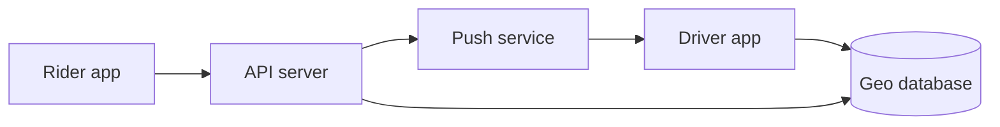
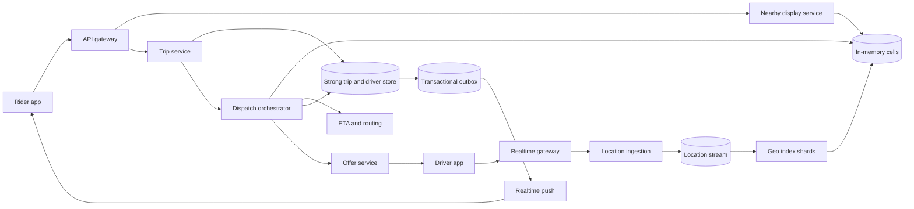
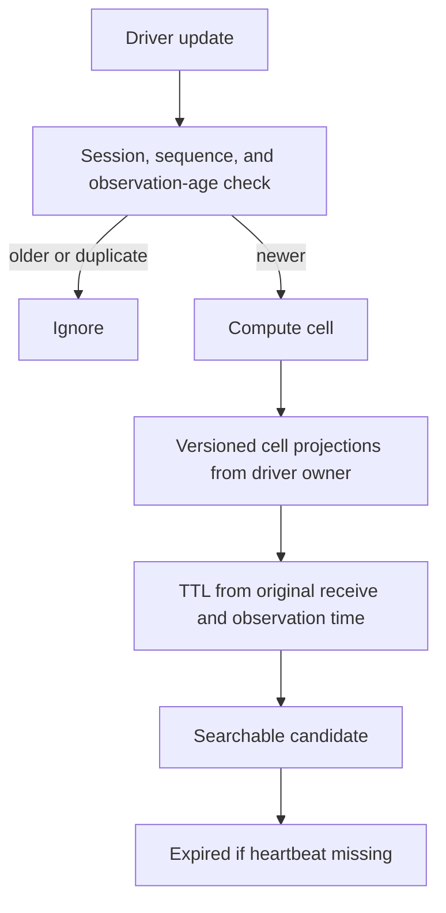
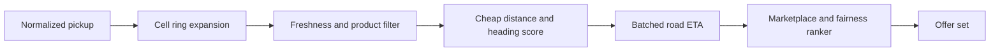
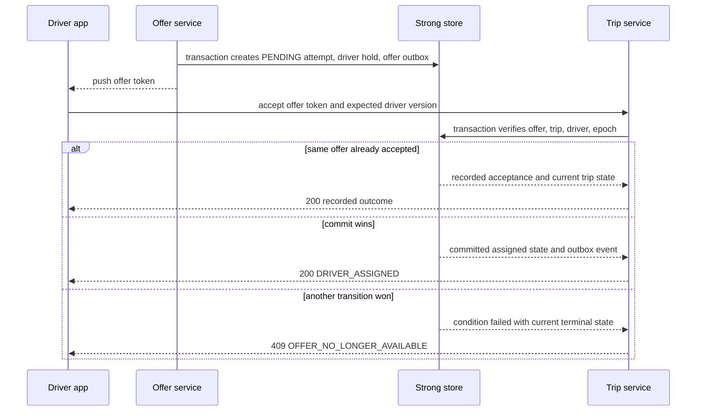

# Nearby Drivers and Dispatch System Design

This system powers an Uber-like marketplace path from live driver location to rider-facing nearby cars to a correct trip assignment. It includes location ingestion, geospatial search, ETA-based candidate ranking, offers, acceptance, cancellation, and trip-state reconciliation; it excludes pricing, payments, full navigation, and long-term marketplace forecasting except where those signals affect matching.

## 1. Requirements

### 1.1 Functional requirements

- Drivers can come online, report location and availability frequently, and receive offers on a realtime channel.
- Riders can see a low-latency, privacy-safe approximation of nearby available vehicles before requesting a trip.
- Riders can create a trip request idempotently and receive progress while the system searches, offers, assigns, or fails to find a driver.
- The dispatch system can search nearby candidates, estimate pickup ETA, rank them, and send one or a small controlled batch of offers.
- A driver can accept, decline, time out, or lose an offer, and the system must assign that driver to at most one active trip.
- Riders and drivers can reconnect and recover authoritative trip state even if push messages were missed.

### 1.2 Non-functional requirements

- **Freshness.** Candidate search should usually see driver updates within a few seconds, because stale positions create bad ETAs and offers that drivers cannot practically accept.
- **Low latency.** Nearby visualization should be sub-second and dispatch should make useful progress within seconds, or riders abandon before the marketplace has a chance to recover.
- **Assignment correctness.** A driver may appear in multiple soft indexes, but the authoritative state transition from available to assigned must be strongly consistent.
- **Write scalability.** Location writes dominate the system by orders of magnitude, so the location path must be append-heavy, in-memory, sharded, and tolerant of loss.
- **Graceful degradation.** During concerts, storms, map incidents, cellular loss, or ETA overload, the system should reduce display precision and widen search carefully rather than corrupt trip state.
- **Privacy.** Exact driver coordinates are sensitive operational data; rider maps should reveal density or jittered anonymous cars, not stable driver identities.

### 1.3 The binding constraint

The binding constraint is that two adjacent subsystems want opposite consistency models. Driver locations are written by millions of mobile devices every few seconds. They are ephemeral, naturally lossy, frequently duplicated, and only useful while fresh. Forcing every location update through a strongly consistent transactional database would spend the system's consistency budget on data that expires in seconds. Matching, however, has a hard invariant: one driver cannot be assigned to two active trips, even if two riders request at the same time, two dispatch workers race, or a driver taps accept just as an offer times out.

That tension shapes the architecture. The location index is a sharded in-memory soft-state service fed by streams, sequence numbers, TTLs, and hierarchical cells. Dispatch treats it as a candidate generator, not truth. The assignment path then crosses into a strongly consistent driver/trip store using offer tokens, state versions, leases, and atomic compare-and-swap or transactions. The design is therefore not one database or one index; it is an explicit handoff from approximate high-volume search to fenced, authoritative state transitions.

## 2. Back-of-the-envelope estimation

Use illustrative peak assumptions, not claims about any real company. Suppose `10M` drivers are online globally at a busy moment and each sends a location every `3` seconds while moving. The average location write rate is `10M / 3 = 3.33M updates/s`. If mobile clients synchronize after connectivity gaps or several large cities peak together, a `3x` burst gives about `10M updates/s`. At `150 bytes` for a compact encoded update before replication and protocol overhead, raw ingress is `3.33M × 150 = 499.5 MB/s` on average and `10M × 150 = 1.5 GB/s` during bursts. Replication, stream metadata, indexes, and TLS framing can multiply that, so location cannot be a normal request/response write to a relational table.

Ride requests are much smaller in count but much more correctness-sensitive. If an exceptional global peak is `2M` trip requests per minute, that is `2M / 60 = 33,333 requests/s`. If each request considers `200` candidate driver IDs from cells and sends batched ETA calls for the best `20`, candidate reads are roughly `33,333 × 200 = 6.67M candidate checks/s`, while expensive ETA work is `33,333 × 20 = 666,660 driver ETAs/s`. This implies a two-stage ranker: cheap cell and distance filtering first, then batched road-network ETA for a much smaller set.

Freshness also drives storage choices. If the index only needs the last `20` seconds of searchable locations for `10M` drivers, the hot working set is approximately `10M × 150 = 1.5 GB` of raw latest points, plus indexes, replicas, and per-cell sets. Even at a generous `10x` overhead, this is memory-scale per global fleet when partitioned by city and cell. Long-term trip events are durable, but raw nearby location history should not be retained in the dispatch serving path.

Hotspot math is more important than global averages. A stadium egress could put `50,000` drivers and riders around a few adjacent cells. If every nearby query scanned one huge downtown cell, a single partition would become a CPU and lock hotspot. Cells must split or use fine-enough resolution in dense areas, and dispatch must cap candidate reads per ring so one burst does not starve the rest of the city.

> **Key idea.** The numbers split the design in two: millions of loss-tolerant writes per second belong in sharded memory and streams, while tens of thousands of match decisions per second need strong, narrow transactions only at the moment of assignment.

## 3. API design

**Question.** If a rider retries trip creation after a timeout and a driver retries offer acceptance after reconnecting, what makes those retries safe instead of creating duplicate trips or double assignments?
<details><summary>Answer</summary>

Trip creation uses a rider-scoped idempotency key and returns the existing trip for the same request. Offer acceptance carries an opaque offer token, the expected driver state version, and the offer expiry; the server accepts it only if the trip and driver are still in compatible states in the authoritative store.

</details>

```http
POST /v1/drivers/me/locations
{ "lat": 37.78, "lng": -122.41, "observed_at": "2026-10-14T02:16:05Z", "session_epoch": 27, "sequence": 8841, "accuracy_m": 8 }

POST /v1/drivers/me/availability
{ "status": "AVAILABLE", "idempotency_key": "drv-2026-10-14-shift-7" }

GET /v1/nearby-drivers?lat=37.78&lng=-122.41&product=standard

POST /v1/trips
{ "pickup": { "lat": 37.78, "lng": -122.41 }, "destination": { "lat": 37.62, "lng": -122.38 }, "product": "standard", "idempotency_key": "rider-abc-req-991" }

GET /v1/trips/{trip_id}

POST /v1/offers/{offer_id}/accept
{ "offer_token": "opaque", "driver_state_version": 731 }

POST /v1/offers/{offer_id}/decline
{ "offer_token": "opaque", "reason": "too_far" }

POST /v1/trips/{trip_id}/cancel
{ "idempotency_key": "rider-abc-cancel-3", "expected_version": 12 }
```

The location endpoint is intentionally not a durable command API. It accepts duplicates, rejects impossible coordinates, and returns success once the gateway has handed a valid update to the regional ingestion path. A mobile client may also use a streaming channel for locations. A server-issued session epoch fences old connections; within the current epoch only a newer sequence can replace the point. Sequence reset after an app restart requires a new epoch, not an arbitrarily larger client number.

Nearby display is a read API over soft state. It should return anonymous vehicle tokens, jittered positions, coarse headings, or density summaries, not driver IDs. Caching it for a few seconds is acceptable because it is not a promise that a displayed car can be assigned. Dispatch never says, "the rider saw driver D, therefore D is available." It creates a trip, searches fresh candidates, and checks authoritative driver state before offering.

Independent random jitter is not a privacy guarantee: repeated queries can average it away and link a moving trace even without a driver ID. Use cohort/time-bucketed synthetic display points or thresholded density, suppress sparse cells, rotate unlinkable tokens, and limit repeated spatial queries. Exact coordinates are available only to authorized operational callers and, under the tracking policy, the assigned rider; display caches cannot bypass those rules.

Trip creation is idempotent because riders retry when mobile networks fail. The server stores `(rider_id, idempotency_key)` with the trip request and returns the existing `trip_id` if the same key appears again. Cancellation is versioned because it races with assignment. A cancellation that arrives after `DRIVER_ASSIGNED` may still succeed depending on product rules, but it is a state transition against a known version, not a blind deletion.

Offers use push for latency and pull for recovery. The driver app receives an offer over WebSocket, HTTP/2, or a mobile push-assisted channel. If that message is lost, reconnect can fetch outstanding offers. Acceptance is not trusted merely because it arrives before a client-side timer ends; the server checks the offer's expiry, token, dispatch epoch, driver version, and trip state. This makes driver taps safe across duplicated messages, reconnects, and worker failover.

## 4. Data model

Start with the obvious entity: `DriverLocation(driver_id, lat, lng, observed_at)`. That is enough to draw a dot, but it fails as soon as the mobile network reorders packets or the app resets its counter. The record needs a server-issued `session_epoch`, per-session `sequence_number`, original gateway `received_at`, `accuracy_m`, and `cell_id`. Replays and consumer processing must not reset receive time or refresh a duplicate's TTL. Server receive time bounds pipeline age, not the age of a GPS fix buffered on the device; dispatch also needs a validated observation-age bound or a newly sampled point after a server challenge.

Next, add `DriverState`. Location alone cannot tell whether the driver is offline, available, considering an offer, already assigned, or on a trip. If availability were stored only inside the geo index, an index rebuild could resurrect a busy driver as available. `DriverState` is authoritative and versioned. It has `availability`, `active_trip_id`, `state_version`, `lease_expires_at`, product capabilities, and a home market. The geo index may cache a projection of availability for fast filtering, but dispatch rechecks the source of truth.

An availability command and a presence timeout must use this state machine too. They cannot overwrite `ASSIGNED` or `ON_TRIP` with `AVAILABLE`, clear `active_trip_id`, or release a trip merely because GPS stopped. Only an authorized trip-completion/cancellation transition releases that ownership. Market changes transfer the same global driver authority; creating an independent driver row in a neighboring city would bypass the one-trip invariant.

A `RideRequest` starts as pickup, destination, product, rider, and status. That is insufficient because creation retries can duplicate demand. We add a rider-scoped `idempotency_key` and a `version`. The request evolves into a trip state machine: `REQUESTED`, `SEARCHING`, `DRIVER_ASSIGNED`, `DRIVER_ARRIVING`, `IN_PROGRESS`, `COMPLETED`, or `CANCELLED`. Every command includes an expected version or is explicitly idempotent.

Now consider the offer. If dispatch simply sends a push notification and waits, two workers can offer the same driver after a lease handoff, or one worker can time out an offer while the driver accepts it. `DispatchAttempt` records `attempt_id`, `round`, `candidate_driver_id`, `offer_id`, opaque `offer_token`, `dispatch_epoch`, `offered_at`, `expires_at`, and result. The token is not just authentication; it identifies a bounded state transition. Accepting it must prove that the offer is pending, unexpired, from the current epoch, and still attached to the same trip.

Finally, trip history needs an ordered event log. Current state is optimized for reads and transactions, but clients need replay after reconnect and downstream systems need a durable audit trail. `TripEvent` carries a per-trip sequence number, event type, actor, timestamp, and payload. It is written through a transactional outbox with the current trip transition so push delivery can fail without losing the event.

```text
DriverState
- driver_id
- city_id, product_capabilities, vehicle_type
- availability: OFFLINE | AVAILABLE | OFFERED | ASSIGNED | ON_TRIP
- active_trip_id nullable
- current_offer_id nullable
- state_version
- lease_expires_at
- updated_at

DriverLocation
- driver_id
- latitude, longitude, heading, speed, accuracy_m
- observed_at, received_at
- session_epoch, sequence_number
- cell_id

RideRequest / Trip
- trip_id
- rider_id
- idempotency_key
- pickup, normalized_pickup, destination
- product_type
- status
- assigned_driver_id nullable
- dispatch_epoch, dispatch_lease_expires_at
- version
- created_at, updated_at

DispatchAttempt
- attempt_id
- trip_id
- round
- candidate_driver_id
- score_snapshot
- offer_id, offer_token_hash
- dispatch_epoch
- offered_at, expires_at
- result: PENDING | ACCEPTED | DECLINED | EXPIRED | CANCELLED | LOST_RACE

TripEvent
- trip_id
- sequence_number
- event_type
- actor_id
- timestamp
- payload
```

`DriverLocation` and per-cell membership live in the regional geo index, backed by a location stream and periodic snapshots. `DriverState`, `Trip`, and the active driver-to-trip mapping live in a strongly consistent transactional store partitioned to support atomic assignment. `DispatchAttempt` is durable enough to recover offer rounds and audit races. `TripEvent` goes to a durable log or event table through an outbox. What deliberately does not go in the transactional store is every raw location update; only the latest operational projection and assignment-critical state cross that boundary.

> **Key idea.** The model separates soft presence from hard ownership: a driver can be stale or duplicated in search structures, but only one versioned `DriverState` row can move into `ASSIGNED`.

## 5. High-level design

The simplest design is tempting: every driver writes location and availability to one database table, the rider request queries nearby rows with a geospatial index, the server chooses the nearest driver, and it writes the trip ID back to that driver row.



This breaks in four concrete ways. First, location writes are so frequent that the database spends most of its I/O on replacing data that expires almost immediately. Second, hot downtown cells become read and write hotspots even if global capacity is sufficient. Third, straight-line nearest-driver selection fails around rivers, one-way streets, gates, airports, and traffic. Fourth, the offer/accept race is not solved by a geospatial query; two dispatchers can see the same driver as available and both attempt to assign them.

### Fix 1: Split ephemeral location from authoritative state

Location updates go to regional realtime gateways, then to an append-only stream, then to an in-memory geo index. Each driver has a single owner shard for update ordering, and each index entry has a TTL. Uber's Ringpop work is a useful production analogue: its geospatial service used cooperative in-memory workers for continuously pinged driver locations because the state is fleeting and load must be distributed. The important boundary is that Ringpop-like membership and routing are appropriate for soft location serving, not for deciding legal trip ownership.

Authoritative `DriverState` remains in a strongly consistent store. The geo index may cache `AVAILABLE` to avoid returning obviously busy drivers, but dispatch still performs a fresh state check before offering and again at acceptance. This accepts that the index can be wrong for a few seconds while preserving the assignment invariant.

### Fix 2: Shard the search space with hierarchical cells

A flat latitude/longitude index does not explain how to distribute load. Partition the index by `(city_id, cell_id_prefix)` using H3, S2, or an equivalent hierarchy. Uber's H3 shows why hexagonal hierarchical cells are attractive: neighboring rings are more uniform than square grids, and the same hierarchy can roll up supply-demand counts for balancing and surge-like controls. H3 cells do not by themselves know driving distance, but they are good at limiting which in-memory shards a query touches.

Cell resolution should be adaptive. In sparse suburbs, a query expands through multiple rings. In dense downtown areas, the service uses finer cells or caps per-cell candidates and samples fairly so a single huge set does not dominate CPU. Hot-cell detection is then natural: if candidate set size, update rate, or lock contention crosses a threshold for a cell prefix, split to child cells or replicate read ownership while keeping each driver's update stream owned by one writer.

### Fix 3: Use candidate search before expensive ranking

The dispatch path should not call a routing engine for every driver in a ten-kilometer radius. It first gathers a bounded set from nearby cell rings, drops stale or incompatible entries, and uses cheap distance and heading filters. Only then does it ask an ETA service for batched many-to-one pickup estimates for the top candidates.

This is where straight-line distance reaches its limit. Grab's Pharos describes the stronger version for complex road networks: store drivers in memory, map-match them to road graph nodes, and search by driving distance or ETA through incremental network expansion. Uber's DeepETA work points in the same direction from the prediction side: graph shortest paths need historical data, real-time traffic, and ML correction. The design can start with H3 rings plus batched ETA, but dense cities with bridges, one-way grids, gated communities, or airport loops may need road-network KNN earlier in the pipeline.

### Fix 4: Fence dispatch ownership and make acceptance atomic

A dispatch worker owns a trip search only under a lease and epoch. It transactionally records the offer and driver hold before sending the token through an outbox. Acceptance uses a multi-record transaction or an equivalent single-authority state-machine command: verify token, expiry, matching offer/trip IDs and epoch, a still-`SEARCHING` trip, and the driver still `OFFERED` for that exact offer/version; then update driver, trip, active assignment index, attempt result, and outbox together. Independent per-row compare-and-swaps are not that transaction.

Uber's fulfillment rearchitecture is relevant here because fulfillment state is not just a stream of messages; it needs transactions, state models, and secondary indexes. A stream can notify, recover, and audit, but it cannot be the only mechanism enforcing "one driver, one trip" unless all conflicting commands are serialized through the same authoritative partition.

### Putting it together



A driver location flows through the gateway into the location stream and updates an in-memory cell entry if its sequence number is newer. A rider's nearby map reads those cells and receives an anonymized, jittered view. When the rider requests a trip, `TripService` creates a versioned trip idempotently, `DispatchOrchestrator` searches geo cells for candidates, `ETA` ranks a bounded set, and `OfferService` pushes a token. Acceptance crosses into the strong store, where `DriverState`, `Trip`, `DispatchAttempt`, active assignment mapping, and outbox event update atomically. `TripEvent` then reaches clients through push, and clients reconcile through `GET /trips/{trip_id}` after reconnect.

> **Key idea.** Each component traces back to a specific failure of the naive design: memory absorbs expiring writes, cells distribute search, ETA fixes geometric lies, and transactions protect the assignment invariant.

## 6. Deep dives

### 6.1 Location index: H3, quadtree, or road graph?

**Question.** A city center has hundreds of thousands of location updates per second and riders querying every few seconds. Why not put the latest point for every driver in a geospatial database and query `ORDER BY distance LIMIT 20`?
<details><summary>Answer</summary>

Because the dominant write path is high-volume soft state. A database geospatial query may work at small scale, but replacing millions of expiring points per second creates write amplification and hotspots. Use sharded in-memory cells fed by a stream, with sequence checks and TTLs, and reserve durable stores for state that must survive and be consistent.

</details>

The index exists to answer two different questions cheaply: "what should the rider roughly see nearby?" and "which drivers are plausible dispatch candidates?" Neither question requires permanent storage of every point. If a location update is dropped, the next update arrives in a few seconds. If a driver disappears, a TTL removes the entry. If a geo shard fails, it can rebuild from a recent snapshot plus the location stream. These properties make memory a feature, not a shortcut.

A hierarchical cell index is usually the first practical design. A stable driver-keyed owner serializes `(session_epoch, sequence_number)` updates and retains the latest point and previous cell pointer. Geographic cell shards are asynchronous search projections, not competing update owners. A cell crossing sends versioned additions and removals, potentially to different shards; a removal applies only to the matching old membership generation so a delayed delete cannot erase a later return to that cell. Queries deduplicate IDs and resolve finalists against the driver's latest owner record. Temporary duplicate memberships or misses are acceptable soft-state effects, but an old cell row cannot supply a fresh dispatch location. Owner handoff fences the old writer and transfers session/sequence high-water state; rebuilds preserve original timestamps rather than making snapshots fresh again.

H3, S2, and quadtrees are not interchangeable slogans; they optimize different operations. H3 gives hexagonal cells and convenient k-ring expansion, which keeps neighbor rings more uniform and makes rollups useful for marketplace balance. S2 maps the sphere to hierarchical cells with strong library support and range-friendly IDs. A quadtree can split hot rectangular regions dynamically and is easy to reason about for storage ranges, but square cells create less uniform neighbor distances and awkward behavior near diagonals. Any of them can work if the design includes adaptive resolution, bounded fan-out, and clear ownership. The bad design is pretending the cell library itself solves dispatch.

Cell proximity is not road proximity. A driver across a river may be in the first ring and still fifteen minutes away. A driver just outside the ring may be on a highway ramp and arrive quickly. That is why the index should return candidates, not final winners. In many markets the cheap sequence is H3 or S2 rings, stale filtering, haversine sort, then batched ETA. In markets where barriers dominate, Grab's Pharos-style road-network KNN can replace the first ranking stage: map-match drivers to graph nodes and expand along the road network from the pickup until enough reachable drivers are found. This is more CPU- and map-data-intensive, but it avoids wasting ETA calls on geometrically close but unreachable drivers.

Hot cells need special handling. Imagine a cell near a stadium with `20,000` available drivers and many riders refreshing the map. If every query copies the full set, p99 latency collapses. The cell can maintain small randomized samples for display, separate candidate heaps by product type, and child-cell summaries. Dispatch queries should request up to a budget per ring, for example "return the best 500 fresh compatible IDs by cheap score," not "return every driver." If a cell is consistently hot, split it to a finer resolution for serving while keeping coarse rollups for supply-demand metrics. If reads are hot but writes are manageable, replicate the cell read projection; if writes are hot, partition ownership by child cell or driver hash while preserving one update owner per driver.

Staleness policy must be explicit. Require both original gateway receive age and validated GPS observation age to be below an illustrative `10-20` seconds for dispatch. Reject old buffered fixes even when they have a higher sequence; if device clock uncertainty prevents establishing age, obtain a fresh fix under a short-lived server challenge before making it eligible. Processing lag, replay, and duplicates never extend the deadline. Accuracy also matters: a point with `accuracy_m = 200` should not be treated like a curbside pickup. Sparse markets may accept it with lower confidence, but not invent freshness.

Uber's Ringpop lesson fits exactly at this layer: cooperative in-memory workers can hold and route ephemeral geospatial state at high update rates. Uber's H3 lesson also fits here: hierarchy is useful both for search and for rollups such as hot-cell detection and marketplace balance. The production-grade answer is to combine them while drawing a hard line before assignment truth.



Signals worth watching: update ingest lag, per-cell update rate, stale-driver ratio, candidates returned per ring, cell split frequency, index rebuild time, and disagreement between geo-index availability and authoritative driver state.

> **Strong-answer criteria.** A senior answer separates expiring location state from assignment truth, compares cell indexes by operational behavior rather than naming one winner, and explains how staleness, hot cells, and road distance affect dispatch quality.

| Level | Approach | Why |
|---|---|---|
| Bad | Store every driver point in one durable geo table and query nearest rows directly. | It spends durable write capacity on expiring data and creates hot geospatial partitions. |
| Good | Use H3 or S2 cells in memory with TTL and ring expansion. | It scales writes and search, but still needs adaptive hot-cell handling and road-aware ranking. |
| Great | Use sharded in-memory hierarchical cells, sequence checks, snapshots, adaptive resolution, bounded candidate budgets, and optional road-network KNN in hard markets. | It treats the index as a recoverable candidate generator and makes its failure modes explicit. |

### 6.2 Candidate search to ranking: from k-rings to ETA

**Question.** The nearest driver by straight-line distance is 400 meters away, but the pickup ETA is eight minutes; another driver is 900 meters away and can arrive in three minutes. Where should this correction happen?
<details><summary>Answer</summary>

The geo index should generate plausible candidates quickly, but dispatch ranking should use road-network ETA for the bounded finalist set, or road-network KNN earlier in cities where geometry is consistently misleading. The final score should include pickup ETA, acceptance probability, freshness, fairness, and marketplace balance, not straight-line distance alone.

</details>

A naive matcher expands cell rings and picks the closest coordinate. It will look good in a demo because most nearby points are reachable in open grids. It fails in the places that generate support tickets: airports with designated pickup zones, gated communities, bridges, tunnels, one-way streets, divided highways, ferry terminals, campuses, and event road closures. Lyft's gated pickup work illustrates that pickup normalization is not cosmetic. If the system routes the driver to a locked gate or tells the rider to wait at an unreachable pin, the location index did its job and the product still failed.

The production path starts before dispatch with pickup normalization. A raw rider coordinate becomes a `normalized_pickup`: curb side, venue entrance, airport zone, gate instruction, or safe walking point. Uber's geofence service lesson matters here because product availability, airport rules, and pricing or dispatch zones may be high-QPS point-in-polygon checks. Those checks should be served from specialized low-latency in-memory policy data near dispatch, not from slow per-candidate calls.

Candidate search then proceeds in stages. First, cover the normalized pickup with the base cell and neighboring rings. The ring count grows until one of three things happens: enough compatible candidates are found, the distance budget is reached, or the latency budget is reached. Second, filter by product, capacity, accessibility, driver state projection, location freshness, and accuracy. Third, compute a cheap score using distance, heading, and maybe cell-level traffic. Fourth, request batched ETA for the top `N`, where illustrative `N = 20` keeps the expensive path bounded. If `33,333` trip requests per second each asked ETA for all `200` candidates, routing would see `6.67M` ETA pairs per second; by narrowing to `20`, it sees `666,660` pairs per second before cache hits and batching. That arithmetic is why the two-stage ranker exists.

ETA itself is not one number from one service. A practical routing service map-matches driver origins, uses live traffic and road restrictions, and caches coarse origin-destination cell pairs for seconds to minutes. Uber's DeepETA work highlights that learned corrections over graph estimates improve arrival predictions. The dispatch system should consume ETA with metadata: confidence, age, fallback reason, and maybe a prediction interval. A three-minute ETA with low confidence due to stale traffic may be worse than a four-minute ETA with high confidence.

Ranking has to balance immediate pickup time against marketplace health. A simple score might be `w1 * pickup_eta - w2 * acceptance_probability - w3 * idle_time + w4 * marketplace_penalty + w5 * uncertainty`. Acceptance probability captures driver behavior, offer distance, destination hints where legal, and whether the driver is moving away. Idle time and fairness prevent the same drivers from always losing. Marketplace penalty prevents draining supply from a neighboring area that is about to spike. Uber's marketplace balance work frames matching as a sequential decision: nearest now is not always best for the next few minutes. The guardrail is that long-term optimization cannot justify unreasonable pickup times or discriminatory outcomes.

Batching offers is a ranking and consistency choice. Serial offers reduce double-accept races and driver spam, but can add `10-15` seconds per failed offer. A sparse suburb may need small batches of two or three drivers to meet rider latency. A dense downtown can offer one at a time because alternatives are abundant. If batching is used, each driver receives a distinct pending offer token, and the first valid acceptance wins the trip transaction. Losing acceptances return a clear terminal response and must not leave drivers stuck in `OFFERED`.

When ETA degrades, the system should fail soft but not silently. Nearby display can show broader ranges or fewer cars. Dispatch can fall back to distance plus historical speed in low-risk markets, widen search more conservatively, or pause certain products that require precise pickup rules. What it should not do is overload the ETA service by retrying every candidate synchronously or pretend low-confidence estimates are exact.



Signals worth watching: ETA latency, ETA error after actual pickup, candidate count by ring, fallback rate, offer acceptance by ETA bucket, cancellations caused by pickup confusion, and supply imbalance after dispatch decisions.

> **Strong-answer criteria.** A strong answer explains why geospatial nearest-neighbor is only candidate generation, includes pickup normalization and policy lookups, bounds expensive ETA work, and treats ranking as a marketplace decision with guardrails.

| Level | Approach | Why |
|---|---|---|
| Bad | Pick the nearest coordinate from the nearby index. | It fails around road barriers, access constraints, and stale or inaccurate points. |
| Good | Generate cell candidates, then rank finalists with batched road ETA. | It fixes most pickup-time errors while keeping routing load bounded. |
| Great | Normalize pickups, serve policy/geofence checks locally, use road-network KNN where needed, rank with ETA confidence, acceptance, fairness, and marketplace balance. | It addresses the real causes of bad matches rather than only replacing one distance metric. |

### 6.3 Dispatch and assignment race: offer to accept

**Question.** Two riders request at the same time. The same driver receives two offers due to stale geo projections or worker failover and taps accept on one while the other is timing out. What exact state transition prevents double assignment?
<details><summary>Answer</summary>

The accept endpoint performs an atomic conditional transition in the strong store: the offer is pending and unexpired, the dispatch epoch matches, the trip is still searching, and the driver is still `OFFERED` for that exact offer and state version. The transaction updates driver, trip, attempt, active assignment index, and outbox together; only one acceptance can commit.

</details>

Dispatch begins with a trip lease. A worker claims `Trip(status=SEARCHING, dispatch_epoch=e)` for a short period; every orchestration mutation checks both the epoch and the unexpired lease in the authority. This design allows one outstanding offer per driver, although a trip may offer to a small batch of different drivers. One transaction verifies the searching trip and worker lease, changes a chosen driver from `AVAILABLE` to `OFFERED`, inserts `DispatchAttempt(PENDING)`, and creates the offer-delivery outbox event. Separate writes could strand a driver after a crash or send an offer after cancellation. A new owner cancels/releases old-epoch offers conditionally before issuing replacements. Supporting several simultaneous offers to one driver would require a different model than the single `current_offer_id` used here.

The key is that push delivery is not state ownership. Sending an offer to a device only creates an opportunity for a command. The driver may never see it, may see it after timeout, may tap twice, or may reconnect through another gateway. Therefore `OfferService` records `DispatchAttempt(PENDING, expires_at, offer_token_hash)` and sends an opaque token. The token is validated at accept time, but token validity alone is not enough. A stolen or duplicated token cannot override the current driver and trip state.

The authenticated accepting driver must match the attempt's driver, and the attempt must reference this trip. If the offer already committed as `ACCEPTED`, a retry returns that recorded outcome and current trip state before testing the old expected driver version; otherwise a lost response would falsely look like a failed assignment. The acceptance transaction locks or conditionally updates all participating records, using authoritative server time for the unexpired predicate at the serialized decision point:

```text
IF Offer.offer_id = ?
AND Offer.result = PENDING
AND Offer.expires_at > now()
AND Offer.dispatch_epoch = Trip.dispatch_epoch
AND Offer.trip_id = Trip.trip_id
AND Trip.status = SEARCHING
AND authenticated_driver_id = Offer.candidate_driver_id
AND Driver.driver_id = Offer.candidate_driver_id
AND Driver.state_version = expected_version
AND Driver.availability = OFFERED
AND Driver.current_offer_id = Offer.offer_id
THEN
  Offer.result = ACCEPTED
  Driver.availability = ASSIGNED
  Driver.active_trip_id = Trip.trip_id
  Driver.current_offer_id = null
  Driver.state_version = Driver.state_version + 1
  Trip.status = DRIVER_ASSIGNED
  Trip.assigned_driver_id = Driver.driver_id
  Trip.version = Trip.version + 1
  ActiveDriverTrip[driver_id] = trip_id
  Outbox += DRIVER_ASSIGNED event
```

The active driver-to-trip mapping is not redundant bureaucracy. It is a convenient invariant check and lookup path: there should be at most one active row for a driver. In a relational or NewSQL store, this can be a unique index updated in the same transaction. In a linearizable KV design, put driver assignment and active mapping behind the same partition or use a transaction primitive. What does not work is writing `Trip.assigned_driver_id` and later asynchronously updating `DriverState`; a crash between the two creates ambiguity exactly where the system needs certainty.

Timeouts are also state transitions. A scheduler or dispatch worker marks a pending offer expired only if it is still pending and the epoch matches. If an accept races with expiry, one conditional write wins. If expiry wins first, accept returns `OFFER_EXPIRED` and the driver is released or moved back to `AVAILABLE` if no newer offer exists. If accept wins first, the timeout sees `ACCEPTED` and does nothing. This is the same compare-and-swap pattern, not a separate best-effort cleanup.

Cancellation races are similar. If the rider cancels while an offer is pending, the trip moves to `CANCELLED`, pending offers are cancelled by conditional updates, and later accepts fail because the trip is no longer claimable. If the rider cancels just after assignment, product rules decide whether cancellation is allowed and what event is emitted, but the driver was still assigned exactly once. The invariant is not "no races happen"; it is "every race has one authoritative winner and all losers observe a terminal state."

Small offer batches add one more edge. Suppose three drivers receive offers and two accept within milliseconds. Both acceptance requests may validate their own offer tokens, but they contend on the same `Trip` row and perhaps the same trip assignment unique constraint. The first transaction commits `DRIVER_ASSIGNED`; the second fails the `Trip.status` condition and marks its attempt `LOST_RACE` or leaves it to be updated after reading the committed state. The losing driver must be moved out of `OFFERED` only if their `current_offer_id` still matches the lost offer, because they might already have received another offer.



Signals worth watching: assignment CAS conflict rate, offers accepted after expiry, drivers stuck in `OFFERED`, duplicate active assignment invariant violations, dispatch lease steal count, and time from trip creation to first valid assignment.

> **Strong-answer criteria.** A strong answer names the invariant, identifies push as non-authoritative, uses fencing and conditional state transitions, and covers timeout, cancellation, retry, and batched-offer races.

| Level | Approach | Why |
|---|---|---|
| Bad | Send a push to the nearest driver and mark the trip assigned when the driver replies. | It trusts unreliable delivery and has no atomic protection against concurrent replies. |
| Good | Store offers and use a transaction to update driver and trip on accept. | It protects the core invariant but may miss epochs, timeout races, or active assignment indexes. |
| Great | Use trip leases with epochs, offer tokens, expected driver versions, transactional driver/trip/attempt/active-index updates, and outbox events. | It makes every race resolve to one committed state and gives clients a recoverable protocol. |

## 7. Variants

**10x scale.** If online drivers and update rates grow by `10x`, the location stream becomes the first bottleneck, not the assignment store. The design would add more regional ingestion partitions, stronger on-device adaptive sampling, per-driver update coalescing at gateways, and more aggressive cell-level display summaries. The assignment transaction remains narrow because trip requests do not grow at the same multiplier as location pings, and each trip still needs only one winning driver.

**Active-active regions.** Most cities should have a home region because dispatch is local and latency-sensitive. A paired region can receive asynchronous location snapshots, but an asynchronous trip replica may be missing an acknowledged assignment. Fencing the old owner alone does not recover that assignment. Resume new assignments only after recovering every committed driver/trip transition from a surviving quorum or synchronous durable replica; otherwise keep affected drivers unavailable until reconciled. Location ingestion can resume quickly, but driver assignment truth requires both fencing and no loss of committed ownership.

**Large event surge.** A stadium release creates adjacent hot cells, synchronized rider requests, and unreliable cellular networks. The geo index should split cells or use precomputed samples, nearby display should degrade to density or fewer vehicles, dispatch should cap candidate budgets per ring, and offer rounds may batch slightly more aggressively. Strong assignment semantics do not change; the system sheds visualization precision and search breadth before it weakens correctness.

**Complex pickup products.** Airports, gated communities, campuses, and autonomous-vehicle pickup points make `pickup = lat/lng` inadequate. The data model adds normalized pickup entities, access instructions, pickup zones, and eligibility rules. Candidate search must filter drivers by product and access constraints before ETA ranking. Lyft's gated-community example fits this variant: routing through the right gate or suggesting an outside-gate pickup can matter more than finding the geometrically nearest driver.

## 8. The transferable pattern

The reusable pattern is a split between high-volume soft state and low-volume hard state. Soft state is current enough, partitioned by geography or interest, rebuilt from streams, and allowed to be stale. Hard state is versioned, fenced, and updated through atomic transitions. The same pattern appears in presence systems, live cursors, inventory reservations, food delivery dispatch, and collaborative systems where a fast approximate view feeds a correctness-critical claim.

This design is closest to systems that reserve scarce resources after a broad search. A ticketing system such as [Ticketmaster](./ticketmaster-system-design.md) can show eventually consistent seat availability, but checkout must atomically reserve a seat. A delivery marketplace can show nearby couriers, but order assignment must claim one courier. The interview trick is not to say "use strong consistency" everywhere; it is to spend strong consistency only on the small invariant that would be user-visible and expensive to repair.

## Review

The architecture follows from one tension: driver locations are massive, ephemeral, and loss-tolerant, while driver assignment is scarce, durable, and must be exclusive. The design therefore ingests locations through realtime gateways and streams into sharded in-memory hierarchical cells, uses H3/S2 or road-network search only to produce candidates, ranks a bounded finalist set with ETA, pickup policy, acceptance, fairness, and marketplace signals, and then crosses into a strongly consistent driver/trip store for offer acceptance. Push channels provide speed, but idempotency keys, versions, offer tokens, dispatch epochs, conditional transitions, unique active-assignment indexes, and outbox events provide correctness and recovery.

### Check your understanding

1. Why is it wrong to put every driver location update into the same strongly consistent database used for trip assignment?
   <details><summary>Answer</summary>

   Location updates arrive at millions per second, expire within seconds, and tolerate loss or replacement by newer updates. Forcing them through the assignment database would waste durable write capacity and create hotspots. Trip assignment needs strong consistency only for the narrow driver/trip ownership transition.

   </details>

2. Why can the nearby rider map show a car that dispatch later refuses to offer?
   <details><summary>Answer</summary>

   The map is served from cached soft state that may be stale, jittered, sampled, or privacy-filtered. Dispatch performs fresh candidate search and authoritative driver-state checks, so a displayed driver may already be busy, stale, incompatible, or a poor ETA choice.

   </details>

3. What problem does a dispatch epoch solve?
   <details><summary>Answer</summary>

   It fences old workers. If a dispatch worker loses its lease and later resumes, its writes carry an old epoch and cannot expire offers or assign drivers for a trip now owned by a newer worker.

   </details>

4. Why does road-network ETA not replace the cell index entirely in every market?
   <details><summary>Answer</summary>

   Road-network search is more expensive and depends on map matching, traffic, and graph data. Cells are cheap for sharding, freshness, and first-pass candidate generation. Road-network KNN is worth moving earlier in markets where straight-line geometry is consistently misleading.

   </details>

5. In a small batched offer round, two drivers accept the same trip. What should the losing driver observe?
   <details><summary>Answer</summary>

   The first acceptance transaction commits the trip assignment. The second fails the trip-state condition and returns a terminal response such as `OFFER_NO_LONGER_AVAILABLE`; cleanup releases that driver from `OFFERED` only if their current offer still matches the lost offer.

   </details>

## Sources and further reading

| Source | Article | Why it matters |
|---|---|---|
| Uber | [H3: Uber’s Hexagonal Hierarchical Spatial Index](https://www.uber.com/us/en/blog/h3/) | Hierarchical hex cells for dispatch, pricing, rollups, and hot-cell management. |
| Uber | [Ringpop: Open Source Node.js Library](https://www.uber.com/us/en/blog/ringpop-open-source-nodejs-library/) | Shows why real-time driver locations are ephemeral in-memory state distributed across geo workers. |
| Uber | [Uber’s Fulfillment Platform: Ground-up Re-architecture to Accelerate Uber’s Go/Get Strategy](https://www.uber.com/us/en/blog/fulfillment-platform-rearchitecture/) | Strong multi-entity fulfillment state needs transactions, state models, and a source-of-truth store. |
| Uber | [Uber’s Real-Time Push Platform](https://www.uber.com/us/en/blog/real-time-push-platform/) | Replaces aggressive mobile polling with streaming updates while keeping API reconciliation. |
| Uber | [DeepETA: How Uber Predicts Arrival Times Using Deep Learning](https://www.uber.com/us/en/blog/deepeta-how-uber-predicts-arrival-times/) | ETA ranking needs real-time signals and ML refinement beyond graph shortest paths. |
| Uber | [How We Built Uber Engineering’s Highest Query per Second Service Using Go](https://www.uber.com/us/en/blog/go-geofence-highest-query-per-second-service/) | High-QPS geofence/policy lookups belong in specialized low-latency serving paths. |
| Uber | [Reinforcement Learning for Modeling Marketplace Balance](https://www.uber.com/us/en/blog/reinforcement-learning-for-modeling-marketplace-balance/) | Dispatch ranking should consider future supply-demand balance, not only nearest ETA. |
| Grab | [Pharos - Searching Nearby Drivers on Road Network at Scale](https://engineering.grab.com/pharos-searching-nearby-drivers-on-road-network-at-scale) | Road-network KNN, map matching, in-memory replicas, and ETA-based search for driver allocation. |
| Lyft | [How We Built a Smarter Pickup Experience for Gated Communities](https://eng.lyft.com/how-we-built-a-smarter-pickup-experience-for-gated-communities-47416e9df029) | Pickup normalization, gate-aware routing, and access instructions reduce cancellations and bad ETAs. |
