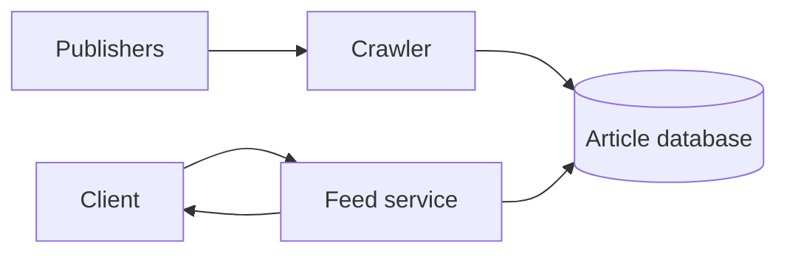
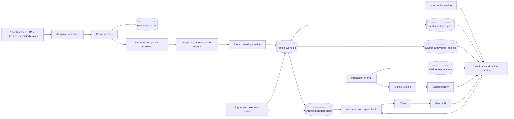
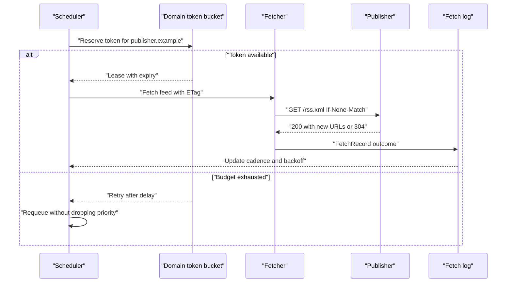
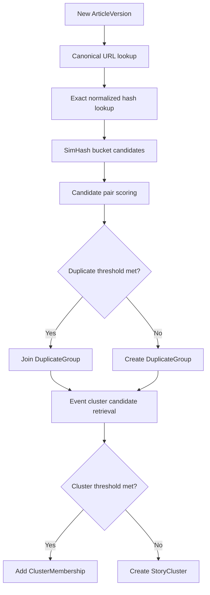
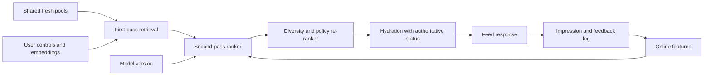

# News Aggregator System Design

A news aggregator discovers publisher articles, normalizes them into attributable records, groups duplicate and related coverage, and serves personalized feeds and story pages. The design focuses on aggregation and linking, not hosting full copyrighted articles unless licensed, and it treats search, ranking, and user feedback as supporting pieces around the harder problem: keeping a constantly changing news corpus fresh without flooding users with hundreds of copies of the same story.

## 1. Requirements

### 1.1 Functional requirements

- Ingest news from publisher push APIs, RSS/Atom feeds, XML sitemaps, and permitted crawls while respecting rights and robots policies.
- Extract canonical article metadata, source attribution, images, language, entities, topics, and short excerpts when licensing allows.
- Collapse exact and near-duplicate articles while preserving publisher variants for attribution and source choice.
- Cluster distinct articles that cover the same evolving story and expose a story page with timelines, multiple sources, local angles, and related context.
- Serve personalized home feeds, topical feeds, story pages, and keyword search with user follows, mutes, seen-state, and feedback.
- Process publisher corrections, removals, legal restrictions, and takedowns quickly enough that stale indexes or caches do not keep serving removed content.

### 1.2 Non-functional requirements

- **Freshness.** Breaking articles should become eligible for feeds within 1-2 minutes because news value decays quickly and late ingestion makes the product feel stale.
- **Deduplication quality.** The system should avoid showing five syndicated copies of the same article, but false merges must be reversible because hiding distinct reporting is worse than showing an occasional duplicate.
- **Serving latency.** Feed reads should stay under about 200 ms p95 by using shared candidate pools, caches, and read-time ranking rather than expensive full-corpus scans.
- **Publisher politeness.** Crawling must respect per-domain budgets, conditional requests, robots rules, and licensing because aggressive freshness cannot come from overloading publishers.
- **Rights correctness.** Takedown and restriction state must be enforced on the final serving path even when asynchronous search, cluster, or ranking indexes lag.
- **Learning safety.** Ranking must blend engagement with freshness, source quality, diversity, and explicit user controls so feedback loops do not trap users in repetitive or low-quality coverage.

### 1.3 The binding constraint

The binding constraint is freshness over a corpus whose identity is unstable. A breaking story can arrive as a wire article, local rewrite, live blog, correction, photo gallery, and hundreds of syndicated copies within minutes. If the system waits for perfect clustering, it misses the freshness target. If it publishes every discovered URL independently, the feed becomes duplicate spam and ranking learns from a polluted inventory.

That tension forces three mechanisms. Ingestion needs adaptive discovery that combines fast feeds with slower completeness scans and publisher politeness. The content pipeline needs cheap exact fingerprints, SimHash-style near-duplicate checks, and versioned, reversible story clustering. Serving needs read-time personalization with freshness-aware ranking so cold-start articles can compete before click history exists.

## 2. Back-of-the-envelope estimation

Assumptions here are illustrative, not claims about any specific company. Suppose the product has 100 million daily active users and an average user opens or refreshes a feed 20 times per day. That is `100M × 20 / 86,400 = 23,148` feed reads per second on average. A morning commute, election night, or major disaster can create a `10×` burst, so the serving design should tolerate roughly `230k` feed reads per second without depending on the crawler or model trainer.

On the ingestion side, assume 10 million known publisher endpoints across feeds, section pages, sitemaps, and APIs. If the scheduler touches an average endpoint six times per day, that is `10M × 6 / 86,400 = 694` scheduled fetches per second. Fetches are not evenly distributed: large publishers publish in batches, feeds become hot during breaking news, and retries bunch after outages. Provisioning the fetch tier for `5×` the average gives about `3,500` fetches per second, but the more important consequence is not raw bandwidth. The scheduler must enforce per-domain budgets so a large global fleet does not accidentally hit one publisher with all retries at once.

If 50 million URLs are fetched per day and 5 million become accepted article versions, accepted article throughput is `5M / 86,400 = 58` per second on average. That seems small compared with feed reads, but each accepted article fans out into raw storage, extraction, policy scans, fingerprint lookup, cluster candidate search, article metadata, search indexing, feature updates, and cache invalidation. The design should treat ingestion as an asynchronous stream with idempotent consumers rather than a single request path that synchronously updates every index.

For storage, if the normalized article metadata record averages 20 KB and the retention horizon holds 500 million versions, metadata alone is `500M × 20 KB = 10 TB` before indexes and replicas. Raw HTML is larger and less frequently read, so it belongs in object storage with policy-controlled retention. Interaction events dominate write volume: 10 billion events per day means `10B / 86,400 = 115,741` events per second, which is a stream/log problem, not an OLTP-table problem.

> **Key idea.** Reads dominate online latency, but freshness and deduplication dominate correctness. The architecture separates slow, polite, asynchronous corpus construction from fast read-time ranking over shared fresh candidate pools.

## 3. API design

**Question.** How does the API let publishers, crawlers, and clients retry safely while the same URL may be corrected, duplicated, or removed later?
<details><summary>Answer</summary>

Publisher writes and client feedback use idempotency keys, article reads expose versions, and feed pagination uses opaque cursors tied to a generation window. Takedowns are separate control-plane writes that change authoritative serving eligibility before all derived indexes necessarily catch up.

</details>

```http
POST /v1/publisher/articles
Idempotency-Key: <publisher-guid-or-url-version>

GET /v1/publisher/articles/{publisher_article_id}/status

POST /v1/publisher/takedowns
Idempotency-Key: <case-id>

GET /v1/feed?cursor=<opaque>&limit=30

GET /v1/topics/{topic_id}/feed?cursor=<opaque>&limit=30

GET /v1/stories/{cluster_id}?version=<optional>

GET /v1/search?q=<query>&cursor=<opaque>&freshness=24h

POST /v1/interactions
Idempotency-Key: <event-id>
```

Publisher push is accepted with `202 Accepted` when it enters the ingestion log, not when every search shard and ranking feature has updated. The status endpoint reports states such as `RECEIVED`, `FETCHED`, `EXTRACTED`, `DUPLICATE_OF`, `CLUSTERED`, `ACTIVE`, `RESTRICTED`, and `REMOVED`, plus the latest known version. That avoids making publisher retries ambiguous: the same idempotency key returns the same ingestion record, while a material correction uses a new version key.

Feed cursors are opaque because offsets are unstable in news. A cursor binds the user or anonymous cohort, locale, model version, policy version, generation timestamp, and a short frozen candidate window. The next page should not reshuffle because ten newer articles arrived between page one and page two. A deliberate refresh can request a new generation and see breaking stories. The interaction API includes request ID, position, candidate set identity, and model version so training can distinguish a clicked article from an article the user never saw.

Takedowns and restrictions are not ordinary article updates. They are control-plane mutations with stronger consistency, an audit trail, and high-priority cache invalidation. A feed response should include article and policy versions so clients can discard stale prefetched cards if the server reports a newer restriction.

## 4. Data model

Start with the obvious entity, `Article`, identified by a URL. That fails immediately because news URLs are not stable identities. A canonical URL can redirect, a live blog can change under the same URL, syndicated copies can carry different URLs for identical text, and one URL can be republished with material changes. So the model separates a publisher's submitted or discovered URL from an immutable `ArticleVersion`.

Next, exact duplicate detection suggests storing a content hash on the article. That catches byte-identical syndication but misses lightly edited titles, tracking widgets, and localized boilerplate. The version therefore stores normalized text hashes and a SimHash fingerprint. SimHash is compact enough to compare at crawl scale using Hamming-distance buckets, but a fingerprint alone cannot explain why two stories are the same. The system keeps the duplicate decision as a reversible `DuplicateGroup` membership with threshold, model version, and evidence.

Then we need story pages. A duplicate group is too narrow: two articles about the same election result may have different text, different quotes, and different local angles. A `StoryCluster` groups distinct coverage around one evolving event. Cluster membership also has to be versioned because early breaking-news clusters are often wrong; articles may move as more evidence arrives.

Finally, personalization requires user state, but the article store should not become a user-feature database. User follows and mutes need read-your-writes behavior, while long-term interest embeddings and short-window counters can be derived asynchronously from interaction streams. This separation lets a user mute a publisher and see the effect on the next request even if the offline model still thinks that source is relevant.

```text
Source
- source_id, canonical_domain, ownership_status
- feed_urls, sitemap_urls, api_credentials_ref
- fetch_policy, robots_policy_version, crawl_delay
- trust_tier, languages, regions, rights_policy
- scheduler_state, last_success_at, quality_stats

FetchRecord
- fetch_id, source_id, requested_url, final_url
- requested_at, completed_at, status_code, etag, last_modified
- content_hash, raw_object_key, fetch_policy_version
- outcome: FETCHED | NOT_MODIFIED | FAILED | BLOCKED

ArticleVersion
- article_version_id, logical_article_id, source_id
- canonical_url, title, byline, summary, image_refs
- published_at, updated_at, discovered_at, extracted_at
- language, region_tags, topic_ids, entity_ids
- normalized_text_hash, simhash, embedding_ref
- rights_status, safety_status, serving_status, version

DuplicateGroup
- duplicate_group_id, representative_article_version_id
- member_article_version_ids, exact_hashes, simhash_bucket_ids
- decision_version, created_at, updated_at

StoryCluster
- cluster_id, representative_article_version_id
- canonical_topic, entity_ids, location_tags
- first_seen_at, last_updated_at, centroid_ref
- article_count, cluster_version, status

ClusterMembership
- cluster_id, article_version_id
- score, evidence, model_version, assigned_at, active

UserProfile
- user_id, locale, followed_topics, followed_sources
- muted_entities, muted_sources, profile_version
- interest_embedding_ref, updated_at

InteractionEvent
- event_id, user_id_or_session, request_id
- article_version_id, cluster_id, event_type
- position, model_version, timestamp

FeedRequestLog
- request_id, user_id_or_cohort, cursor_id
- candidate_set_id, result_article_version_ids
- feature_versions, model_version, policy_version, generated_at
```

Source, user control, rights, and article serving status live in strongly consistent stores because they gate what may be fetched or shown. Raw fetches live in immutable object storage, partitioned by date and content hash, because they are large and mostly used for replay or audit. Article metadata can live in a wide-column or document store keyed by `article_version_id`, with secondary indexes by source, canonical URL, and time. Search indexes, ANN vector indexes, cluster centroids, trending counters, and ranking features are derived views fed by an event log; they are allowed to lag because hydration rechecks authoritative status before serving.

> **Key idea.** The model distinguishes URL, article version, duplicate group, and story cluster because each answers a different question: where content came from, what exact text was observed, which versions are equivalent, and which distinct reports cover the same event.

## 5. High-level design

The simplest design polls every publisher feed, parses new URLs, writes articles into one database, and lets the feed service query recent articles and rank them for each user.



This design breaks in several named ways. First, uniform polling either misses breaking publishers or overloads quiet ones. Second, article identity explodes because one wire story appears under hundreds of URLs. Third, story pages are noisy because duplicate detection is not the same as event clustering. Fourth, a fresh article has no click history, so a ranking model trained on engagement suppresses the very items that make news valuable. Fifth, asynchronous indexes and caches can keep serving a removed article unless the final serving path checks authoritative rights state.

### Fix 1: Adaptive discovery with politeness budgets

Instead of treating all sources equally, the source registry stores allowed discovery methods, historical update cadence, credentials, crawl delay, conditional request headers, and rights policy. The scheduler has two lanes per publisher: a fast lane for RSS/Atom feeds, webhooks, and recent-change APIs, and a slower reconciliation lane for XML sitemaps and section crawls. Google Search Central's guidance maps directly here: feeds are useful for recent updates, while sitemaps provide the broader URL set and meaningful last-modified hints.

Per-domain token buckets are global, not per fetcher process. A breaking event should raise priority for a publisher's feed, but it should not let a hundred regional crawlers synchronize retries. Fetchers use `ETag` and `If-Modified-Since`, bound response size and decompression ratio, sandbox parsing, and emit a `FetchRecord` for success, failure, or `304 Not Modified` so the scheduler can learn.

### Fix 2: Versioned ingestion log and derived indexes

The parser, scanner, fingerprint service, clusterer, search indexer, and feature builders consume article events from a durable log. The article metadata commit uses an outbox event so consumers never have to infer missed updates from a database scan. Consumers are idempotent by `article_version_id` and their own projection version.

This fixes the synchronous fan-out problem. A fetched article can become eligible quickly after minimal extraction and policy checks, while slower embedding generation or cluster refinement updates derived views later. It also makes repair practical: if a parser improves or a model is rolled back, the system can replay raw fetches or article events into a new projection.

### Fix 3: Layered duplicate detection before story clustering

The pipeline first canonicalizes URLs and exact hashes. Then it computes a near-duplicate fingerprint such as SimHash over normalized shingles and compares candidates within Hamming-distance buckets. Only after duplicate groups are formed does story clustering reason about semantic similarity, entities, locations, and time. Google's near-duplicate crawling work supports this separation: compact fingerprints are a crawl-scale primitive, but the product decision still needs conservative thresholds and reversible membership.

Keeping every publisher's article version preserves attribution and source choice. The feed can select one representative from a duplicate group, while a story page can list all relevant sources. False merges and false splits are corrected by versioned membership changes rather than destructive deletes.

### Fix 4: Shared candidate pools with read-time personalization

Precomputing every user's news feed is stale the moment new articles arrive. Yahoo! JAPAN's news recommendation write-up describes this failure mode and motivates request-time recommendation over fresh article vectors. This design precomputes shared global, regional, language, topic, and breaking-news pools, plus user embeddings and source/topic preferences. At request time, the ranker retrieves from those pools, filters rights and mutes, scores fresh candidates, diversifies by cluster and source, and hydrates article cards.

Cold-start articles enter through content features, source quality, followed-topic matches, local significance, and breaking-news lanes before clicks accumulate. Engagement still matters, but it is not the only gate into the candidate set.

### Fix 5: Authoritative serving checks for rights and removals

Search, cluster, and feed caches are derived and may lag. Therefore the final hydration step checks authoritative `serving_status`, `rights_status`, region restrictions, and user mutes before returning a card. Takedown events use a high-priority control stream to invalidate caches, but cache invalidation is treated as an optimization. Correctness comes from the final status check.

### Putting it together



A publisher update enters through a push API or the scheduler. Fetchers store raw bytes, the extractor creates an `ArticleVersion`, the duplicate service assigns a `DuplicateGroup`, and the clusterer attaches it to a `StoryCluster`. Article events update metadata, search, vector indexes, candidate pools, and features asynchronously. A feed request loads the user's controls, retrieves fresh shared candidates, ranks them with online features and a model version, diversifies by story cluster, and hydrates cards only after checking authoritative rights and serving status.

> **Key idea.** Each component traces back to a specific failure of the naive design.

## 6. Deep dives

### 6.1 Ingestion discovery: feeds, sitemaps, crawling, and politeness

**Question.** A major publisher updates its RSS feed every 30 seconds during a breaking event, while its sitemap contains 500,000 URLs and its robots policy allows one request per second. How does the system stay fresh without becoming an abusive crawler?
<details><summary>Answer</summary>

Use separate discovery lanes. Poll the small recent-update feed or accept signed pushes for freshness, reconcile the sitemap slowly for completeness, and enforce one global per-domain token bucket across all fetchers. Conditional requests and adaptive priorities reduce wasted fetches; breaking-news priority changes scheduling order, not the politeness limit.

</details>

The naive crawler has one interval per source. If that interval is short, quiet publishers are hammered with useless requests. If it is long, breaking news appears late. Worse, a horizontally scaled crawler can multiply harm: ten regions each running a polite one-request-per-second loop become ten requests per second to the same domain unless politeness is coordinated globally.

The scheduler should model discovery methods separately. RSS and Atom feeds are small, recent-update surfaces; they answer, "What changed lately?" Sitemaps answer, "What URLs should eventually be known?" Section pages and homepage crawls are fallback mechanisms when feeds are unreliable or incomplete. Publisher push APIs and signed webhooks are best when available because the publisher controls timing and payload identity. The source registry records which methods are allowed, which credentials to use, which paths are disallowed, and the current robots-policy version.

Priority is computed from expected value, not a fixed loop. A source that published 40 articles in the last hour gets a shorter feed poll interval than one that publishes twice a day. A feed that returned `304 Not Modified` ten times in a row backs off. A source with high user demand, local relevance, or a breaking topic gets higher priority. Failures use exponential backoff with jitter so retries do not synchronize. The token bucket for a registrable domain remains the hard gate; priority decides who gets the next token, not how many tokens exist.



Conditional HTTP requests matter because freshness is usually about detecting small changes on repeated surfaces. If a publisher supports `ETag` or `Last-Modified`, the fetcher can ask cheaply whether content changed. If a publisher returns weak or bogus timestamps, the scheduler learns lower trust for that signal and relies more on feeds, canonical URLs, or content hashes.

Safety is part of ingestion, not an afterthought. Fetchers validate DNS results and final redirect destinations to avoid SSRF; they block private, loopback, link-local, and cloud metadata addresses. They cap response size, redirect count, timeout, decompression ratio, and parser CPU. HTML and image parsing run in a sandbox because publisher pages are untrusted input. Every outcome writes a `FetchRecord`, even a block or parser failure, because silent failure makes the scheduler over-poll and leaves operators blind.

Google Search Central's feed-versus-sitemap distinction is useful production evidence: use feeds for recent URLs and sitemaps for complete discovery and reconciliation. The design also mirrors a general lesson from large crawlers: the unit of politeness is the publisher or domain, not the worker. A global lease or token service prevents regional duplication. If that service fails, the safe fallback is to stop or drastically reduce crawling for affected domains, not to let every worker guess independently.

Signals worth watching: per-domain request rate versus budget, feed freshness lag, `304` ratio, fetch failure bursts, parser failure rate by source, sitemap reconciliation lag, and any incident where multiple regions fetched the same domain concurrently.

> **Strong-answer criteria.** A strong answer separates freshness discovery from completeness discovery and treats politeness as a globally coordinated correctness constraint, not a local sleep in each worker.

| Level | Approach | Why |
|---|---|---|
| Bad | Poll every source every minute from every region. | It misses source differences and multiplies load against publishers. |
| Good | Use RSS for recent updates, sitemaps for completeness, and conditional requests. | It improves freshness and efficiency but may still fail without global budgets and adaptive backoff. |
| Great | Combine adaptive scheduling, signed push where possible, global per-domain token buckets, sandboxed fetching, durable fetch records, and slow reconciliation. | It stays fresh while preserving publisher trust and providing repairable evidence. |

### 6.2 Near-duplicate detection and incremental story clustering

**Question.** Five hundred publishers publish the same wire story, then twenty local reporters add distinct updates about the same event. How does the system avoid duplicate spam without collapsing all reporting into one article?
<details><summary>Answer</summary>

Use layered identity. Exact hashes and SimHash-style near-duplicate fingerprints form duplicate groups for substantially equivalent text. Story clustering then groups distinct duplicate groups by event using embeddings, entities, location, and time. Both memberships are versioned and reversible, with conservative thresholds for automatic merges.

</details>

A single "similarity" score is tempting, but it conflates two product questions. Deduplication asks whether two article versions are close substitutes in a feed. Story clustering asks whether distinct reporting belongs on the same evolving event page. A syndicated Associated Press article and a lightly edited republication are duplicates. A local interview, an explainer, and a live update about the same storm are not duplicates, but they belong in the same story cluster.

The pipeline starts with cheap deterministic keys. URL canonicalization removes known tracking parameters, normalizes hosts and redirects, and respects publisher-declared canonical links when trusted. Exact normalized-text hashes collapse byte-identical and boilerplate-normalized copies. These checks are fast and precise, but too narrow for news, where syndicated stories often change a headline, first paragraph, or embedded media.

Near-duplicate detection uses a compact fingerprint such as SimHash over normalized shingles. Similar documents should have fingerprints with small Hamming distance. At scale, the system cannot compare every new article against every old article, so it partitions fingerprints into bands or buckets and only compares candidates within a time, language, and source window. Google's near-duplicate web-crawling paper is the relevant production lesson: compact fingerprints make crawl-scale duplicate detection feasible. For news, the threshold should be conservative because false merges hide legitimate reporting. A common pattern is to auto-merge only below a strict Hamming threshold, flag a review or later-model pass for the gray zone, and keep the decision evidence.



After duplicate grouping, story clustering retrieves candidate clusters from a vector index and time/entity inverted indexes. The score blends semantic embedding similarity, entity overlap, location overlap, publication time, source type, and topic. Incremental clustering is hard because the first article about a breaking event may be vague. Early clusters should be easy to split. A `ClusterMembership` stores model version and evidence so a later job can move an article, merge two clusters, or split a cluster without breaking saved links. Cluster aliases preserve old URLs: if cluster `c1` merges into `c9`, requests for `c1` redirect or resolve to `c9` with an alias record.

The main failure modes are false merge, false split, and cluster churn. False merge is most damaging: two unrelated stories about the same company can share entities and keywords. Add time and event-type features, require stronger evidence for broad entities, and penalize generic topics. False split is visible but repairable: a story page misses some coverage until a merge job finds it. Churn confuses users and caches; use hysteresis so a membership is not moved on tiny score changes, and preserve representative articles for a short time unless they are removed.

Google News Full Coverage provides the product evidence for keeping clustering above deduplication. Its story organization emphasizes timelines, local headlines, explainers, interviews, and multiple perspectives rather than one canonical article. That means the data model must preserve multiple sources and article types inside a cluster. The feed may show one representative per duplicate group, but the cluster page should intentionally expose diversity.

Signals worth watching: sampled duplicate false-merge rate, duplicate false-split rate, cluster purity, cluster split/merge churn, number of feed items suppressed by duplicate group, and the age of unclustered breaking articles.

> **Strong-answer criteria.** A senior answer distinguishes duplicate equivalence from same-story relatedness and makes automatic membership reversible with versioned evidence.

| Level | Approach | Why |
|---|---|---|
| Bad | Compare titles and hide articles with similar words. | Headlines are noisy, language-specific, and cause both false merges and missed syndication. |
| Good | Use content hashes plus SimHash and cluster by embeddings. | It has the right primitives but needs thresholds, candidate windows, and reversible decisions. |
| Great | Layer URL, exact hash, SimHash, semantic clustering, entity/time checks, hysteresis, aliases, and sampled human evaluation. | It handles scale while preserving attribution and correcting inevitable mistakes. |

### 6.3 Personalized ranking with cold-start articles and freshness decay

**Question.** A just-published article has no clicks, but it may be the most important story for millions of users. How does the ranker avoid burying it under older articles with proven engagement?
<details><summary>Answer</summary>

Separate candidate eligibility from engagement history. Fresh articles enter shared candidate pools through source, topic, entity, locality, and breaking-news signals. The ranker applies freshness decay, content/user similarity, source quality, exploration, and diversity constraints, then learns from impressions and clicks once exposure exists.

</details>

A pure collaborative filter works best after users have interacted with items. News inventory violates that assumption: the value of an article is highest when behavior is sparsest. Google's early Google News personalization work blended online collaborative filtering with content and profile signals for a fast-changing inventory. Yahoo! JAPAN describes a related production issue: precomputing user-specific news lists omits articles that arrive after list generation, so they compute recommendations at request time from fresh article vectors. Those lessons point to a hybrid design.

Candidate generation should be broad and cheap. Shared pools include latest high-quality articles by language and region, followed topics, followed sources, trending clusters, local-significance modules, editorial/public-interest modules, and exploration pools. User-specific retrieval uses followed entities, interest embeddings, recent clicks, and mutes, but it does not scan the corpus. The first-stage ranker narrows thousands of candidates to hundreds using inexpensive features. The second-stage ranker scores a smaller set with richer features. A re-ranker enforces cluster diversity, source caps, freshness mix, and explicit user controls. LinkedIn's feed architecture uses this first-pass, second-pass, re-rank separation for heterogeneous inventory; the same shape fits news because followed topics, breaking stories, local news, and exploration have different feature distributions.

Freshness decay is not a simple global penalty. A sports final, an earthquake warning, and a long-form investigation have different half-lives. The ranker can model freshness as a feature family: time since `published_at`, time since `discovered_at`, update velocity of the cluster, topic-specific decay, and whether the user has already seen the cluster. Freshness should boost eligibility early and decay unless engagement, editorial value, or continued updates sustain the story. Discovered time guards against publishers backdating articles, while published time preserves real chronology.



Cold-start scoring relies on content and source priors: topic match, entity match, location relevance, source trust tier, article type, cluster velocity, publisher freshness reliability, and similarity to the user's profile embedding. Exploration should be explicit, not accidental. Reserve a small fraction of positions for fresh or diverse candidates that the model is uncertain about, then log impressions so the system learns unbiased negatives. Microsoft's MIND dataset illustrates why impressions matter: clicked and non-clicked exposed items, user click history, categories, and entities are all needed for training. Click logs without exposure data teach the model only from what previous models chose to show.

Feature freshness needs infrastructure. SmartNews's feature-store design is relevant because short-window counters such as source click-through, cluster velocity, or user-topic engagement must be precomputed from streams and served as low-latency point lookups. The offline copy must remain reproducible for training. A naive sliding-window job for every feature and segment can multiply state and writes; use shared aggregations and clear window definitions.

The ranker must also resist feedback loops. If engagement is the only objective, sensational sources and repetitive clusters can dominate. The re-ranker should cap duplicate groups, limit source concentration, include public-interest and local modules, and honor explicit mutes before model scoring. For anonymous users, use locale and cohort features with a short-lived seen set. For signed-in users, follows and mutes are strongly consistent controls while long-term embeddings update asynchronously.

Signals worth watching: fresh-article exposure within 1, 5, and 15 minutes; click and long-click by freshness bucket; source concentration; duplicate suppression rate; fallback feed rate; hide/mute rates; and model performance split by new versus mature articles.

> **Strong-answer criteria.** A strong answer explains how fresh items enter the candidate set before behavior exists and how impression logging prevents the next model from learning only from previous exposure bias.

| Level | Approach | Why |
|---|---|---|
| Bad | Rank by recent global clicks. | New articles have no clicks, and popular duplicate sources crowd out fresh relevant reporting. |
| Good | Add a freshness boost to a personalized ranker. | It helps but can still miss cold-start items without broad candidate pools and impression-aware training. |
| Great | Use shared fresh pools, read-time retrieval, content/source priors, freshness decay, exploration, impression logging, and diversity re-ranking. | It balances freshness, personalization, learning, and duplicate control. |

## 7. Variants

**10x scale.** At one billion daily users and several million feed reads per second, the serving architecture keeps the same shape but pushes more work into shared regional candidate pools, prehydrated article cards, and edge caches. The ranker still runs at read time, but it operates over tighter per-locale and per-topic pools. Interaction logging becomes a multi-region stream with local buffering and exactly-once-like deduplication by event ID at aggregation boundaries. The crawler does not simply scale by `10×`; publisher politeness budgets remain fixed, so freshness improvements must come from better push integrations, smarter prioritization, and fewer wasted fetches.

**Election night or disaster burst.** A few clusters become extremely hot, and publisher update velocity spikes. The system can raise priority for relevant feeds, create special breaking-news candidate pools, cache cluster pages aggressively, and allocate more ranker capacity to affected locales. The authoritative rights check remains mandatory. The main change is faster control and candidate propagation, not bypassing deduplication; otherwise hundreds of similar live updates flood the feed.

**Strict regional rights.** If licensing differs by country, `rights_status` becomes region-scoped and user residency matters in final hydration. Search and candidate indexes may include globally known article IDs, but serving filters by region before ranking or at least before hydration. Raw fetch replication follows licensing and residency rules. Takedown events carry jurisdiction, policy version, and audit metadata.

**Publisher push-first ecosystem.** If most major publishers adopt signed push APIs, the scheduler shifts from polling to verification and reconciliation. Push reduces freshness lag and wasted fetches, but it does not remove the need for crawling: sitemaps and occasional fetches still validate canonical URLs, corrections, removals, and missed pushes. Idempotency keys and publisher ownership verification become more important.

## 8. The transferable pattern

The reusable shape is an unstable-inventory recommendation system. Items arrive continuously, item identity is fuzzy, and the serving experience depends on both fresh global signals and personal state. The architecture separates ingestion truth from derived indexes, uses layered identity resolution, and ranks at read time over shared candidate pools. Similar patterns appear in marketplace search, social feeds, job recommendations, and event discovery, though news is unusually strict about freshness, attribution, and duplicate suppression.

Compared with [Ticketmaster](./ticketmaster-system-design.md), both systems care about freshness and bursts, but the scarce resource differs. Ticketing is shaped by transactional inventory and race-free purchase flows. News aggregation is shaped by corpus freshness and fuzzy equivalence: the hard question is not who gets the last seat, but whether five URLs are the same article, whether twenty more belong to the same story, and how to rank them before behavior data exists.

## Review

The design starts from the failure of a simple crawler-backed feed: uniform polling is either stale or abusive, duplicate publisher URLs pollute inventory, story pages need more than deduplication, engagement-only ranking buries cold-start news, and stale derived indexes can violate rights. The resulting architecture uses adaptive discovery with global politeness, immutable fetch records, article versions, layered duplicate groups, reversible story clusters, shared fresh candidate pools, read-time personalized ranking, impression-aware feedback, and final authoritative serving checks for rights and removals. Freshness is achieved by fast minimal eligibility and asynchronous refinement, not by making every downstream index synchronously perfect.

### Check your understanding

1. Why are feeds and sitemaps both needed?
   <details><summary>Answer</summary>

   Feeds and publisher pushes provide recent updates for freshness, while sitemaps provide broader URL discovery and reconciliation for missed or older URLs. Polling a full sitemap at feed frequency wastes crawl budget and violates publisher politeness.

   </details>

2. Why is a duplicate group not the same as a story cluster?
   <details><summary>Answer</summary>

   A duplicate group contains substantially equivalent article versions, such as syndicated copies. A story cluster contains distinct reporting about the same event, such as an explainer, local angle, live update, and interview. Feeds suppress duplicates; story pages expose diverse coverage.

   </details>

3. How does SimHash help, and why is it not sufficient by itself?
   <details><summary>Answer</summary>

   SimHash provides compact fingerprints where near-identical documents have small Hamming distance, making crawl-scale candidate comparison feasible. It is not sufficient because thresholds can false-merge distinct stories, so decisions need conservative windows, additional features, and reversible membership evidence.

   </details>

4. Why is feed fan-out on read preferred here?
   <details><summary>Answer</summary>

   News inventory changes too quickly for fully precomputed per-user feeds. Read-time ranking over shared fresh candidate pools lets newly arrived articles compete immediately while still using user profiles, mutes, and online features.

   </details>

5. Why must hydration recheck authoritative article status?
   <details><summary>Answer</summary>

   Search indexes, cluster views, feed caches, and candidate pools are derived asynchronously and can lag. Rechecking authoritative rights and serving status during hydration prevents removed or restricted content from being served because a stale projection still contains it.

   </details>

## Sources and further reading

| Source | Article | Why it matters |
|---|---|---|
| Google Research | [Google News Personalization: Scalable Online Collaborative Filtering](https://research.google/pubs/google-news-personalization-scalable-online-collaborative-filtering/) | Shows why online collaborative filtering must be blended with fresh content/profile features for rapidly changing news inventory. |
| Google Blog | [New Google News: AI meets human intelligence](https://blog.google/products-and-platforms/products/news/new-google-news-ai-meets-human-intelligence/) | Explains real-time AI/ML organization of news into evolving storylines and personalized briefings. |
| Google Blog | [Get the full news story with Full Coverage in Search](https://blog.google/products-and-platforms/products/news/get-full-news-story-full-coverage-search/) | Shows how story pages expose multiple sources, local headlines, explainers, and perspectives for complex developing events. |
| Google Search Central | [Best practices for XML sitemaps and RSS/Atom feeds](https://developers.google.com/search/blog/2014/10/best-practices-for-xml-sitemaps-rssatom) | Clarifies why feeds are for recent updates while sitemaps are for complete URL discovery and reconciliation. |
| Google Research | [Detecting Near-Duplicates for Web Crawling](https://static.googleusercontent.com/media/research.google.com/en/us/pubs/archive/33026.pdf) | Establishes compact fingerprinting as a crawl-scale near-duplicate detection primitive. |
| Yahoo! JAPAN Tech Blog | [Yahoo! JAPANアプリにおけるニュース記事レコメンドの取り組み](https://techblog.yahoo.co.jp/entry/2023022730415148/) | Describes request-time vector retrieval, new-article cold start handling, and dedup/diversity for news recommendations. |
| SmartNews Engineering | [Feature Engineering Practice in SmartNews](https://medium.com/smartnews-inc/feature-engineering-practice-in-smartnews-e14877e3edc2) | Details real-time/offline feature-store design and sliding-window pitfalls for low-latency recommendation features. |
| LinkedIn Engineering | [Feed relevance](https://engineering.linkedin.com/teams/data/artificial-intelligence/feed) | Describes first-pass rankers, second-pass ranking, re-ranking, and implicit feedback for heterogeneous personalized feeds. |
| Microsoft Learn | [Microsoft News Recommendation Dataset](https://learn.microsoft.com/en-us/azure/open-datasets/dataset-microsoft-news) | Documents impression logs, clicked/non-clicked negatives, entities, and anonymized users for news-recommendation training data. |
