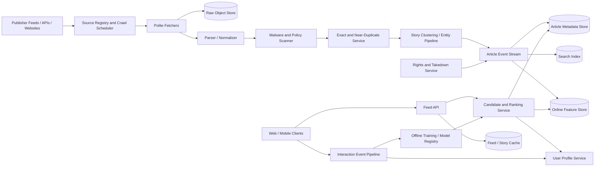

# News Aggregator and Personalized Feed

## 1. Requirements

### Functional requirements

1. Ingest articles from publisher feeds, APIs, sitemaps, and permitted crawls.
2. Normalize metadata and extract canonical article content.
3. Deduplicate syndicated or near-identical stories.
4. Cluster articles covering the same evolving event.
5. Rank a personalized home feed and topical feeds.
6. Support search by keyword, source, topic, language, and date.
7. Show source attribution, timestamps, images, summaries, and links.
8. Let users follow or mute topics, publishers, locations, and entities.
9. Track clicks, hides, saves, and explicit feedback.
10. Enforce publisher rights, takedowns, regional restrictions, and content policies.

### Non-functional requirements

- Newly published breaking news should become discoverable within 1-2 minutes.
- Feed reads should have p95 latency under 200 ms.
- Ranking should balance relevance with freshness, source quality, and diversity.
- Ingestion must be resilient to malformed and adversarial publisher content.
- The serving path should remain available if crawling or ML pipelines lag.
- Avoid showing duplicate versions of the same story.
- Correct attribution and takedown propagation are higher priority than ranking freshness.
- Support global languages, regions, and residency rules.

The system aggregates and links to publishers; it does not host arbitrary full copyrighted articles unless licensing permits it.

## 2. Scale assumptions

- 500 million registered users and 100 million daily active users.
- 20,000 feed reads/second average and 200,000/second peak.
- 10 million active publisher endpoints.
- 50 million fetched URLs/day.
- 5 million newly accepted articles/day after filtering.
- 500 million stored article versions over the retention horizon.
- 10 billion user interaction events/day.
- Average normalized article record: 20 KB excluding images.
- Breaking event: 100,000 related articles and millions of feed requests.
- Read-to-ingest ratio: over 1,000:1.

Ingestion average:

```text
50M fetched URLs / 86,400 seconds
= about 580 fetches/second average

5M accepted articles / 86,400 seconds
= about 58 accepted articles/second average

10B interaction events / 86,400 seconds
= about 116,000 events/second average

500M article versions * 20 KB
= about 10 TB of article metadata before indexes, replicas, and raw fetches
```

Fetches are bursty around publisher schedules and breaking events, so provision scheduler, fetcher, and parser capacity for several times the 580 fetches/second average and isolate that capacity from feed serving. Ranking and feed serving dominate online compute; extraction, clustering, and model training dominate asynchronous compute.

## 3. High-level architecture



Separate:

- **Ingestion plane:** discover, fetch, normalize, deduplicate, cluster, and index.
- **Serving plane:** retrieve candidates, rank, diversify, filter, and hydrate.
- **Learning plane:** process feedback, train models, validate them, and publish versions.
- **Governance plane:** source rights, policy, takedown, provenance, and audit.

## 4. Data model

```text
Source
- source_id
- canonical_domain
- feed_urls
- fetch_policy
- trust_tier
- languages
- regions
- rights_policy
- crawl_state

FetchRecord
- fetch_id
- url
- source_id
- requested_at
- status_code
- content_hash
- object_key
- robots_policy_version

Article
- article_id
- source_id
- canonical_url
- title
- summary
- author
- published_at
- discovered_at
- language
- region_tags
- topic_ids
- entity_ids
- exact_hash
- simhash
- cluster_id
- content_rights
- status: ACTIVE | SUPERSEDED | REMOVED | RESTRICTED
- version

StoryCluster
- cluster_id
- canonical_topic
- representative_article_id
- article_count
- first_seen_at
- last_updated_at
- embedding_centroid
- version

UserProfile
- user_id
- followed_topics
- followed_sources
- muted_entities
- locale
- interest_embedding
- profile_version

Interaction
- event_id
- user_id
- article_id
- request_id
- type: IMPRESSION | CLICK | HIDE | SAVE | SHARE
- position
- model_version
- timestamp

FeedRequestLog
- request_id
- user_id_or_cohort
- candidate_ids
- result_ids
- feature_versions
- model_version
- policy_version
```

Raw fetches are immutable for reproducibility and short, policy-controlled retention. Article versions preserve provenance. Takedown state is authoritative in the metadata store and propagated to every serving index.

## 5. Ingestion APIs and feed APIs

Publishers may push:

```http
POST /v1/publisher/articles
Authorization: Bearer publisher-token
Idempotency-Key: article-guid

{
  "url": "https://publisher.example/story",
  "title": "Election results...",
  "published_at": "2026-10-13T06:55:00Z",
  "updated_at": "2026-10-13T07:05:00Z"
}
```

### Personalized feed

```http
GET /v1/feed?cursor=opaque&limit=30
```

```json
{
  "items": [
    {
      "article_id": "a-91",
      "cluster_id": "story-7",
      "title": "Election results...",
      "source": {"name": "Publisher"},
      "published_at": "2026-10-13T06:55:00Z",
      "reason": "Because you follow national politics"
    }
  ],
  "next_cursor": "opaque",
  "generated_at": "2026-10-13T07:10:00Z"
}
```

Other endpoints:

```http
GET    /v1/topics/{topic_id}/feed
GET    /v1/stories/{cluster_id}
GET    /v1/search?q=...
PUT    /v1/users/me/follows/{entity_id}
PUT    /v1/users/me/mutes/{entity_id}
POST   /v1/interactions
POST   /v1/publisher/takedowns
GET    /v1/publisher/articles/{publisher_article_id}/status
```

Feed cursors bind to query, cohort, ranking context, and time window so they cannot be reused to enumerate unrelated data.

## 6. Source discovery and crawl scheduling

The source registry stores ownership, allowed fetch methods, crawl delay, credentials, licensing, and historical quality.

Scheduler priorities combine:

- Explicit feed update or publisher push.
- RSS/Atom recent-change feeds for freshness plus XML sitemaps for full URL discovery.
- Expected publication frequency.
- Time since last successful fetch.
- Change probability learned from history.
- Breaking-news signals.
- Source importance and freshness SLO.
- Per-domain politeness budget.

Fetchers:

1. Resolve and validate the destination to prevent SSRF.
2. Enforce robots, rights, and per-domain rate limits.
3. Send conditional requests with ETag and `If-Modified-Since`.
4. Limit response size, redirects, decompression ratio, and timeout.
5. Store raw bytes plus headers immutably.
6. Emit a fetch event even for failure or not-modified results.

Exponential backoff handles failures, but scheduler jitter prevents synchronized retries. Publishers with signed push APIs avoid crawl delay.

## 7. Extraction and canonicalization

Extraction workers use source-specific rules where available and a general parser otherwise:

- Decode charset and normalize Unicode.
- Extract canonical URL, title, byline, publication/update time, body, images, and structured data.
- Remove navigation, advertisements, and unrelated page chrome.
- Normalize tracking parameters and redirects.
- Detect language and region.
- Classify topic, entities, sensitivity, and article type.
- Scan links and media for malware or policy violations.

Never trust page-supplied `published_at` without plausibility checks. Preserve both publisher time and discovery time.

Updates to a URL create an article version. Minor corrections update the same logical article; a republished materially different story may receive a new article ID. Version decisions remain traceable.

## 8. Deduplication

Use layers:

1. **URL canonicalization:** strip known tracking parameters, normalize host and path.
2. **Exact content hash:** collapse byte- or text-identical copies.
3. **Near-duplicate fingerprint:** SimHash or MinHash over normalized shingles; compare fingerprints with a Hamming-distance threshold rather than equality.
4. **Semantic similarity:** compare embeddings and named entities within a time window.
5. **Syndication metadata:** honor canonical/source relationships supplied by publishers.

Deduplication does not necessarily delete variants. Keep each publisher's article for attribution and source choice, but prevent multiple near-identical items from occupying the same feed.

False merges are costly: unrelated updates about a broad topic should not become one article. Use conservative thresholds and retain reversible cluster membership with model/version evidence.

## 9. Story clustering

A story cluster groups distinct reporting about one evolving event, unlike deduplication, which groups substantially equivalent text. Google News's Full Coverage product frames this as real-time organization of people, places, things, timelines, local headlines, explainers, and multiple perspectives rather than a single article list.

For each article:

1. Generate topic, entity, location, time, and embedding features.
2. Retrieve candidate clusters from an approximate-nearest-neighbor index.
3. Score compatibility using semantic similarity and entity/time overlap.
4. Attach to the best cluster over a threshold or create a new one.
5. Update the centroid and representative article asynchronously.

Clusters may split or merge as evidence changes. Maintain aliases so saved links and feed references survive. A cluster page should expose multiple sources, a timeline, and related updates rather than presenting a generated summary as original reporting.

## 10. Candidate generation and ranking

Candidate sources:

- Followed topics, entities, locations, and publishers.
- Trending and breaking story clusters in the user's locale.
- Collaborative or embedding-based interests.
- Editorially curated and public-interest modules.
- Exploration candidates outside the established profile.
- Continued coverage of recently read stories.

Two-stage ranking:

1. Retrieve hundreds or thousands of candidates cheaply.
2. Score a smaller set with a richer model.

Production systems usually keep candidate generation broad and fast: Google News combined content/profile signals with online collaborative filtering, LinkedIn used first-pass rankers feeding a second-pass ranker and re-ranker, and Yahoo! JAPAN builds the user-specific recommendation list at request time from fresh article vectors to avoid stale precomputed lists.

Possible score:

```text
relevance
+ freshness
+ source_quality
+ local_significance
+ explicit_follow_match
+ exploration
- duplicate_penalty
- already_seen_penalty
- low_quality_risk
```

Then apply hard policy filters and constrained re-ranking for source, topic, viewpoint, and format diversity. Do not let engagement alone optimize toward sensational or repetitive content.

## 11. Feed generation and pagination

Use fan-out on read for most users because news inventory changes rapidly and the candidate set is shared. Precompute:

- Global, regional, language, topic, and cohort candidate pools.
- Breaking-news modules.
- User interest embeddings and followed-entity sets.

At request time:

1. Load user profile and seen-state summary.
2. Retrieve candidates from precomputed pools and indexes.
3. Apply rights, locale, mute, safety, and takedown filters.
4. Rank with online features.
5. Diversify by cluster and source.
6. Hydrate article cards and record impressions.
7. Return an opaque cursor.

The cursor carries a feed-generation timestamp, model version, and last scoring boundary. Freeze a short candidate window to reduce duplicates between pages, while allowing a refresh to show breaking news.

Anonymous users receive region/language cohort feeds and a short-lived session seen set.

## 12. Feedback and model lifecycle

Impressions are essential; clicks without exposure data create biased training. Microsoft's MIND news-recommendation dataset models this explicitly with impression logs containing clicked and non-clicked items plus prior click history, after delinking production user IDs into anonymized IDs. Interaction events include request ID, position, candidate set, and model version.

Pipeline:

1. Validate and deduplicate client events.
2. Join clicks, dwell, hides, saves, and shares with impressions.
3. Build time-windowed features without leaking future information.
4. Train candidate and ranking models.
5. Evaluate offline relevance, calibration, diversity, and safety metrics.
6. Shadow new models, then run guarded experiments.
7. Publish signed model artifacts to a versioned registry.

Explicit hides and mutes should affect the next request quickly through an online profile write. Long-term embeddings update asynchronously.

Counter feedback loops by reserving exploration traffic, applying diversity constraints, monitoring source exposure, and separating editorial/public-interest objectives from raw engagement.

## 13. Consistency, concurrency, and event publication

Strong consistency is required for:

- Publisher ownership and rights policy.
- Takedown and legal restriction state.
- User follow/mute mutations.
- Model and policy version publication.

Eventual consistency is acceptable for:

- Search indexing.
- Cluster membership.
- Trending counts.
- Long-term interest features.
- Feed caches.

Article metadata commits with an outbox event. Consumers update search, features, clustering, and cache invalidation idempotently. A feed hydration step rechecks authoritative article status, so removed items do not survive merely because an index or cache lags.

Interaction events are at-least-once. Stable event IDs prevent inflated training signals.

## 14. Partitioning, storage, and caching

- Partition article metadata by `article_id`; maintain indexes by source and canonical URL.
- Partition raw objects by content hash/date in object storage.
- Partition interaction streams by `user_id` to preserve per-user order.
- Partition topic and regional candidate pools by locale/topic.
- Shard search by language and time, with replicas for query load.
- Store online user features in a low-latency key-value service.

Breaking stories are hot read keys. Cache hydrated story modules and immutable images at the edge, but separate personalization from shared cards. For online features, SmartNews's feature-store design shows why short-window counters should be precomputed from streams and served by point lookups, while offline copies remain available for reproducible model training.

Cache layers:

- CDN for public images and publisher assets when rights permit.
- Redis-like cache for article cards, cluster pages, and candidate pools.
- Short per-user feed-page cache for retry consistency.
- Negative cache for removed or invalid URLs.

Every cache entry carries article/policy versions or short TTLs. Takedown invalidation bypasses normal batching.

## 15. Reliability and failure handling

| Failure | Handling |
|---|---|
| Publisher feed is unavailable | Back off with jitter and continue serving stored articles |
| Page parser fails | Retain raw fetch, try fallback parser, surface source health |
| Fetch returns a decompression bomb | Enforce compressed and expanded size limits |
| Duplicate ingestion event | Idempotent canonical URL/hash processing |
| Dedup service is unavailable | Quarantine or ingest provisionally; repair later |
| Cluster model is wrong | Move article with versioned, reversible mutation |
| Search indexing lags | Feed can use article store and candidate pools |
| Ranking service times out | Serve cached cohort feed with explicit freshness age |
| Feature store is unavailable | Use bounded default/cohort features, not fabricated user data |
| Interaction events duplicate | Deduplicate by event ID before aggregation/training |
| Takedown consumer lags | Authoritative hydration filter blocks removed content |
| Bad model is deployed | Automated guardrails and instant rollback to prior signed version |

Daily reconciliation compares source records, canonical mappings, indexes, candidate pools, and authoritative article status. Dead-letter queues preserve malformed events with diagnostics rather than silently dropping them.

## 16. Multi-region design

Deploy feed and search serving in multiple regions:

- Route users to a nearby serving region.
- Replicate article metadata, search indexes, and candidate pools.
- Keep user profiles in a residency-compliant home region with read replicas or derived non-sensitive features nearby.
- Run crawlers close to publisher origins while enforcing one global politeness budget per domain.
- Use a globally coordinated source lease so regions do not duplicate fetches.
- Replicate raw objects according to rights and residency constraints.

Ingestion can continue in another region after scheduler lease failover. Stable fetch and article IDs deduplicate overlap.

If personalization dependencies fail cross-region, serve a local regional/topic feed. Takedowns and safety blocks use a high-priority global control stream and authoritative serving checks.

## 17. Security, rights, and trust

- Sandbox HTML parsing and image processing.
- Prevent SSRF by resolving, validating, and pinning allowed public destinations.
- Block private, loopback, link-local, and cloud metadata addresses.
- Limit redirects, response sizes, decompression, and parser CPU.
- Authenticate publisher APIs and verify signed webhooks.
- Respect robots directives, licensing, excerpts, embargoes, and regional rights.
- Preserve canonical links and visible source attribution.
- Provide fast verified takedown and correction workflows.
- Detect malicious domains, impersonation, coordinated manipulation, and metadata spam.
- Encrypt user profiles and minimize retention of reading history.
- Separate advertising signals from editorial ranking controls.
- Audit operator overrides, source trust changes, policy decisions, and model releases.

Generated summaries require source-grounding, attribution, quality evaluation, and a product policy for corrections. A simpler initial design uses publisher-provided excerpts.

## 18. Observability and trade-offs

Track:

- Fetch success, freshness lag, robots compliance, and per-domain request rate.
- Extraction yield and source-specific parser failures.
- Exact/near-duplicate rate and sampled false merge/split rate.
- Article-to-index and article-to-feed eligibility latency.
- Cluster purity, churn, and breaking-story detection delay.
- Feed p50/p95/p99 latency, cache hit ratio, and fallback rate.
- Ranking model version, click-through, long-click, hide, save, and return metrics.
- Source/topic exposure concentration and diversity.
- Takedown propagation time and stale-serve incidents.
- Interaction loss, duplication, and feature freshness.
- Model drift, experiment guardrail breaches, and rollback time.

### Fan-out on read versus write

- Read-time ranking stays fresh and personalized.
- Precomputed feeds reduce latency for high-fan-out accounts.
- A hybrid of shared candidate pools and read-time ranking fits news.

### Freshness versus ranking quality

- Fresh articles have sparse behavior.
- Content/source features and a breaking-news lane prevent engagement history from delaying them.

### Deduplicate versus preserve source choice

- Collapsing duplicates improves feed quality.
- Retaining variants preserves attribution and lets users compare coverage.

### Personalization versus diversity

- Personalization raises relevance.
- Constraints and exploration reduce filter bubbles and source domination.

### Availability versus correctness fallback

- A cached cohort feed is a useful fallback.
- Rights, takedown, and safety filters must still be rechecked; never use a success-shaped unfiltered fallback.

## 19. Lessons from production systems

### Google News: online collaborative filtering plus content signals

Google's 2007 Google News personalization paper describes scalable online collaborative filtering for a fast-changing inventory. The practical lesson is to avoid relying only on long-lived user profiles: keep a real-time item-item/user-item signal path for fresh popular stories, but blend it with content, source, locale, and policy features so cold-start articles are still eligible.

### Google News Full Coverage: cluster evolving stories, not just duplicates

Google's Full Coverage posts describe real-time AI/ML organization of news into storylines with people, places, things, top news, local headlines, explainers, interviews, and multiple perspectives. That maps directly to this design's `StoryCluster`: clusters need source diversity, timelines, and perspective modules, while deduplication stays at the equivalent-article level.

### Google Search Central: combine feeds and sitemaps for discovery

Google Search Central recommends XML sitemaps for the full URL set and RSS/Atom feeds for recent updates, with canonical URLs and meaningful last-modified times. The scheduler should therefore maintain two lanes per publisher: a frequent small feed poll or push path for freshness and a slower sitemap reconciliation path for completeness and missed URLs.

### Google near-duplicate detection: fingerprints are a crawl-scale primitive

Google's near-duplicate web-crawling paper uses compact fingerprints such as SimHash to identify near-identical documents at scale. For news, this keeps syndicated copies and lightly edited republishes from flooding feeds, but thresholds must be conservative and reversible because false merges hide legitimate distinct reporting.

### Yahoo! JAPAN News: request-time recommendation over fresh vectors

Yahoo! JAPAN describes why precomputing each user's news list is a poor fit: articles arriving between list generation and the user's visit are omitted, and pure click-history methods cold-start new articles. Their architecture precomputes user vectors and article vectors, indexes each newly submitted article, then performs vector search and deduplication when the user arrives; this supports the fan-out-on-read choice here.

### SmartNews: feature freshness needs a production feature store

SmartNews's feature engineering post describes real-time features from Flink, offline features from Spark, Kafka distribution, ScyllaDB for online serving, and Iceberg for offline training. The key mapping is to separate online low-latency point lookups from offline reproducibility, and to avoid naive sliding-window jobs that multiply state, output, and downstream writes.

### LinkedIn Feed: first-pass rankers, second-pass ranker, re-ranker

LinkedIn's feed relevance architecture separates inventory-specific first-pass rankers, a second-pass ranker that merges heterogeneous candidates, and a re-ranker that adjusts the final list. For a news aggregator, use this pattern to combine followed topics, breaking news, local modules, editorial/public-interest items, and exploration without letting one inventory dominate.

### Microsoft News MIND: log impressions, negatives, entities, and privacy boundaries

Microsoft's MIND dataset was built from Microsoft News behavior logs and includes impressions with clicked and non-clicked items, user click history, article categories, entities, and anonymized user IDs. This reinforces that training data must include exposure and negatives, entity-rich article features, and privacy-preserving user identifiers rather than raw account data.

## 20. Recommended interview presentation

A clear 45-minute sequence is:

1. Clarify ingestion sources, personalization, search, rights, and freshness.
2. Quantify publisher crawl load separately from feed-read scale.
3. Draw ingestion, serving, learning, and governance planes.
4. Walk through crawl scheduling, safe fetching, and extraction.
5. Deep-dive into deduplication versus story clustering.
6. Explain candidate generation, two-stage ranking, and diversity.
7. Cover cursor feeds, feedback loops, and model deployment.
8. Discuss partitioning, multi-region serving, takedowns, and security.
9. Summarize production lessons from Google, Yahoo! JAPAN, SmartNews, LinkedIn, and Microsoft.
10. Finish with freshness, personalization, and source-diversity trade-offs.

The central design insight is:

> Convert unreliable publisher inputs into versioned, attributable article records; collapse duplicates while clustering distinct coverage; and rank fresh shared candidates at read time with hard rights, safety, and diversity constraints that remain enforceable even when asynchronous indexes lag.

## Further reading: curated engineering blogs

| Source | Article | Why it matters |
|---|---|---|
| Google Research | [Google News Personalization: Scalable Online Collaborative Filtering](https://research.google/pubs/google-news-personalization-scalable-online-collaborative-filtering/) | Shows why online collaborative filtering must be blended with fresh content/profile features for rapidly changing news inventory. |
| Google Blog | [New Google News: AI meets human intelligence](https://blog.google/products-and-platforms/products/news/new-google-news-ai-meets-human-intelligence/) | Explains real-time AI/ML organization of news into evolving storylines and personalized briefings. |
| Google Blog | [Get the full news story with Full Coverage in Search](https://blog.google/products-and-platforms/products/news/get-full-news-story-full-coverage-search/) | Shows how story pages expose multiple sources, local headlines, explainers, and perspectives for complex developing events. |
| Google Search Central | [Best practices for XML sitemaps and RSS/Atom feeds](https://developers.google.com/search/blog/2014/10/best-practices-for-xml-sitemaps-rssatom) | Clarifies why feeds are for recent updates while sitemaps are for complete URL discovery and reconciliation. |
| Google Research | [Detecting Near-Duplicates for Web Crawling](https://static.googleusercontent.com/media/research.google.com/en/us/pubs/archive/33026.pdf) | Establishes compact fingerprinting as a crawl-scale near-duplicate detection primitive. |
| Yahoo! JAPAN Tech Blog | [Yahoo! JAPANアプリにおけるニュース記事レコメンドの取り組み](https://techblog.yahoo.co.jp/entry/2023022730415148/) | Describes request-time vector retrieval, new-article cold start handling, and dedup/diversity for news recommendations. |
| SmartNews Engineering | [Feature Engineering Practice in SmartNews](https://medium.com/smartnews-inc/feature-engineering-practice-in-smartnews-e14877e3edc2) | Details real-time/offline feature-store design and sliding-window pitfalls for low-latency recommendation features. |
| LinkedIn Engineering | [Feed relevance](https://engineering.linkedin.com/teams/data/artificial-intelligence/feed) | Describes first-pass rankers, second-pass ranking, re-ranking, and implicit feedback for heterogeneous personalized feeds. |
| Microsoft Learn | [Microsoft News Recommendation Dataset](https://learn.microsoft.com/en-us/azure/open-datasets/dataset-microsoft-news) | Documents impression logs, clicked/non-clicked negatives, entities, and anonymized users for news-recommendation training data. |
