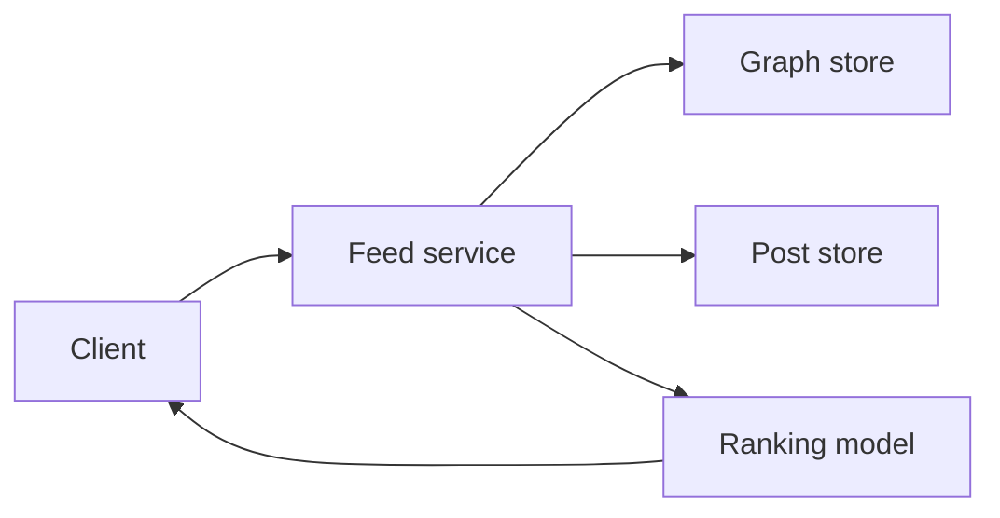
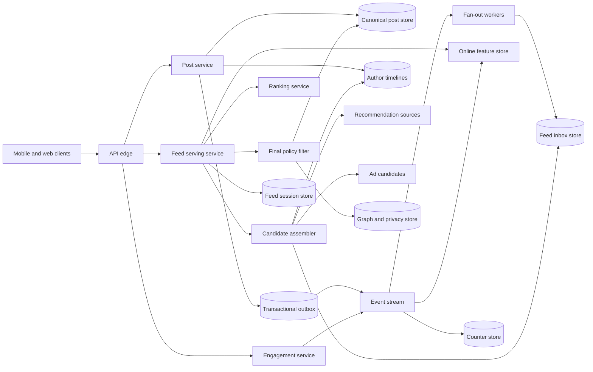
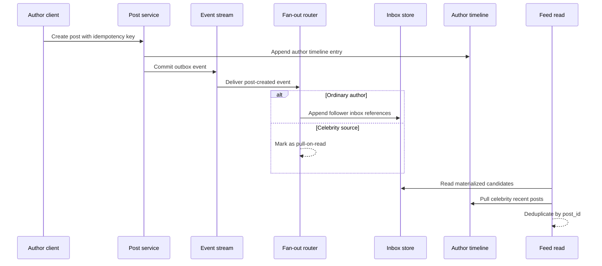
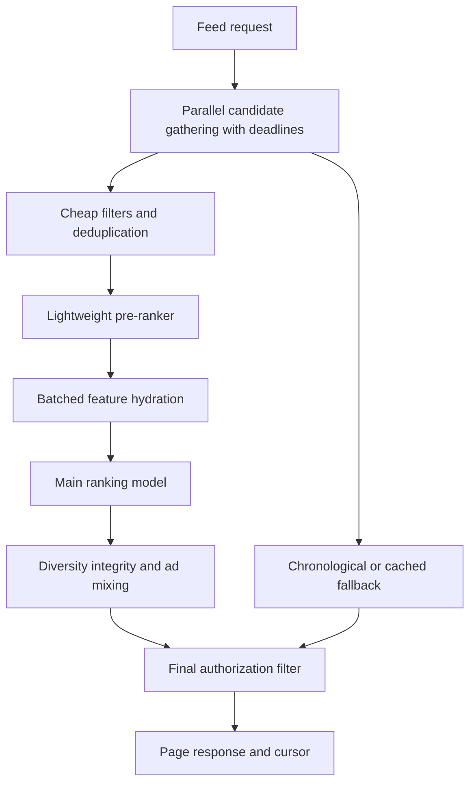
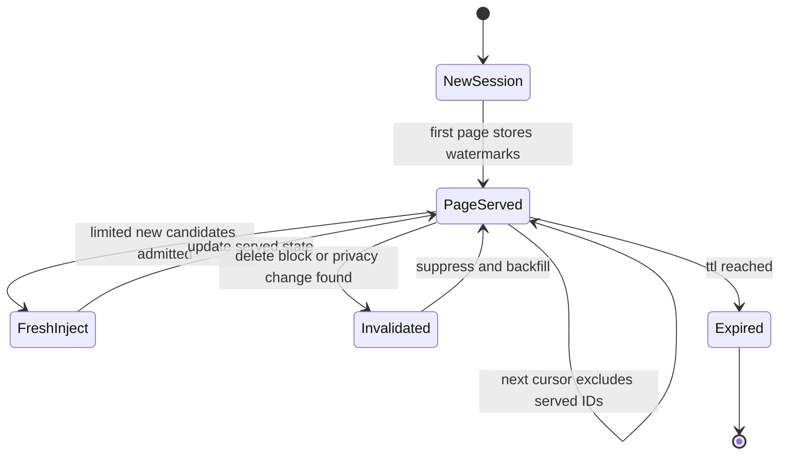

# News Feed System Design

A news feed system stores posts, follows, reactions, and policy state, then serves each viewer a paginated stream of posts that is fresh, relevant, and safe to show. This design covers the home feed for a large social product: followed authors, groups, pages, lightweight recommendations, ads as labeled candidates, ranking, pagination, and privacy enforcement. It does not design media transcoding, full-text search, direct messaging, or the offline ads marketplace except where they touch feed serving.

## 1. Requirements

### 1.1 Functional requirements

- Let users create posts with text, media references, links, and reshares, then distribute those posts to eligible viewers.
- Serve a personalized home feed with cursor pagination, deduplication, and a following-only or chronological fallback mode.
- Mix followed-source inventory, group/page posts, recommendations, and labeled ads while preserving freshness and diversity.
- Support reactions, comments, saves, hides, shares, impressions, and feedback that affect counters and ranking features.
- Reflect follow, unfollow, mute, block, delete, privacy, moderation, and account-disable changes before content is shown.
- Log enough impression and feature context to train ranking models and run experiments without putting training work on the hot path.

### 1.2 Non-functional requirements

- **Low latency.** The first feed page should stay under roughly 300 ms p95 because feed opening is the product's front door; candidate retrieval, feature hydration, ranking, and final filtering all share that budget.
- **High read availability.** Users refresh the feed far more often than they post, so the system should degrade to cached or chronological followed content when optional recommendation or ML dependencies fail.
- **Authorization safety.** Deleted, blocked, private, or moderated content must be suppressed even if stale derived indexes still contain references to it.
- **Eventual projection consistency.** Inboxes, counters, features, notifications, and recommendations can lag because making every projection transactional with every post and graph change would destroy write throughput.
- **Stable-enough pagination.** A scrolling session should avoid duplicates and wild reorderings even while new posts arrive, model scores change, and deletes invalidate items.
- **Skew tolerance.** The design must survive a follower-count distribution where most authors have small audiences and a few celebrities have tens or hundreds of millions of followers.

### 1.3 The binding constraint

The binding constraint is the read/write fan-out asymmetry caused by the social graph's heavy tail. Most posts are written by ordinary users to small follower sets; precomputing inbox entries for those posts makes reads cheap. A celebrity post is different: writing one row into every follower's feed can mean tens of millions of writes for a single post, yet pulling every followed author's timeline on every read is also impossible at feed-open volume. A single fan-out strategy fails on one side of the distribution.

This forces a hybrid design: canonical posts are written once, ordinary-author candidates are fanned out on write into per-user inbox references, celebrity and high-churn sources are pulled on read, and the feed service deduplicates the overlap. Because those projections can lag or be wrong, final serving rechecks privacy, deletion, block, and moderation state. Ranking then runs online over candidate references rather than over a permanently materialized ranked feed.

## 2. Back-of-the-envelope estimation

Use illustrative numbers to size the pressure points, not to claim any real company's traffic. Suppose the service has 2 billion registered users, 500 million daily active users, and 250 million users who open the home feed each day. If each feed user has `10` sessions per day and reads `5` pages per session, page reads are `250M × 10 × 5 = 12.5B` pages/day. Dividing by `86,400` seconds gives about `145K` page reads/second average. A diurnal and event multiplier of `5×` gives a peak near `725K` page reads/second. At 20 returned items per page, the serving tier emits up to `725K × 20 = 14.5M` feed items/second before counting candidate overfetch.

Writes are much smaller. If users create `100M` posts/day, average post creation QPS is `100M / 86,400 ≈ 1.16K` posts/second. With a `10×` burst factor for breaking news or live events, peak write QPS is around `11.6K` posts/second. The trap is fan-out amplification. If the average author has 300 followers, ordinary fan-out at peak is `11.6K × 300 = 3.48M` inbox-reference writes/second, high but shardable because it spreads across many followers. One celebrity with 100 million followers creates `100M` inbox writes from one post. If the row is only 64 bytes before storage overhead, that single post creates `100M × 64 B = 6.4 GB` of logical references, and with replication, indexes, logs, and compaction overhead it can easily be several times that. The issue is not just bytes; it is also a hot fan-out job competing with every other author.

Candidate inspection is the read-side mirror image. If each page needs 500 candidates to rank 20, peak read traffic inspects `725K × 500 = 362.5M` candidate references/second. If the system tried to join the viewer's 300 followees against recent posts at read time for every page, it would multiply those reads by graph and author-timeline lookups and would make first-page latency hostage to the slowest source. That number justifies materialized inboxes for the many small authors and pre-ranked or cached candidate pools for common first-page reads.

Post storage is not the hardest part. At 100 million posts/day and 2 KB of post metadata, canonical post metadata is `100M × 2 KB = 200 GB/day` before indexes and replicas; media belongs in object storage and CDN. The bigger storage item is derived references. If all posts were fanned out to an average of 300 followers, daily inbox references would be `100M × 300 = 30B` rows/day. At 64 bytes each, that is `1.92 TB/day` logical data before replication and compaction. This is acceptable only with finite retention, time-bucketed partitions, and selective fan-out.

> **Key idea.** The feed is read-heavy, but the expensive design choice is not simply read scaling; it is where to pay the fan-out multiplier. Pay it on write for ordinary authors, pay it on read for celebrities, and keep all derived feed rows disposable.

## 3. API design

**Question.** What makes feed APIs safe when post creation, fan-out, and ranking are asynchronous?
<details><summary>Answer</summary>

The APIs separate durable user intent from derived feed state. Post creation is idempotent and returns after the canonical post and outbox event commit, not after every follower has an inbox entry. Feed reads use signed cursors instead of offsets, and every response item carries a signed impression token so later engagement can be attributed without trusting the client.

</details>

```http
POST   /v1/posts
       Idempotency-Key: client-generated-uuid
       {"body":"...","media_ids":["m1"],"audience":{"type":"FOLLOWERS"}}
       -> 201 {"post_id":"p1","created_at":"2026-10-13T07:22:18Z","fanout_state":"QUEUED"}

GET    /v1/feed/home?limit=20&cursor=opaque-signed-cursor
       -> 200 {"items":[{"post":{},"reason":"Because you follow Ada","tracking_token":"..."}],"next_cursor":"..."}

GET    /v1/feed/following?limit=20&cursor=opaque-signed-cursor
       -> 200 {"items":[...],"next_cursor":"...","mode":"CHRONOLOGICAL"}

DELETE /v1/posts/{post_id}
       If-Match: post-version
       -> 202 {"post_id":"p1","state":"DELETE_ACCEPTED"}

PUT    /v1/users/{target_user_id}/follow
       Idempotency-Key: client-generated-uuid
       -> 200 {"edge_state":"ACTIVE","edge_version":481}

DELETE /v1/users/{target_user_id}/follow
       -> 200 {"edge_state":"NONE","edge_version":482}

PUT    /v1/posts/{post_id}/reactions/{type}
       Idempotency-Key: client-generated-uuid
       -> 200 {"reaction":"LIKE","counter_state":"PENDING"}

POST   /v1/impressions/batch
       {"events":[{"tracking_token":"...","visible_ms":1200,"dwell_ms":900}]}
       -> 202 {"accepted":true}
```

The post creation endpoint uses an idempotency key because the client may lose the response after the server commits. Retrying should return the existing post for the same author and key rather than creating duplicates. The response includes `fanout_state` to make the asynchronous boundary explicit: the author's own feed can inject the new post immediately, but follower inboxes may lag.

Feed reads use cursors, not offsets. Offset `40` has no stable meaning after ranking changes or deletes remove earlier items. The cursor is opaque and signed; internally it can reference a feed session, model version, candidate watermark, last score/tie-breaker, served-item set, and expiry. The cursor is a UX stability mechanism, not a promise of a frozen ledger. If it expires, the client starts a new session.

Deletes and privacy changes return after canonical state changes and high-priority invalidation events are enqueued. They do not synchronously scrub every inbox row. The final feed-serving filter must therefore treat inbox presence as a hint only. Engagement APIs are idempotent because mobile clients retry aggressively and because counters are eventually aggregated from event streams. Impression tokens prevent clients from inventing arbitrary model versions or positions for training logs.

## 4. Data model

Start with the obvious entity: `Post`. A post has an author, body, media references, audience, creation time, edit time, deletion state, moderation state, and version. That is enough to render an author's profile timeline, but it is not enough to render a home feed cheaply. Reading a home feed by scanning all posts from every followee requires hundreds of author-timeline reads per page and does not leave room for recommendations or ranking under a 300 ms budget.

Add `FollowEdge`, stored in both follower-to-followee and followee-to-follower directions. The forward edge answers "who do I follow" for read-time celebrity pulls and eligibility checks. The reverse edge answers "who should receive this ordinary author's new post" during fan-out. But an edge alone cannot prove that a post should be shown forever: the viewer may mute, block, unfollow, or lose group membership after the post was materialized. Therefore each edge carries a version and state, and serving checks current authorization for sensitive cases.

Add `FeedInboxEntry` as a derived reference, not as a copy of the post. It stores viewer ID, bucket, post ID, author ID, source type, creation time, fan-out event ID, and optional lightweight features. The failure it fixes is read-time graph joins for ordinary authors. The failure it introduces is staleness: stale inbox entries may refer to deleted posts or no-longer-authorized authors. That is why the entry deliberately does not contain full post content or final authorization; it must be rehydrated and refiltered.

Add `AuthorTimelineEntry` for pull sources. Celebrity posts, group posts, and page posts need efficient recent-post reads by source because they are not always pushed to every follower. This index is keyed by source ID and reverse creation time. It lets candidate generation pull recent posts from a small set of high-fan-out sources without scanning the global post table.

Add `FeedSession` or equivalent server-side state for pagination. A cursor can carry small fields, but an exact served set, deferred candidates, and source watermarks are often too large for the client. This entity fixes duplicates and unstable pagination. It expires quickly and can be reconstructed imperfectly; it is not canonical product data.

Add `Engagement`, `PostCounter`, `FeedImpression`, and `RankingFeature`. Reactions and comments are user actions with idempotency and moderation concerns. Counters are read-optimized aggregates and may lag. Impressions are append-only training facts. Ranking features are versioned online values with TTLs because model serving must avoid recomputing graph and engagement signals per item.

```text
User
- user_id, status, home_region, privacy_settings, created_at

FollowEdge
- follower_id, followee_id, state: ACTIVE | MUTED | BLOCKED | NONE
- edge_version, created_at, updated_at

Post
- post_id, author_id, body_ref, media_ids, original_post_id
- audience_type, audience_id, moderation_state
- created_at, edited_at, deleted_at, version

AuthorTimelineEntry
- source_id, source_type, created_at_desc_bucket, post_id, post_version

FeedInboxEntry
- user_id, time_bucket, post_id, author_id, created_at
- source_type, fanout_event_id, fanout_mode, lightweight_features

FeedSession
- feed_session_id, user_id, model_version, candidate_watermark
- served_post_ids_ref, deferred_candidate_ids_ref, expires_at

Engagement
- user_id, post_id, type, idempotency_key, created_at, version

PostCounter
- post_id, reaction_counts, comment_count, share_count, snapshot_at

FeedImpression
- impression_id, user_id, post_id, position, model_version
- candidate_sources, served_at, dwell_ms, feedback

RankingFeature
- entity_key, feature_name, value, computed_at, expires_at, definition_version
```

Canonical `Post`, `FollowEdge`, and destructive state changes live in strongly consistent transactional or quorum-backed stores appropriate to their access pattern. Author timelines and feed inboxes live in wide-column or log-structured key-value storage partitioned by source/user and time bucket. Counters and ranking features live in stores optimized for high-write aggregation and low-latency batch reads. Media is stored separately in immutable object storage and served through a CDN. Final ranked feed pages are not stored as canonical truth because model versions, request context, and privacy state change too often.

> **Key idea.** The model separates truth from accelerators. Posts and graph edges decide what may exist and who may see it; inboxes, timelines, counters, sessions, and features make reads fast but are always disposable or repairable.

## 5. High-level design

The simplest design stores posts and follows, then computes the feed on every read by fetching the viewer's followees, reading each followee's recent posts, sorting by time or score, and returning the first page.



This looks attractive because every read sees fresh graph and post state. It breaks in several named ways. First, a user following 300 sources turns one feed read into hundreds of timeline reads, and a peak of hundreds of thousands of page reads per second becomes an enormous scatter/gather problem. Second, celebrities invert the problem: pushing their posts to every follower is a write explosion, but pulling them from every viewer's follow graph on every read is a read explosion. Third, ranking all possible candidates with a heavy model exceeds the latency budget. Fourth, offset pagination duplicates and skips items as the ranked set changes. Fifth, derived indexes inevitably lag, so privacy cannot rely on fan-out state.

### Fix 1: Hybrid fan-out by source class

For ordinary authors, post creation emits an event and fan-out workers append `FeedInboxEntry` references to followers' inboxes. The insert key includes `(user_id, fanout_event_id)` or `(user_id, post_id, source_type)` so worker retries are idempotent. Workers page through reverse followers with checkpoints; a crash resumes the current batch without duplicating rows. This pays the fan-out multiplier when the multiplier is small and makes feed reads fast.

For celebrities, large groups, and sources with high active-follower counts, the system writes only the canonical post and author timeline entry. Candidate generation pulls their recent posts at read time for viewers who follow them. The mode is not a permanent label; it can depend on follower count, active-follower ratio, posting rate, and current system load. LinkedIn FollowFeed is a useful production lesson here: LinkedIn reported that full fan-out-on-write could make data size 62 times larger and make relevance experiments expensive, so it used timeline indexes and online relevance rather than storing final ranked feeds for every viewer. The design here adopts that lesson selectively rather than treating fan-out-on-read as universal.

### Fix 2: Candidate assembly before expensive ranking

The feed service first gathers candidates from bounded sources: materialized inbox references, pull timelines for followed celebrities, group/page indexes, recommendation sources, and ads. Each source has a deadline and a maximum contribution. Candidates are deduplicated by `post_id`, lightly filtered, and trimmed by a cheap pre-ranker before the main model sees them. This turns a huge inventory problem into a bounded ranking problem.

Meta describes News Feed as collecting eligible inventory, predicting multiple outcomes, and applying rules such as diversity. X/Twitter's published recommendation architecture similarly separates candidate sources, user-signal services, model serving, product mixing, and visibility filters. The point is operational as much as algorithmic: if optional recommendations are late, the feed can still serve followed inventory; if the heavy ranker fails, the system can fall back to a chronological or lightweight ranked page.

### Fix 3: Final authorization and invalidation path

Fan-out and candidate indexes are not proof of eligibility. A post may have been deleted, an author may have blocked the viewer, a group membership may have changed, or moderation may have removed the content. The feed service performs a cheap early filter to reduce wasted ranking work, then an authoritative final filter immediately before response. Safety-critical state such as blocks, deletion tombstones, account disablement, and moderation decisions is cached aggressively but treated as fail-closed when unavailable.

Deletes and privacy changes write canonical state and emit high-priority invalidation events. Those events remove or mark derived entries where practical, but correctness comes from the final check. Meta TAO's graph lesson applies: social reads need cache-aware, single-hop object and association lookups. Deep graph traversals do not belong in the feed hot path.

### Fix 4: Session cursors and seen-state

A feed is not a database query with stable offsets. The first page may be ranked with one model version, the second page may arrive after new posts and deletes, and the viewer may have already seen items on another device. The feed service creates a short-lived session that records source watermarks, served item IDs or a compact reference to them, and deferred candidates. The cursor points into that session and carries a signed boundary.

Pinterest Smart Feed provides the production analogy: separate available unseen content from already presented content, defer lower-value items instead of throwing them away, and mix sources deliberately. The design uses the same idea for pagination. It does not freeze the entire feed forever; it freezes enough of the candidate state for a scrolling session while allowing controlled fresh-post injection.

### Fix 5: Disposable projections with repair

Every derived structure is rebuildable from canonical posts, graph edges, and event logs. The post service writes a transactional outbox entry with the post commit. Fan-out, counters, features, search, and notifications consume events idempotently and store the latest aggregate version they have applied. Periodic reconciliation samples canonical state against inboxes and timelines to repair drift. Twitter Manhattan's lesson is that social storage needs workload isolation, quotas, and predictable latency; a single generic database should not hold posts, graph edges, inbox references, counters, features, and logs with one consistency model.

### Putting it together



A post write commits the canonical post, author timeline entry, and outbox event. Fan-out workers materialize inbox references only where the source is eligible for write fan-out. A feed read decodes the cursor, loads materialized candidates, pulls celebrity timelines, asks recommendation and ad systems for bounded candidates, hydrates features in batches, ranks the reduced set, applies diversity and policy constraints, performs final authorization, updates session seen-state, returns items, and logs impressions asynchronously. Each store maps to a data-model role: canonical truth in post/graph stores, accelerators in inbox/timeline/feature stores, and user-session stability in the feed session store.

> **Key idea.** Each component traces back to a specific failure of the naive design.

## 6. Deep dives

### 6.1 Fan-out on write, fan-out on read, and celebrity handling

**Question.** A user with 80 million followers publishes a post during a traffic spike. Do we write 80 million inbox rows, pull the post on every follower read, or something else?
<details><summary>Answer</summary>

Use hybrid fan-out. Ordinary authors are fanned out on write into follower inbox references. Celebrity sources are stored once in author timelines and pulled during candidate generation. Thresholds are dynamic, overlap is allowed during transitions, and deduplication by `post_id` makes mode changes safe.

</details>

Pure fan-out-on-write is seductive because it makes feed reads a fast per-user inbox scan. It is also the right default for most authors. If Alice has 200 followers, appending 200 references when she posts is cheaper than making each follower's future feed read join against Alice's timeline. The writes spread across follower partitions and happen asynchronously after the post commit. If fan-out lags by seconds, the author still sees the post through read-your-writes injection, and followers see it shortly after.

The strategy fails at the top of the follower distribution. One post from an 80 million-follower account creates 80 million derived writes. A burst of posts from several celebrities can dominate the event stream, storage write bandwidth, compaction, and cache churn. Worse, the work is tied to a small number of authors, so partitioning the event log by author for ordering can create hot partitions. The fix is to treat fan-out as a policy per source, not as a global architecture.

For high-fan-out sources, the write path stores the post once and appends an `AuthorTimelineEntry`. On read, candidate assembly already knows the viewer's followed celebrity set from cached graph summaries or a small forward-edge lookup. It pulls recent posts from those few high-fan-out timelines and merges them with materialized inbox entries. If the viewer follows 300 accounts but only 5 are celebrities, this is a bounded read-time cost. If the viewer follows 100 high-volume publishers, the candidate assembler caps per-source contribution and lets ranking decide what survives.



Mode selection should use more than raw follower count. A dormant account with many followers but few active readers may still be cheap to fan out. A medium-sized account posting hundreds of times per day can be expensive even below a celebrity threshold. Useful inputs are follower count, active follower count, post rate, engagement rate, fan-out queue age, inbox write cost, and read-time pull cost. The decision can be hysteretic: move to celebrity mode above a high threshold and back to write fan-out below a lower threshold, avoiding flapping.

Mode transitions create edge cases. If an author switches from write fan-out to read pull while events are in flight, some followers may already have inbox entries for recent posts while the read path also pulls them from the author timeline. The safe answer is not to coordinate a perfect cutover; it is to allow overlap and deduplicate by `post_id`. If switching the other way, the system can fan out only future posts or run a bounded backfill for recent posts. Backfills must be lower priority than fresh fan-out so an old transition does not delay current posts.

LinkedIn FollowFeed illustrates the trade-off. LinkedIn reported that full fan-out-on-write would inflate data size by 62 times and make ranking experiments expensive, so it used timeline indexes and computed relevance online. Twitter timelines show the complementary lesson: relevance can sit on top of chronological followed inventory, preserving a simple fallback. A production feed should not argue fan-out-on-write versus fan-out-on-read as ideology. It should measure the graph distribution and choose per source.

Signals worth watching: fan-out queue age by source class, inbox writes per post percentile, celebrity pull latency, duplicate rate from mixed modes, and percentage of first-page candidates from delayed fan-out.

> **Strong-answer criteria.** A senior answer names the heavy-tail follower distribution, uses idempotent fan-out with checkpoints, treats celebrity mode as dynamic, and explains deduplication during mode changes.

| Level | Approach | Why |
|---|---|---|
| Bad | Fan out every post to every follower. | It makes normal reads fast but lets one celebrity post create tens of millions of writes and hot partitions. |
| Good | Use fan-out on write for normal users and fan-out on read for celebrities. | It addresses the main asymmetry but is incomplete without transition rules, idempotency, and deduplication. |
| Great | Use dynamic hybrid fan-out with author timelines, checkpointed workers, overlap-safe mode changes, bounded pull costs, and final eligibility checks. | It handles scale, retries, celebrity bursts, and stale derived entries without making feed reads unbounded. |

### 6.2 Feed assembly and multi-stage ranking within a latency budget

**Question.** The feed has 300 ms p95 to return the first page, but candidate sources, feature stores, and ranking models all have tail latency. How does the system still return a good page?
<details><summary>Answer</summary>

Use a cascade. Gather bounded candidates in parallel under source deadlines, apply cheap filters and pre-ranking, batch feature hydration, run the main model only on a reduced set, then apply deterministic mixing, diversity, integrity, and ad constraints. Optional sources can time out; core followed inventory and final authorization cannot be skipped.

</details>

The naive ranking design asks every candidate source for everything, hydrates every feature, scores every item with the largest model, sorts by score, and returns the top 20. That is clean on a whiteboard and disastrous in production. Candidate inventory is too large, some features are slow, model inference has tail latency, and business constraints such as author diversity and ad labeling are not naturally encoded by a single score.

The feed service should treat each page request as a budgeted pipeline. For example, an illustrative 300 ms p95 budget might reserve 20 ms for edge/auth overhead, 60 ms for candidate retrieval, 60 ms for feature hydration, 50 ms for pre-ranking and main ranking, 30 ms for policy checks and hydration, 20 ms for session/cursor updates, and the remainder for network variance. These numbers are illustrative and must be tuned with real latency distributions. The important design point is that every downstream call receives a deadline and a fallback behavior.

Candidate assembly starts in parallel. The materialized inbox returns recent followed candidates. Celebrity timelines return recent posts from pull-mode followees. Group/page indexes return membership-based posts. Recommendation sources return out-of-network candidates with reasons and policy labels. Ads return eligible paid candidates that must remain labeled and constrained. Each source has a maximum count and a deadline. Late optional recommendations are omitted. Late core followed inventory may cause a fallback to a cached first-page candidate list or chronological feed, but the request should not wait unboundedly.

The first filters are cheap and conservative: remove duplicate `post_id`s, remove already served items for the session, drop obviously deleted or moderated posts from fresh caches, and apply simple age/source caps. Then a pre-ranker uses cheap features, such as recency, relationship strength, source type, and cached engagement, to cut 500-2,000 candidates down to perhaps 100-200. Only then does the system batch feature hydration for expensive online features and call the main model. Batch reads matter: 100 keys in one feature-store call are far cheaper than 100 serial calls.



Ranking should optimize multiple predictions rather than raw click probability. Meta's News Feed material describes predicting multiple outcomes and combining them into a value score aligned with quality, meaningful interactions, and negative feedback. For this design, model outputs might include probability of meaningful reaction, dwell time, comment likelihood, hide/report probability, freshness decay, and relationship value. The mixer can then enforce rules that are awkward for a single scalar: no three posts in a row from the same author, normalize across media types, cap low-quality engagement bait, insert paid items only in allowed slots, and preserve a minimum freshness share. Instagram's feed system card describes exactly this kind of post-score normalization, integrity demotion, and author/media diversity after scoring. Pinterest's PID-controller work is a reminder that post-ranking controls need feedback loops because model score distributions drift after experiments.

The ranking pipeline must be observable by stage. If the main model is slow, the system should know whether it is feature hydration, inference, model-server saturation, or candidate explosion. If recommendations vanish from the page, the system should know whether the recommender timed out or the final policy filter removed them. The response logs model version, feature definition versions, source counts, drop reasons, and experiment assignment asynchronously. LinkedIn's feed ranking work emphasizes streaming feature tracking asynchronously from serving infrastructure so training consistency does not add synchronous latency.

Failure modes shape the fallbacks. If optional recommendations fail, return followed content. If the online feature store is slow, use bounded-stale features or a lighter model. If the main ranker is unavailable, sort followed candidates by time plus lightweight quality. If final authorization is unavailable, exclude uncertain items rather than showing private content. Ranking quality may degrade; privacy cannot.

Signals worth watching: per-stage p50/p95/p99 latency, candidate counts by source, feature freshness, model timeout rate, fallback rate, post-filter empty pages, diversity constraint activations, and online/offline feature skew.

> **Strong-answer criteria.** A senior answer budgets latency by stage, bounds candidate sources, separates pre-ranking from heavy ranking, and treats final policy filtering as mandatory even during ML fallback.

| Level | Approach | Why |
|---|---|---|
| Bad | Fetch all possible posts and run one model over everything. | It ignores scatter/gather latency, feature cost, and tail behavior. |
| Good | Use candidate generation, pre-ranking, and a main ranker. | It bounds work but may still miss deadlines without source budgets, fallbacks, and post-ranking constraints. |
| Great | Build a deadline-aware cascade with batched features, optional-source shedding, deterministic mixing, final authorization, and detailed stage metrics. | It preserves availability and safety while allowing ranking quality to improve independently. |

### 6.3 Pagination over a changing ranked feed, seen-state, and invalidations

**Question.** A user reads page one, then new posts arrive, an old post is deleted, and the model score changes before page two. How do we avoid duplicates, skipped items, and privacy leaks?
<details><summary>Answer</summary>

Use a short-lived feed session with source watermarks, served-item state, deferred candidates, and a signed cursor. Do not use offsets. Revalidate every item before serving, allow limited fresh injection, and accept that feed pagination is stable enough for UX rather than a strict snapshot guarantee.

</details>

Offset pagination fails immediately for ranked feeds. If page one returns items 1-20 and a new high-scoring post appears at position 3, offset 20 for page two now starts after a different set of items. The user may see duplicates or miss items. Reranking every page independently is fresh but chaotic. Freezing the entire feed at page one is stable but stale, expensive, and hostile to deletes and privacy changes.

The practical design is a feed session. On the first page, the feed service records a candidate snapshot watermark for each source, the model version, returned post IDs, and a deferred pool of candidates that scored below the first page but may be useful later. The cursor returned to the client is signed and references this state. For page two, the service reloads the session, excludes served IDs, considers deferred candidates, optionally admits a small number of fresh candidates above the old watermark, reranks within constraints, and updates the served set.

Seen-state can be exact or approximate. A server-side exact set avoids false positives but costs memory proportional to active feed sessions. If 50 million users have an active session and each session stores 200 served or deferred IDs at 16 bytes per ID, raw ID storage is `50M × 200 × 16 B = 160 GB` before overhead. That is feasible only with short TTLs, compression, and sharding. A Bloom filter is smaller but can falsely suppress unseen posts. Most feeds can tolerate a tiny false-suppression rate better than visible duplicates, especially for lower-ranked items. For high-value surfaces such as notifications, exact state may be required; for home feed scrolling, bounded approximate state is acceptable.

Deletes and privacy changes cut across pagination. Suppose page one includes post `p1`, the author deletes it, and the user refreshes or scrolls. The session may still contain `p1` in served or deferred state, and another inbox may still reference it. The final policy filter must check the current post tombstone and suppress it. If suppression leaves the page short, the feed service backfills from deferred candidates or pulls more from sources under the old watermarks. If it cannot fill the page without violating deadlines, returning fewer than 20 items is better than leaking deleted content.

Unfollow and block are similar but more sensitive. Presence in a `FeedInboxEntry` means "this post was once a plausible candidate," not "this viewer may see it now." The final filter checks current graph and block state. To keep that fast, graph state should expose single-hop edge lookups, compact deny caches, and versions. A block write should update the authoritative edge, invalidate deny caches with high priority, and cause the serving path to fail closed if the current block state cannot be determined. Making every inbox row transactionally disappear on block is unnecessary and too slow; making the final check reliable is mandatory.



Pinterest Smart Feed's unseen-versus-presented separation is the key production lesson. Lower-value candidates should be deferred rather than discarded, because they can fill later pages without repeating source queries or destabilizing order. At the same time, a feed is not a financial ledger. If a user returns hours later, freshness matters more than preserving an old rank boundary. Sessions should expire, and clients should start new sessions on major context changes such as switching devices or modes.

The cursor itself must be tamper-resistant. It should include an expiry, user binding, feed mode, and signature. The client should not be able to request another user's session, skip policy filters, or force an old model version. Large served sets should live server-side; putting too much state in the cursor creates bloated URLs and leaks implementation details.

Signals worth watching: duplicate impression rate, false-empty pages, cursor expiry rate, suppression due to deletes/blocks, average session state size, deferred-pool reuse rate, and fresh-injection displacement rate.

> **Strong-answer criteria.** A senior answer rejects offsets, distinguishes snapshot stability from authorization freshness, and describes seen-state plus final revalidation rather than relying on inbox cleanup.

| Level | Approach | Why |
|---|---|---|
| Bad | Use `?offset=40` and rerun ranking. | It duplicates and skips items whenever inventory or scores change. |
| Good | Use opaque cursors with a rank boundary. | It improves order stability but misses seen-state, deletes, and source watermarks. |
| Great | Use short-lived sessions with served sets, deferred candidates, source watermarks, limited fresh injection, and final eligibility checks. | It balances UX stability, freshness, memory cost, and privacy correctness. |

## 7. Variants

**10x scale.** At 10 times the illustrative read volume, the architecture stays hybrid but becomes stricter about precomputation and isolation. First-page candidate lists for active users may be refreshed continuously in the background, feature hydration must rely more on colocated caches and vectorized reads, and ranking may use smaller online models with heavier offline pre-ranking. The canonical truth/projection split remains the same; what changes is how aggressively the system budgets each source and protects storage tenants from one another.

**Breaking-news celebrity burst.** During a live event, many high-follower accounts post at once and many users refresh simultaneously. The fan-out router should move more sources into pull mode, source deadlines should tighten, and the feed may prefer chronological followed inventory plus a small number of high-confidence recommendations. Celebrity author timelines and CDN-cached media become hot, so request coalescing and cache warming matter. The system should shed optional candidates before delaying core followed content.

**Strict following-only product mode.** If regulation or product policy requires a following-only feed, the recommendation and ad sources can be removed from candidate assembly, but the hard problems do not disappear. Hybrid fan-out, celebrity pull, privacy rechecks, session pagination, counters, and chronological fallback still matter. Ranking may become simpler, but diversity and spam/integrity demotions still protect the user experience.

**Multi-region active-active reads.** Feed reads can be served near the user from regional inboxes, feature caches, and author timelines, while post and graph writes have home-region authority or globally replicated quorum semantics. Stale ranking features across regions are acceptable. Stale deletion, block, or moderation state is not, so safety invalidations need high-priority replication and fail-closed serving behavior. Moving a user between regions requires dual-reading or rebuilding their inbox from event logs and author timelines.

## 8. The transferable pattern

This is the same pattern as many systems with one canonical write and many personalized read projections: keep truth small and strongly owned, build derived indexes asynchronously, and revalidate anything safety-critical at serving time. The unique news-feed twist is the heavy-tail fan-out distribution. A design that is perfect for the median author is often catastrophically expensive for the largest author, so the architecture must choose per-entity strategies rather than one global rule.

The pattern also appears in [Ticketmaster](./ticketmaster-system-design.md), where scarce inventory must be held in a canonical store while queues and views are derived, and in recommendation-heavy systems where online serving cannot recompute all possible candidates. The reusable lesson is to name the multiplier: followers per author, viewers per event, seats per show, or candidates per query. Once the multiplier is explicit, the rest of the design follows from where you can safely pay it.

## Review

The design starts from the follower-count distribution rather than from ranking models. Ordinary posts are cheap to fan out on write; celebrity posts are not, so canonical posts and author timelines feed a hybrid candidate assembler. The read path bounds work through materialized inboxes, pull timelines, source deadlines, pre-ranking, batched feature hydration, main ranking, deterministic mixing, and final policy filtering. Derived inboxes, counters, features, and sessions are disposable projections; posts, graph edges, deletion tombstones, and moderation state are authoritative. Cursor sessions make scrolling stable enough without freezing the world, and final authorization prevents stale fan-out rows from leaking private or deleted content.

### Check your understanding

1. Why is fan-out strategy the binding constraint rather than post storage size?
   <details><summary>Answer</summary>

   Canonical post storage grows with posts, while fan-out grows with posts multiplied by followers. Most authors have small fan-out, but celebrities can turn one write into tens of millions of inbox rows. The system must decide where to pay that multiplier.

   </details>

2. Why are feed inbox entries references instead of full post copies?
   <details><summary>Answer</summary>

   References keep derived storage smaller and force serving to rehydrate current post state. Full copies would amplify edits, deletes, moderation changes, and privacy changes across many rows and make stale content harder to suppress.

   </details>

3. Why is final authorization required if candidate generation already filters privacy?
   <details><summary>Answer</summary>

   Candidate indexes can lag behind deletes, unfollows, blocks, group membership changes, and moderation decisions. Early filters save work, but only a final check against current authoritative state prevents leaks.

   </details>

4. What does the feed session store that an offset cannot?
   <details><summary>Answer</summary>

   It stores source watermarks, served or deferred item state, model/version context, and expiry. That lets the next page avoid duplicates and reuse unseen candidates even as inventory and rankings change.

   </details>

5. What should happen when the main ranking model is unavailable?
   <details><summary>Answer</summary>

   The feed should degrade to a lightweight or chronological followed-content ranking, omit optional sources if necessary, continue final policy checks, and log the fallback. Ranking quality may drop, but availability and authorization safety should remain.

   </details>

## Sources and further reading

| Source | Article | Why it matters |
|---|---|---|
| Meta | [How machine learning powers Facebook’s News Feed ranking algorithm](https://engineering.fb.com/2021/01/26/ml-applications/news-feed-ranking/) | Shows multi-pass News Feed ranking, multi-objective predictions, and diversity rules at billions-user scale. |
| Meta | [TAO: The power of the graph](https://engineering.fb.com/2013/06/25/core-infra/tao-the-power-of-the-graph/) | Explains social graph storage, object/association APIs, celebrity hot spots, and cache-aware graph reads. |
| X/Twitter | [Using Deep Learning at Scale in Twitter’s Timelines](https://blog.x.com/engineering/en_us/topics/insights/2017/using-deep-learning-at-scale-in-twitters-timelines) | Shows ranked timeline layering over chronological followed inventory and relevance scoring under tight latency. |
| X/Twitter | [X’s Recommendation Algorithm](https://github.com/twitter/the-algorithm/blob/main/README.md) | Documents candidate sources, real-time user signals, graph embeddings, model serving, product mixing, and visibility filters. |
| X/Twitter | [Manhattan, our real-time, multi-tenant distributed database for Twitter scale](https://blog.x.com/engineering/en_us/a/2014/manhattan-our-real-time-multi-tenant-distributed-database-for-twitter-scale) | Covers low-latency multi-tenant storage, quotas, rate limits, replication, and workload-specific storage for social data. |
| LinkedIn | [FollowFeed: LinkedIn’s Feed Made Faster and Smarter](https://www.linkedin.com/blog/engineering/feed/followfeed-linkedin-s-feed-made-faster-and-smarter) | Explains timeline indexes, fan-out-on-read trade-offs, online relevance, RocksDB storage, and p99/feed-cost wins. |
| LinkedIn | [Community-focused Feed optimization](https://www.linkedin.com/blog/engineering/feed/community-focused-feed-optimization) | Details two-pass feed ranking, local feature storage, Quasar model inference, data-pack deployment, and async feature tracking. |
| Pinterest | [Building a smarter home feed](https://medium.com/pinterest-engineering/building-a-smarter-home-feed-ad1918fdfbe3) | Introduces Smart Feed source mixing, best-first ordering, unseen/presented separation, and deferring lower-value items. |
| Pinterest | [Using PID controllers to diversify content types on home feed](https://medium.com/pinterest-engineering/using-pid-controllers-to-diversify-content-types-on-home-feed-1c7195c89218) | Shows production control loops for media mix, freshness, creator goals, and AB-test-safe post-ranking constraints. |
| Meta/Instagram | [Instagram Feed Ranking System Card](https://ai.meta.com/tools/system-cards/instagram-feed-ranking/) | Summarizes feed sourcing, action prediction, score normalization, integrity demotions, and author/media diversity rules. |
