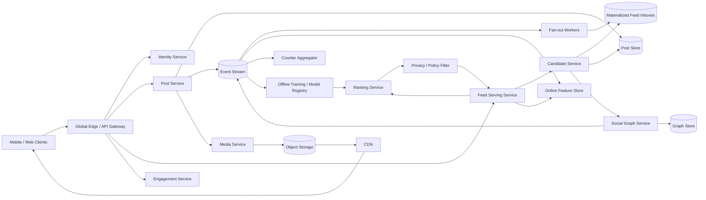

# Production-Scale Personalized News Feed

## 1. Requirements

### Functional requirements

1. Let users create text, image, video, link, and reshare posts.
2. Show a personalized, paginated home feed.
3. Include posts from followed users, groups, pages, and recommendations.
4. Support likes, reactions, comments, hides, saves, and shares.
5. Reflect follow, unfollow, block, privacy, deletion, and moderation changes.
6. Rank by relevance while preserving freshness and diversity.
7. Avoid duplicate items and excessive repetition from one author.
8. Provide notifications for selected engagement.
9. Support ads as clearly labeled, policy-filtered feed items.
10. Offer a chronological or following-only mode if required by the product.

### Non-functional requirements

- Feed page p95 latency below 300 ms, including ranking.
- High read availability; degrade to simpler feeds when ML dependencies fail.
- Read-your-writes for a user's own post and rapid removal of deleted or unauthorized content.
- Eventual consistency for fan-out, counters, features, and most ranking updates.
- Stable cursor pagination despite concurrent publishing and reranking.
- Billions of users, highly skewed social graphs, and celebrity hot keys.
- Privacy and policy enforcement at both candidate generation and final serving.
- Explainable operations, experimentation safety, and resistance to manipulation.

## 2. Scale assumptions and capacity

- 2 billion registered users and 500 million daily active users.
- 250 million users open the home feed daily.
- 10 feed sessions/user/day and 5 pages/session.
- 12.5 billion page reads/day: approximately 145,000/second average and 750,000/second peak.
- 100 million new posts/day: approximately 1,200/second average and 10,000/second peak.
- Average feed page: 20 items.
- Average user follows 300 sources; a celebrity may have 100 million followers.
- Candidate retrieval may inspect 500-2,000 items to rank 20. At 12.5 billion page reads/day, that is 6.25-25 trillion candidate inspections/day, or roughly 72-289 million inspections/second average before caching and pre-ranking.
- Post metadata averages 2 KB; media is stored separately in object storage. New post metadata is about 200 GB/day before indexes, replicas, inbox references, and logs.

Naively joining every user's follow graph against recent posts at read time is too expensive. Naively writing every celebrity post into every follower inbox is also too expensive. The core design is therefore hybrid fan-out.

## 3. High-level architecture



The write path durably stores canonical posts and asynchronously materializes candidates. The read path gathers candidates, hydrates features, ranks, filters, and returns a bounded page. Materialized inboxes are accelerators, not the source of truth.

## 4. Data model

```text
User
- user_id
- status
- home_region
- privacy_settings

FollowEdge
- follower_id
- followee_id
- state: ACTIVE | MUTED | BLOCKED
- created_at
- version

Post
- post_id
- author_id
- body
- media_ids
- audience_type
- audience_id
- original_post_id
- moderation_state
- created_at
- edited_at
- deleted_at
- version

FeedInboxEntry
- user_id
- bucket
- post_id
- author_id
- created_at
- source_type
- fanout_event_id

Engagement
- user_id
- post_id
- type
- created_at

PostCounter
- post_id
- reaction_counts
- comment_count
- share_count
- snapshot_at

FeedImpression
- impression_id
- user_id
- post_id
- position
- model_version
- served_at
- dwell_ms

RankingFeature
- entity_key
- feature_name
- value
- computed_at
- expires_at
```

The canonical post never stores one row per recipient. Inbox entries contain references and coarse source metadata; the serving path rehydrates the post and rechecks eligibility.

## 5. Core APIs

### Create a post

```http
POST /v1/posts
Idempotency-Key: client-generated-uuid

{
  "body": "Launching today",
  "media_ids": ["media-12"],
  "audience": {"type": "FOLLOWERS"}
}
```

```json
{
  "post_id": "post-981",
  "created_at": "2026-10-13T07:22:18Z",
  "fanout_state": "QUEUED"
}
```

### Read home feed

```http
GET /v1/feed/home?cursor=opaque-token&limit=20
```

```json
{
  "items": [
    {
      "post": {},
      "reason": "Because you follow Ada",
      "tracking_token": "signed-impression-token"
    }
  ],
  "next_cursor": "opaque-token",
  "snapshot_expires_at": "2026-10-13T08:00:00Z"
}
```

Other endpoints:

```http
GET    /v1/feed/following?cursor=...
GET    /v1/users/{user_id}/posts?cursor=...
PATCH  /v1/posts/{post_id}
DELETE /v1/posts/{post_id}
PUT    /v1/users/{user_id}/follow
DELETE /v1/users/{user_id}/follow
PUT    /v1/posts/{post_id}/reactions/{type}
DELETE /v1/posts/{post_id}/reactions
POST   /v1/feed/feedback
POST   /v1/impressions/batch
```

The feed cursor is opaque and signed. It can encode a feed-session ID, rank boundary, candidate watermark, and deduplication state, but should not expose model internals.

## 6. Post creation and publication flow

1. The client uploads media directly using signed URLs.
2. The post service authenticates the author and validates audience settings.
3. A transaction writes the post, idempotency record, and outbox event.
4. The response returns after durable commit; fan-out is asynchronous.
5. Safety classifiers and human-review workflows may limit distribution.
6. Fan-out workers materialize inbox references for ordinary authors.
7. Feature pipelines update freshness, author, topic, and engagement signals.
8. The author sees the post immediately through read-your-writes injection even if fan-out lags.

For pre-moderated surfaces, publication waits for policy approval. For ordinary posts, distribution may begin with conservative reach while asynchronous classifiers complete. A later policy decision must generate a high-priority invalidation event.

## 7. Hybrid fan-out strategy

### Fan-out on write

For ordinary authors:

- Read follower IDs in bounded pages.
- Append a post reference to each follower's inbox.
- Track batch checkpoints and make inserts idempotent by `(user_id, fanout_event_id)`.
- Trim old inbox entries asynchronously.

This makes feed reads fast and moves work to the much smaller post-write volume.

### Fan-out on read

For celebrities and other high-fan-out sources:

- Do not write millions of inbox rows.
- Fetch their recent posts during candidate generation.
- Merge them with the materialized inbox at read time.

Select the mode using follower count, active-follower ratio, posting rate, and current system load. A hybrid avoids both write explosions and expensive full graph joins. LinkedIn FollowFeed found full fan-out-on-write could inflate data size by 62x and make ranking-model A/B tests expensive, so only materialize cheap candidate references, not final rank order, and keep relevance scoring online. Changing modes must tolerate overlap; deduplicate by `post_id`.

## 8. Feed read and ranking flow

1. Validate the user and decode the cursor.
2. Fetch candidates in parallel from materialized inbox, celebrity pull sources, groups, recommendations, and ads.
3. Remove exact duplicates and previously served items for this feed session.
4. Perform an early privacy, block, deletion, and moderation filter.
5. Hydrate online features in batches.
6. Apply a lightweight pre-ranker to reduce candidates, similar to production cascades that avoid running heavy models on every possible item.
7. Apply the main ranking model.
8. Re-rank for diversity, freshness, creator frequency caps, integrity, and ad constraints. Instagram explicitly normalizes across media types and applies author/media diversity rules after scoring; keep those as serving-time constraints, not only training objectives.
9. Recheck authoritative eligibility immediately before response.
10. Return posts, explanations, signed tracking tokens, and the next cursor.
11. Log impressions asynchronously.

The request has a strict time budget. Candidate sources and models receive deadlines; late optional sources are omitted rather than delaying the page. Core followed-content retrieval has a larger share of the budget than experimental recommendations. Twitter/X-style pipelines also separate candidate sourcing, feature hydration, heavy ranking, visibility filtering, and mixing so each stage can shed work independently.

## 9. Ranking model and feature design

The ranker estimates multiple outcomes rather than a single click. Meta describes News Feed ranking as optimizing multiple predictions, weighted toward long-term value and survey-backed quality, rather than raw engagement alone.

The ranker estimates:

- Probability of meaningful engagement.
- Expected dwell time.
- Probability of hide, report, or unfollow.
- Content quality and integrity.
- Freshness and relationship strength.

Feature classes include:

- Viewer-author interactions, graph proximity, community embeddings, and relationship-strength models.
- Post age, type, language, and topic.
- Recent aggregate engagement with age normalization.
- User preferences, device, network, and session context.
- Negative feedback and policy risk.

Offline pipelines train on impression-labeled data and publish versioned models. The online feature store serves freshness-sensitive values; static embeddings may be cached. Graph/community embeddings such as X/Twitter SimClusters, TwHIN, and RealGraph-style relationship features are useful for out-of-network recommendations and social proof. Training/serving feature definitions must be shared to avoid skew. Never train only on clicks without accounting for position bias and prior model exposure.

## 10. Pagination, deduplication, and freshness

Offset pagination fails because rankings and candidates change while a user scrolls. Use a feed-session cursor:

```text
feed_session_id
model_version
candidate_snapshot_watermark
last_rank_score_tiebreaker
served-item bloom filter or server-side set reference
expiry
signature
```

Freezing an entire feed gives stable pagination but quickly becomes stale. Recomputing every page is fresh but causes duplicates and reorderings. A practical compromise keeps a short-lived candidate snapshot, separates unseen candidate pools from already presented items, excludes already served IDs, and allows limited fresh-post injection. Pinterest Smart Feed used this unseen-versus-seen separation to defer lower-value items rather than discard all unshown content.

Bloom filters are compact but can falsely suppress an item. A server-side exact set is more precise but costs state. Bound session length and accept that feed pagination is best-effort, not a financial ledger.

## 11. Consistency and concurrency

Strong consistency is needed for:

- Creating and deleting canonical posts.
- Audience and ownership changes.
- Blocks and account disablement.
- Exactly one active reaction per user/post when reactions are mutually exclusive, or idempotent per-type reactions if the product allows multiple simultaneous reaction types.

Eventually consistent projections include inboxes, counts, search, ranking features, and notifications.

Use optimistic versioning for post edits. Deletion writes a tombstone and emits invalidations; the serving path always checks current post state so stale inbox references do not leak deleted content. Block operations update an authoritative edge and a fast deny cache; safety-critical reads fail closed if that state is unavailable.

There is no strict global feed order. A chronological following feed can order by server publication time plus `post_id` as a stable tie-breaker.

## 12. Social graph and privacy enforcement

Store outgoing and incoming adjacency lists in a graph-optimized key-value or wide-column store:

```text
(follower_id, followee_id) -> edge state
(followee_id, follower_id) -> reverse edge
```

Update both indexes through a transactional store or an event-driven repairable workflow. The authoritative edge version resolves discrepancies.

Eligibility depends on:

- Current follow/group membership.
- Post audience.
- Blocks in either direction.
- Geographic, age, and legal restrictions.
- Moderation state.

Apply cheap filters during candidate generation and authoritative checks at response time. Never assume that presence in an inbox proves current authorization. Systems like Meta TAO model social data as objects and associations and are optimized for high-volume single-hop graph reads; a feed design should keep graph lookups cheap, cached, and versioned rather than doing deep graph traversals in the hot path.

## 13. Partitioning, caching, and storage

- Partition canonical posts by `post_id`; index author timelines by `(author_id, created_at)`.
- Partition inboxes by `user_id` and time bucket to bound partitions.
- Partition graph adjacency by source user and shard celebrity reverse edges.
- Partition the immutable publication log by `author_id` when per-author ordering is required, then emit separate salted fan-out task records for celebrity distribution so one author does not pin all worker parallelism to one hot partition.
- Store media in immutable object storage and deliver through a CDN.
- Cache hydrated posts, graph summaries, model features, and first feed pages.

First-page feed caches have high value but invalidate frequently. Cache a candidate or ranked-ID list for a short TTL, then rehydrate and refilter. Do not cache fully authorized responses across users. For core storage, Twitter Manhattan shows why social feeds often need multi-tenant low-latency key-value stores with quotas, rate limits, and per-workload storage engines rather than one generic database.

Inbox retention is finite; old items can be reconstructed from author timelines when users scroll deeply. This caps storage and keeps hot partitions small.

## 14. Reliable event processing

Use a transactional outbox for post and graph mutations. Events include immutable IDs and aggregate versions. Consumers are idempotent and tolerate reordering:

- Fan-out worker ignores a duplicate event.
- Delete version supersedes an older create/update.
- Counter aggregator deduplicates engagement event IDs.
- Feature store retains the newest event-time/version value.

Critical invalidations use dedicated high-priority topics and measurable end-to-end SLOs. Periodic reconciliation compares canonical posts and graph state against inbox samples, repairing drift caused by long-lived consumer failures.

## 15. Availability and multi-region design

- Serve feed reads active-active from regions near users.
- Assign user and post writes to a home region or use globally consistent storage for safety-critical state.
- Replicate canonical posts and graph changes across availability zones synchronously.
- Replicate asynchronously across regions and route feed reads to local projections.
- Keep event streams and inbox materializations regional where possible.
- Deliver media from globally replicated object storage and CDN edges.

If ranking fails, return a cached or chronological followed-content feed. If optional candidate sources fail, omit them. If authoritative privacy state cannot be verified, exclude uncertain items. During region failover, stale ranking is acceptable; stale authorization is not.

Moving a user between regions requires dual-reading inbox projections during transition or rebuilding them from followed-source timelines and event checkpoints.

## 16. Security, abuse, and integrity

- TLS, encryption at rest, scoped service identities, and managed key rotation.
- Authenticate impression and engagement events to reduce metric poisoning.
- Enforce audience and block rules on every serving path, media URL, reshare, and notification.
- Rate limit posting, following, reactions, comments, and automated scraping.
- Detect coordinated inauthentic behavior, spam rings, engagement farming, and account takeover.
- Sandbox link preview fetches and defend against SSRF.
- Strip dangerous media metadata and process uploads in isolated workers.
- Maintain auditable moderation actions, appeals, legal holds, and deletion workflows.
- Minimize sensitive feature exposure and restrict employee access to feed-debug tooling.
- Apply differential privacy or aggregation thresholds to analytics where appropriate.

Ranking systems themselves are an attack surface. Protect feature pipelines, validate model artifacts, cap the influence of sudden engagement, and monitor distribution shifts.

## 17. Important failure cases

| Failure | Handling |
|---|---|
| Create response is lost | Idempotency key returns the existing post |
| Fan-out event is delayed | Author sees read-your-writes; followers receive it later |
| Worker crashes mid-fan-out | Resume follower batch; idempotent inbox inserts |
| Celebrity threshold changes | Pull/write overlap is deduplicated by post ID |
| Deleted post remains in inbox | Final authoritative filter suppresses it |
| User unfollows after materialization | Current graph check suppresses stale candidate |
| Feature store is slow | Use bounded stale features or lighter ranker |
| Main ranker fails | Chronological/cached followed-content fallback |
| One candidate source times out | Deadline drops that optional source |
| Cursor is tampered with | Signature validation rejects it |
| Counter stream is duplicated | Event-ID deduplication |
| Region loses local inboxes | Rebuild from event log and author timelines |
| Safety invalidation lags | High-priority path plus serving-time policy check |

## 18. Observability and experimentation

Track:

- Feed latency by candidate retrieval, feature hydration, ranking, filtering, and hydration.
- Availability and fallback rate by dependency.
- Fan-out queue age, amplification, completion time, and inbox write failures.
- Candidate counts and drop reasons by source.
- Duplicate rate, stale/deleted candidate rate, and empty-feed rate.
- Feature freshness, cache hit rate, training/serving skew, and model inference errors.
- Engagement, dwell, hide, report, diversity, freshness, and creator distribution.
- Privacy-filter denials and deletion/block propagation latency.
- Impression-log loss and counter lag.

Use guarded experiments with stable assignment, holdouts, sample-ratio-mismatch detection, and predefined safety metrics. Optimize long-term user value, not only short-term clicks. Pinterest used PID controllers over impression streams to keep content-type distribution targets stable as ranking models changed; similar post-ranking controls keep freshness, media mix, and creator exposure from drifting. Every response logs model, feature, and experiment versions without logging sensitive raw content unnecessarily. LinkedIn streams feature tracking asynchronously from index nodes and brokers to avoid adding synchronous latency while preserving training/serving consistency.

## 19. Major trade-offs

### Fan-out on write versus fan-out on read

Write fan-out makes reads cheap but explodes for celebrity accounts. Read fan-out handles celebrities but increases read-time joins. A thresholded hybrid is the central design choice.

### Precomputed feed versus rank on read

Precomputation minimizes latency but goes stale and cannot use request context. Ranking entirely on read is fresh but costly. Materialize candidates, then rank and filter on read.

### Stable pagination versus freshness

Frozen snapshots avoid duplicates but miss new posts. Re-ranking each page is fresh but unstable. Short-lived sessions with deduplication and limited injection balance both.

### Strong versus eventual privacy propagation

Making all feed projections strongly consistent is impractical. Keep canonical privacy state strong and recheck it at serving time; projections may lag without leaking content.

### Complex ML versus reliable fallback

Large models improve relevance but add latency and dependencies. A lightweight model and chronological followed feed must remain operational fallbacks.

### Exact versus approximate deduplication

Exact server-side served sets cost memory. Bloom filters are compact but occasionally hide unseen items. The UX normally tolerates approximate suppression.

## 20. Lessons from production systems

### Meta News Feed: multi-pass ranking and value-aligned objectives

Meta describes News Feed ranking as a multi-stage process: gather eligible inventory, predict multiple outcomes, combine those predictions into a value score, and apply rules such as content-type diversity. This supports the design's pre-ranker, main ranker, and re-ranker split. The important production lesson is not to optimize only for clicks; include hides, reports, meaningful interactions, freshness, and survey- or quality-backed labels.

### Meta TAO: social graph reads are a first-class storage problem

TAO was built because Facebook's graph workload is read-heavy, highly customized, hard to partition, and sensitive to celebrity hot spots. It models objects and associations with cache-aware APIs and primary/secondary regional behavior. For this design, graph and privacy checks should be single-hop, cached, versioned, and backed by an authoritative store; feed inboxes must remain derived indexes.

### X/Twitter timelines: relevance sits on top of chronological inventory

Twitter's ranked timeline started from reverse-chronological followed content, then scored candidates with deep models and placed the best items above the time-ordered remainder or in modules such as “In case you missed it.” This maps to preserving a chronological fallback while letting relevance ranking promote selected content. The fallback is not a separate product afterthought; it is the reliability baseline.

### X/Twitter recommendation algorithm: explicit pipeline boundaries

The open X recommendation repository breaks the system into shared data streams, user-signal services, graph/embedding features, candidate sources, model serving, product mixing, and visibility filters. That reinforces separating candidate generation, feature hydration, heavy ranking, integrity filtering, and mixing in this design so experiments or failures in one stage do not corrupt the whole feed.

### Twitter Manhattan: low-latency social storage needs workload isolation

Manhattan was built for millions of low-latency queries per second, multi-region scale, multi-tenancy, quotas, rate limiting, and predictable operation. A production feed should budget storage classes separately: canonical post store, author timelines, inbox references, counters, features, and event logs have different consistency, latency, and access patterns. Do not force all of them through one storage engine.

### LinkedIn FollowFeed: fan-out-on-read can beat pre-materialized feeds

LinkedIn replaced a generic search system with FollowFeed, a timeline index over entities, and reported a fivefold reduction in mobile feed p99 latency, 20x larger index, and 50% lower capex. It chose fan-out-on-read because full fan-out-on-write was measured at 62x larger data size and made relevance A/B tests hard. This design should materialize candidate references selectively, but compute relevance online.

### LinkedIn Feed ranking: two-pass ranking and local features

LinkedIn's feed uses multiple first-pass rankers, including FollowFeed for network content, and a second-pass ranker to merge inventories. FollowFeed stores activity features near indexed records, passes viewer features in the request, and asynchronously streams tracking events for training/serving consistency. This maps directly to batched feature hydration, local feature caches, and asynchronous impression logging.

### Pinterest Smart Feed: defer, mix, and remember unseen content

Pinterest moved from newest-first to Smart Feed, mixing sources at different rates, dropping or deferring lower-value Pins, and separating available unseen content from already presented content. That supports this design's short-lived candidate snapshot and served-item set: pagination should manage unseen inventory explicitly rather than repeatedly re-querying and hoping deduplication fixes the UX.

### Pinterest controllable distribution: post-ranking control loops

Pinterest used PID controllers over frontend impression streams to tune normalization constants for content-type targets, replacing brittle periodic insertion rules. This maps to the re-ranker: diversity, freshness, creator exposure, and media mix need observable control loops and guardrails because model score distributions drift after ranking-model updates.

### Instagram Feed ranking: normalize and diversify after scoring

Instagram's Feed ranking system card describes sourcing unseen followed content, filtering, predicting actions, combining scores, normalizing across post types, applying integrity demotions, and enforcing author/media diversity rules such as limiting consecutive posts from the same account. This validates the final serving-time policy filter and diversity re-ranker in this design.

## 21. Recommended interview presentation

1. Clarify graph semantics, chronological mode, post privacy, recommendations, and ads.
2. Estimate feed reads, posts, average follow count, and celebrity fan-out.
3. Draw canonical post storage, event log, hybrid fan-out, candidate retrieval, ranking, and final policy filter.
4. Deep-dive why ordinary users use fan-out on write and celebrities use fan-out on read.
5. Explain candidate generation, feature hydration, ranking, diversity, and request deadlines.
6. Define the opaque cursor and how it limits duplicates while allowing freshness.
7. State strong consistency for canonical privacy/deletion and eventual consistency for inboxes/features/counters.
8. Walk through deletion, unfollow, ranker failure, consumer lag, and region failure.
9. Close with integrity, experimentation, and the chronological fallback.

A strong answer treats ranking as only one layer. Durable posts, scalable candidate generation, final authorization checks, stable-enough pagination, and graceful fallback are what make the feed production-ready.

## Further reading: curated engineering blogs

| Source | Article | Why it matters |
|---|---|---|
| Meta | [How machine learning powers Facebook’s News Feed ranking algorithm](https://engineering.fb.com/2021/01/26/ml-applications/news-feed-ranking/) | Shows multi-pass News Feed ranking, multi-objective predictions, and diversity rules at billions-user scale. |
| Meta | [TAO: The power of the graph](https://engineering.fb.com/2013/06/25/core-infra/tao-the-power-of-the-graph/) | Explains social graph storage, object/association APIs, celebrity hot spots, and cache-aware graph reads. |
| X/Twitter | [Using Deep Learning at Scale in Twitter’s Timelines](https://blog.x.com/engineering/en_us/topics/insights/2017/using-deep-learning-at-scale-in-twitters-timelines) | Shows ranked timeline layering over chronological followed inventory and relevance scoring under tight latency. |
| X/Twitter | [X’s Recommendation Algorithm](https://github.com/twitter/the-algorithm/blob/main/README.md) | Documents candidate sources, real-time user signals, graph embeddings, model serving, product mixing, and visibility filters. |
| X/Twitter | [Manhattan, our real-time, multi-tenant distributed database for Twitter scale](https://blog.x.com/engineering/en_us/a/2014/manhattan-our-real-time-multi-tenant-distributed-database-for-twitter-scale) | Covers low-latency multi-tenant storage, quotas, rate limits, replication, and workload-specific storage for social data. |
| LinkedIn | [FollowFeed: LinkedIn’s Feed Made Faster and Smarter](https://www.linkedin.com/blog/engineering/feed/followfeed-linkedin-s-feed-made-faster-and-smarter) | Explains timeline indexes, fan-out-on-read trade-offs, online relevance, RocksDB storage, and p99/feed-cost wins. |
| LinkedIn | [Community-focused Feed optimization](https://www.linkedin.com/blog/engineering/feed/community-focused-feed-optimization) | Details two-pass feed ranking, local feature storage, Quasar model inference, data-pack deployment, and async feature tracking. |
| Pinterest | [Building a smarter home feed](https://medium.com/pinterest-engineering/building-a-smarter-home-feed-ad1918fdfbe3) | Introduces Smart Feed source mixing, best-first ordering, unseen/presented separation, and deferring lower-value items. |
| Pinterest | [Using PID controllers to diversify content types on home feed](https://medium.com/pinterest-engineering/using-pid-controllers-to-diversify-content-types-on-home-feed-1c7195c89218) | Shows production control loops for media mix, freshness, creator goals, and AB-test-safe post-ranking constraints. |
| Meta/Instagram | [Instagram Feed Ranking System Card](https://ai.meta.com/tools/system-cards/instagram-feed-ranking/) | Summarizes feed sourcing, action prediction, score normalization, integrity demotions, and author/media diversity rules. |
