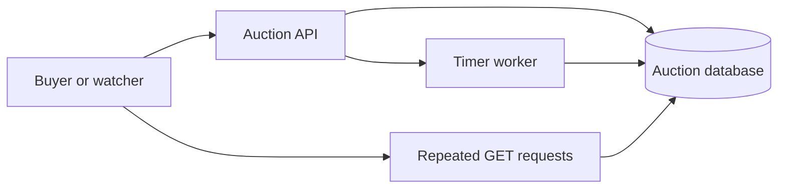
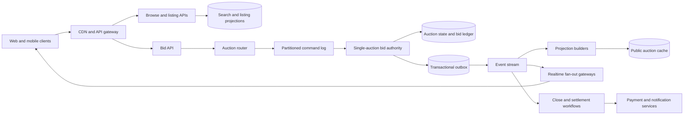
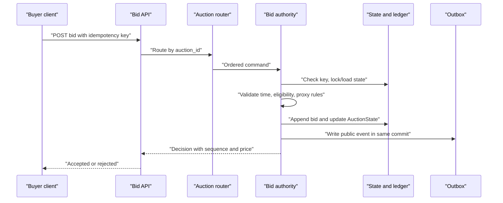
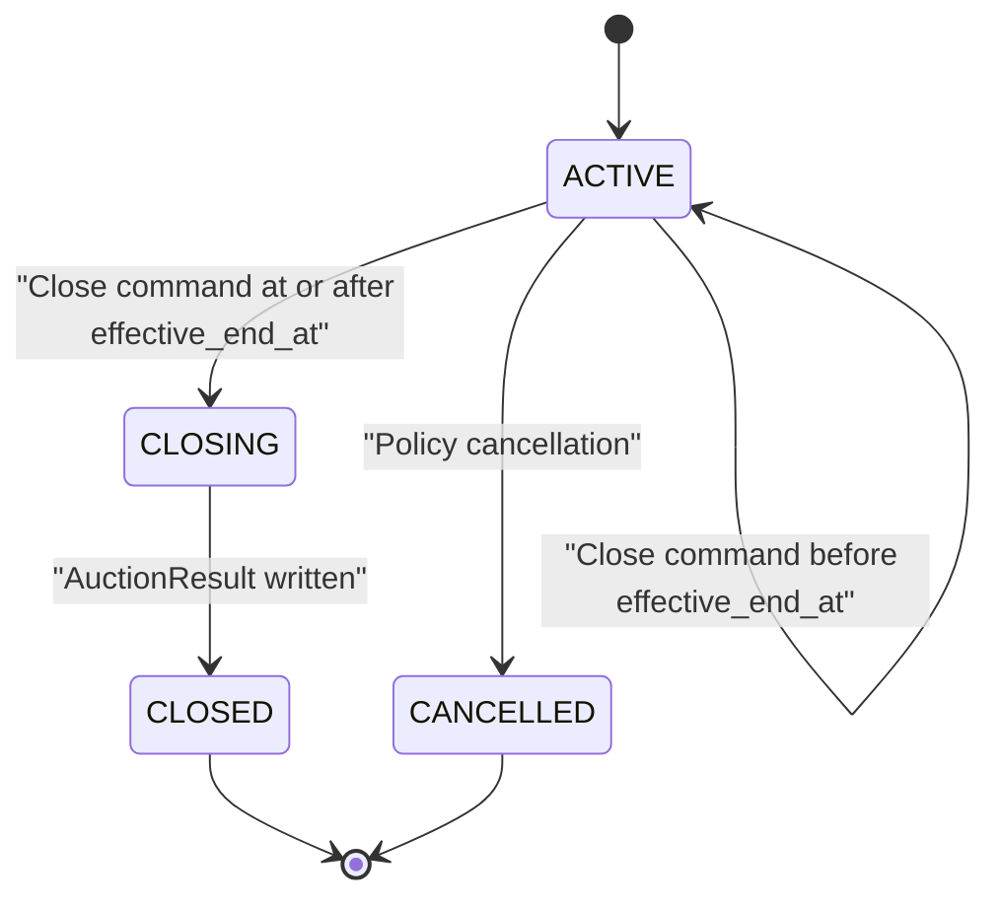
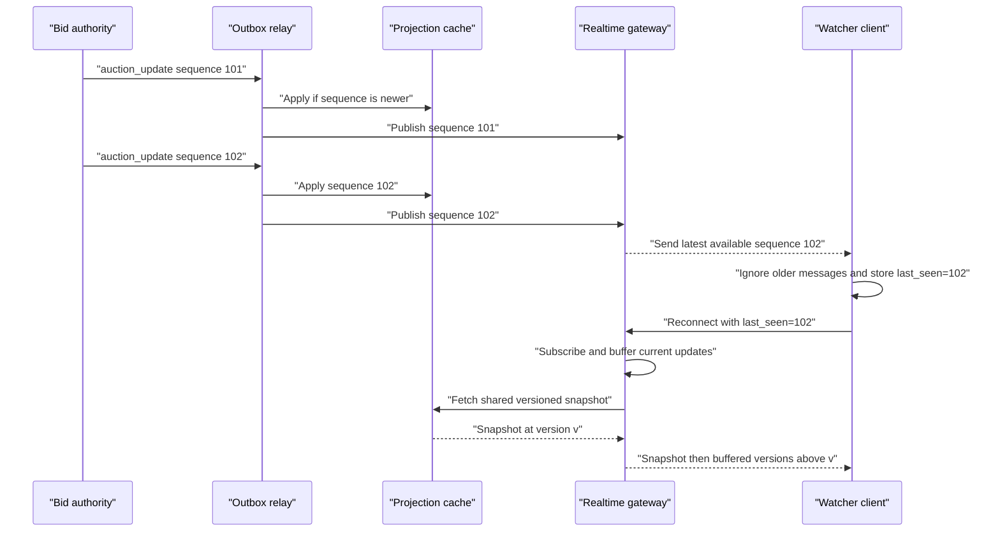

# Online Auction System Design

An online auction system lets sellers publish time-bounded listings and lets buyers place proxy bids while many more users watch the public price move live. This design focuses on English-style proxy auctions with optional reserve prices, anti-sniping extensions, settlement, and realtime watcher updates; fixed-price listings, shipping-carrier integrations, and exchange-like sub-millisecond matching are out of scope.

## 1. Requirements

### 1.1 Functional requirements

- Sellers can create and publish auctions with media, commercial terms, start time, end time, reserve price, and an increment policy.
- Buyers can discover active auctions, inspect current public state, place maximum proxy bids, and see their own bidding status.
- The system validates bidder eligibility, bid increments, currency, reserve rules, auction timing, and seller/bidder separation before accepting a bid.
- Watchers receive near-realtime visible price, bid count, leader-status, and end-time updates without learning hidden maximum bids.
- Each auction closes deterministically, produces at most one immutable result, and starts settlement for the winner exactly once.
- The system keeps an auditable bid ledger, supports policy-controlled retractions or cancellations, and preserves evidence for disputes and abuse review.

### 1.2 Non-functional requirements

- **Per-auction correctness.** Accepted bids for one auction must have a single total order because proxy bidding, tie breaks, the visible price, and the winner all depend on the exact sequence.
- **Bounded bid latency.** Normal bid decisions should complete within about 500 ms in the auction's home region; near the deadline, predictable queue delay matters more than average latency.
- **Read scalability.** Millions of watchers may follow a hot auction, so public reads and push updates must scale independently from the single authoritative bid writer.
- **Deadline determinism.** The product must define exactly whether a bid at the boundary is accepted, which clock is authoritative, and how anti-sniping extensions change the end time.
- **Privacy and auditability.** Maximum bids and reserves are sensitive strategy data, but every accepted, rejected, retracted, and administrative action must be explainable later.
- **Graceful degradation.** Search, recommendations, and live push can lag or shed load, but the bid path must preserve ordering or deliberately reject work rather than guess.

### 1.3 The binding constraint

The binding constraint is that every auction needs a strict total order of bid decisions at exactly the moment when traffic is most bursty. Daily averages are misleading: a valuable listing can receive a synchronized burst in its final seconds, and the system must still decide whether Alice's maximum was earlier than Bob's, whether Bob's bid extended the auction, and which public price follows from the proxy rules. That decision cannot be made independently by two regions, two database replicas, or two consumers without either consensus or a single sequencer.

At the same time, the public side has the opposite shape. Millions of watchers do not need linearizable reads of hidden maximums; they need a cheap, versioned stream of public price changes and a way to resync when they miss an event. The architecture is therefore forced into three mechanisms: a per-auction bid authority for serialization, an idempotent close workflow that treats timers as hints rather than truth, and a fan-out path that distributes sequenced public updates without becoming part of bid correctness.

## 2. Back-of-the-envelope estimation

Use illustrative numbers to size the design. Suppose the marketplace has 100 million registered users, 10 million daily active users, 10 million active auctions, and 1 million new auctions per day. If the site receives 100 million bids per day, average bid traffic is `100,000,000 / 86,400 = 1,157` bids per second. A peak multiplier of 20 gives roughly `1,157 × 20 = 23,140` bid attempts per second across the site. That is not difficult for a fleet, but the distribution is the problem: if 2% of peak traffic targets one celebrity auction, that one auction sees `23,140 × 0.02 = 463` bid attempts per second. If a flash event concentrates 10% on one auction, it sees `2,314` attempts per second and still needs one serial decision stream.

Watcher traffic is larger. If 1 million users watch auctions concurrently and a hot auction attracts 500,000 of them, then each accepted bid cannot trigger 500,000 direct database reads. At only 20 public updates per second, naive per-client JSON messages of 300 bytes would be `500,000 × 20 × 300 = 3,000,000,000` bytes per second, about 3 GB/s before protocol overhead. This implies hierarchical fan-out, update coalescing, and compact versioned events. It also implies that push is a cache invalidation and user-experience layer, not the source of truth.

Storage is not the hard part, but it shapes partitioning. If 100 million bid attempts per day each produce a 1 KB ledger row after metadata and indexes, the write ledger grows by `100,000,000 × 1 KB = 100 GB/day`, before replicas. One year is about `100 GB × 365 = 36.5 TB`, which is comfortable for a sharded datastore but too large for one relational table without partitioning and retention policies. Media is much larger: 1 million new listings per day with 20 images averaging 1 MB produces `1,000,000 × 20 × 1 MB = 20 TB/day` of raw uploads, so media must live in object storage behind a CDN and cannot be coupled to bid transactions.

Finally, closing load bunches by human behavior. If 1 million auctions end per day uniformly, close commands average `1,000,000 / 86,400 = 11.6` per second. If 20% are scheduled for evening hours and many end on minute boundaries, close workers will see bursts. Since the close command is another ordered mutation for the auction, the close path must use the same authority as bids rather than a separate worker updating state behind its back.

> **Key idea.** The system is not globally write-heavy; it is locally sequential. Scale comes from keeping each auction's authoritative state tiny and ordered while moving reads, media, search, and live fan-out onto derived paths.

## 3. API design

**Question.** What makes a bid retry safe when the client times out during the final second?
<details><summary>Answer</summary>

The retry must carry a scoped idempotency key and must return the original bid decision if the first request committed. The server cannot decide from the client's timestamp or from the retry arrival time; it must look up the authoritative command result for `(auction_id, bidder_id, idempotency_key)` and return the accepted sequence, rejection reason, visible price, and effective end time that were decided the first time.

</details>

```http
POST /v1/auctions
  body: {title, description, category_id, media_ids, start_price, reserve_price, currency, start_at, end_at, extension_policy}

POST /v1/auctions/{auction_id}/publish
  body: {expected_version}

GET /v1/auctions/{auction_id}
  response: {auction_id, public_fields, visible_price, bid_count, effective_end_at, state, version}

POST /v1/auctions/{auction_id}/bids
  headers: Idempotency-Key: <client-generated-key>
  body: {maximum_amount, expected_public_version?}
  response: {bid_id, decision, sequence, visible_price, you_are_leading, effective_end_at, version}

GET /v1/users/me/bids?cursor=<opaque>
  response: {items: [{auction_id, bid_id, status, you_are_leading, visible_price}], next_cursor}

POST /v1/auctions/{auction_id}/bid-retractions
  body: {bid_id, reason_code, evidence_ref}

WS /v1/auctions/{auction_id}/watch
  client: {type: "resume", last_seen_sequence}
  server: {type: "auction_update", sequence, visible_price, bid_count, effective_end_at, state}
```

The bid API accepts maximum amounts in integer minor units or fixed-point decimal strings; it never accepts floating-point money. `expected_public_version` is optional because a buyer should be allowed to bid from a slightly stale page if their maximum still satisfies the current state. The response is therefore a decision, not just an acknowledgement: accepted but not leading, accepted and leading, rejected because the auction is closed, rejected because the bid is below the next required public amount, or rejected for eligibility.

The idempotency key is scoped to the auction and bidder, not globally. A user can bid on two auctions with the same mobile retry key without collision, and a malicious user cannot probe another user's keys. Store a request hash under that unique key and reject reuse with a changed maximum; the hash must not create a new uniqueness scope. Retention must cover at least the retry and dispute window. A timed-out response is common during close bursts, so the command result is persisted with the bid decision, not cached only at the edge.

Watch messages are deliberately thinner than the GET response. They carry a monotonic public `sequence`, enough fields to update the visible page, and instructions to resync if the gateway detects a gap. Cursors are opaque on list APIs because bid histories are naturally ordered by `(auction_id, accepted_sequence)` or by user activity projections, not by stable numeric offsets. Retraction is not `DELETE /bids/{id}` because the ledger must remain auditable; it is a policy-controlled transition with evidence and an emitted correction event if public state changes.

## 4. Data model

Start with the obvious `Auction` row: title, seller, start price, start time, and end time. That is enough to browse listings, but it cannot decide a proxy bid because the public price is not simply the last bid amount. A bidder submits a hidden maximum; the system computes the visible price from the top two maximums, increment schedule, tie order, reserve, and current time. That forces an `AuctionState` record that stores the small authoritative summary needed for the next decision: current leader, leading maximum, second maximum, visible price, bid count, effective end time, state, and version.

A single state row still is not an audit trail. If the bid engine updates only the current leader and crashes after responding, the marketplace cannot explain why a user lost, replay state after corruption, or investigate shill bidding. Each attempt needs a `BidLedger` entry with the submitted maximum encrypted, the decision, the accepted sequence if any, the resulting public price, and the idempotency key. Maintain a rebuildable `BidderMaximum` per distinct bidder from this history: the top two bid submissions might both belong to one person, and retracting a leader may require a previous third-place bidder. Retractions and administrative decisions must also be immutable sequenced records, not deletions.

Now consider side effects. A bid changes public price and may extend the auction, which must reach watchers and projections. Publishing to Kafka or another event bus after the database commit creates a classic lost-event failure: the bid is accepted, but the process dies before notifying anyone. The fix is an `OutboxEvent` written in the same transaction or log append as the bid decision. A relay later publishes it at least once, and consumers deduplicate by event id and sequence.

Closing adds another entity. `AuctionResult` is an immutable, unique-per-auction record containing winner, final price, reserve outcome, and closed sequence. It records no sale if there are no eligible bids or the reserve is unmet. A separate mutable `Settlement` tracks payment progress. Order creation uses `result_id` as its business identity; distinct financial operations derive their own keys from that result and operation type. This prevents a duplicate close from creating another order without conflating authorization, capture, and refund.

Eligibility and abuse state cannot be embedded directly in auction state because it changes by user and often comes from risk systems. `BidderEligibility` or a risk snapshot records whether a bidder is allowed to bid, high-value limits, verification status, and the version of the policy used. Whatnot's public writeup on shill-bidding defense is a reminder that this is not just a boolean: device fingerprints, account relationships, bid/cancel patterns, anomaly detection, and investigator decisions all feed the accept-or-review path. The bid engine should use a compact decision snapshot, while the trust system keeps richer evidence outside the hot state row.

```text
Auction
- auction_id, seller_id, category_id, title, description, media_ids
- start_price, reserve_price_encrypted, currency, increment_policy_id
- start_at, original_end_at, extension_policy, home_region
- state: DRAFT | SCHEDULED | ACTIVE | CLOSING | CLOSED | CANCELLED
- version, created_at, published_at

AuctionState
- auction_id
- leading_bidder_id, leading_max_amount_encrypted
- second_bidder_id, second_max_amount_encrypted
- visible_price, reserve_met, accepted_bid_count
- effective_end_at, last_sequence, last_decision_at, state_version, owner_epoch

BidderMaximum
- auction_id, bidder_id, active_max_amount_encrypted, max_reached_sequence

BidLedger
- bid_id, auction_id, bidder_id, client_idempotency_key
- submitted_max_amount_encrypted, request_hash, decision, rejection_reason
- accepted_sequence, resulting_visible_price, effective_end_at_after_bid
- received_at, decided_at, policy_snapshot_id

AuctionResult
- auction_id, result_id, winner_id, final_price, reserve_met
- closed_at, closed_sequence

Settlement
- result_id, order_id, state, payment_operation_references

OutboxEvent
- event_id, auction_id, sequence, event_type, payload, published_at

PublicAuctionProjection
- auction_id, title, media_thumbnail, visible_price, bid_count
- effective_end_at, state, last_sequence, updated_at
```

`Auction` and seller workflow data fit in a relational or document store partitioned by `auction_id` and indexed by seller. `AuctionState`, `BidLedger`, `AuctionResult`, and `OutboxEvent` need strong consistency within one auction; they can live in a strongly consistent relational shard, a consensus-backed key-value store, or behind a replicated command log with a state store. The partition key is `auction_id`, and accepted ledger rows are clustered by `accepted_sequence`. Search indexes, public projections, recommendation features, user bid summaries, and WebSocket topic state are derived. They deliberately do not store hidden maximums or reserve prices.

> **Key idea.** The transactional model is small: serialize commands, update one auction's state, append ledger and outbox records, and never put fan-out or search in that critical section.

## 5. High-level design

The simplest design is a web service that writes bids directly to a database row and lets clients poll the row for the latest visible price. It is attractive because it is easy to explain: every bid runs a transaction, updates `AuctionState`, inserts `BidLedger`, and returns the new price.



This breaks in four concrete ways. First, two bid API instances can race unless every mutation uses the same row lock or compare-and-swap version, and even then a hot auction turns the row into a queue hidden inside the database. Second, a timer worker can close an auction while a bid transaction is in flight unless close is ordered with bids. Third, polling by millions of watchers converts every public price change into a database read storm. Fourth, event publication after commit can be lost, causing read models and WebSocket clients to miss accepted bids.

### Fix 1: Give every auction one bid authority

All commands that can change one auction route through one logical authority: either a single-writer actor consuming a partitioned command log or a transactional service using a strict row lock/CAS on `AuctionState.version`. The actor form makes the queue explicit. Commands for `auction_id = A` are appended to the same ordered partition; the actor processes them one at a time, updates a local state store or transactional database, writes ledger/outbox records, and advances the sequence. The database form is simpler at moderate scale: each bid transaction locks `AuctionState(A)`, recomputes the proxy decision, inserts the ledger, increments version, and commits. Both designs must expose the same semantics: one accepted sequence per mutation, scoped idempotency, and no dependence on client clocks.

The actor/log approach makes close, bid, extension, and cancellation share one stream and allows isolation of a hot auction. It does not remove serialization cost. A replaced actor can still be running, so the state store must atomically validate its `owner_epoch` and state version while applying a command, updating ledger/outbox records, and advancing the applied offset. A consumer assignment alone is not a write fence. This design's deadline is evaluated at the authority's serialized decision point after loading current state, not at edge receipt or at the later physical commit time; a decision counts only if durably committed.

### Fix 2: Make timers advisory and close through the same command stream

A delayed job or scheduler is useful for waking the system near `effective_end_at`, but it is not allowed to decide the winner by itself. Close is a command routed to the same per-auction authority as bids. When processed, it checks authoritative time and `effective_end_at`; if early, it reschedules. If due, it transitions `ACTIVE -> CLOSING -> CLOSED`, writes exactly one `AuctionResult`, and emits settlement events through the outbox. Duplicate close commands are harmless because `AuctionResult.auction_id` is unique and the state transition is conditional.

This also handles anti-sniping. A bid decided inside the extension window updates `effective_end_at` in the same committed state transition that accepts it. Any close command already queued will observe the new end time and reschedule rather than close early.

### Fix 3: Split authoritative state from public read models

Browse, auction detail pages, user bid summaries, and search do not read hidden maximums or lock the bid row. They read derived projections built from outbox events. eBay's Global Secondary Index work is a useful production lesson here: if the query key differs from the primary shard key, local secondary indexes push the system toward scatter-gather. Auction browse by category, seller, end time, price range, and demand features should therefore use dedicated global indexes or projections, not queries across all `auction_id` shards.

The listing workflow feeds those indexes before publish. eBay's buyer demand architecture showed how buyer keywords, filter clicks, and browsing paths can improve item-specific completion and conversion. For auctions, that means category attributes and facets are not cosmetic fields; they determine whether buyers find the item without touching the bid authority.

### Fix 4: Fan out sequenced public events, not bid transactions

The bid engine writes compact, complete public-state `auction_update` events with sequence numbers. Realtime gateways coalesce updates and fan them out. A newer full-state message safely supersedes missing earlier messages; an intentional sequence jump does not require a GET. Reconnect or an explicit resync request uses a versioned snapshot and a subscribe/buffer handshake so a change between snapshot and subscription is not lost.

Whatnot's live shopping infrastructure illustrates why this layer needs admission control and connection pooling. They prepared for very large live streams by enforcing global session caps through an admission service and by adding proxy layers so Redis, OpenSearch, and Kafka connection limits did not grow linearly with backend pods. A hot auction needs the same separation: protect admitted bidders and watchers, shed new watcher joins cleanly, and pool downstream connections so fan-out pressure does not collapse the bid path.

### Fix 5: Treat settlement as an idempotent saga after an immutable result

Winning an auction is not the same as successfully charging the winner. The close command writes an immutable result, then emits `auction_won`. Order creation, payment authorization, notification, shipment holds, payout, and dispute handling are separate idempotent steps keyed by `result_id`. If payment fails, policy may retry, offer a second-chance flow, relist, or cancel, but it must not silently rewrite the winner or mutate the historical auction result.

### Putting it together



A bid request enters through the API gateway, passes authentication and lightweight rate checks, and is routed by `auction_id` to the auction's home region and command partition. The bid authority processes it in sequence order, checks eligibility and authoritative time, applies proxy bidding rules, updates `AuctionState`, appends `BidLedger`, writes an outbox event, and returns the decision. The outbox relay publishes the public update to projections and realtime gateways. Watchers receive a sequence-numbered hint and can resync from the public cache. Close commands follow the same route as bids, which is why the winner and final price are based on the same ordered history as every earlier bid.

> **Key idea.** Each component traces back to a specific failure of the naive design: hidden database queues, racy timers, read storms, lost events, and non-idempotent settlement.

## 6. Deep dives

### 6.1 Per-auction bid acceptance and proxy semantics

**Question.** Two buyers submit maximum bids during the last second, both clients time out, and both retry. How does the system avoid accepting them twice or computing two different winners?
<details><summary>Answer</summary>

Route both commands to one per-auction authority, deduplicate by `(auction_id, bidder_id, idempotency_key)`, and validate the deadline at the serialized decision point. Persist that decision and its sequence atomically. Compute the price from distinct bidders' active maximums, not raw submissions. Retries return the persisted result rather than re-running the bid.

</details>

The tempting implementation is `UPDATE auction_state SET visible_price = ... WHERE auction_id = ...` from any API server. That looks safe if the database is strongly consistent, but proxy bidding makes the update depend on hidden state and tie order. For an illustrative fixed $1 increment, suppose Alice has an accepted maximum of $100 and leads at $50. Bob submits $80 and Carol submits $120 concurrently. If two API instances read Alice's state at the same time, Bob may compute Alice leading at $81 while Carol computes Carol leading at $101. Whichever write wins hides the other decision unless the transaction locks the state and inserts a sequenced ledger row atomically.

The first production-grade requirement is one serialization point per auction. In a database-centered design, every bid transaction locks `AuctionState` for that `auction_id` or uses CAS on `state_version`. The transaction re-reads current state, checks idempotency, validates the bid, inserts a ledger record, updates state, writes the outbox, and commits. In a log-centered design, the router appends commands for the auction to the same partition and a single actor processes them. The actor can keep hot state in memory because the replicated log and ledger are the durable source. Both approaches are valid; the decision is mostly about expected hot-auction bursts. Conditional updates are simpler and good until lock wait time becomes the bottleneck. A single-writer actor exposes that wait as queue depth and makes it easier to isolate a hot auction.

The second requirement is a precise proxy-bidding contract. A maximum is a bidding instruction, not a bank authorization. Keep one active maximum per distinct bidder. Raising the leader's own maximum must not make that bidder compete with their previous bid. Reject ordinary decreases, and validate challengers against the current published minimum before acceptance; an identical repeat under a new key does not become a second competing maximum.

Here is an explicit pricing policy for this design, rather than a claim to reproduce every eBay edge case. Freeze a monotone increment schedule `I(amount)` when publishing. A first bidder must meet the start price; a challenger must meet `visible_price + I(visible_price)` and raise their own previous maximum. The leader may simply raise their hidden maximum. After updating the per-bidder state, let `M1` and `M2` be the highest and second-highest maximums from distinct bidders. With only one bidder, the base price is the start price. Otherwise it is `max(start_price, min(M1, M2 + I(M2)))`; equal maximums choose the bidder who first reached that amount. For reserve `R`, validate `R >= start_price`; if `M1 >= R`, the visible price is at least `R`, never more than `M1`. Otherwise the reserve remains unmet and closing produces no sale. Thus a sole $100 maximum on a $10-start, $80-reserve listing sells for $80, not $10. With no reserve, raising that same bidder's maximum alone leaves the $10 price unchanged.

Retractions recompute the active per-bidder maxima and ranking from eligible history, potentially restoring a third-place bidder; two cached maxima alone are insufficient. eBay's automatic bidding documentation motivates hidden limits and price-bracket increments, but the exact increment, tie, reserve, and retraction policies must be specified and replayable here.

The third requirement is idempotency at the command-decision layer. Store the idempotency key with the canonical command result before returning. A retry with the same key and body returns the original decision even after close; a changed body conflicts. A different key is a new command subject to the current bidder-specific admission rules. Keys are scoped by bidder and auction. Persist accepted and rejected decisions, while retaining rate limits because a client can still generate fresh keys.

There are two subtle alternatives. One is to model every proxy bid as an event and rebuild state by scanning the ledger. That is excellent for audit and disaster recovery but too slow for the synchronous decision unless the current state is cached and fenced by sequence. The other is to use a globally ordered log for all auctions. That is overkill: it reduces concurrency across independent auctions even though only per-auction ordering matters. Partition by auction, then isolate the exceptional hot auction if it threatens partition neighbors.



Signals worth watching: per-auction queue delay, lock wait time, duplicate-key hit rate, rejected-below-minimum rate, and any non-contiguous accepted sequence.

> **Strong-answer criteria.** A senior answer names the serialization mechanism, idempotency scope, proxy price formula, tie behavior, and where hidden maximums are protected. It also distinguishes global throughput from one hot auction's sequential bottleneck.

| Level | Approach | Why |
|---|---|---|
| Bad | Let any API server update the current price from its read of the row. | Concurrent bidders can overwrite each other, retries can double-apply, and proxy maximums leak into inconsistent public prices. |
| Good | Use a row lock or CAS around `AuctionState` and insert a bid ledger row. | This preserves correctness for moderate load, but hot auctions may suffer hidden database queues and need explicit partition isolation. |
| Great | Route commands through a per-auction authority backed by a replicated log or strict transaction, with scoped idempotency, encrypted maximums, sequenced ledger rows, and bounded queue monitoring. | It makes the required total order explicit while keeping reads and fan-out out of the critical path. |

### 6.2 Closing-time cutoff, soft close, and exactly-once winner selection

**Question.** A bid is accepted by the API gateway before the displayed countdown hits zero, but it reaches the bid authority after another command has closed the auction. Is it valid?
<details><summary>Answer</summary>

No, not under this design. A bid must reach the authority's serialized decision point while the auction is active and before `effective_end_at`, and that decision must commit. Edge arrival and client timestamps are advisory. A valid pre-deadline decision can finish its commit after the deadline; close cannot overtake it on the same authority.

</details>

The close boundary is where vague designs fail. If the rule is "request received before the deadline," received by whom? The CDN, API gateway, regional load balancer, command log, actor, or database? If the rule is "client submitted before the deadline," malicious clients can backdate timestamps, and honest clients have clock skew. If the rule is "timer job ran," delayed jobs and worker crashes can change winners. The system needs one clock authority and one ordered mutation path.

This design checks `start_at <= decision_at < effective_end_at` after acquiring serialization and loading current state. In the database implementation, sample the database clock after taking the row lock; PostgreSQL's transaction-start `now()` would backdate a transaction that waited for that lock, so use an actual current-time sample such as `clock_timestamp()`. Store `decision_at` with the decision and do not acknowledge acceptance until commit. This is not a guarantee that physical commit finishes before the deadline: that would require a different, storage-supported commit-time rule.

The owner uses a monitored clock and persists a nondecreasing `last_decision_at` across takeover. A leader with unacceptable clock uncertainty pauses deadline-sensitive decisions rather than silently changing their ordering. If queue delay causes requests to reach the decision point too late, use admission control, capacity isolation, or a published soft-close/outage policy; an edge timestamp does not override the authority.

Close itself is a command in the same stream. The scheduler enqueues `CloseAuction(auction_id, expected_end_at)` around the end time. The authority compares current `effective_end_at` to the same decision clock. If early, it durably schedules another wake-up. If due, it computes the winner and reserve outcome, inserts the unique `AuctionResult`, changes state to `CLOSED`, and appends `auction_closed` in one commit. `CLOSING` is an internal transition, not a separately committed state that can strand an auction after a crash. Duplicate close commands return the existing result.

Anti-sniping changes the product semantics but not the architecture. For example, a valid bid decided within the last two minutes extends `effective_end_at` to `decision_at + 2 minutes`, capped by the published maximum extension deadline. Commit that extension with the bid, never shrink the current deadline, and apply the extension only to qualifying new bids, not idempotent retries. A queued close then sees the extended deadline and reschedules. Fixed deadlines are simpler; soft close reduces timing games, but the eligibility and cap rules must be replayable from the log.

Exactly-once winner selection is really at-least-once execution plus idempotent state. Close workers, outbox relays, payment services, and notification systems can all retry. The unique `AuctionResult` row is the fence. Settlement consumes `auction_won(result_id)` and creates an order using `result_id` as its idempotency key. If payment authorization times out, the payment step retries or moves to a grace state; it does not reopen the auction. If the reserve is not met, the result records `reserve_met = false` and settlement emits seller notifications rather than a winner charge.

Home-region failover is the hard variant. Active-active bid acceptance across two regions risks two valid prefixes and two winners unless every bid goes through cross-region consensus, which hurts latency at the exact moment bids burst. A safer marketplace assigns each auction a home region, synchronously replicates within local availability zones, asynchronously replicates to disaster recovery, and exposes replication lag. On home-region failure, a new leader can accept bids only after it proves it has the committed prefix and fences the old leader. If it cannot prove that, the honest behavior is to pause bidding and extend affected auctions under a published outage policy.



Signals worth watching: close-job delay, active auctions past `effective_end_at`, bids rejected after deadline, bid-authority queue age in the final minute, duplicate close commands, and results without settlement.

> **Strong-answer criteria.** A senior answer defines the exact cutoff, routes close through the same serialization path as bids, uses a unique immutable result, and explains how soft close changes `effective_end_at` atomically.

| Level | Approach | Why |
|---|---|---|
| Bad | Trust client timestamps or close auctions directly from a timer worker. | Clocks can lie or drift, timers can be late or duplicated, and close can race with in-flight bids. |
| Good | Use server time and a conditional `ACTIVE -> CLOSED` transition. | Better, but it still needs to be ordered with bids and must handle anti-sniping extensions and duplicate workers. |
| Great | Serialize bids and close, record the pre-deadline decision time, durably commit its result and any extension, and write one immutable `AuctionResult` consumed idempotently by settlement. | It gives deterministic winners without confusing lock acquisition, decision time, and physical commit time. |

### 6.3 Live price fan-out with sequence numbers and resync

**Question.** A hot auction has 500,000 watchers, the bid engine emits 50 accepted updates in one second, and some mobile clients miss messages. How do clients end up on the right visible price without hammering the database?
<details><summary>Answer</summary>

Send complete public-state updates with monotonically increasing auction sequences, coalesce intermediate updates, and apply only newer versions. A sequence jump in a full-state event is harmless. Reconnect uses a versioned projection snapshot plus buffered newer events; the projection is eventually consistent, not an authoritative bid decision.

</details>

The naive watcher path is polling: every client calls `GET /auctions/{id}` every second. With 500,000 watchers, that is 500,000 reads per second for one auction even when nothing changes. If the page polls faster near close, the cache or database becomes the bottleneck. The opposite naive path is to have the bid engine push directly to every connected WebSocket. That preserves freshness until it couples the sequential bid writer to the slowest mobile network and turns a write-side correctness component into a fan-out server.

The right split is that the bid engine emits one public event per committed sequence, and realtime infrastructure handles delivery as best-effort. An event contains `auction_id`, `sequence`, `visible_price`, `bid_count`, `effective_end_at`, `state`, and perhaps a `leader_hint` for the current user on a private channel. It does not contain hidden maximums, reserve price, or full bid history. Projection builders update `PublicAuctionProjection`, and gateways fan out the event to subscribed clients. A client stores `last_seen_sequence`, ignores older or duplicate messages, and applies a message only if the sequence is greater than the current one.

For hot auctions, a gateway can skip full-state versions 101 and 102 and send 103. Do not make every such skip trigger a snapshot request from 500,000 watchers. On reconnect or `resync_required`, subscribe and buffer first, fetch a snapshot at version `v`, then discard buffered versions `<= v` and deliver the rest. Never replace a newer local view with an older projection. Gateways share snapshot fetches and jitter retries if projections lag. Delta-only protocols instead require contiguous replay or a fresh snapshot; they cannot safely use the same coalescing rule.

Topic ownership needs its own coordination. Use bounded fan-out groups rather than unbounded downstream subscriptions. AWS's DynamoDB lease pattern for streaming workers is a useful ownership analogy, but expiry does not physically stop an old worker. Gateways must reject obsolete owner epochs or tolerate duplicate full-state events through sequence checks. AWS AppSync illustrates separating WebSocket handling from backend state; none of this makes the watcher layer authoritative for bids.

Admission control is part of correctness by protection. Whatnot's large live-event work showed that adding application pods can run into Redis, search, and Kafka connection ceilings before CPU is exhausted, and that deterministic load shedding protects admitted users. For auctions, new watcher connections are cheaper to reject than bid commands are to delay. The gateway should enforce per-auction watcher caps, prefer already-connected users, reserve capacity for active bidders and sellers, and degrade from per-bid updates to lower-frequency price snapshots if needed. Bidders can still use the bid API and authoritative GET response even if the public WebSocket is degraded.

The public projection is eventually consistent, so the UI must be honest. After placing a bid, the bidder's response from the bid API is read-your-writes for that decision. The watcher stream may deliver the corresponding public update later. If the user refreshes immediately, the API can either read the authoritative state for that auction or return the projection with a version lower than the bid response and tell the client to wait/resync. Mixing those without sequence checks creates confusing regressions where a bidder sees themselves leading and then briefly sees an old price.



Signals worth watching: fan-out latency by auction, gateway send-buffer depth, coalesced update count, reconnect rate, snapshot resync rate, and projection lag behind the bid sequence.

> **Strong-answer criteria.** A senior answer separates authoritative bid ordering from best-effort push, uses monotonic sequences, explains coalescing and resync, and names backpressure/admission controls for hot watcher bursts.

| Level | Approach | Why |
|---|---|---|
| Bad | Have every watcher poll the database or make the bid engine write to every socket. | Polling creates read storms; direct push couples correctness to slow clients. |
| Good | Publish bid events to WebSocket gateways and update a cache. | This scales better, but without sequences and resync clients can apply stale or duplicate updates. |
| Great | Fan out compact sequenced public events, coalesce hot updates, enforce gateway backpressure/admission, and make clients resync from a versioned projection when gaps occur. | It keeps millions of watchers live without making them part of the bid transaction. |

## 7. Variants

**10x scale.** If peak bids rise from about 23,000 per second to about 230,000 per second, the global fleet scales by adding command partitions and bid-authority workers, but a single auction is still sequential. The important changes are adaptive isolation for hot auctions, pre-warming partitions for promoted events, stricter watcher admission, and lower-frequency coalesced updates. The data model and cutoff semantics stay the same.

**Multi-region active-active bidding.** Active-active writes are attractive for latency, but they attack the binding constraint. If two regions accept bids independently, tie order, soft-close extension, and winner selection become ambiguous. Either use cross-region consensus for each auction command, which increases latency, or keep a home region per auction and serve reads globally. For most marketplaces, home-region bidding plus fenced failover is the safer trade.

**Hard regulatory audit.** If regulators require tamper-evident bid history, append accepted and rejected decisions to an immutable ledger with hash chaining per auction and periodic notarized checkpoints. This does not replace the hot state store; it complements it. The bid authority still decides from current state, while the audit ledger proves later that no bid was removed or reordered.

**Paid live event burst.** A planned celebrity auction or live-commerce event should look more like a ticketed stream than ordinary browse traffic. Add pre-event load tests, reservation of bid-authority capacity, deterministic watcher admission, waiting rooms for non-bidders, and dedicated fan-out shards. What does not change is the rule that watcher load must be shed before bid ordering is compromised.

## 8. The transferable pattern

This is the same shape as many systems where a tiny ordered core drives a huge eventually consistent audience. The trick is to identify the object that truly needs serialization, make that serialization explicit, and push everything else behind versioned events. Auctions serialize by `auction_id`; inventory systems serialize by SKU or reservation key; ticketing serializes by seat or event inventory. The related [Ticketmaster](./ticketmaster-system-design.md) problem has the same burst-at-deadline pressure, but its scarce object is a seat or ticket allocation rather than a proxy-bid sequence.

The reusable pattern is: accept commands at an idempotent edge, route them to the owner of the consistency key, mutate small authoritative state, append an ordered ledger and outbox event, and build scalable read models from those events. Clients treat push as a hint and reconcile by version. Timers, settlement, and external side effects become commands or sagas fenced by immutable results, not independent writers racing the core state.

## Review

The design starts from the fact that an auction is locally sequential and publicly massive. Proxy bids require distinct bidders' hidden maximums, deterministic tie breaks, and an ordered ledger, so each auction gets a fenced authority or a strict transactional lock/CAS. Closing is another serialized command: decisions must occur before `effective_end_at` and become durable to count, with optional atomic soft-close extension and one immutable `AuctionResult`. Public full-state updates use monotonic sequences and can coalesce without forcing per-viewer resyncs. Settlement is a separate idempotent saga, and hot-event reliability comes from protecting the ordered bid path from watcher fan-out.

### Check your understanding

1. Why is global bid QPS less important than the hottest auction's bid QPS?
   <details><summary>Answer</summary>

   Independent auctions can be processed in parallel, but bids within one auction must be serialized to compute proxy prices, tie breaks, extensions, and the winner. A single hot auction can therefore bottleneck on one authority even when total marketplace QPS is manageable.

   </details>

2. Why not accept bids based on the time they reached the CDN or API gateway?
   <details><summary>Answer</summary>

   Edge arrival is not ordered with auction state or close commands. A bid can sit in a gateway queue until after close. The rule checks time at the serialized decision point and then durably commits that decision; it does not promise that physical commit finishes before the deadline.

   </details>

3. What information must a public watcher event contain, and what must it not contain?
   <details><summary>Answer</summary>

   It should contain public sequence, visible price, bid count, effective end time, and state. It must not include hidden maximum fields, the unpublished reserve, or private eligibility data. Public price behavior inevitably reveals some bounds, so this is access control on private data, not a promise that bidder strategy cannot be inferred.

   </details>

4. Why is a bid retraction not modeled as deleting a bid row?
   <details><summary>Answer</summary>

   The marketplace needs an audit trail for disputes, abuse detection, and replay. Retraction is a policy-controlled state transition with evidence and possibly a compensating public event; deleting the row would destroy the history needed to explain the auction.

   </details>

5. What changes if the product adds a two-minute anti-sniping rule?
   <details><summary>Answer</summary>

   The bid authority updates `effective_end_at` atomically when it accepts a bid inside the extension window, subject to product caps. Close commands remain advisory and reschedule if they observe the extended end time. The serialization model does not change.

   </details>

## Sources and further reading

| Source | Article | Why it matters |
|---|---|---|
| eBay | [Automatic bidding](https://www.ebay.com/help/buying/bidding/automatic-bidding?id=4014) | Canonical proxy-bidding behavior: hidden maximums, public increments, immediate outbid semantics, and contractual commitment. |
| eBay Developers | [Offer API](https://www.developer.ebay.com/develop/api/buy/offer_api) | Shows proxy bid placement/retraction and buyer bid summaries as explicit marketplace API capabilities. |
| eBay | [eBay's Global Secondary Indexes](https://innovation.ebayinc.com/stories/ebays-global-secondary-indexes/) | Petabyte-scale distributed indexing pattern that avoids scatter-gather reads across listing shards. |
| eBay | [How eBay's Distributed Architecture Surfaces More Item Listings for Buyers](https://innovation.ebayinc.com/stories/how-ebays-distributed-architecture-surfaces-more-item-listings-for-buyers/) | Connects buyer demand signals, listing attributes, and asynchronous data products to search quality. |
| Whatnot | [Scaling Whatnot: Behind the Largest Live Shopping Stream in US History](https://medium.com/whatnot-engineering/scaling-whatnot-behind-the-largest-live-shopping-stream-in-us-history-040a458f538c) | Practical live-auction adjacent lessons on admission control, load testing, connection pooling, and hot-event readiness. |
| Whatnot | [Taking On Shill Bidding](https://blog.teamwhatnot.com/unitedstates/taking-on-shill-bidding) | Trust-and-safety signals for detecting seller-related bids, collusion, and manipulation. |
| AWS | [Building resilient real-time streaming workers with Amazon DynamoDB leases](https://aws.amazon.com/blogs/architecture/building-resilient-real-time-streaming-workers-with-amazon-dynamodb-leases/) | Lease, heartbeat, and reconciliation pattern for exactly-one ownership of stateful WebSocket work. |
| AWS | [AWS AppSync real-time reference architecture](https://aws.amazon.com/blogs/mobile/aws-appsync-real-time-reference-architecture/) | Managed WebSocket subscription fan-out pattern for delivering realtime auction read-model updates. |
| PostgreSQL | [Date/time functions](https://www.postgresql.org/docs/17/functions-datetime.html) | Distinguishes transaction-start time from an actual clock sample when defining deadline checks. |
