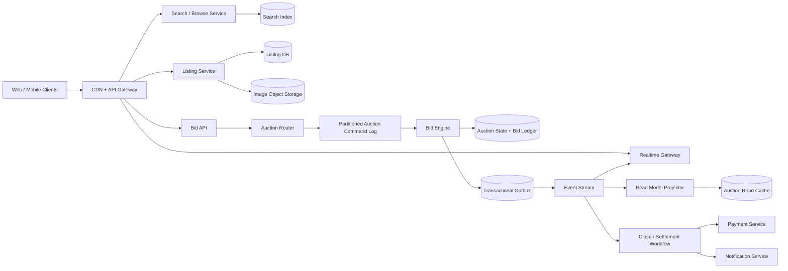

# Online Auction System

## 1. Requirements

### Functional requirements

1. Sellers create listings with description, media, reserve price, start/end time, and shipping terms.
2. Buyers discover active auctions and view current price, bid count, and time remaining.
3. Buyers place maximum proxy bids; the system computes the visible winning price.
4. Enforce bid increments, eligibility, reserve price, and auction timing.
5. Stream bid and price updates to watchers in near real time.
6. Close each auction exactly once logically and determine one winner.
7. Authorize/capture payment, notify seller, and support cancellation, non-payment, and disputes.
8. Protect bidder maximums and retain an auditable bid history.

Out of scope: fixed-price listings, real-time sub-second financial exchange matching, and full shipping-carrier design.

### Non-functional requirements

- Accepted bids must never be lost or reordered within an auction.
- `p99` bid decision latency below 500 ms in the auction's home region.
- Browse availability `99.99%`; bidding prioritizes consistency over availability.
- Real-time updates normally arrive within 1 second.
- Deterministic behavior at the close boundary.
- Withstand hot celebrity auctions and synchronized end-of-auction traffic.
- Financial, bid, and administrative actions are fully auditable.

## 2. Scale assumptions and capacity

- 100 million registered users; 10 million daily active users.
- 10 million active auctions; 1 million new auctions/day.
- 100 million bids/day: about 1,200 bids/second average and 20,000/second peak.
- 1 million simultaneous auction watchers.
- Typical auction has 10 bids; hot auction may have millions of watchers and thousands of bids/second.
- 20 photos/listing averaging 1 MB: 20 TB/day of uploaded media before deduplication/lifecycle policies.

Reads greatly exceed writes, but bids are skewed by both listing popularity and time. Capacity planning must model the final minute separately from daily averages.

## 3. High-level architecture



Each auction has one logical write leader. All commands for an `auction_id` are routed to the same ordered partition and processed serially or under a row lock. Browse, search, and watcher views are derived and can be eventually consistent; bid acceptance uses authoritative state.

## 4. Data model

```text
Auction
- auction_id
- seller_id
- title
- description
- category_id
- start_price
- reserve_price_encrypted
- currency
- increment_policy_id
- start_at
- end_at
- extension_policy
- state: DRAFT | SCHEDULED | ACTIVE | CLOSING | CLOSED | CANCELLED
- home_region
- version

Bid
- bid_id
- auction_id
- bidder_id
- max_amount_encrypted
- resulting_visible_price
- accepted_sequence
- status: ACCEPTED | REJECTED | RETRACTED
- client_idempotency_key
- received_at
- decided_at

AuctionState
- auction_id
- leading_bidder_id
- leading_max_amount_encrypted
- second_max_amount_encrypted
- visible_price
- accepted_bid_count
- last_sequence
- effective_end_at
- version

AuctionResult
- auction_id
- winner_id
- final_price
- reserve_met
- closed_at
- settlement_state

BidderEligibility
- auction_id
- bidder_id
- status
- limit
- verified_at
```

Bid maximums and reserve prices are sensitive. Encrypt them with tightly controlled keys and never expose them in read models, logs, events, or client responses.

## 5. Core APIs

### Create and publish

```http
POST /v1/auctions
POST /v1/auctions/{auction_id}/publish
```

Publishing validates immutable commercial fields, media scan status, seller eligibility, and future start/end times.

### Place a proxy bid

```http
POST /v1/auctions/{auction_id}/bids
Idempotency-Key: 1b43...

{
  "maximum_amount": {"currency": "USD", "minor_units": 12500},
  "expected_auction_version": 481
}
```

```json
{
  "bid_id": "bid-882",
  "accepted": true,
  "auction_version": 482,
  "visible_price": {"currency": "USD", "minor_units": 10100},
  "you_are_leading": true,
  "effective_end_at": "2026-10-13T08:30:00Z"
}
```

The server's receive/commit order decides races, not client timestamps.

### Read and watch

```http
GET /v1/auctions/{auction_id}
GET /v1/auctions/{auction_id}/bids?cursor=...
GET /v1/users/me/bids
WS  /v1/auctions/{auction_id}/watch
```

Bid history exposes bidder aliases and resulting visible prices, never maximum amounts.

## 6. Proxy bidding algorithm

Let the current leader's maximum be `L`, the challenger's maximum be `C`, and the applicable increment be `I`.

1. Validate auction is `ACTIVE` and authoritative time is before `effective_end_at`.
2. Validate bidder, currency, minimum amount, limits, sanctions, and seller/bidder separation.
3. If `C <= L`, current leader remains; visible price becomes `min(L, C + I)`.
4. If `C > L`, challenger leads; visible price becomes `min(C, L + I)`.
5. If maximums tie, the earlier accepted bid wins.
6. Persist the bid, updated state, sequence, and outbox event atomically.

For the first bid, visible price is the start price. Increment schedules may vary by current price and must be versioned per auction. Use integer minor units or decimal fixed precision, never floating point.

Example:

```text
Start price: $50
Alice maximum: $100 -> Alice leads at $50
Bob maximum:   $80  -> Alice leads at $81
Carol maximum: $120 -> Carol leads at $101
```

The bidder is authorizing a maximum, not submitting the displayed amount repeatedly.

## 7. Bid ordering and concurrency

All mutations for one auction need a total order. Two viable implementations are:

- Route by `auction_id` to a single consumer of a replicated command-log partition.
- Execute a strongly consistent transaction with a row lock or compare-and-swap on `AuctionState.version`.

The log model naturally absorbs bursts and preserves ordering, but queue delay must be bounded near close. The transactional model is simpler at moderate load. Both require a per-auction idempotency constraint on `(bidder_id, idempotency_key)`.

Do not accept a bid merely because it entered an edge queue before the deadline. Define acceptance precisely:

> A bid is on time only if the authoritative bid engine commits it before `effective_end_at`.

Return `AUCTION_CLOSED` for later commands. Synchronized clocks use NTP/PTP monitoring, but database/leader time is authoritative.

## 8. Auction close and anti-sniping

A delayed job queue schedules close commands, but timers are not the source of truth.

1. A close worker loads authoritative state.
2. If `now < effective_end_at`, it reschedules.
3. It conditionally transitions `ACTIVE -> CLOSING`.
4. The bid engine drains/rejects commands according to the committed-time rule.
5. It computes reserve outcome and writes `AuctionResult` once.
6. It transitions to `CLOSED` and emits settlement events transactionally.

A reconciliation scanner finds active auctions past their end time in case the timer was lost.

For anti-sniping, a bid committed in the last two minutes can extend `effective_end_at` by two minutes, optionally capped. The extension is in the same bid transaction, and the response/event includes the new end time. This converts a race at a fixed deadline into an explicit product policy.

## 9. Read path and real-time fan-out

Auction pages read a denormalized cache containing public listing fields, visible price, bid count, version, and effective end time. Bid events update this projection.

Realtime gateways:

- Subscribe internally by auction topic.
- Fan out compact versioned events to connected watchers.
- Coalesce high-frequency updates for very hot auctions.
- Apply backpressure and disconnect persistently slow clients.
- Tell reconnecting clients to fetch the authoritative snapshot from their last version.

Push is a latency optimization, not the source of truth. Events may be lost or duplicated. The client applies only higher versions and periodically reconciles through `GET /auctions/{id}`.

Use CDN caching for static listing content and images. Keep price/state TTLs very short or update them by event.

## 10. Discovery and seller workflows

Listings are indexed asynchronously by title, description, category, attributes, price range, seller, and end time. The listing database remains authoritative.

Before an auction starts, sellers may edit allowed fields. After the first bid, price, reserve, duration, and material description fields should be immutable or require a controlled cancellation because bidders relied on them.

Media uploads use signed URLs, malware scanning, image transcoding, and content moderation. Only approved media is published.

## 11. Settlement flow

Closing emits a stable `auction_won` event:

1. Create an order/settlement record idempotently.
2. Attempt payment authorization for the final price, tax, and shipping.
3. Notify winner and seller.
4. On authorization, capture according to shipping/marketplace policy.
5. Hold seller payout until required shipment or dispute milestones.
6. If payment fails, allow a grace period and retries.
7. Apply policy: offer to next bidder, relist, or cancel. Never silently charge the runner-up.

Payment, order, and payout operations use the auction result ID as their idempotency key. Settlement is a saga; it must not reopen or change the immutable auction result.

## 12. Partitioning and hot auctions

- Partition bid commands and authoritative state by `hash(auction_id)`.
- Partition listing browse/search separately by category or index shards.
- Store bid history clustered by `(auction_id, accepted_sequence)`.
- Partition user bid summaries as independent projections by `bidder_id`.

A single auction cannot be safely multi-writer without consensus because its bids require a total order. Scale a hot auction by keeping its write state small and single-leader while scaling reads/fan-out horizontally. Techniques include dedicated partitions, adaptive router isolation, in-memory state backed by a replicated log, event coalescing, and hierarchical fan-out.

## 13. Reliability and failure handling

| Failure | Handling |
|---|---|
| Client retries a bid | Return the prior decision by scoped idempotency key |
| Bid commit succeeds, response is lost | Retry returns accepted bid and sequence |
| Event publication fails | Transactional outbox retries |
| Realtime event is missed | Client reloads snapshot by version |
| Close timer is lost | Past-due reconciliation scanner closes auction |
| Duplicate close commands | Conditional state transition and unique result |
| Bid engine dies mid-command | Uncommitted command replays; transaction is atomic |
| Read projection lags | Bid endpoint still uses authoritative state |
| Payment fails after close | Settlement saga; result remains immutable |
| Hot auction overloads partition | Isolate partition, admission controls, preserve bid ordering |
| Home region fails | Fenced leader promotion; temporarily pause bids if order is uncertain |

Regularly reconcile closed auctions without results, results without settlements, accepted bids against final state, and outbox sequence continuity.

## 14. Multi-region design

- Assign every auction a home region when published, preferably near the seller and expected bidders.
- Serve images, discovery, and auction read models globally.
- Route bid commands to the home region even if the buyer is remote.
- Replicate the command log and database synchronously across local availability zones.
- Replicate to a disaster-recovery region and expose its lag.

Active-active bidding across regions creates ambiguous close ordering and should be avoided. On failure, fence the old leader and promote a caught-up replica. If no replica can prove it has the committed prefix, pause bidding and extend the auction under a published outage policy rather than risk two winners.

## 15. Security, trust, and abuse prevention

- TLS, encryption at rest, and field-level encryption for maximums/reserves.
- Strong authentication and step-up verification for high-value bids.
- Payment-method verification and bidder limits before bid acceptance.
- Prevent sellers, related accounts, or employees from shill bidding.
- Detect bid shielding, collusion, bots, account takeover, and card testing.
- Apply rate limits by account, device, IP, auction, and risk score.
- Sign administrative actions and keep immutable audit logs.
- Mask bidder identities publicly while retaining evidence for disputes.
- Scan listing media and text; enforce prohibited-goods policies.
- Restrict bid retraction to auditable, policy-approved cases.
- Protect WebSocket topics with per-auction authorization.

## 16. Observability and invariants

Track:

- Bid decision latency, rejection reasons, and queue delay.
- Commands committed before/after deadline.
- Auction-state version conflicts and duplicate requests.
- Realtime fan-out latency, dropped/coalesced updates, reconnects.
- Close-job delay and active auctions past effective end time.
- Hot-partition CPU, log lag, storage latency, and watcher counts.
- Search indexing lag and stale read-model versions.
- Reserve-met, payment-failure, dispute, and non-payment rates.
- Fraud rule triggers and manual interventions.

Continuously check invariants:

```text
exactly one AuctionResult per closed auction
final_price <= winning maximum
visible_price follows increment policy
accepted bid sequences are unique and contiguous
no bid is accepted at or after effective_end_at
```

## 17. Major trade-offs

### Fixed deadline versus anti-sniping

- Fixed deadlines are simple but reward network timing and sniping.
- Extensions improve price discovery but make end time less predictable.

### Synchronous writes versus queued commands

- Direct transactions minimize normal latency.
- A replicated command log absorbs bursts and gives explicit ordering.
- Both still need one authority per auction.

### Consistency versus regional availability

- Cross-region active-active accepts more bids during failures.
- It risks conflicting order and multiple winners.
- Auction correctness favors a home-region leader and brief unavailability.

### Transparent bids versus sealed maximums

- Public individual bids improve transparency.
- Proxy maximums must remain sealed to preserve bidder strategy.

### Rich real-time updates versus fan-out cost

- Per-bid push feels immediate.
- Coalesced price/version updates keep hot auctions operable.

## 18. Recommended interview presentation

A clear 45-minute sequence is:

1. Clarify proxy bidding, reserve, deadline, extensions, and settlement.
2. Estimate bid traffic and emphasize end-time/hot-auction skew.
3. Draw separate authoritative bidding and derived read paths.
4. Walk through the proxy algorithm with an example.
5. Deep-dive into total ordering, idempotency, and deadline semantics.
6. Explain deterministic close, reconciliation, and settlement saga.
7. Cover realtime fan-out, hot partitions, regional failover, and fraud.
8. Finish with availability and anti-sniping trade-offs.

The central design insight is:

> Give each auction one strongly consistent, totally ordered bid authority; derive scalable browse and realtime views from its versioned events, and make closing an idempotent state transition rather than trusting a timer.
