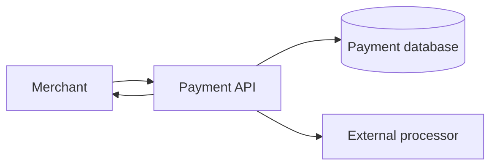
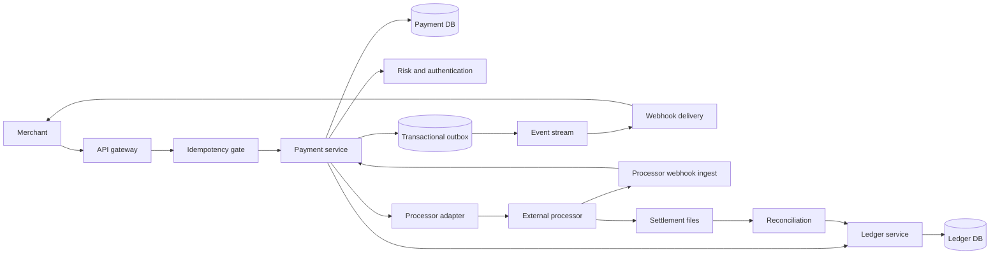
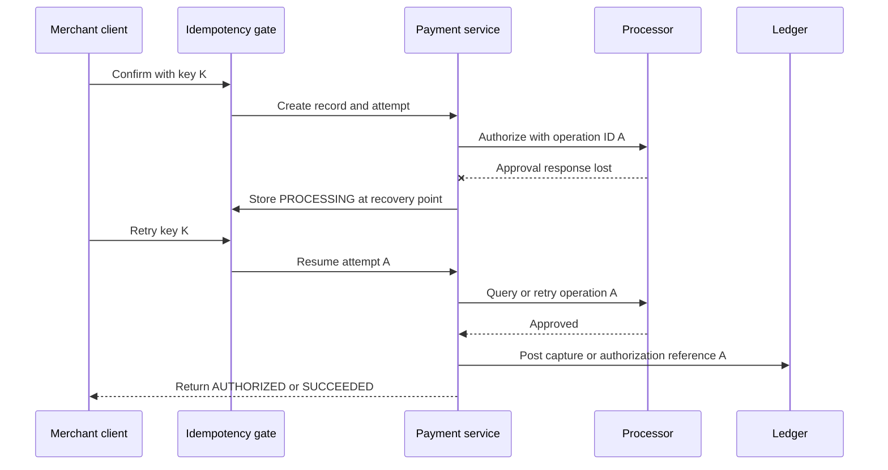
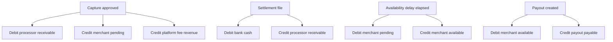
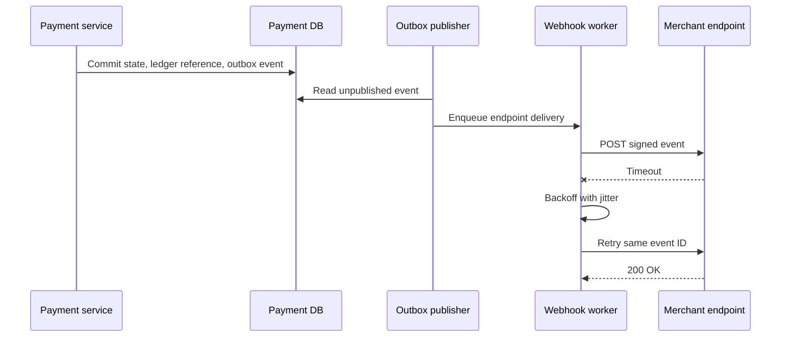

# Payment System Design

A payment system lets merchants create payment attempts, charge or authorize a customer through external rails, move the resulting money through an auditable ledger, and notify merchants when state changes. This design covers payment intents, authorization, capture, refund, payout accounting, webhooks, and reconciliation; it deliberately excludes card-network implementation, wallet UX, foreign-exchange trading, and a full ERP.

## 1. Requirements

### 1.1 Functional requirements

- Let merchants create, confirm, capture, cancel, and refund payment intents for card or bank-based payment methods.
- Support automatic capture, manual capture, partial capture, off-session retries, and processor-required customer actions such as 3-D Secure.
- Route operations through one or more external processors while exposing stable internal payment states and error categories.
- Maintain merchant balances, fees, reserves, refunds, disputes, and payouts in an immutable double-entry ledger.
- Deliver signed webhooks and query APIs so merchants can learn asynchronous state changes and replay missed events.
- Ingest processor events, settlement files, and bank statements to reconcile every external movement with internal records.

### 1.2 Non-functional requirements

- **Exactly-once financial effect.** Clients, workers, processors, and webhooks will retry, but one business operation must not charge, refund, or pay out twice.
- **Auditable money movement.** Every accepted movement needs balanced postings, immutable history, reversals instead of edits, and enough references to explain it years later.
- **Explicit uncertainty.** A processor timeout is not a decline; the system must represent in-doubt operations until the external outcome is discovered.
- **Low-latency admission.** The synchronous API should validate, persist intent, and either finish the processor call or return a processing state quickly, because merchants block checkout on it.
- **Tenant and currency isolation.** Merchant data, idempotency keys, tokens, ledger accounts, and balances must be scoped so one tenant or currency cannot leak into another.
- **Recoverable asynchronous delivery.** Webhooks, settlement ingestion, and reconciliation can lag, but they must be replayable, deduplicated, and observable.

### 1.3 The binding constraint

The binding constraint is that the system moves real money through external processors that cannot join our database transaction and often fail ambiguously. We can atomically update our payment row and ledger, or we can send a network request to a processor, but we cannot commit both in one serializable transaction. A timeout after an authorization request might mean no one saw it, the processor approved it, or the approval committed and only the response was lost.

That constraint forces the architecture. We need scoped idempotency so client retries do not create new operations, recovery points so a retry resumes after the last completed step, stable processor operation IDs so external retries refer to the same side effect, a double-entry ledger so internal money effects are deterministic, an outbox so notifications follow committed state, and reconciliation so processor settlement becomes the final external check.

## 2. Back-of-the-envelope estimation

Assume, illustratively, `100M` payment attempts per day. The average attempt rate is `100,000,000 / 86,400 = 1,157.4` attempts per second, so normal traffic is not hard for a sharded transactional service. Peak traffic matters more: if checkout traffic reaches roughly `10x` average during sales or regional evenings, the admission path sees about `11,574` attempts per second. That number pushes idempotency, payment-intent writes, and processor-adapter queues onto horizontally partitioned stores; it does not justify holding locks while waiting on external networks.

If `70%` of attempts eventually succeed and each successful lifecycle emits about `20` ledger postings across authorization, capture, fee, pending-to-available transfer, reserve, refund, dispute, settlement, and payout bookkeeping, postings are `100M × 0.70 × 20 = 1.4B` per day. At an illustrative `500` bytes per posting before indexes, that is `700GB` of raw postings per day, or `700GB × 365 × 7 = 1.79PB` over seven years before compression and replicas. The consequence is that the ledger must be append-only, partitioned, and tiered; reporting copies should be fed by change data capture instead of scanning primaries.

Webhooks are smaller but burstier. If each successful payment emits two merchant-visible events on average, the system emits `70M × 2 = 140M` events per day, or `1,620` events per second on average. A single merchant outage can turn that into retry storms, so webhook delivery needs bounded queues, exponential backoff with jitter, and replay tooling rather than synchronous delivery from the payment transaction.

Stored payment credentials are numerous but not latency critical. If `5M` merchants store `500M` tokens, the token vault and metadata store optimize for PCI isolation, key rotation, and read availability. They should not sit in the hot ledger transaction, and webhook payloads should never include reusable payment credentials.

> **Key idea.** The attempt rate can be handled with sharding, but the ledger volume and retry amplification shape the design: append-only storage, partitioned hot accounts, asynchronous delivery, and explicit recovery from ambiguous external calls.

## 3. API design

**Question.** What makes a merchant retry safe when the first response disappeared after a processor may already have charged the customer?
<details><summary>Answer</summary>

The API must bind the retry to the same merchant, endpoint, normalized request body, internal operation, and processor operation ID. The retry returns the stored result or resumes from a recovery point; it must not create a fresh processor call merely because the first HTTP response was lost.

</details>

```http
POST /v1/payment_intents
Idempotency-Key: ik_merchant_generated
{
  "amount": 4999,
  "currency": "USD",
  "payment_method": "pm_123",
  "capture_method": "manual",
  "merchant_order_id": "order-42"
}

POST /v1/payment_intents/{payment_intent_id}/confirm
Idempotency-Key: ik_confirm_123
{
  "return_url": "https://merchant.example/return"
}

POST /v1/payment_intents/{payment_intent_id}/capture
Idempotency-Key: ik_capture_123
{
  "amount_to_capture": 4500
}

POST /v1/refunds
Idempotency-Key: ik_refund_123
{
  "payment_intent_id": "pi_91",
  "amount": 1200,
  "reason": "requested_by_customer"
}

POST /v1/payment_intents/{payment_intent_id}/cancel
Idempotency-Key: ik_cancel_123

GET /v1/payment_intents/{payment_intent_id}
GET /v1/balance_transactions?cursor=bt_123&limit=100
POST /v1/webhook_endpoints
```

The create and mutate endpoints accept merchant-provided idempotency keys. The key is not global; it is scoped to `(merchant_id, endpoint, idempotency_key, normalized_body_hash)`. If the same key and body arrive again, the service returns the original response, including a `PROCESSING` response if the operation is still in doubt. If the key is reused with a different body, the service returns a conflict because replaying a different amount under a reused key is more dangerous than making the merchant choose a new key.

The response model must admit asynchronous truth. A confirm call can return `200` with `AUTHORIZED`, `200` with `REQUIRES_ACTION`, or `202` with `PROCESSING` and a status resource. The merchant can poll `GET /payment_intents/{id}`, but the primary asynchronous mechanism is a signed webhook. Cursor pagination is used for balance transactions because offsets are unstable on an append-only stream. Cancel semantics are guarded by state: canceling before the processor request is sent is local, canceling an authorization may become a void request, and canceling after capture must become a refund. The API should expose that distinction instead of promising impossible synchronous cancellation.

## 4. Data model

Start with the obvious entity: `PaymentIntent` stores the merchant, amount, currency, capture method, and current status. That works until a customer retries authentication, a merchant uses a new card after a decline, or an adapter must query a processor by operation. The intent is the merchant-facing object, not the external attempt, so we add `PaymentAttempt` with a stable `processor_operation_id`, processor reference, authentication state, and recovery point.

A payment row still cannot explain where the money went. Updating `captured_amount` on the intent may prevent over-capture, but it cannot represent fees, reserves, processor receivables, pending balances, available balances, payouts, chargeback fees, or settlement adjustments. The system therefore needs ledger accounts, ledger transactions, and postings. Every ledger transaction balances debits and credits per currency; historical mistakes are reversed with linked transactions rather than edited.

Idempotency also deserves its own durable record. A cache would lose the exact boundary we need during a retry storm or failover. The `IdempotencyRecord` stores the request scope, body hash, response snapshot when available, status, locked operation ID, and recovery point. Airbnb's published payment idempotency work is a useful production analogue: they store recovery points so a repeated call continues the distributed workflow instead of replaying side effects.

Finally, asynchronous integrations require first-class records. `OutboxEvent` is created in the same local transaction as the state change it describes. `WebhookDelivery` tracks endpoint-specific delivery attempts. `ReconciliationFile` and `ReconciliationRow` store immutable processor settlement inputs and matching results so operations teams can resolve aged discrepancies without changing history.

```text
PaymentIntent
- payment_intent_id, merchant_id, amount_minor, currency
- capture_method: AUTOMATIC | MANUAL
- status: REQUIRES_PAYMENT_METHOD | REQUIRES_CONFIRMATION | REQUIRES_ACTION | PROCESSING | AUTHORIZED | PARTIALLY_CAPTURED | SUCCEEDED | CANCELED | FAILED
- payment_method_token, authorized_amount_minor, captured_amount_minor, refunded_amount_minor
- version, created_at, updated_at

PaymentAttempt
- attempt_id, payment_intent_id, merchant_id, processor
- processor_operation_id, processor_reference, status
- authentication_state, requested_amount_minor, currency
- recovery_point, last_processor_request_hash, failure_code
- created_at, updated_at

IdempotencyRecord
- merchant_id, endpoint, idempotency_key, normalized_body_hash
- operation_type, operation_id, status, recovery_point
- response_code, response_body, expires_at, created_at, updated_at

LedgerAccount
- account_id, legal_entity_id, owner_type, owner_id
- account_type: PROCESSOR_RECEIVABLE | MERCHANT_PENDING | MERCHANT_AVAILABLE | PLATFORM_FEE_REVENUE | RESERVE | PAYOUT_PAYABLE | BANK_CASH
- currency, partition_key, status

LedgerTransaction
- ledger_transaction_id, business_reference_type, business_reference_id
- effective_at, created_at, reversal_of, idempotency_key

LedgerPosting
- ledger_transaction_id, account_id, direction: DEBIT | CREDIT
- amount_minor, currency, account_sequence

OutboxEvent
- event_id, aggregate_type, aggregate_id, aggregate_version
- event_type, payload, created_at, published_at

WebhookDelivery
- delivery_id, event_id, endpoint_id, attempt_count
- next_attempt_at, state, last_response_code

ReconciliationFile
- file_id, processor, settlement_date, sequence, checksum, object_uri, status

ReconciliationRow
- row_id, file_id, processor_reference, amount_minor, currency
- row_type, matched_reference, match_status, resolution_state
```

Payment workflow state lives in a strongly consistent transactional store partitioned by merchant and payment ID. Ledger transactions and postings live in a ledger service with serializable writes within an account partition or balancing boundary. Raw processor payloads and settlement files live in encrypted, restricted object storage; they are referenced from transactional rows but not duplicated into merchant-facing tables. Analytical reporting receives CDC copies because unbounded queries must not compete with payment admission.

> **Key idea.** The payment intent answers "what is the checkout doing?" while the ledger answers "where did the money move?" Keeping those models separate avoids rewriting history when workflow state changes.

## 5. High-level design

The simplest design is a payment service that writes a payment row, calls a processor, updates status, and returns the result. For a small prototype with one processor and no retries, it is attractive because the merchant sees a single synchronous answer.



It breaks in concrete ways. If the processor approves but the API times out, a client retry can create a second charge. If the database update succeeds but the webhook publish fails, merchants miss state changes. If balances are mutable columns, a refund race can overdraw captured funds or hide fee and reserve movements. If settlement files disagree with processor callbacks, there is no independent financial truth. If a platform-wide receivable account receives every posting, it becomes a hot row at peak.

### Fix 1: Scoped idempotency with recovery points

The API gateway and payment service first acquire or create an `IdempotencyRecord`. The record stores the normalized body hash, operation ID, recovery point, and final response. A retry either returns the saved result or resumes the same operation. This follows the same lesson Stripe emphasizes in its idempotency guidance: network failures are ambiguous, so the server must make retries predictable rather than relying on clients to infer what happened.

### Fix 2: Stable attempts and processor operation IDs

Before any network I/O, the service creates a `PaymentAttempt` with a stable `processor_operation_id`. Processor adapters pass that ID as the processor's idempotency key when supported. When a call times out, the attempt moves to `PROCESSING` or `UNKNOWN`, and recovery workers query the processor by reference or retry the same operation ID according to that adapter's safety rules. The system does not fail over an in-doubt authorization to a second processor unless it first proves the original operation did not take effect.

### Fix 3: Ledger service as the source of economic truth

Payment state transitions are not sufficient for money. The ledger service accepts balanced journal entries with unique business references such as `(capture, attempt_id)` or `(refund, refund_id)`. It rejects unbalanced entries, duplicate business references, currency mismatches within a balancing group, and postings that violate guarded balance constraints. Square's Books and Stripe's Ledger both point to the same production lesson: a shared, immutable double-entry primitive lets many products use one auditable money model rather than inventing product-specific settlement tables.

### Fix 4: Transactional outbox for merchant events

Payment and ledger state changes insert outbox events in the same local transaction as the aggregate update. Publishers read the outbox, write to an event stream, and delivery workers create endpoint-specific webhook attempts. The webhook system is at-least-once by design. Merchants deduplicate by event ID and fetch current object state when ordering matters.

### Fix 5: Reconciliation and hot-account partitioning

Processor webhooks are useful but not final enough. Settlement files and bank statements are ingested as immutable inputs, parsed idempotently, and matched against attempts and ledger references. Discrepancies become owned work items. At the same time, ledger accounts that aggregate platform money are partitioned by currency, processor, cohort, or time bucket. Modern Treasury and Uber's Gulfstream both describe hot financial accounts as a real scaling limit; the design must shard the accounts that receive every capture, fee, or payout movement.

### Putting it together



A confirm request enters through the idempotency gate. The payment service creates or resumes a `PaymentAttempt`, runs risk and authentication checks, and calls the selected processor with the stable operation ID. If the outcome is definitive, it conditionally advances the `PaymentIntent`, posts ledger entries through the ledger service, and writes an outbox event. If the outcome is unknown, it persists `PROCESSING` and lets recovery and reconciliation close the loop. Processor webhooks and settlement files do not bypass the model; they drive the same guarded transitions and idempotent ledger references.

> **Key idea.** Each component traces back to a specific failure of the naive design.

## 6. Deep dives

### 6.1 Idempotency, unknown outcomes, and recovery points

**Question.** The processor authorization request times out after five seconds. The merchant retries immediately with the same idempotency key. What state is the payment in, and what should the retry do?
<details><summary>Answer</summary>

The payment is in an in-doubt state such as `PROCESSING`, tied to the original attempt and processor operation ID. The retry must not create a new authorization; it should return the saved in-doubt response or resume recovery by querying or retrying the same processor operation according to adapter rules.

</details>

The naive approach treats timeout as failure. It writes `FAILED`, returns an error, and lets the merchant retry from scratch. That is exactly how duplicate charges happen. The timeout tells us only that our process stopped waiting; it says nothing about whether the processor received, authorized, committed, and later tried to respond. A second call with a new processor operation ID is a new money-moving request.

The robust flow starts before network I/O. The service creates an idempotency record and payment attempt in one local transaction. The attempt contains a stable processor operation ID, chosen route, request hash, and recovery point such as `attempt_created`. Only then does the adapter call the processor. If the processor supports idempotency keys, the adapter sends the operation ID. If it returns approval, the recovery point advances to `processor_authorized`; the service then commits the payment state and ledger posting with unique business references. If the process crashes after external approval but before ledger posting, the next retry sees `processor_authorized` and continues with ledger finalization rather than calling the processor again.



Airbnb's payment idempotency framework maps directly onto this problem. Their lesson is that a distributed payment call is not one function; it is a workflow with recovery points. A retry after `risk_checked` should not repeat a non-idempotent risk hold if that matters; a retry after `processor_authorized` should not call authorize again; a retry after `ledger_posted` should only return the stored response and publish any missing outbox event.

Stripe's public idempotency design also matters because it frames idempotency as an API contract rather than a best-effort cache. The system must store the first executed result and replay it. It should also reject key reuse with different parameters. Otherwise a merchant bug could send the same key for `$49.99` and `$499.99`, and the payment provider would have to guess which amount the key means.

There are edge cases. Some processors do not provide a strong idempotency primitive or query-by-operation endpoint. In that case the adapter must mark the attempt as more dangerous: serialize operations per payment method or intent, wait for webhook or settlement evidence before retrying, and potentially require manual resolution after a threshold. Another edge is failover. Routing an in-doubt authorization from Processor A to Processor B improves apparent availability but can double-charge. Safe failover is easiest before the first external request, after a definitive decline, or after a void/refund workflow has neutralized the original approval.

The state machine should distinguish `FAILED` from `PROCESSING`. A decline, invalid card, or expired authorization can be terminal. A timeout, worker crash, or missing webhook is uncertainty. Merchant-facing APIs can still be friendly: return `202`, an explanatory status, and webhooks when the outcome becomes known. Internally, the important invariant is that every retry references the same operation until the system proves the old operation is impossible or resolved.

Signals worth watching: age and count of `PROCESSING` attempts, retries per idempotency key, duplicate-key conflicts, adapter timeout rate, recovery-point distribution, and operations manually resolved after missing processor evidence.

> **Strong-answer criteria.** A senior answer must say that a timeout is an unknown outcome, not a failure, and must tie retries to durable idempotency records, stable external operation IDs, recovery points, and reconciliation.

| Level | Approach | Why |
|---|---|---|
| Bad | Treat timeout as failed and let the client retry normally. | It can create a second external authorization after the first one actually succeeded. |
| Good | Store idempotency keys and replay the same API response. | It protects client retries but may still be incomplete if the workflow crashes between external approval and ledger finalization. |
| Great | Store recovery points, stable processor operation IDs, guarded state transitions, and reconciliation paths. | It makes each retry resume the original money-moving workflow and exposes uncertainty until external truth is known. |

### 6.2 Double-entry ledger, hot accounts, and balance derivation

**Question.** Why not keep `available_balance` as a column on the merchant row and update it whenever a payment captures or refunds?
<details><summary>Answer</summary>

A mutable balance column cannot explain history, prove that debits equal credits, represent pending versus available funds, or survive concurrent refunds and payouts safely. Use an immutable double-entry ledger with guarded balance snapshots derived from postings.

</details>

A mutable balance feels simple because many product questions ask for one number: how much can the merchant withdraw? The trouble is that payment money has several simultaneous interpretations. A `$100.00` capture may create a processor receivable, a `$97.00` merchant pending balance, and a `$3.00` platform fee. Settlement later turns the receivable into bank cash. A risk delay moves pending to available. A payout moves available to payout payable, then to cash leaving the platform bank account. A refund reverses part of the merchant's economics but may not settle externally on the same day. One balance column cannot preserve those facts.

The ledger records journal entries with postings. For a `$100.00` capture and `$3.00` fee, using fixed-point minor units, the transaction is balanced in USD: debit `ProcessorReceivable` `10000`, credit `MerchantPending` `9700`, and credit `PlatformFeeRevenue` `300`. When settlement arrives, debit `PlatformBankCash` and credit `ProcessorReceivable`. When funds become available, debit `MerchantPending` and credit `MerchantAvailable`. A payout first debits `MerchantAvailable` and credits `PayoutPayable`; the bank transfer later debits `PayoutPayable` and credits `PlatformBankCash`.



Ledger writes must be serializable within the affected account boundary. Each transaction has a unique business reference, such as `(capture, attempt_id)`, so a recovery worker can safely submit the same journal again and get a duplicate-reference no-op. The ledger rejects any transaction where debits and credits do not sum to zero per currency. FX is not hidden inside rounding; it uses explicit bridge accounts and rates so the books remain explainable.

Balances are derived from postings, but deriving by scanning billions of rows is too slow for checkout and payout decisions. The practical design maintains transactional balance snapshots or account sequences alongside immutable postings. A write appends postings and updates snapshots in the same serializable transaction. Reads of merchant available balance can use the snapshot, while reconciliation jobs continuously recompute from postings and compare. If a snapshot drifts, postings win.

The hard scaling problem is hot accounts. Merchant accounts partition naturally because each merchant's available balance changes with that merchant's traffic. Platform accounts do not. `ProcessorReceivable:USD` or `PlatformBankCash:USD` might receive every capture in a region. Modern Treasury's ledgers work calls this out as a first-class high-throughput problem, and Uber's Gulfstream describes the same pressure on hot financial accounts. The fix is not to weaken consistency on one row; it is to choose account partitions that preserve accounting meaning while spreading writes: by processor, currency, legal entity, merchant cohort, or time bucket. Roll-up accounts and control reports can aggregate partitions asynchronously.

There is also a concurrency boundary. Two refunds racing against the same captured amount must not both observe the old refundable balance and pass. The payment service can guard counters with `WHERE refunded_amount + :amount <= captured_amount`, but the ledger should also enforce available-balance constraints for accounts that cannot go negative. For payouts, moving funds from `MerchantAvailable` to `PayoutPayable` is the reservation; the bank file is generated from payout-payable entries, not from a stale merchant balance read.

Stripe's Ledger article emphasizes completeness and timeliness checks, not just double-entry arithmetic. That matters because a balanced ledger can still be wrong if a producer never posted the capture or posted it late. The ledger therefore exposes control queries: aged nonzero clearing accounts, missing expected transitions by reference ID, and settlement rows unmatched to ledger transactions. Square's Books reinforces the organizational pattern: make the ledger a shared primitive with product-neutral semantics, so refunds, disputes, subscriptions, and payouts all use the same correctness machinery.

Signals worth watching: ledger write latency by hot account partition, duplicate business-reference rate, rejected imbalance attempts, balance-snapshot drift, aged clearing balances, and payout reservations blocked by insufficient available funds.

> **Strong-answer criteria.** A senior answer must separate workflow state from economic truth, use immutable balanced postings, explain balance snapshots as derived optimizations, and address hot accounts without giving up serializable money movement.

| Level | Approach | Why |
|---|---|---|
| Bad | Update merchant balance columns directly. | It loses audit history, hides fund-flow stages, and races under refunds and payouts. |
| Good | Add append-only transactions and compute balances from them. | It improves auditability but can be too slow and can still bottleneck on shared accounts. |
| Great | Use double-entry postings, unique business references, transactional snapshots, partitioned hot accounts, and clearing-account reconciliation. | It preserves correctness while scaling reads and writes. |

### 6.3 Reconciliation, webhooks, and the outbox boundary

**Question.** The database commit for a successful capture succeeds, but publishing the merchant webhook fails. Separately, the processor's settlement file later shows a fee that differs from the callback. Which system is authoritative?
<details><summary>Answer</summary>

Committed internal state and ledger entries are authoritative for the merchant-facing workflow, and the transactional outbox guarantees eventual notification. Processor settlement files are authoritative evidence for external clearing and fees, so reconciliation posts adjustments or quarantines mismatches without rewriting history.

</details>

The naive design publishes webhooks inline after the payment update. That loses events whenever the process crashes between commit and publish. It also tempts the system to treat webhooks as the source of truth: if the merchant got the callback, the payment must be done. In a payment system, notifications are downstream of committed state. They are important, but they are not the transaction boundary.

The outbox pattern draws the boundary. When the payment service transitions an intent to `SUCCEEDED` or `AUTHORIZED`, it writes the payment update, ledger reference, and `OutboxEvent` in the same database transaction. A publisher later reads unpublished rows and sends them to an event stream. Delivery workers create one `WebhookDelivery` per subscribed endpoint, sign the raw payload with the endpoint secret, and POST it. Any documented `2xx` acknowledges that delivery. Timeouts and non-`2xx` responses retry with exponential backoff and jitter. Delivery is at-least-once, so merchants deduplicate by event ID and fetch current state if they need ordering.



Out-of-order delivery is normal. A refund event can arrive before the capture event at a slow endpoint if retries differ. The payload should include object ID, event ID, creation time, aggregate version, and a compact snapshot, but merchants should treat `GET /payment_intents/{id}` as the current view. The system can offer event replay and secret rotation with overlap windows. It must not include raw card data or reusable client secrets in events.

Reconciliation is the second half of the same story. Processor callbacks are operationally useful, but settlement files are the external accounting evidence for what cleared, which fees applied, and what cash should arrive. The reconciliation pipeline stores the original file in write-once object storage, verifies signature or checksum and sequence, parses rows idempotently into staging, and matches each row by processor reference, amount, currency, and date window. Matched rows post settlement ledger transactions such as `ProcessorReceivable` to `BankCash`. Fee differences become explicit fee-adjustment postings. Unmatched or mismatched rows are quarantined with owner, age, amount, and resolution state.

This is where Stripe Ledger's completeness and clearing checks become concrete. It is not enough that every posted journal balances. The system must ask whether every approved capture produced the expected settlement row, whether processor receivables clear within the expected number of days, whether settlement totals equal control-account movements, and whether bank deposits equal processor net settlement after fees and reserves. A balanced but uncleared receivable is a real discrepancy.

Shopify's resilience guidance also fits here: queues, low timeouts, realistic load tests, and backpressure matter because webhook and reconciliation pipelines see burst behavior. A large merchant outage can produce millions of retries. A delayed processor file can cause a next-day reconciliation surge. Bounded queues and explicit lag metrics prevent asynchronous systems from silently becoming correctness gaps.

There are alternatives. Some systems make merchants poll only, avoiding webhook delivery complexity. That can work for internal clients but is poor for broad merchant integrations because it shifts retry storms to read APIs and delays fulfillment. Some systems treat processor webhooks as authoritative and skip settlement reconciliation. That is acceptable only for toy flows; real processors send adjustments, fees, reserves, disputes, and corrections through settlement reports that callbacks do not fully capture.

Signals worth watching: outbox age, event-stream lag, webhook delivery backlog by merchant, duplicate event acknowledgments, settlement file lateness, unmatched row count and value, aged processor receivables, and bank cash differences.

> **Strong-answer criteria.** A senior answer must define the local transaction boundary, use an outbox for at-least-once notifications, make webhooks idempotent, and treat settlement reconciliation as a core correctness path rather than an operations afterthought.

| Level | Approach | Why |
|---|---|---|
| Bad | Publish webhooks inline and trust callbacks for accounting. | Crashes lose notifications, duplicate deliveries confuse merchants, and settlement differences are invisible. |
| Good | Use an outbox and retry webhook delivery. | It fixes notification loss but may still miss external clearing and fee discrepancies. |
| Great | Combine outbox delivery with immutable settlement ingestion, idempotent matching, ledger adjustments, and aged discrepancy ownership. | It makes asynchronous notification and external financial truth recoverable. |

## 7. Variants

**10x scale.** At `1B` attempts per day, average admission becomes `11,574` attempts per second and a `10x` peak is roughly `115,740` attempts per second. The core design stays the same, but partitions become mandatory everywhere: idempotency by merchant hash, payment state by home shard, ledger accounts split by legal entity/currency/processor/cohort, outbox streams by aggregate ID, and reconciliation workers by processor file and row ranges. The design should also separate synchronous authorization capacity from slower reporting and webhook backlogs with strict queue limits.

**Multi-region active-active.** The safe default is merchant or payment home-region ownership. Stateless APIs can run globally, but writes for one payment and its ledger boundary route to the home region. True active-active writes to the same payment make idempotency, capture limits, and account ordering much harder. If regulatory or latency requirements demand regional ledgers, use independent legal-entity ledgers and explicit intercompany settlement rather than a single global balance row.

**New payment method with delayed finality.** Bank debit or buy-now-pay-later rails may authorize quickly but settle or fail days later. The `PaymentIntent` state machine gains rail-specific pending and return states, but the pattern remains: explicit uncertainty, ledger entries for pending receivables and reserves, webhooks for state changes, and reconciliation against rail settlement files. Merchant availability policies may delay funds until return windows expire.

**High-risk merchant or reserve requirement.** The ledger absorbs this without changing processor adapters. Capture credits `MerchantPending`, availability rules move only part to `MerchantAvailable`, and the rest moves to `Reserve`. Disputes debit reserve first according to policy. The API exposes balance components so the merchant understands why captured revenue is not fully payable.

## 8. The transferable pattern

The reusable shape is a local system coordinating with an external side-effecting system that cannot participate in the local transaction. The answer is not magical exactly-once delivery; it is durable intent, idempotent operation identity, explicit in-doubt states, recovery points, immutable effects, and reconciliation against an independent source of truth. The same pattern appears in ticket purchase flows, inventory reservations, email delivery, and bank transfers. A design like [Ticketmaster](./ticketmaster-system-design.md) has a related reservation problem: a timeout cannot simply release or double-sell a scarce seat without checking the durable reservation state.

The second transferable pattern is separating workflow from accounting. Product state answers what the user is trying to do; ledger state answers what value moved. Systems that keep those in one mutable row become brittle when refunds, reversals, fees, payouts, or audits arrive. Append-only facts plus derived projections are a broader pattern used in finance, fulfillment, and event-driven systems whenever history matters more than overwriting the latest value.

## Review

The design starts from the fact that payment processors are outside our transaction boundary and can time out after moving money. That makes retry safety the central problem: scoped idempotency records, stable processor operation IDs, and recovery points prevent duplicate charges while preserving explicit `PROCESSING` states. Payment workflow tables model customer and merchant state, while an immutable double-entry ledger models economic truth with balanced postings, unique business references, derived balances, and hot-account partitioning. Transactional outbox delivery makes merchant notifications recoverable, and reconciliation against settlement files and bank statements closes the gap between internal state and external clearing. The system accepts that exactly-once messaging is unrealistic and instead builds exactly-once financial effect from idempotency, guarded transitions, ledger invariants, and reconciliation.

### Check your understanding

1. Why is a processor timeout different from a decline?
   <details><summary>Answer</summary>

   A decline is a definitive external outcome. A timeout only means the local service stopped waiting; the processor may still have approved and committed the operation. The system must keep an in-doubt state and resolve it with the same operation ID.

   </details>

2. Why scope idempotency keys by merchant, endpoint, and request body hash?
   <details><summary>Answer</summary>

   The same raw key from two merchants should not collide, different endpoints have different semantics, and reusing a key with a different amount or currency should be rejected rather than silently replayed.

   </details>

3. Why is the ledger separate from `PaymentIntent` status?
   <details><summary>Answer</summary>

   Payment status describes workflow, while the ledger records economic movements such as receivables, fees, reserves, available balance, payouts, and reversals. Combining them loses auditability and makes later adjustments rewrite history.

   </details>

4. What problem does the transactional outbox solve?
   <details><summary>Answer</summary>

   It ensures a committed state change has a durable event to publish even if the process crashes before sending a webhook or event-stream message. Delivery can then be retried at least once.

   </details>

5. Why are settlement files needed if processor webhooks already arrive?
   <details><summary>Answer</summary>

   Webhooks report operational state, but settlement files and bank statements show what actually cleared, which fees and reserves applied, and what cash moved. Reconciliation catches missing, mismatched, or adjusted external movements.

   </details>

## Sources and further reading

| Source | Article | Why it matters |
|---|---|---|
| Stripe | [Designing robust and predictable APIs with idempotency](https://stripe.com/blog/idempotency) | Explains ambiguous network failures, idempotency keys, replayed results, and backoff for safe payment retries. |
| Airbnb | [Avoiding double payments in a distributed payments system](https://medium.com/airbnb-engineering/avoiding-double-payments-in-a-distributed-payments-system-2981f6b070bb) | Shows a recovery-point idempotency framework for exactly-once effects across payment microservices. |
| Stripe | [Ledger: Stripe's system for tracking and validating money movement](https://stripe.com/blog/ledger-stripe-system-for-tracking-and-validating-money-movement) | Describes immutable fund-flow modeling, clearing/timeliness/completeness checks, and data-quality tooling at payment scale. |
| Square | [Books, an immutable double-entry accounting database service](https://developer.squareup.com/blog/books-an-immutable-double-entry-accounting-database-service/) | Details why Square built a shared double-entry ledger database for settlements, payouts, consistency, and auditability. |
| Modern Treasury | [Behind the Scenes: How We Built Ledgers for High Throughput](https://www.moderntreasury.com/journal/behind-the-scenes-how-we-built-ledgers-for-high-throughput) | Covers hot-account bottlenecks, balance caching, and making double-entry ledger writes fast enough for critical paths. |
| Uber | [Building High Throughput Payment Account Processing](https://www.uber.com/us/en/blog/high-throughput-processing/) | Explains how Uber handles bursty hot financial accounts while preserving strict consistency in Gulfstream. |
| Shopify | [10 Tips for Building Resilient Payment Systems](https://shopify.engineering/building-resilient-payment-systems) | Practical payment resilience advice on low timeouts, queues, retries, observability, and realistic load testing. |
| Stripe | [Online migrations at scale](https://stripe.com/blog/online-migrations) | Gives a dual-write/backfill/read-switch pattern for evolving payment schemas without downtime or data divergence. |
| Airbnb | [Rebuilding Payment Orchestration at Airbnb](https://medium.com/airbnb-engineering/rebuilding-payment-orchestration-at-airbnb-341d194a781b) | Shows how Airbnb decoupled reusable payment orchestration from product-specific booking flows during SOA migration. |
