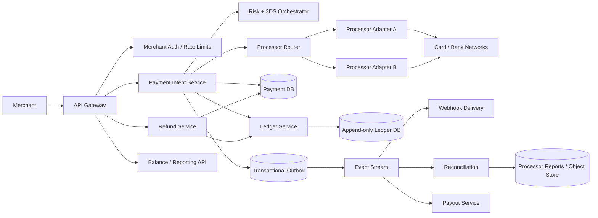

# Payment System

## 1. Requirements

### Functional requirements

1. Let merchants create payment intents and accept card or bank-based payments.
2. Support authorization, capture, partial capture, void, refund, and recurring/off-session payment.
3. Route transactions to external processors/acquirers and handle asynchronous status updates.
4. Maintain an immutable double-entry ledger for merchant balances, fees, refunds, and payouts.
5. Provide idempotent APIs, webhooks, reconciliation, disputes, and settlement reports.
6. Tokenize payment methods and avoid exposing sensitive credentials to merchants.
7. Support multiple currencies without implicit conversion.
8. Provide risk checks, authentication challenges, and merchant-level controls.

Out of scope: implementing card-network rails, consumer wallet UI, foreign-exchange trading, and a full accounting ERP.

### Non-functional requirements

- Never double-charge because of a retry.
- Every accepted monetary movement is auditable and ledger-balanced.
- `99.99%` API availability; payment creation `p99` below 1 second excluding external challenge time.
- Correct behavior under processor timeouts and duplicate/out-of-order webhooks.
- Strong tenant isolation, PCI DSS controls, and encrypted sensitive data.
- Recoverable from regional failure with explicit RPO/RTO.
- Merchant notifications are at-least-once and verifiable.

## 2. Scale assumptions and capacity

- 5 million merchants; 500 million stored payment-method tokens.
- 100 million payment attempts/day.
- Average: about 1,160 attempts/second; peak: 10,000/second.
- 70% authorize-and-capture, 20% separate capture, 10% failed/abandoned.
- 20 ledger entries per successful lifecycle on average.
- About 2 billion ledger postings/day including reserves, fees, refunds, and payouts.
- 10 million webhook deliveries/day, with retry bursts during merchant outages.
- Seven-year financial retention, requiring tiered immutable storage and partitioned reporting.

Money uses integer minor units plus an ISO currency. Currencies with unusual exponents require currency metadata; never use binary floating point.

## 3. High-level architecture



The payment state machine records product workflow. The ledger records economic truth. External processors are independent systems that can time out, duplicate callbacks, or disagree temporarily; reconciliation closes those gaps.

## 4. Data model

```text
PaymentIntent
- payment_intent_id
- merchant_id
- amount
- currency
- capture_method: AUTOMATIC | MANUAL
- status
- payment_method_token
- idempotency_key
- version
- created_at

PaymentAttempt
- attempt_id
- payment_intent_id
- processor
- processor_operation_id
- status
- authentication_state
- requested_amount
- processor_reference
- failure_code
- created_at

Refund
- refund_id
- payment_intent_id
- amount
- status
- processor_operation_id
- idempotency_key

LedgerAccount
- account_id
- owner_type
- owner_id
- currency
- account_type

LedgerTransaction
- ledger_transaction_id
- reference_type
- reference_id
- effective_at
- created_at
- reversal_of

LedgerPosting
- ledger_transaction_id
- account_id
- direction: DEBIT | CREDIT
- amount
- currency
- sequence

WebhookEndpoint
- endpoint_id
- merchant_id
- url
- signing_secret_version
- enabled

WebhookDelivery
- delivery_id
- event_id
- endpoint_id
- attempt_count
- next_attempt_at
- state
```

Enforce:

```text
for every ledger transaction and currency:
sum(debits) = sum(credits)
```

Never update or delete ledger postings. Correct mistakes with linked reversal and replacement transactions.

## 5. Core APIs

### Create a payment intent

```http
POST /v1/payment_intents
Idempotency-Key: 0e7d...

{
  "amount": 4999,
  "currency": "USD",
  "payment_method": "pm_tok_123",
  "capture_method": "manual",
  "merchant_order_id": "order-42"
}
```

```json
{
  "id": "pi_91",
  "status": "requires_confirmation",
  "amount": 4999,
  "currency": "USD",
  "client_secret": "short_lived_secret"
}
```

### Confirm and capture

```http
POST /v1/payment_intents/{id}/confirm
POST /v1/payment_intents/{id}/capture

{
  "amount_to_capture": 4500
}
```

### Refund

```http
POST /v1/refunds
Idempotency-Key: 782f...

{
  "payment_intent_id": "pi_91",
  "amount": 1200,
  "reason": "requested_by_customer"
}
```

Other important APIs:

```http
GET  /v1/payment_intents/{id}
POST /v1/payment_intents/{id}/cancel
GET  /v1/refunds/{id}
GET  /v1/balance
GET  /v1/balance_transactions?cursor=...
POST /v1/webhook_endpoints
```

Scope every idempotency key to merchant, endpoint, and normalized request body. Reusing a key with different parameters returns a conflict.

## 6. Payment state machine

A simplified lifecycle:

```text
REQUIRES_PAYMENT_METHOD
  -> REQUIRES_CONFIRMATION
  -> REQUIRES_ACTION
  -> PROCESSING
  -> AUTHORIZED
  -> PARTIALLY_CAPTURED
  -> SUCCEEDED

Terminal/alternate states:
CANCELLED | FAILED
```

Refunds and disputes are separate state machines; they do not rewrite a succeeded payment into a historical fiction.

Transitions use compare-and-swap on `version` and validate allowed source states. For example, capture is valid only from `AUTHORIZED` or `PARTIALLY_CAPTURED`, before authorization expiry, and total captures cannot exceed authorized amount.

## 7. Idempotent authorization and capture flow

1. Authenticate merchant and validate amount, currency, payment token, and request key.
2. Atomically create or retrieve the `PaymentIntent` by idempotency scope.
3. Run risk rules and, when required, return a 3-D Secure challenge.
4. Create a stable `PaymentAttempt` and processor operation ID before network I/O.
5. Send the operation through the chosen processor adapter.
6. If approved, conditionally advance payment state.
7. Post the corresponding balanced ledger transaction.
8. Insert an outbox event in the same local transaction where architecture permits.
9. Return authoritative state; webhooks notify asynchronous changes.

If the processor times out, status becomes `PROCESSING` or `UNKNOWN`, not `FAILED`. Retry/query using the same processor operation ID. Creating a new operation risks a duplicate charge.

For processors without native idempotency, serialize operations per payment attempt and reconcile before retrying. A timeout is an uncertainty to resolve, not evidence of failure.

## 8. Ledger design

Assume a $100 capture with a $3 platform fee:

```text
Debit  ProcessorReceivable:USD      $100
Credit MerchantPending:USD           $97
Credit PlatformFeeRevenue:USD         $3
```

When processor settlement arrives:

```text
Debit  PlatformBankCash:USD          $100
Credit ProcessorReceivable:USD       $100
```

When paying the merchant:

```text
Debit  MerchantAvailable:USD          $97
Credit MerchantPayoutsPayable:USD     $97
```

The exact chart of accounts depends on legal entity and fund flow, but every movement has balanced postings. Keep pending, available, reserve, fee, refund, dispute, processor receivable, bank cash, and payout payable accounts distinct.

Ledger writes require:

- A unique business reference such as `(operation_type, operation_id)`.
- Balanced postings in one serializable transaction.
- Monotonic per-account sequence or snapshot version.
- Immutable records and linked reversals.
- Currency equality within a balancing group; FX uses explicit bridge accounts and rates.

Balances are derived. Maintain transactional balance snapshots for fast reads, then continuously verify them against postings.

## 9. Processor abstraction and routing

Adapters translate the internal model to processor-specific APIs and normalize:

- Authorization/capture/refund operations.
- Error categories and retry safety.
- Authentication/challenge data.
- Webhook signatures and event types.
- Settlement and dispute reports.

Routing considers merchant configuration, card network, geography, currency, cost, approval rate, processor health, and data residency.

Do not automatically fail over an ambiguous authorization to another processor. First establish that the original processor did not charge. Safe failover is easiest before any external request or after a definitive decline.

Store raw processor payloads in restricted encrypted storage for audit, but expose stable internal error codes to merchants.

## 10. Webhooks and asynchronous events

The outbox atomically records an immutable merchant event when payment state changes. Delivery workers:

1. Create a delivery per subscribed endpoint.
2. Sign timestamp plus raw body with an endpoint secret.
3. POST with a stable event and delivery ID.
4. Treat any documented `2xx` as acknowledgment.
5. Retry with exponential backoff and jitter for hours or days.
6. Disable or alert on persistently failing endpoints.

Delivery is at-least-once and ordering is not guaranteed across endpoints. Include object version and event creation time. Merchants must deduplicate by event ID and fetch current object state when order matters.

Provide event replay and secret rotation with an overlap window. Never place card data or reusable client secrets in events.

## 11. Refunds, disputes, and payouts

Refund creation atomically reserves refundable amount so concurrent refunds cannot exceed captured funds. A processor refund may remain pending; the ledger records the correct pending liability and finalizes/reverses based on outcome.

Disputes:

- Debit merchant available balance or reserve according to policy.
- Track evidence deadlines and submission.
- Post separate ledger transactions for dispute amount and network fee.
- Reverse those entries if the merchant wins.

Payouts aggregate merchant available balances by currency and schedule. Create a payout snapshot, lock/transfer eligible funds to a payout-payable account, send one bank operation, then reconcile bank settlement. Failed payouts return funds through explicit reversal postings.

## 12. Reconciliation

Reconciliation is a primary correctness mechanism, not an afterthought.

### Transaction reconciliation

Compare internal attempts with processor API/events:

- Internal unknown, processor approved: finalize payment and ledger.
- Internal succeeded, processor missing: investigate; do not silently alter money.
- Duplicate processor operations: refund/void under controlled workflow.
- Amount/currency mismatch: quarantine and alert.

### Settlement reconciliation

Ingest signed processor settlement files:

1. Store the immutable original in object storage.
2. Verify checksum, signature, date, and sequence.
3. Parse idempotently into staging tables.
4. Match processor references to internal attempts.
5. Post settlement, fee, reserve, and adjustment ledger transactions.
6. Send unmatched or mismatched rows to an operations queue.

Also reconcile ledger control accounts against processor totals and bank statements daily. Every discrepancy has ownership, age, amount, and resolution audit.

## 13. Consistency and concurrency

Strong consistency is required for:

- Idempotency records.
- Payment state transitions.
- Capture/refund amount limits.
- Ledger transactions and balance snapshots.
- Payout fund reservation.

Use serializable transactions or row-level locking around a payment's monetary counters. Acquire locks in stable order. External network calls must not hold database locks; record the operation, call externally, then finalize conditionally.

Exactly-once end-to-end delivery is not realistic. Achieve exactly-once financial effect with unique business references, idempotent processor calls, conditional state transitions, balanced ledger transactions, and reconciliation.

## 14. Partitioning and storage

- Partition payment intents and attempts by `merchant_id` plus hashed payment ID, balancing tenant locality against hot merchants.
- Keep all mutable state for one payment on one database shard.
- Partition ledger postings by legal entity, currency, and account range; preserve atomic transactions within a balancing boundary.
- Maintain merchant balance/read projections separately from immutable postings.
- Partition event streams by payment ID for per-object ordering.
- Store reports and raw processor files in write-once object storage.
- Send analytical copies through CDC; never run unbounded reporting queries on payment primaries.

Moving ledger accounts between shards is complex. Choose partition boundaries from legal entity and currency requirements early, and use inter-partition clearing accounts for controlled cross-boundary movements.

## 15. Reliability and failure handling

| Failure | Handling |
|---|---|
| Client retries create/capture/refund | Scoped idempotency returns original operation |
| Processor times out | Mark unknown/processing; query by stable operation ID |
| Processor sends duplicate webhook | Unique processor event ID and idempotent transition |
| Webhooks arrive out of order | Version/state guards and fetch processor state when needed |
| DB commit succeeds, event publish fails | Transactional outbox retries |
| Ledger posting fails after external approval | Durable recovery task finalizes; block payout until reconciled |
| Worker crashes after processor call | Resume same attempt ID; never invent a new call |
| Merchant webhook endpoint is down | Exponential retries and replay tooling |
| Settlement file is duplicated | File checksum/sequence and row-level idempotency |
| Database shard fails | Synchronous replica promotion with fencing |
| Processor is degraded | Circuit breaker; safe pre-attempt routing only |

Use durable workflow state for operations spanning external calls. Dead-letter queues require alerts and operator tooling; they are not a terminal resolution for money.

## 16. Multi-region design

A conservative design assigns each merchant/payment to a home region:

- Stateless APIs run globally and route writes to the home region.
- Databases replicate synchronously across local availability zones.
- Ledger and payment state replicate asynchronously to a warm disaster-recovery region.
- Processor integrations run in permitted regions with region-specific credentials.
- Read-only reporting can use replicas after exposing freshness.

Active-active writes to the same payment or ledger account complicate idempotency and balance ordering. Prefer regional ownership. During failover, fence the old primary, verify replication position, and promote. If RPO is nonzero, hold uncertain payouts and reconcile external processors before resuming risky retries.

Country-specific legal entities, data residency, and payment licenses may require independent regional ledgers connected through explicit intercompany settlement rather than one global ledger.

## 17. Security and compliance

- Minimize PCI scope with hosted fields/client-side tokenization; never store CVV.
- Encrypt PAN/token vault data with HSM-backed keys and strict key rotation.
- TLS/mTLS, service identities, least privilege, and network segmentation.
- Separate production duties; require approval for manual money movement.
- Sign webhook payloads and validate processor webhook signatures with replay windows.
- Protect idempotency and client secrets from cross-merchant access.
- Apply merchant, account, device, IP, velocity, and behavioral risk controls.
- Strong customer authentication where required.
- Immutable audit logs for API, operator, configuration, and ledger actions.
- Redact sensitive fields from logs/traces and limit production data access.
- Comply with retention, deletion, sanctions, AML/KYC, and local reporting obligations.

Security controls must distinguish payment credentials, personally identifiable data, and immutable financial records; their retention rules differ.

## 18. Observability and controls

Track:

- API availability and latency by operation and merchant tier.
- Authorization approval/decline/timeout rates by processor, network, country, and issuer.
- Unknown/processing payment age and count.
- Duplicate-request and idempotency-conflict rates.
- Capture/refund/dispute/payout latency and failure.
- Processor webhook lag, outbox lag, and merchant delivery backlog.
- Ledger posting latency, rejected imbalance attempts, and snapshot drift.
- Reconciliation unmatched count/value and discrepancy age.
- Processor settlement totals versus ledger control accounts versus bank cash.
- Fraud loss, false-positive rate, chargebacks, and manual-review queue.

Critical invariants should page immediately:

```text
unbalanced ledger transaction count = 0
captured amount <= authorized amount
refunded amount <= captured amount
payout amount <= merchant available balance
one business operation -> at most one ledger effect
```

Trace with internal IDs, never raw card data. Synthetic payments in processor test modes exercise the complete flow continuously.

## 19. Major trade-offs

### Synchronous response versus asynchronous truth

- Waiting for processors gives a simpler merchant response.
- Many rails finalize asynchronously or time out ambiguously.
- Model `PROCESSING` explicitly and use webhooks plus polling.

### Build one ledger or use payment tables

- Updating balances in payment rows appears simple.
- An immutable double-entry ledger provides auditability, reversals, and reconciliation.
- Financial correctness justifies the additional complexity.

### Multi-processor routing

- Multiple processors improve reach and resilience.
- They multiply state mappings, reconciliation, credentials, and failure modes.
- Add processors behind a strict internal contract, not ad hoc branches.

### Availability versus duplicate-charge risk

- Aggressive retries improve apparent availability.
- Retrying uncertain operations can charge twice.
- Preserve uncertainty and reconcile before retrying.

### Global active-active versus regional ownership

- Active-active reduces write latency.
- Strong idempotency and ledger ordering become much harder.
- Home-region ownership is the safer default.

## 20. Recommended interview presentation

A clear 45-minute sequence is:

1. Clarify payment methods, authorization/capture, ledger, and compliance boundary.
2. Estimate attempt rate, ledger volume, and retention.
3. Draw payment intent, processor adapters, ledger, outbox, webhooks, and reconciliation.
4. Walk through idempotent authorization and an ambiguous timeout.
5. Deep-dive into double-entry ledger entries and invariants.
6. Explain refunds, asynchronous webhooks, and settlement reconciliation.
7. Cover partitioning, regional failover, PCI security, and operational controls.
8. Finish with availability-versus-duplicate-risk trade-offs.

The central design insight is:

> Treat external payment status as asynchronous and sometimes uncertain, but make internal monetary effects deterministic through scoped idempotency, guarded state machines, an immutable balanced ledger, and continuous reconciliation against processors and banks.
