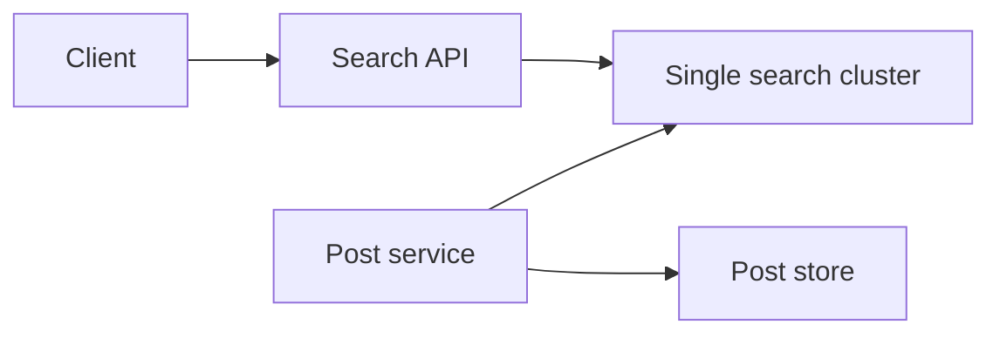
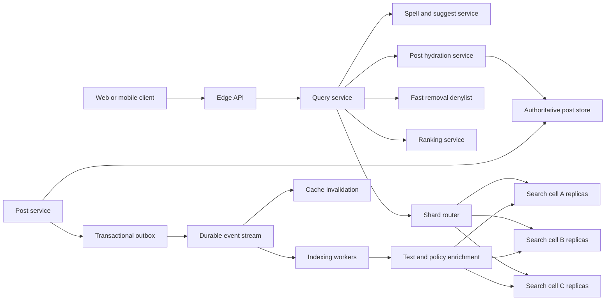
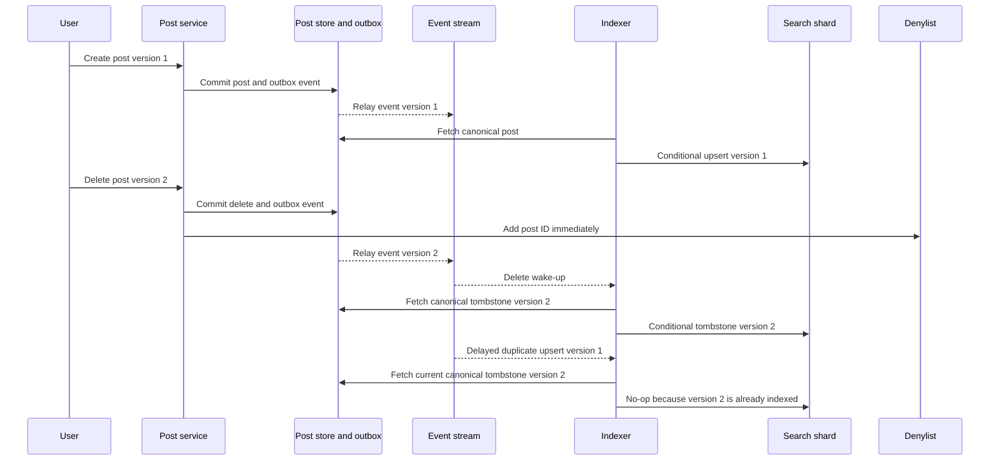
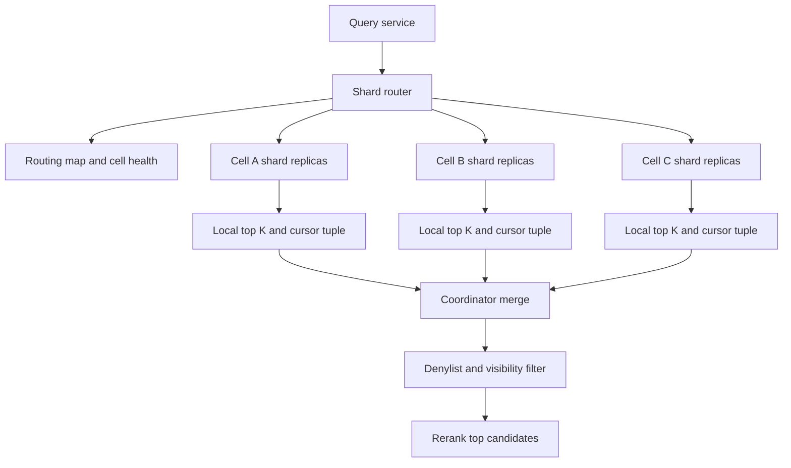
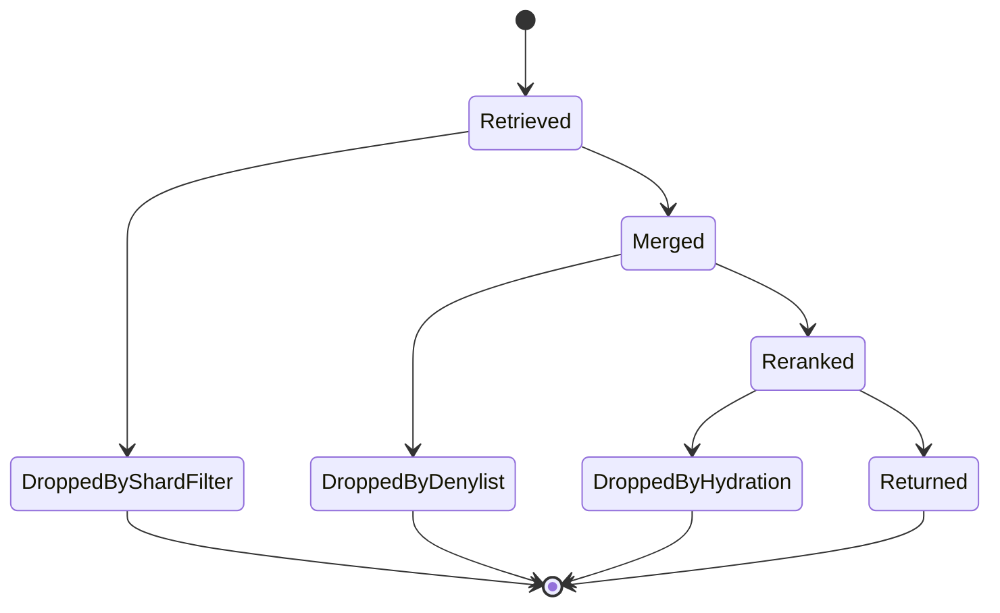

# Post Search System Design

Post search lets a user search a very large stream of public posts by text, author, language, hashtag, and time while still respecting deletion, privacy, block, and policy changes. This design covers lexical full-text search, freshness, shard fan-out, pagination, ranking, and safe removal; it leaves semantic/vector retrieval, analytics exports, and private-message-body search as variants rather than the first system.

## 1. Requirements

### 1.1 Functional requirements

- Search public posts by words, phrases, hashtags, author, language, and time range.
- Return ranked pages with highlighted snippets, spelling correction, and stable pagination.
- Make newly created or edited public posts searchable quickly.
- Remove deleted, private, blocked, or policy-violating posts from visible results quickly.
- Enforce viewer-specific visibility, blocks, safe-search, and locale-specific tokenization.
- Support typeahead suggestions and narrow routed searches for author, community, or time filters.

### 1.2 Non-functional requirements

- **Freshness.** New posts should usually become searchable within 5 seconds, because search is part of the live conversation rather than an archive.
- **Removal safety.** Deletes, privacy changes, and legal removals must fail closed even when the index is behind, because stale recall is acceptable but unsafe disclosure is not.
- **Low tail latency.** Search should stay below about 300 ms at p99 for normal queries, because the request fans out to many shards and the slowest few replicas can dominate user latency.
- **High availability.** Query serving should remain available through replica loss and limited shard failures, with explicit partial-result semantics when the product allows them.
- **Independent scaling.** Ingestion, retrieval, ranking, hydration, and reindexing must scale separately because their bottlenecks are different.
- **Rebuildability.** The search index is a derived view, so the system must tolerate full rebuilds, dark reads, alias swaps, and event replay without making the post store depend on the search cluster.

### 1.3 The binding constraint

The binding constraint is that the corpus is huge, queries are broad, and new posts still need to be searchable within seconds. A single global inverted index looks simple until a common query has to touch every posting list across every shard and then wait for the slowest shard, while the same cluster is also refreshing small new segments every second. Freshness pushes toward frequent refreshes and mutable posting lists; search latency pushes toward compact, immutable, optimized segments. Those are opposite pressures on the same data structure.

The design therefore becomes a set of mechanisms around that tension: a near-real-time indexing pipeline with versioned events and refresh watermarks, shard layouts that control scatter-gather and tail latency, early termination where product semantics allow it, and a retrieve-then-rerank query path that keeps expensive personalization and permission checks away from the posting-list inner loop.

## 2. Back-of-the-envelope estimation

Use these as illustrative assumptions, not claims about a specific company. Suppose the service has 100 million daily active users, each issuing 30 searches per day. Average search traffic is `100M × 30 / 86,400 = 34,722 QPS`, which rounds to 35K QPS. If the daily curve peaks at about 4.3 times average, peak search load is roughly `35K × 4.3 = 150.5K QPS`. This number matters because a query is not one backend read. With 256 logical shards and two replica choices per shard, a broad query may create `150K × 256 = 38.4M` shard-level requests per second before hedging or retries. The router cannot treat shard RPCs as an implementation detail; it needs deadlines, replica selection, cancellation, admission control, and bounded per-shard work.

For writes, assume 100 million new posts and 20 million edits or deletes per day. Average mutation traffic is `(100M + 20M) / 86,400 = 1,389 events/second`. A 10 times burst gives about 14K events/second. That is modest compared with query fan-out, but each event can trigger text analysis, policy enrichment, feature extraction, indexing, refresh, cache invalidation, and later segment merging. The hard part is not raw event throughput; it is making thousands of small writes visible quickly without flooding the search nodes with tiny segments and merge debt.

For storage, assume 2 billion searchable posts with 1 KB of normalized text and metadata each. Source content is `2B × 1 KB = 2 TB` before indexing. A full-text index stores term dictionaries, postings, positions, offsets for highlighting, doc values for filters and sorting, stored snippets, tombstones, replicas, and merge headroom. A practical budget of 5 to 10 times source bytes gives 10 to 20 TB for the replicated search tier. The design consequence is that full rebuilds and snapshots are normal operations, not rare disasters; they need their own throughput budget and an alias-swap protocol.

Finally, consider tail latency. If a query fans out to 256 shards and each shard independently has a 1% chance of missing a 100 ms target, the chance that at least one shard misses is `1 - 0.99^256 = 92.4%`. Even if the exact distribution is better in practice, broad fan-out converts ordinary per-shard variance into user-visible tail latency. This is why routing, cells, early termination, and partial-result policy shape the architecture as much as the inverted index itself.

> **Key idea.** The average write rate is manageable, but freshness creates segment churn, while broad search multiplies query QPS by every shard. The architecture is mostly about controlling fan-out, refresh cost, and stale-authorization risk.

## 3. API design

**Question.** What makes pagination and retries safe when the index changes every second?
<details><summary>Answer</summary>

The cursor binds the viewer, query fingerprint, an actual point-in-time view, and a search-session page boundary. Shard retrieval cursors and application reranking positions are separate. Retries reuse the same candidate page while rechecking current visibility; a mutable index generation alone is not a snapshot.

</details>

```http
GET /v1/search/posts?q=distributed+systems&language=en&author_id=u42&from=2026-10-01T00:00:00Z&limit=20&cursor=...
Authorization: Bearer ...

GET /v1/search/suggestions?prefix=distri&language=en&limit=10
Authorization: Bearer ...

GET /v1/search/posts/{search_id}/status
Authorization: Bearer ...

POST /internal/index-events
Idempotency-Key: evt-9
Content-Type: application/json

POST /internal/search/denylist
Content-Type: application/json

DELETE /internal/search/denylist/{post_id}
```

The public endpoint is synchronous and returns a signed, viewer-bound cursor referencing query, locale, safe-search, expiry, and search-session page state. The session retains actual PIT handles and each retrieval boundary `(retrieval_score, created_at, post_id)` with a unique engine tie-breaker where required. `search_after` uses exactly the shard query's sort, never an application reranker's score. The session stores the bounded candidate pool and its reranked order separately. A generation name only stabilizes routing unless its contents are immutable; refreshing the same generation still changes results.

Suggestions use a separate endpoint because typeahead has a different latency target and a different index shape. It should use prefix dictionaries, popular query caches, and safe locale-specific normalization, not the full ranking stack. The internal indexing endpoint is shown as an HTTP contract for clarity, but production indexers normally consume from a durable stream. Its idempotency key is the event ID; correctness comes from the `post_version`, not from assuming exactly-once delivery. The denylist endpoint is a fast safety valve for urgent removals: a legal or privacy action can block a post ID at query time before the durable tombstone has propagated through every shard.

A `202 Accepted` API is useful for administrative backfills, large export-like moderation searches, or expensive diagnostics, but not for the core user search path. If the product chooses to return partial results during a shard outage, the response must say so explicitly with `partial=true`, missing shard or cell metadata, and a cursor that is valid only for the partial view. Silent partial search trains users to trust incomplete results.

## 4. Data model

Start with the obvious entity: `Post(post_id, author_id, body, created_at)`. That is enough to show text to a user, but it is not enough to search safely. Search needs a derived representation with tokens, positions, language, quality signals, and fields sorted in columnar form. It also needs to know when a document is stale. Add a monotonically increasing `post_version` to the authoritative post. Every edit, delete, privacy change, and relevant policy transition increments that version.

Next, the system needs a way to get mutations out of the post store without losing them. Publishing directly to a message bus after committing the post looks fine until the process crashes between commit and publish. The post exists, but search never hears about it. Put an `IndexOutbox` row in the same transaction as the post mutation. A relay publishes it later and marks it sent. This is at-least-once delivery, so every downstream write must be idempotent.

Now consider deletes and reordering. If event version 8 deletes a post and an older version 7 upsert arrives late, a naive indexer can resurrect the post. The search document therefore stores `post_version`, and every content upsert or tombstone is conditional: apply only when `incoming_version > indexed_version`. Deletes are not just removals; they are versioned tombstones kept beyond the event-retention window until older workers, backfills, and replay sources are fenced.

Permissions add another split. Public, safe fields can be indexed, but viewer-specific authorization cannot be fully baked into a global index. Blocks, private audience changes, and legal deny rules change faster than segment merges. The index can store cheap coarse fields like `visibility_class`, `author_id`, `language`, `created_at`, and `policy_state`, but the query path must recheck current deny and visibility state for final candidates. If a permission model cannot be replicated safely, that content should not enter this index at all; Slack's enterprise search made the same trade-off for external sources by querying partner APIs at request time rather than caching data whose permissions it could not safely own.

```text
Post
- post_id: stable identifier and default routing key
- author_id
- body
- language_hint
- visibility: PUBLIC | FOLLOWERS | PRIVATE
- created_at
- updated_at
- post_version: monotonically increasing per post
- deleted_at
- policy_state

PostAudience
- post_id
- audience_rule_version
- circle_ids or follower_policy_ref

IndexOutbox
- event_id
- post_id
- post_version
- operation: UPSERT | DELETE | POLICY_UPDATE
- occurred_at
- published_at

SearchDocument
- post_id
- shard_doc_id
- body_tokens with positions and offsets
- body_exact
- hashtags
- author_id
- language
- created_at as doc value
- quality_score as doc value
- engagement_features as doc values
- visibility_class
- policy_state
- post_version
- enrichment_version
- indexed_at
- snippet_source

RemovalDenylist
- post_id
- reason
- expires_at or permanent flag
- version_seen
```

`Post`, `PostAudience`, and `IndexOutbox` live in the authoritative post store, partitioned by `post_id` or by the product's write ownership model. The event stream is keyed by `post_id` so per-post order is preserved. `SearchDocument` lives in search shards on local SSD, with immutable segment files snapshotted to object storage. `RemovalDenylist` lives in a low-latency replicated key-value store because it is consulted on every final result and must update faster than the index can refresh. Dynamic viewer features, large social graphs, and raw private audience lists do not belong in the inverted index; they either become compact query-time bitsets or are checked during hydration.

> **Key idea.** The index is a versioned, rebuildable projection. The source of truth owns content and permissions; search owns fast candidate retrieval and must prove that stale candidates are still visible before returning them.

## 5. High-level design

The simplest design is to put every public post into one search cluster and have the API call it directly. The cluster indexes each post when it is written and returns hydrated results from stored fields.



This breaks in several concrete ways. A post commit can succeed while the indexing call fails, losing searchability. A broad query fans out inside the cluster and waits for slow shards without application-level control. Frequent refreshes create many small segments and merge pressure. A stale index can return deleted or newly private content. Ranking becomes tangled with retrieval, so expensive viewer features run too early. Rebuilds become scary because the live cluster is both the write target and the only serving path.

### Fix 1: Transactional outbox and versioned indexing

The post service writes the post mutation and an outbox event in one transaction. A relay publishes events to a durable stream keyed by `post_id`; indexers consume, fetch the canonical post, and write a conditional upsert or tombstone to the target shard. The stream offset is committed only after the shard acknowledges the versioned write. Duplicate delivery is fine. Reordered delivery across different posts is fine. Reordered delivery for the same post is avoided by key partitioning and still defended by the version check.

This turns search from a synchronous side effect into a rebuildable projection. It also gives the system a recovery story: restore an index snapshot and replay events from the snapshot watermark. LinkedIn's Galene experience points in this direction: full offline builds, federators, brokers, and separation between infrastructure and relevance were not operational polish; they were how search stopped being a fragile pile of live-update scripts.

### Fix 2: Near-real-time segments with partial freshness

A search engine cannot expose every single write by rewriting one giant structure. It accumulates documents in memory, flushes small immutable segments, refreshes searchers so those segments are visible, and later merges segments into larger optimized files. A one-second refresh interval helps freshness but increases segment count, cache churn, and merge I/O. The design budgets for this explicitly: hot shards accept small active segments, background merges compact them, and query nodes enforce deadlines so merge debt cannot starve reads.

X's search team hit the sharper version of this problem when reducing indexing latency from roughly 15 seconds to one second. The important lesson is partial freshness semantics: index fields available at creation immediately, then apply slower enrichments such as resolved URLs, abuse features, and some quality signals later. Users see the new post quickly, while ranking and policy continue to improve. That only works because query-time policy checks can still remove unsafe candidates.

### Fix 3: Shard router, cells, and routed scopes

The API should not hand a broad query to a giant opaque cluster and hope. A shard router knows logical shard ownership, replica health, queue depth, and cell placement. It sends broad queries to all relevant shards, but it also uses filters to reduce fan-out when possible. An author search, a community search, or a bounded recent-time search should not pay for the whole corpus if the routing map can narrow it.

Discord's message-search evolution is useful evidence. Their earlier design routed guilds to selected Elasticsearch clusters at the application layer, which kept natural search scopes small. Later, they moved to many Kubernetes-managed Elasticsearch cells because clusters above a few hundred nodes suffered cluster-state and master-node overhead. Public post search has broader global queries than Discord guild search, but the same principle applies: prefer many bounded cells with explicit routing and special handling for extreme tenants over one enormous cluster whose tail latency and operational blast radius grow together.

### Fix 4: Retrieve, filter, rerank, then hydrate

Shard retrieval should do cheap lexical work: parse terms, traverse postings, apply static filters, compute BM25-like scores, and return local top `K`. The coordinator merges those candidates, applies fast denylist and visibility filters, and sends only the top few hundred or thousand to a ranking service. The ranking service can use freshness, quality, engagement, and viewer-author affinity without putting dynamic social features in every posting-list traversal. Slack's search architecture follows this shape: Solr retrieval first, application-layer reranking with work-graph features second. That split is why personalization can improve relevance without turning every shard into a user-specific ranking service.

Hydration is the final safety gate. It checks authoritative current public-search eligibility, viewer access, and content version even on query-cache hits. If the indexed version differs from the current post, drop it until reindexed or re-evaluate the query and generate snippets from the current authorized body. An ACL check alone would still leak redacted text through old stored snippets, highlights, or match existence. Cache entries and PITs retain candidate IDs, not reusable authorization decisions; uncertainty fails closed.

### Fix 5: Rebuilds, dark reads, and alias swaps

A search index must be replaceable. Backfills build a new generation from authoritative posts and stream replay, validate document counts and sampled queries, dark-read mirrored production traffic, then atomically move the read alias. Live events are either dual-written to old and new generations or replayed from a captured stream offset until the new generation catches up. X's one-second indexing rollout and LinkedIn's Galene both emphasize dark reads and routine rebuilds because ranking bugs, schema mistakes, and index corruption are unavoidable at this scale.

### Putting it together



A new post is committed with an outbox row, published to the stream, enriched, conditionally indexed into its hash shard, and made searchable on the next refresh. A query is normalized, routed to relevant shards, locally retrieved, merged, filtered against the denylist, reranked, hydrated with authoritative permission checks, highlighted, and returned with a signed cursor. The post store owns `Post` and `PostAudience`; the stream owns ordered `IndexOutbox` delivery; search cells own `SearchDocument` segments; the denylist owns urgent removal state.

> **Key idea.** Each component traces back to a specific failure of the naive design.

## 6. Deep dives

### 6.1 Near-real-time indexing without unsafe freshness

**Question.** A user publishes a post, edits it three seconds later, and then deletes it while an older indexing event is delayed. What prevents search from showing the wrong version or resurrecting the deleted post?
<details><summary>Answer</summary>

Every mutation carries a monotonically increasing `post_version`, events are keyed by `post_id`, and the shard applies upserts or tombstones only if the incoming version is newer than the indexed version. Urgent removals also enter a query-time denylist before the tombstone finishes propagating.

</details>

The naive indexing path calls the search cluster in the post-write request. It feels fresh because the write and index call happen together, but it has bad failure semantics. If the post transaction commits and the indexing call times out, retrying the whole post write risks duplicate posts; not retrying leaves the post absent from search. If the index call succeeds and the post transaction later rolls back, search sees a ghost. Even when both systems are up, a delete can race an older upsert and resurrect content.

The durable pattern is a transactional outbox plus idempotent consumers. The relay can crash, publish twice, or publish late. The indexer treats an event as a wake-up hint and fetches the canonical post or retained tombstone. It indexes the fetched payload under the fetched `post_version` and current operation/state, not the older event's version or verb. Otherwise a delayed delete event could incorrectly delete a later restored post, or new content could be mislabeled as an old version.

The index write is conditional: content upserts with `incoming_version <= indexed_version` are ignored. A delete leaves an explicit non-searchable tombstone document or durable version ledger, not merely an engine delete whose version memory may expire. Elasticsearch, for example, retains deleted-version information only for its configured `index.gc_deletes` period. Tombstones are compacted only after fencing older retries, backfills, snapshots, and replay sources; log retention alone does not bound an already-running stale worker.



Freshness then depends on refresh mechanics. Lucene-like systems write new documents into in-memory buffers, flush segment files, and reopen searchers so the segment becomes visible. Refreshing every second makes posts searchable quickly, but it creates many small segments. Small segments increase per-query overhead, reduce compression efficiency, and create merge backlog. The design therefore separates the active tier from colder optimized segments. Twitter's Earlybird and Omnisearch lessons fit here: real-time search needs postings and refresh paths designed for concurrent writes, while older data benefits from optimized read-only formats with compression and skipping. We do not need to copy a specific implementation, but we should preserve the principle: hot mutable data and cold optimized data have different physical needs.

One subtlety is partial freshness. X described indexing immediately available fields first and delayed fields later. Here, initial indexing supplies text and basic metadata. A later enrichment carries `(post_version, enrichment_version)` and conditionally updates only enrichment fields when the indexed post version still matches and the enrichment revision is newer. Otherwise the strict content-version rule would reject every enrichment of the same post version, or an old enrichment could restore stale text after an edit. New content versions reset enrichment state; safety remains in final authoritative checks.

Backfills use the same version semantics. Before scanning, establish a consistent source snapshot and its corresponding CDC/outbox replay boundary `O` (a vector for partitioned streams), retaining all later changes. Build `G2` from that snapshot and replay after `O`; capturing `O` only after the scan would miss changes to rows already visited. With an outbox relay, account for unpublished rows at the boundary rather than assuming a sampled broker head corresponds to the database snapshot. Validate and refresh G2 through a cutover watermark before atomically changing the read alias. Existing PIT sessions stay on their retained generation until expiry; new sessions use G2. Keep old-generation replay during the rollback window.

Signals worth watching: commit-to-searchable lag by percentile, outbox relay lag, stream consumer lag, refresh duration, segment count per shard, merge backlog, stale-event drop rate, tombstone ratio, and urgent-removal propagation time.

> **Strong-answer criteria.** A senior answer must separate post commit from indexing with an outbox, use versioned idempotent writes, and explain refresh and tombstone failure modes. It should also distinguish creation freshness from removal safety.

| Level | Approach | Why |
|---|---|---|
| Bad | Synchronously write the search index during post creation. | It loses events on partial failure and has no defense against delayed older updates. |
| Good | Use a durable stream and retry indexing. | It improves reliability but still needs version checks, tombstones, and refresh budgeting. |
| Great | Use an outbox, keyed stream, conditional upserts, versioned tombstones, denylist, partial freshness, and generation rebuilds. | It handles crashes, duplicates, reordering, unsafe deletes, and routine schema changes. |

### 6.2 Sharding, scatter-gather, and tail latency

**Question.** If every global query must touch every shard, how can the system keep p99 latency under control as the corpus grows?
<details><summary>Answer</summary>

Hash documents for even distribution, but put a router in front that narrows fan-out for scoped queries, chooses replicas by live health, sets per-shard deadlines, uses early termination for compatible sorts, and isolates shards into cells. For some products, tenant or community routing beats pure global hashing.

</details>

The first sharding decision is tempting: partition by time. Most users care about recent posts, and time buckets let recent queries touch fewer shards. But pure time sharding creates a hot recent tier. All writes land in the newest bucket, all breaking-news queries hammer it, and global relevance has to merge across buckets with different statistics. Old buckets become easy to optimize, but the hot bucket becomes the system.

Hashing by `post_id` gives even write and storage distribution. It also gives simple shard movement and replica placement. The price is broad fan-out: a query for common terms may touch every shard because every shard has some matching documents. This is acceptable only if the router and shards make scatter-gather predictable. The router maintains a map of logical shards to replicas and cells. It sends the query to one healthy replica per shard, using queue depth, recent latency, and failure signals. It attaches a deadline so shards stop work when their result can no longer be used. If a request is canceled by the client, cancellation propagates to shard RPCs.

Cells bound blast radius. Instead of one huge search cluster, use many cells that each own a subset of logical shards and replicas. Cell boundaries make cluster-state updates smaller, let operators roll deployments gradually, and prevent an overloaded tenant or shard group from consuming every node. Discord's later Elasticsearch design moved toward many Kubernetes-managed cells because very large clusters suffered master-node and cluster-state overhead. For post search, cells also make it natural to place hot recent shards on faster hardware and older optimized shards on denser nodes.

The router should reduce fan-out whenever query semantics allow it. An `author_id` filter can route to shards containing that author's posts if the index maintains an author-to-shard map or if author collections have dedicated partitions. A community, tenant, or guild-like scope can route to the cell that owns that scope. Discord's original message search leaned heavily on this because a guild is a natural search boundary. Public global search cannot assume every query has a scope, but it should exploit one when present. A time range can skip old buckets inside each hash shard or route to recent-only tiers.

Early termination is another lever, but it only works honestly for certain sorts. If the user asks for newest-first results and segments are ordered by descending creation time, a shard can stop after it has enough matches newer than the coordinator's competitive threshold. X's Earlybird design used reverse chronological traversal and early termination because tweets are often searched by freshness. For pure relevance ranking, early termination is riskier: a late document in an older segment may have the best textual match. The system can use block-max indexes, impact-ordered postings, or WAND-like algorithms to skip work while preserving top-k correctness, but it should not silently trade recall for speed unless the product accepts approximate results.



Tail latency needs math, not optimism. If the coordinator waits for 256 shards, p99 depends on the slowest few. Hedged requests can help, but doubling requests under load can collapse the cluster. A safer approach is deadline-aware replica selection first, limited hedging only after a percentile threshold, and admission control before fan-out. Query-cost estimation should reject or degrade pathological wildcard, regex, or huge Boolean queries before they become millions of posting-list seeks.

Partial results are a product decision, not a hidden optimization. For exploratory public search, returning partial results with a clear marker may be acceptable during a cell outage. For compliance, moderation, or legal search, partial results may be worse than an error. The cursor must encode whether it came from a partial view, because page two cannot pretend missing shards suddenly existed on page one.

Signals worth watching: shard fan-out per query, per-cell p95 and p99, slowest-shard contribution, hedged request rate, query cancellation effectiveness, partial-result rate, scoped-routing hit rate, and early-termination savings by query class.

> **Strong-answer criteria.** A senior answer must connect sharding to query semantics, not just storage balance. It should explain why fan-out amplifies tail latency and which mechanisms reduce work without lying about recall.

| Level | Approach | Why |
|---|---|---|
| Bad | Put all data in one large cluster and rely on the search engine to scale. | Cluster state, hot shards, and tail latency become invisible until they dominate. |
| Good | Hash by document and add replicas. | It balances data but makes every global query scatter to all shards. |
| Great | Combine hash shards, cells, live replica routing, scoped routing, deadline propagation, honest early termination, and explicit partial-result policy. | It controls both average capacity and p99 behavior under broad fan-out. |

### 6.3 Ranking after retrieval, with deletes and permissions in the loop

**Question.** A shard returns a highly relevant post that was made private milliseconds ago. Where is it removed, and how does ranking avoid spending too much work on candidates the viewer cannot see?
<details><summary>Answer</summary>

The shard applies cheap indexed filters, the coordinator checks a fast denylist and compact visibility state, the reranker scores only surviving candidates, and hydration performs the authoritative permission check before display. If final filtering removes too many results, the coordinator requests or keeps extra candidates for backfill.

</details>

A full-text shard is good at retrieving candidates by terms. It is not the right place to run every viewer-specific ranking and permission rule. If we push all personalization into shards, every shard needs fresh social graph features, block lists, audience memberships, safe-search state, and model features for every viewer. That makes the posting-list loop slow and turns shard caches into per-user caches with poor reuse. If we ignore personalization until after returning results, relevance is bad and unsafe candidates may leak.

The workable split is staged. During retrieval, shards apply filters that are cheap and stable: language, time range, author, coarse visibility class, policy state, safe-search class, and maybe a precomputed quality threshold. They compute lexical relevance and return local top `K`, often more than the final page size. The coordinator merges and applies fast global exclusions: urgent removal denylist, blocked authors, and compact per-viewer visibility bitsets where available. Only then does the ranking service score the top few hundred or thousand candidates.

Slack's search system is a strong production example of this shape. Solr retrieved candidates; the application reranked with work-graph features such as channel priority, author affinity, pins, reactions, age, and Lucene score. For public post search, equivalent features might include textual score, freshness decay, author quality, viewer-author affinity, language match, engagement quality, and abuse penalties. The important point is that reranking is bounded. It is acceptable to call feature stores for 500 candidates; it is not acceptable to do so for every posting that contains a common word.

Meta's Unicorn and Graph Search add another lesson: social search often needs query rewriting, vertical fan-out, forward-index metadata, and result-set scoring. For posts, the query service may rewrite hashtags, normalize entities, or blend posts with authors and topics in a product variant. Even within posts, result-set scoring can prevent a page from collapsing to one viral author or one language if the query intent is broad. Diversity belongs after candidate retrieval because it compares candidates to each other, not just a document to a query.

Deletes and permissions cut across every stage. The index stores `visibility_class` and `policy_state` so obviously ineligible documents are filtered early. A legal removal or emergency privacy change writes the `RemovalDenylist` immediately, so the coordinator can drop the post even before the shard refresh sees the tombstone. Blocks and follower-only audience checks can be represented as compact query-time filters only if they are fresh enough and small enough. When they are not, hydration is the final authority. The post hydration service fetches display fields and returns them only if the viewer can currently see the post.

This creates a backfill problem. Suppose each shard returns 100 candidates and the coordinator merges 2,000 candidates, but policy and hydration remove many of the top 20. While constructing the bounded session pool, the coordinator can ask shards for deeper pages under the same PIT. Once the pool and ranked order are frozen, later pages draw only from its reserve; exhaustion returns a shorter page or the session cap, not newly reranked candidates that invalidate earlier page boundaries. It must not fill holes with unchecked documents or reveal that a removed or blocked post matched the query by returning special placeholders.



Cursor stability requires separating retrieval from reranking. This proposal materializes a bounded candidate pool under a PIT, freezes model/features, and stores the resulting order in a short-lived viewer-bound search session. Pages consume that order with idempotent page transitions and fresh hydration. Reserve candidates fill authorization holes without discarding unseen items. The response exposes the result cap; once the pool is exhausted, request a refined/new search rather than claiming exhaustive globally reranked pagination. Alternatively, a product may extend in retrieval-ordered windows, but then ranking is only within each window, not globally score-sorted. A frozen model alone cannot make its final scores valid `search_after` values for shards sorting by lexical score. PIT handles and the last consumed retrieval tuple remain internal and follow the engine's continuation rules.

Signals worth watching: candidates per stage, drops by denylist and hydration, backfill depth, reranker latency, feature-store timeout rate, model fallback rate, zero-result after filtering, click metrics by query class, and stale-permission incidents.

#### Pagination mechanics and costs

**Use `search_after`, not deep `OFFSET`.** With an offset, each shard must collect enough hits for all preceding pages plus the requested page. A signed cursor carries the retrieval sort tuple and binds the query, filters, sort mode, and expiry.

**It is a sort boundary, not a saved result list.** For a retrieval batch of 20, each shard collects its best 20 hits after the cursor instead of collecting `offset + 20` hits. Each retrieval request still performs matching and scoring; the main savings are in result collection, shard transfer, and coordinator merging. In this design, later user pages consume the cached session pool rather than rerunning retrieval.

**Choose the guarantee explicitly:**

| Mode | Index view | Tradeoff |
|---|---|---|
| **This proposal: stable session** | PIT while building a bounded pool; cached ranked order for later pages | Stable page boundaries, but retained segments and session state consume resources |
| **Cheaper alternative: best-effort browsing** | Current index on each page; no PIT or cached ranked pool | Less server-side state, but duplicates and skipped results are possible |

For best-effort browsing:

- **Relevance sort:** use `(retrieval_score, created_at, post_id)` with fixed sort directions and a unique tie-breaker.
- **Newest-first sort:** use `(created_at, post_id)` with a fixed initial upper time bound. Newer posts stay out; delayed indexing, edits, and deletions can still change membership.
- **UX:** cap pagination depth and offer refresh/restart. Client deduplication cannot recover skipped results; reranking within each retrieval window is not globally sorted final relevance.

**What does a PIT retain?**

**It does not copy the entire index per query.** Each shard consists of immutable segments, each containing an inverted index (`term -> matching document IDs`) and supporting fields. A PIT retains references to those segments and their document-visibility state, not ranked query results.

```text
At PIT creation:  PIT X -> segments A, B
After refresh:   latest -> A, B, C       PIT X -> A, B
After merge:     latest -> merged M      PIT X -> A, B (retained)
```

**PIT chooses the index view; `search_after` chooses the retrieval boundary.** Neither caches scores. The separate session pool is what avoids repeated retrieval for later user pages.

| Resource | Why usage increases |
|---|---|
| Disk | Old segments cannot be deleted after merges while a PIT still needs them |
| Search contexts and file handles | Views retain resources across participating shards |
| Heap | Updates/deletes require document-liveness bookkeeping |

For scale: **10,000 new sessions/second x 60-second PIT lifetime = roughly 600,000 active PITs**, even if nobody requests page two. Close PITs as soon as the bounded pool is complete; do not retain them just to serve cached pages.

**Stable-session guardrails:**

- **Start before retrieval:** open the PIT before building the pool; retain its handle and retrieval boundaries internally.
- **Bound resources:** enforce idle expiry, maximum lifetime, and per-user/global limits on PITs and cached pools. Reject new sessions explicitly at capacity.
- **Monitor:** retained segment bytes, open contexts, file handles, heap, and session-cache bytes.
- **Fail explicitly:** return `CURSOR_EXPIRED` if session state expires or a PIT needed for unfinished retrieval is lost. A completed pool does not require a live PIT.
- **Preserve ranking and privacy:** a PIT alone does not freeze external features or authorization. Freeze the pool's ranking inputs and recheck current visibility on every page.

See [Elasticsearch's PIT documentation](https://www.elastic.co/guide/en/elasticsearch/reference/8.19/point-in-time-api.html#keeping-point-in-time-alive) for segment-retention and resource costs.

> **Strong-answer criteria.** A senior answer must keep retrieval cheap, make reranking bounded, and treat authorization as a final correctness gate rather than a relevance feature. It should also explain how deletes and cursor stability interact with ranking.

| Level | Approach | Why |
|---|---|---|
| Bad | Let shards return final personalized results directly. | It pushes dynamic viewer state into every shard and makes caching and freshness brittle. |
| Good | Retrieve top candidates, then rerank in the application. | It bounds expensive features but still needs permission gates and backfill behavior. |
| Great | Stage shard filters, denylist checks, bounded reranking, authoritative hydration, reserve candidates, and cursor-bound ranking metadata. | It gives good relevance without leaking stale or unauthorized content. |

## 7. Variants

**10x scale.** At 1.5 million peak user queries per second, broad fan-out dominates everything. The core design stays the same, but the system needs more aggressive routed scopes, query-result caching for anonymous trending queries, separate hot-recent and cold-archive cells, stronger admission control, and possibly approximate retrieval for low-value exploratory queries. The event pipeline probably still fits with partitioning, but refresh and merge isolation become stricter.

**Breaking-news burst.** A major event creates a hot term that every user searches. Hash sharding distributes data, but the same posting lists become hot everywhere. Cache normalized public results for the top queries with very short TTLs, precompute newest-first slices for trending hashtags, and protect shards with query budgets. Do not cache personalized or unsafe results unless the cache key includes every relevant policy dimension.

**Tenant or guild-scoped product.** If the natural query is inside a community, workspace, or guild, route by that scope first and use global search as a separate path. Very large tenants get split shards or dedicated cells; small cold tenants can be lazily indexed or packed densely. This follows the Discord lesson: application-layer routing can turn a global search problem into many smaller search problems when the product has a real boundary.

**Federated private sources.** If search must include external documents or private sources whose permissions cannot be replicated safely, do not index their bodies into the public post index. Use federated retrieval at request time with source OAuth scopes, then blend those results after local retrieval. This is slower and less complete, but it avoids stale-permission leaks.

## 8. The transferable pattern

This is the same pattern as many derived-read-model systems: keep the transactional source of truth small and correct, project it asynchronously into a read-optimized structure, attach versions and watermarks to the projection, and put a final correctness gate on the read path. The hard part is not building an inverted index; it is admitting that the index is stale by design and then deciding which stale states are acceptable. Creation freshness can be eventual. Authorization and legal removal must fail closed.

The pattern also appears in feed, ticketing, and marketplace systems where a broad read model is built from authoritative writes. A ticket search or event discovery system may use different ranking signals, but it still needs versioned projections, fan-out control, and final inventory or permission checks. See [Ticketmaster](./ticketmaster-system-design.md) for a sibling problem where fast discovery and authoritative final state must be kept separate.

## Review

Post search is a rebuildable, near-real-time projection of authoritative posts. The binding pressure is that new posts need to appear within seconds while broad queries scatter across a huge corpus and wait on tail latency. The design starts with a post store, transactional outbox, durable stream, versioned indexer, and Lucene-like segmented search cells. It then adds a router to control fan-out, cells to bound blast radius, scoped routing and early termination to reduce work, retrieve-then-rerank to keep personalization bounded, and denylist plus hydration checks to prevent stale deletes or permission changes from leaking. Rebuilds, dark reads, and alias swaps are first-class because the index is disposable, but search correctness depends on watermarks, versions, and final authorization gates.

### Check your understanding

1. Why is a transactional outbox better than writing the search index directly in the post-create request?
   <details><summary>Answer</summary>

   The outbox makes the post mutation and indexing intent commit atomically. If publishing or indexing fails later, the relay can retry from durable state. Direct indexing creates split-brain failures where the post exists without an index event or the index contains content from a rolled-back write.

   </details>

2. Why does broad fan-out make p99 latency much worse than per-shard latency suggests?
   <details><summary>Answer</summary>

   A broad query waits for many shard responses, so the user sees the slowest few shards rather than the median shard. Even small independent per-shard tail probabilities compound across hundreds of shards, which is why routing, deadlines, cells, and cancellation are necessary.

   </details>

3. Why is a delete represented as a versioned tombstone instead of simply removing the document?
   <details><summary>Answer</summary>

   A tombstone preserves the fact that version 8 deleted the post. If an older version 7 upsert arrives late, the shard can ignore it. If the document were simply removed with no version memory, that stale upsert could resurrect deleted content.

   </details>

4. Why not put all viewer-specific ranking and permissions inside every search shard?
   <details><summary>Answer</summary>

   It would require every shard to maintain fresh dynamic state for every viewer and would make posting-list traversal slow and poorly cacheable. The better split is cheap indexed filters in shards, bounded reranking after merge, and authoritative hydration before display.

   </details>

5. When is early termination safe, and when is it dangerous?
   <details><summary>Answer</summary>

   It is safe when the index order and query semantics guarantee that skipped documents cannot beat the current results, such as newest-first traversal over time-ordered segments or correctness-preserving block-max skipping. It is dangerous when used as an unmarked approximation for relevance ranking because a skipped older document may be the best textual match.

   </details>

## Sources and further reading

| Source | Article | Why it matters |
|---|---|---|
| Twitter/X | [Twitter's New Search Architecture](https://blog.x.com/engineering/en_us/a/2010/twitters-new-search-architecture) | Explains Earlybird's real-time Lucene-derived inverted index, lock-free postings, reverse traversal, and early termination. |
| X | [Reducing search indexing latency to one second](https://blog.x.com/engineering/en_us/topics/infrastructure/2020/reducing-search-indexing-latency-to-one-second) | Shows how one-second indexing required timestamp-based doc IDs, skip-list postings, partial updates, dark reads, and careful rollout. |
| Twitter/X | [Omnisearch index formats](https://blog.x.com/engineering/en_us/topics/infrastructure/2016/omnisearch-index-formats) | Details active versus optimized postings formats, delta compression, bit packing, and measured memory/latency wins. |
| Meta | [Under the Hood: Building out the infrastructure for Graph Search](https://engineering.fb.com/2013/03/06/core-infra/under-the-hood-building-out-the-infrastructure-for-graph-search/) | Introduces Unicorn as the unified inverted-index infrastructure for Facebook's social graph search. |
| Meta | [Under the Hood: Indexing and ranking in Graph Search](https://engineering.fb.com/2013/03/14/core-infra/under-the-hood-indexing-and-ranking-in-graph-search/) | Covers vertical fan-out, query rewriting, forward-index scoring, result-set scoring, blending, and A/B-tested ranking. |
| LinkedIn | [Did you mean "Galene"?](https://engineering.linkedin.com/search/did-you-mean-galene) | Describes Galene's federators, brokers, offline rebuilds, live updates, and separation of infrastructure from relevance. |
| Discord | [How Discord Indexes Billions of Messages](https://discord.com/blog/how-discord-indexes-billions-of-messages) | Shows application-layer routing to smaller Elasticsearch clusters, lazy indexing, shard mapping, and refresh control. |
| Discord | [How Discord Indexes Trillions of Messages](https://discord.com/blog/how-discord-indexes-trillions-of-messages) | Explains Elasticsearch cells, destination-aware Pub/Sub bulk indexing, Kubernetes operations, and special handling for huge guilds. |
| Slack | [Search at Slack](https://slack.engineering/search-at-slack/) | Demonstrates two-stage Solr retrieval plus personalized re-ranking with work-graph features and click-bias-aware training. |
| Slack | [How we built enterprise search to be secure and private](https://slack.engineering/how-we-built-enterprise-search-to-be-secure-and-private/) | Shows when to use federated, permission-aware real-time retrieval instead of indexing stale external data. |
| Elastic | [Paginate search results](https://www.elastic.co/docs/reference/elasticsearch/rest-apis/paginate-search-results) | Defines PIT, unchanged query/sort, tie-breakers, and retrieval `search_after` values. |
| Elastic | [Delete a document](https://www.elastic.co/docs/api/doc/elasticsearch/operation/operation-delete) | Documents finite deleted-version retention and `index.gc_deletes`; durable replay fences require more than a bare delete. |
| PostgreSQL | [Logical decoding: exported snapshots](https://www.postgresql.org/docs/current/logicaldecoding-explanation.html#LOGICALDECODING-EXPORTED-SNAPSHOTS) | Provides a primary-source example of a snapshot tied to a change-stream boundary without a scan/replay gap. |
