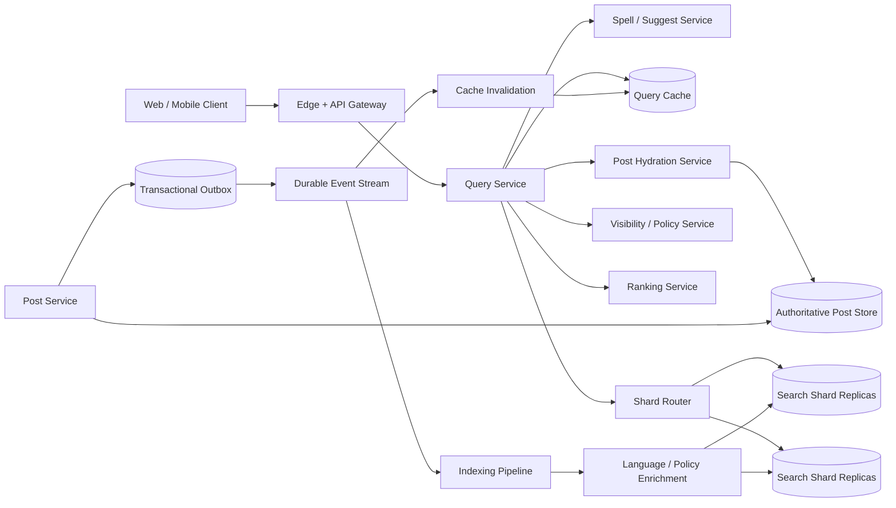

# Post Search: Production Full-Text Search System

## 1. Requirements

### Functional requirements

1. Search public posts by words, phrases, hashtags, author, language, and time range.
2. Rank results by textual relevance, freshness, quality, and viewer-specific signals.
3. Support filters, sorting, pagination, spelling correction, and typeahead suggestions.
4. Make newly published or edited posts searchable quickly.
5. Remove deleted, private, blocked, or policy-violating posts quickly.
6. Enforce per-viewer visibility at query time.
7. Return highlighted snippets and explain empty-result corrections.
8. Support safe-search and locale-aware tokenization.

Out of scope for the first design: semantic/vector search, searching private message bodies, and analytics-grade exhaustive exports.

### Non-functional requirements

- `p99` query latency below 300 ms; typeahead below 100 ms.
- `99.99%` query availability.
- New-post indexing lag below 5 seconds at `p95`; urgent deletion below 30 seconds.
- No result may bypass current privacy, block, or legal-removal rules.
- Horizontally scale reads and ingestion independently.
- Gracefully degrade personalization and highlighting before returning errors.

## 2. Scale assumptions and capacity

- 500 million monthly active users; 100 million daily active users.
- 2 billion searchable posts, averaging 1 KB of normalized text and metadata.
- 100 million new posts and 20 million edits/deletes per day.
- 30 searches per daily active user per day.
- Average query rate: about 35,000 QPS; peak: 150,000 QPS.
- Peak mutation stream: 10,000 events/second.
- Replicated inverted index: roughly 10-20 TB after postings, positions, doc values, and overhead.

```text
100M DAU x 30 searches / 86,400
= approximately 35K average search QPS

100M new posts / 86,400
= approximately 1,160 average creates/second
```

Index size must be measured rather than inferred only from source bytes: term dictionaries, positions, stored snippets, tombstones, replicas, and merge headroom commonly require several times the normalized corpus size.

## 3. High-level architecture



The authoritative post store owns content and visibility. The search index is a derived, rebuildable read model. Query processing has two phases:

1. **Candidate retrieval:** inverted-index shards find and locally rank matching document IDs.
2. **Re-ranking and hydration:** the coordinator merges candidates, applies current policy, re-ranks the top set, and fetches display fields.

## 4. Data model and index schema

### Authoritative records

```text
Post
- post_id
- author_id
- body
- language
- visibility: PUBLIC | FOLLOWERS | PRIVATE
- created_at
- updated_at
- version
- deleted_at
- policy_state

PostAudience
- post_id
- audience_rule_version
- circle_ids

IndexEvent
- event_id
- post_id
- post_version
- operation: UPSERT | DELETE
- occurred_at
```

### Search document

```text
SearchDocument
- post_id                 keyword, routing key
- body_tokens             analyzed text with positions
- body_exact              normalized keyword/text
- hashtags                keyword
- author_id               keyword
- language                keyword
- created_at              date/doc value
- quality_score           numeric/doc value
- engagement_features     numeric/doc values
- visibility_class        keyword
- policy_state            keyword
- post_version            numeric
- indexed_at              date
- snippet_source          stored field
```

Use locale-specific analyzers, Unicode normalization, case folding, and language-aware stemming. Preserve positions and offsets for phrase matching and highlighting. Do not index secrets or private posts merely to filter them later.

`post_version` makes indexing idempotent: an event applies only if its version is newer than the indexed version. A delete is a versioned tombstone, preventing an older delayed upsert from resurrecting content.

## 5. Core APIs

### Search posts

```http
GET /v1/search/posts?q=distributed+systems&author_id=u42&language=en&limit=20&cursor=...
Authorization: Bearer <token>
```

```json
{
  "results": [
    {
      "post_id": "p123",
      "author_id": "u42",
      "snippet": "A practical guide to <em>distributed systems</em>...",
      "created_at": "2026-10-12T20:10:00Z",
      "score": 12.41
    }
  ],
  "next_cursor": "base64-search-after-token",
  "corrected_query": null,
  "took_ms": 84
}
```

The cursor contains the point-in-time identifier, final sort tuple, and query fingerprint, signed by the service. Reject it if filters or query change.

### Suggestions

```http
GET /v1/search/suggestions?prefix=distri&language=en&limit=10
```

### Internal indexing contract

```json
{
  "event_id": "evt-9",
  "post_id": "p123",
  "post_version": 7,
  "operation": "UPSERT",
  "occurred_at": "2026-10-13T07:20:00Z"
}
```

The indexer fetches the canonical post by ID instead of trusting a possibly incomplete event payload.

## 6. Indexing flow

1. The post service commits the post mutation and an outbox row in one transaction.
2. An outbox relay publishes a keyed event to the durable stream.
3. Events are partitioned by `post_id`, preserving per-post order.
4. The indexer loads canonical content and current policy state.
5. It normalizes text, detects language, extracts hashtags, and computes static quality features.
6. It sends a version-conditional upsert or tombstone to the appropriate search shard.
7. A refresh makes the segment searchable, normally within 1-5 seconds.
8. The consumer commits its stream offset only after the index acknowledges the write.

Bulk backfills write to a new index generation, validate counts and sampled queries, then switch a read alias atomically. Live events are dual-written or replayed from a captured offset so the generation has no gap.

## 7. Query and ranking flow

1. Authenticate, normalize the query, and validate filters.
2. Parse operators with bounded complexity; reject pathological wildcard or regex expansion.
3. Resolve spelling correction and synonyms by locale.
4. Route the request to all relevant corpus shards or a restricted time tier.
5. Each shard uses BM25 to return its top `K` candidates and sort tuples.
6. The coordinator merges shard lists.
7. Apply cheap visibility bitsets, policy filters, and blocked-author exclusions.
8. Re-rank the top 200-1000 candidates using freshness, quality, engagement, and optional viewer features.
9. Hydrate the top page from the post service and recheck authoritative visibility.
10. Remove stale/forbidden results, produce snippets, and return a signed search-after cursor.

A representative score is:

```text
score = w1 * BM25
      + w2 * freshness_decay
      + w3 * quality
      + w4 * viewer_author_affinity
      - abuse_penalty
```

Never let engagement fully dominate relevance; otherwise old viral or spammy posts crowd out precise matches.

## 8. Pagination and result stability

Avoid deep `OFFSET` pagination because every shard must score and discard all preceding hits. Use:

- A point-in-time index snapshot with a short TTL.
- `search_after` on a deterministic tuple such as `(score, created_at, post_id)`.
- A signed cursor binding snapshot, query, filters, and tuple.

Without a snapshot, refreshes can cause duplicates or skipped results between pages. If the snapshot expires, return `CURSOR_EXPIRED`; do not silently continue against a different corpus.

## 9. Consistency, privacy, and deletions

Search is intentionally eventually consistent for discovery, but authorization is not.

- New posts may be absent for a few seconds.
- Edits may show an older snippet briefly.
- Deleted or newly private content must fail closed during hydration.
- Block and legal-removal lists should propagate through a fast invalidation channel and be checked at query time.

For urgent removals, place the `post_id` in a globally replicated denylist immediately, then process the durable tombstone. The denylist closes the indexing-lag window.

Read-your-writes can be offered by showing the user's newly created post directly in their own profile/search response or by waiting on an indexing watermark, not by forcing every search refresh synchronously.

## 10. Partitioning and storage

Partition the corpus by a stable hash of `post_id`:

- Even write and storage distribution.
- Scatter/gather queries across all primary shards.
- Straightforward replica placement and shard movement.

Time partitioning reduces fan-out for recent searches but complicates global relevance and hot recent tiers. A hybrid can use immutable time buckets inside hash shards.

Each logical shard has multiple replicas. The router chooses replicas using latency, queue depth, and availability. Segment files are immutable and stored on local SSD for low latency, with snapshots in object storage. Background merges compact small segments and purge tombstones; throttle merges so they do not starve queries.

## 11. Caching and load control

Cache normalized anonymous queries only when policy and locale permit. Include safe-search, language, filters, index generation, and coarse audience class in the key. Personalized result pages usually have poor cacheability.

Useful caches:

- Typeahead prefix cache.
- Term dictionary and postings block cache.
- Author/profile hydration cache.
- Short-lived cache for trending public queries.

Protect the cluster with per-tenant rate limits, query cost estimation, deadlines, bounded fan-out, admission control, and cancellation propagation. Return partial results only with an explicit `partial=true` marker and missing-shard metadata.

## 12. Reliability and failure handling

| Failure | Handling |
|---|---|
| Post commit succeeds, publish fails | Transactional outbox retries |
| Duplicate or reordered events | Version-conditional idempotent indexing |
| Search replica fails | Route to another replica |
| Entire shard unavailable | Explicit partial result or fail request by product policy |
| Poison document | Dead-letter with alert; do not stall the partition |
| Index corruption | Restore snapshot and replay stream |
| Reindex misses concurrent changes | Capture offset, replay or dual-write, then alias swap |
| Hydration service is slow | Tight deadline; omit unverified candidates rather than leak |
| Cache contains removed post | Policy/denylist check and invalidation |
| Merge consumes I/O | Merge throttling and workload isolation |
| Ranking service fails | Fall back to deterministic lexical ranking |

Store the event stream long enough to rebuild the maximum index recovery window. Periodically reconcile authoritative post counts, versions, and tombstones against the index.

## 13. Multi-region design

- Run query stacks and complete index replicas in each major region.
- Route users to the nearest healthy query region.
- Publish mutations into a home-region stream and replicate them globally.
- Track per-region indexing watermarks and lag.
- Keep index snapshots in cross-region object storage.
- Fail query traffic away from a lagging or incomplete region.

Because the index is derived, active-active query serving is safe. Authoritative post writes retain their own consistency model. Legal restrictions and data residency may require region-specific filtered indexes rather than globally identical replicas.

## 14. Security and abuse prevention

- TLS in transit and encryption at rest with managed keys.
- Validate query syntax and cap token, wildcard, regex, and Boolean-clause counts.
- Parameterize backend queries; never expose raw search-engine DSL publicly.
- Enforce authorization again when hydrating results.
- Minimize indexed personal data and honor retention/deletion requests.
- Rate-limit scraping and credential-based enumeration.
- Audit moderator searches and legal-removal actions.
- Separate suggestion logs from identities where possible.
- Defend ranking against keyword stuffing, coordinated engagement, and adversarial Unicode.
- Redact raw queries from logs or apply access controls and retention limits.

## 15. Observability and SLOs

Track:

- Query QPS and `p50/p95/p99` latency by stage.
- Zero-result, correction, click-through, and reformulation rates.
- Shard fan-out, timeout, partial-result, and cache-hit rates.
- Ingestion lag from post commit to searchable.
- Urgent deletion propagation time.
- Event consumer lag and dead-letter count.
- Segment count, merge backlog, tombstone ratio, disk watermarks.
- Candidate counts before and after policy filtering.
- Ranking feature freshness and model fallback rate.
- Relevance metrics such as NDCG and recall on judged query sets.

The most important end-to-end freshness SLI is:

```text
time(searchable_at) - time(authoritative_post_commit)
```

Maintain separate SLOs for creates and removals; removal safety is more important than creation freshness.

## 16. Major trade-offs

### Lexical versus semantic retrieval

- Inverted indexes are fast, explainable, and strong for exact terms.
- Vector retrieval improves conceptual recall but increases cost and filtering complexity.
- Start lexical; add vector candidates as a separately measured hybrid path.

### Index-time versus query-time enrichment

- Index-time features make queries fast but become stale.
- Query-time features are fresh but increase latency and dependencies.
- Store stable features in the index and fetch only high-value dynamic features for top candidates.

### Refresh frequency

- Frequent refreshes improve freshness but create many small segments and merge pressure.
- Larger refresh intervals improve throughput but expose stale results.

### Global scatter/gather versus routed search

- Global search requires broad fan-out and gives complete recall.
- Author, tenant, language, or time filters can route to fewer shards.

### Availability versus complete results

- Returning partial results preserves availability.
- Silent partial results damage trust and relevance.
- Make partial behavior explicit and product-specific.

## 17. Recommended interview presentation

A clear 45-minute sequence is:

1. Clarify corpus, filters, ranking, privacy, and freshness targets.
2. Estimate query QPS, ingest rate, and index size.
3. Draw the authoritative store, event stream, indexers, shards, and query path.
4. Deep-dive into inverted indexes and two-stage ranking.
5. Explain versioned idempotent indexing and reindexing.
6. Cover pagination, visibility checks, and urgent deletion.
7. Discuss shard failures, multi-region replicas, and observability.
8. Finish with semantic-search and freshness trade-offs.

The central design insight is:

> Treat search as a rebuildable, eventually consistent projection of authoritative posts: use an inverted index for broad candidate retrieval, versioned events for correct ingestion, and authoritative policy checks before any result is returned.
