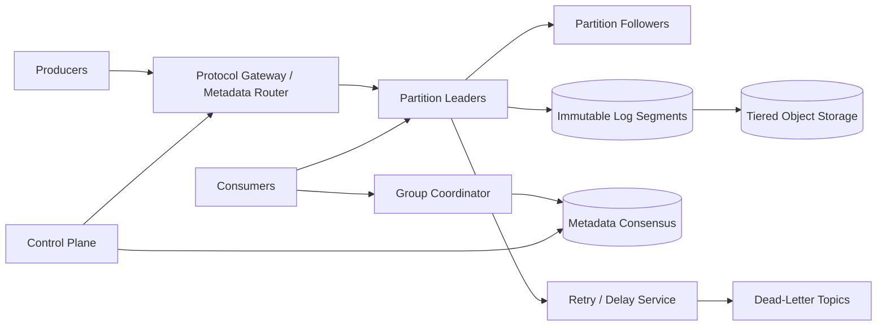

# Production Pub-Sub and Message Queue

## 1. Requirements

### Functional requirements

1. Publish messages to named topics.
2. Support queue semantics through consumer groups and broadcast semantics through independent subscriptions.
3. Preserve ordered delivery within a partition.
4. Retain messages for replay by time or offset.
5. Support acknowledgements, retries, dead-letter topics, and delayed redelivery.
6. Filter subscriptions using message attributes.
7. Allow producers to batch, compress, and publish idempotently.
8. Expose consumer lag and safely rebalance group membership.

### Non-functional requirements

- Sustain millions of messages per second and petabytes of retained data.
- Acknowledge durable writes in tens of milliseconds within a region.
- Remain available through broker and availability-zone failures.
- Provide at-least-once delivery by default and bounded exactly-once processing support.
- Isolate tenants and apply storage, bandwidth, and connection quotas.
- Scale partitions online without silently changing ordering guarantees.

Arbitrary global order is out of scope. Ordering is guaranteed only within a partition or an explicitly keyed stream.

## 2. Scale assumptions and capacity

Assume:

- 10 million messages/second peak.
- 1 KB average payload: 10 GB/second ingress before replication.
- Replication factor three: 30 GB/second durable broker writes; roughly 20 GB/second is broker-to-broker replication traffic before consumer egress.
- Seven-day default retention: roughly 6.0 PB for one logical copy; about 18 PB physically persisted at replication factor three, before compression and indexes.
- 100,000 topics, 10 million partitions, 50 million consumer connections.
- Typical publish-to-visible latency below 100 ms.

Payload size distribution and fan-out dominate cost. Ten independent subscriptions may read one stored copy ten times; messages should be stored once per topic partition, not copied into every subscription queue. LinkedIn reports more than 100 Kafka clusters, 4,000 brokers, 100,000 topics, 7 million partitions, and 7 trillion messages/day, so the assumed topic count is realistic but 10 million partitions requires aggressive metadata and controller engineering. Google Pub/Sub documents an internal service handling more than 500 million messages/second and 1 TB/second, but it achieves that by horizontally sharding publishers, subscribers, and storage instead of giving every topic a single owner.

## 3. High-level architecture



The data plane appends and fetches bytes. A smaller consensus-backed control plane owns topic metadata, partition assignments, ACLs, quotas, and leader epochs. Kafka KRaft moved this metadata into a replicated log to remove ZooKeeper/controller bottlenecks; Google Pub/Sub similarly separates routers/control plane from forwarders/data plane so connected clients continue during control-plane changes.

## 4. Data model and protocol

```text
Topic
- tenant_id
- topic_id
- partition_count
- replication_factor
- retention_policy
- compaction_policy

Partition
- topic_id
- partition_id
- leader_broker
- leader_epoch
- replica_set
- high_watermark

Record
- offset
- timestamp
- key
- value
- headers
- producer_id
- producer_epoch
- producer_sequence
- checksum

ConsumerGroup
- group_id
- generation
- members
- assignments

CommittedOffset
- group_id
- topic_id
- partition_id
- next_offset
- metadata
```

Records are length-prefixed and checksummed inside compressed batches. The offset is assigned by the partition leader and identifies log position, not a globally unique event.

## 5. Core APIs

```http
POST /v1/topics
POST /v1/topics/{topic}/messages
GET  /v1/topics/{topic}/partitions
POST /v1/groups/{group}/offsets:commit
GET  /v1/groups/{group}/lag
POST /v1/subscriptions/{subscription}:seek
```

High-throughput clients use a versioned binary protocol:

```text
Produce(topic, partition|key, producer_id, epoch, first_sequence, batches)
Fetch(topic, partition, offset, max_bytes, wait_ms)
JoinGroup(group, member, protocols)
Heartbeat(group, member, generation)
CommitOffsets(group, generation, offsets)
```

Errors distinguish retriable leader changes, throttling, fencing, invalid records, and authorization failures.

## 6. Publish flow

1. The producer refreshes topic metadata and chooses a partition by explicit ID, key hash, or sticky batching.
2. It batches records, compresses them, and sends them to the current leader.
3. The leader validates ACLs, quotas, checksum, producer epoch, and sequence.
4. It appends to its local log and replicates to followers.
5. Once the configured quorum has persisted the batch, the leader advances the high watermark and acknowledges.
6. Consumers may fetch only through the replicated high watermark.

`acks=all` offers durable quorum acknowledgement. A lower acknowledgement level may improve latency but can lose messages during failover and must be an explicit producer choice.

## 7. Idempotent publishing and transactions

A producer obtains a `producer_id` and increasing epoch. Each partition receives monotonically increasing sequence numbers. The leader remembers the recent sequence window:

- Expected sequence: append.
- Already accepted sequence: return the original offset.
- Gap: reject so the producer refreshes state.
- Older producer epoch: fence it.

For atomic writes across partitions, a transaction coordinator records participating partitions and commits a transaction marker to each. Read-committed consumers skip aborted and unresolved records. This adds coordinator state, marker traffic, and stalled-transaction handling; use it only when atomic multi-partition publication is required.

End-to-end exactly-once processing additionally requires consumed offsets and produced output to be committed in the same broker transaction, and consumers must use read-committed isolation. It does not make calls to arbitrary external databases exactly once.

## 8. Consume, acknowledge, and rebalance

Within a consumer group, each partition is assigned to at most one active member. Independent groups each receive the full topic.

1. A member joins the coordinator and receives a group generation.
2. The coordinator computes assignments based on subscriptions and capacity.
3. Consumers fetch sequential batches from leaders and process them.
4. They commit the next offset only after successful processing.
5. A crash before commit causes replay; a commit before processing can lose work.

Use cooperative rebalancing: revoke only partitions that must move, let members drain, then assign them. Generation numbers fence offset commits from removed members. Static membership avoids full rebalances for short restarts.

## 9. Retry, delay, and dead-letter handling

Immediate retry can block a partition behind one poison message. A managed subscription may republish failures to retry topics such as `orders.retry.1m` with original topic, partition, offset, and attempt headers. A delay service releases them at the due time. For pull-based APIs, treat acknowledgements as leases: Google Pub/Sub uses ack deadlines and only promises no redelivery after a successful ack, while expired deadlines cause valid redelivery. After the retry budget, publish to a dead-letter topic and commit the original offset.

This relaxes strict ordering: later records may complete first. Workloads requiring key order can pause that key/partition, accept head-of-line blocking, or use a keyed retry lane. Dead-letter replay is an audited operation with a new replay ID to prevent loops.

## 10. Ordering, consistency, and delivery semantics

- A leader assigns monotonically increasing offsets within one partition.
- Only offsets up to the replication high watermark are visible to consumers; committed consumer offsets are separate group checkpoints.
- On failover, the new leader is chosen from sufficiently caught-up replicas and starts a higher leader epoch.
- Producer retries may duplicate without idempotence.
- Consumer retries may duplicate whenever completion and offset commit are not atomic.

Keyed partitioning preserves order for one key until repartitioning. Increasing the partition count changes `hash(key) mod N`; existing keys may move and lose cross-partition order. Stable virtual buckets can reduce this disruption.

## 11. Partitioning, storage, and retention

Each partition is an append-only sequence of immutable segments plus sparse offset and time indexes. The active segment receives sequential writes; closed segments are checksummed and can move to object storage while brokers retain a local cache. Confluent Tiered Storage and Pinterest MemQ both show why separating hot serving from cold object storage reduces rebalance cost, but it makes remote-read latency, cache sizing, and tier metadata part of the critical path.

Partition by message key to preserve per-entity order. Hot keys cannot be split without changing that guarantee; mitigate them with application-level subkeys or dedicated partitions.

Retention modes:

- Time/size deletion for event streams.
- Key compaction retaining the latest value and tombstones for changelog topics.
- Both compaction and time retention for bounded state histories.

Segment deletion waits until the retention boundary, active readers, replication, and tiered-storage upload permit it.

## 12. Replication and leader election

Replicas append in leader order and report durable offsets. The high watermark is the largest contiguous offset replicated to the required in-sync replicas or commit quorum. The control plane elects a new leader with a higher epoch.

Unclean election of a stale replica restores availability by discarding acknowledged data; production defaults should disable it. If no safe leader exists, prefer partition unavailability until an in-sync replica returns. Rack-aware placement ensures a quorum does not share a failure domain.

## 13. Reliability and failure handling

| Failure | Handling |
|---|---|
| Producer times out after append | Retry with producer ID/sequence |
| Leader crashes | Elect caught-up replica; clients refresh metadata |
| Follower corrupts a segment | Checksum failure, quarantine, copy from healthy replica |
| Consumer crashes before commit | New owner reprocesses batch |
| Consumer commits stale generation | Coordinator rejects fenced commit |
| Broker disk fills | Throttle, move leaders, tier segments; never acknowledge dropped data |
| Poison message | Bounded retry then dead-letter |
| Control plane unavailable | Existing leaders continue bounded operation; metadata changes pause |
| Object tier unavailable | Serve cached/local data or explicit fetch error; preserve hot log |
| Region isolation | Follow configured regional ownership/failover policy |

Background scrubbers verify segment checksums and replica agreement. Capacity automation should move replicas before disks reach an emergency threshold.

## 14. Multi-region design

For low latency and clear ordering, keep each partition writable in one home region and asynchronously mirror committed records elsewhere. Consumers can read local mirrors with measurable lag.

Failover promotes a mirror only after fencing the old region and choosing an accepted recovery point. Automatic active-active publication is possible by assigning distinct partitions to regions, but one logical key should have one writer. If multi-master semantics are mandatory, expose region-specific ordering and application conflict resolution rather than claiming a single order.

Geo-replication checkpoints source offsets and maps them to destination offsets. Uber built uReplicator because MirrorMaker rebalances could pause replication for minutes and static topic whitelists made operations brittle; production replication needs dynamic topic management, lag isolation, and explicit offset mapping. Residency policies determine which topics may leave a region.

## 15. Security and tenant isolation

- Mutual TLS for clients and brokers; short-lived identities.
- Topic- and group-level ACLs for create, publish, consume, seek, and administer.
- Encryption at rest with KMS-backed keys and rotation.
- Per-tenant quotas for bytes, requests, partitions, connections, and retained storage.
- Message and header size limits; decompression-bomb protection.
- Audit topic changes, ACLs, offset resets, and dead-letter replays.
- Avoid sensitive payloads in broker logs and metrics.

For end-to-end encrypted payloads, brokers can route on approved unencrypted headers but cannot filter or inspect content.

## 16. Observability

Track:

- Publish/fetch throughput, batch size, compression ratio, and throttle time.
- End-to-end publish-to-consume latency.
- Replication lag, under-replicated partitions, leader elections, and offline partitions.
- Consumer lag in messages, bytes, and time.
- Rebalance duration, churn, and fenced commits.
- Disk utilization, segment age, tiering backlog, and checksum failures.
- Retry/DLQ rates and oldest unprocessed message.
- Control-plane quorum health and metadata propagation.

Canary producers and consumers should continuously verify durability, order, replay, and cross-region replication.

## 17. Capacity and operational controls

Partition count sets parallelism but carries file handles, metadata, election, and memory overhead. Choose enough headroom without creating millions of tiny partitions unnecessarily; Cloudflare notes that a consumer group can run only one active consumer per partition, so partition skew cannot be fixed by merely adding workers. Reassignment copies replicas gradually, rate limits network use, and changes leadership separately from data movement.

Operators need pause/resume, partition reassignment, safe offset reset, consumer drain, quota override, and segment repair procedures. All destructive controls require preview and audit.

## 18. Major trade-offs

### Queue versus log

Deleting on acknowledgement is simple for work queues but prevents replay and duplicates payloads across subscriptions. A retained log plus group offsets supports both queue and pub-sub semantics.

### Ordering versus parallelism

More partitions increase throughput but only guarantee order inside each. Global ordering would force a throughput bottleneck.

### At-least-once versus exactly-once

At-least-once is robust and general. Broker transactions reduce duplicates within broker-managed pipelines but add coordinator and recovery complexity.

### Local storage versus tiered storage

Local disks provide predictable hot reads; object storage makes long retention affordable. Tiering adds cache misses and another failure mode.

### Availability versus durability on election

Unclean leader election favors availability while losing committed records. Quorum-only election favors durability and is the safer default.

## 19. Lessons from production systems

### LinkedIn: controller and metadata scalability

LinkedIn runs Kafka at extreme scale: more than 100 clusters, 4,000 brokers, 100,000 topics, 7 million partitions, and 7 trillion messages/day. Their largest clusters had more than 140 brokers and one million replicas, exposing slow controller paths, memory pressure, and startup/shutdown delays. For this design, metadata memory, controller isolation, maintenance mode, and partition-move automation are first-class requirements, not operator niceties.

### Confluent/Kafka: KRaft metadata log

Kafka replaced ZooKeeper with KRaft because controller metadata stored in an external service made broker shutdowns, leader changes, and large partition counts bottleneck on watcher and metadata propagation paths. Model the control plane as its own replicated metadata log with snapshots, epochs, and bounded fan-out to brokers; keep control-plane quorum resources isolated from broker data-plane spikes.

### Confluent/Kafka: idempotence and transactions have a narrow contract

Kafka exactly-once semantics combine producer IDs, epochs, per-partition sequence numbers, transaction markers, and committing consumed offsets with produced records. The guarantee is strongest for consume-transform-produce pipelines inside Kafka. External databases, email, payment APIs, and non-transactional side effects still need idempotency keys or an outbox/inbox pattern.

### Confluent: tiered storage changes operations, not just cost

Confluent Tiered Storage offloads closed log segments to object storage so broker replacement and partition reassignment copy mostly hot local data instead of the full retained history. That removes the retention cliff, but the design must track remote segment metadata, throttle upload/download, expose earliest-local versus tiered offsets, and handle remote-store errors explicitly.

### Uber: cross-region replication is a product, not a cron job

Uber built uReplicator after MirrorMaker caused delayed delivery, static topic-whitelist restarts, rebalances with 5-10 minutes of inactivity, and possible data loss. Multi-region replication in this design should have independent workers, dynamic topic discovery, offset checkpoints, lag SLOs, and destination backpressure isolation so a WAN or aggregate-cluster incident does not cascade to source brokers.

### Pinterest: separate storage and serving when latency can be relaxed

Pinterest MemQ complements Kafka by writing immutable micro-batches to object storage and scaling reads separately from writes, reporting up to 90% lower cost for near-real-time workloads. This design should not force every topic into sub-100 ms Kafka-style local logs; offer topic classes where lower latency costs more and object-backed topics trade seconds of latency for cheaper retention and easier scaling.

### Cloudflare: partition skew limits consumer scaling

Cloudflare's Messagebus experience highlights a common trap: in a consumer group, only one active consumer can own a partition, so partition skew cannot be solved by adding more workers. Require pre-production throughput estimates, key-distribution dashboards, partition-skew alerts, and a repartitioning/virtual-bucket plan before hot keys create uncatchable lag.

### Slack: queue workloads need dedupe, retries, and migration paths

Slack's job queue outage came from Redis memory exhaustion and recovery coupling: the queue needed free memory even to dequeue. Their migration to Kafka-centered job queues emphasized duplicate tolerance, failure-mode testing, and gradual dual-running. For work-queue topics, design retry/DLQ metadata, enqueue idempotency, and side-by-side migration before promising exactly-once job execution.

### Google Pub/Sub: horizontally shard publisher and subscriber paths

Google Pub/Sub documents separate router/control-plane and forwarder/data-plane roles, with publishers and subscribers connected to multiple forwarders and messages persisted to quorums across clusters and disks. That maps to this design as a reason to avoid single per-topic bottlenecks: shard publish sources and subscription delivery while keeping ack state durable per subscription.

### Google Pub/Sub: ack responses and lease semantics matter

Google Pub/Sub exactly-once delivery is regional and pull-only; it prevents duplicate delivery after a successful acknowledgement, but deadline expiration or negative ack causes valid redelivery and only the latest ack ID is accepted. Expose ack success/failure to clients, support lease extension, and document redelivery versus duplicate clearly.

## 20. Recommended interview presentation

1. Clarify queue versus broadcast consumers, replay, order, and delivery guarantees.
2. Estimate ingress bandwidth, retention, replication, and partition count.
3. Draw producers, partition leaders/followers, coordinators, and tiered storage.
4. Walk through quorum publication and sequential consumption.
5. Deep-dive into consumer groups, generations, and cooperative rebalance.
6. Explain duplicates, idempotent producers, transactions, and external side effects.
7. Cover retention, hot partitions, retry ordering, and failover.
8. Finish with multi-region and durability/availability trade-offs.

The central design insight is:

> Store each topic partition as a replicated append-only log, make offsets the durable consumer checkpoint, and use epochs and sequence numbers to fence stale producers, leaders, and group members while accepting that external processing is normally at least once.

## Further reading: curated engineering blogs

| Source | Article | Why it matters |
|---|---|---|
| LinkedIn | [How LinkedIn customizes Apache Kafka for 7 trillion messages per day](https://www.linkedin.com/blog/engineering/open-source/apache-kafka-trillion-messages) | Shows real partition, broker, controller, maintenance-mode, and quota pressures at Kafka scale. |
| Confluent | [Why ZooKeeper Was Replaced with KRaft - The Log of All Logs](https://www.confluent.io/blog/why-replace-zookeeper-with-kafka-raft-the-log-of-all-logs/) | Explains why large Kafka clusters need a replicated metadata log and scalable controller path. |
| Confluent | [Exactly-Once Semantics Are Possible: Here’s How Apache Kafka Does It](https://www.confluent.io/blog/exactly-once-semantics-are-possible-heres-how-apache-kafka-does-it/) | Details producer idempotence, transactions, and the limits of exactly-once processing. |
| Confluent | [Infinite Kafka Data Retention in Confluent Platform](https://www.confluent.io/blog/infinite-kafka-storage-in-confluent-platform/) | Motivates tiered storage for retention, broker replacement, and partition rebalancing. |
| Uber | [uReplicator: Uber Engineering’s Robust Apache Kafka Replicator](https://www.uber.com/blog/ureplicator-apache-kafka-replicator/) | Shows operational requirements for reliable cross-datacenter Kafka replication. |
| Pinterest | [MemQ: An efficient, scalable cloud native PubSub system](https://medium.com/pinterest-engineering/memq-an-efficient-scalable-cloud-native-pubsub-system-4402695dd4e7) | Demonstrates object-storage-backed pub/sub with decoupled storage and serving for lower-cost topics. |
| Cloudflare | [Using Apache Kafka to process 1 trillion inter-service messages](https://blog.cloudflare.com/using-apache-kafka-to-process-1-trillion-messages/) | Highlights partition skew, client abstractions, and observability lessons for Kafka-backed message buses. |
| Slack | [Scaling Slack’s Job Queue](https://slack.engineering/scaling-slacks-job-queue/) | Connects Kafka-style logs to practical job-queue retry, dedupe, and migration concerns. |
| Google Cloud | [Architectural overview of Pub/Sub](https://docs.cloud.google.com/pubsub/architecture) | Describes forwarders, routers, quorum persistence, and horizontal sharding in a managed pub/sub service. |
| Google Cloud | [Exactly-once delivery](https://docs.cloud.google.com/pubsub/docs/exactly-once-delivery) | Clarifies ack IDs, lease deadlines, regional scope, and duplicate versus redelivery semantics. |

