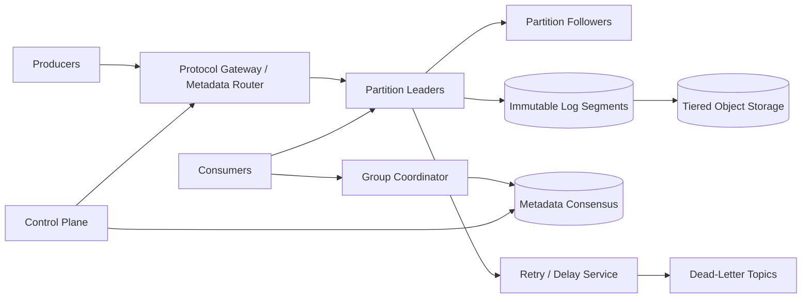

# Production Pub-Sub and Message Queue

## 1. Requirements

### Functional requirements

1. Publish messages to named topics.
2. Support queue semantics through consumer groups and broadcast semantics through independent subscriptions.
3. Preserve ordered delivery within a partition.
4. Retain messages for replay by time or offset.
5. Support acknowledgements, retries, dead-letter topics, and delayed redelivery.
6. Filter subscriptions using message attributes.
7. Allow producers to batch, compress, and publish idempotently.
8. Expose consumer lag and safely rebalance group membership.

### Non-functional requirements

- Sustain millions of messages per second and petabytes of retained data.
- Acknowledge durable writes in tens of milliseconds within a region.
- Remain available through broker and availability-zone failures.
- Provide at-least-once delivery by default and bounded exactly-once processing support.
- Isolate tenants and apply storage, bandwidth, and connection quotas.
- Scale partitions online without silently changing ordering guarantees.

Arbitrary global order is out of scope. Ordering is guaranteed only within a partition or an explicitly keyed stream.

## 2. Scale assumptions and capacity

Assume:

- 10 million messages/second peak.
- 1 KB average payload: 10 GB/second ingress before replication.
- Replication factor three: 30 GB/second internal write traffic.
- Seven-day default retention: roughly 6 PB raw, before compression and indexes.
- 100,000 topics, 10 million partitions, 50 million consumer connections.
- Typical publish-to-visible latency below 100 ms.

Payload size distribution and fan-out dominate cost. Ten independent subscriptions may read one stored copy ten times; messages should be stored once per topic partition, not copied into every subscription queue.

## 3. High-level architecture



The data plane appends and fetches bytes. A smaller consensus-backed control plane owns topic metadata, partition assignments, ACLs, quotas, and leader epochs.

## 4. Data model and protocol

```text
Topic
- tenant_id
- topic_id
- partition_count
- replication_factor
- retention_policy
- compaction_policy

Partition
- topic_id
- partition_id
- leader_broker
- leader_epoch
- replica_set
- high_watermark

Record
- offset
- timestamp
- key
- value
- headers
- producer_id
- producer_epoch
- producer_sequence
- checksum

ConsumerGroup
- group_id
- generation
- members
- assignments

CommittedOffset
- group_id
- topic_id
- partition_id
- next_offset
- metadata
```

Records are length-prefixed and checksummed inside compressed batches. The offset is assigned by the partition leader and identifies log position, not a globally unique event.

## 5. Core APIs

```http
POST /v1/topics
POST /v1/topics/{topic}/messages
GET  /v1/topics/{topic}/partitions
POST /v1/groups/{group}/offsets:commit
GET  /v1/groups/{group}/lag
POST /v1/subscriptions/{subscription}:seek
```

High-throughput clients use a versioned binary protocol:

```text
Produce(topic, partition|key, producer_id, epoch, first_sequence, batches)
Fetch(topic, partition, offset, max_bytes, wait_ms)
JoinGroup(group, member, protocols)
Heartbeat(group, member, generation)
CommitOffsets(group, generation, offsets)
```

Errors distinguish retriable leader changes, throttling, fencing, invalid records, and authorization failures.

## 6. Publish flow

1. The producer refreshes topic metadata and chooses a partition by explicit ID, key hash, or sticky batching.
2. It batches records, compresses them, and sends them to the current leader.
3. The leader validates ACLs, quotas, checksum, producer epoch, and sequence.
4. It appends to its local log and replicates to followers.
5. Once the configured quorum has persisted the batch, the leader advances the high watermark and acknowledges.
6. Consumers may fetch only through the committed high watermark.

`acks=all` offers durable quorum acknowledgement. A lower acknowledgement level may improve latency but can lose messages during failover and must be an explicit producer choice.

## 7. Idempotent publishing and transactions

A producer obtains a `producer_id` and increasing epoch. Each partition receives monotonically increasing sequence numbers. The leader remembers the recent sequence window:

- Expected sequence: append.
- Already accepted sequence: return the original offset.
- Gap: reject so the producer refreshes state.
- Older producer epoch: fence it.

For atomic writes across partitions, a transaction coordinator records participating partitions and commits a transaction marker to each. Read-committed consumers skip aborted and unresolved records. This adds coordinator state, marker traffic, and stalled-transaction handling; use it only when atomic multi-partition publication is required.

End-to-end exactly-once processing additionally requires consumed offsets and produced output to be committed in the same broker transaction. It does not make calls to arbitrary external databases exactly once.

## 8. Consume, acknowledge, and rebalance

Within a consumer group, each partition is assigned to at most one active member. Independent groups each receive the full topic.

1. A member joins the coordinator and receives a group generation.
2. The coordinator computes assignments based on subscriptions and capacity.
3. Consumers fetch sequential batches from leaders and process them.
4. They commit the next offset only after successful processing.
5. A crash before commit causes replay; a commit before processing can lose work.

Use cooperative rebalancing: revoke only partitions that must move, let members drain, then assign them. Generation numbers fence offset commits from removed members. Static membership avoids full rebalances for short restarts.

## 9. Retry, delay, and dead-letter handling

Immediate retry can block a partition behind one poison message. A managed subscription may republish failures to retry topics such as `orders.retry.1m` with original topic, partition, offset, and attempt headers. A delay service releases them at the due time. After the retry budget, publish to a dead-letter topic and commit the original offset.

This relaxes strict ordering: later records may complete first. Workloads requiring key order can pause that key/partition, accept head-of-line blocking, or use a keyed retry lane. Dead-letter replay is an audited operation with a new replay ID to prevent loops.

## 10. Ordering, consistency, and delivery semantics

- A leader assigns monotonically increasing offsets within one partition.
- Only committed offsets are visible.
- On failover, the new leader is chosen from sufficiently caught-up replicas and starts a higher leader epoch.
- Producer retries may duplicate without idempotence.
- Consumer retries may duplicate whenever completion and offset commit are not atomic.

Keyed partitioning preserves order for one key until repartitioning. Increasing the partition count changes `hash(key) mod N`; existing keys may move and lose cross-partition order. Stable virtual buckets can reduce this disruption.

## 11. Partitioning, storage, and retention

Each partition is an append-only sequence of immutable segments plus sparse offset and time indexes. The active segment receives sequential writes; closed segments are checksummed and can move to object storage while brokers retain a local cache.

Partition by message key to preserve per-entity order. Hot keys cannot be split without changing that guarantee; mitigate them with application-level subkeys or dedicated partitions.

Retention modes:

- Time/size deletion for event streams.
- Key compaction retaining the latest value and tombstones for changelog topics.
- Both compaction and time retention for bounded state histories.

Segment deletion waits until the retention boundary, active readers, replication, and tiered-storage upload permit it.

## 12. Replication and leader election

Replicas append in leader order and report durable offsets. The high watermark is the largest offset replicated to the in-sync quorum. The control plane elects a new leader with a higher epoch.

Unclean election of a stale replica restores availability by discarding acknowledged data; production defaults should disable it. If no safe leader exists, prefer partition unavailability until an in-sync replica returns. Rack-aware placement ensures a quorum does not share a failure domain.

## 13. Reliability and failure handling

| Failure | Handling |
|---|---|
| Producer times out after append | Retry with producer ID/sequence |
| Leader crashes | Elect caught-up replica; clients refresh metadata |
| Follower corrupts a segment | Checksum failure, quarantine, copy from healthy replica |
| Consumer crashes before commit | New owner reprocesses batch |
| Consumer commits stale generation | Coordinator rejects fenced commit |
| Broker disk fills | Throttle, move leaders, tier segments; never acknowledge dropped data |
| Poison message | Bounded retry then dead-letter |
| Control plane unavailable | Existing leaders continue bounded operation; metadata changes pause |
| Object tier unavailable | Serve cached/local data or explicit fetch error; preserve hot log |
| Region isolation | Follow configured regional ownership/failover policy |

Background scrubbers verify segment checksums and replica agreement. Capacity automation should move replicas before disks reach an emergency threshold.

## 14. Multi-region design

For low latency and clear ordering, keep each partition writable in one home region and asynchronously mirror committed records elsewhere. Consumers can read local mirrors with measurable lag.

Failover promotes a mirror only after fencing the old region and choosing an accepted recovery point. Automatic active-active publication is possible by assigning distinct partitions to regions, but one logical key should have one writer. If multi-master semantics are mandatory, expose region-specific ordering and application conflict resolution rather than claiming a single order.

Geo-replication checkpoints source offsets and maps them to destination offsets. Residency policies determine which topics may leave a region.

## 15. Security and tenant isolation

- Mutual TLS for clients and brokers; short-lived identities.
- Topic- and group-level ACLs for create, publish, consume, seek, and administer.
- Encryption at rest with KMS-backed keys and rotation.
- Per-tenant quotas for bytes, requests, partitions, connections, and retained storage.
- Message and header size limits; decompression-bomb protection.
- Audit topic changes, ACLs, offset resets, and dead-letter replays.
- Avoid sensitive payloads in broker logs and metrics.

For end-to-end encrypted payloads, brokers can route on approved unencrypted headers but cannot filter or inspect content.

## 16. Observability

Track:

- Publish/fetch throughput, batch size, compression ratio, and throttle time.
- End-to-end publish-to-consume latency.
- Replication lag, under-replicated partitions, leader elections, and offline partitions.
- Consumer lag in messages, bytes, and time.
- Rebalance duration, churn, and fenced commits.
- Disk utilization, segment age, tiering backlog, and checksum failures.
- Retry/DLQ rates and oldest unprocessed message.
- Control-plane quorum health and metadata propagation.

Canary producers and consumers should continuously verify durability, order, replay, and cross-region replication.

## 17. Capacity and operational controls

Partition count sets parallelism but carries file handles, metadata, election, and memory overhead. Choose enough headroom without creating millions of tiny partitions unnecessarily. Reassignment copies replicas gradually, rate limits network use, and changes leadership separately from data movement.

Operators need pause/resume, partition reassignment, safe offset reset, consumer drain, quota override, and segment repair procedures. All destructive controls require preview and audit.

## 18. Major trade-offs

### Queue versus log

Deleting on acknowledgement is simple for work queues but prevents replay and duplicates payloads across subscriptions. A retained log plus group offsets supports both queue and pub-sub semantics.

### Ordering versus parallelism

More partitions increase throughput but only guarantee order inside each. Global ordering would force a throughput bottleneck.

### At-least-once versus exactly-once

At-least-once is robust and general. Broker transactions reduce duplicates within broker-managed pipelines but add coordinator and recovery complexity.

### Local storage versus tiered storage

Local disks provide predictable hot reads; object storage makes long retention affordable. Tiering adds cache misses and another failure mode.

### Availability versus durability on election

Unclean leader election favors availability while losing committed records. Quorum-only election favors durability and is the safer default.

## 19. Recommended interview presentation

1. Clarify queue versus broadcast consumers, replay, order, and delivery guarantees.
2. Estimate ingress bandwidth, retention, replication, and partition count.
3. Draw producers, partition leaders/followers, coordinators, and tiered storage.
4. Walk through quorum publication and sequential consumption.
5. Deep-dive into consumer groups, generations, and cooperative rebalance.
6. Explain duplicates, idempotent producers, transactions, and external side effects.
7. Cover retention, hot partitions, retry ordering, and failover.
8. Finish with multi-region and durability/availability trade-offs.

The central design insight is:

> Store each topic partition as a replicated append-only log, make offsets the durable consumer checkpoint, and use epochs and sequence numbers to fence stale producers, leaders, and group members while accepting that external processing is normally at least once.
