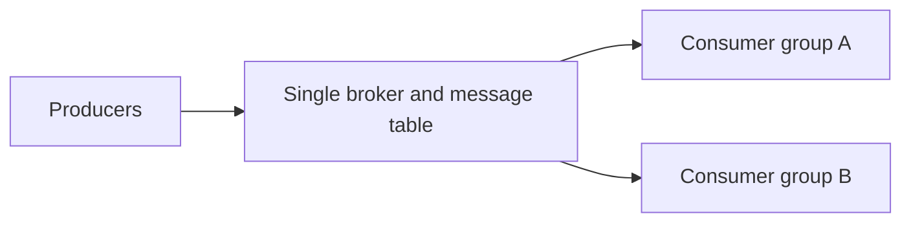
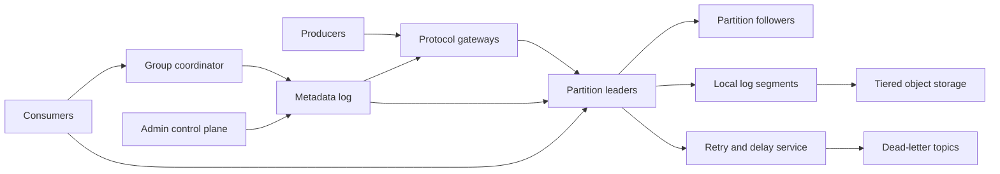
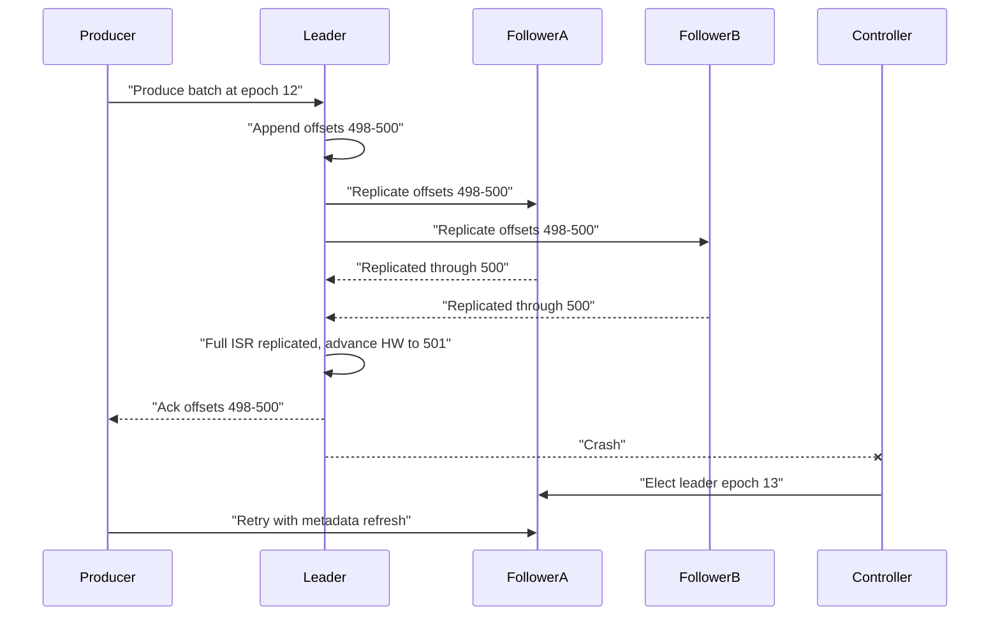
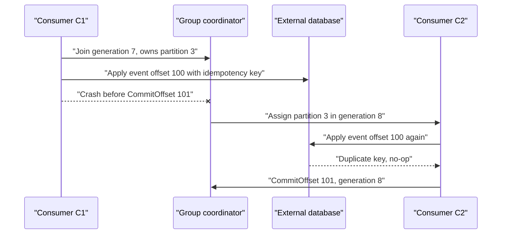
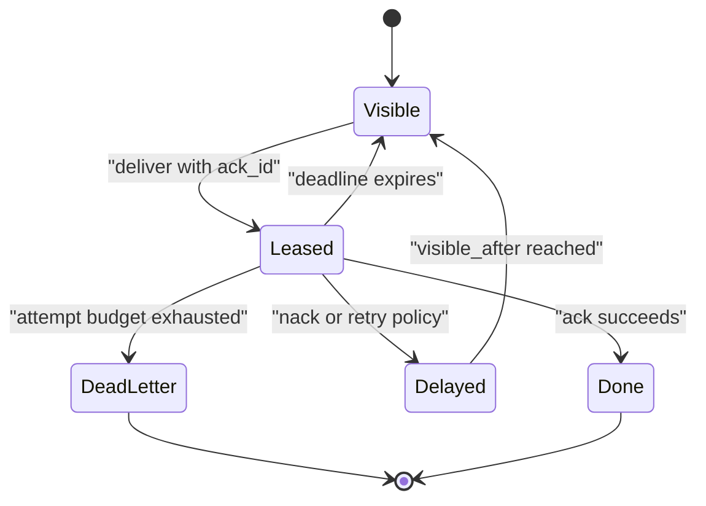

# Pub-Sub Message Queue System Design

This design builds a production pub-sub and message queue that accepts high-volume publishes, durably stores messages, and delivers them to many independent consumers. The scope is a regional service with replayable topics, consumer groups, retries, and dead-letter handling; arbitrary global ordering is out of scope because the system only promises order inside a partition.

## 1. Requirements

### 1.1 Functional requirements

- Producers can publish messages to named topics, either to an explicit partition or through key-based partitioning.
- Consumers can read a topic as independent subscriptions for broadcast or as a consumer group where members divide partitions.
- The service preserves message order within one partition and supports replay by offset or timestamp within retention.
- Consumers can acknowledge progress, retry failed work, delay redelivery, and route poison messages to a dead-letter topic.
- Producers can batch, compress, retry safely, and use idempotent publishing for duplicate suppression.
- Operators can change partition counts, move replicas, inspect lag, and reset offsets without pretending that repartitioning preserves old ordering for every key.

### 1.2 Non-functional requirements

- **Durability.** Once a publish is acknowledged at the durable setting, the message must survive the loss of a broker or availability zone, because downstream services use the log as the source of truth for recovery.
- **Ordered throughput.** The system must sustain millions of messages per second while preserving order only within partitions; forcing one global order would make one sequencer the bottleneck.
- **Bounded latency.** Hot-path publish and fetch should stay in the tens of milliseconds inside a region, so control-plane consensus and cold storage cannot sit on every record path.
- **Elastic fan-out.** Ten consumer groups should not require ten physical copies of every message; the storage model must separate retained records from each group's read position.
- **Failure transparency.** Clients must be able to distinguish retriable leader changes, fenced producers, stale group generations, throttling, and authorization failures.
- **Tenant isolation.** Quotas for bytes, partitions, connections, and retained storage are required because one hot tenant can otherwise exhaust broker disks or controller memory for everyone.

### 1.3 The binding constraint

The binding constraint is durable, ordered, high-throughput delivery where ordering exists only inside a partition and acknowledged writes must survive broker loss. A queue that deletes each message on acknowledgement is simple, but it cannot support replay or many independent subscribers without copying payloads. A single ordered log is also simple, but it cannot absorb millions of writes per second. The design must therefore shard the log into partitions and make the partition, not the topic, the unit of ordering, replication, leadership, and consumer assignment.

That choice forces three mechanisms. First, each partition is a replicated append-only log with a leader, in-sync replicas, high watermark, and explicit election policy. Second, delivery semantics are expressed through consumer offsets and group generations, not through deleting records. Third, queue-like retry and dead-letter behavior must be layered on top of the log model without accidentally breaking the per-partition ordering contract more than the user chose.

## 2. Back-of-the-envelope estimation

Assume an illustrative peak of 10 million messages per second with an average payload of 1 KB. Ingress is `10,000,000 × 1 KB = 10 GB/s` before protocol overhead and compression. With replication factor three, brokers perform about `10 GB/s × 3 = 30 GB/s` of durable disk writes across leaders and followers, and leader-to-follower replication adds roughly `10 GB/s × 2 = 20 GB/s` of internal network traffic before consumer egress. This immediately rules out a design where one topic owner stores all messages or where every subscriber receives a private physical copy.

Retention is the second shaping number. Sustaining the stated peak for all seven days would require `10 GB/s × 86,400 × 7 = 6,048,000 GB`, about 6.0 PB for one logical copy and 18.1 PB with three copies. This is a peak-sustained bound; a normal retention estimate uses measured average ingress. Compression and object-tier durability change the physical footprint. Cold segments can move to object storage so a replacement broker need not copy a full week locally.

Partition count drives parallelism and metadata cost. If one partition can safely accept 10 MB/s of sustained append traffic, `10 GB/s ÷ 10 MB/s = 1,000` hot partitions are enough for raw ingress, but real deployments need many more partitions to isolate tenants, keys, and consumer groups. LinkedIn has described Kafka deployments with 100,000 topics and millions of partitions, which is evidence that this order of magnitude is possible, but it also explains why controller metadata and partition movement must be engineered as first-class paths rather than background scripts.

Fan-out can dominate both network and lag. If a topic has 20 active consumer groups and each reads all data, egress can reach `10 GB/s × 20 = 200 GB/s` even though storage writes remain 10 GB/s logical. The architecture should optimize the write path for one stored copy per partition and optimize the read path with batching, fetch coalescing, quotas, and consumer lag visibility.

> **Key idea.** The numbers say the system is not a database table of messages and not one giant FIFO. It is a fleet of replicated partition logs, with cold bytes offloaded, offsets tracked separately from records, and metadata scaled almost as carefully as data.

## 3. API design

**Question.** What makes a producer retry safe when the first publish may have succeeded but the response was lost?
<details><summary>Answer</summary>

Use a stable producer identity, epoch, and per-partition sequence, with dedupe state replicated and recovered on leader change. This suppresses protocol retries within the supported session and retention window, not every duplicate business event forever. Restarting with a new producer identity or application-level republishing can still duplicate a logical event; those cases need a stable business ID and downstream dedupe.

</details>

```http
POST /v1/topics
GET  /v1/topics/{topic}/metadata
POST /v1/topics/{topic}/messages
GET  /v1/topics/{topic}/partitions/{partition}/records?offset={offset}&max_bytes={n}
POST /v1/groups/{group}:join
POST /v1/groups/{group}/offsets:commit
POST /v1/subscriptions/{subscription}:seek
GET  /v1/groups/{group}/lag
```

High-throughput clients normally use a versioned binary protocol over long-lived connections rather than these HTTP shapes. The core messages are `Produce(topic, partition|key, producer_id, epoch, first_sequence, batches)`, `Fetch(topic, partition, offset, max_bytes, wait_ms)`, `JoinGroup(group, member, protocols)`, `Heartbeat(group, member, generation)`, and `CommitOffsets(group, generation, offsets)`. HTTP is still useful for administration, low-volume producers, and debugging because it makes status resources and errors easy to expose.

The non-obvious API decision is that acknowledgement means different things at different layers. A producer acknowledgement says a record reached the configured durability point, such as the leader only or all in-sync replicas. A consumer acknowledgement is an offset commit saying, "the next record I need is offset N." It does not delete the record, and it does not prove that an external side effect was performed exactly once. For queue-like subscriptions that expose per-message ack IDs, the ack ID should be a lease token tied to a delivery attempt, not the record's permanent identity, so stale acks can be rejected after redelivery.

Seek and offset reset are explicit administrative operations because they can replay side effects. A reset should require the target offset or timestamp, the affected group, a preview of lag change, and an audit record. Cancellation is best effort: a client can cancel an in-flight fetch or a delayed retry before it is redelivered, but it cannot erase a record that has already been appended to a retained log.

## 4. Data model

Start with the obvious entity, `Topic`, a named stream with retention and partition count. A topic alone cannot represent ordering, because order is only meaningful inside a shard. We therefore add `Partition`, which has a monotonically increasing offset sequence, a replica set, and a leader epoch. The leader epoch matters because a stale leader may still be reachable after a network partition; clients and followers must be able to reject writes from an old term.

Next comes `Record`. It is tempting to store one row per message with a UUID and status, but that turns every consumer acknowledgement into a write against the message row and makes broadcast subscriptions copy or mutate shared state. Instead, records are immutable entries in partition segments. The offset is assigned by the leader when appending; producer IDs, producer epochs, and sequence numbers are stored so retries can be deduplicated without requiring a global message ID lookup.

The first consumer model might put `delivered_to` or `acked_by` on each record. That breaks as soon as one topic has thousands of consumer groups. The scalable model is `CommittedOffset`, one checkpoint per group and partition. The log remains append-only while each group records the next offset it wants to read. For managed queue semantics, `DeliveryAttempt` adds a lease-like ack ID, attempt count, and deadline, but it points back to the immutable record rather than mutating the record.

Finally, transactions need their own metadata. Idempotent append needs recoverable producer-sequence state, not just a volatile leader cache. Atomic writes across partitions need a `Transaction` coordinator record, participants, and commit or abort markers. Read-committed consumers hide aborted records and stop before unresolved transactions; they do not wait by reading past an unstable prefix.

```text
Topic
- tenant_id
- topic_id
- name
- partition_count
- replication_factor
- retention_policy
- compaction_policy
- message_size_limit

Partition
- topic_id
- partition_id
- leader_broker_id
- leader_epoch
- replica_set
- in_sync_replica_set
- high_watermark
- log_start_offset

RecordBatch
- topic_id
- partition_id
- base_offset
- last_offset
- producer_id
- producer_epoch
- first_sequence
- timestamp_range
- compression_codec
- checksum
- records

ConsumerGroup
- tenant_id
- group_id
- generation
- protocol
- members
- assignments

CommittedOffset
- group_id
- topic_id
- partition_id
- next_offset
- generation
- metadata
- committed_at

DeliveryAttempt
- subscription_id
- topic_id
- partition_id
- offset
- ack_id
- attempt
- visible_after
- deadline
- status

Transaction
- transactional_id
- producer_id
- producer_epoch
- state
- participant_partitions
- timeout_at
```

Topic metadata, partition assignments, ACLs, and leader epochs belong in a small replicated metadata log, not in the same local files as message bytes. Record batches live in broker log segments on local disks, with closed segments optionally copied to object storage. Consumer offsets can be stored in an internal compacted topic or equivalent replicated log because they need high write throughput and replayability, not relational joins. Delivery attempts for a managed queue API may live in a compacted state store backed by the log; they should not be the source of truth for the retained payload.

> **Key idea.** Records are immutable and shared; offsets, leases, and transactions are separate state machines layered around the log so that fan-out and replay do not rewrite message data.

## 5. High-level design

The simplest design is a single broker with a table of messages. Producers insert rows, consumers poll rows, and acknowledgements delete rows. It is attractive because every operation is easy to understand and the database can give a single order.



This breaks in concrete ways. The broker is a throughput bottleneck and a single failure domain. Deleting on ack prevents replay and makes independent subscribers fight over shared row state. A leader crash after acknowledging but before replication loses messages. One poison record can block a FIFO queue forever. Finally, a database row model turns retention into expensive random mutation rather than cheap sequential segment deletion.

### Fix 1: Shard topics into partition logs

A topic is split into partitions, and each partition is an append-only log. The partition leader assigns offsets and appends batches sequentially. Producers choose partitions by explicit ID, key hash, or sticky batching. Consumers fetch from an offset, which means replay is just another read. This fixes the single-broker throughput bottleneck by making the partition the unit of parallelism, but it deliberately narrows the ordering contract: records with different keys in different partitions have no defined relative order.

### Fix 2: Replicate each partition with leader epochs and high watermarks

For the classic Kafka-style ISR design here, without eligible-leader-replica extensions, require replication factor three across failure domains, `acks=all`, `min.insync.replicas=2`, and clean election. All current ISR members must replicate the write; the minimum is an admission threshold, not permission to ignore a third member still in the ISR. Define the high watermark as an exclusive boundary: offsets below `HW` are replication-committed. Transactional `read_committed` adds a last-stable-offset bound. Epochs accompany membership and election rules; comparing a cached epoch alone cannot fence an isolated leader.

### Fix 3: Separate consumer progress from stored records

A consumer group stores committed offsets per partition and grants one valid assignment per partition at a time. Independent groups keep separate progress. An evicted process can still run, so assignment alone does not fence downstream effects. Adding consumers helps only until all partitions are assigned; hot partitions need better partitioning or explicit application-level concurrency.

### Fix 4: Add retry, delay, and dead-letter lanes as log-backed state

Retries cannot be naive immediate re-fetches forever. A poison message would pin a partition and hide all later records. For general work queues, failed records move through retry topics or a delivery-attempt state machine with `visible_after`, attempt count, and an ack lease. After the retry budget, the record is sent to a dead-letter topic with headers pointing to the original topic, partition, offset, and failure reason. Workloads that require strict key order can choose head-of-line blocking for that key; other workloads can trade order for progress.

### Fix 5: Move cold segments to tiered storage

Seven-day or longer retention makes local-only storage operationally heavy. Closed immutable segments can be uploaded to object storage while brokers retain active and recently read segments locally. Confluent's tiered storage work and Pinterest's MemQ both point to the same lesson: separating hot serving from cold retention reduces broker replacement and rebalance cost, but it makes remote segment metadata, cache misses, and object-store errors part of the design.

### Putting it together



A publish starts with metadata lookup and a compressed batch sent to the leader. The leader validates quota, ACL, checksum, producer epoch, and sequence, appends, replicates, and returns offsets after the configured acknowledgement condition. Consumers join groups, process fetched records, and commit the next required offset. Group offsets and transaction-coordinator state use internal logs; transaction commit/abort markers live in the participating data partitions, not only in a separate coordinator log. Retry and dead-letter state remain distinct from the original immutable payload.

> **Key idea.** Each component traces back to a specific failure of the naive design: partition logs for throughput, replication for durable acknowledgement, offsets for fan-out and replay, retry lanes for poison records, and tiered storage for retained bytes.

## 6. Deep dives

### 6.1 Replicated partition log: leader, ISR, high watermark, and election

**Question.** A producer receives an acknowledgement for offset 500, the leader crashes one millisecond later, and a follower becomes leader. How do we know whether offset 500 is still there?
<details><summary>Answer</summary>

For the configured single-broker/zone failure model, offset 500 must be replicated under the ISR acknowledgement rules before success. It is below the exclusive high watermark once `HW >= 501`. Only a clean successor containing the committed prefix may lead; electing a stale replica can discard acknowledged records. Replication acknowledgement is not automatically a per-record fsync guarantee against correlated power loss.

</details>

A single append-only file gives order but not replicated durability. `acks=1` can acknowledge a record that no future leader has. `acks=all` waits for the current ISR, but without a minimum ISR setting it can still succeed with only the leader left. This design requires at least two in-sync replicas across failure domains and refuses durable publishes below that threshold. A replication error after append is ambiguous; retry the same producer batch rather than inventing a new logical message.

Followers append in log order and report replication progress. If all three replicas remain in the ISR, all three must reach offset 500 before `HW` advances to 501; if a lagging follower is safely removed from ISR, the remaining set must still meet the configured minimum. Kafka normally relies on replicated filesystem/page-cache writes rather than fsync for every acknowledgement. A stricter power-loss contract requires an explicit flush policy and its cost, not a renamed replication acknowledgement. Consumers never fetch offsets `>= HW`; read-committed transactional consumers also stop at the last stable offset.



Leader epochs are part of stale-authority fencing, not a broadcast that instantly reaches an isolated node. Membership changes and elections must be serialized by the metadata controller, replicas must enforce current terms, and a fenced/disconnected broker must not claim fresh authority or unilaterally shrink ISR to itself. An old node might accept uncommitted local appends, but cannot give the configured durable success once it cannot satisfy the valid ISR protocol. Recovery may truncate an uncommitted suffix, never the committed prefix below `HW`. A different quorum-log implementation must supply its own consensus election rules rather than mixing a majority acknowledgement with classic Kafka ISR semantics.

Unclean leader election is the painful trade-off. If every in-sync replica is gone, the service can either keep the partition unavailable or elect a stale replica. Electing stale restores reads and writes sooner, but it may discard acknowledged data if the stale replica lacks committed offsets. For a message queue where acknowledged records often trigger business workflows, the safer default is to disable unclean election and make unavailability visible. Some low-value telemetry topics might choose the opposite: losing a few seconds of metrics can be better than backpressuring all agents. The point is to make the durability/availability trade explicit per topic class.

This is also where controller scalability matters. LinkedIn's Kafka scale exposed slow controller paths, memory pressure, and maintenance pain at millions of partitions and replicas. Kafka's move from ZooKeeper to KRaft put metadata into its own replicated log so controller failover and broker metadata propagation could be reasoned about with epochs and snapshots. The design should isolate controller resources from data-plane spikes; otherwise, a burst of produce traffic can delay leader elections exactly when the cluster is trying to recover.

Signals worth watching: under-replicated partitions, high-watermark lag, leader election rate, offline partitions, stale-epoch errors, and the number of partitions with no clean leader candidate.

> **Strong-answer criteria.** A senior answer distinguishes leader append from committed visibility, explains high watermark and epochs, and names the data-loss consequence of unclean election rather than saying "replication handles it."

| Level | Approach | Why |
|---|---|---|
| Bad | Acknowledge after the leader writes locally. | A leader crash can lose acknowledged records that never reached a follower. |
| Good | Replicate to followers before ack and elect a new leader on failure. | This is directionally right but incomplete without high-watermark visibility and stale-leader fencing. |
| Great | Use ISR or quorum replication, expose only the high watermark, fence with leader epochs, and make unclean election a topic-level durability trade-off. | These mechanisms preserve the committed prefix while allowing explicit choices for low-value data. |

### 6.2 Delivery semantics: groups, offsets, rebalancing, and exactly-once boundaries

**Question.** A consumer processes offset 100, writes to a database, crashes before committing offset 101, and then another member takes the partition. What delivery guarantee did the system provide?
<details><summary>Answer</summary>

It provided at-least-once delivery. The new owner starts from the last committed offset and may reprocess offset 100. Preventing a duplicate database effect requires an idempotency key, an inbox/outbox table, or a broker transaction that includes both consumed offsets and produced broker records; broker transactions alone do not make arbitrary external databases exactly once.

</details>

Consumer groups are the bridge between a retained log and a queue. The log keeps all records until retention. The group coordinator assigns partitions to members so each partition has at most one active owner in the group. The group's committed offset for a partition is the next offset to read, not the last record delivered. This convention makes recovery simple: after a crash, the new owner fetches from the committed offset and may repeat any records processed but not committed.

The commit boundary is the source of most delivery confusion. Committing before processing can lose work; processing before committing can repeat work. For a database effect, insert the inbox identity and apply the mutation in the same transaction, so a replay is a genuine no-op. Merely inserting a dedupe row before a separate mutation creates a crash gap. An email or payment HTTP call needs provider-supported idempotency or explicit unknown-outcome recovery; a local send-attempt record alone cannot make that external effect exactly once.

Rebalancing adds another race. A member may be slow or partitioned while the coordinator decides it is dead and increments the group generation. If the old member later commits offsets, those commits must be rejected; otherwise, an evicted consumer can overwrite the progress of the new owner. Generation numbers fence stale commits. Cooperative rebalancing improves availability by revoking only partitions that move, letting members drain and commit before handoff, and then assigning the partitions to their new owners. Static membership avoids full rebalances during short rolling restarts because a known member can return without making the whole group reshuffle.

One assigned owner does not imply one physically running process. An evicted consumer may continue external writes even though its offset commits fail. Enforce downstream business deduplication and, where order matters, a current resource fence or sequence check atomically with the effect. Concurrent processing within a partition also needs a completed-offset set: commit only the contiguous completed prefix, not the largest offset that happened to finish.



Exactly-once semantics are narrower than the phrase suggests. Kafka's model combines idempotent producer sequence numbers, producer epochs, transactions, commit markers, and the ability to include consumed offsets in the same transaction as produced output records. That can make a consume-transform-produce pipeline inside the broker appear exactly once to read-committed consumers. It does not make an HTTP call to a shipping provider or a write to an unrelated database exactly once. Those systems need their own idempotency or a transactional outbox/inbox pattern.

The `read_committed` caveat is important. Transactional producers write records before the transaction outcome is known. A read-uncommitted consumer can see records that later abort. A read-committed consumer must skip aborted records and may have to stop at the last stable offset while an earlier transaction remains unresolved. This improves correctness for transactional pipelines but can increase tail latency when a producer stalls. The system needs transaction timeouts and coordinator recovery to prevent one dead producer from hiding later committed records indefinitely.

Google Pub/Sub's enabled exactly-once mode provides a different boundary: successful acknowledgements prevent subsequent redelivery of that message within its regional pull-subscription contract; deadline expiry and nacks still permit redelivery, and stale ack IDs are rejected. This is not a guarantee for all subscription modes and does not remove distinct publish-side duplicates. Our managed queue deliberately adopts strict per-attempt ack tokens. Acknowledgement success must be visible to the client so it can distinguish completion from an unresolved ack timeout.

Signals worth watching: consumer lag by time and bytes, rebalance duration, generation-fenced commits, duplicate-handler no-ops, transaction timeout rate, and the gap between high watermark and last stable offset.

> **Strong-answer criteria.** A strong answer separates log durability from processing effects, states exactly where duplicates arise, and confines exactly-once claims to broker-managed transactional boundaries plus read-committed consumers.

| Level | Approach | Why |
|---|---|---|
| Bad | Commit offsets as soon as records are fetched. | A crash after commit but before processing loses work. |
| Good | Process first, then commit offsets, and make handlers idempotent. | This is the right default but still needs stale-generation fencing during rebalances. |
| Great | Use generation-fenced commits, cooperative rebalance, idempotent side effects, and broker transactions only for consume-transform-produce paths with read-committed consumers. | It states the real guarantee and the operational caveats. |

### 6.3 Queue model versus log model: ack leases, retries, DLQs, skew, and tiering

**Question.** A work item at offset 42 always fails, but offsets 43 through 10,000 are independent jobs. Should the queue keep delivering offset 42 until it succeeds?
<details><summary>Answer</summary>

Only if strict ordering for that key or partition is more important than progress. A general work queue should give offset 42 a bounded retry policy, delay redelivery with an ack lease or retry topic, and eventually move it to a dead-letter topic while committing past it. That choice weakens strict partition order for failed records, so it must be explicit.

</details>

A log and a queue answer different questions. A queue asks, "which work item should a worker own right now?" Once acknowledged, the item can disappear. A log asks, "what happened at offset N, and where is this subscriber in the stream?" The log keeps the record and moves subscriber offsets. Pub-sub at scale usually wants the log model because it supports replay, broadcast, and one stored copy. Work queues want per-message leases, retries, and poison-message isolation. A production system often has to expose both without muddling their guarantees.

The naive log-based retry is to not commit the offset until processing succeeds. That preserves order but can create catastrophic head-of-line blocking. If offset 42 is malformed, the partition cannot make progress even if later records are unrelated. Slack's job-queue migration is a useful reminder that queue workloads need duplicate tolerance, failure-mode testing, and migration paths; the hard part is not only storing the jobs but recovering when the queue backend itself is under pressure.

The managed-queue layer introduces delivery attempts. A consumer receives an ack ID with a deadline. Ack, renewal, expiry, and reassignment are atomic conditional transitions on the current attempt. Once expiry or reassignment wins, an old ack cannot erase the replacement attempt. Out-of-order acks are stored individually; the subscription's reclaimable offset advances only over a contiguous acknowledged or durably rerouted prefix. Otherwise, finishing offset 43 while 42 is still leased would lose 42. This strict ack policy resembles Pub/Sub's exactly-once mode, not every default queue's behavior.



There are two common implementations. Retry topics keep the core log simple: failed records are republished to topics such as `orders.retry.1m` and later released to the original processing path with headers carrying original topic, partition, offset, attempt, and failure class. This is easy to inspect and scales like normal topics, but it changes ordering because later records can finish first. A delivery-attempt state store keeps a queue-like view over the original log and can preserve more subscription semantics, but it adds a mutable state machine that must itself be durable and partitioned.

Moving to a retry or dead-letter topic must be durable before acknowledging the original. For a broker-local pipeline, commit the destination record and consumed offset in one broker transaction. With an external attempt store, atomically record the reroute decision and its outbox command, and retain enough payload to finish publication. A standalone publish followed by an offset commit is at-least-once and needs dedupe; committing first can lose the work. The original source identity remains stable across retry lanes.

Partition skew is the related throughput trap. In a consumer group, one partition has one valid assigned owner. If one key accounts for 50% of traffic and its effects must be ordered, half the topic's work is serialized regardless of consumer count. Cloudflare's Kafka message-bus work highlights this limit. Virtual buckets can distribute different keys, but a single hot key still requires subkeys or weaker ordering. Append order is not completion order: strict key lanes must execute sequentially, preserve that lane through retries and handoffs, and fence stale effects.

Tiered storage is the storage-side counterpart. The log model makes replay possible, but replay over petabytes cannot require every byte to remain on broker SSDs. Closed segments can move to object storage with sparse offset and time indexes. Hot consumers read from local disks; old replays fetch remote segments through a cache. Confluent's tiered storage reduces broker replacement and partition reassignment cost because new brokers do not copy all historical segments. Pinterest MemQ pushes the idea further for workloads that accept seconds of latency by writing immutable micro-batches to object storage and scaling serving separately from writes. The trade-off is that remote-read latency and remote-store availability become visible product behavior. A replay from last month may be slower or fail differently than reading the hot tail, and the API should say so.

Verify uploaded segment checksums and durably publish their lookup metadata before evicting local copies. Retention is independent of an individual consumer's acknowledgement: a seven-day log can delete an eight-day-old unprocessed record. Return an explicit offset-expired error, not a silent reset to latest. A queue that promises to retain unacknowledged work must pin or copy its payload within a separately specified maximum retention policy.

Signals worth watching: oldest visible message age, retry and DLQ rate by failure class, expired ack deadlines, hot-key contribution to partition traffic, remote segment cache hit rate, and tier upload backlog.

> **Strong-answer criteria.** A senior answer does not collapse queues and logs into one vague abstraction. It states which guarantees are kept, which are relaxed for retries, and how skew and cold replay affect the system at scale.

| Level | Approach | Why |
|---|---|---|
| Bad | Never commit a failed message, and keep retrying immediately. | One poison record can block an entire partition forever. |
| Good | Use delayed retries and a DLQ after a fixed attempt budget. | This preserves progress but must document the ordering trade-off and stale-ack races. |
| Great | Layer per-attempt ack leases or retry topics over an immutable log, fence stale ack IDs, expose DLQ replay as audited reprocessing, monitor partition skew, and tier cold segments explicitly. | It gives queue behavior without losing the log's replay and fan-out strengths. |

## 7. Variants

**10x scale.** At 100 million messages per second and 100 GB/s ingress, the same partition-log model remains, but every shared path must be sharded harder. Gateways need connection sharding and request coalescing, metadata propagation must be incremental, partitions need placement automation, and tier upload bandwidth becomes a first-class capacity pool. The design should also introduce topic classes so low-latency topics pay for local replication while bulk telemetry can use larger batches and object-backed storage.

**Multi-region active-passive.** Keep one home region per partition and asynchronously mirror committed records. Promotion requires fencing the old region and selecting a recoverable prefix. Regional acknowledgements do not imply zero-loss regional disaster recovery: unmirrored records and group/producer/transaction state can be lost or need reconciliation. Resume consumers using translated checkpoints, deduplicate replayed business events, and resolve incomplete transactions rather than assuming identical offsets or sessions. A zero-RPO contract requires synchronous cross-region durability. Uber's uReplicator work motivates explicit offset mapping, replication-lag isolation, and destination backpressure.

**Strict per-key workflow queue.** If a customer says jobs for one account must never run out of order, retries cannot simply skip a failed record for that key. The design can pause that key, not the whole partition, by using application-level key lanes, or it can accept head-of-line blocking and show the blocked key in operations tooling. If the key becomes hot, the product must choose between subkeying and strict order.

**Long-retention audit stream.** For compliance topics with years of retention, the hot path stays the same but compaction, deletion, and tiering policies change. Segments need immutable retention locks, slower replay expectations, and careful audit logs for seek and replay. The service should avoid promising low-latency historical reads unless it provisions cache and object-store throughput for them.

## 8. The transferable pattern

The reusable shape is a high-throughput ordered core with weaker order at the edges. The system chooses a small unit where ordering is real, makes that unit append-only and replicated, and moves mutable subscriber state outside the record. You see the same pattern in event sourcing, change-data-capture pipelines, metrics ingestion, and chat fan-out: the durable event stream is separate from each reader's progress and from downstream side effects.

The sibling design most closely related is [Ad Click Aggregator](./ad-click-aggregator-system-design.md), where replayable partitioned logs, consumer offsets, and transactional sinks decide whether billed counts are exactly once. [Distributed Job Scheduler](./distributed-job-scheduler-system-design.md) shares the lease, retry, and dead-letter shape, but its primary object is scheduled work ownership rather than a replayable partition log.

## Review

The design starts from the failure of a single broker queue: it cannot provide high throughput, durable acknowledgement, replay, and independent subscribers at once. Sharding into partition logs gives throughput and scoped order; replication with leader epochs and high watermarks makes acknowledgements durable; consumer groups and committed offsets provide queue-like division of work without deleting shared records; idempotent producers, transactions, and read-committed consumers narrow but do not universalize exactly-once semantics; retry lanes, ack leases, DLQs, skew controls, and tiered storage adapt the log to real queue workloads and petabyte retention.

### Check your understanding

1. Why is ordering guaranteed only within a partition rather than across a whole topic?
   <details><summary>Answer</summary>

   A whole-topic order would require every write to pass through one sequencer or consensus group, which would cap throughput and availability. Partitions let the system scale horizontally, but records in different partitions have no single meaningful order unless an application adds one.

   </details>

2. What does the high watermark protect consumers from reading?
   <details><summary>Answer</summary>

   It is the exclusive replication-committed boundary: offsets below `HW` are safe under the stated failure model. A `read_committed` consumer also respects the last stable offset and skips aborted transaction records.

   </details>

3. Why can a process-first, commit-later consumer still produce duplicates?
   <details><summary>Answer</summary>

   If the consumer performs the side effect and crashes before committing the next offset, the next owner starts from the old committed offset and repeats the record. The handler or downstream store must make that repeat idempotent.

   </details>

4. What is the caveat behind broker exactly-once semantics?
   <details><summary>Answer</summary>

   Broker transactions can make consumed offsets and produced broker records commit atomically for read-committed consumers. They do not make non-transactional external side effects, such as emails or third-party API calls, exactly once.

   </details>

5. Why can adding more consumers fail to reduce lag?
   <details><summary>Answer</summary>

   In one consumer group, a partition has one valid assigned owner. If lag is concentrated in a hot partition or strictly ordered key, extra consumers alone cannot parallelize it; repartitioning or application-level concurrency must respect the chosen ordering contract.

   </details>

## Sources and further reading

| Source | Article | Why it matters |
|---|---|---|
| LinkedIn | [How LinkedIn customizes Apache Kafka for 7 trillion messages per day](https://www.linkedin.com/blog/engineering/open-source/apache-kafka-trillion-messages) | Shows real partition, broker, controller, maintenance-mode, and quota pressures at Kafka scale. |
| Confluent | [Why ZooKeeper Was Replaced with KRaft - The Log of All Logs](https://www.confluent.io/blog/why-replace-zookeeper-with-kafka-raft-the-log-of-all-logs/) | Explains why large Kafka clusters need a replicated metadata log and scalable controller path. |
| Confluent | [Exactly-Once Semantics Are Possible: Here’s How Apache Kafka Does It](https://www.confluent.io/blog/exactly-once-semantics-are-possible-heres-how-apache-kafka-does-it/) | Details producer idempotence, transactions, and the limits of exactly-once processing. |
| Confluent | [Infinite Kafka Data Retention in Confluent Platform](https://www.confluent.io/blog/infinite-kafka-storage-in-confluent-platform/) | Motivates tiered storage for retention, broker replacement, and partition rebalancing. |
| Uber | [uReplicator: Uber Engineering’s Robust Apache Kafka Replicator](https://www.uber.com/blog/ureplicator-apache-kafka-replicator/) | Shows operational requirements for reliable cross-datacenter Kafka replication. |
| Pinterest | [MemQ: An efficient, scalable cloud native PubSub system](https://medium.com/pinterest-engineering/memq-an-efficient-scalable-cloud-native-pubsub-system-4402695dd4e7) | Demonstrates object-storage-backed pub/sub with decoupled storage and serving for lower-cost topics. |
| Cloudflare | [Using Apache Kafka to process 1 trillion inter-service messages](https://blog.cloudflare.com/using-apache-kafka-to-process-1-trillion-messages/) | Highlights partition skew, client abstractions, and observability lessons for Kafka-backed message buses. |
| Slack | [Scaling Slack’s Job Queue](https://slack.engineering/scaling-slacks-job-queue/) | Connects Kafka-style logs to practical job-queue retry, dedupe, and migration concerns. |
| Google Cloud | [Architectural overview of Pub/Sub](https://docs.cloud.google.com/pubsub/architecture) | Describes forwarders, routers, quorum persistence, and horizontal sharding in a managed pub/sub service. |
| Google Cloud | [Exactly-once delivery](https://docs.cloud.google.com/pubsub/docs/exactly-once-delivery) | Clarifies ack IDs, lease deadlines, regional scope, and duplicate versus redelivery semantics. |
| Apache Kafka | [Topic configuration](https://kafka.apache.org/41/configuration/topic-configs/) | Specifies ISR acknowledgement requirements and the minimum-replica durability threshold. |
| Apache Kafka | [Design](https://kafka.apache.org/41/design/design/) | Explains replication, filesystem caching, transactions, and the limits of delivery guarantees. |
