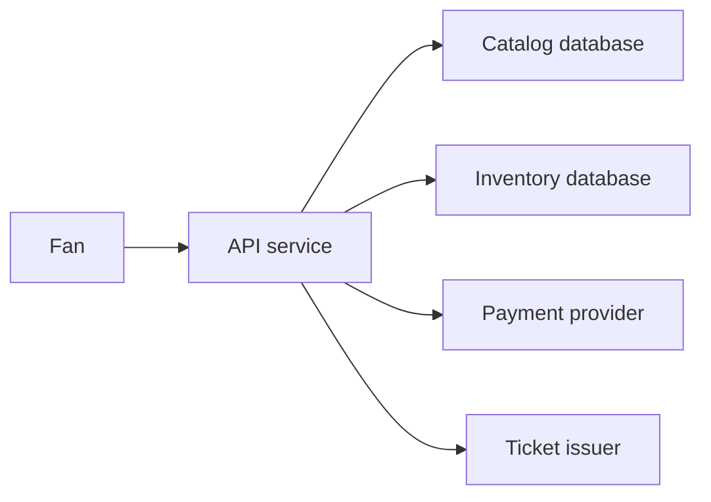
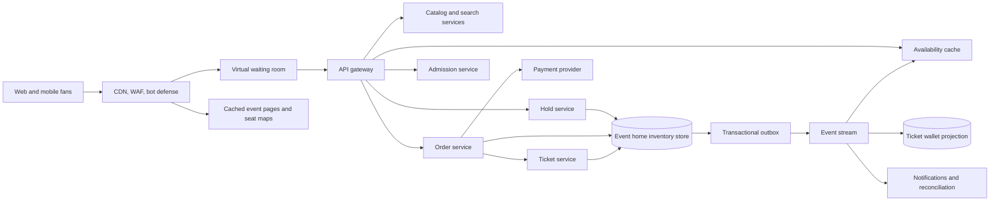
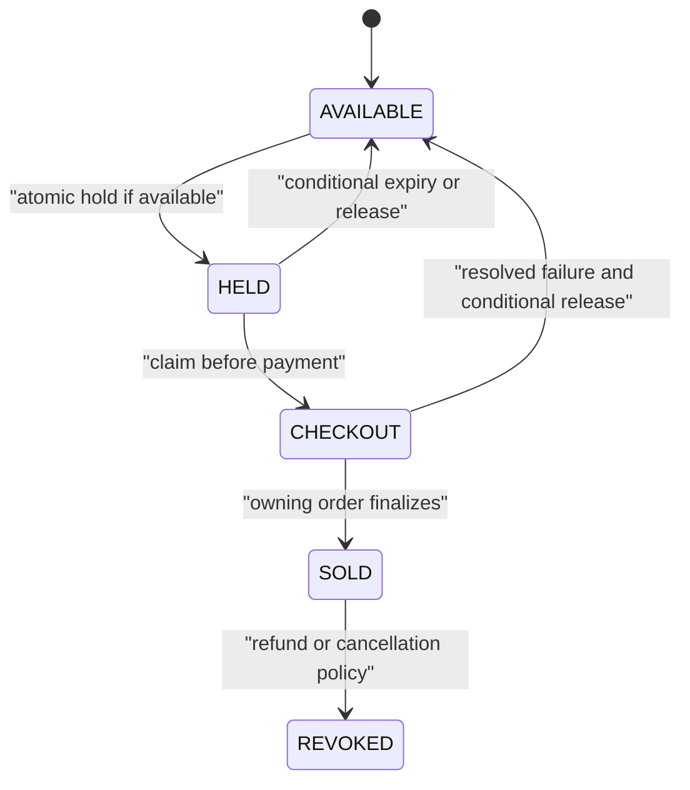
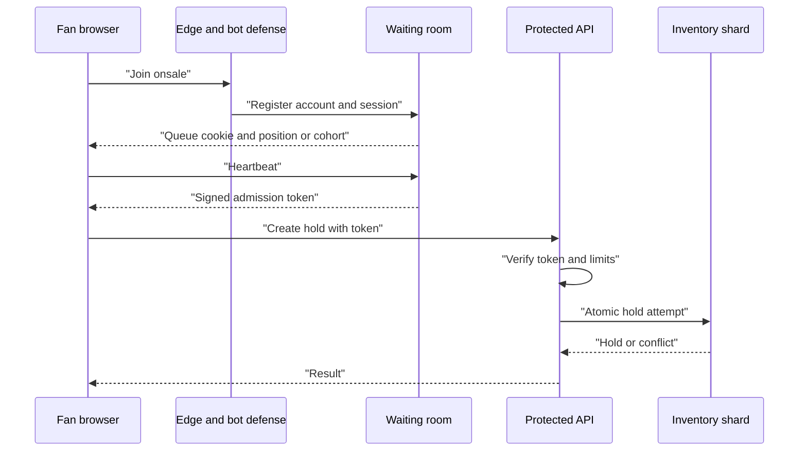
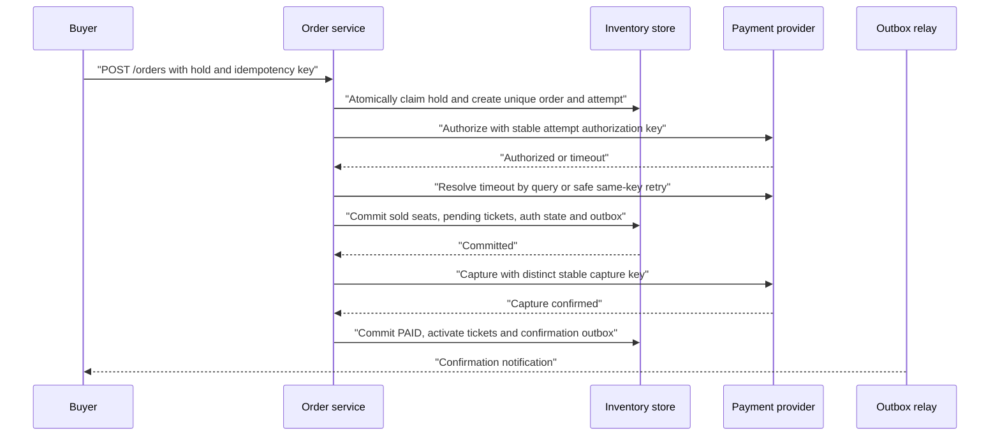

# Ticketmaster System Design

A Ticketmaster-like platform lets fans discover events, wait for high-demand onsales, reserve scarce inventory, pay, receive digital tickets, transfer tickets, and enter a venue. The hard part is not browsing events; it is a synchronized onsale where millions of buyers compete for far fewer seats, each seat must be sold exactly once, and payment is an external system that cannot join our database transaction.

## 1. Requirements
### 1.1 Functional requirements
- Let fans search events, view event details, prices, fees, seat maps, and current availability hints.
- Gate high-demand onsales through presales, access codes, bot defenses, and a virtual waiting room.
- Place reserved seats or general-admission quantities on short-lived holds while a buyer checks out.
- Convert a valid hold into an order, payment authorization/capture, issued tickets, and buyer notifications.
- Support ticket transfer, controlled resale, refunds, revocation, and venue scanning.
- Let venue operators publish events, load inventory, manage allocations, and audit inventory transitions.

### 1.2 Non-functional requirements
- **No oversells.** A seat sold twice is worse than a temporarily rejected purchase, so authoritative inventory mutations must be strongly consistent.
- **Spike tolerance.** A major onsale can create traffic that is orders of magnitude above normal, so admission must be shaped before requests reach inventory.
- **Low-latency browsing.** Event pages and seat maps must remain responsive under load, which means browse data cannot depend on synchronous seat-by-seat reads.
- **Idempotent checkout.** Buyers retry during slowdowns and payment providers time out, so duplicate requests must produce one business outcome.
- **Auditable money and inventory.** Every hold, release, sale, refund, transfer, and scan needs durable evidence for customer support, settlement, fraud review, and venue operations.
- **Fast admission.** A ticket should scan in hundreds of milliseconds online and degrade safely when a venue has weak connectivity.

### 1.3 The binding constraint
The binding constraint is a synchronized onsale where demand exceeds inventory by orders of magnitude and every seat must be sold exactly once. The read side wants massive caching and approximate freshness. The write side cannot be approximate: two buyers racing for the last seat need one winner, not two eventual winners and a refund apology.

This forces three mechanisms that shape the whole design. First, seat holds are short TTL leases created by atomic conditional updates, not by long distributed locks. Second, a virtual waiting room meters admitted shoppers with signed tokens so the inventory system sees a survivable write rate. Third, checkout is a saga: hold, authorize payment, confirm inventory and tickets, then capture or compensate, with idempotency and an outbox at every boundary.

## 2. Back-of-the-envelope estimation
Assume these numbers are illustrative for one large platform, not claims about a specific company. A normal day might sell `5,000,000 / 86,400 ≈ 58` tickets per second on average, but this average is not useful for architecture. The dangerous moment is a launch where `5,000,000` fans chase `100,000` seats. If even `20%` click through in the first minute, that is `5,000,000 × 0.2 / 60 ≈ 16,667` seat-selection attempts per second for one event before retries, bots, and refreshes.

Browsing is bigger but easier. If `5,000,000` fans reload a page every `10` seconds, the edge sees `500,000` requests per second for that event. Add search, static seat-map tiles, queue polling, and mobile reconnects, and a platform-wide browse peak of `1,000,000-2,000,000` requests per second is plausible. That implies CDN and edge waiting-room infrastructure must absorb most traffic; the catalog database should not see this load.

Inventory writes are smaller but more constrained. Suppose we allow `50,000` admitted shoppers in the protected shopping zone and each makes one hold attempt every `30` seconds after failed selections. That is `50,000 / 30 ≈ 1,667` authoritative hold attempts per second for a hot event. If each request touches an average of `2.5` seats, the event home shard performs about `4,167` seat conditional updates per second. This is high but tractable with event-local partitioning, short transactions, and admission control; it is not tractable if every buyer can hammer the hold endpoint directly.

Checkout is bounded by successful holds. If a `100,000` seat event sells out over `20` minutes, it completes `100,000 / 1,200 ≈ 83` tickets per second, maybe `30-60` orders per second depending on tickets per order. Payment systems and order databases must handle platform-wide peaks, but the hottest event's payment rate is far below its failed seat-selection rate. This difference is why queue admission and hold failures must be cheap, while finalization must be conservative.

> **Key idea.** The architecture is sized by skew, not averages: millions can browse, thousands can attempt holds, and only tens to hundreds per second can actually convert for one event. We spend strong consistency only on scarce inventory and use admission control to keep that path within its safe operating envelope.

## 3. API design
**Question.** What makes a checkout retry safe when the browser, our order service, and the payment provider can each time out independently?
<details><summary>Answer</summary>

Every mutating API takes an idempotency key scoped to the authenticated user and operation, with changed parameters rejected. The order service also enforces one order per hold, even if the buyer retries with a new key. Each payment attempt and operation has a distinct stable provider key; authorization and capture must not accidentally share one key. A status resource exposes progress rather than creating another charge or ticket.

</details>

```http
GET  /v1/events?city=SEA&from=2026-11-01&category=music
GET  /v1/events/{event_id}
GET  /v1/events/{event_id}/availability?section=102&since_version=4812
POST /v1/waiting-rooms/{onsale_id}/join
POST /v1/waiting-rooms/{onsale_id}/token/refresh
POST /v1/events/{event_id}/holds
     Idempotency-Key: <uuid>
     {"seat_ids":["102-A-1","102-A-2"],"admission_token":"<signed>","quote_token":"<signed>"}
POST /v1/orders
     Idempotency-Key: <uuid>
     {"hold_id":"hold_71","payment_method_token":"pm_...","expected_total":{"amount":"292.00","currency":"USD"}}
GET  /v1/orders/{order_id}
POST /v1/tickets/{ticket_id}/transfers
POST /v1/admission/scans
```

The availability endpoint returns hints, not promises. It can include `as_of`, a section version, and deltas since a prior version, but the create-hold endpoint is the only place where availability becomes authoritative. The API should say this explicitly because otherwise users experience a stale green seat as a lie rather than normal contention.

Queue admission tokens are separate from holds. A token says this account/session may enter the protected shopping zone for this onsale until a short expiration; it does not reserve a seat. The hold API validates the token on every request so a script cannot bypass the waiting-room page and call inventory directly. Tokens should be signed, event-scoped, audience-scoped, rate-limit classed, and preferably bound to account plus device/session. A refresh endpoint extends active shoppers only while they heartbeat and stay within policy.

Checkout returns either a completed order or `202 Accepted` with a status resource when payment or finalization is still in progress. That is better than making clients guess after a timeout. Cancel semantics are deliberately narrow: releasing an active hold is allowed before payment authorization starts, but once an order is in `AUTHORIZING` or later, the system resolves through the saga and compensates if needed. This avoids a race where a buyer cancels locally while a payment authorization succeeds remotely.

Money amounts use decimal strings or integer minor units consistently. The hold stores the quoted subtotal, fees, taxes, currency, and expiration so the order can reject `expected_total` mismatches rather than silently changing the buyer's price during checkout.

## 4. Data model
Start with the obvious entity: `Seat(event_id, seat_id, state)`. That is enough to draw a map, but not enough to explain who owns a temporary claim or protect against stale releases. Add `hold_id`, `state_version`, and `updated_at` so every transition can be conditional: only change this exact seat if it is still in the expected state and, for releases, still belongs to the hold being released.

General admission breaks the per-seat model because there may not be individual seat IDs. For that, use a `GeneralAdmissionPool(event_id, pool_id, capacity, held_count, sold_count, version)`. A hold on GA inventory is a conditional counter update: `capacity - held_count - sold_count >= requested_quantity`. The same invariant, `held + sold <= capacity`, is enforced without pretending to know seat numbers.

A `Hold` is not just a cache key. It is a lease with an owner, expiration, price quote, status, and idempotency key. Without a durable hold row, checkout cannot prove that the buyer is entitled to convert the seats, expiration cannot be raced safely, and support cannot audit why a seat disappeared. `HoldItem` records the exact seats or pool quantities and the quoted price components.

An `Order` records the attempt to turn a hold into money and tickets. It needs a state machine because payment can succeed while our response is lost, or our finalization transaction can fail after authorization. `PaymentAttempt` is separate because one order may have several attempts while the hold remains valid, and provider webhooks can arrive after the client has left.

A `Ticket` should not be a static barcode. It is an owned entitlement for an event and seat, with a current owner, credential version, and status. `TicketOwnershipEvent` gives an append-only chain for transfers, resale, refunds, and disputes. Online scanning atomically verifies the current credential version and changes an active, unused entitlement to used while recording the accepted `AdmissionScan`; separately checking a barcode and then inserting a scan would let two gates admit the same ticket. Rotating credentials alone do not prevent that race.

```text
Event(event_id, venue_id, name, starts_at, onsale_id, status, home_region, seating_plan_version)
Seat(event_id, seat_id, section, row, number, price_level_id, state, hold_id, state_version, updated_at)
GeneralAdmissionPool(event_id, pool_id, capacity, held_count, sold_count, version)
Hold(hold_id, event_id, user_id, status: ACTIVE | CHECKOUT | CONVERTED | RELEASED, owning_order_id, expires_at, idempotency_key, quote_version, total_amount, currency)
HoldItem(hold_id, item_id, seat_id, pool_id, quantity, unit_amount, fee_amount, tax_amount)
Order(order_id, user_id, event_id, hold_id UNIQUE, status, idempotency_key, total_amount, currency, created_at)
PaymentAttempt(payment_attempt_id, order_id, provider, authorization_key, capture_key, void_key, provider_reference, status, authorized_amount, captured_amount)
Ticket(ticket_id, order_id, event_id, seat_id, current_owner_id, credential_version, status)
TicketOwnershipEvent(ticket_id, sequence, from_owner_id, to_owner_id, reason, created_at)
OutboxEvent(event_id, aggregate_type, aggregate_id, sequence, type, payload, created_at)
AdmissionScan(ticket_id, event_id, gate_id, scanner_id, scanned_at, result)
```

Inventory tables live in the event's home region in a strongly consistent relational database or a key-value store with conditional multi-item transactions for the access pattern. Co-locate authoritative orders, holds, seat or GA state, ticket entitlements, and their outbox on the event shard so the finalization transaction described below is real. Buyer-order indexes and ticket-wallet views are asynchronous projections, not separate authorities that are somehow committed atomically by an RPC. Very large venues may subpartition by section while keeping transactions section-local or explicitly using distributed transactions. Catalog, search, static seat geometry, and availability summaries live in caches, object storage, and search indexes because they tolerate staleness. Raw card data deliberately does not enter the core store; tokenized payment methods and provider references do.

> **Key idea.** The data model separates hints from rights. Availability caches hint that seats may be open; only a durable hold tied to authoritative inventory grants the temporary right to buy.

## 5. High-level design
The simplest design is a web app in front of catalog, inventory, order, and payment services. Users browse events, select seats, the app marks seats sold after payment, and tickets are issued.



This breaks in several concrete ways. First, browsing load from a hot onsale overloads origin before any purchase happens. Second, marking seats sold after payment lets two buyers pay for the same last seat. Third, holding database locks while users type card details destroys concurrency and creates deadlocks. Fourth, direct access to hold endpoints lets bots multiply pressure on the only strongly consistent path. Fifth, publishing events to caches, notifications, and ticket services after committing orders creates dual-write gaps when a process crashes.

### Fix 1: Split browsing from authoritative inventory
Event pages, search results, seat-map geometry, and section-level availability summaries are served from CDN, search indexes, object storage, and short-TTL caches. Inventory mutations do not depend on those systems being fresh. This makes browsing resilient during a stampede and preserves the mental model: green seats are invitations to try, not promises.

SeatGeek's resilience writing describes a similar need for CDN shielding, short TTLs, stale-while-revalidate, route-specific limits, and circuit breakers because origin failure can reduce cacheability and amplify load. That lesson maps directly here: the cache layer is not an afterthought; it is the blast shield between millions of reloads and fragile origin paths.

### Fix 2: Add a virtual waiting room before protected APIs
The waiting room absorbs burst intake, assigns queue order or lottery rank, and issues signed admission tokens at a controlled rate. The protected zone includes seat holds and checkout, not just a web page. Ticketmaster describes Smart Queue as account sign-in, assigned positions, controlled admission, and live messaging; AWS's SeatGeek waiting-room architecture similarly separates edge gatekeeping from a protected ticket-selection zone with explicit throughput controls. The important architectural point is that queue admission is a pressure valve for inventory, not a fairness decoration.

### Fix 3: Use short seat holds with atomic conditional updates
A hold is a TTL lease recorded with the inventory transition. The system atomically moves requested seats from `AVAILABLE` to `HELD` only if every requested seat is still available, or atomically increments a GA held counter only if capacity remains. This prevents oversells without keeping locks open while the buyer checks out. Expiration is also conditional, so a delayed worker cannot release a seat that has already been converted or re-held.

### Fix 4: Make checkout an idempotent saga
Payment cannot join an ACID transaction with inventory. Claim the hold for its unique order before sending an authorization, then advance through explicit payment and inventory states. Resolve provider timeouts through supported lookup or safe same-key replay. Finalization creates pending entitlements; capture success activates them. Unknown outcomes retain the claim, and resolved failures use audited compensation before releasing inventory.

### Fix 5: Publish state changes through a transactional outbox
Order, inventory, and ticket updates write an outbox row in the same transaction as the state change. A relay publishes those rows to Kafka or another event bus. SeatGeek's outbox work, including WAL-based emission with Debezium/Kafka Connect, is evidence that this is not theoretical hygiene: without an atomic outbox, a crash after commit but before publish leaves stale availability, missing notifications, and broken reconciliation.

### Putting it together


A fan first hits the edge, which serves static event data and places them in a waiting room if the onsale is protected. When admitted, the fan receives a signed token and may call availability and hold APIs. The hold service validates the token, writes `Hold` and `Seat` or `GeneralAdmissionPool` changes in the event home inventory store, and emits invalidation through the outbox. Checkout creates an `Order`, authorizes payment, finalizes inventory, creates `Ticket` rows, and publishes events for notifications, cache updates, settlement, and reconciliation. The only path that decides whether a seat is still sellable is the event home inventory transaction.

> **Key idea.** Each component traces back to a specific failure of the naive design: caches protect reads, the waiting room protects writes, holds protect seats during checkout, sagas protect money boundaries, and the outbox protects downstream truth.

## 6. Deep dives
### 6.1 Seat holds as TTL leases, not distributed locks
**Question.** Two buyers race for the same last pair of seats, one hold expires at the same time checkout starts, and an expiration worker is running late. How do we avoid selling or releasing the wrong seats?
<details><summary>Answer</summary>

Create holds with atomic conditional inventory updates and release them with conditional expiry checks against database time, hold status, and seat ownership. Before any payment call, checkout atomically claims an unexpired `ACTIVE` hold as `CHECKOUT` for one order. Expiration and checkout contend on that same record, so only one wins. Normal expiry workers may release only `ACTIVE` holds, never a payment-owned `CHECKOUT` hold.

</details>

The tempting design is to put a distributed lock around each seat: lock seats, send the buyer to checkout, unlock after payment. That fails because checkout takes minutes and payment is external. Long locks strand inventory when clients disappear, create lock convoys around popular seats, and require correctness from a lock service during the most overloaded moment. Worse, a lock is not the business state. Support, checkout, and scanners need to know whether the buyer has a valid claim, what price was quoted, and when the claim expires.

A hold should be modeled as a TTL lease in the authoritative inventory store. For reserved seating, create a `Hold` row and update all requested seats in one transaction:

```sql
UPDATE seats
SET state = 'HELD', hold_id = :hold_id, state_version = state_version + 1
WHERE event_id = :event_id
  AND seat_id IN (:seat_ids)
  AND state = 'AVAILABLE';
```

The transaction commits only if the affected row count equals the requested seat count, then inserts `HoldItem` rows and the quoted price. If one seat is unavailable, the whole hold fails. Partial holds look user-friendly until a buyer asks for four adjacent seats and receives two random seats; they also complicate payment totals and release logic.

For general admission, the equivalent is a conditional counter update on the pool: increase `held_count` only when `capacity - held_count - sold_count >= quantity`. This can be a row lock in a relational database, a compare-and-swap on a versioned item, or a serializable transaction in a distributed store. A cache decrement is never the source of truth because cache replication and retries are exactly where oversells are born.

Expiration is where many designs accidentally reintroduce races. A delay queue can wake a worker at `expires_at`, but queues are not clocks and delivery can be early, late, duplicated, or lost. Correctness comes from the conditional release:

```text
release hold H only if
  database_now >= H.expires_at
  and H.status = ACTIVE
  and each seat.state = HELD
  and each seat.hold_id = H.hold_id
```

Using database time prevents client-clock manipulation. Checking `seat.hold_id` prevents a delayed expiration job for an old hold from releasing a seat that was already re-held by another buyer. Expiry atomically marks the hold released, releases its seats or decrements its GA held count, and writes its outbox event; replaying the worker cannot decrement a pool twice.

Checkout locks or conditionally updates the same hold: require `status = ACTIVE`, an unexpired deadline evaluated at the claim, and ownership of every item, then create its unique order and change the hold to `CHECKOUT` in one transaction. Finalization later requires `CHECKOUT` and that exact owning order, not the original shopping deadline. A recovery deadline escalates stuck payments for query or compensation; it does not automatically return their seats to inventory while a payment outcome is unknown.



The main trade-off is partitioning. Keeping all seats for an event in one strongly consistent shard makes multi-seat holds straightforward. A stadium onsale may push that shard hard, but the waiting room can throttle write QPS and most reads are cached. If one event cannot fit on one shard, partition by section and make the product prefer section-local holds. Cross-section atomic holds require a coordinator or a small distributed transaction, but that complexity should be reserved for cases that truly need it.

Signals worth watching: hold transaction latency, conditional-update conflict rate, expiration lag, active expired holds, held-to-sold conversion, and any invariant violation where `sold_count + held_count > capacity` or a sold seat has more than one active ticket.

> **Strong-answer criteria.** A senior answer distinguishes a lease from a lock, makes every state transition conditional, and explains delayed expiration races. It also states which store is authoritative and which cached views are only hints.

| Level | Approach | Why |
|---|---|---|
| Bad | Decrement a cache or lock seats while the user pays. | Cache writes are not authoritative, and long locks collapse under abandoned checkouts and provider delays. |
| Good | Store holds with TTL and atomically mark seats held. | This prevents most oversells but may still be vague about expiration races and GA counters. |
| Great | Use conditional updates, database-time TTL leases, idempotency keys, hold ownership checks, and event-local partitioning. | This handles retries, late workers, exact-seat and GA inventory, and hot-event contention without weakening the sell-once invariant. |

### 6.2 Virtual waiting room as admission control and fairness policy
**Question.** Five million fans arrive before an onsale for one hundred thousand seats. Should the first TCP connections get the first chance to buy, or should the system randomize access, and how does queueing actually protect inventory?
<details><summary>Answer</summary>

Use a waiting room that assigns eligibility before the sale according to the product's fairness policy, then admits shoppers at a measured rate with signed, short-lived, account-bound tokens. FIFO after the sale is intuitive, while randomized ordering before a hype launch prevents early refresh races from dominating. The hold and checkout APIs reject requests without valid admission tokens.

</details>

A waiting room is often described as a queue page, but the production mechanism is a protected-zone token system. The edge can accept millions of visitors because it serves static pages, queue status, and heartbeats cheaply. Only a controlled number of users receive tokens that allow calls to seat selection and checkout. If the inventory shard, payment provider, or checkout error rate degrades, operations lower the admission rate; if holds are converting smoothly, they raise it.

Ticketmaster's public Eras Tour explanation gives the scale of the problem: more than `3.5 million` registrations, about `1.5 million` access codes, `2 million` waitlisted fans, and `3.5 billion` total system requests, roughly `4x` a previous peak. The lesson is that Verified Fan or presale registration is demand shaping, not capacity magic. Many users and bots still arrive, refresh, reconnect, and call APIs. Therefore, access codes must be just one input to admission; every protected commerce request still needs token validation and rate limits.

The queue policy is a product decision. FIFO feels fair once the sale starts because a user's position moves forward and wait estimates make sense. Before a high-demand launch, strict FIFO rewards people who open tabs hours early, run many sessions, or exploit clock and network quirks. Cloudflare's waiting-room material explicitly supports FIFO and random queueing, and that maps well here: randomize the eligible population at onsale start, then process admitted cohorts FIFO. Communicate the rule clearly so refreshing or arriving excessively early is not rewarded.

A useful token contains `onsale_id`, `account_id`, `session_id`, `issued_at`, `expires_at`, `admission_sequence` or cohort, `rate_limit_class`, and a signature. It may also include a risk decision or proof that the user passed an access-code check. The token is not a bearer ticket to unlimited API calls. The gateway and hold service verify signature, expiration, audience, account binding, and per-token request budget. Refresh requires active heartbeat and can be denied if the user opens too many sessions.



Cloudflare's global waiting-room design uses encrypted cookies with bucket IDs and allocates slots across data centers using recent traffic ratios, accepting bounded overshoot instead of constant global coordination. That is a good trade for browse admission because a small over-admission only raises pressure. It is not acceptable for selling a seat. The queue may be eventually coordinated globally, but all hold attempts still converge on the event's strongly consistent home shard.

SeatGeek's AWS waiting-room architecture adds another practical lesson: model the protected zone explicitly with counters, user mappings, and metrics like queue length and wait time. Without those metrics, operators cannot tune the sale while it is running. SeatGeek also found that browser-based load testing with Playwright exposed WebSocket, heartbeat, reload, and token-exchange behaviors that protocol-level purchase tests missed. A major onsale release gate should simulate real browsers through the waiting room, not only POST `/holds` in a loop.

Signals worth watching: queue depth, token issue rate, protected-zone active users, token rejection reason, hold QPS, checkout error rate, wait estimate error, bot challenge pass rate, and whether admission changes correlate with inventory or payment saturation.

> **Strong-answer criteria.** A strong answer says what the queue token authorizes, where it is enforced, how admission rate is adjusted, and why FIFO versus randomized fairness is a product choice. It also separates queue over-admission tolerance from inventory correctness.

| Level | Approach | Why |
|---|---|---|
| Bad | Put a static queue page in front of the website. | Direct API calls, refresh storms, and bots still reach the protected path. |
| Good | Issue signed tokens and admit users gradually. | This protects inventory but may not address fairness, account binding, or live rate control. |
| Great | Combine pre-sale randomization or FIFO policy, account-bound short-lived tokens, enforcement on every protected API, and feedback-controlled admission. | This handles both perceived fairness and the operational need to keep hold and checkout paths below saturation. |

### 6.3 Checkout saga across inventory, payment, and tickets
**Question.** The payment provider authorizes the card but our order service times out before marking seats sold. What state is the order in, and can those seats be released to other buyers?
<details><summary>Answer</summary>

If approval was durably recorded, the order is authorized but not finalized; if the response was lost, its outcome is unknown. Either way, the hold was claimed before the call and remains fenced to that order. Recovery queries the provider by reference, or safely retries the same operation under its idempotency contract. Seats stay unavailable until finalization or a resolved compensation. An uncaptured authorization is voided; an actual capture is refunded.

</details>

The naive checkout transaction is impossible: update inventory, charge the card, create tickets, send confirmation, and commit. The payment provider is external, slow, and failure-prone; notifications and event streams are also external. Holding a database transaction open across those calls would block scarce inventory and still would not make the provider roll back if our database commit failed.

The better design is a saga with explicit state and idempotency. First, checkout atomically validates and claims the hold, creates its unique `Order` in `PENDING_PAYMENT`, and records a payment attempt before network I/O. A retry with a different client key still finds the same order by `hold_id`. Authorization, capture, and void each use stable keys derived from the order, attempt, and operation; a new card can create a new attempt only after the previous attempt is definitively resolved. A provider may support replay with a key without offering lookup by that key, so recovery uses its documented reference/query API or safe replay window.

On authorization success, one local transaction on the event shard checks the `CHECKOUT` hold's owning order, marks its seats `SOLD` (or moves GA quantity from held to sold), marks the hold `CONVERTED`, creates `PENDING_PAYMENT` ticket entitlements, advances the order to `PAYMENT_AUTHORIZED`, and writes outbox events. Capture then runs as a separate idempotent operation. Only definitive capture success atomically marks the order `PAID`, activates its entitlements, and emits the paid confirmation; pending tickets cannot be scanned or transferred. Capture timeout keeps inventory fenced and tickets pending. Definitive capture failure triggers compensation, revokes pending tickets, and releases inventory only after any authorization or charge has been resolved. Authorization has an expiry, so monitor the provider's capture deadline. Immediate-charge rails use the same recovery and compensation rules without pretending they support separate authorization.



Timeouts drive most edge cases. If authorization times out, the service does not send a blind second charge. It resolves the original attempt through the provider's supported recovery path. If the provider is unavailable, the order remains `AUTHORIZING` and the hold remains `CHECKOUT`, excluded from ordinary TTL expiry. If finalization times out after approval, query the order on its home shard before retrying or compensating: the transaction may already have committed. Capture and compensation workers use guarded order states so they cannot race a release against a late successful capture.

If finalization becomes permanently impossible, perhaps because an operator canceled the event inventory or a data corruption check fails, the compensation is financial first: void the authorization or refund the capture, mark the order compensated, then release or block the inventory according to policy. Compensation must be rare and audited. It is not a normal timeout path.

The outbox matters because finalization has multiple observers: availability cache, notification service, ticket wallet, settlement jobs, fraud review, and reconciliation. Publishing to Kafka after the database commit creates a gap where the source of truth changed but the world never hears about it. Writing `OutboxEvent` in the same transaction makes the event stream retryable and reconstructable. Consumers still remain idempotent because event delivery is at-least-once.

Signals worth watching: orders stuck in `AUTHORIZING`, authorized-not-finalized age, capture failure rate, payment lookup latency, outbox relay lag, duplicate idempotency-key hits, paid orders without tickets, and sold seats without paid or compensated orders.

> **Strong-answer criteria.** A senior answer refuses to make payment and inventory one fake distributed transaction, names the intermediate states, and describes the compensation path. It also uses provider idempotency keys and an outbox rather than hoping retries are harmless.

| Level | Approach | Why |
|---|---|---|
| Bad | Charge first, then try to mark seats sold. | A finalization failure creates paid buyers without inventory or tickets. |
| Good | Hold seats, charge, then convert the hold. | This is directionally right but incomplete without timeout handling and idempotency. |
| Great | Use pre-payment hold claiming, unique orders, operation-specific provider keys, transactional finalization, capture-gated ticket activation, compensation, and outbox events. | Safe retries depend on the provider's actual idempotency/recovery contract, with unresolved outcomes kept unavailable rather than guessed. |

## 7. Variants
**10x scale.** If the largest sale is `50 million` interested fans for `1 million` seats, the read plane must become more edge-native: static pages, queue status, and most availability summaries served from CDN or edge workers. The write plane should still not become multi-master for the same seat. Instead, split the event into section-local inventory shards, bias the UI toward section-local choices, raise waiting-room sophistication, and reserve cross-section holds for limited cases with a coordinator. The invariant remains one authoritative owner for each seat transition.

**Multi-region active-active.** Catalog, search, waiting-room edges, and ticket wallet reads can be active-active. Inventory writes for one event should have a home region with synchronous replication across zones and a fenced failover process. During home-region uncertainty, pause new holds rather than accept conflicting sales. Already-issued tickets and venue scanning can continue from replicated ticket data, with admission reconciliation after recovery.

**Best-available allocation.** Some onsales do not let fans click exact seats; they request a price band and quantity. This reduces hot-seat contention because the inventory service can allocate from precomputed contiguous blocks or section pools. The same hold, checkout, and expiration design remains, but `HoldItem` may reference an allocated block chosen by the service rather than client-provided seat IDs.

**Offline venue admission.** A venue may need scanning when internet connectivity is weak. Scanners can receive encrypted, time-bounded allowlists and revocation snapshots before doors open, then coordinate over a local venue network to suppress duplicates. This preserves gate throughput but accepts bounded duplicate-admission risk until reconciliation. SafeTix-like rotating, managed credentials reduce screenshot fraud online; offline mode must be explicit about its risk window.

## 8. The transferable pattern
This is the scarce-inventory pattern: a huge, mostly cacheable read audience competes for a small number of items whose ownership transitions must be linearizable. The reusable shape is to separate hints from rights, meter entry into the write path, create short leases with conditional updates, and convert leases through a saga when money or another external system is involved. Hotel rooms, limited sneaker drops, restaurant reservations, and ad-budget allocation all have the same outline.

The closest sibling pattern is any system where a user-visible flow spans a strongly consistent internal resource and an unreliable external party. A ride-hailing match, an e-commerce checkout, or a marketplace payout can borrow the same idempotency, fencing, and outbox techniques. The Ticketmaster version is harsher because the burst is synchronized and the losing requests outnumber winning requests by orders of magnitude.

## Review
The design is built around one invariant: a seat is sold exactly once. Browsing, search, and seat maps are cached because they are high-volume hints. The waiting room meters users into protected APIs with signed account-bound tokens because direct demand would overwhelm the authoritative path. Holds are TTL leases created by atomic conditional updates because users need checkout time but locks cannot be held across payment. Checkout is an idempotent saga because payment cannot be part of our database transaction. A transactional outbox and reconcilers make downstream systems eventually complete without pretending delivery is exactly once.

### Check your understanding
1. Why is a displayed available seat not a promise?
   <details><summary>Answer</summary>

   Availability views are cached and can lag behind real holds or sales. The promise is created only when the authoritative inventory store atomically transitions the seat from `AVAILABLE` to `HELD` for a specific hold.

   </details>
2. Why not use a distributed lock for each seat during checkout?
   <details><summary>Answer</summary>

   Checkout lasts minutes and calls external payment systems. Long locks strand inventory, create lock convoys, and still do not provide durable business evidence. A TTL hold records the claim and can be conditionally converted or expired.

   </details>
3. What does a waiting-room token authorize?
   <details><summary>Answer</summary>

   It authorizes a specific account/session to call protected commerce APIs for an onsale for a short time and within rate limits. It does not reserve a seat, and every hold still needs an authoritative inventory transaction.

   </details>
4. If payment authorization succeeds but finalization times out, why can't we release the hold?
   <details><summary>Answer</summary>

   The original order still owns the checkout claim, and the finalization transaction may already have committed. Query and resume that order rather than releasing seats behind it. Resolve an uncaptured authorization by voiding it, or an actual capture by refunding it, before compensated inventory release.

   </details>
5. What problem does the transactional outbox solve?
   <details><summary>Answer</summary>

   It prevents dual-write gaps. State changes and their events are committed together, so a crash cannot leave sold inventory without cache invalidation, ticket issuance signals, notifications, or reconciliation inputs.

   </details>

## Sources and further reading
| Source | Article | Why it matters |
|---|---|---|
| Ticketmaster | [Taylor Swift \| The Eras Tour Onsale Explained](https://business.ticketmaster.com/press-release/taylor-swift-the-eras-tour-onsale-explained/) | Real incident numbers for Verified Fan demand shaping, bot/non-code traffic, queue slowdowns, and sale outcomes. |
| Ticketmaster | [Smart Queue: Streamline Sales and Maximize Sell-Through](https://business.ticketmaster.com/smart-queue/) | Shows the production queue contract: account sign-in, assigned positions, controlled admission, and live in-queue messaging. |
| Ticketmaster | [SafeTix: Secure Ticketing Built for Fans](https://business.ticketmaster.com/safetix-encrypted-digital-ticketing/) | Demonstrates why issued tickets should be rotating, account/device-bound credentials rather than reusable screenshots. |
| AWS / SeatGeek | [Build a Virtual Waiting Room with Amazon DynamoDB and AWS Lambda at SeatGeek](https://aws.amazon.com/blogs/architecture/build-a-virtual-waiting-room-with-amazon-dynamodb-and-aws-lambda-at-seatgeek/) | Concrete ticketing waiting-room design with edge gatekeeper, protected-zone tokens, DynamoDB queue state, and operational metrics. |
| SeatGeek | [Browser-Based Load Testing Without Breaking the Bank](https://chairnerd.seatgeek.com/browser-based-load-testing/) | Explains why high-demand onsales need real browser simulations for queues, WebSockets, heartbeats, and token exchange. |
| SeatGeek | [The Transactional Outbox Pattern: Transforming Real-Time Data Distribution at SeatGeek](https://chairnerd.seatgeek.com/transactional-outbox-pattern/) | Production outbox/WAL/Debezium/Kafka approach for avoiding dual-write gaps in inventory, order, and ticket event streams. |
| SeatGeek | [Shielding the Core: Scaling Resilience with a Multi-Layered Approach](https://chairnerd.seatgeek.com/shielding-the-core/) | Shows how CDN shielding, rate limits, circuit breakers, and load tests stop cache-miss spikes from overwhelming origin services. |
| Cloudflare | [Building Waiting Room on Workers and Durable Objects](https://blog.cloudflare.com/building-waiting-room-on-workers-and-durable-objects/) | Details global slot allocation, encrypted queue cookies, bucketed users, and bounded edge coordination for waiting rooms. |
| Cloudflare | [Waiting Room: Random Queueing and Custom Web/Mobile Apps](https://blog.cloudflare.com/waiting-room-random-queueing-and-custom-web-mobile-apps/) | Compares FIFO and random queueing and explains when hype launches need randomized fairness instead of arrival-order dominance. |
| AWS | [Introducing AWS Virtual Waiting Room](https://aws.amazon.com/blogs/compute/introducing-aws-virtual-waiting-room/) | Reference implementation for signed time-limited admission tokens, authorizers, burst buffering, and protected API integration. |
| Stripe | [Place a hold on a payment method](https://docs.stripe.com/payments/place-a-hold-on-a-payment-method) | Defines authorization expiry and capture semantics for the checkout saga. |
