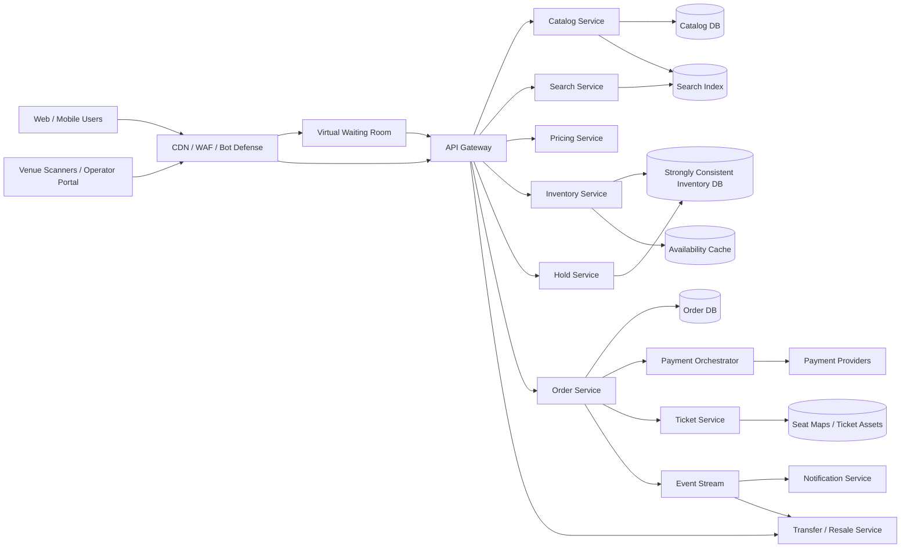

# Ticketmaster-like Event Ticketing Platform

## 1. Requirements

### Functional requirements

1. Search and browse events by artist, venue, city, category, and date.
2. Display event details, seat maps, prices, fees, and availability.
3. Support reserved seating and general-admission inventory.
4. Place seats in a short-lived hold while a buyer checks out.
5. Process payment and issue digitally signed tickets.
6. Prevent overselling and duplicate ticket issuance.
7. Support waiting rooms, presales, access codes, and per-account limits.
8. Allow cancellation, refund, transfer, and controlled resale.
9. Let venue operators create events, allocate inventory, and scan tickets.
10. Notify buyers about purchases, transfers, refunds, and event changes.

### Non-functional requirements

- Correct inventory is more important than write availability.
- Event browsing should remain available during sale spikes.
- Seat availability should update within seconds.
- Checkout must be idempotent and auditable.
- The platform must withstand bot traffic and hundred-fold flash-sale bursts.
- Payment data must meet PCI obligations.
- A sold ticket must scan quickly even if venue connectivity is degraded.

The design covers primary sales and transfers. Auction pricing and a complete recommendation engine are out of scope.

## 2. Scale assumptions

- 200 million registered users and 20 million daily active users.
- 2 million future events; 100,000 venues.
- 5 million tickets sold on an ordinary day.
- A major onsale can attract 5 million users for 100,000 seats in minutes.
- Browse peak: 2 million requests/second, mostly served from caches.
- Inventory mutation peak: 100,000 hold attempts/second for one event.
- Checkout peak: 20,000 orders/second platform-wide.
- Average reserved event: 20,000 seats; stadium event: 100,000.
- Hold duration: 5-10 minutes.

Ordinary average ticket sales:

```text
5M tickets / 86,400 seconds = about 58 tickets/second
```

That average is misleading. Capacity planning is driven by synchronized onsales and extreme skew toward a few events.

## 3. High-level architecture



Browsing and seat-map reads are a scalable, eventually consistent plane. Holds, orders, and ticket ownership form the strongly consistent transaction plane.

## 4. Data model

```text
Event
- event_id
- venue_id
- name
- starts_at
- onsale_at
- status
- home_region
- seating_plan_version

Seat
- event_id
- seat_id
- section
- row
- number
- price_level_id
- accessibility_attributes
- state: AVAILABLE | HELD | SOLD | BLOCKED
- hold_id
- state_version

GeneralAdmissionPool
- event_id
- pool_id
- capacity
- held_count
- sold_count
- version

Hold
- hold_id
- event_id
- user_id
- status: ACTIVE | CONVERTED | EXPIRED | RELEASED
- expires_at
- idempotency_key

HoldItem
- hold_id
- seat_id_or_pool_id
- quantity
- quoted_unit_price
- fee_breakdown

Order
- order_id
- user_id
- event_id
- hold_id
- amount
- currency
- status: PENDING_PAYMENT | PAYMENT_AUTHORIZED | PAID | FAILED | REFUNDED | CANCELLED
- payment_attempt_id
- idempotency_key

Ticket
- ticket_id
- order_id
- event_id
- seat_id
- current_owner_id
- credential_version
- status: ACTIVE | TRANSFER_PENDING | REVOKED | SCANNED

TicketOwnershipEvent
- ticket_id
- sequence
- from_owner_id
- to_owner_id
- reason
- timestamp

AdmissionScan
- ticket_id
- gate_id
- scanned_at
- result
- scanner_id
```

Seat state is authoritative in the inventory database. The availability cache and search index are hints. Store the price quote on the hold so checkout cannot silently change the total.

## 5. Core APIs

### Browse availability

```http
GET /v1/events/{event_id}/availability?section=102
```

```json
{
  "event_id": "evt-9",
  "as_of": "2026-10-13T07:20:01Z",
  "seats": [
    {"seat_id": "102-A-1", "state": "AVAILABLE", "price": {"amount": 12500, "currency": "USD"}}
  ]
}
```

### Create a hold

```http
POST /v1/events/{event_id}/holds
Idempotency-Key: 33b...

{
  "seat_ids": ["102-A-1", "102-A-2"],
  "offer_token": "signed-presale-or-queue-token"
}
```

```json
{
  "hold_id": "hold-71",
  "expires_at": "2026-10-13T07:28:00Z",
  "price": {"subtotal": 25000, "fees": 4200, "total": 29200, "currency": "USD"}
}
```

### Checkout

```http
POST /v1/orders
Idempotency-Key: 76c...

{
  "hold_id": "hold-71",
  "payment_method_token": "pm-token",
  "expected_total": 29200
}
```

Other endpoints:

```http
GET  /v1/events/{event_id}
GET  /v1/search/events
GET  /v1/orders/{order_id}
POST /v1/orders/{order_id}/refund
POST /v1/tickets/{ticket_id}/transfers
POST /v1/transfers/{transfer_id}/accept
POST /v1/tickets/{ticket_id}/resale-listings
POST /v1/admission/scans
```

Every mutating request is idempotent. Queue tokens are signed, event-scoped, short-lived, and bound to an account where possible.

## 6. Browse and onsale flow

Before onsale:

1. Operators publish event metadata, seat map, price levels, and inventory allocations.
2. Catalog changes update the search index and CDN.
3. Inventory is loaded into the event's home region and validated against venue capacity.
4. Waiting-room admission begins before the sale.

During onsale:

1. CDN serves event pages and static seat-map geometry.
2. The waiting room admits users at a controlled rate.
3. Availability APIs return cached summaries and fresher section-level deltas.
4. Selecting seats sends a strongly consistent hold request.
5. Inventory changes publish invalidations to the availability cache.

The UI must communicate that displayed availability is provisional until a hold succeeds.

## 7. Seat hold algorithm

For reserved seats, atomically transition every requested seat:

```sql
UPDATE seats
SET state = 'HELD',
    hold_id = :hold_id,
    state_version = state_version + 1
WHERE event_id = :event_id
  AND seat_id IN (...)
  AND state = 'AVAILABLE';
```

Commit only if the affected count equals the requested count. Otherwise roll back and return which seats are unavailable, possibly with nearby alternatives.

For general admission, use a conditional counter:

```text
if capacity - sold_count - held_count >= requested_quantity:
    held_count += requested_quantity
else:
    reject
```

This update executes under a row lock or serializable compare-and-swap. Never use a cache decrement as the source of truth.

The hold row and inventory transition commit in one transaction. A delay queue schedules expiration, but expiration correctness comes from `expires_at`, not from delivery timing.

## 8. Checkout and payment saga

Payment cannot share an ACID transaction with the inventory database. Use an explicit saga:

1. Validate the active hold, ownership, price, limits, and expiration.
2. Create `PENDING_PAYMENT` order idempotently.
3. Authorize or charge through the payment provider using the order ID as its idempotency key.
4. On authorization success, transactionally mark seats `SOLD`, mark the hold `CONVERTED`, mark the order `PAYMENT_AUTHORIZED`, create ticket records, and write an outbox event.
5. Capture payment, if authorization and capture are separate, then mark the order `PAID`; if the provider charged immediately, record the successful charge and mark `PAID` in the finalization transaction.
6. Deliver ticket notifications asynchronously.

If payment succeeds or is authorized but finalization initially fails, retain the hold and retry finalization. Do not sell those seats to someone else. If finalization is permanently impossible, void or refund the payment and release inventory with an audited compensation.

If payment fails, mark the order failed. The user may retry while the hold remains valid.

## 9. Hold expiration and fairness

Expiration workers scan buckets by `expires_at` and conditionally release:

```text
release only when:
hold.status == ACTIVE
and hold.expires_at <= database_now
and seat.hold_id == hold.id
```

This prevents a delayed worker from releasing a seat belonging to a newer hold. Database time avoids client-clock manipulation.

Fairness controls:

- Virtual waiting room with randomized ordering before onsale.
- Signed admission tokens and controlled per-event issue rate; a queue token permits shopping, not a specific seat, and protected APIs still validate the token on every request.
- Per-account, card, device, address, and phone purchase limits.
- CAPTCHA or step-up checks based on risk, not on every request.
- Short holds and limits on concurrent holds.
- No advantage from request flooding; rate limits apply before inventory.
- Accessible inventory receives policy-specific enforcement and auditing.

## 10. Consistency and concurrency

Strong consistency is required for:

- Seat and pool availability transitions.
- Hold conversion and expiration.
- Order state changes.
- Ticket ownership and revocation.
- Admission's first successful scan.

Event catalog, search, aggregate availability, recommendations, and notifications may be eventual.

All state transitions are conditional:

```text
AVAILABLE -> HELD -> SOLD
             |
             -> AVAILABLE on expiration
```

No transition from `SOLD` back to `AVAILABLE` occurs without an explicit cancellation/refund policy. State versions and audit events expose illegal transitions.

Exactly-once delivery is not assumed. Idempotency at API, payment, order, ticket, and consumer boundaries produces exactly-once business effects.

## 11. Partitioning and storage

Partition inventory by `event_id`, keeping one event's seat mutations in a single strongly consistent shard or database partition. This enables multi-seat atomic holds.

The hottest event can exceed one shard. Options:

- Partition by section and restrict a hold to one partition.
- Use a dedicated high-capacity shard for major events.
- Preallocate inventory ranges to section leaders with no overlap.
- Keep a small cross-section coordinator for atomic multi-partition holds.

Prefer dedicated event shards and section-local selection before introducing distributed transactions.

Catalog data is partitioned geographically or by event ID. Orders partition by buyer or order ID, with an event index for operations. Tickets use `ticket_id` and maintain a strongly consistent current-owner pointer plus immutable ownership history.

## 12. Caching, search, and seat maps

- CDN-cache event pages, venue assets, and static seat geometry.
- Search indexes event metadata and is updated asynchronously.
- Cache section-level available counts with a very short TTL.
- Use CDN shield POPs and route/service rate limits so cache misses do not stampede fragile origin services.
- Stream seat-state deltas to active clients rather than refetching full maps.
- For large venues, load geometry and availability by viewport/section.

The cache may falsely show an available seat, but a hold never succeeds without authoritative validation. Avoid falsely showing a sold seat for too long by invalidating on every hold, release, and sale.

Pricing responses include signed quote IDs, fee details, and expiration. Dynamic pricing rules are versioned and auditable; already-held quotes remain stable through their stated expiry.

## 13. Tickets, transfer, resale, and admission

Issue an opaque ticket ID with a rotating, device-bound signed barcode. Do not encode reusable bearer credentials in screenshots or static wallet images.

Transfer flow:

1. Owner initiates transfer and the ticket becomes `TRANSFER_PENDING`.
2. Recipient accepts while authenticated.
3. A transaction appends an ownership event, changes current owner, revokes the prior credential, and activates a new credential.
4. Both parties receive notifications.

Resale locks the ticket while listed and transfers it only after payment settlement. Venue and jurisdiction rules determine price caps and transfer eligibility.

At admission, online scanners submit the current rotating credential. The admission service atomically records the first valid scan. For weak connectivity, scanners receive encrypted, time-bounded event allowlists and later reconcile; offline mode carries a controlled duplicate-admission risk and should coordinate scanners over a local venue network.

## 14. Reliability and failure handling

Use transactional outboxes for order, inventory, and ticket events; high-throughput implementations can emit domain events in the same database transaction and relay them from the write-ahead log to Kafka. Consumers are idempotent. Periodic reconcilers compare:

- Paid orders against sold inventory.
- Sold seats against active tickets.
- Provider settlements against internal payment records.
- Active holds against held seats.
- Ticket ownership against credential versions.

| Failure | Handling |
|---|---|
| Hold request is retried | Return the original hold by idempotency key |
| One of several seats is unavailable | Roll back the entire requested hold |
| Expiration event is late | Validate `expires_at` during every checkout and release |
| Payment times out | Query provider by idempotency key before retrying |
| Payment succeeds, response is lost | Reconcile provider state and finalize the same order |
| Finalization temporarily fails | Preserve inventory and retry; compensate only if unrecoverable |
| Notification fails | Ticket remains available in account; retry delivery |
| Availability cache is stale | Authoritative hold rejects unavailable inventory |
| Inventory shard fails | Pause holds rather than risk overselling |
| Duplicate barcode scan | Atomic first-scan wins and later scans alert staff |
| Queue service degrades | Stop new admission tokens; existing tokens remain verifiable |

## 15. Multi-region design

Each event has a home region for inventory writes:

- Inventory and hold data replicate synchronously across availability zones.
- Catalog, seat maps, and search are global.
- Edge waiting rooms and bot defense run near users.
- Remote hold requests travel to the event home region.
- Orders may be globally partitioned, but event finalization calls the home inventory shard.

Active-active writes for the same seat invite oversells. During home-region failure, stop new holds, assess replication position, fence the old primary, and promote a zero-data-loss secondary. Browsing and already-issued ticket access continue.

Venue admission uses a geographically nearby deployment and pre-provisioned offline data. Data residency and payment routing may select the event home region.

## 16. Security and abuse prevention

- WAF, DDoS protection, behavioral bot scoring, and device attestation.
- Do not expose sequential seat mutation endpoints or trust client prices.
- Signed queue, presale, offer, quote, and ticket tokens with narrow scope.
- Tokenized payment methods; isolate the PCI cardholder-data environment.
- Encrypt PII and apply field-level access controls.
- Require MFA and strong audit logs for venue operators.
- Rate-limit by account, device, IP range, card fingerprint, event, and action.
- Detect account takeover, card testing, bulk purchase, and collusive resale.
- Rotate barcode credentials and revoke old versions on transfer/refund.
- Verify webhook signatures and replay windows.
- Retain immutable audit evidence for inventory and money transitions.

## 17. Observability

Track:

- Waiting-room depth, admission rate, and estimated wait error.
- Browse latency and CDN hit ratio.
- Hold success rate by event, section, and rejection reason.
- Inventory transaction latency, lock waits, and shard saturation.
- Held-to-sold conversion and hold expiration lag.
- Checkout latency and payment authorization outcomes by provider.
- Paid-but-not-finalized orders.
- Inventory/order/ticket reconciliation mismatches.
- Bot challenges, rate-limit decisions, and suspicious account clusters.
- Ticket issuance and transfer latency.
- Admission validation latency and duplicate-scan rate.

Critical invariants should page immediately:

```text
sold_count <= capacity
one active ticket per sold seat
one current owner per active ticket
no expired active hold accepted at checkout
```

Run protocol-level load tests, real-browser onsale simulations, and payment-provider fault injection before major releases.

## 18. Major trade-offs

### Pessimistic locks versus optimistic conditional updates

- Locks are intuitive but can create long queues.
- Short conditional transactions scale better.
- Never keep a database lock open while the user pays.

### Availability versus oversell prevention

- Multi-master inventory is highly available.
- Single-home strongly consistent inventory prevents conflicting sales.
- For ticketing, temporary write unavailability is safer.

### Exact seats versus best available

- Exact selection improves user control but creates hot-seat contention.
- Best-available allocation can assign from precomputed blocks efficiently.

### Longer versus shorter holds

- Longer holds improve checkout completion.
- Shorter holds recycle scarce inventory and resist hoarding.

### Online-only versus offline admission

- Online validation prevents duplicates globally.
- Offline validation keeps gates moving but accepts bounded duplicate risk.

## 19. Lessons from production systems

### Ticketmaster: Verified Fan is demand shaping, not capacity magic

Ticketmaster's Eras Tour postmortem-style business note says TaylorSwiftTix had more than 3.5 million preregistrations, about 1.5 million access codes, and 2 million waitlisted fans; the onsale still saw 3.5 billion total system requests, about 4x the previous peak. Map that to this design by treating registration and access codes as only the first filter: the edge must still absorb non-code traffic, queue tokens must be validated before every protected commerce API, and sale pacing must slow when checkout error rates rise.

### Ticketmaster: Smart Queue needs account binding and live communication

Ticketmaster describes Smart Queue as account sign-in before the sale, assignment of queue position at start, and admission at a rate that minimizes checkout errors, with in-queue inventory, price, and added-date messaging. For this design, the waiting room should not be a blind FIFO pipe: it should bind tokens to account/session, publish realistic availability and price-band updates, and let operations lower the admission rate without changing inventory correctness.

### Ticketmaster: SafeTix shifts tickets from bearer images to managed credentials

SafeTix describes tickets that refresh automatically, stay authenticated in the Ticketmaster ecosystem, block screenshots/recordings, bind to a fan device, and support secure transfer/resale. The analogous ticket service should rotate credentials, revoke old credential versions on transfer or refund, keep chain-of-custody events, and make offline admission explicitly risk-bounded rather than accepting static barcodes.

### SeatGeek/AWS: a ticketing waiting room is a protected-zone token system

AWS's SeatGeek architecture uses a gatekeeper at the edge, waiting-room and queueing modes, predefined throughput into the protected ticket-selection zone, DynamoDB tables for protected zones/counters/user connections/queue mappings, and metrics such as queue length and wait time. This supports modeling queue admission separately from inventory holds: issue access tokens at a controlled rate, cap users in the protected zone, and track business metrics so operators can tune the sale while it runs.

### SeatGeek: test the browser behavior, not just the purchase endpoint

SeatGeek built browser-based load testing with AWS Batch and Playwright to simulate 50,000+ users because protocol tests missed WebSocket, heartbeat, reload, and edge-token behaviors in high-demand queues. This design should keep cheap API load tests, but the release gate for major onsales needs full browser simulations that exercise waiting room refreshes, queue-token exchange, seat-map loading, checkout, and failure messaging.

### SeatGeek: transactional outbox avoids dual-write drift

SeatGeek's data-platform team adopted a transactional outbox pattern, then optimized it by emitting domain events directly into Postgres WAL with `pg_logical_emit_message()`, relaying with Debezium/Kafka Connect, and enforcing schemas. For ticketing, inventory/order/ticket state transitions and their events must be atomic; a direct publish to Kafka after commit is insufficient because a crash creates missing notifications, stale availability, or broken reconciliation inputs.

### SeatGeek: cache shielding and rate limits prevent failure cascades

SeatGeek's resilience write-up describes Fastly shield POPs, short TTL and stale-while-revalidate caching, Kong token-bucket/per-consumer limits, and circuit-breaking for fragile services. The important lesson is that failed origin responses often cannot be cached, so overload can reduce cache hit rate and amplify itself. Event pages, maps, and cacheable availability summaries need edge shielding plus route-specific throttles before origin saturation.

### Cloudflare: global waiting rooms trade exact global state for bounded overshoot

Cloudflare's Waiting Room uses encrypted cookies with bucket IDs, accepted timestamps, and last check-in time; it divides active-user and new-user-per-minute slots across data centers using recent historical traffic ratios to avoid constant global coordination. This maps well to browse admission, where slight over-admission is acceptable, but not to seat holds; holds still go to the event's strongly consistent home shard.

### Cloudflare: queueing policy is a product decision

Cloudflare supports FIFO and random queueing. FIFO gives intuitive wait estimates, while random queueing can be fairer for hype launches where pre-start arrival time should not dominate; switching can preserve the underlying bucketed queue state. Ticketing systems should make that policy explicit per onsale: randomized assignment before sale start, FIFO after start, and clear communication so users do not gain advantage by refreshing or arriving hours early.

### AWS Virtual Waiting Room: protect APIs with signed, time-limited tokens

AWS's reference solution combines API Gateway, Lambda, SQS batching for burst intake, DynamoDB token state, Secrets Manager keys, and a Lambda authorizer or OIDC adapter to validate signed time-limited tokens before protected APIs. In this design, the queue service must be in the enforcement path, not just the web page: direct calls to hold or checkout endpoints without a valid admission token should be rejected before they reach inventory.

## 20. Recommended interview presentation

A clear 45-minute sequence is:

1. Clarify reserved seating, GA, onsales, checkout, and ticket transfer.
2. Quantify normal load versus flash-sale skew.
3. Separate cached browsing from authoritative inventory.
4. Deep-dive into atomic seat holds and expiration.
5. Walk through the payment/order saga and compensation.
6. Explain waiting-room fairness and bot controls.
7. Cover event-based partitioning and hot-event isolation.
8. Discuss ticket credentials, transfer, scanning, and failover.
9. Finish with consistency, availability, and hold-duration trade-offs.

The central design insight is:

> Treat every seat as scarce strongly consistent inventory: atomically hold it for a bounded time, never lock it across payment, and convert the hold through an idempotent saga. Scale volatile onsales with waiting rooms and cached browsing, not by weakening the sale invariant.


## Further reading: curated engineering blogs

| Source | Article | Why it matters |
|---|---|---|
| Ticketmaster | [Taylor Swift \| The Eras Tour Onsale Explained](https://business.ticketmaster.com/press-release/taylor-swift-the-eras-tour-onsale-explained/) | Real incident numbers for Verified Fan demand shaping, bot/non-code traffic, queue slowdowns, and sale outcomes. |
| Ticketmaster | [Smart Queue: Streamline Sales and Maximize Sell-Through](https://business.ticketmaster.com/smart-queue/) | Shows the production queue contract: account sign-in, assigned positions, controlled admission, and live in-queue messaging. |
| Ticketmaster | [SafeTix: Secure Ticketing Built for Fans](https://business.ticketmaster.com/safetix-encrypted-digital-ticketing/) | Demonstrates why issued tickets should be rotating, account/device-bound credentials rather than reusable screenshots. |
| AWS / SeatGeek | [Build a Virtual Waiting Room with Amazon DynamoDB and AWS Lambda at SeatGeek](https://aws.amazon.com/blogs/architecture/build-a-virtual-waiting-room-with-amazon-dynamodb-and-aws-lambda-at-seatgeek/) | Concrete ticketing waiting-room design with edge gatekeeper, protected-zone tokens, DynamoDB queue state, and operational metrics. |
| SeatGeek | [Browser-Based Load Testing Without Breaking the Bank](https://chairnerd.seatgeek.com/browser-based-load-testing/) | Explains why high-demand onsales need real browser simulations for queues, WebSockets, heartbeats, and token exchange. |
| SeatGeek | [The Transactional Outbox Pattern: Transforming Real-Time Data Distribution at SeatGeek](https://chairnerd.seatgeek.com/transactional-outbox-pattern/) | Production outbox/WAL/Debezium/Kafka approach for avoiding dual-write gaps in inventory, order, and ticket event streams. |
| SeatGeek | [Shielding the Core: Scaling Resilience with a Multi-Layered Approach](https://chairnerd.seatgeek.com/shielding-the-core/) | Shows how CDN shielding, rate limits, circuit breakers, and load tests stop cache-miss spikes from overwhelming origin services. |
| Cloudflare | [Building Waiting Room on Workers and Durable Objects](https://blog.cloudflare.com/building-waiting-room-on-workers-and-durable-objects/) | Details global slot allocation, encrypted queue cookies, bucketed users, and bounded edge coordination for waiting rooms. |
| Cloudflare | [Waiting Room: Random Queueing and Custom Web/Mobile Apps](https://blog.cloudflare.com/waiting-room-random-queueing-and-custom-web-mobile-apps/) | Compares FIFO and random queueing and explains when hype launches need randomized fairness instead of arrival-order dominance. |
| AWS | [Introducing AWS Virtual Waiting Room](https://aws.amazon.com/blogs/compute/introducing-aws-virtual-waiting-room/) | Reference implementation for signed time-limited admission tokens, authorizers, burst buffering, and protected API integration. |
