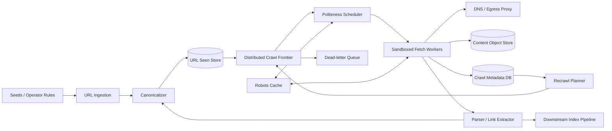

# Production-Scale Web Crawler

## 1. Requirements

### Functional requirements

1. Discover and fetch public HTTP/HTTPS pages from seed URLs and links.
2. Respect `robots.txt`, crawl-delay policy, and per-origin rate limits.
3. Canonicalize URLs and avoid duplicate fetches and duplicate content.
4. Prioritize fresh, important, and frequently changing pages.
5. Parse HTML, extract links and metadata, and store content for downstream indexing.
6. Retry transient failures without creating retry storms.
7. Recrawl pages according to observed change rate.
8. Support crawler operators adding seeds, exclusions, and priority overrides.

### Non-functional requirements

- Crawl billions of pages while never overwhelming a host.
- Sustain high aggregate throughput with bounded per-origin concurrency.
- At-least-once scheduling with idempotent processing.
- Recover from worker, queue, region, and storage failures.
- Make crawl decisions explainable and auditable.
- Isolate hostile content and protect internal networks.

Out of scope: ranking search results, rendering every JavaScript application, and crawling authenticated/private content.

## 2. Scale assumptions

- 10 billion known canonical URLs; 3 billion retained pages.
- 1 billion fetches/day: about 11,600/second average and 50,000/second peak.
- Average compressed response: 500 KB; roughly 500 TB/day ingress.
- Average page exposes 30 links before filtering.
- 100 million origins, with a highly skewed popularity distribution.
- 30-day median long-tail revisit interval, shortened to minutes for news and lengthened to months for static pages.
- Maximum response retained: 20 MB; maximum redirect chain: 10.
- HTML indexing reads a bounded prefix; for example Googlebot currently fetches up to 2 MB for non-PDF URLs, while larger retained objects are for diagnostics or specialized pipelines.

Bandwidth, parsing, and storage dominate cost. The global rate is less difficult than safely scheduling millions of independent origin-specific streams.

## 3. High-level architecture



The frontier is not a single FIFO. It combines a priority queue of origins with a per-origin queue so global importance never bypasses host politeness.

## 4. Data model

```text
UrlRecord
- url_id, canonical_url, origin_id, url_hash
- discovery_time, discovered_from_url_id
- priority, next_fetch_at, state, retry_count

Origin
- origin_id, scheme, host, port
- next_allowed_at, max_concurrency, crawl_delay_ms
- robots_version, robots_expires_at, health_state

FetchAttempt
- attempt_id, url_id, scheduled_at, started_at, completed_at
- worker_id, status_code, error_class, redirect_target
- bytes, latency_ms, content_hash, lease_token

PageVersion
- url_id, fetched_at, content_hash, object_key
- mime_type, language, etag, last_modified
- parse_status, canonical_target

RobotsPolicy
- origin_id, user_agent, allowed_rules, disallowed_rules
- crawl_delay_ms, fetched_at, expires_at
```

Use normalized canonical URLs for identity, but retain discovered and final URLs for diagnostics. Content hashes identify byte-level duplicates; similarity fingerprints such as SimHash identify near duplicates.

## 5. Core APIs

```http
POST /v1/seeds
{"urls":["https://example.com/"],"priority":"HIGH","max_depth":5}

POST /internal/v1/frontier/lease
{"worker_id":"fetch-42","capacity":100}

POST /internal/v1/fetches/{attempt_id}/complete
{"lease_token":"...","status":200,"content_hash":"sha256:...","links_object_key":"..."}

GET /v1/urls/{url_id}/history
POST /v1/origins/{origin_id}/pause
PUT /v1/origins/{origin_id}/policy
```

Lease and completion calls are idempotent. Completion validates that the attempt still owns the lease; a late worker cannot overwrite a newer result.

## 6. URL ingestion and canonicalization

1. Resolve relative links against the document base URL.
2. Accept only configured schemes and valid IDNA hostnames.
3. Lowercase scheme/host, remove default ports and fragments, normalize dot segments, and normalize percent encoding.
4. Apply conservative query-parameter rules; never globally remove parameters because they may change content.
5. Check allow/deny policy and depth limits.
6. Insert into the seen store using an atomic put-if-absent.
7. If new, enqueue with source-derived priority; if known, update discovery signals without duplicating work.

Canonical tags and redirects are hints, not blindly trusted identity changes. They can be malicious or cyclic.

## 7. Crawl frontier and politeness

Maintain:

- **Per-origin ready queues** ordered by URL priority and discovery time.
- **Origin eligibility heap** ordered by `next_allowed_at`.
- **Leases** for origins and URLs with expiry.

The scheduler pops an eligible origin, verifies robots policy and concurrency, leases one or more URLs, then advances `next_allowed_at`. An origin is owned by one scheduler shard at a time, preventing two workers from independently violating delay limits.

Priority can combine PageRank-like importance, seed distance, content type, staleness, change probability, and operator overrides. Aging prevents low-priority starvation.

Robots enforcement should follow RFC 9309-style parsing: choose the most specific matching allow/disallow rule, parse at least the first 500 KiB, cap cache freshness to HTTP cache headers or 24 hours, and fail closed when a previously reachable robots file becomes temporarily unavailable. `Crawl-delay` is a non-standard extension, so treat it as crawler-specific policy rather than portable REP behavior.

## 8. Fetch and parse flow

1. Worker receives a leased URL plus resolved policy.
2. It resolves DNS through a guarded resolver and validates every redirect target.
3. It fetches with strict connect, header, body, and total deadlines.
4. Streaming limits stop oversized or decompression-bomb responses.
5. Raw bytes are written under a content hash; metadata commit references only durable objects.
6. Parsers selected by MIME type extract links, canonical hints, language, and indexing fields.
7. New URLs return through canonicalization.
8. Completion updates origin health and schedules recrawl.

HTML parsing runs in resource-limited sandboxes. JavaScript rendering is a separate scarce queue used only for selected pages.

## 9. Deduplication

Three layers serve different purposes:

- URL seen set prevents repeated scheduling of the same canonical URL.
- SHA-256 content hash avoids storing exact duplicate bodies.
- SimHash or MinHash groups mirrors and templated near duplicates for indexing.

A Bloom filter can reject most known URLs cheaply, but false positives must not permanently suppress discovery. Use it only as a cache before an authoritative LSM/KV seen store, or periodically sample positives against the store.

## 10. Consistency and concurrency

- Queue delivery is at least once; fetching and completion are idempotent.
- Seen-set insertion is atomic by canonical URL hash.
- Lease fencing tokens prevent expired workers from committing stale ownership.
- Origin scheduler state is strongly consistent within an origin shard.
- Page bodies are immutable and eventually replicated.
- Metadata publication uses a database transaction plus outbox.

Exactly-once network fetching is impossible after ambiguous failures. Correctness means duplicate attempts do not corrupt frontier state or downstream indexes.

## 11. Partitioning and storage

- Partition origin scheduling by consistent hash of `origin_id`; all URLs for an origin share a shard.
- Subpartition large origin queues by priority bucket while preserving one politeness governor.
- Partition the seen store by URL hash for even distribution.
- Store immutable bodies in object storage with lifecycle tiers.
- Store recent crawl metadata in an LSM database; compact old attempts to analytical storage.

Hot origins are intentionally capped, not spread to gain unconstrained throughput. Scheduler shard splitting moves groups of origins, never halves one origin's policy state.

## 12. Recrawl algorithm

Estimate each URL's change interval from recent fetches, `ETag`/`Last-Modified`, sitemap hints, and page class. A simple policy is:

```text
next_interval = clamp(min_interval, max_interval,
                      previous_interval * adjustment(change_detected))
```

Shorten after change, lengthen after repeated stability, add jitter, and prioritize expected freshness value per fetch cost. `304 Not Modified` still consumes host capacity but saves bandwidth and parsing.

Accept push freshness hints from trusted sources, such as sitemaps, feeds, IndexNow-style notifications, or CDN cache-purge signals, but verify them through the same frontier, robots, and politeness controls before fetching.

## 13. Reliability and failure handling

| Failure | Handling |
|---|---|
| Worker dies after lease | Lease expires; another worker retries |
| Completion response is lost | Idempotent completion returns prior result |
| DNS or TLS transient failure | Exponential backoff with jitter and retry budget |
| Origin returns 429/503 | Honor `Retry-After`, reduce concurrency, open circuit |
| Robots cache unavailable | Fail closed for unknown policy; use unexpired cached policy |
| Parser crashes | Isolate document, record failure, continue fetch pipeline |
| Queue shard fails | Replicated log elects a leader and replays leases |
| Object write succeeds but metadata fails | Unreferenced object expires through lifecycle GC |
| Poison URL retries forever | Bounded retries then dead-letter with reason |
| Link explosion/trap | Depth, pattern, per-site budget, and calendar/session detection |

## 14. Multi-region design

Assign each origin a home region so only one region controls politeness. Fetch near the origin when legal and useful, but transfer ownership through a fenced epoch. Replicate the seen store and content asynchronously; route new discoveries to the origin's owner. A region outage pauses affected origins until a secondary acquires a higher epoch, preferring temporary staleness over accidental traffic multiplication.

Respect data residency for stored page bodies and regional restrictions on crawling. Global seeds and policy updates use a durable replicated control plane.

## 15. Security and abuse prevention

- Block loopback, link-local, private, metadata-service, and internal ranges before and after DNS resolution.
- Revalidate every redirect to prevent SSRF and DNS rebinding.
- Run fetchers and parsers without ambient credentials in isolated networks.
- Restrict egress ports and protocols; cap response size and decompression ratio.
- Sign worker leases and authenticate internal APIs with mTLS.
- Treat page text, headers, and robots files as untrusted data.
- Maintain takedown, domain exclusion, user-agent identification, and contact processes.
- Log policy overrides and protect operator APIs with least privilege.

## 16. Observability

Track fetch success by error class, pages/second, bytes/second, frontier age, eligible-origin lag, per-origin request rate, robots denials, lease expiry, duplicate ratio, content-change rate, parser failures, 429/503 rates, retry volume, and storage growth.

Key SLOs:

- 99% of high-priority eligible URLs start within their scheduling deadline.
- Zero verified politeness violations attributable to scheduler concurrency.
- Freshness lag by page class stays within target.

## 17. Major trade-offs

### Centralized versus distributed frontier

A central frontier simplifies ordering but becomes a bottleneck. Sharding by origin preserves local politeness and scales horizontally.

### Breadth versus freshness

Discovering more pages competes with recrawling important pages. Allocate explicit budgets by crawl class rather than letting one starve the other.

### Full rendering versus HTTP fetching

Browser rendering increases coverage but costs orders of magnitude more CPU and attack surface. Apply it selectively.

### Strict versus optimistic deduplication

Authoritative checks preserve coverage; probabilistic filters save I/O but can miss pages if used as truth.

## 18. Capacity and cost controls

Enforce global, region, tenant, origin, and content-type budgets. Backpressure propagates from parsers and storage to fetch scheduling. Sample low-value repeated errors, compact attempt history, compress content, and tier unchanged old versions. Admission control should shed speculative discovery before high-priority refresh work.

## 19. Lessons from production systems

### Google Search: crawl budget is both rate limit and demand

Google Search Central describes crawl budget as the URLs Googlebot can and wants to crawl: rate limit rises when a site is fast and healthy, falls on timeouts or 5xxs, and demand comes from popularity and staleness. This maps directly to the origin model here: `max_concurrency` and `next_allowed_at` are not static quotas, and recrawl priority should be reduced when site health degrades instead of retrying harder.

### Google Search: REP/robots correctness is a parser problem, not a string match

Google's REP work that led to standardization documents edge cases crawlers historically implemented inconsistently: minimum 500 KiB parsing, 24-hour maximum cache time unless HTTP cache allows less/more appropriately, and conservative behavior when robots becomes unavailable. This design should store parsed robots versions with expiry and keep the raw file/audit trail so policy decisions can be explained and replayed.

### Google Search: byte limits protect the crawler and shape indexing

Googlebot is now documented as fetching up to 2 MB for non-PDF URLs and 64 MB for PDFs; bytes past the per-URL cutoff are not fetched, rendered, or indexed. The system can still retain up to 20 MB for archival or diagnostics, but the parser/index pipeline should operate on a smaller bounded prefix and track truncation so ranking or metadata extraction does not silently assume the full document was processed.

### Google Research: SimHash makes near-duplicate detection feasible at web scale

Google's "Detecting Near-Duplicates for Web Crawling" uses SimHash fingerprints so pages with similar features map to hashes with small Hamming distance. That justifies keeping exact SHA-256 for storage identity and a separate similarity fingerprint for mirrors, boilerplate-heavy pages, and crawl traps; do not use the near-duplicate fingerprint as the authoritative URL seen key.

### Common Crawl: public web crawls are tail-heavy and artifact-oriented

Common Crawl's September 2026 crawl contains 2.17 billion pages, 361.4 TiB uncompressed content, 40.4 million hosts, 33.2 million registered domains, and 587.2 million URLs not seen in prior crawls. The implication is that storage and downstream artifact formats matter as much as fetch QPS: write immutable WARC/WAT/WET-like objects, preserve request/response metadata, and expect many newly discovered URLs to be low-value tail pages.

### Common Crawl: web-graph processing is a separate batch product

Common Crawl's July-August-September 2026 host graph has 245.8 million host nodes and 2.7 billion edges, with 74.65% dangling nodes; the domain graph aggregates by pay-level domain using the Public Suffix List. This design should not compute graph rank inside fetch workers. Emit link records to an offline graph pipeline and feed resulting host/domain importance back into frontier priorities.

### Bing: crawl efficiency is freshness per page fetched

Bing describes crawl efficiency as discovering new or changed content per page crawled, and explicitly calls out the tension between freshness and webmaster load. This is a better objective than raw pages/second: dashboards should include "changed pages per 1,000 fetches", duplicate ratio, and unchanged recrawl rate, then feed those signals into the recrawl planner.

### Bing IndexNow: push signals reduce waste but do not bypass validation

IndexNow lets sites notify search engines when URLs are created, updated, or deleted, and Bing shares submitted URLs among participating engines. In this architecture, such notifications should enter URL ingestion with elevated freshness priority, but still pass canonicalization, policy checks, robots, leases, and per-origin budgets.

### Cloudflare Crawler Hints: freshness pipelines need batching, dedupe, and backpressure

Cloudflare's Crawler Hints processes cache-miss and purge-derived freshness signals through Kafka, validates records, deduplicates/buffers URLs in Redis generations, then writes batches back to Kafka for partner dispatch with per-partner retries and lag/memory metrics. The same pattern applies to seed and freshness ingestion here: separate event capture from frontier admission, dedupe before dispatch, and monitor lag before pushing more work onto fetchers.

## 20. Recommended interview presentation

1. Clarify crawl scope, freshness, and robots compliance.
2. Estimate fetch rate, bandwidth, and frontier size.
3. Draw ingestion, frontier, fetch, parse, and storage.
4. Deep-dive on the two-level origin scheduler.
5. Explain canonicalization and layered deduplication.
6. Cover leases, idempotency, traps, and hostile content.
7. Discuss partitioning, recrawl scoring, and multi-region ownership.
8. Finish with observability and cost/freshness trade-offs.

The central design insight is:

> Partition scheduling by origin, enforce politeness before issuing every fenced lease, and treat fetching as an at-least-once operation whose metadata and downstream effects are idempotent.

## Further reading: curated engineering blogs

| Source | Article | Why it matters |
|---|---|---|
| Google Search Central | [What crawl budget means for Googlebot](https://developers.google.com/search/blog/2017/01/what-crawl-budget-means-for-googlebot) | Defines crawl budget as crawl rate limit plus crawl demand, grounding origin health and freshness prioritization. |
| Google Search Central | [Formalizing the Robots Exclusion Protocol specification](https://developers.google.com/search/blog/2019/07/rep-id) | Explains REP edge cases: 500 KiB parsing, 24-hour robots caching, and conservative behavior on unavailable robots files. |
| Google Search Central | [Inside Googlebot: demystifying crawling, fetching, and the bytes we process](https://developers.google.com/search/blog/2026/03/crawler-blog-post) | Documents modern Googlebot fetch limits, especially the 2 MB non-PDF per-URL cutoff that motivates parser byte caps. |
| Google Research | [Detecting Near-Duplicates for Web Crawling](https://research.google.com/pubs/archive/33026.pdf) | Introduces SimHash-style near-duplicate detection for mirrors and templated pages at crawler scale. |
| Common Crawl | [September 2026 Crawl Archive Now Available](https://commoncrawl.org/blog/september-2026-crawl-archive-now-available) | Gives real crawl-scale numbers for pages, hosts, domains, new URLs, and uncompressed storage volume. |
| Common Crawl | [Host- and Domain-Level Web Graphs July, August, and September 2026](https://commoncrawl.org/blog/host--and-domain-level-web-graphs-july-august-and-september-2026) | Shows why link graph construction and ranking should be an offline pipeline feeding frontier priority. |
| Microsoft Bing Webmaster | [Bingbot Series: Maximizing Crawl Efficiency](https://blogs.bing.com/webmaster/2018/10/bingbot-Series-Maximizing-Crawl-Efficiency/) | Frames crawl quality as fresh/new content discovered per fetch, not merely pages crawled per second. |
| Microsoft Bing Webmaster | [IndexNow: Announcing Sharing of Submitted URLs](https://blogs.bing.com/webmaster/2022/1/IndexNow-Announcing-Sharing-of-Submitted-URLs/) | Shows how push URL-change notifications can improve freshness and reduce waste while still needing validation. |
| Cloudflare | [From 0 to 20 billion - How We Built Crawler Hints](https://blog.cloudflare.com/from-0-to-20-billion-how-we-built-crawler-hints/) | Details a production freshness-hint pipeline with Kafka, Redis dedupe generations, batching, retries, and observability. |
