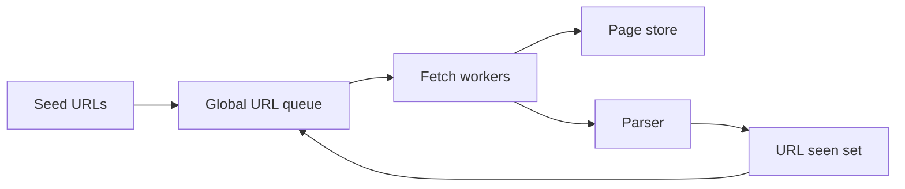
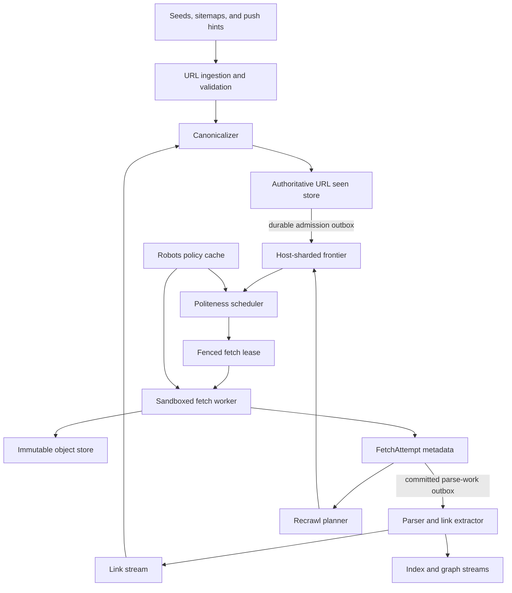
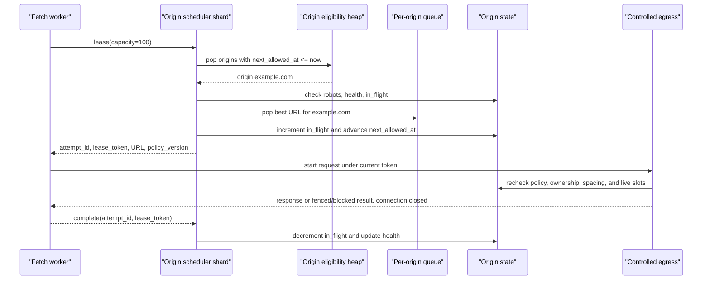
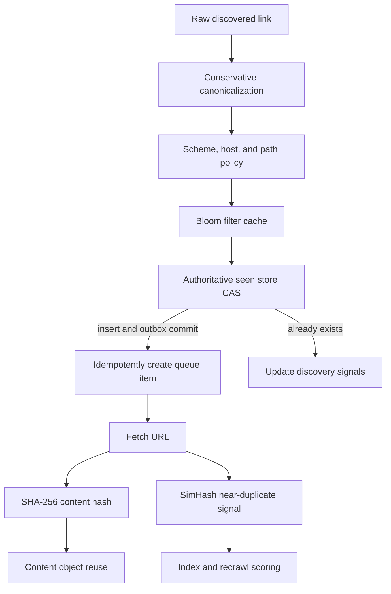
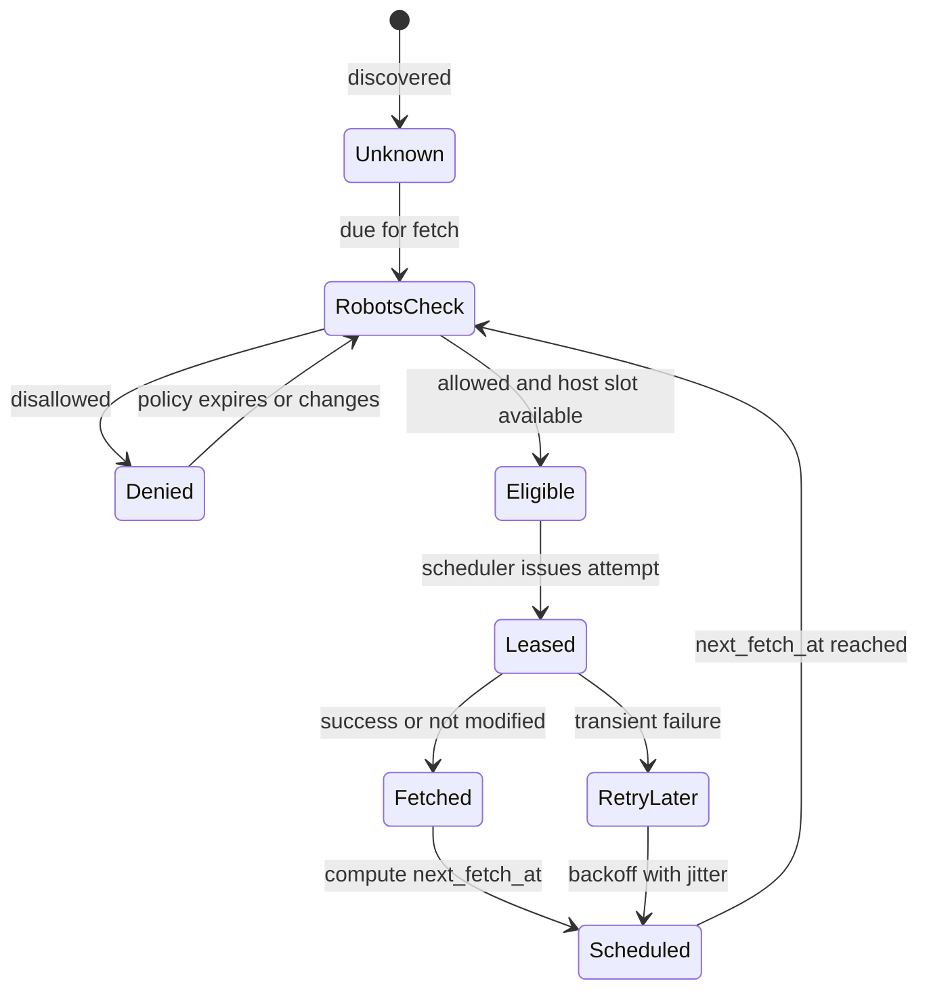

# Web Crawler System Design

A web crawler discovers public HTTP and HTTPS pages, fetches them without harming sites, extracts links and metadata, and keeps downstream indexes supplied with fresh content. This design focuses on large-scale discovery, fetching, deduplication, and recrawl scheduling; it excludes search ranking, crawling authenticated content, and rendering every JavaScript-heavy page as a default path.

## 1. Requirements

### 1.1 Functional requirements

- Accept seed URLs, sitemaps, operator rules, and trusted push hints, then discover more URLs from fetched pages.
- Canonicalize URLs, avoid scheduling the same canonical URL repeatedly, and group exact and near-duplicate content.
- Fetch pages through public HTTP/HTTPS while respecting robots.txt, per-host politeness, redirects, response limits, and crawler identity.
- Store crawl metadata, immutable page bodies, extracted links, and freshness signals for downstream indexing and graph pipelines.
- Recrawl valuable pages based on observed change rate, site health, and explicit freshness signals.
- Let operators pause hosts, adjust budgets, inspect crawl history, and explain why a URL was or was not fetched.

### 1.2 Non-functional requirements

- **Politeness.** The crawler must never turn aggregate scale into accidental denial of service; every host needs bounded concurrency and spacing between requests.
- **Freshness efficiency.** Fetch capacity is scarce at the host level, so the system should spend requests on pages likely to be new, changed, important, or otherwise valuable.
- **Idempotence.** Network fetches, queue leases, parser retries, and metadata commits can repeat after failures without corrupting URL state or downstream indexes.
- **Coverage.** Probabilistic filters and trap defenses must reduce waste without permanently hiding legitimate pages.
- **Isolation.** Untrusted HTML, redirects, DNS answers, compressed bodies, and robots files must not reach internal networks or escape parser resource limits.
- **Explainability.** Operators need to reconstruct decisions from canonicalization, robots version, priority score, lease, response, and recrawl history.

### 1.3 The binding constraint

The binding constraint is politeness, not raw throughput. A fleet that can fetch 50,000 pages per second globally still may only be allowed one request every few seconds to a small host. If the frontier is a single global priority queue, high-value URLs from the same host will cluster at the head and either violate politeness or leave workers idle while they wait. The real frontier is therefore a scheduler of per-host queues: it chooses which host is eligible next, then chooses which URL within that host deserves the next scarce request.

That constraint forces the main mechanisms in the design: host-sharded frontiers with front/back queues, fenced leases so two schedulers do not crawl the same host concurrently, layered URL and content deduplication to avoid wasting host budget, and recrawl scoring that treats freshness value per fetch as the objective. Google's crawl budget framing and Bing's crawl-efficiency framing both point to the same lesson: crawling more pages is not success if it overloads hosts or spends scarce requests on unchanged, low-value pages.

## 2. Back-of-the-envelope estimation

Assume illustrative scale of `10B` known canonical URLs, `3B` retained pages, and `1B` fetch attempts per day. The average fetch rate is `1B / 86,400 = 11,574` fetches per second; a peak factor of about `4.3` gives roughly `50,000` fetches per second. That sounds large, but it is easy to parallelize across workers. The harder number is host fan-out: with `100M` known origins, most origins are idle at any moment, while a small set of popular hosts contribute a large fraction of URLs. The scheduler must efficiently find eligible origins without scanning millions of empty or sleeping queues.

If every request returned an average compressed body of `500 KiB`, the upper-envelope daily ingress would be `1B × 500 KiB = 500,000,000,000 KiB`, about `466 TiB`. At peak, `50,000 × 500 KiB` is about `23.8 GiB/s` before protocol overhead. Actual bytes depend on the mix of full pages, robots, errors, and bodyless `304` responses. This drives streaming fetches, response caps, storage, and parser backpressure. For example, retain diagnostic objects up to `20 MiB` but parse/index a bounded prefix, tracking truncation rather than treating partial bytes as a complete page.

Discovery has a larger internal multiplier. At the upper envelope of `1B` parsed pages with `30` links each, the parser emits `30B` discovered links per day. Rejecting `90%` still leaves `3B` candidate admission attempts, about `34,722/s`; not all become new records. Actual page count is lower when requests go to robots, retries, redirects, or unchanged pages. The seen store must be authoritative and horizontally partitioned, with Bloom filters only as accelerators; a false positive cannot permanently suppress a real URL.

Freshness capacity is also finite. Treat `1B/day` as a total HTTP-request budget: robots refreshes, redirect hops, retries, and conditional `304` requests consume it too. The `10B / 1B = 10` day revisit period is only an ideal lower bound if every request revisits a different known URL. Refreshing robots once daily for all `100M` origins would alone leave at most `900M` page requests, or `10B / 900M = 11.1` days before discovery, redirects, and retries. In practice refresh robots only for active origins and allocate by value. A news home page may need minutes and a static PDF months. A FIFO recrawl queue wastes scarce capacity on the wrong pages.

> **Key idea.** The capacity math says bandwidth and storage are expensive, but the architecture is shaped by scarce per-host request slots. Every stage should protect those slots from duplicates, traps, retries, and low-value recrawls.

## 3. API design

**Question.** What makes retrying a crawler API safe when the network fetch itself cannot be exactly once?
<details><summary>Answer</summary>

The API fences ownership and makes state transitions idempotent. Leasing a URL returns an attempt id and lease token; completion is accepted only if that token still owns the attempt. If a worker retries completion after a timeout, it receives the already committed result. If a worker finishes after its lease expired and another attempt won, the stale completion is rejected without overwriting newer metadata.

</details>

```http
POST /v1/seeds
{"urls":["https://example.com/"],"priority":"HIGH","max_depth":5,"source":"operator"}

POST /v1/freshness-hints
{"urls":["https://example.com/story"],"hint_type":"UPDATED","source":"indexnow","occurred_at":"2026-10-13T18:00:00Z"}

POST /internal/v1/frontier/lease
{"worker_id":"fetch-42","region":"us-west","capacity":100,"user_agent":"ExampleBot"}

POST /internal/v1/fetches/{attempt_id}/heartbeat
{"lease_token":"abc","bytes_read":262144,"redirects":1}

POST /internal/v1/fetches/{attempt_id}/complete
{"lease_token":"abc","status_code":200,"content_hash":"sha256:...","object_key":"raw/sha256/...","links_object_key":"links/..."}

POST /internal/v1/fetches/{attempt_id}/fail
{"lease_token":"abc","error_class":"TLS_TIMEOUT","retryable":true,"retry_after_ms":600000}

GET /v1/urls/{url_id}/history?cursor=opaque

POST /v1/origins/{origin_id}/pause
{"reason":"owner_request","until":"2026-10-20T00:00:00Z"}
```

The public seed and freshness-hint APIs are admission APIs, not commands to fetch immediately. They return `202 Accepted` with an ingest id because canonicalization, policy checks, deduplication, and frontier admission are asynchronous. Push hints from IndexNow-like systems or CDN cache events get elevated freshness priority, but they still pass through the same canonicalization, robots, and host budget path as ordinary discovered links.

The internal lease API deliberately leases from eligible hosts rather than arbitrary URLs. The response contains the canonical URL, origin policy version, robots decision, maximum response size, deadline, attempt id, and lease token. A heartbeat is useful for long responses and diagnostics, but it does not extend politeness; politeness is enforced before issuing the fetch, while completion and retry behavior are controlled by the attempt lease. Cancellation is best effort: pausing an origin prevents new leases immediately, while already issued attempts are allowed to finish unless the policy change is safety-critical. History uses cursors, not offsets, because a hot URL can accumulate attempts while an operator is paging.

## 4. Data model

Start with the obvious entity, `UrlRecord`, keyed by canonical URL. It can represent discovery and scheduling, but it cannot explain host politeness. Two different URLs on the same host must share a rate limiter, robots policy, health state, and next eligible time. That creates an `Origin` entity, keyed by scheme, host, and port, and every URL points to exactly one origin after canonicalization.

`UrlRecord` and `Origin` still do not model at-least-once work. A worker can receive a URL, fetch it, time out while committing, and later retry. If the URL row is overwritten directly, a stale worker can corrupt a newer fetch. The fix is `FetchAttempt`: an append-oriented attempt record with a lease token, expiry, status, and immutable completion result. The current URL state advances only through fenced transitions from the winning attempt.

Raw bytes introduce a different identity problem. The same body can appear under many URLs, and one URL can produce many versions over time. Storing bytes directly on the URL row duplicates storage and makes near-duplicate grouping impossible. The model separates `ContentObject`, addressed by cryptographic hash and object key, from `PageVersion`, which connects a URL, fetch time, HTTP validators, parse result, and content fingerprint. Exact duplicate bodies share a content object; near duplicates share a similarity cluster but not storage identity.

Robots rules are versioned because a decision made yesterday may need to be explained tomorrow. The system stores the parsed `RobotsPolicy`, raw object pointer, fetch time, expiry, and parser version. RFC 9309-style behavior makes this more than a string match: the crawler needs longest-match allow/disallow decisions, a minimum parsing limit, cache expiry, and conservative behavior when a previously reachable robots file becomes temporarily unavailable.

```text
UrlRecord
- url_id, canonical_url, url_hash, origin_id
- first_seen_at, last_discovered_at, discovered_from_url_id
- priority_score, next_fetch_at, state, retry_count
- canonical_target_url_id, trap_score, last_page_version_id

Origin
- origin_id, scheme, host, port, owner_shard, owner_epoch
- next_allowed_at, max_concurrency, in_flight_count, crawl_delay_ms
- health_state, retry_after_until, robots_policy_id, paused_until

OriginQueueItem
- origin_id, url_id, priority_bucket, score, enqueued_at, not_before
- reason, budget_class, dedupe_generation

FetchAttempt
- attempt_id, url_id, origin_id, lease_token, lease_expires_at
- scheduled_at, started_at, completed_at, worker_id
- status, status_code, error_class, redirect_target_url
- bytes_read, latency_ms, content_hash, fencing_epoch

PageVersion
- page_version_id, url_id, fetched_at, attempt_id
- content_hash, simhash, object_key, mime_type, language
- etag, last_modified, parser_version, parse_status, truncation_state

RobotsPolicy
- robots_policy_id, origin_id, user_agent, raw_object_key
- parsed_rules, fetched_at, expires_at, parser_version, unavailable_mode

FreshnessSignal
- signal_id, url_id, origin_id, source, signal_type
- observed_at, confidence, payload_hash, consumed_at
```

`UrlRecord`, `Origin`, queue metadata, and attempts live in strongly consistent storage inside an origin shard, typically a replicated log plus KV state or a database partition with conditional updates. The authoritative URL seen set is partitioned by URL hash so discovery writes distribute evenly. Immutable bodies live in object storage under content hash. Link records and graph edges do not belong in the transactional fetch store; they are emitted to append-only streams and processed by offline graph and indexing jobs.

> **Key idea.** The model separates identities that fail differently: URL identity, host politeness identity, fetch-attempt ownership, immutable byte identity, and freshness evidence.

## 5. High-level design

The simplest crawler is a queue of URLs, a fleet of fetch workers, a parser, and a seen set. A worker pops a URL, fetches it, stores the page, extracts links, inserts unseen links, and pushes them back to the queue.



This design fails in four concrete ways. First, a global queue has no native place to enforce one-host-at-a-time politeness, so either workers hammer a host or the queue head blocks. Second, duplicate URLs and duplicate bodies burn host budget, storage, and parser CPU. Third, retries and worker deaths create races because the network call cannot be exactly once. Fourth, recrawling by time alone spends equal effort on static, low-value pages and fast-changing important pages.

### Fix 1: Host-sharded frontier with front/back queues

The frontier is split by `origin_id`, and each origin has its own URL queue. A scheduler shard owns a set of origins and keeps an eligibility heap ordered by `next_allowed_at`. When an origin becomes eligible, the scheduler leases one or more URLs from that origin, increments in-flight count, and advances `next_allowed_at` according to crawl delay, host health, and configured rate. This is the Mercator-style front/back queue idea in production form: global priority chooses classes of work, but the back queues serialize by host. Google's crawl budget idea maps directly here: crawl rate rises when a site is healthy and falls when it returns timeouts or 5xxs.

### Fix 2: Layered deduplication before spending host budget

URL canonicalization and an atomic seen-set insert happen before frontier admission. Exact content hashes deduplicate storage after fetch. SimHash or MinHash groups near-duplicate pages for indexing and trap detection. These layers are intentionally separate. A canonical URL hash answers, "Have we scheduled this URL?" A SHA-256 hash answers, "Have we stored these exact bytes?" A SimHash answers, "Is this page mostly the same as many others?" Using the similarity fingerprint as URL truth would drop legitimate pages; using only URL dedup would waste storage on mirrors and templated pages.

### Fix 3: Fenced leases and idempotent completion

The frontier issues a `FetchAttempt` with a lease token and fencing epoch. Completion atomically updates attempt state, URL metadata, and a parse-work outbox only if the token still owns the attempt. Retries return the recorded completion; stale attempts cannot overwrite it. Expiry permits retry only after the old network operation has been fenced or its enforced request lifetime has elapsed, not merely because metadata ownership changed. The object store remains append-only; unreferenced objects from ambiguous failures expire through lifecycle garbage collection.

### Fix 4: Freshness planner and crawl budget allocation

The recrawl planner scores URLs by expected freshness value per cost. It combines page importance, observed change intervals, HTTP validators, sitemap hints, feeds, IndexNow-style updates, CDN crawler hints, duplicate rate, and host pressure. Bing's crawl-efficiency framing is useful: the metric is not pages per second, but new or changed valuable pages per request. Push hints are admitted as freshness signals, not trusted commands, because a malicious or noisy source could otherwise steal host budget.

### Putting it together



A discovered URL first enters ingestion, where invalid schemes, blocked hosts, policy exclusions, and obvious traps are rejected. Canonicalization computes `url_hash`; an atomic put-if-absent stores the canonical identity and a frontier-admission outbox item in the same seen-store transaction. The origin-sharded frontier idempotently consumes that item. Without this durable bridge, crashing after "seen" but before enqueue would permanently lose the URL. The scheduler checks origin eligibility and robots, issues a fenced attempt, and the fetcher stores bytes before atomically committing metadata and parse work. Parser outputs carry page-version IDs, are replay-safe, and cannot replace newer URL metadata. Recrawl signals update priority without bypassing politeness.

> **Key idea.** Each component traces back to a specific failure of the naive design: host queues protect politeness, dedup protects budget, leases protect retries, and recrawl scoring protects freshness.

## 6. Deep dives

### 6.1 Frontier scheduling with per-host politeness queues

**Question.** A breaking news site produces 100,000 high-priority URLs, but its robots and health budget allow one request per second. How does the crawler stay busy globally without violating that host's limit?
<details><summary>Answer</summary>

Keep URLs in per-origin queues and schedule origins, not individual URLs, through an eligibility heap. The hot site can have a huge backlog, but it appears in the heap only when its next request slot is due. Other eligible origins continue to feed workers, and the hot site's internal queue decides which single URL gets its next scarce slot.

</details>

A global priority queue looks attractive because every URL can have one score. It fails as soon as priority correlates by host. News, social, ecommerce, and CDN-backed sites often produce bursts where thousands of URLs from one origin all outrank long-tail pages. If workers pop directly from that queue, they either fetch those URLs immediately and overload the host, or they repeatedly pop blocked work and push it back. Both outcomes are bad: the first is impolite, the second converts politeness into global head-of-line blocking.

The scheduler needs two levels. The front level chooses broad crawl classes or score buckets: urgent recrawls, high-importance discovery, normal recrawls, low-value exploration, and retry work. The back level stores queues per origin. A scheduler shard owns many origins, but each origin has one governor: `next_allowed_at`, `in_flight_count`, `max_concurrency`, `crawl_delay_ms`, health state, robots policy, and pause state. The shard keeps an origin eligibility heap ordered by `next_allowed_at`; when the heap's minimum is in the past, the shard can lease work for that origin.

Within an origin, the scheduler chooses the best URL according to priority, freshness, age, and budget class. If spacing is `1000 ms` and concurrency is `1`, the next request cannot start before both the spacing deadline and completion of the previous request; a ten-second response does not free a slot after one second. Enforce spacing at actual request start, not just lease issuance, because delayed workers could otherwise start many preissued leases together. A `429` with `Retry-After` extends the deadline, and rising timeouts/5xxs reduce the rate. Robots use scheme/host/port origin identity, while shared host/domain or destination-IP budgets can additionally prevent HTTP/HTTPS and aliases from multiplying load on the same server.

Automatic redirect following must not bypass the governor. Every hop obtains a destination-origin budget and robots decision (except the robots bootstrap fetch itself), with a bounded redirect chain. A controlled egress layer validates the current owner/attempt token immediately before opening the request and owns the connection lifetime. It resolves and pins approved public IPs, blocks non-public destinations, and repeats validation on redirects and new connections; parser sandboxing alone does not prevent server-side requests to internal addresses. Credentials and cookies are not forwarded across origins. These checks also cover robots redirects and rendering subresources.

Sharding must preserve that single governor. The partition key is `origin_id`, not URL hash, for scheduling state. A huge host may have millions of queued URLs, and it is tempting to split them across many shards for throughput. That would break politeness unless all shards coordinate through one limiter, which becomes the real bottleneck anyway. The better design is to subpartition the queue storage by priority bucket or page type while keeping one origin owner that grants leases. For very large sites with explicit cooperation, the policy can define finer identities such as host plus path prefix, but that is a policy decision, not an accidental storage split.

Mercator's front/back queue pattern captures the essential shape: the crawler can have high global throughput because many hosts are independently eligible, while each host is crawled slowly. Bingbot's public guidance about crawl efficiency also fits this design. A host with high duplicate rate and low change rate should receive fewer valuable slots even if it has many URLs; a host with frequent meaningful changes and healthy responses earns more demand. The frontier is therefore not just a queue; it is an economic allocator for host-level crawl budget.



The failure modes are subtle. A metadata epoch cannot stop a paused worker from sending an HTTP request to a publisher that does not understand fencing tokens. Ownership transfer therefore fences old egress access and carries forward live request accounting, or waits out the maximum authorized start window plus enforced request lifetime and clock uncertainty. Reading replicated state alone is not sufficient. Reconciliation releases each expired attempt's in-flight slot once, only after its connection is closed or bounded lifetime passes. Robots decisions are checked again at request start if the leased policy expired or changed. On uncertain ownership, stop that origin rather than letting both regions issue traffic.

Signals worth watching: per-origin request rate, eligible-origin lag, heap size, politeness violations, `429/503` rate, retry-after volume, scheduler lease expirations, and changed pages per 1,000 fetches.

> **Strong-answer criteria.** A senior answer must schedule by host, not just by URL, and must explain how host ownership, `next_allowed_at`, health feedback, and lease fencing prevent distributed workers from multiplying traffic.

| Level | Approach | Why |
|---|---|---|
| Bad | One global priority queue consumed directly by workers | High-priority bursts from one host either violate politeness or block unrelated hosts. |
| Good | Per-host queues with fixed crawl delays | Protects hosts, but misses health feedback, ownership fencing, priority aging, and hot-host storage pressure. |
| Great | Host-sharded front/back frontier with fenced origin ownership and adaptive demand | Preserves per-host politeness while keeping aggregate throughput high and spending budget on fresh, valuable pages. |

### 6.2 URL deduplication and near-duplicate content

**Question.** If a Bloom filter says a discovered URL was seen, can the crawler drop it permanently?
<details><summary>Answer</summary>

No. A Bloom filter can be a fast negative cache or admission accelerator, but its false positives would permanently hide pages if used as the source of truth. The authoritative decision must be an atomic check in a durable seen store keyed by canonical URL hash.

</details>

Deduplication starts before the network. The parser may emit `30B` raw links per day at the illustrative scale, and many differ only by fragments, default ports, tracking parameters, case, dot segments, or repeated discovery from popular pages. If each link reaches the frontier, per-host queues fill with waste and the crawler spends scarce slots proving that the same URL is still the same. Canonicalization therefore normalizes scheme and host case, removes fragments, removes default ports, resolves dot segments, normalizes percent encoding where safe, applies IDNA hostname rules, and resolves relative links against the page base.

The dangerous word is "safe." Query parameters cannot be globally stripped. `?session=...` may be a trap parameter on one site, while `?id=123` may identify content on another. Canonical tags and redirects are also hints, not authority. A malicious page can claim a canonical URL on a victim domain; a redirect chain can loop; a soft-404 page can make many distinct URLs look alike. The crawler records hints and final URLs, but the canonical URL identity used for scheduling changes only through conservative rules and observed evidence.

The URL seen path needs an atomic put-if-absent with canonical-string collision verification. Two parsers can discover the same URL concurrently. Only the winner creates the seen record and durable admission outbox item; the frontier deduplicates deliveries by URL/admission generation. The loser updates discovery evidence without duplicating fetch work. The URL-hash seen store and origin-sharded frontier do not share a local transaction, so "only the winner enqueues" without an outbox is incomplete.

A Bloom filter still helps, but a positive is not proof that a URL was admitted. Every positive not covered by an exact cache of durably admitted URLs must be checked in the authoritative store or recorded for guaranteed deferred verification. Sampling positives only measures loss; it does not prevent an unseen URL from disappearing permanently. A negative may skip a read but still requires atomic insertion to resolve concurrent discoveries. Rotating filters and sampled false-positive metrics are operational optimizations, not the coverage guarantee.

After fetch, exact content deduplication solves a different problem. The same bytes can appear under many URLs, so SHA-256-addressed objects can be shared. They still have different robots policies, HTTP metadata, and base URLs: identical HTML containing a relative link can resolve to different destinations. Reuse context-independent parsing only; resolve links and indexing policy per page version. Hashes of truncated prefixes are not full-body equality, so preserve truncation state and never collapse complete-page identity based solely on a shared prefix.

Near-duplicate detection is looser. Google's SimHash work showed how pages represented by feature fingerprints can be compared by Hamming distance, making large-scale near-duplicate grouping feasible. This is valuable for boilerplate-heavy pages, mirrors, infinite calendars, and faceted navigation. A near-duplicate cluster can lower indexing priority, reduce recrawl demand, or raise trap scores. It must not be the authority for seen URLs because near duplicates can still represent distinct products, articles, legal notices, or language variants. A robust system uses SimHash as a signal, not a verdict.



Trap defense ties URL and content dedup together. A site can generate infinite calendars, sort orders, or session paths where every URL is syntactically unique. The seen store alone will happily admit them. Signals such as repeated URL patterns, low content uniqueness, high parameter cardinality, deep paths, and near-duplicate clusters feed a `trap_score`. The scheduler can then reduce budget for that path pattern or require higher importance before enqueueing more URLs. This is where deduplication becomes politeness again: trap control prevents one site from consuming its own crawl budget and the crawler's global parser/storage budget.

Signals worth watching: canonicalization rejection rate, seen-store CAS conflict rate, Bloom filter false-positive sample rate, exact duplicate ratio, near-duplicate cluster growth, trap-score distribution, and host budget spent on low-unique pages.

> **Strong-answer criteria.** A strong answer distinguishes URL identity, byte identity, and similarity identity, and explains why probabilistic or similarity structures cannot be the only source of truth.

| Level | Approach | Why |
|---|---|---|
| Bad | Store every discovered URL and deduplicate later | Wastes frontier capacity, host budget, storage, and parser CPU before discovering the duplicate. |
| Good | Canonical URL hash plus Bloom filter | Reduces load, but loses coverage if the Bloom filter is authoritative or canonicalization is too aggressive. |
| Great | Conservative canonicalization, authoritative CAS seen store, exact content hashes, and SimHash signals | Protects coverage while reducing repeated fetches, storage duplication, and near-duplicate indexing waste. |

### 6.3 Recrawl scheduling, robots, traps, and push hints

**Question.** A trusted push source reports that 10 million URLs changed, while many belong to slow hosts and some are disallowed by robots. What should happen?
<details><summary>Answer</summary>

The hints become freshness signals that raise priority, not direct fetch commands. Each URL still goes through canonicalization, robots evaluation, trap checks, and the per-host frontier. Slow or disallowed hosts remain slow or disallowed, and the planner spends limited host budget on the highest expected freshness value.

</details>

A crawler that only discovers new links becomes stale. A crawler that recrawls everything on a fixed interval wastes capacity. With `10B` known URLs and `1B` daily requests, ten days is only the ideal revisit lower bound before robots, retries, and discovery overhead. A high-value news page can become stale in minutes while stable documentation remains unchanged for months. Recrawl scheduling turns limited host slots into freshness.

The naive policy is `next_fetch_at = last_fetch_at + 7 days`. It fails in both directions: frequently changing pages are stale, and stable pages consume capacity. A better policy estimates change probability and value. Inputs include previous content hashes, `ETag`, `Last-Modified`, status history, page class, inbound link importance, sitemap hints, feed entries, push hints, and host health. If a URL changes on most fetches, shorten the interval. If it returns repeated `304 Not Modified` or identical hashes, lengthen it. Add jitter so millions of pages from the same host do not become due at exactly midnight.

The scoring objective should be explicit: expected value per fetch. A simplified score might be `importance × probability_of_change × freshness_urgency / cost`. Cost includes bandwidth, parser CPU, rendering need, and host pressure. This is why Bing's crawl efficiency idea matters. A dashboard that celebrates pages per second can make the crawler worse by rewarding unchanged recrawls and duplicate discovery. Better metrics ask how many valuable changed pages were found per 1,000 fetches, and how much webmaster load was imposed to find them.

Robots policy sits in the critical path. Fetch unknown policies before ordinary pages, accounting for those requests in the host budget. RFC 9309 distinguishes unavailable robots (HTTP 4xx, which may permit crawling) from unreachable robots (network errors/5xx, requiring disallow absent a usable cached policy). This design additionally backs off on 429 and never treats it as permission. Parse at least 500 KiB, apply the longest matching rule and allow on equivalent allow/disallow ties, and normally refresh within 24 hours; the RFC permits extended cache use when unreachable. Follow at least five robots redirects subject to network safety, applying the result to the original authority. `Crawl-delay` is an optional extension/operator policy, not a standardized RFC directive.

Push hints are useful because polling the whole web for changes is wasteful. IndexNow-style notifications, sitemaps, feeds, and Cloudflare-like crawler hints from cache misses or purges can all reduce latency. Cloudflare's Crawler Hints architecture is instructive: capture events, validate them, deduplicate and buffer URLs, batch dispatch, and monitor lag and memory. The crawler should use the same separation. Hint ingestion writes `FreshnessSignal` records and updates URL priority. It does not directly enqueue unlimited fetches. Otherwise a noisy feed, partner bug, or adversarial source could overwhelm a host or starve organic discovery.

Common Crawl's public artifacts show another production lesson: crawling is not just a fetch loop; it produces durable archives, metadata, and web graphs. Host/domain graph processing should be offline. Fetch workers emit link records; batch graph jobs compute host and domain importance; the resulting scores feed back into recrawl priority. Putting graph rank computation in fetch workers would couple a CPU-heavy, global algorithm to a latency-sensitive, host-politeness path.



Crawl traps are the adversarial counterpart to freshness. Infinite calendars and faceted search pages can always produce new URLs and may change superficially on every fetch. The planner should budget by host and path pattern, raise trap scores when URL cardinality grows faster than unique content, and require stronger importance signals before admitting more URLs from suspicious patterns. The scheduler also needs dead-letter reasons for poison URLs: repeated oversized responses, redirect loops, malformed compression, parser crashes, or persistent policy denial.

Signals worth watching: changed pages per 1,000 fetches, `304` rate, unchanged recrawl rate, push-hint lag, robots denial rate, robots fetch failures, trap budget consumption, and freshness lag by page class.

> **Strong-answer criteria.** A senior answer treats recrawl as expected-value scheduling constrained by robots and host budget, and treats push hints as prioritized evidence rather than permission to bypass the frontier.

| Level | Approach | Why |
|---|---|---|
| Bad | Recrawl every URL on a fixed interval | Wastes host budget on stable pages and misses fast-changing important pages. |
| Good | Adjust intervals based on observed changes | Improves freshness but may still ignore page importance, host health, robots changes, traps, and push-signal abuse. |
| Great | Expected-value recrawl planner with robots-at-lease-time, trap budgets, and validated push hints | Spends scarce host slots on valuable changes while preserving politeness and coverage. |

## 7. Variants

**10x scale.** At `10B` fetches per day, the average rate becomes `10B / 86,400 = 115,741` fetches per second and a similar peak factor would exceed `500,000` fetches per second. Fetch workers, object storage, parser streams, and seen-store partitions scale horizontally, but per-host governors do not loosen. The main changes are more scheduler shards, stricter admission control, more aggressive object lifecycle tiering, and stronger separation between discovery, recrawl, and rendering budgets.

**JavaScript-heavy web.** Rendering is a scarce secondary pipeline selected by importance and content gaps. Rendered results use the same page-version and link protocols, with separate CPU quotas. Every browser subresource, script-triggered request, and redirect still passes through controlled egress, destination budgets, and robots policy; sandboxing a browser does not stop it from generating excessive or internal-network traffic.

**Cooperative large sites.** Some large publishers or platforms may provide sitemaps, feeds, IndexNow updates, or explicit crawl windows. The design does not bypass the frontier; it creates higher-confidence `FreshnessSignal` records and possibly a negotiated `Origin` policy with higher concurrency or path-level budgets. The host owner still controls a single politeness governor so internal queue sharding cannot multiply traffic accidentally.

**Regional ownership and outages.** Each origin has a home owner with consensus-backed scheduling/attempt authority. A secondary fences old egress and recovers live-request accounting or waits out the enforced safety window before resuming. An asynchronous snapshot alone can miss outstanding attempts and next-allowed deadlines. Raw objects may replicate asynchronously, but retain discovery/outbox evidence until durable so accepted URLs are recoverable. Prefer temporary staleness to overlapping origin traffic.

## 8. The transferable pattern

This is a budgeted scheduler problem: work appears in enormous aggregate volume, but the binding limit belongs to many small independent entities. The same shape appears when notification systems must respect per-user or per-provider rate limits, when ad delivery must spend campaign budgets smoothly, and when APIs must call partner services without exceeding tenant quotas. A single global priority queue is almost always the wrong abstraction; the design needs per-entity queues, eligibility times, adaptive health, and a global allocator that keeps the fleet busy without violating local constraints.

The other reusable pattern is layered identity. A crawler separates URL identity, host identity, fetch-attempt identity, byte identity, and similarity identity. Payment systems make similar separations between idempotency key, account, ledger entry, external provider attempt, and reconciliation record; see [Payment System](./payment-system-design.md) if present in this repo. Ticketing and booking systems likewise use leases and fencing around scarce resources; see [Ticketmaster](./ticketmaster-system-design.md) for the same idea applied to seats rather than host request slots.

## Review

The crawler is shaped by politeness: the fleet can fetch at massive aggregate rates, but each host must be crawled slowly and adaptively. The naive global queue fails because high-priority work clusters by host, duplicates waste scarce slots, retries race, and fixed recrawl intervals ignore freshness value. The production design uses a host-sharded frontier with per-origin queues and fenced leases, conservative URL canonicalization backed by an authoritative seen store, exact and near-duplicate content detection, and a recrawl planner that treats robots, traps, push hints, and host health as first-class scheduling inputs. The result is not merely a fast fetcher; it is a budget allocator that spends requests where they are fresh, valuable, allowed, and safe.

### Check your understanding

1. Why is a global URL priority queue insufficient even if every URL has a correct priority score?
   <details><summary>Answer</summary>

   Priority alone does not enforce host politeness. A burst of high-priority URLs from one host can dominate the queue; workers would either overload that host or repeatedly encounter blocked work while other eligible hosts wait. Scheduling must happen at the origin level, with per-origin queues and `next_allowed_at` gates.

   </details>

2. Why should a Bloom filter not be the authoritative URL seen set?
   <details><summary>Answer</summary>

   Bloom filters have false positives. If a positive result permanently suppresses a URL, the crawler loses coverage. The authoritative decision must be a durable atomic insert keyed by canonical URL hash; the Bloom filter can only reduce load or guide caching.

   </details>

3. What race does a fetch lease token prevent?
   <details><summary>Answer</summary>

   It prevents a worker whose lease expired from committing stale results after another worker has retried and completed the same URL. Completion is accepted only for the current attempt token and fencing epoch, making retries idempotent without requiring exactly-once network fetches.

   </details>

4. How should IndexNow or CDN crawler hints affect scheduling?
   <details><summary>Answer</summary>

   They should create freshness signals and raise priority, but they should not bypass canonicalization, robots, trap checks, leases, or per-host politeness. Push signals are evidence of change, not permission to fetch unlimited URLs immediately.

   </details>

5. Why are SHA-256 content hashes and SimHash fingerprints both useful?
   <details><summary>Answer</summary>

   SHA-256 identifies exact byte equality and lets the system reuse immutable content objects. SimHash identifies near duplicates such as mirrors, boilerplate-heavy pages, and trap patterns. Exact hashes support storage identity; similarity fingerprints support indexing and scheduling signals.

   </details>

## Sources and further reading

| Source | Article | Why it matters |
|---|---|---|
| Google Search Central | [What crawl budget means for Googlebot](https://developers.google.com/search/blog/2017/01/what-crawl-budget-means-for-googlebot) | Defines crawl budget as crawl rate limit plus crawl demand, grounding origin health and freshness prioritization. |
| Google Search Central | [Formalizing the Robots Exclusion Protocol specification](https://developers.google.com/search/blog/2019/07/rep-id) | Explains REP edge cases: 500 KiB parsing, 24-hour robots caching, and conservative behavior on unavailable robots files. |
| Google Search Central | [Inside Googlebot: demystifying crawling, fetching, and the bytes we process](https://developers.google.com/search/blog/2026/03/crawler-blog-post) | Documents modern Googlebot fetch limits, especially the 2 MB non-PDF per-URL cutoff that motivates parser byte caps. |
| Google Research | [Detecting Near-Duplicates for Web Crawling](https://research.google.com/pubs/archive/33026.pdf) | Introduces SimHash-style near-duplicate detection for mirrors and templated pages at crawler scale. |
| Common Crawl | [September 2026 Crawl Archive Now Available](https://commoncrawl.org/blog/september-2026-crawl-archive-now-available) | Gives real crawl-scale numbers for pages, hosts, domains, new URLs, and uncompressed storage volume. |
| Common Crawl | [Host- and Domain-Level Web Graphs July, August, and September 2026](https://commoncrawl.org/blog/host--and-domain-level-web-graphs-july-august-and-september-2026) | Shows why link graph construction and ranking should be an offline pipeline feeding frontier priority. |
| Microsoft Bing Webmaster | [Bingbot Series: Maximizing Crawl Efficiency](https://blogs.bing.com/webmaster/2018/10/bingbot-Series-Maximizing-Crawl-Efficiency/) | Frames crawl quality as fresh/new content discovered per fetch, not merely pages crawled per second. |
| Microsoft Bing Webmaster | [IndexNow: Announcing Sharing of Submitted URLs](https://blogs.bing.com/webmaster/2022/1/IndexNow-Announcing-Sharing-of-Submitted-URLs/) | Shows how push URL-change notifications can improve freshness and reduce waste while still needing validation. |
| Cloudflare | [From 0 to 20 billion - How We Built Crawler Hints](https://blog.cloudflare.com/from-0-to-20-billion-how-we-built-crawler-hints/) | Details a production freshness-hint pipeline with Kafka, Redis dedupe generations, batching, retries, and observability. |
| IETF | [RFC 9309: Robots Exclusion Protocol](https://www.rfc-editor.org/rfc/rfc9309.html) | Normative matching, redirect, status, caching, and minimum parsing-limit rules; distinguishes the standard from crawler-specific policy. |
