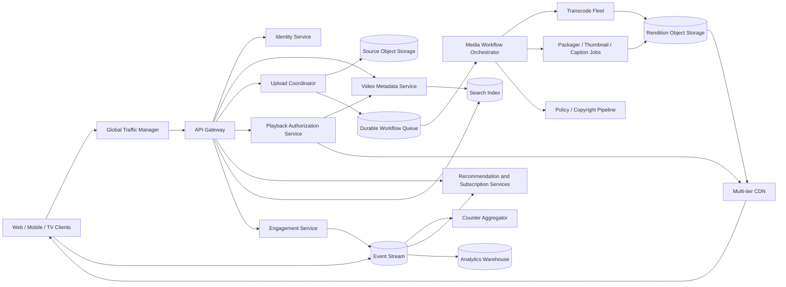

# Production-Scale Video Platform (YouTube)

## 1. Requirements

### Functional requirements

1. Upload videos with titles, descriptions, thumbnails, visibility, and audience settings.
2. Process uploads into multiple codecs, resolutions, bitrates, captions, and preview formats.
3. Stream video with adaptive bitrate playback, seeking, and resume position.
4. Browse subscriptions, recommendations, trending content, channels, and playlists.
5. Search videos, channels, and captions.
6. Support likes, comments, view counts, shares, and subscriptions.
7. Provide live streaming with chat and a replay archive.
8. Enforce copyright, safety, privacy, age, geographic, and monetization policies.
9. Provide creators with upload status and analytics.
10. Support private, unlisted, scheduled, and public publication.

### Non-functional requirements

- Very high playback availability and low startup latency.
- Global delivery of large immutable media through a CDN.
- Durable source uploads and resumable ingest.
- Elastic asynchronous processing; upload acknowledgement must not wait for transcoding.
- Eventual consistency is acceptable for counters, recommendations, search, and analytics.
- Strong consistency is required for ownership, visibility, policy state, and publication transitions.
- Graceful degradation when recommendation, comments, or analytics systems fail.
- Cost-efficient storage and network egress at exabyte scale.

## 2. Scale assumptions and capacity

- 2.5 billion monthly active users and 500 million daily active users.
- 1 billion hours watched/day, about 3.6 trillion playback seconds/day.
- Average encoded delivery bitrate: 3 Mbps.
- Approximate average egress: `3.6T seconds x 3 Mb / 86,400`, roughly 125 Pb/s before cache effects; CDN locality is mandatory.
- 5 million video uploads/day, approximately 58/second average and 500/second peak.
- Average source upload: 1 GB, or 5 PB/day before replication.
- Transcoded renditions and thumbnails consume 2-5 times source size depending on codec ladder and retention.
- Playback requests peak at tens of millions per second when segment requests are included.
- Read-to-write ratio is extremely high, but upload processing is compute intensive.

Separate metadata request rate from segment traffic. The origin should serve only a small fraction of playback bytes; a 95-99% edge hit ratio for popular immutable segments changes feasibility and cost.

## 3. High-level architecture



The **control plane** manages metadata, policy, publication, and playback authorization. The **media plane** ingests, transforms, stores, and serves bytes. Playback must not depend synchronously on recommendation, analytics, or counter systems.

## 4. Data model

```text
Channel
- channel_id
- owner_user_id
- handle
- status
- subscriber_count_hint

Video
- video_id
- channel_id
- title
- description
- visibility: PRIVATE | UNLISTED | PUBLIC
- processing_state
- policy_state
- publish_at
- duration_ms
- default_thumbnail_id
- version
- created_at

UploadSession
- upload_id
- video_id
- expected_size
- received_ranges
- checksum
- status
- expires_at

MediaAsset
- asset_id
- video_id
- type: SOURCE | VIDEO | AUDIO | CAPTION | THUMBNAIL
- codec
- resolution
- bitrate
- object_key
- checksum
- duration_ms

PlaybackManifest
- video_id
- manifest_version
- asset_ids
- encryption_key_id
- generated_at

Engagement
- user_id
- video_id
- type: LIKE | DISLIKE | SAVE
- created_at

Subscription
- subscriber_user_id
- channel_id
- notification_level
- created_at

Comment
- comment_id
- video_id
- parent_comment_id
- author_id
- body
- moderation_state
- created_at

ViewEvent
- event_id
- video_id
- user_or_session_id
- watch_ms
- playback_session_id
- event_time
```

The source and rendition objects are immutable. Updating metadata increments `Video.version`; reprocessing creates a new manifest version and only switches the active pointer after validation.

## 5. Core APIs

### Create an upload

```http
POST /v1/videos
Idempotency-Key: creator-generated-uuid

{
  "title": "System Design",
  "visibility": "PRIVATE",
  "size": 2147483648,
  "checksum": "sha256:..."
}
```

```json
{
  "video_id": "vid-123",
  "upload_id": "up-456",
  "part_size": 16777216,
  "upload_urls": ["https://object-store/..."],
  "expires_at": "2026-10-14T00:00:00Z"
}
```

### Complete upload

```http
POST /v1/uploads/{upload_id}/complete

{
  "parts": [{"part_number": 1, "etag": "..."}],
  "checksum": "sha256:..."
}
```

### Get playback

```http
GET /v1/videos/{video_id}/playback?capabilities=av1,vp9,h264&max_height=2160
```

```json
{
  "session_id": "play-789",
  "manifest_url": "https://cdn.example/manifest.mpd?token=...",
  "heartbeat_interval_seconds": 10,
  "expires_at": "2026-10-13T08:00:00Z"
}
```

Other endpoints:

```http
GET    /v1/videos/{video_id}
PATCH  /v1/videos/{video_id}
POST   /v1/videos/{video_id}/publish
GET    /v1/search?q=...
GET    /v1/home?cursor=...
GET    /v1/channels/{channel_id}/videos?cursor=...
PUT    /v1/videos/{video_id}/like
POST   /v1/videos/{video_id}/comments
POST   /v1/playback/{session_id}/events
```

All mutation APIs use idempotency keys or resource versions. Cursor pagination avoids unstable offset scans.

## 6. Upload and ingest flow

1. The creator creates a private video record and resumable upload session.
2. The client uploads numbered parts directly to regional object storage.
3. The upload coordinator records completed ranges and validates final size and checksum.
4. Completing the upload atomically changes state from `UPLOADING` to `UPLOADED` and creates a workflow event.
5. The client receives success immediately and polls or subscribes to processing status.
6. The source object is replicated according to durability policy.
7. The workflow orchestrator probes media, creates a processing DAG, and dispatches jobs.

Direct-to-object-storage upload prevents API servers from proxying gigabyte bodies. Sessions support resume, parallel parts, expiration, and idempotent completion. Uncommitted parts are removed by lifecycle rules.

## 7. Transcoding and publication pipeline

The processing DAG may contain:

```text
virus/container validation
  -> audio/video demux
  -> parallel codec/resolution transcodes
  -> quality validation
  -> segment packaging
  -> thumbnails/storyboards
  -> speech-to-text and captions
  -> policy and copyright checks
  -> manifest assembly
  -> publish eligibility
```

Jobs are idempotent and write outputs to deterministic versioned keys. The orchestrator stores dependency state durably, retries transient failures with backoff, sends poison inputs to a dead-letter queue, and exposes actionable failure status to creators.

The video can become playable after a minimum ladder, such as 360p and 720p, while 4K/AV1 processing continues. Publication requires both playable assets and an allowed policy state. The metadata transaction switches the active manifest pointer; partial renditions are never exposed accidentally.

## 8. Playback flow and adaptive bitrate

1. The client fetches video metadata.
2. Playback authorization checks visibility, age, territory, entitlements, and policy.
3. It returns a short-lived signed HLS/DASH manifest URL.
4. The client downloads a small initial segment from a nearby CDN edge.
5. The adaptive bitrate algorithm estimates bandwidth and buffer health.
6. It requests successive immutable segments at an appropriate rendition.
7. Playback events are batched and sent asynchronously.

Use short segments for fast adaptation and startup, but longer segments improve compression and reduce request overhead. Low-latency live streams use much shorter chunks than video on demand.

Seeking works because manifests map time ranges to independent segments and keyframes. Range requests can support progressive files, but segmented HLS/DASH is the primary production path.

## 9. CDN and caching strategy

Use a hierarchy:

- Browser/device cache.
- Edge point of presence.
- Regional shield cache.
- Origin rendition storage.

Assets are content-addressed or versioned and immutable, so cache TTLs can be long. Manifests are versioned; authorization tokens should be validated without destroying cache sharing, for example with signed cookies or edge token validation separate from the cache key.

Proactively pre-position predicted viral videos and regional premieres. Apply request coalescing so one cache miss does not create an origin stampede. Less popular renditions can be generated just in time only if startup latency and compute economics support it; otherwise precompute the standard ladder.

## 10. Metadata consistency and concurrency

Strongly consistent operations include:

- Ownership and channel permissions.
- Visibility and scheduled publication.
- Policy takedowns and geographic restrictions.
- Active manifest pointer changes.
- Playlist edits when user-visible ordering matters.

Use optimistic concurrency:

```http
PATCH /v1/videos/{id}
If-Match: "video-version-19"
```

A simultaneous creator edit returns `409 Conflict` rather than overwriting changes. Publication is a state machine:

```text
DRAFT -> UPLOADING -> PROCESSING -> READY -> PUBLIC
                         |            |
                       FAILED       BLOCKED
```

View counts, likes, search documents, recommendations, and creator analytics are derived projections and eventually consistent. The canonical engagement row still enforces one active like per user/video.

## 11. Counters and view validation

Do not update a single video row for every view. Clients emit events to a partitioned log. Stream processors:

- Validate session and event shape.
- Deduplicate event IDs.
- Estimate genuine watch time.
- Filter obvious bots and rapid refreshes.
- Aggregate by video, creator, region, and time window.
- Periodically publish count snapshots.

The displayed count can be approximate and monotonic. Billing and creator revenue use a slower, fraud-reviewed ledger rather than the public counter. Raw event replay permits corrected aggregation logic.

## 12. Recommendations, subscriptions, and search

The home page is a multi-stage system:

1. Candidate generators retrieve subscriptions, similar content, trending items, and personalized embeddings.
2. Policy and availability filters remove ineligible videos.
3. A ranking model scores candidates using user, context, freshness, and quality features.
4. A re-ranker adds diversity, creator caps, exploration, and business constraints.
5. The response logs impressions with model versions for training.

Subscription feeds should remain usable when ML ranking fails: fetch recent public videos from subscribed channels and merge by publish time. Search indexes metadata, captions, and permitted engagement signals asynchronously; results must re-check current visibility and policy because index deletion can lag.

## 13. Live streaming

A broadcaster sends RTMP/SRT/WebRTC ingest to the nearest healthy ingest region. The platform:

- Authenticates the stream key.
- Replicates ingest to a backup path.
- Transcodes the live ladder.
- Produces short HLS/DASH/CMAF chunks.
- Distributes chunks through the CDN.
- Records segments for replay.

Ordinary live latency may be 5-20 seconds; interactive streams require low-latency protocols and tighter buffers at greater operational cost. Live chat is a separate realtime messaging system partitioned by stream, with rate limits, moderation, slow mode, and lossy handling during extreme spikes.

## 14. Partitioning and storage

- Partition video metadata by `video_id`; colocate lightweight ownership indexes by `channel_id`.
- Partition comments first by `video_id`, then bucket hot videos by comment ID or time.
- Partition event streams by `video_id` when per-video aggregation order matters, while salting exceptionally hot IDs.
- Store source and renditions in replicated object storage with erasure coding for cold tiers.
- Move old sources and rarely watched renditions to colder storage; keep popular segments in CDN caches.
- Maintain secondary indexes for channel listings, scheduled publication, and moderation queues.

A single viral video is a hot key for metadata and counters but not for immutable media if CDN caching works. Cache-miss storms, comment writes, and event partitions require explicit hot-key sharding.

## 15. Availability and multi-region design

- Run playback authorization, metadata reads, feed APIs, and ingest endpoints in multiple regions.
- Upload to the nearest allowed ingest region, then replicate the source asynchronously.
- Keep each metadata entity's writes in a home region or globally consistent database.
- Replicate rendition origins across regions and use multi-CDN failover.
- Fail playback open only for non-sensitive ancillary failures; never bypass visibility or policy checks.

During metadata-region failure, serve cached public metadata and already authorized manifests where safe, while private/purchase-sensitive operations may fail closed. A takedown must propagate quickly to playback authorization and CDN purge channels. Disaster recovery regularly verifies that source files, manifests, database backups, keys, and workflow state can be restored together.

## 16. Security, privacy, and policy

- TLS in transit and encryption at rest with managed keys.
- Short-lived, scoped upload and playback tokens.
- Validate containers and codecs in sandboxed workers; treat media parsers as hostile-input surfaces.
- Apply least privilege between workflow workers and object prefixes.
- Scan uploads for malware and prohibited content where legally permitted.
- Fingerprint audio/video for copyright matching and support disputes.
- Enforce private/unlisted/public visibility at every metadata, manifest, thumbnail, caption, and download surface.
- Protect minors, age-restricted content, and regional rights.
- Rate limit comments, likes, uploads, and API scraping.
- Minimize playback-history retention and provide deletion/export controls.
- Keep immutable audit trails for policy actions and creator changes.
- Separate public analytics from financial ledgers and protect both against event forgery.

Digital rights management can encrypt segments and issue licenses from a separate highly available service. It increases complexity and does not replace authorization or watermarking.

## 17. Important failure cases

| Failure | Handling |
|---|---|
| Upload part is interrupted | Resume only missing byte ranges |
| Complete request is retried | Idempotent completion returns the existing video |
| Source is stored but workflow event fails | Transactional outbox republishes |
| One transcode job fails | Retry that rendition; publish minimum viable ladder if policy permits |
| Worker writes output twice | Deterministic versioned key and checksum make the job idempotent |
| Bad source crashes decoder | Sandboxing, retry cap, dead-letter state, creator-visible error |
| CDN edge misses during a premiere | Shield cache, request coalescing, prewarming |
| Origin region fails | CDN or multi-CDN uses replicated origin |
| Recommendation service fails | Subscription/trending fallback |
| Search shows a removed video | Playback authorization rejects it; removal event updates index |
| Counter consumer lags | Playback continues; displayed count becomes stale |
| Takedown event is delayed | Strong policy read and emergency CDN purge |
| Live ingest path fails | Broadcaster reconnects or redundant ingest takes over |

## 18. Observability

Track:

- Upload success, throughput, resume rate, and checksum failures.
- Queue age and processing time by codec, resolution, and workflow stage.
- Transcode failure rate, quality-validation failures, and cost per output minute.
- Time from upload completion to first playable rendition and full ladder.
- Video startup time, rebuffer ratio, bitrate, seek latency, fatal playback errors, and completion rate.
- CDN hit ratio, origin egress, cache-fill latency, and multi-CDN errors.
- Playback authorization latency and denial reason.
- Live ingest health, glass-to-glass latency, dropped frames, and segment gaps.
- Search freshness and recommendation latency/coverage.
- Counter lag, fraud-filter rates, and analytics completeness.
- Policy review backlog and takedown propagation time.

Playback quality metrics should be segmented by device, ISP, region, codec, and CDN. Synthetic probes continuously play known videos from representative networks.

## 19. Major trade-offs

### Precompute every rendition versus just-in-time transcoding

Precomputation gives predictable playback but spends compute and storage on unwatched videos. Just-in-time processing saves cold-content cost but harms first-view latency. Precompute a core ladder and defer premium variants for low-demand content.

### Small versus large media segments

Small segments improve startup, seeking, adaptation, and live latency but increase request and packaging overhead. Segment duration should differ for on-demand and low-latency live content.

### Strong versus eventual counters

Transactional counters cannot absorb global view traffic. Event-sourced aggregation is scalable and replayable, while tolerating temporarily stale public numbers.

### Single CDN versus multi-CDN

A single CDN is operationally simpler and may have better pricing. Multi-CDN improves reach and resilience but complicates routing, logs, token validation, and cache warming.

### Home-region metadata versus globally synchronous writes

Home-region writes reduce coordination cost. Global synchronous storage simplifies failover but adds latency and expense to creator operations.

### Personalized ranking versus transparent chronological feeds

Ranking improves relevance and watch time but adds model dependency, feedback loops, and explainability concerns. A subscriptions fallback preserves core utility.

## 20. Recommended interview presentation

1. Clarify on-demand versus live scope, upload limits, private video behavior, and recommendation depth.
2. Estimate playback egress, uploads, transcode amplification, and segment request rate.
3. Draw separate control and media planes with direct upload, workflow orchestration, object storage, and CDN.
4. Deep-dive the resumable upload and idempotent transcoding DAG.
5. Explain adaptive bitrate playback and why immutable segments make CDN caching effective.
6. State consistency boundaries for visibility/policy versus counters/search/recommendations.
7. Cover hot viral videos, cache stampedes, event aggregation, and multi-CDN failover.
8. Discuss cost controls: codec ladder, cold tiers, origin shielding, and selective processing.
9. Close with playback SLOs, policy enforcement, and graceful degradation.

A strong answer makes playback independent of nonessential systems, never serves partially processed or unauthorized assets, and treats media processing as a durable, replayable workflow rather than a synchronous request.
