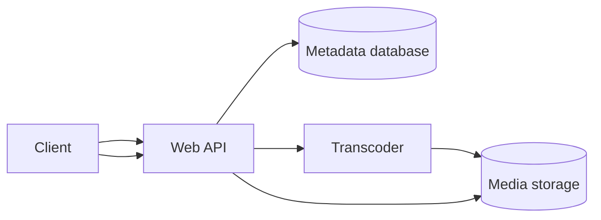
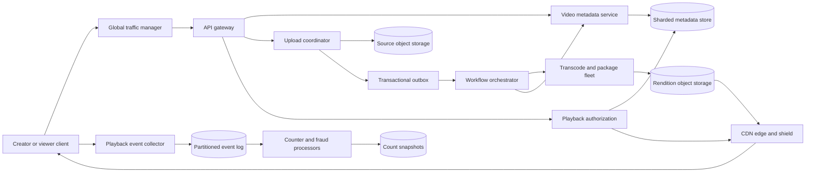
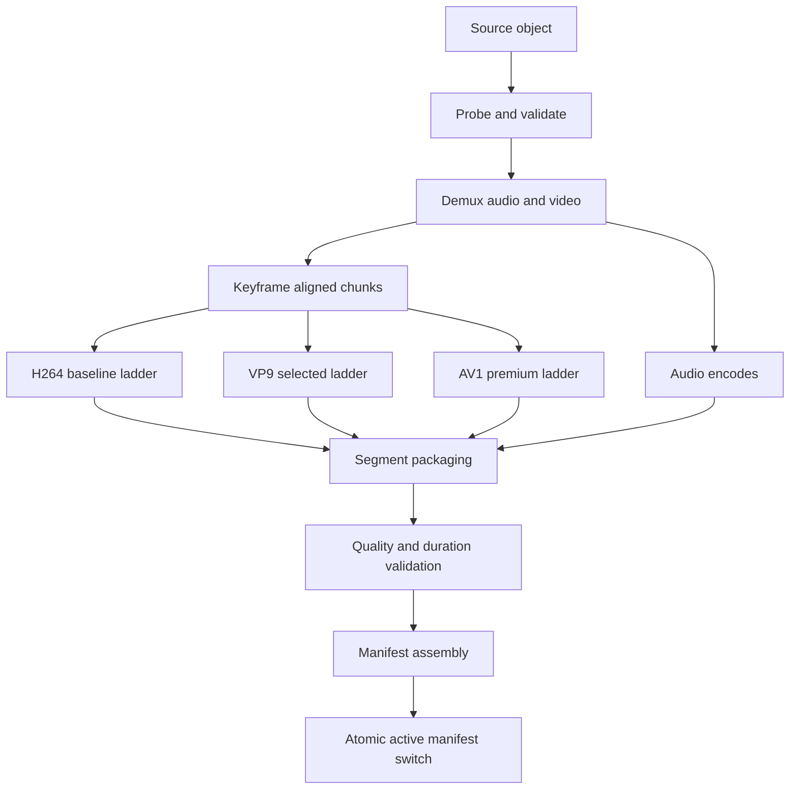
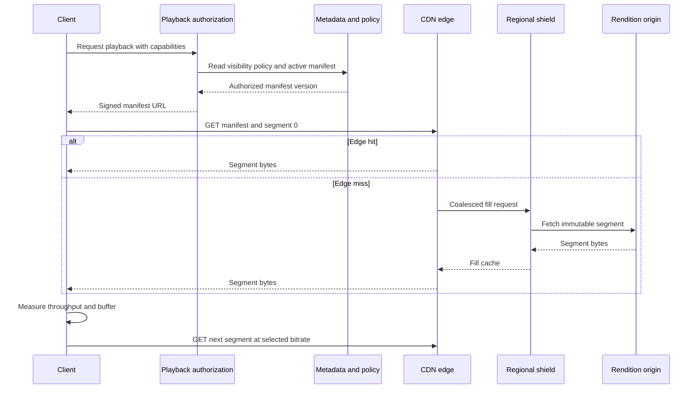
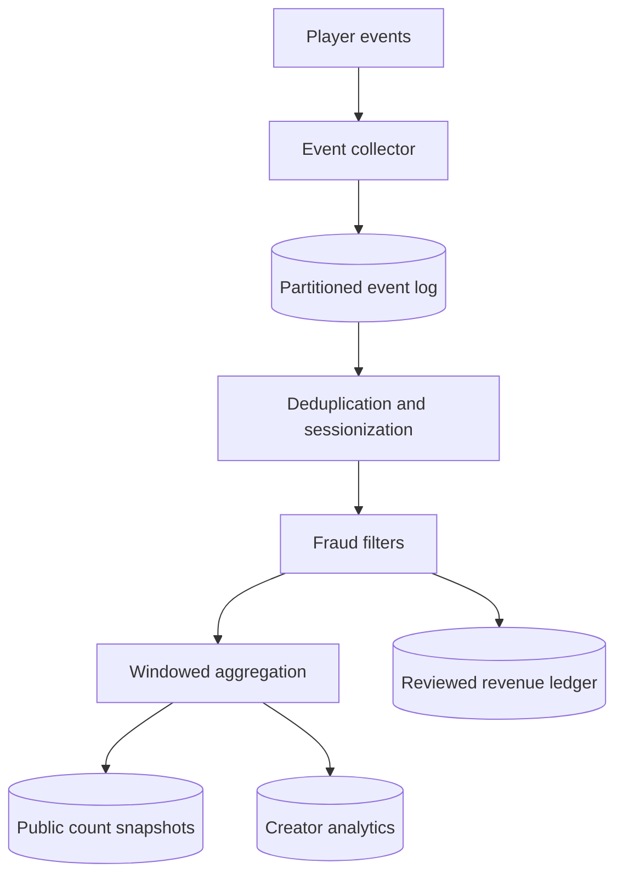

# YouTube System Design

YouTube is a global video platform for uploading, processing, discovering, and streaming on-demand video. This design focuses on durable upload, asynchronous media processing, adaptive playback through CDN caches, view counting, and metadata consistency; it treats recommendations, live streaming, ads, comments, and copyright review only where they affect those core paths.

## 1. Requirements

### 1.1 Functional requirements

- Creators can create a video, upload large media files resumably, edit metadata, and publish when processing and policy checks allow it.
- Viewers can start playback quickly, seek, resume, and receive an adaptive bitrate stream that matches device and network capability.
- The platform can generate thumbnails, captions, preview assets, and multiple codec and bitrate renditions from one source upload.
- Viewers can discover videos through search, subscriptions, recommendations, and channel pages, with current visibility and policy enforced at playback time.
- The platform records views, watch time, likes, and creator analytics without putting those write rates on the playback critical path.
- Operators can take down, geo-block, age-restrict, or make private a video and have that decision affect manifests and cached media quickly.

### 1.2 Non-functional requirements

- **Egress efficiency.** Video bytes dominate cost and capacity, so popular media must be served from ISP-near caches and encoded with ladders that avoid wasting bits.
- **Low startup latency.** A viewer who waits several seconds before the first frame often abandons, so authorization, manifest fetch, first segment selection, and edge cache hit rate matter more than most control-plane work.
- **Asynchronous durability.** Upload acknowledgement must not wait for full transcoding, but once a source upload is completed the workflow must be replayable and not lose work after worker or queue failures.
- **Correct policy enforcement.** Visibility, copyright, age, territory, and takedown state are not approximate counters; stale policy must not authorize playback just because media segments are cached.
- **Eventual derived data.** View counts, search freshness, recommendations, and analytics may lag because exact synchronous updates at playback rate would make the system unavailable or unaffordable.
- **Graceful degradation.** Playback should survive failures in comments, recommendations, analytics, and counter aggregation, while failing closed for private or blocked videos.

### 1.3 The binding constraint

The binding constraint is egress. Even using illustrative assumptions, aggregate streaming bandwidth reaches hundreds of terabits per second, while upload QPS is modest by comparison. Upload processing is compute-heavy, but it is asynchronous: a creator can wait minutes for 4K or AV1, while a viewer cannot wait for the next segment. That asymmetry splits the system into a control plane for metadata and authorization, a media-processing plane for expensive offline work, and a delivery plane whose job is to keep bytes near viewers.

This constraint forces three mechanisms. First, transcoding becomes a durable chunked DAG, not a request handler. Second, playback uses immutable segmented media, signed manifests, adaptive bitrate selection, and popularity-tiered CDN placement. Third, view counts and analytics are log-derived projections, while only metadata and policy transitions remain strongly coordinated.

## 2. Back-of-the-envelope estimation

Assume, illustratively, `500M` daily active viewers and `1B` hours watched per day. That is `1B × 3,600 = 3.6T` playback seconds per day. At an average delivered bitrate of `3 Mb/s`, average viewer egress is `3.6T × 3 Mb / 86,400 ≈ 125,000,000 Mb/s`, or about `125 Tb/s`. Peak can be several times average by region and time of day; designing for `2.5×` gives about `312 Tb/s`. This number is the reason the origin cannot be in the normal serving path. A `98%` byte hit ratio still leaves `125 Tb/s × 2% = 2.5 Tb/s` average origin or shield egress, which is large but tractable compared with serving everything from object storage.

Segments turn viewer concurrency into request load. If the average segment duration is `4 s`, then average segment request rate is `3.6T / 4 / 86,400 ≈ 10.4M` segment requests per second, before manifests, thumbnails, comments, and API calls. Shorter `2 s` segments double that request rate while improving adaptation and live latency. The CDN and clients must therefore tolerate very high small-object request rates, and the metadata API must not be consulted per segment.

Uploads are smaller in QPS but heavy in bytes and compute. Suppose `5M` uploads per day with an average source size of `1 GB`. That is `5 PB/day` of source ingest and `5M / 86,400 ≈ 58` uploads per second on average; a busy-hour multiplier of `8×` yields roughly `460` completed uploads per second. If the platform creates a baseline H.264 ladder, audio, thumbnails, captions, and selected VP9 or AV1 renditions, stored outputs may be `2×` to `5×` the source size. The implication is not that upload coordinators need exotic QPS handling; it is that storage lifecycle, codec selection, and transcode scheduling determine cost.

Compute amplification is also uneven. A short low-resolution phone clip may finish in seconds on commodity workers, while a long 4K upload with AV1, captions, and perceptual quality validation can occupy scarce encoders for much longer. If every upload immediately received the most expensive ladder, the transcode fleet would be sized for mostly unwatched content. The scheduler must spend premium codec work where predicted watch time, device support, and egress savings justify it.

> **Key idea.** Playback bandwidth and segment request rate shape the serving architecture; upload QPS shapes workflow durability and scheduling, not synchronous API scale.

## 3. API design

**Question.** What makes a gigabyte upload and a publish action safe to retry after the client, API gateway, or queue times out?
<details><summary>Answer</summary>

The API separates video creation, byte transfer, upload completion, processing status, and publication. Creation and completion use idempotency keys and stable resource IDs. Publication uses a version precondition so a retry cannot accidentally publish a different metadata revision, and processing status is a resource rather than a long-running request.

</details>

```http
POST   /v1/videos
       Idempotency-Key: creator-generated-uuid
       body: {title, description, visibility, expected_size, source_checksum}

PUT    /v1/uploads/{upload_id}/parts/{part_number}
       headers: Content-Range, Content-SHA256
       body: bytes

POST   /v1/uploads/{upload_id}/complete
       Idempotency-Key: creator-generated-uuid
       body: {parts: [{part_number, etag}], source_checksum}

GET    /v1/videos/{video_id}/processing
       response: {state, playable_height, failed_stage, retryable, active_manifest_version}

PATCH  /v1/videos/{video_id}
       If-Match: "video-version-19"
       body: {title, description, visibility, publish_at}

POST   /v1/videos/{video_id}/publish
       If-Match: "video-version-20"
       body: {target_state: "PUBLIC"}

GET    /v1/videos/{video_id}/playback?capabilities=av1,vp9,h264&max_height=2160
       response: {playback_session_id, manifest_url, heartbeat_interval_seconds, expires_at}

POST   /v1/playback/{playback_session_id}/events
       body: {events: [{event_id, type, position_ms, watch_ms, event_time}]}
```

The upload API sends bytes to object storage or upload servers using resumable parts rather than proxying large bodies through ordinary API workers. `POST /v1/videos` creates a private `Video` and an `UploadSession`; if the client retries with the same idempotency key, it receives the same `video_id` and upload instructions. `complete` is also idempotent: if the coordinator already validated the checksum and emitted the workflow event, a retry returns the existing state.

The processing endpoint exists because transcoding can take seconds to hours. A synchronous `POST /upload-and-transcode` would fail through normal load balancer timeouts and would encourage clients to retry work that may still be running. Publication is deliberately separate from processing. A creator can schedule publication before full 4K finishes, but the state transition to public checks that a minimum viable manifest exists and policy permits playback.

Playback returns a short-lived manifest URL rather than raw object keys. The manifest token encodes the video, active manifest version, viewer authorization class, expiry, and sometimes territory or device constraints. Segment URLs are immutable and cacheable, so authorization should be validated at the manifest or edge-token layer without adding viewer identity to every segment cache key. Event submission is best-effort and batched; dropping analytics must not stall playback.

## 4. Data model

Start with the obvious `Video` row: title, owner, visibility, and processing state. That row is enough to render a creator dashboard, but it cannot represent resumable upload because byte ranges, checksums, and expiration are properties of an upload attempt, not the video itself. Add `UploadSession`, keyed by `upload_id`, with expected size, received parts, source checksum, and a state machine. This lets a failed client resume missing parts without duplicating the logical video.

Next, a single `video_url` field looks tempting after upload completes. It breaks as soon as the source must produce many derived files: H.264 for compatibility, VP9 or AV1 for efficient delivery, audio-only tracks, captions, thumbnails, preview sprites, and multiple segment durations. Add immutable `MediaAsset` rows with codec, resolution, bitrate, duration, checksum, object key, and generation version. A `PlaybackManifest` then becomes the active contract between metadata and clients: it names a coherent set of assets and can be atomically switched when reprocessing creates a better ladder.

Publication introduces another failure. If a worker writes a 1080p asset and immediately exposes it, a viewer may receive a manifest that references missing audio or an unvalidated segment. The model therefore needs `ProcessingJob` and `WorkflowRun` state so the orchestrator can require dependencies, validation, and policy checks before moving `Video.active_manifest_version`. The switch is a metadata transaction; the media objects themselves stay immutable.

Engagement and views have different consistency needs. A `Like` should enforce one active like per user/video, so it can be stored as a canonical row with a unique key. A view cannot update one counter row per playback. The canonical representation is an append-only `ViewEvent`; displayed counts are materialized snapshots produced by stream processors after deduplication and fraud filtering.

```text
Video
- video_id, channel_id, owner_user_id
- title, description, visibility, policy_state
- processing_state, active_manifest_version, publish_at
- duration_ms, default_thumbnail_asset_id
- version, created_at, updated_at

UploadSession
- upload_id, video_id, expected_size, received_parts
- source_checksum, status, idempotency_key, expires_at

WorkflowRun
- workflow_id, video_id, source_asset_id, target_profile
- state, dag_version, attempt, created_at, updated_at

ProcessingJob
- job_id, workflow_id, job_type, input_asset_ids
- output_asset_ids, state, worker_fence_token, attempt, error_code

MediaAsset
- asset_id, video_id, manifest_version
- type, codec, resolution, bitrate, segment_duration_ms
- object_key, checksum, duration_ms, created_at

PlaybackManifest
- video_id, manifest_version, asset_ids
- min_playable_profile, encryption_key_id, generated_at, validation_state

Engagement
- user_id, video_id, type, state, created_at, updated_at

ViewEvent
- event_id, playback_session_id, video_id, user_or_session_id
- watch_ms, position_ms, client_time, received_time

ViewCountSnapshot
- video_id, window_start, window_end
- public_count, verified_count, fraud_score_version, watermark
```

`Video`, `UploadSession`, manifest pointers, and engagement rows belong in a sharded transactional metadata store because creators expect read-your-writes behavior and policy transitions need conditional updates. At YouTube scale this is the territory of a routed, reshardable relational layer such as Vitess: the application keeps relational semantics for a video or channel shard, while query routing, connection pooling, and online resharding prevent one giant primary from becoming the limit. Media bytes live in object storage and CDN caches, not in the database. View events live in a partitioned log and analytical storage because replayability and throughput matter more than synchronous reads.

> **Key idea.** The database stores identities, state transitions, and pointers to immutable media; the media plane stores bytes; logs store high-volume facts that can be reprocessed.

## 5. High-level design

The simplest design is a web application that accepts an upload, stores the source file, transcodes it, writes a URL into the video row, and serves the file through a web server.



This works for a prototype and fails in predictable ways. The API server times out on large uploads and retries duplicate work. A long transcode blocks publication and is lost if the worker dies. A single output file cannot adapt to network conditions or device codecs. The web tier cannot serve hundreds of terabits per second. Updating counters inside the video row creates hot keys for viral videos. Policy changes race with cached media if authorization is not separated from immutable segment delivery.

### Fix 1: Direct resumable upload and durable workflow handoff

Clients upload numbered parts directly to regional upload storage under an `UploadSession`. The API records metadata and expected checksum, while the upload coordinator validates final size and emits a workflow event through a transactional outbox. If object storage succeeds but queue publish fails, the outbox row is retried until the workflow starts. Upload completion returns quickly once the source is durable; it does not wait for transcoding.

### Fix 2: Chunked media-processing DAG

The workflow orchestrator probes the source, builds a DAG, and dispatches idempotent jobs: demux, chunk, transcode, package, thumbnail, caption, quality validation, and policy scanning. Jobs write deterministic versioned object keys and report outputs before dependent jobs run. A failed 4K AV1 encode should not invalidate a playable 720p H.264 ladder if policy permits partial availability. YouTube's Argos and VCU work shows why this path eventually becomes warehouse-scale scheduling over specialized accelerators, not just a pool of CPU containers.

### Fix 3: Immutable segments, manifests, and CDN hierarchy

The packager writes HLS or DASH segments and manifests. Segments are immutable and content-versioned, so browser caches, edge caches, regional shields, and origin storage can keep them for long periods. The playback service authorizes a viewer and returns a signed manifest URL; the client then downloads segment bytes from the nearest cache without consulting the metadata service per segment. Netflix Open Connect demonstrates the same principle at appliance level: a video edge cache is a high-throughput storage and networking system, not a generic reverse proxy.

### Fix 4: Strong metadata boundaries and log-derived counters

Visibility, ownership, policy, scheduled publish, and active manifest pointer changes use conditional writes on versioned metadata. View events, watch time, public counts, recommendations, and analytics are asynchronous projections from logs. A viral video can produce millions of segment requests and view heartbeats without writing the `Video` row millions of times.

### Putting it together



A creator first creates a private video and uploads parts to source storage. Completion validates the source and wakes the workflow. The orchestrator creates assets and finally switches the active manifest pointer when validation and policy permit. A viewer asks for playback; the authorization service reads the current video and policy state, returns a signed manifest, and the client pulls immutable segments from CDN. Playback events flow to a log and later update count snapshots and analytics. Each store matches its entity: transactional metadata for state, object storage for bytes, CDN for hot immutable objects, and logs for high-rate observations.

> **Key idea.** Each component traces back to a specific failure of the naive design.

## 6. Deep dives

### 6.1 Transcoding pipeline as a chunked parallel DAG

**Question.** A creator uploads a 90-minute 4K video. The 720p H.264 output is ready, an AV1 worker crashes halfway through, and the creator presses publish. What becomes visible?
<details><summary>Answer</summary>

Only a validated manifest that meets the minimum playable profile and policy rules can become active. The failed AV1 job is retried independently because outputs are deterministic and versioned; publication can expose the ready baseline ladder while premium renditions continue, or it can block if the creator or product policy requires the full ladder.

</details>

The naive pipeline treats transcoding as one job: input file in, output ladder out. That wastes time and makes failure handling crude. A single bad rendition forces the whole upload back to the beginning, workers repeatedly decode the same source, and a long 4K video cannot use parallelism across time ranges. Worse, if the system exposes outputs as each worker writes them, clients can see a manifest that references missing audio, mismatched durations, or segments whose quality validation has not run.

A production pipeline starts by probing the source container, streams, duration, keyframes, color space, audio tracks, and corruption boundaries. It then creates a DAG with explicit dependencies. A common shape is: validate container, demux audio and video, split the video into time chunks aligned to keyframes, transcode chunks for each target codec and resolution, stitch or package into segments, generate thumbnails and storyboards, run speech-to-text, run copyright or safety scanners, validate duration and perceptual quality, and assemble a manifest. Chunking lets a 90-minute source use many workers, but it must preserve boundaries that avoid visible artifacts and audio drift.



Idempotency is the difference between a workflow and an expensive guessing game. Every job writes to a deterministic key containing `video_id`, `workflow_id`, profile, chunk number, and attempt or content hash. The worker may crash after writing bytes but before acknowledging; on retry, the scheduler checks the checksum and either reuses the output or overwrites a new attempt key and updates metadata conditionally. A worker lease includes a fencing token so a slow old worker cannot report success after a newer attempt already finished. The orchestrator stores DAG state durably, and retry policies distinguish transient infrastructure failures from poison inputs such as corrupt containers.

The ladder should not be fixed for every video. Netflix's per-title and shot-based encoding work shows that content complexity changes the useful bitrate-resolution points: a talking-head lecture and a fast sports clip should not consume the same bits for the same perceived quality. A practical platform can produce a quick compatibility ladder first, then run content-aware refinement for videos whose predicted watch time justifies the compute. Meta describes benefit-cost models for advanced codecs, and that maps directly here: AV1 may save substantial egress, but only if enough target devices can decode it and enough views will amortize encoder cost. YouTube's VCU story pushes the same lesson further. At this scale, the scheduler should know which workers have video accelerators and reserve scarce slots for profiles with material delivery savings.

Intermediate reuse is another cost lever. Instagram reported large compute reductions by avoiding redundant basic encodes. In this design, reusable decoded intermediates, normalized audio, scene boundaries, and validated chunks are first-class DAG outputs when their storage cost is lower than repeated work. That does not mean keeping every intermediate forever; lifecycle policy can retain them while demand is likely or while a reprocessing campaign is running.

Failure modes remain. A content-aware ladder can choose too low a bitrate and create visible artifacts, so validation needs objective metrics plus sampled human or model review for high-traffic content. Chunked parallelism can create boundary discontinuities if keyframe alignment and encoder settings are inconsistent. Selective premium encoding can disappoint creators if a low-predicted video suddenly goes viral before AV1 is ready. The mitigation is a priority feedback loop: early watch signals can promote the video for better encodes, while the baseline ladder keeps it playable.

Signals worth watching: queue age by profile, first-playable latency, full-ladder latency, retry rate by codec, accelerator utilization, quality-validation failures, and egress saved per premium encode minute.

> **Strong-answer criteria.** A senior answer separates source durability from derived assets, uses an idempotent DAG with atomic manifest activation, and treats expensive codecs as scheduling decisions tied to expected egress savings.

| Level | Approach | Why |
|---|---|---|
| Bad | Synchronously transcode every rendition before upload returns. | It times out, wastes retries, and blocks creators on nonessential outputs. |
| Good | Queue asynchronous transcode jobs and publish after a baseline ladder. | It fixes latency but may still duplicate work and expose partial outputs without manifest discipline. |
| Great | Use a chunked, idempotent DAG with content-aware ladders, worker fencing, validation, and selective accelerator scheduling. | It handles long videos, failures, quality, and cost at production scale. |

### 6.2 Adaptive bitrate streaming and CDN placement

**Question.** A regional premiere starts, a million viewers request the first segment within seconds, and the edge cache is cold. How does the system avoid melting origin while still starting playback quickly?
<details><summary>Answer</summary>

The platform prewarms predicted hot assets, routes viewers to nearby edges, uses shield caches and request coalescing so one miss fills many concurrent edge requests, and keeps segment objects immutable with cache keys independent of individual viewer identity. The client starts from a small safe rendition and adapts upward after measuring throughput.

</details>

Serving a video as one large file from origin looks simple until the first viral event. Viewers seek to different offsets, mobile networks fluctuate, televisions prefer different codecs, and a cache miss storm can turn one popular segment into thousands of identical origin reads. Adaptive bitrate streaming changes the unit of delivery. The packager produces short media segments and a manifest describing variants. The client chooses a rendition based on device support, viewport, measured bandwidth, and buffer health. If bandwidth drops, the next segment can be lower bitrate; if the buffer is healthy, it can climb.

Segment duration is a trade-off, not a constant handed down by the protocol. A `2 s` segment adapts quickly and helps low-latency live, but it roughly doubles request rate compared with `4 s`. Larger segments reduce request overhead and improve compression opportunities, but they slow adaptation and seeking. For on-demand video, a platform often uses a moderate segment size and starts with an initial rendition likely to arrive quickly. The first-frame path should read metadata, authorize playback, fetch the manifest, and retrieve the first segment from a nearby cache. None of those steps should call recommendation ranking, comments, or counter aggregation.



The CDN hierarchy is the real serving system: device cache, edge point of presence, regional shield, and origin. Immutable segment keys allow long TTLs and simple validation. Manifests can be shorter lived because they encode the active version and policy-sensitive choices. Authorization must not destroy cacheability. If every segment URL contains a unique viewer token in the cache key, the hit ratio collapses. Instead, use signed cookies, edge token validation that ignores the token for object lookup, or tokenized manifests whose segment paths remain shared within an authorization class.

Popularity-tiered placement follows from the egress math. Hot videos should be pushed or prewarmed to regions where demand is likely: subscriptions, scheduled premieres, home-page promotion, and early velocity are useful signals. Warm content lives at regional shields and fills edges on demand. Cold long-tail content may remain in origin storage with only opportunistic caching. Netflix Open Connect is useful evidence because it shows that the last mile is not just HTTP semantics; cache appliances need NVMe, NIC, kernel, and sendfile tuning to sustain media throughput. A platform at YouTube scale would also embed caches in ISP networks or peer deeply with them because reducing backbone and transit traffic is the main cost win.

Request coalescing protects origin during synchronized misses. If `10,000` viewers at one edge ask for segment `S` and it is absent, the edge should issue one fill to the shield and attach the other requests to that promise. The shield applies the same rule toward origin. Negative caching matters too: if a manifest accidentally references a missing segment, blindly retrying from every edge creates a failure amplifier. The edge should cache a short negative result, while the playback service stops handing out that manifest version once validation detects the issue.

Multi-CDN can improve reach and resilience but complicates logs, token validation, cache warming, and debugging. The traffic manager should route by viewer ISP, region, device, real-time CDN health, and content placement. Failover must be careful: shifting a viral video to an unprepared CDN can create a second cold-cache storm. For sensitive takedowns, the system needs both metadata denial and purge or token invalidation paths, because cached immutable bytes may otherwise remain accessible through old URLs until expiry.

Signals worth watching: startup time, first-segment cache hit rate, rebuffer ratio, average bitrate, edge-to-shield fill rate, origin egress, coalescing fan-in, and CDN errors by ISP and device.

> **Strong-answer criteria.** A strong design makes manifests the authorization boundary, segments the cacheable byte boundary, and CDN placement the main capacity control.

| Level | Approach | Why |
|---|---|---|
| Bad | Serve video files from application servers or origin object storage. | It cannot absorb segment request rate or egress cost. |
| Good | Put HLS or DASH segments behind a CDN. | It handles basic delivery but may fail under cold-cache premieres and token-induced cache fragmentation. |
| Great | Use immutable segments, signed manifests, shield caches, request coalescing, popularity prewarming, ISP-near caches, and capability-aware ABR. | It protects origin, preserves low startup latency, and aligns cost with popularity. |

### 6.3 View counting and metadata at scale

**Question.** A video goes viral while bots refresh it, the creator changes it from public to private, and millions of playback heartbeats are in flight. Which state must be exact, and which can lag?
<details><summary>Answer</summary>

Visibility and policy must be exact enough to deny new playback immediately through the metadata and authorization path. View counts, analytics, recommendations, and search documents can lag because they are derived from event logs after deduplication and fraud filtering. In-flight events may still be processed, but they do not authorize playback.

</details>

A single `views = views + 1` column is attractive because it is easy to explain and impossible to operate at YouTube scale. Viral videos become hot rows, retries double count, clients can forge refreshes, and the counter transaction competes with metadata updates that actually need correctness. The right model is event first, counter later. Clients emit playback starts, heartbeats, seeks, stalls, and completions with event IDs and playback session IDs. Collectors validate shape and authentication cheaply, append to a partitioned log, and return without reading or writing the `Video` row.

Stream processors then compute multiple projections. A public view count might require a minimum watch duration, dedupe by event ID and playback session, apply session-level rate limits, and filter obvious bot patterns. Creator analytics might be delayed but richer, grouped by geography, traffic source, device, and retention curve. Revenue or billing ledgers should be slower still, with stricter fraud review and auditability. Public counters should be monotonic or at least avoid confusing regressions; when fraud filtering removes views, the system can adjust through a reviewed correction path rather than decrementing every minute.



Partitioning is subtle. Partitioning strictly by `video_id` makes per-video aggregation simple but creates hot partitions for viral content. Random partitioning spreads load but makes exactly-once-ish per-video windows harder. A practical design uses a composite strategy: normal videos partition by `video_id`, while hot videos are salted across buckets and later merged by window. The snapshot includes a watermark so readers know how far the aggregation has progressed. The public API can display `1.2M views` from the latest snapshot rather than pretending every heartbeat is included.

Metadata has the opposite character. A creator changing a video to private, a policy system issuing a takedown, or a workflow switching active manifests should be guarded by conditional updates. `PATCH /videos/{id}` uses `If-Match` on `Video.version`; a stale edit returns conflict rather than overwriting a newer policy state. `publish` checks `processing_state = READY`, `policy_state = ALLOWED`, and expected version in one transaction. `active_manifest_version` changes only after the manifest validation state is complete. The playback service reads this authoritative state before issuing a manifest, and tokens expire quickly enough that old authorizations drain.

Vitess is relevant because relational metadata does not disappear just because the platform is huge. You still want transactions for a video row, unique constraints for likes or subscriptions, and secondary indexes for channel listings. What changes is the operational layer: route queries by shard key, prevent cross-shard fan-out in hot APIs, support online resharding, and isolate analytical scans from serving databases. A video page can combine strongly read metadata with eventually consistent projections: title and visibility from the metadata store, public count from the latest snapshot, comments from their own partitioned store, and recommendations from a separate service.

Search and recommendations must re-check policy because their indexes lag. If search still contains a removed video, clicking it should fail at playback authorization. Subscription feeds can show cached entries but should filter current visibility before response. This is the recurring pattern: derived systems may be stale, but the final action that exposes protected media goes through the control plane.

Signals worth watching: event ingestion lag, duplicate rate, hot partition load, fraud rejection rate, snapshot watermark age, metadata conditional-write conflicts, takedown propagation time, and playback denials from stale search or feed entries.

> **Strong-answer criteria.** The answer must draw a hard line between exact state transitions for rights and publication versus approximate replayable projections for views and analytics.

| Level | Approach | Why |
|---|---|---|
| Bad | Increment `Video.view_count` on every playback request. | It creates hot rows, double-counts retries, and mixes fraud-prone events with critical metadata. |
| Good | Append events to a log and aggregate counts asynchronously. | It scales, but still needs dedupe, fraud filtering, hot-key handling, and watermarks. |
| Great | Use log-derived snapshots for counters, separate reviewed ledgers for money, and strongly versioned metadata for visibility, policy, and manifest switches. | It preserves correctness where it matters and accepts lag where exactness would break the system. |

## 7. Variants

**10x scale.** If watch time grows from `1B` to `10B` hours per day, average egress at `3 Mb/s` becomes about `1.25 Pb/s`. The basic architecture stays the same, but ISP-embedded caches, prewarming, codec efficiency, and cache-hit telemetry become existential. Origin hit ratio must improve, advanced codecs become more valuable for popular compatible devices, and the traffic manager needs finer regional and ISP-level controls.

**Low-latency live.** Live streaming keeps the same authorization, CDN, and event principles but changes segment timing and failure tolerance. Chunks may be sub-second, encoder buffers shrink, and ingest needs redundant paths because a missed live segment cannot be regenerated before viewers notice. Chat should be a separate realtime system partitioned by stream, with slow mode, moderation, and lossy degradation during spikes.

**Strict regional rights.** If content rights differ by country or age group, manifests must be generated or filtered by entitlement class, and tokens must carry territory and expiry. Segment bytes can remain shared when the underlying asset is allowed for multiple classes, but the manifest and playback authorization layer decide which assets are referenced. Takedown propagation and CDN purge become audited workflows, not best-effort cache operations.

**Creator-first premium uploads.** If the product promises that certain creators always get full 4K, HDR, or AV1 before publish, scheduling changes more than serving. The workflow reserves accelerator capacity, exposes clearer status and retry controls, and may block publication until a full required ladder is validated. The CDN, metadata, and counter design remain largely unchanged.

## 8. The transferable pattern

The reusable shape is a system where the user-facing read path is dominated by immutable heavy objects, while the write path creates those objects through expensive asynchronous workflows. The correct architecture separates control-plane truth from data-plane bytes: metadata and authorization stay strongly coordinated; media assets are immutable and cacheable; high-volume observations are logs and projections. Similar arguments appear in systems that sell scarce inventory or tickets, but the bottleneck differs. In [Ticketmaster](./ticketmaster-system-design.md), the hard part is transactional allocation under contention; here it is egress and offline transformation.

Another transferable pattern is progressive refinement. Produce a safe baseline quickly, then improve quality or efficiency when demand justifies it. Video platforms do this with baseline ladders followed by content-aware encodes. Search systems do it with coarse candidate retrieval followed by expensive ranking. Feed systems do it with durable fallback lists and richer personalization when models are healthy. The senior design move is to name what must be correct synchronously and what can become better asynchronously.

## Review

The design follows the egress constraint. Upload QPS is manageable, but source bytes and transcoding are expensive, so uploads go directly to storage and become durable workflow runs. Processing is a chunked idempotent DAG that can publish a validated baseline ladder while selectively spending accelerators and advanced codecs where expected watch time justifies the cost. Playback is a signed-manifest and immutable-segment system fronted by a CDN hierarchy with prewarming and request coalescing, because hundreds of terabits per second cannot flow through origins. Metadata and policy use versioned transactional updates; views, analytics, search, and recommendations are asynchronous projections that may lag but must re-check authorization before exposing protected media.

### Check your understanding

1. Why is egress the binding constraint rather than upload QPS?
   <details><summary>Answer</summary>

   With illustrative numbers, `1B` watch hours per day at `3 Mb/s` implies about `125 Tb/s` average delivery bandwidth, while `5M` uploads per day is only about `58` uploads per second on average. Upload processing is expensive but asynchronous; playback bytes are immediate and continuous.

   </details>

2. Why should publication switch an active manifest pointer instead of exposing assets as jobs finish?
   <details><summary>Answer</summary>

   Individual assets can finish at different times or fail validation. An atomic manifest switch exposes only a coherent set of audio, video, captions, and segment references that passed quality and policy checks.

   </details>

3. How can playback be authorized without ruining CDN cache sharing?
   <details><summary>Answer</summary>

   Authorize at manifest request time and use short-lived signed manifests, signed cookies, or edge token validation that does not make viewer identity part of the segment object cache key. Segments remain immutable and shared by authorized classes.

   </details>

4. Why are public view counts not stored as a synchronous counter on the video row?
   <details><summary>Answer</summary>

   Viral videos would create hot rows, retries and forged events would overcount, and counter writes would compete with critical metadata transitions. Events should be logged, deduplicated, fraud-filtered, and aggregated into snapshots.

   </details>

5. What production lesson connects YouTube VCU, Netflix per-title encoding, and Meta codec prioritization?
   <details><summary>Answer</summary>

   Encoding work should be allocated by benefit and cost. The platform should use content-aware ladders and expensive codecs where they improve quality or reduce egress enough to justify scarce compute and device constraints.

   </details>

## Sources and further reading

| Source | Article | Why it matters |
|---|---|---|
| YouTube | [A new era of video infrastructure](https://blog.youtube/inside-youtube/new-era-video-infrastructure/) | Explains YouTube's VCU/Argos accelerator approach and 20-33x transcoding efficiency improvement. |
| Google Research | [Deep Neural Networks for YouTube Recommendations](https://research.google/pubs/deep-neural-networks-for-youtube-recommendations/) | Canonical two-stage candidate generation plus ranking design for YouTube-scale recommendations. |
| Vitess | [Vitess: The Complete Story](https://vitess.io/blog/2016-03-10-percona-live-featured-talk-with-sugu-sougoumarane-vitess-the-complete-story/) | Describes Vitess originating from YouTube's need to shard and operate MySQL at commodity-hardware scale. |
| Netflix | [Per-Title Encode Optimization](https://netflixtechblog.com/per-title-encode-optimization-7e99442b62a2) | Shows why each video needs a content-aware bitrate ladder rather than a fixed ladder. |
| Netflix | [Serving 100 Gbps from an Open Connect Appliance](https://netflixtechblog.com/serving-100-gbps-from-an-open-connect-appliance-cdb51dda3b99) | Demonstrates the appliance, OS, NIC, and storage tuning needed for video CDN edge throughput. |
| Netflix | [Optimized shot-based encodes for 4K: Now streaming!](https://netflixtechblog.com/optimized-shot-based-encodes-for-4k-now-streaming-47b516b10bbb) | Extends ladder optimization to shot-level bit allocation and perceptual quality metrics. |
| Meta | [How Facebook encodes your videos](https://engineering.fb.com/2021/04/05/video-engineering/how-facebook-encodes-your-videos/) | Uses benefit-cost and ML prioritization so expensive codecs are applied where they improve QoE most. |
| Meta | [Reducing Instagram's basic video compute by 94 percent](https://engineering.fb.com/2022/11/04/video-engineering/instagram-video-processing-encoding-reduction/) | Demonstrates DAG/intermediate reuse to remove redundant encoding work at massive upload scale. |
| Meta | [Bringing AV1 to Facebook and Instagram Reels](https://engineering.fb.com/2023/02/21/video-engineering/av1-codec-facebook-instagram-reels/) | Covers AV1's compression benefits and the compute/device trade-offs of production codec rollout. |
